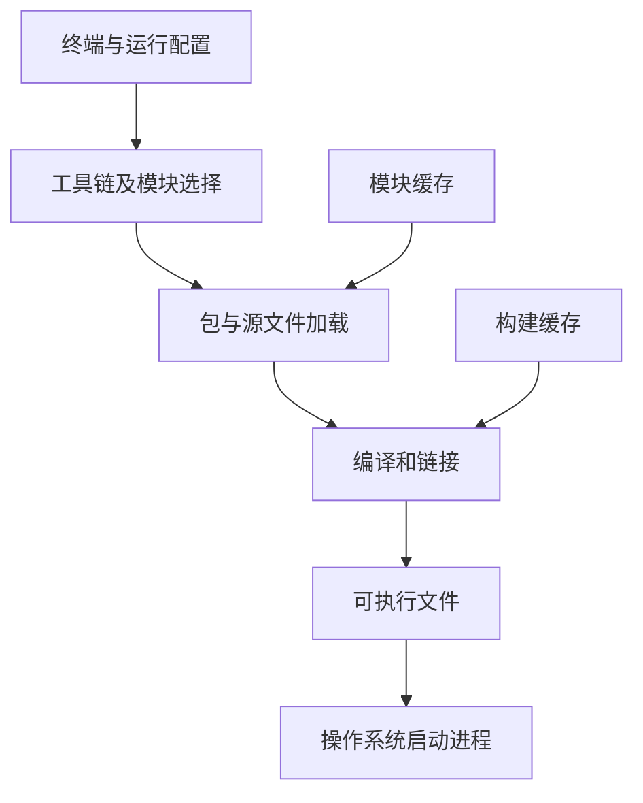
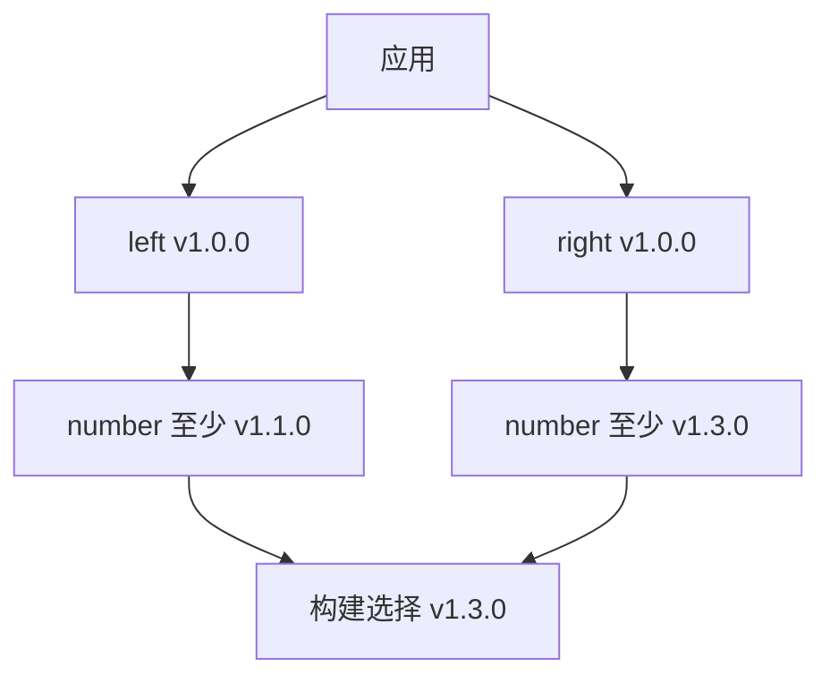

# Go 开发环境与工程基础：完整学习笔记

整理日期：2026-10-22（UTC+8）  

本篇解决的是这样一个具体问题：拿到一个 Go 项目后，知道应安装什么，能够找到项目入口，解释代码如何变成程序，并在自己和同事的机器上重复完成构建、运行与测试。安装成功只是第一步；真正的工程环境还包括可解释的工具链选择、清楚的模块关系、正确的配置来源，以及遇到错误时能缩小范围的检查方法。

正文依据 Go 官方文档、Go 工具本身的帮助、标准库文档、GVM 项目自己的源码与说明、JetBrains GoLand 文档撰写。例子是为本篇重新设计的讲解实例，保留官方接口的语义，不把第三方工具写成 Go 标准库，也不把网页上出现的旧版本安装示例当成当前推荐版本。本文核验所用编译器为 **Go 1.27.3，linux/amd64**；具体执行范围见文末。

学习过程中可以分三轮阅读。第一轮完成安装、单模块程序、基本测试；第二轮理解工具链、模块依赖与工作区；第三轮处理代理、私有仓库、可复现构建和 IDE 与命令行不一致的问题。暂时不理解每个环境变量，不妨先用默认值；没有证据时同时修改五个变量，通常比只改一个变量更难排错。

<a id="section-001"></a>

> **统一运行基线：** 建议使用 Go 1.27.3，示例模块声明采用 `go 1.27.0`。文中出现其他 Go 版本时，仅用于说明特性引入时间或历史实现差异；第三方依赖仍以对应模块的版本要求为准。


*图示：环境与工程流程。*

## 正文导航

- [正文导航](#section-002)
- [阅读前先分清六个对象【补充】](#section-003)
- [一、Golang 环境配置](#section-004)
  - [1. 下载安装：先确认操作系统、架构与版本](#section-005)
  - [1.1 Windows](#section-006)
  - [1.2 Mac：macOS 的安装与验证](#section-010)
  - [2. 命令行安装](#section-014)
  - [3. 环境变量：每个变量究竟回答什么问题【补充】](#section-017)
  - [4. 安装失败时按层定位【补充】](#section-018)
- [二、使用 GVM 安装 Golang](#section-019)
  - [0. GVM 在这套环境中的位置【补充】](#section-020)
  - [1. 使用 curl 下载 GVM 脚本并运行它](#section-021)
  - [2. 配置环境变量](#section-022)
  - [3. 验证 GVM 安装](#section-023)
  - [4. 安装 Go 版本](#section-024)
  - [5. 验证 Go 版本](#section-025)
  - [6. 管理 Go 版本](#section-026)
  - [7. GVM 全部的命令行](#section-027)
  - [8. 三种多版本方法怎么选【补充】](#section-028)
- [三、Go 的工具链](#section-029)
  - [1. Go 工具链的主要组件](#section-030)
  - [2. 常用的 Go 工具链命令](#section-033)
  - [3. 其他重要概念](#section-043)
- [四、Go 模块化管理](#section-048)
  - [1. 模块的基本概念](#section-049)
  - [2. go.mod 文件](#section-052)
  - [3. 常用命令](#section-059)
  - [4. 版本控制](#section-065)
  - [5. 代理和私有模块](#section-071)
- [五、GoLand 配置](#section-076)
  - [1. GoLand 简介](#section-077)
  - [2. GoLand 安装步骤](#section-079)
  - [3. IDE 与命令行不一致时的对照表【补充】](#section-085)
  - [4. 一个可交接项目应留下哪些说明【补充】](#section-086)
- [六、三个完整工程实验【补充】](#section-087)
  - [实验一：一个能构建、测试和阅读文档的单模块命令](#section-088)
  - [实验二：两个模块组成的工作区](#section-094)
  - [实验三：本地模块代理、MVS 与 vendor 离线运行](#section-099)
- [七、工程基础配套的独立运行示例【补充】](#section-106)
  - [ENV-03：独立的命令行参数集合](#section-107)
  - [ENV-04：规范化本机文件路径](#section-108)
  - [ENV-05：区分 io/fs 路径和操作系统路径](#section-109)
  - [ENV-06：严格读取一个 JSON 配置对象](#section-110)
  - [ENV-07：把环境变量字符串转成经过校验的端口](#section-111)
  - [ENV-08：让配置读取依赖 fs.FS，而不是某个绝对路径](#section-112)
  - [ENV-09：创建、关闭、读取并清理临时文件](#section-113)
  - [ENV-10：列出目录时保持确定性结果](#section-114)
  - [ENV-11：校验内容改变，而不是把校验值当作身份凭据](#section-115)
  - [ENV-12：在生成代码后使用 Go 官方格式化接口](#section-116)
  - [ENV-13：使用语法树读取源码结构](#section-117)
  - [ENV-14：从语法树筛选导出函数](#section-118)
  - [ENV-15：解释构建约束的布尔条件](#section-119)
  - [ENV-16：保留文件读取错误的可检查结构](#section-120)
  - [ENV-17：把带单位的超时配置变成 time.Duration](#section-121)
  - [ENV-18：按 JSON 流读取 go list 风格的模块报告](#section-122)
  - [ENV-19：用官方测试辅助函数检查文件系统夹具](#section-123)
  - [ENV-20：把配置优先级写成可测试的函数](#section-124)
- [八、复习题与参考答案【补充】](#section-125)
  - [1. 安装了 GoLand，为什么终端仍然提示找不到 go？](#section-126)
  - [2. GOROOT、GOPATH 和项目根目录能否都设置成同一个目录？](#section-127)
  - [3. 已经修改 PATH，当前终端仍找到旧版 go，先检查什么？](#section-128)
  - [4. go env -w 与给一条命令设置环境变量有什么差别？](#section-129)
  - [5. go.mod 写 go 1.27.0，是否说明本次实际用的是 Go 1.27.0？](#section-130)
  - [6. 为什么把 GOTOOLCHAIN 设置为 local 后，旧 Go 可能无法构建新项目？](#section-131)
  - [7. GVM、golang.org/dl 和 GOTOOLCHAIN 是否同一个机制的三个名字？](#section-132)
  - [8. 为什么不能把 Linux 的 GVM 安装命令直接放进 Windows PowerShell？](#section-133)
  - [9. go run . 与 go run main.go 为什么可能结果不同？](#section-134)
  - [10. go build 成功是否会自动运行程序、测试和生成器？](#section-135)
  - [11. 为什么现在安装命令行工具通常使用 go install 包路径@版本？](#section-136)
  - [12. go fmt、go vet 和 go test 各回答什么问题？](#section-137)
  - [13. 为什么不应一遇到构建错误就删除整个模块缓存？](#section-138)
  - [14. 从源码目录启动与从上级目录启动，同一个程序为什么可能读到不同配置？](#section-139)
  - [15. 一个 Git 仓库为什么可能有多个 go.mod？](#section-140)
  - [16. go.sum 是否等同于精确锁定所有依赖版本的锁文件？](#section-141)
  - [17. indirect 是否表示这个依赖不重要、可以随意删除？](#section-142)
  - [18. replace 到 ../lib 后，为什么还需要 require？](#section-143)
  - [19. 本地 replace 是否会自动传播给依赖当前的模块的所有人？](#section-144)
  - [20. 实验三里 left 要求 number 1.1.0，为什么实际返回 13？](#section-145)
  - [21. MVS 选择成功，是否意味着上游确实遵守了向后兼容？](#section-146)
  - [22. 为什么多数采用模块的 v2 库会在路径中出现 /v2？](#section-147)
  - [23. go.work 内通过测试，为什么关闭工作区后可能失败？](#section-148)
  - [24. GOPROXY 中逗号和竖线有什么实际差别？](#section-149)
  - [25. 设置了 GOPRIVATE，是否就获得了私有仓库账号权限？](#section-150)
  - [26. 公司统一代理能提供私有模块时，为什么照搬 GOPRIVATE 可能绕开它？](#section-151)
  - [27. go mod verify 成功，能否说明依赖没有安全问题？](#section-152)
  - [28. vendor 完整就一定能在任何离线机器构建吗？](#section-153)
  - [29. 为什么配置中“变量不存在”和“变量存在但为空”可能应有不同处理？](#section-154)
  - [30. 给同事一个“能运行”的 Go 项目，最低应交接哪些信息？](#section-155)
- [九、三个工程作业与验收标准【补充】](#section-156)
  - [作业一：可交接的命令行配置检查器](#section-157)
  - [作业二：开发工作区与独立模块的双重验收](#section-158)
  - [作业三：可解释的依赖升级与离线构建记录](#section-159)
- [十、官方资料索引与阅读路线【补充】](#section-160)
- [十一、执行验证与适用边界【补充】](#section-161)
  - [三组工程实验的实测记录](#section-162)

<a id="section-003"></a>

## 阅读前先分清六个对象

| 对象 | 它是什么 | 典型内容 | 不应与什么混淆 |
|---|---|---|---|
| Go 语言 | 写程序时遵守的语法和语义 | 类型、函数、接口、并发规则 | 某个编辑器 |
| Go SDK / 发行包 | 开发所需工具和库的发行集合 | `go` 命令、编译器、标准库 | 当前的业务项目 |
| 工具链 | 把源码处理成目标程序的一组工具及配套标准库 | 编译、汇编、链接工具 | 仅一个版本号字符串 |
| 包 package | 一起编译的一组同目录 Go 源文件 | `package greeting` | 整个 Git 仓库 |
| 模块 module | 一起管理版本与依赖的一组包 | `go.mod` 和多个包目录 | 一定等于一个目录中的单个文件 |
| IDE | 编辑、索引、运行、调试等工作的界面 | GoLand、运行配置、断点 | 编译器与依赖管理器本身 |

一个具体项目可以只有一个模块，但模块内包含三个包：`cmd/hello` 是程序入口，`internal/greeting` 负责业务规则，`internal/config` 负责配置。GoLand 打开项目后，调用选定的 Go 工具链构建它。运行时操作系统启动的是生成的可执行文件；这个文件不需要编辑器一直开着。

安装 GoLand 后仍要配置可用的 Go SDK；安装 Go SDK 后，即使没有 GoLand，也能在终端完成编译与测试。第三方框架提供的是项目结构、路由或其他能力，不会改变 Go 编译器寻找包和模块的基本规则。读开源项目时，先寻找 `go.mod`、可执行包和 `func main()`，通常比先研究编辑器按钮更有效。[官方代码组织说明](https://go.dev/doc/code)、[工具链说明](https://go.dev/doc/toolchain)。

<a id="section-004"></a>

## 一、Golang 环境配置

<a id="section-005"></a>

### 1. 下载安装：先确认操作系统、架构与版本

下载文件名里常出现三个维度：版本，例如 `go1.27.3`；操作系统，例如 `windows`、`darwin`、`linux`；处理器架构，例如 `amd64`、`arm64`。`darwin` 在这里对应 macOS 的系统目标，`amd64` 也可用于兼容的 Intel 64 位处理器，并不表示只能安装在 AMD 机器上。

不要仅因为电脑显示“64 位”就直接选择 `amd64`。Apple Silicon 通常是 `arm64`，Windows 设备也可能使用 ARM 处理器。选错架构可能导致无法执行，或通过系统兼容层运行而使性能、原生库依赖和调试情况更复杂。最开始用与目标环境一致的原生架构，后面再学习交叉编译。

版本选择有两个场景。自己建立学习环境时，从官方发行页选择当前受支持的稳定版本；加入已有团队项目时，先看 README、`go.mod`、`toolchain` 指令和 CI 使用的版本。本文用到的具体版本用于复现实验，不表示这一个补丁版本永久适合所有新项目。官方示例网页中可能仍保留老文件名，应该理解操作步骤，实际下载则以发行页为准。[官方下载页](https://go.dev/dl/)、[发布与支持历史](https://go.dev/doc/devel/release)。

下载后可以比较文件的 SHA-256 校验值。校验值是对文件字节计算得到的摘要；下载不完整、传输错误或文件与官方记录不同，通常会导致不同摘要。这个步骤不能证明安装后的所有软件都没有问题，但可以回答“手里的安装包是否与所核对的官方文件相同”。校验值应从可信的官方发布页面取得，不能把同一个不可信来源同时提供的文件和摘要当成独立证据。

<a id="section-006"></a>

### 1.1 Windows

<a id="section-007"></a>

#### 1.1.1 下载

在官方发行页选择与 Windows 架构相符的 MSI 安装包。安装向导负责建立 SDK 目录并处理常见系统配置。使用官方压缩包自行解压也可行，但这会把目录管理和 PATH 配置交给自己；初次安装使用 MSI 更容易形成可检查的步骤。

下载目录、SDK 安装目录和项目目录是三个不同位置。例如安装包位于 `Downloads`，SDK 位于 `C:\Program Files\Go`，项目位于 `D:\learning\hello`。项目不需要放进 SDK 的 `src` 目录，也不应把自己的源文件写进标准库目录。这样做会把个人业务代码和工具链发行内容混在一起，升级或卸载工具链时还可能误伤项目。

本文后面的 Windows 命令采用 PowerShell。PowerShell 与传统 `cmd.exe` 都能运行 Go，但变量写法和当前目录可执行文件的调用写法不同。看到 Bash 中的 `export KEY=value`，不要原样贴到 PowerShell；看到 `$env:KEY`，也不要贴到 Bash。

<a id="section-008"></a>

#### 1.1.2 配置

安装完成后，关闭旧终端并新开一个 PowerShell。原因不是 Go 特殊，而是已经运行的进程通常保留启动时继承的环境变量。系统设置更新了 PATH，旧 PowerShell 仍可能不知道新的路径。

检查命令位置：

```powershell
Get-Command go -All
where.exe go
go version
go env GOROOT GOPATH GOBIN GOMODCACHE GOCACHE GOTOOLCHAIN
```

`Get-Command go -All` 能暴露同名函数、别名或多个可执行程序；`where.exe go` 侧重 PATH 中的可执行文件。特意写 `where.exe`，是为了避免 PowerShell 中 `where` 别名造成阅读混淆。两条命令提供的证据不完全相同，遇到版本不对时一起看更清楚。

一般不需要手动设置 `GOROOT`。Go 工具链能够定位自己的 SDK，安装程序和 IDE 也能帮助识别。手动保留一个过时的 `GOROOT`，反而可能让新 `go.exe` 与旧标准库目录组合在一起。`GOPATH` 在模块模式下仍用于某些缓存和工具安装默认位置，但项目通常不必放在它下面。

如果安装命令行工具后提示找不到工具，先检查 `GOBIN`。它为空时，工具通常安装到 `GOPATH` 的 `bin` 目录；这个目录与 SDK 的 `bin` 不是一个位置。把工具目录加入当前 PowerShell 的 PATH，可先做一次临时试验：

```powershell
$GoToolsDir = go env GOBIN
if ([string]::IsNullOrWhiteSpace($GoToolsDir)) {
    $FirstGoPath = (go env GOPATH).Split([IO.Path]::PathSeparator)[0]
    $GoToolsDir = Join-Path $FirstGoPath 'bin'
}
$env:Path = "$GoToolsDir;$env:Path"
```

这里使用任务专属变量名 `GoToolsDir`，不覆盖 PowerShell 的系统变量。临时设置只影响当前进程及它启动的子进程；确认有效后，再通过 Windows 的调用方环境变量界面持久配置。不要在没有检查现有内容时用一条命令覆盖整个 PATH。

<a id="section-009"></a>

#### 1.1.3 验证安装

验证要逐层推进。`go version` 成功，只说明当前找到了一个可以启动的 Go 命令；不等于模块下载、C 工具链、数据库连接都已可用。先建立一个只依赖标准库的项目，排除网络因素：

```powershell
New-Item -ItemType Directory -Path .\hello-env
Set-Location .\hello-env
go mod init example.com/learning/hello-env
```

建立 `main.go`，使用下面的 ENV-01。这个程序把一个固定的检查项列表逐项输出，目的是确认源文件、标准库、编译器与程序执行这条最小路径能走通。

```go
// 运行示例：ENV-01
package main

import "fmt"

func main() {
	checks := []string{"source", "compiler", "runtime"}
	for i, check := range checks {
		fmt.Printf("%d: %s ready\n", i+1, check)
	}
}
```

输出：

```text
1: source ready
2: compiler ready
3: runtime ready
```

在项目目录执行：

```powershell
go run .
go build -o hello-env.exe .
.\hello-env.exe
```

`go run .` 和 `go build` 都会构建程序；前者随后执行，后者把可执行文件留下。PowerShell 中用 `.\hello-env.exe` 明确指定当前目录里的文件。程序成功后，即使关掉 IDE，仍可重新运行该文件。这个现象直接说明 IDE 不承担程序运行时的基本执行职责。

程序依据标准库 `fmt` 的格式化输出接口改写。[fmt 官方文档](https://pkg.go.dev/fmt)。

<a id="section-010"></a>

### 1.2 Mac：macOS 的安装与验证

<a id="section-011"></a>

#### 1.2.1 下载

确认设备是 Apple Silicon 还是 Intel，并在官方发行页选择对应的 macOS 安装包。可以先在终端执行 `uname -m` 观察当前执行环境的机器类型；若终端运行在兼容层内，结果还应结合系统信息核对。安装包一般采用 `.pkg`，向导会放置 SDK 并配置常见路径。

不要把 macOS 的安装包和 Linux 的 `arm64` 压缩包混淆。相同处理器架构只说明指令集有相似之处，不说明系统调用、可执行文件格式和系统库接口完全相同。运行目标需要同时匹配操作系统和架构。

<a id="section-012"></a>

#### 1.2.2 配置

官方 macOS 安装说明描述了 `/usr/local/go` 及相关路径设置。安装后打开新终端，检查：

```bash
command -v go
type -a go
go version
go env GOROOT GOPATH GOBIN GOMODCACHE GOCACHE GOTOOLCHAIN
```

`command -v` 回答当前 shell 将如何找到命令；`type -a` 有助于发现多个同名候选。如果之前用包管理器或 GVM 安装过另一份 Go，路径优先级可能与预期不同。先解释为什么选中某份 Go，再决定是否调整配置，通常比重复安装更有效。

macOS 常用 zsh，交互式配置一般可以放在 `~/.zshrc`，但登录 shell 与交互 shell 的启动文件并不完全相同。需要知道实际使用的 shell，避免把设置写进一个从未被读取的文件。给本次终端临时加入 Go 工具安装位置，可使用：

```bash
export PATH="$(go env GOPATH)/bin:$PATH"
```

这段命令是在本文给读者执行的 shell 示例中使用命令替换；它读取 Go 的有效 GOPATH，不修改 GOPATH 本身。当 GOPATH 由多个目录组成时，应先查看并明确选取工具安装对应的位置，不能把整串多路径误当一个目录。

<a id="section-013"></a>

#### 1.2.3 验证安装

与 Windows 一样，建立独立项目、运行标准库程序，再构建二进制。区别主要在 shell 和可执行文件形式：

```bash
mkdir hello-env
cd hello-env
go mod init example.com/learning/hello-env
# 在此目录保存 ENV-01 为 main.go
go run .
go build -o hello-env .
./hello-env
```

如果提示 `permission denied`，先确认运行的确实是构建出的文件，以及它的权限和所在文件系统是否允许执行；如果提示 `exec format error` 或类似架构错误，检查 `GOOS`、`GOARCH` 是否被历史交叉编译设置影响。不要把所有失败统一归因于“Go 没装好”。[Go 安装说明](https://go.dev/doc/install)。

<a id="section-014"></a>

### 2. 命令行安装

命令行安装可以指三种不同动作：下载官方发行包并放到指定目录；通过系统包管理器安装；通过多版本管理工具安装。它们最终都要得到可工作的工具链，但版本来源、目录所有者和升级方式可能不同。把三种方式同时叠加，容易造成“终端一个版本，IDE 另一个版本”的情况。

Linux 上可以把官方压缩包解压到自己有权限的新目录，先用绝对路径运行，确认可用后再调整 PATH。以下是操作模板，必须把压缩包路径替换为实际下载的对应文件：

```bash
mkdir -p "$HOME/sdk/go-study"
tar -C "$HOME/sdk/go-study" -xzf /path/to/downloaded-go-archive.tar.gz
"$HOME/sdk/go-study/go/bin/go" version
```

这使用一个专门的安装目录，避免示例直接删除读者现有的系统安装。目录已经含有另一版 Go 时，不要在旧树上简单覆盖解压；旧文件可能残留并造成混合版本。是否移除旧安装，要先明确它由安装包、包管理器还是自己管理。[官方安装中的完整目录要求](https://go.dev/doc/install)。

macOS 或 Linux 的包管理器、Windows 的系统软件管理工具可以作为团队统一环境的一部分，但它们不是 Go 语言规范的一部分。包名、仓库更新节奏和系统支持会变化，应检查所用管理器的官方文档。本文不把某条第三方安装命令写成所有机器都适用的固定真理。

<a id="section-015"></a>

#### 2.1 官方多版本安装：命令名称中包含版本

Go 官方提供 `golang.org/dl` 下的版本包装命令。已有可用 Go 时，可以安装某个版本对应的包装器，再让它下载那一版 SDK。使用步骤如下，示例固定为本文实验版本：

```bash
go install golang.org/dl/go1.27.3@latest
go1.27.3 download
go1.27.3 version
```

第一步安装的是一个名为 `go1.27.3` 的包装命令，第二步才取得对应 SDK。`@latest` 针对包装器所在模块的版本选择，并不把目标工具链改成“任意最新 Go”。如果第一步完成后找不到 `go1.27.3`，应检查工具二进制安装位置，而不是重复执行下载。

这个方法适合明确调用两个已经安装的版本，例如用 `go1.24.0 test ./...` 与 `go1.27.3 test ./...` 检查兼容性。这里的旧版本只用于说明指定版本调用方式，不表示建议新项目安装旧补丁版本。它与改变默认 `go` 的 PATH 不是一回事，也不需要把两个 SDK 的标准库文件混进同一个目录。[官方多版本管理](https://go.dev/doc/manage-install)。

<a id="section-016"></a>

#### 2.2 GOTOOLCHAIN：启动命令与实际工具链可能不同

从 Go 1.21 开始，`go` 命令能够依据 `GOTOOLCHAIN`、主模块的 `go` / `toolchain` 指令或工作区要求选择工具链。于是“我在 PATH 中找到的是哪个 go”与“这个项目实际用哪套工具链构建”成为相关但不同的问题。默认的自动选择允许在必要时使用更合适的版本，包括查找本地命令或下载工具链。[官方选择规则](https://go.dev/doc/toolchain)。

假设机器当前启动的 Go 是 1.26，而项目要求 `go 1.27.0`。自动模式可能选择或下载能够满足要求的版本；禁止自动切换后，则应得到版本要求不满足的错误。正确处理方式是确认项目为什么需要新版本，再准备工具链，而不是把 `go.mod` 中的数字改小，假装新语法和新标准库不存在。

用下面的命令观察当前项目的有效环境：

```bash
go version
go env GOVERSION GOTOOLCHAIN GOROOT GOMOD GOWORK
```

若只想在一次实验中明确使用当前安装附带的工具链，可以在该命令的环境中设置 `GOTOOLCHAIN=local`。Bash 示例为 `GOTOOLCHAIN=local go test ./...`；PowerShell 可先暂存旧值，再设置 `$env:GOTOOLCHAIN='local'`，实验后恢复。持久写入 `go env -w` 会影响后续项目，不能把临时排错操作和长期团队策略混在一起。

`go 1.24.0` 主要表达模块所需语言及工具链最低要求的语境，不能把它理解为运行时一定来自 Go 1.24.0。用 Go 1.27.3 编译一个写着 `go 1.24.0` 的模块，仍然使用所选 Go 1.27.3 的编译器与标准库。若需要验证旧版本兼容性，应实际用旧工具链运行测试，而不是只看这一行。

<a id="section-017"></a>

### 3. 环境变量：每个变量究竟回答什么问题

| 名称 | 回答的问题 | 入门阶段常见误解 |
|---|---|---|
| `PATH` | shell 去哪些目录寻找命令 | 误当成 Go 项目导入路径 |
| `GOROOT` | 当前工具链的 SDK 在哪里 | 误设为自己的项目目录 |
| `GOPATH` | 某些工具安装和缓存的默认基准位置是什么 | 以为所有模块都必须放在其 `src` 下 |
| `GOBIN` | `go install` 生成的命令安装到哪里 | 以为空值代表无法安装 |
| `GOMODCACHE` | 下载的模块源码及有关资料存在哪里 | 以为清空它等于删除业务源码 |
| `GOCACHE` | 构建缓存存在哪里 | 以为它与模块下载缓存完全相同 |
| `GOENV` | `go env -w` 的持久配置从哪里读取 | 以为它就是当前 shell 的变量表 |
| `GOMOD` | 当前命令关联的主模块文件在哪里 | 手工设置来“修复”错误工作目录 |
| `GOWORK` | 当前是否使用某个工作区文件 | 忘记父目录的 `go.work` 会影响选择 |
| `GOOS` / `GOARCH` | 构建目标的操作系统和架构 | 以为永远描述当前宿主机 |
| `CGO_ENABLED` | 是否启用调用 C 相关构建能力 | 以为开关能自动安装 C 编译器和系统库 |

可以把环境变量理解成进程收到的一组字符串配置。操作系统启动终端，终端启动 `go`，`go` 再启动编译器或测试程序；默认情况下，子进程继承父进程环境。这解释了为什么一个终端的临时修改不会自动“传回”另一个已经运行的终端，也解释了从桌面图标启动的 IDE 不一定继承开发者在某个终端里刚设置的值。

Go 的有效设置还可能结合工具默认值与调用方配置文件。因此 `echo $GOPATH` 没有输出，不代表 `go env GOPATH` 也没有结果。前者查看 shell 变量，后者询问 Go 计算后的有效值。排错时要问清楚“我正在看哪个进程、哪一层配置”。[go env 与环境变量参考](https://pkg.go.dev/cmd/go#hdr-Environment_variables)。

下面用一个业务专属变量演示“存在但为空”和“不存在”的区别。程序只设置自己的演示键，不打印调用方已有环境，不读取密钥。

```go
// 运行示例：ENV-02
package main

import (
	"fmt"
	"os"
)

func main() {
	const key = "GO_NOTES_ENV_DEMO"
	old, existed := os.LookupEnv(key)
	defer func() {
		if existed {
			_ = os.Setenv(key, old)
		} else {
			_ = os.Unsetenv(key)
		}
	}()
	if err := os.Unsetenv(key); err != nil {
		panic(err)
	}
	value, ok := os.LookupEnv(key)
	fmt.Printf("missing: value=%q present=%v\n", value, ok)
	if err := os.Setenv(key, ""); err != nil {
		panic(err)
	}
	value, ok = os.LookupEnv(key)
	fmt.Printf("empty: value=%q present=%v\n", value, ok)
}
```

输出：

```text
missing: value="" present=false
empty: value="" present=true
```

业务配置若把“空字符串”解释成显式禁用，而把“不存在”解释成使用默认值，就不能只依赖 `os.Getenv` 的空字符串结果；应使用 `LookupEnv` 的第二个返回值。Go 工具也有各自的空值与默认规则，不能把一个业务演示的默认策略直接套给所有 Go 环境变量。[os.LookupEnv](https://pkg.go.dev/os#LookupEnv)。

<a id="section-018"></a>

### 4. 安装失败时按层定位

| 现象 | 优先检查 | 为什么从这里开始 |
|---|---|---|
| `go` 命令不存在 | SDK 是否存在、PATH、是否新开终端 | 还没有进入 Go 项目处理阶段 |
| 版本不是预期值 | 所有同名命令、GOTOOLCHAIN、主模块与工作区要求 | 可能是路径选择或自动切换 |
| `go.mod file not found` | 当前目录、父目录、是否本来就没有模块 | 这是项目定位问题，不一定是安装问题 |
| 标准库文件异常 | `go env GOROOT` 与实际工具链目录 | 可能混用了不同安装树 |
| 下载依赖失败 | 具体 URL 类别、代理、认证、证书与网络 | 本地编译器可能完全正常 |
| C 相关构建失败 | CGO、C 编译器、头文件和链接库 | Go 工具链不包含所有外部 C 依赖 |
| 可执行文件无法启动 | 构建目标、文件权限、宿主系统、动态库 | 构建成功不等于目标环境可运行 |
| IDE 成功、终端失败 | 两边 SDK、工作目录和环境是否相同 | 它们可能启动了不同的命令环境 |

把完整错误信息保留下来，同时记录刚执行的命令和所在目录。错误中的一个包路径、版本号或文件位置，往往就是区分“工具没装好”和“依赖配置不对”的关键。解决一个具体错误后再继续下一步，不要为了让错误消失而同时切代理、降版本、清缓存、删模块文件。

<a id="section-019"></a>

## 二、使用 GVM 安装 Golang

<a id="section-020"></a>

### 0. GVM 在这套环境中的位置

本章的 GVM 特指 **moovweb/gvm**。它是第三方 Go 版本管理项目，通过 shell 脚本管理不同 Go 安装及有关环境；它不是 Go 标准库，不是 `go` 命令的子命令，也不是 Go 团队官方工具链自动选择机制。网上可能出现同名工具，因此安装前必须核对项目地址。[GVM 官方仓库](https://github.com/moovweb/gvm)。

本篇核对的仓库提交为 `dd652539fa4b771840846f8319fad303c7d0a8d2`，其 `VERSION` 文件为 `1.0.22`。固定提交用于说明本文到底检查了哪一版命令表，不表示读者必须永远停留在该提交。以下操作是根据项目源码与说明整理的使用方法；本次没有在调用方电脑上安装或执行 GVM 安装器。

GVM 的核心作用可以用一次终端切换解释。原先 PATH 先找到系统 Go；执行 `gvm use` 后，GVM 调整当前 shell 的环境，使它先找到选中的 Go 安装，同时设置有关 GOPATH 等位置。它要影响当前 shell，所以需要 shell 函数与 `source` 机制参与。仅让一个子进程修改自己的 PATH，无法把修改自动传回父 shell。

把“选了哪个安装”与“Go 命令最终为模块选了哪个工具链”分开理解。GVM 选中某个 `go` 命令后，这个命令仍可能依据 `GOTOOLCHAIN` 和模块要求切换工具链。排错时先检查 `gvm list`、`command -v go`，再检查 `go version` 与 `go env GOTOOLCHAIN GOROOT`，不要因为 GVM 显示某版本就假定后续所有命令必然使用它。

GVM 的一些功能来自 GOPATH 时代，例如 package set、`linkthis` 和旧交叉编译辅助脚本。它们帮助理解历史项目，但新模块项目通常不需要把源码链接进 GOPATH，也不需要依赖 package set 作为模块版本锁定机制。团队要求现代 Go Modules 时，应以 `go.mod`、`go.sum` 和项目验证流程管理依赖。

<a id="section-021"></a>

### 1. 使用 curl 下载 GVM 脚本并运行它

本章目录标题保留了“下载脚本并运行”的步骤。实际操作最好拆为下载、阅读、执行三步，这样能确认自己拿到的是哪份脚本，并了解它会修改哪些目录和 shell 配置。下面使用明确提交的安装器地址，方便与本篇核对内容对应：

```bash
curl --fail --location \
  'https://raw.githubusercontent.com/moovweb/gvm/dd652539fa4b771840846f8319fad303c7d0a8d2/binscripts/gvm-installer' \
  --output gvm-installer.sh
less gvm-installer.sh
# 确认脚本内容和安装位置符合自己的环境后再执行：
bash gvm-installer.sh
```

`--fail` 让 HTTP 错误以失败返回，避免把错误页当成安装脚本；`--location` 允许跟随下载地址的重定向。把文件保存下来并不能自动证明它可靠，关键仍是检查来源、固定内容和理解执行动作。这里不使用一段下载流直接交给 shell 的写法，便于入门阶段观察每一步发生了什么。

固定安装器文件的提交，也不必然固定它后续下载的所有内容；还应检查脚本内部引用的仓库与分支，并在完成后核对实际 GVM 版本。本文命令表的审阅对象是上述固定提交，不能据此保证任意日期运行安装器都会得到完全相同的内部实现。

GVM 使用 Bash/Zsh 相关环境。Windows 原生 PowerShell 不能把这些脚本当成 PowerShell 脚本运行。若使用 WSL，应把 WSL 当成一个 Linux 开发环境：它的 Go 工具链、PATH、项目路径和可执行文件目标都属于该 Linux 环境。不能把 Windows 的 `C:\Program Files\Go` 简单填成 Linux 的 GOROOT，也不能期待 Linux 构建出的 ELF 文件直接作为 Windows `.exe` 启动。

GVM README 还列出了不同系统的构建依赖，但其中一部分历史说明涉及旧 Go 自举链、旧包管理器或旧工具。当前源代码构建需要什么自举版本，应以目标 Go 版本的官方源码安装说明为准；使用已发布的二进制安装包与从源码编译是两种不同路线，不能因为 README 出现 Go 1.4 就要求所有新调用方先安装 Go 1.4。[从源码安装 Go](https://go.dev/doc/install/source)。

<a id="section-022"></a>

### 2. 配置环境变量

安装器会提示加载 GVM 环境。常见加载形式是：

```bash
test -s "$HOME/.gvm/scripts/gvm" && source "$HOME/.gvm/scripts/gvm"
```

这里的 `source` 让脚本在当前 shell 环境中执行，脚本建立的函数和变量才能继续影响当前终端。将相同加载动作写入实际使用的 shell 启动文件后，新终端可以自动获得 GVM 环境。Bash 与 Zsh 的配置文件不应机械互换；先确认自己使用的是哪种 shell。

不要一边让 GVM 管理 GOROOT，一边在另一个启动文件末尾强制设置不同的 GOROOT。两个设置都可能“成功”，但最后生效的那一个会覆盖前者。出现问题时，把相关启动配置按执行顺序列出来，比继续添加新的 `export` 更容易找出冲突。

GVM 也可能维护自己的 GOPATH 和包集合。模块模式的项目目录可以仍然位于正常工作目录中；不要因看到 GOPATH 改变，就移动所有 Git 仓库。已安装的工具命令若随包集合变化而暂时不可见，应检查 GOBIN/PATH 和工具实际存放位置，避免误判为业务依赖丢失。

<a id="section-023"></a>

### 3. 验证 GVM 安装

```bash
type gvm
gvm version
gvm help
gvm list
```

`type gvm` 有助于看出命令是否以 shell 函数的形式存在。`gvm version` 输出 GVM 自己的版本；`go version` 输出 Go 工具链的版本，两者回答不同问题。`gvm list` 用于查看已安装的 Go，而 `gvm listall` 查询可供选择的版本信息，通常涉及网络。

如果 `gvm` 不存在，检查加载脚本是否成功；如果 `gvm` 存在但提示没有选择 Go，检查是否安装和选择过版本；如果 `gvm listall` 失败而已安装的 Go 仍能编译，本地环境可能没有损坏，失败的只是远程版本枚举。把这三种状态分开，能避免把联网失败处理成重装全部工具。

<a id="section-024"></a>

### 4. 安装 Go 版本

以下命令展示二进制安装与选中版本，需以 GVM 所支持的平台和实际可下载的发行包为条件：

```bash
gvm install go1.27.3 -B
gvm use go1.27.3
go version
```

`-B` 的语义是只使用二进制安装方式。`--prefer-binary` 则表示优先尝试二进制，失败时可能转向源码构建，后者会引入自举工具链、编译依赖和更多耗时。读者若只是希望下载已经编译好的 SDK，理解这一区别可以避免意外进入源码编译流程。

该版本 `install` 帮助中公开的选项如下。这里完整说明选项，不意味着建议在现代项目中使用每一个历史辅助能力。

| 选项 | 含义 | 使用前应理解的条件 |
|---|---|---|
| `-s=...` / `--source=...` | 指定源码来源 | 改变构建输入来源，要核对仓库与目标版本 |
| `-n=...` / `--name=...` | 为安装指定不同名称 | 名称与实际 Go 版本可以不同，排错时仍查看 `go version` |
| `-pb` / `--with-protobuf` | 历史 protobuf 辅助安装 | 源码含旧生态路径，不能替代当前 protobuf 官方安装文档 |
| `-b` / `--with-build-tools` | 历史构建工具安装 | 不等同现代 Go Modules 必需依赖 |
| `-B` / `--binary` | 仅安装二进制发行包 | 必须存在对应平台发行包且下载可用 |
| `--prefer-binary` | 优先二进制，必要时源码 | 失败后的行为与 `-B` 不同 |
| `-h` / `--help` | 显示安装帮助 | 该脚本的正常命令形态仍包含版本参数 |

来源：[固定提交中的 install 实现](https://github.com/moovweb/gvm/blob/dd652539fa4b771840846f8319fad303c7d0a8d2/scripts/install)。

<a id="section-025"></a>

### 5. 验证 Go 版本

选中版本后，至少观察四个信息：GVM 当前选择、shell 找到的命令、Go 报告的版本、Go 报告的 GOROOT。四者联合起来，才能解释“究竟执行了什么”：

```bash
gvm list
command -v go
go version
go env GOROOT GOTOOLCHAIN GOMOD GOWORK
```

再运行第一章的标准库程序和后文的单模块测试。只看版本号可以发现路径问题，运行完整工程则可以检查模块定位、包加载和测试执行。验证范围应逐层增加，不需要在安装第一分钟就接上数据库、Docker 和远程私有模块。

<a id="section-026"></a>

### 6. 管理 Go 版本

`gvm use go1.27.3` 切换当前环境；加 `--default` 用于把选择设为 GVM 的默认值。默认值并不强制所有机器和所有 CI 一起升级。团队的可重复构建仍应在项目文件和持续集成配置中记录工具链要求，并实际执行验证。

可以通过别名给某份安装一个便于记忆的名字，例如实验版或团队版。但别名只是本机管理信息，同事的同名别名未必指向同一内容。发布记录应该保留真实工具链版本和构建输入，不能只写“用 stable 构建”。

卸载某版 Go 与删除全部 GVM 是不同操作。前者针对一个安装，后者可能连带 GVM 管理的其他版本和包集合。学习时先列出要保留的内容；清理工具链不是解决模块编译失败的默认方法。本文只提供语义说明，不把破坏性清理操作放进必做练习。

<a id="section-027"></a>

### 7. GVM 全部的命令行

下表覆盖本篇核对提交中 `gvm help` 公开列出的 **16 个顶层命令**，并补充 shell 入口中的行为说明。将来版本可能增加命令，届时应以实际安装的帮助为准。源码内部还存在支撑脚本，不能简单把每个脚本文件都宣传成稳定的调用方命令。

| 命令 | 作用 | 示例用法或边界 |
|---|---|---|
| `version` | 查看 GVM 版本 | `gvm version`，不是 Go 编译器版本 |
| `get` | 更新或切换 GVM 自身代码，主要面向调试 | 该实现会操作其内部 Git 状态，不是下载 Go 包 |
| `use` | 选择 Go 安装和可选包集合 | `gvm use go1.27.3`，可用 `--default` |
| `diff` | 查看 GOROOT 相对安装记录的变化 | 有助于观察是否改动过工具链文件 |
| `help` | 显示公开帮助 | `gvm help` |
| `implode` | 移除 GVM 及其管理内容 | 大范围清理命令，不应作为普通故障排除第一步 |
| `install` | 安装某版 Go | `gvm install go1.27.3 -B` |
| `uninstall` | 卸载选定 Go 安装 | 先核对名称及是否还被使用 |
| `cross` | 历史交叉编译工具辅助安装 | 所核对源码仍含旧工具名称，现代交叉编译优先使用 Go 官方方式 |
| `linkthis` | 将目录连接到 GOPATH 布局 | GOPATH 时代用途，模块项目通常无需使用 |
| `list` | 查看已安装的 Go | 当前选择会被标记 |
| `listall` | 查看远程可用版本 | `-a` / `--all` 可列出更完整的标签信息 |
| `alias` | 管理 Go 安装别名 | 子命令 `create`、`delete`、`list` |
| `pkgset` | 管理包集合 | 子命令 `create`、`delete`、`use`、`empty`、`list` |
| `pkgenv` | 编辑包集合环境 | `-o` / `--output` 用于输出内容，默认可能启动编辑器 |
| `applymod` | 根据当前 `go.mod` 尝试选择 Go | 见下面的重要限制 |

来源：[固定提交的公开命令表](https://github.com/moovweb/gvm/blob/dd652539fa4b771840846f8319fad303c7d0a8d2/bin/gvm)、[shell 命令入口](https://github.com/moovweb/gvm/blob/dd652539fa4b771840846f8319fad303c7d0a8d2/scripts/env/gvm)。

`alias` 的完整公开子命令可整理为：`gvm alias create NAME VERSION` 创建别名；`gvm alias list` 查看别名；`gvm alias delete NAME` 删除别名。别名创建要求目标安装已存在。包集合的 `create`、`use`、`delete`、`empty`、`list` 分别用于建立、选中、删除、清空和列举；“清空”和“删除”都可能移除内容，不能在不清楚当前集合时运行。

`gvm applymod` 尤其需要与 Go 官方自动工具链选择区分。本篇检查到的实现用文本匹配读取当前目录的 `go.mod`，然后查询、安装或切换相应 Go 名称。它不完整实现官方的工具链选择协议，也不能被当成同时理解 `go.work`、`toolchain`、版本优先级和所有新指令的通用解析器。模块里的语言版本要求也不一定就是团队想固定的补丁版本。[applymod 实现](https://github.com/moovweb/gvm/blob/dd652539fa4b771840846f8319fad303c7d0a8d2/scripts/env/applymod)。

<a id="section-028"></a>

### 8. 三种多版本方法怎么选

| 方法 | 主要控制点 | 适合的任务 | 需要额外理解的部分 |
|---|---|---|---|
| 官方 `golang.org/dl` 包装命令 | 明确调用某个版本命令 | 同一项目测试多个指定工具链 | 包装器目录必须可找到，SDK 另行下载 |
| 官方 `GOTOOLCHAIN` 与项目指令 | 根据模块或工作区要求选择 | 团队项目表达工具链要求 | 自动下载、网络与最低版本规则 |
| GVM | 当前 shell 中选中的安装和环境 | 维护既有 GVM 工作流、多版本实验 | shell 加载、包集合及历史功能的边界 |

三种方法可以在同一机器上出现，但同时出现不意味着配置会自动协调。入门阶段最好先让一种方式的因果关系清楚，再加入第二种。团队协作时，把必须满足的版本写进项目约束，把个人喜欢的版本管理器留在个人工作流中；否则一个没有使用同款 shell 插件的同事，可能无法复现所谓“环境已经配置好了”的项目。

<a id="section-029"></a>

## 三、Go 的工具链

<a id="section-030"></a>

### 1. Go 工具链的主要组件

<a id="section-031"></a>

#### 1.1 从输入命令到运行程序

输入 `go run ./cmd/hello` 时，可以先把过程分成几层：shell 找到一个 `go` 命令；Go 判断当前模块或工作区及所需工具链；加载包和依赖；根据文件名、构建约束和目标平台选取文件；进行编译与链接；最后启动生成的程序。缓存可能让部分工作复用已有结果，但不会改变这些步骤之间的职责关系。



这个图解释三个常见现象。第一，模块下载失败会发生在真正执行业务代码之前；因此当前的 `main` 里加日志也观察不到它。第二，构建成功后程序仍可能因配置、文件权限或网络连接失败而退出；这是运行阶段的问题。第三，清空构建缓存只影响某些中间结果，无法修复错误的数据库密码。

Go 的主要工具包括编译器、汇编器和链接器，标准库与工具链配套使用。日常开发一般通过 `go build`、`go test` 等高层命令驱动这些工具，而不是自己手写全部编译与链接步骤。直接使用底层工具适合学习实现、调试构建过程或特殊工具开发，不是每个应用项目的启动要求。[Go 工具链官方说明](https://go.dev/doc/toolchain)。

<a id="section-032"></a>

#### 1.2 编译器、链接器和运行时分别负责什么

编译器把符合当前语言规则的 Go 源码变为目标平台可用的代码及中间信息。它检查类型、处理函数和表达式，并可能进行优化。链接器把所需代码与数据组织成最终可执行文件。运行时则在程序启动后提供 goroutine 调度、内存分配、垃圾回收等基础支持。

把运行时与编译器区分开很重要：语法错误不能靠修改运行参数解决，因为程序还没有成功构建；goroutine 阻塞发生在运行阶段，需要观察程序状态，不能仅凭编译器没有报错就认为并发协议正确。IDE 对源码标红有时来自它自己的索引或检查，是否真正构建失败仍可以用同一工具链的 `go build` 验证。

“Go 生成单个二进制文件”也需要条件。纯 Go 项目经常可以便捷分发单个程序，但如果使用 cgo、动态链接库、外部配置、证书或运行时读取的静态文件，部署时还要满足这些输入。`embed` 可以把某些资源纳入构建产物，但不会把数据库或所有系统依赖自动塞进二进制。[cgo 文档](https://pkg.go.dev/cmd/cgo)、[embed 文档](https://pkg.go.dev/embed)。

<a id="section-033"></a>

### 2. 常用的 Go 工具链命令

<a id="section-034"></a>

#### 2.1 一张命令职责表

| 命令 | 主要输入 | 主要结果 | 对入门阶段最重要的区别 |
|---|---|---|---|
| `go run` | 可执行包或指定源文件 | 构建后直接执行 | 适合开发运行，不等于发布产物管理 |
| `go build` | 包或指定源文件 | 检查构建，或生成可执行文件 | 构建多个包不一定在当前目录生成多个文件 |
| `go install` | 命令包，可带版本后缀 | 将构建出的命令安装到工具位置 | 安装工具与添加业务依赖是不同任务 |
| `go get` | 包/模块及版本选择 | 调整模块依赖、下载所需源码 | 现代用法主要管理 `go.mod` 依赖 |
| `go test` | 包和 `_test.go` 文件 | 执行测试、示例、基准或模糊测试 | 测试模式和缓存条件会影响执行方式 |
| `go vet` | 包源码 | 报告部分可疑用法 | 静态检查不能证明程序没有逻辑错误 |
| `go fmt` | 包源码 | 按标准格式改写 | 改变排版，不替开发者选择算法 |
| `go doc` | 包或符号 | 显示文档 | 查接口契约比猜函数名可靠 |
| `go list` | 包/模块选择 | 返回结构与依赖信息 | `-m` 将观察对象切换到模块 |
| `go mod` | 模块文件与源码 | 管理依赖图及相关文件 | `go mod build` 不是有效的构建命令 |
| `go work` | 多个本地模块 | 管理工作区 | 工作区不是新的发布单元 |
| `go generate` | 源码中的生成指令 | 运行指定生成命令 | `go build` 不自动执行它 |
| `go tool` | 工具名及参数 | 调用指定工具 | 新版还可调用模块声明的工具依赖 |
| `go env` | 设置名或配置操作 | 查看或更改 Go 的环境配置 | 查看与 `-w` 持久写入影响不同 |
| `go version` | 当前工具链或二进制 | 显示版本/构建信息 | 可用于核对产物，而不只查看本机命令 |
| `go clean` | 指定对象或缓存选项 | 清理有关产物 | 不应把删除所有缓存当成日常编译步骤 |
| `go fix` | 包与工具支持的修复 | 按规则迁移部分源码写法 | 应检查 diff，并重新运行测试 |

命令细节以所用版本的 `go help <command>` 为准。本篇在本地实际检查了 `go help get` 和 `go help mod tidy`，避免把旧教程中的安装行为带入当前说明。[go 命令参考](https://pkg.go.dev/cmd/go)。

<a id="section-035"></a>

#### 2.2 go run：运行包与运行文件不是完全相同的选择

在一个目录中存在 `main.go` 和 `helpers.go`，二者都属于 `package main`。如果 `main.go` 调用了 `helpers.go` 里的函数，`go run main.go` 可能因未包含那个文件而失败；`go run .` 则按包加载当前目录中适用的文件。入门阶段见到“函数明明在同一目录却找不到”，首先应检查命令到底指定了文件还是包。

在模块根目录执行 `go run ./cmd/hello`，其中 `./cmd/hello` 是要运行的包目录；它后面的参数是传给程序的参数。把应用参数错放到包路径之前，可能被 Go 命令当成构建选项或另一个参数。命令行由多个参与者依次解析，因此应说明哪一段交给谁。

例如：

```bash
go run ./cmd/hello -name Gopher
```

`go` 负责构建 `./cmd/hello`；应用自己的 `flag` 包解析 `-name Gopher`。附录 ENV-03 用 `flag.NewFlagSet` 演示相同机制，并给出固定输入和确定输出。[go run](https://pkg.go.dev/cmd/go#hdr-Compile_and_run_Go_program)、[flag](https://pkg.go.dev/flag)。

<a id="section-036"></a>

#### 2.3 go build：构建目标和输出文件

`go build ./...` 通常用于检查当前模块内匹配的包能否构建，并不等于给每个包都留下一个可执行文件。只有可执行的 `main` 包才有应用入口；普通库包的构建结果供其他包使用。需要发布一个命令时，明确指定入口和输出名：

```bash
go build -o bin/hello ./cmd/hello
```

`bin` 目录应事先建立。Windows 发布产物通常使用 `.exe` 后缀。源码、目标路径、运行工作目录是三个不同概念；可以在项目根目录构建，把文件放在 `bin`，再从另一个工作目录启动它。若程序依赖相对文件路径，这三个位置不同就可能暴露问题。

`-trimpath` 可去除某些写入构建结果的本地文件系统路径，帮助改善构建产物的可迁移性与路径隐私。但它不等于自动实现全部字节级可重复构建。工具链、构建标签、生成源码、依赖版本、cgo 工具及其他输入仍需要控制。[build 选项](https://pkg.go.dev/cmd/go#hdr-Compile_packages_and_dependencies)。

<a id="section-037"></a>

#### 2.4 go install 与 go get

如果目的是让终端出现一个工具命令，一般考虑 `go install 路径@版本`；如果目的是让项目可以导入一个外部包，一般通过 `go get 路径@版本` 调整依赖，然后检查源码、`go.mod` 和 `go.sum`。这一区分可以避免“我装好了工具，为什么项目还没有这个依赖”以及“我添加了依赖，为什么终端找不到同名命令”两类问题。

带版本后缀的 `go install` 在模块感知模式下安装指定版本的命令，不按当前目录的 `go.mod` 去决定它的依赖。无版本的 `go install ./cmd/hello` 则在当前模块语境下构建自己的命令。前者适合独立工具安装，后者适合当前项目命令。两者都要关注安装路径和 PATH，而不是只看退出码。

`go get -u ./...` 会扩大依赖更新范围，不能把它当成每次启动项目都必须执行的“初始化”。团队项目通常先按已经声明的版本复现，再在单独的变更中升级依赖、阅读兼容性变化并测试。版本升级是有语义的工程变更，不是简单的缓存刷新。[安装命令的官方语义](https://go.dev/ref/mod#go-install)、[依赖管理指南](https://go.dev/doc/modules/managing-dependencies)。

<a id="section-038"></a>

#### 2.5 go test：先知道正在运行什么

Go 测试文件通常以 `_test.go` 结尾。测试函数检查行为，示例函数可以把文档中的输出变成可执行核对，基准函数用于测量特定工作负载，模糊测试则自动探索更多输入。它们共享工具入口，但目的不同，不应把“测试通过”理解成“性能优秀”，也不应把“基准很快”理解成“所有输入正确”。

常用检查顺序如下：

```bash
go test ./...
go test -count=1 ./...
go test -run '^TestGreet$' -v ./internal/greeting
go test -race ./...
go test -cover ./...
```

第一条是常见的包测试入口；`-count=1` 常用于要求重新执行，而不复用可用的测试结果；`-run` 接受测试名匹配模式；`-race` 在受支持的平台和工具环境下加入数据竞争检测；覆盖率显示测试执行了哪些代码，但高覆盖率仍可能遗漏关键断言和状态组合。一个测试只是调用函数却从不验证结果，即使覆盖率上升，也未必增加了正确性证据。

表驱动测试把输入与期望放进一张表，便于明确覆盖普通、边界和错误情况。后文实验一用普通姓名、两侧空白、中文和空姓名演示。测试断言应对应业务承诺，例如“空白姓名必须报错”，而不是机械复制函数内部每条语句。[testing 官方文档](https://pkg.go.dev/testing)、[竞争检测器指南](https://go.dev/doc/articles/race_detector)。

基准示例中采用 Go 1.24 引入的 `b.Loop()`。它适合控制基准循环并处理相关计时细节；更老工具链上的讲解资料通常用 `b.N`。本文环境篇只验证基准能执行，不把一次运行的 `ns/op` 写成稳定性能结论。性能比较还需要相同机器和负载、足够样本、稳定环境以及统计分析。[B.Loop](https://pkg.go.dev/testing#B.Loop)。

<a id="section-039"></a>

#### 2.6 go fmt、gofmt、go vet 与 go fix

格式化是工程协作的一部分：统一缩进和排版后，代码评审可以把注意力放在含义变化上。`gofmt` 处理源码文本；`go fmt ./...` 按包驱动格式化。格式化不会自动把错误算法变正确，也不负责添加所有缺失的依赖；某些 IDE 的导入整理功能还可能调用额外工具。

`go vet` 通过静态分析发现一些可疑构造，例如特定格式化参数问题。它既可能只覆盖一部分错误，也可能需要人理解报告的语境。不要把没有警告当成没有 bug 的证明；它应与编译、测试和必要的运行分析配合。

新版 `go fix` 可以按工具支持的规则迁移源码写法。执行后要看版本控制中的变化、理解为什么等价或适用，再运行测试。它不是对任何旧框架都通用的自动迁移器；第三方 API 大幅变化仍需阅读对应项目迁移说明。[Go 1.26 中的 go fix 说明](https://go.dev/doc/go1.26)、[gofmt](https://pkg.go.dev/cmd/gofmt)、[vet](https://pkg.go.dev/cmd/vet)。

<a id="section-040"></a>

#### 2.7 go doc 与 go list：把项目结构变成可观察对象

不知道某函数的参数、返回值和限制时，优先读文档：`go doc fmt.Printf`、`go doc os.LookupEnv`、`go doc ./internal/greeting`。包注释说明包的职责，导出符号的注释说明对调用者的承诺。自己的项目也应维护这些说明，使同事能够通过统一工具理解它。

`go list ./...` 给出匹配的包；`go list -m all` 给出模块选择结果；`go list -json` 和 `go list -m -json` 提供结构化信息。包路径与模块路径都像路径，但不能混用：一个模块可能包含几十个包，升级一个模块版本可能影响多个包。

使用 JSON 输出写自动化工具时，应按对象结构解析，避免依赖面向人的排版或把整段输出按空格拆开。某些 list 命令会输出多个连续 JSON 对象，需要用 `json.Decoder` 循环读取到 EOF，而不是假设它们自动构成一个 JSON 数组。附录 ENV-18 演示结构化解析的最小方法。[go list 文档](https://pkg.go.dev/cmd/go#hdr-List_packages_or_modules)。

<a id="section-041"></a>

#### 2.8 go generate 与生成代码

`go generate` 用于执行源码里显式声明的生成指令，例如根据协议描述生成代码，或把模板转为源码。它不会因为开发者执行 `go build` 就自动运行。开发者需要决定生成代码是否提交、生成工具如何固定版本、CI 如何检查生成结果没有过期。

一条生成指令本质上可以运行外部命令。阅读陌生项目时，应先查看 `//go:generate` 内容，理解它会读写什么，再决定是否执行。这个检查是理解项目构建链的一部分：生成器可能需要额外程序，也可能使用当前工作目录或环境变量；它们都是可重复构建的输入。

提交生成代码有利于普通使用者直接构建，但需要防止源码定义与生成结果脱节；不提交则需要每个构建环境具备可靠的生成步骤。两种路线都能成立，关键是写清职责并验证。不能只在作者电脑上“记得先跑一次脚本”。[go generate](https://pkg.go.dev/cmd/go#hdr-Generate_Go_files_by_processing_source)。

<a id="section-042"></a>

#### 2.9 go clean：区分清理哪种东西

构建缓存保存可复用的编译结果，模块缓存保存下载的依赖内容，测试缓存保存满足条件时可复用的测试结果。清空其中一个，并不自动清空其他全部内容。它们服务的阶段不同，因此清理的成本和效果也不同。

如果怀疑测试结果复用，可先用 `go test -count=1`；如果需要检查模块缓存内容，可先看 `go mod verify`；如果明确要重新获取依赖，再考虑模块缓存清理。大范围清空可能导致原本离线可运行的项目突然需要联网，也可能掩盖导致问题的真实配置。

缓存是一种优化，版本约束是一种声明，认证信息是一种访问条件。删除缓存不会给开发者私有仓库权限，也不会修改一个模块的最低 Go 版本。每次清理都应有可解释的预期：清理后哪一步会重新发生，这一步能够验证什么假设。[缓存说明](https://pkg.go.dev/cmd/go#hdr-Build_and_test_caching)、[go clean](https://pkg.go.dev/cmd/go#hdr-Remove_object_files_and_cached_files)。

<a id="section-043"></a>

### 3. 其他重要概念

<a id="section-044"></a>

#### 3.1 工作目录、相对路径与程序位置

程序读取 `config.json` 时，相对路径通常以运行进程的当前工作目录为基准，并不自动以 `main.go` 的目录为基准。IDE 运行配置若选择项目根目录，终端却在 `bin` 中执行程序，同一份二进制可能读到不同位置，甚至一边成功、一边报文件不存在。

解决方式可以是明确配置文件绝对路径，约定运行工作目录，或把不变资源嵌入程序；选择取决于资源是否需要部署后修改。`os.Executable` 可以定位可执行文件，但符号链接、启动方式和部署结构仍应按需要考虑。附录使用临时目录演示文件读取，避免例子依赖读者电脑上的个人文件。[os.Getwd](https://pkg.go.dev/os#Getwd)、[os.Executable](https://pkg.go.dev/os#Executable)。

`path/filepath` 处理操作系统文件路径，`path` 主要处理斜线分隔的通用路径。URL 还有自己的编码与解析规则，不能用字符串拼接或 `filepath.Join` 随意代替。一个 Windows 反斜线目录、一个模块导入路径和一个 HTTP URL，看起来都包含“路径”，实际语义不同。

<a id="section-045"></a>

#### 3.2 配置不是字符串读出来就完成

环境变量和命令行参数通常先以字符串进入程序。业务需要的是经过校验的配置：端口是否在允许范围内，持续时间是否正数，路径是否符合用途，布尔参数是否采用一致语法。把这一步集中在启动阶段，可以让错误尽早发生，而不是直到接到第一个请求才暴露。

配置优先级必须明确，例如“命令行显式参数覆盖环境变量，环境变量覆盖默认值”。其中“显式”很重要：如果参数解析器总是返回一个默认值，开发者可能无法区分调用方真的输入了该值，还是根本没设置。附录 ENV-20 用一个小函数展示先选择来源、再验证值的思路，并不声称所有配置库都采用同一策略。

日志中可以打印配置来源、非敏感选项和校验失败原因，但不应把全部环境变量无差别输出；其中可能包含令牌或密码。排错所需的是与当前问题相关的证据，而不是越多个人环境信息越好。[flag](https://pkg.go.dev/flag)、[strconv](https://pkg.go.dev/strconv)、[time.ParseDuration](https://pkg.go.dev/time#ParseDuration)。

<a id="section-046"></a>

#### 3.3 构建约束与交叉编译

Go 会根据文件名后缀和 `//go:build` 表达式等条件选择源文件。例如 `_windows.go` 与 `_linux.go` 可以用于不同平台实现，构建标签可以选择额外功能。它们影响参与编译的源码，因此同一仓库在不同目标下未必编译相同文件。[构建约束](https://pkg.go.dev/cmd/go#hdr-Build_constraints)。

纯 Go 命令常可通过设置目标系统和架构交叉编译。以下 Bash 例子只为这次命令设置环境：

```bash
GOOS=windows GOARCH=amd64 CGO_ENABLED=0 go build -o bin/hello.exe ./cmd/hello
```

PowerShell 中应使用它自己的环境变量语法，并在操作后恢复先前值。不要永久留下 `GOOS=windows`，然后困惑为什么 Linux 上生成的程序无法执行。使用 cgo 时，交叉编译还可能需要对应的 C 交叉编译器、目标头文件和库；关闭 CGO 也不保证依赖包仍然提供相同功能。

构建成功验证的是工具能产生该目标的产物，实际部署验证还需要在目标系统启动、加载资源并执行关键功能。本文实验一实际交叉构建了 Windows 产物，但没有把它在 Linux 上构建成功写成“已在 Windows 测试通过”。

<a id="section-047"></a>

#### 3.4 工具版本、语言版本与依赖版本

这三类版本常同时出现在错误里。工具版本是构建程序所用的 Go 发行版本；语言版本是模块声明及工具规则决定的语言语义语境；依赖版本是所选模块的发布版本。把第三方依赖升级到新版本，可能同时提高它要求的 Go 版本，进而影响工具链选择。

例如某依赖开始使用新标准库接口，自己的 `go.mod` 仍写旧版本并不能让接口凭空存在。反过来，用新工具链构建旧语言版本模块，也不等于已经证明旧工具链可编译该项目。兼容性需要针对所声称支持的工具链实际验证。

升级建议分成两种检查：先确认源码与 API 是否兼容，再确认构建与运行行为是否符合项目预期。工具链改进可能改变优化决策、诊断信息或运行时细节，依赖升级可能改变默认参数或错误处理方式。保持一个能重复运行的测试集，才能把升级从猜测变成可观察的变更。

<a id="section-048"></a>

## 四、Go 模块化管理

<a id="section-049"></a>

### 1. 模块的基本概念

<a id="section-050"></a>

#### 1.1 模块、包和仓库的对应关系

模块是一起声明依赖和发布版本的一组包；包是同一目录中一起编译的源码集合；Git 仓库是版本控制的边界。三者可以重合一部分，但不能直接画等号。一个仓库可以只有一个模块，也可以包含多个模块；一个模块通常又包含多个包。[Go 代码组织](https://go.dev/doc/code)。

假设模块声明为 `example.com/learning/hello`，其中 `internal/greeting` 是一个包，那么它的导入路径是 `example.com/learning/hello/internal/greeting`。源码里的 `package greeting` 是包名，导入字符串则用于定位包；二者经常相似，却承担不同职责。一个目录改名，会改变包路径；模块前缀改名，会影响其下所有包的导入路径。

`example.com` 在本文用于讲解命名。它不代表已经在互联网上发布了这些练习模块。因此学习实验需要本地代码、工作区或本地代理配合；不能把示例地址直接当作真实远程依赖，执行 `go get` 后期待下载到本篇源码。

模块并不要求项目位于 GOPATH 的 `src` 下。目录 `/work/hello` 和 `D:\learning\hello` 都可以成为模块根，只要工具能够读取正确的 `go.mod` 并解析依赖。这让项目位置与发布身份分离：本地目录决定文件在哪里，模块路径决定其他代码怎样引用它。

<a id="section-051"></a>

#### 1.2 为什么需要模块，而不只复制源码

假设应用同时依赖路由库和认证库，而两个库又依赖同一套工具函数。如果所有源码靠手工复制，必须自己记录复制了什么版本、哪些改动来自上游、升级影响谁。模块机制把发布身份、版本要求和校验信息变成工具可处理的数据，从而让“这次构建用了什么”更容易回答。

这不意味着有了模块文件就自动获得正确性。上游声明向后兼容，仍可能包含 bug；两个模块的 API 兼容，不代表当前的业务默认行为不受影响。模块系统解决依赖定位与版本选择的一部分问题，业务测试和兼容性评估仍需要开发者完成。

直接改模块缓存中的源码也不是正规的修复方式。缓存通常被多个项目共享，工具会把其中内容当作某个已知版本；悄悄改动会破坏版本与字节之间的关系。需要修复依赖时，可以用明确的分支、fork、版本或临时 `replace`，并把该决定写进可审查的项目配置。

<a id="section-052"></a>

### 2. go.mod 文件

<a id="section-053"></a>

#### 2.1 逐行理解一个模块文件

以下是语法示意，不是可从公网直接下载的真实依赖项目：

```gomod
module example.com/team/app

go 1.27.0
toolchain go1.27.3

require example.com/team/lib v1.2.0

replace example.com/team/lib => ../lib
```

`module` 定义模块路径。`go` 声明模块的 Go 版本要求，影响语言及模块处理规则。`toolchain` 表达在该模块作为主模块使用时建议的工具链，其具体选择还与 `GOTOOLCHAIN` 有关。`require` 声明所需模块版本；在普通版本选择语境下，它是最低要求的一部分，不保证最终一定使用这一行写的那个版本。`replace` 指定替换来源，在这里把模块内容映射到一个本地目录。

本地替换没有把被依赖模块“发布”出去，也没有自动增加依赖边。只有 `replace` 而没有 `require` 或其他图中的要求，不能凭空让一个从未需要的模块进入构建。另一个项目依赖当前的模块时，也不会继承开发者本地路径的可用性；主模块中的替换规则要在对应构建上下文中理解。[go.mod 指令说明](https://go.dev/doc/modules/gomod-ref)。

<a id="section-054"></a>

#### 2.2 require 和 indirect

源码直接导入某模块里的包时，该模块通常属于直接依赖；某模块因为其他依赖或模块图处理需要被记录时，可能标记 `// indirect`。这个注释不是“可以随意删除”的意思。较新的模块图裁剪与延迟加载规则会影响哪些要求需要显式保留，最好让 `go mod tidy` 维护必要记录。

假设应用只导入 A，而 A 导入 B；应用可能在 `go.mod` 中看到 B 的间接要求。删除这一行后工具又把它加回来，并不说明工具在“乱改文件”，而是它根据当前模块规则需要记录对应依赖。应该检查为什么需要 B、最终选了什么版本，而不是把文件行数少当成更干净。

有时直接依赖的一个工具命令、测试或带构建标签的文件也会影响模块需要的内容。`go mod tidy` 的分析范围不只是开发者刚才在当前平台运行的那一个 `main.go`。这也是为什么“当前程序没调用这个函数”不能直接推出“这个模块可以删”。

<a id="section-055"></a>

#### 2.3 go.sum 的作用

`go.sum` 记录模块版本或其 `go.mod` 内容对应的校验摘要，帮助验证取得的内容与已知内容一致。它不是可执行程序，也不是“用一个列表完全锁死所有包选择”的通用锁文件。版本选择主要来自模块要求、选择算法、替换、排除与工作区等上下文；校验文件关注的是内容真实性与一致性的一部分。

同一个模块的一个版本可能出现内容摘要以及 `/go.mod` 摘要，这是对不同输入进行校验。看到某模块的多行记录，也不能仅据此断定最终二进制同时链接了这个模块的多个小版本。想观察当前构建选中什么，应看 `go list -m all` 等工具输出。

提交应用代码时通常一并提交 `go.mod` 与 `go.sum`。若项目只有标准库或完全本地替换，没有产生 `go.sum`，这不自动构成错误。不要为了“看起来完整”手写虚假的摘要；应让工具根据真实内容生成与检查。[模块认证与校验](https://go.dev/ref/mod#authenticating)。

<a id="section-056"></a>

#### 2.4 replace、exclude、retract 各自解决什么问题

`replace` 用于明确改变某模块版本的内容来源，常见于本地联合开发或临时使用 fork。它的风险不是语法难，而是很容易留下只能在作者机器成立的路径。提交 `replace ... => /Users/alice/work/lib` 后，同事没有这个目录，构建就无法复现。工作区适合处理一部分本地联合开发场景，但也需要单模块验证。

`exclude` 在主模块中排除某个特定版本，通常与已知问题或版本选择有关。它不是给所有依赖树广播永久封禁，也不能保证排除后一定存在兼容版本。使用时应记录原因和后续去除条件，避免多年后没人知道为什么这个版本被绕开。

`retract` 由模块作者声明某些自己的版本不应再被正常选择，例如误发布或严重缺陷。它主要影响版本发现与选择提示，不会回到调用方磁盘替他们删除已经存在的旧产物。消费者仍应评估升级。三条指令分别站在内容来源、主模块选择限制与发布者版本声明的角度，不能互相替代。[模块文件参考](https://go.dev/doc/modules/gomod-ref)。

<a id="section-057"></a>

#### 2.5 工具依赖：项目使用的生成器也需要版本

业务程序依赖的包需要版本，生成源码或检查代码的工具同样需要版本。如果开发者甲的生成器比乙新，二人对同一个输入可能生成不同文件；这种差异会让代码评审和 CI 反复出现无意义变动。

Go 1.24 引入 `tool` 指令及相关工具依赖管理方式，允许把开发工具声明在模块中，配合 `go get -tool 路径@版本` 和 `go tool 名称` 使用。这里的工具是一个命令包，不能随意把普通库包当工具执行。工具依赖仍参与模块版本选择，不能假定它与业务依赖完全隔离。[Go 1.24 工具依赖说明](https://go.dev/doc/go1.24)、[go tool](https://pkg.go.dev/cmd/go#hdr-Run_specified_go_tool)。

旧项目中可能用带构建约束的 `tools.go` 文件保留工具导入，或者在脚本中写 `go install ...@固定版本`。阅读时先识别它采用哪种机制，再决定迁移；无需为了使用新版语法一次性改动所有团队工具。无论选哪种方式，都要解释工具从哪里取得、版本由哪里约束、谁在什么时候运行它。

<a id="section-058"></a>

#### 2.6 新版本指令与旧版本兼容

模块文件也会随 Go 版本增加能力。例如 Go 1.25 增加了用于包模式匹配的 `ignore` 指令。不能因为某条指令与业务 Go 源码无关，就假定任何旧 `go` 命令都认识它。为项目添加新指令时，要确认构建机器及 IDE 使用的 Go 版本能解析。[Go 1.25 发布说明](https://go.dev/doc/go1.25)。

遇到 `unknown directive`，首先检查是哪个工具链在读取文件，以及该指令从哪个版本开始支持。不要为了让旧工具继续运行，就直接删除不了解的配置；也不要在没有验证的情况下随意提高项目最低版本。正确选择要同时考虑项目的新能力需求与对使用者的兼容承诺。

<a id="section-059"></a>

### 3. 常用命令

<a id="section-060"></a>

#### 3.1 初始化模块

```bash
mkdir hello-project
cd hello-project
go mod init example.com/learning/hello-project
```

`go mod init` 创建模块文件，不会自动建立所有业务文件夹，也不会替开发者写 `main.go`。框架脚手架之所以能生成大量目录，是因为脚手架有额外的项目模板逻辑，不能把它归因于 Go 模块系统本身。

模块名应体现开发者控制的发布身份或明确的讲解命名。不要随意冒用别人的仓库路径；也不要把本地绝对路径写在 `module` 后面。一个本地文件夹可以改位置，但模块路径是供其他包导入的稳定身份。对准备发布的库，尽早规划模块路径可以减少后续全仓库导入改名。

初始化之后先创建一个最小入口，再执行 `go run .`。此时若只有标准库，完全可以不访问第三方模块仓库。将网络、框架和数据库的引入放在最小构建成功之后，排错就能按变化逐步定位。

<a id="section-061"></a>

#### 3.2 添加依赖

典型过程是阅读库的官方文档，确认正确模块主版本与包路径，在代码中使用所需 API，再通过 `go get` 等命令添加明确版本，并执行 `go mod tidy` 与测试。不要因为一个仓库名熟悉，就忽略其 v2、v3 的导入路径要求。

命令形式为：

```bash
go get example.com/vendor/library@v1.2.3
go mod tidy
go test ./...
```

这段是带占位模块路径的语法模板，不能当作公网可执行演示。后文离线代理实验提供了真正能运行的对应流程，便于在没有公网服务的情况下观察依赖下载、选择和校验文件生成。

添加依赖后应看版本控制 diff：新增了哪些直接与间接模块，Go 版本要求是否变化，是否出现工具链指令调整，以及是否下载了预料之外的大型依赖链。代码只多了一次函数调用，依赖图也可能变化很多；这些都属于工程成本。

<a id="section-062"></a>

#### 3.3 更新依赖

更新一个特定模块与更新整张图是不同操作。`go get 模块@指定版本` 便于把意图限制在一个清楚的目标；`@latest` 是随时间变化的查询；`-u` 还会扩大更新范围。需要复现一次发布时，应记录最终选中的具体版本，而不只记录当时输入了 `@latest`。

升级前先找到最接近的变更说明和迁移指南。API 能编译只证明类型接口这一部分相容；超时默认值、排序、错误包装、参数校验或协议行为也可能变化。升级后运行有意义的测试，并针对开发者依赖的行为做核对。

补丁升级通常用于较小修复，但它仍然是软件变更。若项目对稳定性要求高，应将依赖升级与不相关的大规模重构分开，便于确定回归原因。版本管理提供了选择工具，不替开发者判断具体升级是否值得以及如何验证。

<a id="section-063"></a>

#### 3.4 移除依赖

先删除实际不需要的 import、相关实现、测试或工具声明，再执行 `go mod tidy`。如果模块仍保留，可能是其他包、测试、工具或传递依赖仍需要它。使用 `go mod why -m 模块路径` 查找原因，比反复手删 `go.mod` 有效。

`go get 模块@none` 可以请求移除该模块，并可能影响依赖它的其他模块选择。它不是保证只删除一个孤立文本行的编辑操作。执行后需要检查整个依赖图和测试结果，尤其当其他直接依赖还需要被移除模块时。

删除缓存不会等价于移除依赖。代码与模块声明仍需要该模块时，下一次构建会尝试重新取得它。真正的移除应体现在源码或工具使用关系、模块文件以及验证结果中。

<a id="section-064"></a>

#### 3.5 查看依赖

| 命令 | 想回答的问题 |
|---|---|
| `go list -m all` | 当前选中的模块及版本是什么 |
| `go list -m -json all` | 如何让程序解析模块选择及替换信息 |
| `go mod graph` | 哪个模块版本要求哪个模块版本 |
| `go mod why -m PATH` | 为什么主模块仍需要这个模块 |
| `go mod download -json PATH@VERSION` | 下载/定位某版本并观察结构化信息 |
| `go mod verify` | 已下载缓存内容是否符合记录的摘要 |
| `go version -m BINARY` | 该 Go 二进制中可读取到哪些构建和模块信息 |

这些命令从不同角度描述依赖，不能只用一个列表回答所有问题。`graph` 展示要求边，不是每条边都代表最终同时安装一个独立运行版本；`why` 展示需要关系，也不是对模块全部代码做安全审计；`verify` 检查缓存内容，与验证业务行为正确无关。

<a id="section-065"></a>

### 4. 版本控制

<a id="section-066"></a>

#### 4.1 语义化版本与 /v2 路径

常见模块版本形如 `v1.4.2`，三个数字分别对应主版本、次版本和补丁版本。发布者借此表达兼容性意图：不兼容公共 API 的变化通常需要主版本提升，兼容新增能力通常体现在次版本，修复通常体现在补丁版本。版本名表达的是承诺，实际是否满足仍需要发布者负责并由使用者验证。[官方版本编号说明](https://go.dev/doc/modules/version-numbers)。

从 v2 开始，普通模块路径通常包含 `/v2` 等主版本后缀，例如 `example.com/team/lib/v2`。这使不兼容主版本拥有不同导入身份，可以在迁移过程中分别存在。把版本号改成 `v2.0.0` 却仍导入不带 `/v2` 的旧路径，通常不是正确的模块迁移方式。具体历史例外应按官方模块规则判断，不要将例外当普通项目模板。[主版本升级](https://go.dev/doc/modules/major-version)、[v2 模块说明](https://go.dev/blog/v2-go-modules)。

预发布版本和伪版本也有用处。伪版本让未打正式标签的特定提交能够被精确引用，但应该由 Go 工具生成，避免手工拼错时间与提交信息。向团队说明“使用某提交解决某问题”时，记录原因、来源和计划迁回正式发布版本的条件，比只留下一个难读版本字符串更有帮助。

<a id="section-067"></a>

#### 4.2 MVS：在要求图上选择版本

MVS 是 Minimum Version Selection，通常译为最小版本选择。名称容易让入门阶段误以为“永远选能找到的最旧版本”。更准确的学习方式是先看依赖图：对同一模块路径，从相关要求中选择满足这些最低要求的版本，常见例子表现为选取这些要求中最高的版本，而不是无条件追随仓库最新版本。[官方 MVS 说明](https://go.dev/ref/mod#minimal-version-selection)。

例如主程序需要 Left 和 Right，Left 要求 Number 至少 v1.1.0，Right 要求 Number 至少 v1.3.0。最终通常选择 Number v1.3.0。即使公开仓库还有 v1.9.0，也不会仅因为它存在就自动升级过去。这个选择使两条依赖链对同一个模块路径看到统一的选定版本；它不是各自偷偷使用一套互相独立的小版本。

为什么“选取更高的最低要求”仍属于最小选择？因为在这些已经进入要求图的下界中，v1.3.0 是同时满足二者的较小选择，而 v1.1.0 不满足 Right 的要求。真实算法还涉及模块图加载、替换、排除、升级或降级操作等规则；本文的小图只演示共同依赖这一核心情形，不能拿一个简单取最大数函数替代完整 Go 模块算法。

后文第三个实验真正构造了一个本地模块代理，让 Go 工具自己完成这次选择。Left 和 Right 分别请求不同最低版本，程序最终打印 `left=13 right=13`；这比手写一个“模拟 MVS”函数更直接地验证实际工具行为。

<a id="section-068"></a>

#### 4.3 Git 提交与模块发布不是同一个动作

把源码提交进 Git 可以记录修改历史；创建符合模块规则的版本标签，才是模块发布工作流的重要步骤之一。一个仓库有提交并不表示已经存在 `v1.0.0`；写一个 `require ... v1.0.0` 也不会替发布者创建标签。

发布前应检查模块路径、包导入、测试、依赖和文档。标签指向发布内容后，应保持版本含义稳定；不要把同名已发布版本随意改指向不同代码，否则代理缓存、校验记录和使用者对版本的理解都会出现冲突。发现发布错误通常应使用新的版本和明确说明，而不是悄悄改变旧版本内容。[官方发布流程](https://go.dev/doc/modules/publishing)。

一个仓库有多个模块时，标签命名还可能需要模块子目录前缀。此时不能把仓库根模块的标签习惯机械复制给所有子模块。最重要的验证是从一个不依赖本地替换和工作区的使用者项目，实际下载并构建准备发布的版本。

<a id="section-069"></a>

#### 4.4 go.work：联合开发与独立可发布性

`go.work` 让多个本地模块同时成为主模块，适合开发者一边修改库、一边修改调用程序的场景。`use` 列出参与的模块目录，构建时可以直接使用这些本地模块，而不必每改一行就发布一个新版本。[官方工作区教程](https://go.dev/doc/tutorial/workspaces)。

但工作区可以掩盖发布缺口。应用在本地工作区里成功，是因为旁边存在正在开发的库；把应用单独克隆到 CI 后，若库版本没有发布或 `go.mod` 要求不完整，构建可能失败。因此既要测试联合工作区，也要按项目承诺测试每个模块的独立构建能力。

是否提交 `go.work` 取决于仓库与团队约定。统一仓库可能有稳定的多模块布局；个人临时把几个互不相关仓库放在一起开发，则不应把本机目录结构无意强加给使用者。无论是否提交，都应知道 `go env GOWORK` 当前指向哪里，尤其要检查父目录中意外存在的工作区文件。

<a id="section-070"></a>

#### 4.5 vendor：把所需依赖源码放进工程

`go mod vendor` 可以生成 vendor 目录，把构建主模块相关包需要的依赖源码按规则收集起来，并生成记录模块信息的文件。这样能够满足某些离线或供应链审查要求，但 vendor 本身不是另一个随意编辑的业务目录。

如果更新了依赖而未同步 vendor，就可能出现不一致检查错误。正确做法是依据新的模块声明重新生成并审查变化，而不是只手改 vendor 的记录文件，让工具“不要报错”。`-mod=vendor` 可明确要求使用 vendored 依赖；某些版本和条件下工具也会自动采用 vendor，排错时最好把模式讲清楚。[vendoring 参考](https://go.dev/ref/mod#vendoring)。

离线构建仍需 Go 工具链、应用源码、生成产物、外部 C 依赖等条件齐全。vendor 解决的是特定依赖源码来源，不会自动带来数据库服务、证书或动态链接库。后文实验三用空模块缓存与 `GOPROXY=off` 进行 vendor 构建，证明该纯 Go 示例项目的依赖部分可离线满足。

<a id="section-071"></a>

### 5. 代理和私有模块

<a id="section-072"></a>

#### 5.1 GOPROXY：下载路径的选择

模块代理提供的是模块版本内容和相关元数据。它与浏览器的普通 HTTP 代理不是同一层概念：设置 `GOPROXY` 告诉 Go 去哪里取模块，不会把操作系统里的所有 HTTP 流量都自动走那个地址。

`GOPROXY` 可以列出多个来源，也可以使用 `direct` 或 `off`。`direct` 表示按模块路径等规则直接访问版本控制来源，不代表“离线”；`off` 禁止模块下载，不代表忽略依赖或自动找到缺失源码。需要离线构建时，缓存、vendor 或本地替换必须事先准备好。

分隔符具有实际行为差异。逗号分隔时，前一个代理返回 404 或 410 等“不在此处”结果后才继续后面的来源；竖线分隔则允许在更广泛的错误情况下继续，包括超时。这会影响可靠性策略与模块路径向外传播的范围，不能把两种写法当排版风格。[GOPROXY 回退协议](https://go.dev/ref/mod#goproxy-protocol)。

例如企业代理因策略拒绝某模块返回 403，逗号列表通常在这里停止；若改成允许任意错误继续的形式，就可能去另一个来源继续请求。团队配置代理时，应明确哪些失败表示“确实允许换来源”，哪些失败表示“应该停止并向开发者报告”。

<a id="section-073"></a>

#### 5.2 GOPRIVATE、GONOPROXY 与 GONOSUMDB

`GOPRIVATE` 用于匹配哪些模块路径被视为私有，并作为 `GONOPROXY`、`GONOSUMDB` 的默认配置依据。`GONOPROXY` 决定哪些模块绕过模块代理，`GONOSUMDB` 决定哪些模块不向公共校验数据库查询。它们解决的是访问路线和校验路线，不负责替开发者登录私有 Git 服务。[官方私有模块说明](https://go.dev/ref/mod#private-modules)。

场景一：公司没有私有模块代理，开发者直接访问私有仓库。此时按组织域名设置适当的私有模块匹配，再使用公司认可的 Git 或 HTTPS 认证方式。场景二：公司有统一代理服务全部模块。此时如果照搬“所有私有模块都绕过代理”的规则，反而可能绕开团队要求的下载入口；应根据代理架构设置不同变量。

这些匹配项是逗号分隔的模块路径前缀 glob，采用 `path.Match` 风格，不是任意正则表达式。`git.corp.example.com/team` 可以表达一个团队路径前缀；不要写成带 `https://` 的浏览器 URL，也不要在尚未解释作用范围时把所有模块都匹配为私有。[Go 命令：private](https://pkg.go.dev/cmd/go#hdr-Configuration_for_downloading_non_public_code)。

下面两个 Bash/zsh 模板都使用虚构地址，只展示配置关系；使用前必须替换成组织真实批准的域名，并在相应模块目录执行。第一种由私有仓库直接提供源码：

```bash
GOPRIVATE='git.corp.example.com/team' \
GONOPROXY='git.corp.example.com/team' \
GONOSUMDB='git.corp.example.com/team' \
go mod download
```

第二种由公司模块代理提供全部需要的模块，其中包括私有模块：

```bash
GOPRIVATE='git.corp.example.com/team' \
GOPROXY='https://modules.corp.example.com' \
GONOPROXY='none' \
GONOSUMDB='git.corp.example.com/team' \
go mod download
```

第二个模板显式覆盖 GONOPROXY，使私有模块也经过指定代理；仍通过 GONOSUMDB 避免把这些私有路径交给公共校验数据库。`none` 是惯用的不匹配正常模块路径的值，不是一个代理地址。这些命令不携带账号或令牌；认证是否可用，需要另行按组织文档配置。PowerShell 应分别通过 `$env:变量名` 设置，并保存、恢复旧值，不能直接使用 Bash 的前缀赋值语法。

把密码或令牌直接嵌入要提交的模块路径和配置文件，容易让它们进入源码历史、日志或截图。认证应使用环境支持的凭据管理方式，且只授予所需访问权限。本文提供规则解释，不假设读者已经拥有任何私有仓库账号，也不编造企业代理地址能实际登录。

<a id="section-074"></a>

#### 5.3 为什么不建议一遇到校验错误就关闭校验

公共校验数据库帮助使用者核对模块内容。下载失败可能来自网络、代理、私有路径配置或内容不一致，处理方式应针对原因。把 `GOSUMDB=off` 永久写入全局配置，会改变所有之后模块下载的校验语境，无法证明原来的问题已被解释。

本文本地代理实验使用完全自建的讲解模块，并仅在该实验的进程环境中关闭公共校验数据库查询，因为这些假定路径不对应真实已发布公共模块。这个局部实验条件不能照搬为正常公开依赖的全局设置。生产项目应按自己的信任和发布流程选择验证机制。

`go mod verify` 也有边界：它检查本地模块缓存是否与记录的内容保持一致，并不是对上游源码进行漏洞扫描。校验一致只能说明内容符合相应记录，不能推出代码业务逻辑、安全设计或性能都正确。

<a id="section-075"></a>

#### 5.4 私有模块失败的排查顺序

先保存实际错误，再观察它发生在模块定位、代理请求、仓库认证、版本解析还是内容校验。404 可能表示版本不存在，也可能是私有服务对未授权访问隐藏资源；TLS 证书错误不同于账号错误；`unknown revision` 通常需要检查标签或提交是否可见。不要把这些不同情况全部归为“换代理”。

通过 `go env` 查看相关有效设置，通过团队允许的方式验证仓库只读访问，再确认模块 `module` 声明与导入路径一致。拿到仓库权限不等于任意版本标签都存在；拿到某个仓库的访问权也不等于它的所有传递私有依赖都可读取。

把修复结果写成可重现步骤：使用什么工具链、匹配哪些私有路径、通过哪个已批准的入口访问、需要什么类型的凭据，以及不应提交哪些本机配置。这样的记录能帮助下一位开发者，而不只是让自己这一次“终于跑起来”。

<a id="section-076"></a>

## 五、GoLand 配置

<a id="section-077"></a>

### 1. GoLand 简介

GoLand 是 JetBrains 提供的 Go 集成开发环境。它把编辑、代码导航、重构、运行配置、测试和调试组织在同一个界面里。它是第三方 IDE；Go 语言、编译器和模块协议不由这个产品定义。没有 GoLand 仍可以开发 Go 项目，使用 GoLand 也仍然需要理解实际调用的工具链与项目结构。

本章核对的是 JetBrains 官方 **GoLand 2026.2 帮助文档**。不同版本和操作系统的菜单位置、快捷键或界面名称可能变化，因此操作时优先通过设置搜索定位功能。本文不涉及许可价格和购买建议，也没有在当前 Linux 命令环境中模拟已经完成图形界面安装。[GoLand 快速入门](https://www.jetbrains.com/help/go/quick-start-guide-goland.html)。

<a id="section-078"></a>

#### 1.1 主要特点

| 能力 | 在实际开发中解决什么问题 | 需要保留的判断 |
|---|---|---|
| 代码导航 | 跳转定义、调用关系、实现位置 | 自动跳转到的包版本必须与项目实际依赖一致 |
| 补全与静态提示 | 减少记忆 API 名称和低级输入错误 | 提示可辅助检查，不能代替接口文档与测试 |
| 重构 | 批量修改名称、函数签名等引用 | 应审查跨包和公共 API 变化 |
| 运行配置 | 保存入口、参数、目录和环境 | 配置本身是启动行为的一部分 |
| 测试集成 | 按包或测试选择执行并查看结果 | 要清楚范围，不要误把单个测试通过当全项目通过 |
| 调试器 | 暂停程序并观察变量与调用栈 | 暂停会改变时间行为，不能据此推断真实负载性能 |
| 模块集成 | 展示依赖、下载与版本提示 | 自动动作仍可能修改模块文件或触发联网 |

IDE 对入门阶段最大的帮助之一，是把项目结构变得可见。例如点击一个导入路径，可以观察代码究竟来自项目自己的目录还是模块缓存。另一个帮助是保存重复的启动配置：只要入口和参数明确，同事就不必靠聊天记录拼凑启动命令。

但“按钮能运行”不应成为唯一交付标准。团队通常还需要一条清楚的命令行构建和测试路径，供 CI、服务器与不使用同一 IDE 的同事执行。IDE 配置与命令行说明互相核对，可以更快发现隐藏的环境依赖。

<a id="section-079"></a>

### 2. GoLand 安装步骤

<a id="section-080"></a>

#### 2.1 下载 GoLand 并安装 GoLand

从 JetBrains 官方产品或安装说明页进入下载，选择与系统和架构一致的安装方式。官方文档提供 Toolbox App 与独立安装等路线；前者便于管理多个产品或版本，后者适合明确控制安装位置的环境。具体系统需求应查看当前版本文档，不应根据几年前教程里的内存或系统版本数字判断当前支持情况。[GoLand 官方安装指南](https://www.jetbrains.com/help/go/installation-guide.html)。

安装 IDE 与安装 Go SDK 是两个动作。GoLand 可以帮助下载 SDK，也可以使用已经存在的 SDK。若团队已经规定 SDK 版本和位置，直接选择那份安装通常更容易减少重复；若由 IDE 下载，则应记录它放在哪里以及是否与终端使用的工具链一致。

不需要为了运行 GoLand 就单独寻找任意版本的 Java。当前官方安装说明描述了随 IDE 附带的 JetBrains Runtime；编辑器的运行环境与 Go 程序的运行时是不同概念。修改 IDE 自带运行组件属于另一个维护问题，初学阶段使用受支持的默认配置即可。

<a id="section-081"></a>

#### 2.2 启动 GoLand

首次启动时，按界面完成所需的基础设置和合法授权流程。随后可以新建项目、打开已有目录，或从版本控制服务取得代码。若已经有项目，应打开包含正确模块或工作区结构的目录，而不是只打开某个孤立的 `.go` 文件后期待 IDE 推断全部工程关系。

打开陌生项目后，先看 `README`、`go.mod`、`go.work` 和启动脚本，再决定是否执行项目提供的生成、安装或启动命令。源码项目可能需要下载依赖，IDE 的自动同步也可能触发 Go 工具；这些动作应与自己的网络和凭据环境相符。

初次索引需要时间。索引尚未完成时暂时出现的提示，不应立即通过乱改模块路径消除。若等待后仍有错误，用终端执行相应的 `go list` 或 `go test`，区分真实构建问题与 IDE 模型尚未同步的问题。

<a id="section-082"></a>

#### 2.3 配置 GoLand

先配置 SDK。根据所核对的官方文档，在设置中定位 **Go → GOROOT**，可选择已经安装的 SDK，或通过 Add SDK 下载。选择 SDK 根目录，而不是它的 `bin` 子目录；正确的 SDK 根目录应包含相应的 `bin`、`src` 等内容。[SDK 配置](https://www.jetbrains.com/help/go/configuring-goroot-and-gopath.html)。

再核对模块集成。GoLand 识别 `go.mod` 后，能够展示依赖并调用 Go 工具同步。不要因为导入暂时标红就把项目改成旧 GOPATH 布局。需要代理或私有模块设置时，区分供 Go 工具下载依赖的环境与供业务应用运行的环境；二者都可能出现在 IDE 设置中，但用途不同。[Go 模块集成](https://www.jetbrains.com/help/go/create-a-project-with-go-modules-integration.html)。

运行配置中至少检查以下四项：

1. **运行目标**：是哪个包、目录或文件；有多个文件的可执行包通常应按包或目录构建。
2. **工作目录**：业务程序读取相对路径时从哪里开始。
3. **Go 工具参数**：交给构建工具的参数，例如构建标签。
4. **程序参数与环境**：交给应用自身的输入，例如 `-name Gopher` 或应用专属环境变量。

Go 工具参数与程序参数不能互换。把应用的 `-name` 写进 Go 工具参数，编译工具可能报告未知参数；把构建用的 `-tags` 写进程序参数，应用可能完全不理解。IDE 只是替开发者组织命令，参数归属仍应由开发者解释。[运行配置字段说明](https://www.jetbrains.com/help/go/run-debug-configuration.html)。

<a id="section-083"></a>

#### 2.4 创建新项目

从新建项目界面选择 Go 模块类型或对应 Go 项目类型，设置位置和 SDK。不同帮助页面或版本可能把入口显示为 “Go modules” 或 “Go”；关键是创建带 `go.mod` 的模块项目，并核对生成的模块路径。不要把 IDE 项目显示名当成已经发布的模块身份。

一个足够清晰的入门项目可以只包含 `go.mod`、`main.go` 与测试文件。随着职责增加，再拆出 `cmd` 和 `internal`。如果一开始就复制几十个空目录，而不知道每个目录的输入输出，会增加阅读成本；工程结构应服务于真实职责和边界。

本篇实验一提供一个适度拆分的完整项目。`cmd/hello` 处理启动参数与退出行为，`internal/greeting` 负责姓名校验和问候文本。可以在 GoLand 中打开模块根目录，再观察入口如何调用内部包。这个结构便于理解“框架之外，Go 项目本身需要什么”，也便于以后替换成 HTTP 入口。

<a id="section-084"></a>

#### 2.5 开始开发：运行、测试、调试走一轮

先从 `main` 旁边的运行入口创建临时配置，确认输出正确，再保存为清楚命名的配置。把 `-name Gopher` 放进程序参数，工作目录设为模块根目录。随后运行 `greeting` 包的测试，并在内置终端执行同样的 `go test ./...`，比较两种入口的范围与结果。

调试时，可以在 `greeting.Greet` 开头设置断点，使用参数 `-name "  Go  "` 启动。暂停后观察输入字符串，再单步越过 `strings.TrimSpace`，检查空白被去除后的值，然后继续看到返回的文本。这个过程把“参数从入口到业务函数”的数据流变成可观察状态，适合学习调用链。[GoLand 调试指南](https://www.jetbrains.com/help/go/debugging-code.html)。

若断点没有命中，先检查运行的是不是目标配置、请求或参数是否进入该分支、源码与二进制是否一致，再考虑调试器环境。不要一开始就删全部索引或重装 IDE。若程序很快结束，可选择更早的位置暂停；若正在调试并发程序，要认识到暂停和单步会改变调度，不能用一次调试顺序证明所有并发执行都相同。

<a id="section-085"></a>

### 3. IDE 与命令行不一致时的对照表

| 检查项 | 终端侧证据 | IDE 侧证据 |
|---|---|---|
| 工具链 | `go version`、`go env GOROOT GOTOOLCHAIN` | 当前项目 SDK、启动命令 |
| 项目定位 | 当前目录、`go env GOMOD GOWORK` | 打开的根目录、工作区识别 |
| 文件选择 | 包路径、构建标签、GOOS/GOARCH | 运行范围、Build Tags 设置 |
| 配置来源 | 进程环境与命令行参数 | 运行配置中的环境和程序参数 |
| 相对路径 | 启动时的工作目录 | Working directory |
| 依赖来源 | GOPROXY、私有模块匹配、认证 | 模块同步环境及可访问凭据 |

例如终端运行成功，IDE 提示找不到某依赖。先比较 IDE 调用的 Go 与终端 Go 是否相同；再确认它们是否处于同一个模块或工作区；最后观察代理与认证环境。若终端依赖的是一个父目录的临时 `go.work`，而 IDE 只打开应用子目录，则问题的根源可能是工程依赖声明不完整，并不只是界面设置。

有时为了让 IDE 正常识别库，开发者会临时添加 `replace` 或修改模块路径。若没有说明原因，这些本机修补可能被提交给整个团队。更可靠的做法是先证明工具链、工作区和认证的差异，再选择最小且有明确作用的修复。

<a id="section-086"></a>

### 4. 一个可交接项目应留下哪些说明

项目 README 至少应说明入口、必要工具链版本、构建命令、测试命令、启动参数、非敏感配置样例及外部服务条件。若必须先运行生成器，应说明生成器版本与执行顺序；若有多个模块，应说明联合开发与单独发布的差别。

可以共享不含凭据的运行配置，使团队减少重复填写；个人绝对路径、令牌和本机偏好则应按项目约定处理。是否提交 IDE 配置文件应由团队明确，不应简单地一律全提交或一律全忽略。判断依据是配置是否表达项目所需行为，还是只表达个人机器状态。

最终检验不是“原作者电脑能启动”，而是一个新环境是否能按照说明复现。在真实项目中，这通常通过干净的 CI 或容器构建验证；在本篇学习阶段，可以用新的目录、明确工具链和有限环境变量重复执行三个实验，逐步发现哪些输入仍被开发者不知不觉地依赖着。

<a id="section-087"></a>

## 六、三个完整工程实验

前五章把概念逐项解释了，这一章把它们放回能实际运行的工程。三个实验依次回答三个问题：一个模块怎样组织入口和可测试逻辑；两个模块怎样在本机联合开发；多个依赖怎样选版本并形成可以离线使用的供应副本。所有模块路径都使用本篇虚构的 `example.com/learning/...`，不会指向某个可供下载的真实项目。

下文给出全部手写源码。压缩包中的同名目录已经放好这些文件；只保存 Markdown 的读者，也可以按文件标题创建目录和文件。所有 `go.mod` 的语言要求设为 `go 1.27.0`；其中基准测试使用 Go 1.24 加入的 `B.Loop`。本文实际验证使用 Go 1.27.3，没有把语言声明解释成已经在 Go 1.24 编译器上执行过。[testing.B.Loop](https://pkg.go.dev/testing#B.Loop)。

执行前先确认自己在本节指定的目录，执行 `go version`，再用 `go env GOMOD GOWORK` 检查项目定位。以下讲解命令假定 `go` 已经可以从 PATH 找到。验证环境通过 Go 的绝对路径调用工具，并对缓存、工具链选择等设置了进程级参数；读者不必照抄验证机器的绝对路径。

<a id="section-088"></a>

### 实验一：一个能构建、测试和阅读文档的单模块命令

<a id="section-089"></a>

#### 1. 目标与文件职责

命令接受 `-name`，输出问候语。业务函数拒绝只有空白的名字，而命令入口负责解析参数、选择输出流和设置退出状态。把这两部分分开，测试业务规则时就不必真的启动一个新进程，也不必拦截 `os.Exit`。

| 文件 | 职责 |
|---|---|
| `go.mod` | 声明模块身份和最低 Go 要求 |
| `cmd/hello/main.go` | 命令入口、参数、标准输出与错误输出 |
| `internal/greeting/greeting.go` | 校验名字并产生结果 |
| `internal/greeting/greeting_test.go` | 正常输入、边界输入、文档示例与基准入口 |

`cmd` 是常用布局约定，并不是编译器要求每个项目必须使用的保留目录。`internal` 则有导入范围限制：位于这个路径下的包，只能被相应父目录树内允许的代码导入。这里把问候逻辑作为本项目内部实现，不声明为任意外部模块可依赖的公共库。[Go 命令：internal 目录](https://pkg.go.dev/cmd/go#hdr-Internal_Directories)。

<a id="section-090"></a>

#### 2. 全部源码

文件：`labs/01_single_module/go.mod`

```text
module example.com/learning/hello

go 1.27.0
```

文件：`labs/01_single_module/cmd/hello/main.go`

```go
package main

import (
	"example.com/learning/hello/internal/greeting"
	"flag"
	"fmt"
	"os"
)

func main() {
	name := flag.String("name", "Gopher", "person to greet")
	flag.Parse()
	if flag.NArg() != 0 {
		fmt.Fprintln(os.Stderr, "unexpected positional arguments")
		os.Exit(2)
	}
	text, err := greeting.Greet(*name)
	if err != nil {
		fmt.Fprintln(os.Stderr, err)
		os.Exit(1)
	}
	fmt.Println(text)
}
```

文件：`labs/01_single_module/internal/greeting/greeting.go`

```go
// Package greeting creates a greeting after validating the name.
package greeting

import (
	"errors"
	"fmt"
	"strings"
)

var ErrEmptyName = errors.New("name must not be empty")

func Greet(name string) (string, error) {
	name = strings.TrimSpace(name)
	if name == "" {
		return "", ErrEmptyName
	}
	return fmt.Sprintf("Hello, %s!", name), nil
}
```

文件：`labs/01_single_module/internal/greeting/greeting_test.go`

```go
package greeting_test

import (
	"errors"
	"example.com/learning/hello/internal/greeting"
	"fmt"
	"testing"
)

func TestGreet(t *testing.T) {
	for _, tc := range []struct{ name, input, want string }{
		{"plain", "Gopher", "Hello, Gopher!"},
		{"trim", "  Go  ", "Hello, Go!"},
		{"unicode", "学习者", "Hello, 学习者!"},
	} {
		t.Run(tc.name, func(t *testing.T) {
			got, err := greeting.Greet(tc.input)
			if err != nil || got != tc.want {
				t.Fatalf("got %q, %v; want %q", got, err, tc.want)
			}
		})
	}
}

func TestEmptyName(t *testing.T) {
	_, err := greeting.Greet(" \t\n")
	if !errors.Is(err, greeting.ErrEmptyName) {
		t.Fatalf("unexpected error: %v", err)
	}
}

func ExampleGreet() {
	text, err := greeting.Greet("Gopher")
	fmt.Println(text, err)
	// Output: Hello, Gopher! <nil>
}

func BenchmarkGreet(b *testing.B) {
	for b.Loop() {
		if _, err := greeting.Greet("Gopher"); err != nil {
			b.Fatal(err)
		}
	}
}
```

<a id="section-091"></a>

#### 3. 从运行到交付的操作顺序

进入 `labs/01_single_module`，执行：

```bash
go run ./cmd/hello -name Gopher
go test -count=1 -v ./...
go vet ./...
go build -trimpath -o hello ./cmd/hello
go list -f '{{.ImportPath}} {{.Name}}' ./...
go doc ./internal/greeting
```

第一条命令输出：

```text
Hello, Gopher!
```

Windows 上可将构建输出写成 `hello.exe`，随后通过 `./hello.exe -name Gopher` 或 PowerShell 的 `.\hello.exe -name Gopher` 运行；macOS/Linux 使用 `./hello -name Gopher`。包参数 `./cmd/hello` 表示这个目录下应参与构建的一组文件，不把项目退化成只编译某一个文件。

测试执行后，应看到普通名字、去除两端空白、中文名字和空名字四类行为均被覆盖。示例函数 `ExampleGreet` 中的 `Output:` 是 Go 测试识别的预期结果；若文档示例与函数实际返回值不再一致，它也会失败。因此它既帮助阅读 API，也能让一部分示例保持可执行。[testing：Examples](https://pkg.go.dev/testing#hdr-Examples)。

这里测试文件使用 `package greeting_test`，通过包的公开接口调用 `Greet`，可以较接近外部使用者的视角。也可以在需要检查内部实现时使用与源码相同的包名；两种形式服务于不同测试目的。不要仅为了“让测试访问方便”就把所有内部函数改为导出名称。

`go vet` 成功通常没有输出。没有输出不能被解释成“它没有运行”；应结合退出状态判断。它关注特定可疑结构，不证明程序在任意输入下正确，也不替代本例对空名字语义的断言。

<a id="section-092"></a>

#### 4. 基准、交叉构建与结果边界

可以使用下面的命令确认基准入口可执行：

```bash
go test -run '^$' -bench BenchmarkGreet -benchtime=1x ./internal/greeting
```

这个命令只运行一次迭代，适合本篇检查基准是否能构建和启动。一次运行的纳秒数受环境和启动成本影响，不适合拿来宣称某种实现“更快”。要做性能判断，需要先明确被测任务、输入规模、重复次数和机器条件，再讨论统计结果。

在 macOS/Linux 的 Bash 或 zsh 中，纯 Go 的 Windows 交叉构建可这样写：

```bash
GOOS=windows GOARCH=amd64 CGO_ENABLED=0 go build -o hello-windows.exe ./cmd/hello
```

本篇实际产生了 Windows 目标可执行文件。这个结果只能证明当前工具链完成了该目标的构建；要声明 Windows 运行正确，还应在对应系统执行命令、检查参数错误和非 ASCII 输入。PowerShell 的环境变量设置方式见前文，不能把 Bash 的命令前赋值语法原样粘贴进去。

<a id="section-093"></a>

#### 5. 读者应能解释的结果

把 `-name` 改为只有空白时，业务函数返回哨兵错误，入口把错误写到标准错误并退出。标准输出留给正常结果，便于其他程序使用。把普通位置参数写在命令末尾时，入口拒绝它，而不是悄悄忽略拼错的参数。这些都是本例明确选择的命令行为，应由文档和测试共同维护；它们不是 `flag` 自动替所有项目决定的业务规则。

完成实验后，试着只查看 `go.mod` 与 `go list` 输出，解释“磁盘目录、模块前缀、包名、入口包”四者的关系。若能解释清楚，再看大型项目时就不必依赖 IDE 猜入口。

<a id="section-094"></a>

### 实验二：两个模块组成的工作区

<a id="section-095"></a>

#### 1. 为什么分成两个模块

库模块 `example.com/learning/unit` 提供严格的字节单位转换，应用模块 `example.com/learning/unit-app` 调用它。库只接受非负且能被 1024 整除的字节数，避免本章把舍入规则混进工程管理练习。工作区把两个本地模块纳入同一次开发，不要求先把库发布到远程。

这与单模块的两个包不同：两个目录各有一个 `go.mod`，可以有各自的版本要求和发布边界。`go.work` 只表达当前联合开发时使用哪些本地模块，不会自动为库创建远程版本。[Go 官方工作区教程](https://go.dev/doc/tutorial/workspaces)。

<a id="section-096"></a>

#### 2. 全部源码

文件：`labs/02_workspace/go.work`

```text
go 1.27.0
use (
    ./unit
    ./app
)
```

文件：`labs/02_workspace/unit/go.mod`

```text
module example.com/learning/unit

go 1.27.0
```

文件：`labs/02_workspace/unit/unit.go`

```go
// Package unit formats exact nonnegative multiples of 1024 bytes.
package unit

import (
	"errors"
	"fmt"
)

func KiB(n int64) (string, error) {
	if n < 0 || n%1024 != 0 {
		return "", errors.New("need a nonnegative exact multiple of 1024")
	}
	return fmt.Sprintf("%d KiB", n/1024), nil
}
```

文件：`labs/02_workspace/unit/unit_test.go`

```go
package unit

import "testing"

func TestKiB(t *testing.T) {
	got, err := KiB(2048)
	if err != nil || got != "2 KiB" {
		t.Fatalf("got %q, %v", got, err)
	}
	for _, input := range []int64{-1024, 1025} {
		if _, err := KiB(input); err == nil {
			t.Fatalf("accepted invalid input %d", input)
		}
	}
}
```

文件：`labs/02_workspace/app/go.mod`

```text
module example.com/learning/unit-app

go 1.27.0
require example.com/learning/unit v0.0.0
```

文件：`labs/02_workspace/app/main.go`

```go
package main

import (
	"example.com/learning/unit"
	"fmt"
)

func main() {
	text, err := unit.KiB(2048)
	if err != nil {
		panic(err)
	}
	fmt.Println(text)
}
```

<a id="section-097"></a>

#### 3. 工作区内运行

进入 `labs/02_workspace`。如果之前没有显式设置 `GOWORK`，Go 会按规则寻找本目录及父目录的工作区文件；先观察定位结果，再运行：

```bash
go env GOWORK
go run ./app
go test -count=1 ./unit/... ./app/...
```

应用输出：

```text
2 KiB
```

在工作区根目录显式列出两个模块的包模式，可以让测试范围更清楚。这里不能机械地把工作区根目录当成拥有所有子目录的单个模块；它本身没有 `go.mod`。真实项目应根据工作区中的模块清单决定构建与测试范围，避免遗漏未被当前命令匹配的子模块。

如果自己从空目录开始，可以先在两个模块目录分别执行 `go mod init`，再在共同父目录执行 `go work init ./unit ./app`。现成文件已经给出的读者，不要再对已存在的 `go.work` 执行一次初始化并把“文件已存在”的错误误认为项目损坏。[Go 命令：work](https://pkg.go.dev/cmd/go#hdr-Workspace_maintenance)。

<a id="section-098"></a>

#### 4. 有意关闭工作区，观察依赖缺口

进入 `labs/02_workspace/app`，在 Bash/zsh 中执行下面这条仅对该进程生效的命令：

```bash
GOWORK=off GOPROXY=off go run -mod=mod .
```

本篇隔离缓存下的结果是非零退出；关键错误为：

```text
module lookup disabled by GOPROXY=off
```

这是本实验预期的失败。应用要求 `unit v0.0.0`，但该版本未发布；关闭工作区之后，本地 `unit` 目录不再自动作为它的来源。关闭代理又确保实验不会去互联网寻找这个讲解路径。若当前的机器恰好已有同名讲解模块缓存，结果可能不同，所以想严格复现时应使用专门的空模块缓存。

PowerShell 可在一个专门用于实验的新终端中设置 `$env:GOWORK='off'` 和 `$env:GOPROXY='off'`，执行后关闭这个终端；或保存旧值并在 `finally` 中恢复。不要在日常开发终端永久留下实验状态。Bash 形式的前缀赋值与 PowerShell 是两套语法。

这个失败揭示了一个常见交付问题：在开发工作区内通过测试，不代表应用作为独立模块时已经具有完整、可下载的依赖。要交付应用，应发布真实库版本，或按项目明确约定使用本地替换；不能只把自己的 `go.work` 路径截个图交给别人。

<a id="section-099"></a>

### 实验三：本地模块代理、MVS 与 vendor 离线运行

<a id="section-100"></a>

#### 1. 可观察的依赖图

本实验构造四个发布记录，其中 `number` 有两个版本。`left` 要求 `number v1.1.0`，`right` 要求 `number v1.3.0`。应用同时导入两个库。通过不同版本返回不同整数，把“到底选了哪个模块版本”变成能直接观察的输出。



MVS 对同一模块路径选择满足依赖要求的版本；本例不会在 left 内装一份 number 1.1.0、在 right 内再装一份 number 1.3.0。图中的两个要求最终汇聚到同一被选版本。这个结论适用于这里相同的模块路径；不同主版本通常通过不同模块路径共存，不能混为一谈。[Go Modules：Minimal version selection](https://go.dev/ref/mod#minimal-version-selection)。

<a id="section-101"></a>

#### 2. 本地代理生成器

为避免练习依赖公网仓库，生成器直接创建模块代理协议需要的版本元数据、模块文件与 ZIP。它仅写入指定的本地输出目录，不启动服务器、不上传源码。路径全部使用小写 ASCII，因而这个讲解实现没有演示代理协议对大写字母等情况的转义；不要把它当作通用生产代理实现。[模块代理协议](https://go.dev/ref/mod#goproxy-protocol)。

文件：`labs/03_local_proxy/tools/go.mod`

```text
module example.com/learning/proxygen

go 1.27.0
```

文件：`labs/03_local_proxy/tools/main.go`

```go
// This tool builds a local-only module proxy for a controlled MVS exercise.
package main

import (
	"archive/zip"
	"bytes"
	"encoding/json"
	"flag"
	"fmt"
	"os"
	"path/filepath"
	"sort"
	"strings"
)

type release struct {
	module, version, gomod string
	files                  map[string]string
}

func write(path string, data []byte) error {
	if err := os.MkdirAll(filepath.Dir(path), 0755); err != nil {
		return err
	}
	return os.WriteFile(path, data, 0644)
}

func publish(root string, r release) error {
	dir := filepath.Join(root, filepath.FromSlash(r.module), "@v")
	info, err := json.Marshal(struct {
		Version string
		Time    string
	}{r.version, "2024-01-01T00:00:00Z"})
	if err != nil {
		return err
	}
	if err := write(filepath.Join(dir, r.version+".info"), info); err != nil {
		return err
	}
	if err := write(filepath.Join(dir, r.version+".mod"), []byte(r.gomod)); err != nil {
		return err
	}
	all := map[string]string{"go.mod": r.gomod}
	for name, source := range r.files {
		all[name] = source
	}
	names := make([]string, 0, len(all))
	for name := range all {
		names = append(names, name)
	}
	sort.Strings(names)
	var buf bytes.Buffer
	z := zip.NewWriter(&buf)
	for _, name := range names {
		f, err := z.Create(r.module + "@" + r.version + "/" + name)
		if err != nil {
			return err
		}
		if _, err := f.Write([]byte(all[name])); err != nil {
			return err
		}
	}
	if err := z.Close(); err != nil {
		return err
	}
	return write(filepath.Join(dir, r.version+".zip"), buf.Bytes())
}

func main() {
	out := flag.String("out", "proxy", "new local proxy directory")
	flag.Parse()
	releases := []release{
		{"example.com/learning/number", "v1.1.0", "module example.com/learning/number\n\ngo 1.24.0\n", map[string]string{"number.go": "package number\nfunc Value() int { return 11 }\n"}},
		{"example.com/learning/number", "v1.3.0", "module example.com/learning/number\n\ngo 1.24.0\n", map[string]string{"number.go": "package number\nfunc Value() int { return 13 }\n"}},
		{"example.com/learning/left", "v1.0.0", "module example.com/learning/left\n\ngo 1.24.0\n\nrequire example.com/learning/number v1.1.0\n", map[string]string{"left.go": "package left\nimport \"example.com/learning/number\"\nfunc Value() int { return number.Value() }\n"}},
		{"example.com/learning/right", "v1.0.0", "module example.com/learning/right\n\ngo 1.24.0\n\nrequire example.com/learning/number v1.3.0\n", map[string]string{"right.go": "package right\nimport \"example.com/learning/number\"\nfunc Value() int { return number.Value() }\n"}},
	}
	versions := make(map[string][]string)
	for _, r := range releases {
		if err := publish(*out, r); err != nil {
			panic(err)
		}
		versions[r.module] = append(versions[r.module], r.version)
	}
	for module, list := range versions {
		sort.Strings(list)
		if err := write(filepath.Join(*out, filepath.FromSlash(module), "@v", "list"), []byte(strings.Join(list, "\n")+"\n")); err != nil {
			panic(err)
		}
	}
	fmt.Println("local releases: 4")
}
```

进入 `labs/03_local_proxy/tools`，执行：

```bash
go run . -out ../proxy
```

结果：

```text
local releases: 4
```

生成器把每个模块的源码写进 ZIP，并写出 `.mod`、`.info` 和版本列表。只保留 `.mod` 无法重建依赖源码；因此打包复制实验时，要保留整个 `proxy` 目录，或使用完整生成器重新创建它。代码对 ZIP 文件项排序，是为了让一次实验的内容生成过程稳定；这个选择本身不构成生产发布系统的签名、审核或访问控制。

<a id="section-102"></a>

#### 3. 应用源码与起始模块文件

为了观察版本怎样从传递依赖推导出来，**第一次做实验时**，把 `labs/03_local_proxy/app/go.mod` 写成下面的起始状态：

```go
module example.com/learning/mvs-app

go 1.27.0
require (
    example.com/learning/left v1.0.0
    example.com/learning/right v1.0.0
)
```

这个起始文件没有直接列出 `number`。下方以及源码包中的 `go.mod` 保存的是本篇实际执行 `go mod tidy` **之后**的状态，便于直接复现最终工程。如果想重新观察变化，只删除其中单独的 `require example.com/learning/number v1.3.0 // indirect` 那一行，恢复上面这个起始状态；不要把整个模块文件删除。

文件：`labs/03_local_proxy/app/go.mod`（整理后的状态）

```text
module example.com/learning/mvs-app

go 1.27.0
require (
	example.com/learning/left v1.0.0
	example.com/learning/right v1.0.0
)

require example.com/learning/number v1.3.0 // indirect
```

文件：`labs/03_local_proxy/app/main.go`

```go
package main

import (
	"example.com/learning/left"
	"example.com/learning/right"
	"fmt"
)

func main() {
	fmt.Printf("left=%d right=%d\n", left.Value(), right.Value())
}
```

文件：`labs/03_local_proxy/app/main_test.go`

```go
package main

import (
	"example.com/learning/left"
	"example.com/learning/right"
	"testing"
)

func TestSelectedModuleIsShared(t *testing.T) {
	if left.Value() != 13 || right.Value() != 13 {
		t.Fatalf("MVS did not select expected shared module")
	}
}
```

文件：`labs/03_local_proxy/app/go.sum`（本篇固定实验内容的校验记录）

```text
example.com/learning/left v1.0.0 h1:ZPLwJtDsi6OCre4g4PGrmY37wOhyb6mM8ime+Iuymu4=
example.com/learning/left v1.0.0/go.mod h1:yjqxMVeq2Pncq0EGDypQ3aZV2ZmxsyrPISufqQXCUns=
example.com/learning/number v1.3.0 h1:Nx9o6b0/W80Mjc9MCJFqpfuWmLocY1H17PY8up4hZlY=
example.com/learning/number v1.3.0/go.mod h1:jU/FbhHTwTaAgBxQW8zwYfKZ+wKxurqNqNStQNfL9N0=
example.com/learning/right v1.0.0 h1:eo0Q1bLtpxrdaHZ5AeWZybfgdQ20uhPDy7Q4Gxzj64g=
example.com/learning/right v1.0.0/go.mod h1:/+gy0gCZY0Vtf8R+oLR4KHM9VppbE3G3BhK04+6BM8o=
```

校验文件的字节由这些特定讲解模块内容决定。若开发者修改生成器里任一发布版本的源码，却仍沿用原版本号和原校验记录，就可能得到内容不匹配。这恰好说明版本内容应稳定；需要演示新内容时，创建新讲解版本比悄悄改写已用过的版本更清楚。

<a id="section-103"></a>

#### 4. 指向 file 代理并整理依赖

下面是 macOS/Linux 的 Bash 或 zsh 操作。**从 `labs/03_local_proxy` 目录开始**，在子 shell 中设置实验变量，离开括号后不会保留这些设置：

```bash
(
    LAB_PROXY_ROOT="$(pwd -P)/proxy"
    export GOWORK=off
    export GOTOOLCHAIN=local
    export GOPROXY="file://${LAB_PROXY_ROOT}"
    export GOSUMDB=off
    export GOMODCACHE="$(pwd -P)/module-cache"
    cd app || exit 1
    go mod tidy
    go run -mod=mod .
    go list -mod=mod -m all
    go mod graph
    go mod verify
    go test -mod=mod -count=1 ./...
    go mod vendor
)
```

此阶段显式使用 `-mod=mod`，因为源码包也包含已经生成的 vendor。这样从压缩包开始与手工按 Markdown 创建文件的读者，都能先观察模块代理和版本选择；下一阶段再明确切到 `-mod=vendor`。本篇首次验证时 vendor 尚未生成，所以原始执行记录中的默认模式命令同样完成了代理阶段；这里的显式参数用于让重复实验的输入条件更清楚。

练习目录宜使用没有空格、`#` 等 URL 特殊字符的路径；否则应把文件路径正确转换为 file URL，而不是简单拼接。Windows 的本地文件 URL 形如 `file:///C:/go-labs/03_local_proxy/proxy`，与磁盘路径 `C:\go-labs\03_local_proxy\proxy` 不相同。

Windows 读者可在新的 PowerShell 实验终端中进入 `labs/03_local_proxy`，先按前面的步骤生成 `proxy`，然后使用下面的环境设置。将示例中的 `C:/go-labs/03_local_proxy/proxy` 替换为自己的真实代理目录；它只示意 URL 形式，不要求把项目搬到这个固定位置。

```powershell
# 起始目录：包含 tools、proxy、app 的 labs/03_local_proxy。
$env:GOWORK = 'off'
$env:GOTOOLCHAIN = 'local'
$env:GOSUMDB = 'off'
$env:GOPROXY = 'file:///C:/go-labs/03_local_proxy/proxy'
$env:GOMODCACHE = Join-Path (Get-Location).Path 'module-cache'
Set-Location app
go mod tidy
go run -mod=mod .
go list -mod=mod -m all
go mod graph
go mod verify
go test -mod=mod -count=1 ./...
go mod vendor
```

这组变量均只改变当前实验终端及其子进程，完成后关闭该终端即可。它把 Bash 版本中的隔离条件一并转换为 PowerShell 语法；这些 Windows 命令属于操作说明，本次实际运行记录仍来自 Linux。

这里把 `GOSUMDB` 设置为 `off`，仅因为代理中的路径和版本完全由本地讲解生成器虚构，没有发布到公共校验数据库。对于真实公共模块，不应把这个局部实验条件照抄到全局配置。`GOTOOLCHAIN=local` 则保证实验用已安装的工具链执行；若工具链过旧，应先安装满足要求的版本，不能期待这个设置自动下载新工具链。

`go mod tidy` 之后，模块文件中会出现 `number v1.3.0 // indirect`。它记录整理后需要保留的间接要求；实际选择由 left 与 right 的要求已经能够推导出来，不能倒因为果地说“因为讲解作者一开始手写了 1.3.0，所以 MVS 才选它”。

运行结果：

```text
left=13 right=13
```

所选模块列表：

```text
example.com/learning/mvs-app
example.com/learning/left v1.0.0
example.com/learning/number v1.3.0
example.com/learning/right v1.0.0
```

`go mod graph` 中仍可以看到 left 要求 number 1.1.0 的边，同时也能看到 right 要求 1.3.0 的边。这不矛盾：图描述要求关系，被选构建列表描述最终使用的版本。分清这两类输出，才能理解为什么某个“我没直接升级的依赖”随另一个库的升级改变了。

<a id="section-104"></a>

#### 5. 用空模块缓存验证 vendor 的作用

上一轮已经生成 `app/vendor`。再次从 `labs/03_local_proxy` 开始，给模块缓存换一个专用的空目录，并关闭代理：

```bash
(
    export GOWORK=off
    export GOTOOLCHAIN=local
    export GOPROXY=off
    export GOMODCACHE="$(pwd -P)/empty-vendor-cache"
    cd app || exit 1
    go test -mod=vendor -count=1 ./...
    go run -mod=vendor .
)
```

在本篇实际验证中，这两条 Go 命令成功，输出仍是 `left=13 right=13`。这个检查比在原来已下载依赖的缓存上“断网再运行”更有解释力，因为后者可能只证明缓存恰好齐全。

vendor 也不是完整运行环境的替代品。它不包含 Go 编译器，不自动安装 C 编译器或系统动态库，也不会提供业务所需的数据库和网络服务。这个实验的离线边界很明确：已安装可用 Go 工具链、纯 Go 本地源码、完整 vendor、无需外部业务资源。[Go Modules：Vendoring](https://go.dev/ref/mod#vendoring)。

<a id="section-105"></a>

#### 6. 进一步追问，而不是只抄最后输出

把 right 改为依赖 number 1.1.0，但仍保留整理后的根模块间接要求 1.3.0，结果会怎样？首先应观察根模块的显式要求，而不能只看 right 的变化。要做真正的降级实验，应设计新的模块版本并通过 `go get` 管理版本，再检查其他模块是否也需要变化。不要在同一个版本号下替换缓存中的源码来制造“升级成功”的表象。

再问一个问题：如果 number 1.3.0 删除了 left 所需的 API，会发生什么？模块选择仍可能选出 1.3.0，但编译或测试会暴露不兼容。MVS 根据版本要求工作，不能阅读源码后替上游自动兑现兼容性承诺。这个工程边界是保留测试和审查升级内容的理由。

<a id="section-106"></a>

## 七、工程基础配套的独立运行示例

第一章已有 ENV-01、ENV-02。这里继续给出 ENV-03 至 ENV-20，合计二十个独立程序。每次把一个完整代码块保存到一个单独目录的 `main.go`，用 `go run main.go` 运行；不要把二十份 `main` 函数粘进同一个包。需要练习模块方式时，可在该目录先执行 `go mod init example.com/learning/env03`，再执行 `go run .`，并按示例替换模块尾部编号。

这些例子关注参数、路径、配置、测试资源、源码工具和依赖报告。输入刻意保持小且固定，以便先理解接口行为；它们不是生产系统的完整配置框架。出现文件操作的例子只创建自己的临时文件或目录，并安排清理，不依赖某个读者本机已有的配置文件。

<a id="section-107"></a>

### ENV-03：独立的命令行参数集合

使用 `FlagSet` 可以把一段参数解析逻辑与进程的全局参数分开，便于测试和实现子命令。这里主动提供参数列表，结果不受运行工具给程序传了什么影响；实际命令入口可以传入 `os.Args[1:]`。[flag.FlagSet](https://pkg.go.dev/flag#FlagSet)。

```go
// 运行示例：ENV-03
package main

import (
	"flag"
	"fmt"
	"io"
)

func main() {
	flags := flag.NewFlagSet("preview", flag.ContinueOnError)
	flags.SetOutput(io.Discard)
	port := flags.Int("port", 8080, "server port")
	verbose := flags.Bool("verbose", false, "show details")
	if err := flags.Parse([]string{"-port", "9090", "-verbose", "input.txt"}); err != nil {
		panic(err)
	}
	fmt.Printf("port=%d verbose=%v args=%v\n", *port, *verbose, flags.Args())
}
```

输出：

```text
port=9090 verbose=true args=[input.txt]
```

`ContinueOnError` 把错误交回调用者，便于测试失败分支；它并不代表生产命令应默默忽略错误。这里关闭默认诊断输出只是让固定成功输入的示例保持简单，实际命令应该向调用方给出有用的错误和使用说明。还应注意参数解析与业务校验分开：能把 `-port -1` 解析成整数，不代表负端口合法。

<a id="section-108"></a>

### ENV-04：规范化本机文件路径

构造本机路径时使用 `filepath`。打印结果时再调用 `ToSlash`，让本例在常见系统上显示一致；实际访问磁盘时不需要为追求显示样式强行替换系统路径规则。[filepath.Clean](https://pkg.go.dev/path/filepath#Clean)、[filepath.Join](https://pkg.go.dev/path/filepath#Join)。

```go
// 运行示例：ENV-04
package main

import (
	"fmt"
	"path/filepath"
)

func main() {
	name := filepath.Join("config", "..", "data", "app.json")
	fmt.Println(filepath.ToSlash(filepath.Clean(name)))
	fmt.Println(filepath.Base(name))
	fmt.Println(filepath.Ext(name))
}
```

输出：

```text
data/app.json
app.json
.json
```

路径清理主要处理词法结构，不证明路径在磁盘上存在，也不自动处理所有符号链接与访问范围问题。假设配置根目录是 `config`，仅调用 `Clean` 不能保证调用方输入始终留在这个根目录内；工程中必须根据实际文件访问模型另行验证约束。

<a id="section-109"></a>

### ENV-05：区分 io/fs 路径和操作系统路径

`io/fs` 为文件系统接口定义的名字使用斜杠路径。它与 Windows 盘符路径不是同一套抽象。下面观察合法名字与带有向上跳转片段的名字；实际文件是否存在仍由后续读取决定。[fs.ValidPath](https://pkg.go.dev/io/fs#ValidPath)。

```go
// 运行示例：ENV-05
package main

import (
	"fmt"
	"io/fs"
)

func main() {
	names := []string{"config/app.json", "../app.json", "/app.json", ".", ""}
	for _, name := range names {
		fmt.Printf("%q valid=%v\n", name, fs.ValidPath(name))
	}
}
```

输出：

```text
"config/app.json" valid=true
"../app.json" valid=false
"/app.json" valid=false
"." valid=true
"" valid=false
```

`.` 可以表达文件系统根，但不能由此推断把它作为普通配置文件读取一定成功。`ValidPath` 也不是对任意操作系统字符串的安全性保证；在实现文件系统适配器时，不应把其中允许的普通字符擅自解释成额外的路径分隔符。

<a id="section-110"></a>

### ENV-06：严格读取一个 JSON 配置对象

配置拼错字段时，提前报错通常比默默使用默认值更容易排查。本例启用未知字段检查，并在第一个对象之后继续读取一次，确认输入确实结束，避免把两个并列对象误当成一个完整配置。[json.Decoder](https://pkg.go.dev/encoding/json#Decoder)、[DisallowUnknownFields](https://pkg.go.dev/encoding/json#Decoder.DisallowUnknownFields)。

```go
// 运行示例：ENV-06
package main

import (
	"encoding/json"
	"errors"
	"fmt"
	"io"
	"strings"
)

type Config struct {
	Port int `json:"port"`
}

func parseConfig(text string) (Config, error) {
	var cfg Config
	decoder := json.NewDecoder(strings.NewReader(text))
	decoder.DisallowUnknownFields()
	if err := decoder.Decode(&cfg); err != nil {
		return cfg, err
	}
	var extra any
	if err := decoder.Decode(&extra); err != io.EOF {
		if err == nil {
			err = errors.New("only one JSON object is allowed")
		}
		return cfg, err
	}
	if cfg.Port < 1 || cfg.Port > 65535 {
		return cfg, errors.New("port is out of range")
	}
	return cfg, nil
}

func main() {
	cfg, err := parseConfig(`{"port":8080}`)
	if err != nil {
		panic(err)
	}
	fmt.Printf("port=%d\n", cfg.Port)
	_, err = parseConfig(`{"port":8080,"prot":9090}`)
	fmt.Printf("unknown rejected=%v\n", err != nil)
	_, err = parseConfig(`{"port":8080} {"port":9090}`)
	fmt.Printf("trailing rejected=%v\n", err != nil)
}
```

输出：

```text
port=8080
unknown rejected=true
trailing rejected=true
```

未知字段检查不等于完成了所有 JSON 策略，例如重复键、大小写匹配和业务字段之间的关系还需要按接口要求设计。这里对端口范围的判断是应用规则，JSON 解码器本身并不知道“一个端口应该多大”。读取配置的错误应带上来源信息，但不要顺手把包含密码的整个配置原文打印出来。

<a id="section-111"></a>

### ENV-07：把环境变量字符串转成经过校验的端口

环境变量提供字符串，应用必须主动进行类型转换和范围检查。示例故意把“数字转换失败”和“转换成功但范围错误”都汇总成对调用者有用的错误结果，而不是悄悄退回默认值。[strconv.Atoi](https://pkg.go.dev/strconv#Atoi)。

```go
// 运行示例：ENV-07
package main

import (
	"fmt"
	"strconv"
)

func portValue(raw string) (int, error) {
	port, err := strconv.Atoi(raw)
	if err != nil {
		return 0, fmt.Errorf("invalid port %q: %w", raw, err)
	}
	if port < 1 || port > 65535 {
		return 0, fmt.Errorf("port %d is out of range", port)
	}
	return port, nil
}

func main() {
	for _, raw := range []string{"8080", "0", "65536", "eighty"} {
		port, err := portValue(raw)
		if err != nil {
			fmt.Printf("%q rejected\n", raw)
			continue
		}
		fmt.Printf("%q accepted=%d\n", raw, port)
	}
}
```

输出：

```text
"8080" accepted=8080
"0" rejected
"65536" rejected
"eighty" rejected
```

这里明确要求 1 至 65535。某些服务器测试允许端口 0，由系统分配空闲端口，那是另一种业务契约，应显式调整规则。不要因为一个示例拒绝 0，就宣称标准库所有网络操作都禁止它。

<a id="section-112"></a>

### ENV-08：让配置读取依赖 fs.FS，而不是某个绝对路径

接收 `fs.FS` 的读取函数可以用磁盘文件系统、嵌入资源或内存测试资源驱动。这里使用标准库测试辅助包构造一个小文件系统，专门验证读取逻辑，无需预先创建磁盘文件。[fs.ReadFile](https://pkg.go.dev/io/fs#ReadFile)、[fstest.MapFS](https://pkg.go.dev/testing/fstest#MapFS)。

```go
// 运行示例：ENV-08
package main

import (
	"fmt"
	"io/fs"
	"strings"
	"testing/fstest"
)

func loadText(fsys fs.FS, name string) (string, error) {
	data, err := fs.ReadFile(fsys, name)
	if err != nil {
		return "", err
	}
	return strings.TrimSpace(string(data)), nil
}

func main() {
	files := fstest.MapFS{
		"config/app.txt": &fstest.MapFile{Data: []byte("port=8080\n"), Mode: 0644},
	}
	text, err := loadText(files, "config/app.txt")
	if err != nil {
		panic(err)
	}
	fmt.Println(text)
}
```

输出：

```text
port=8080
```

这个设计让测试无需猜测工作目录。它并不要求真实应用把所有文件都放进内存；调用者仍可以选择合适的文件系统来源。`testing/fstest` 用于测试和讲解夹具，生产中的资源模型应依据实际需求选择。

<a id="section-113"></a>

### ENV-09：创建、关闭、读取并清理临时文件

工具脚本经常需要短期配置或中间结果。使用 `CreateTemp` 获得专属临时文件，明确检查写入和关闭错误，再执行后续读取。[os.CreateTemp](https://pkg.go.dev/os#CreateTemp)。

```go
// 运行示例：ENV-09
package main

import (
	"fmt"
	"os"
)

func main() {
	file, err := os.CreateTemp("", "go-env-note-*.txt")
	if err != nil {
		panic(err)
	}
	name := file.Name()
	defer os.Remove(name)
	if _, err := file.WriteString("port=8080\n"); err != nil {
		file.Close()
		panic(err)
	}
	if err := file.Close(); err != nil {
		panic(err)
	}
	data, err := os.ReadFile(name)
	if err != nil {
		panic(err)
	}
	fmt.Printf("bytes=%d content=%q\n", len(data), data)
}
```

输出：

```text
bytes=10 content="port=8080\n"
```

本例不打印随机临时文件名，所以输出可以稳定比较。这里将清理放进 `defer`，适合演示正常返回与 panic 展开时的资源收尾；如果代码改成直接调用 `os.Exit`，尚未执行的延迟函数不会因此自动运行。真实工具若要求清理失败也可被审计，应处理并报告 `Remove` 的错误，而不只是安排一次最佳努力清理。

<a id="section-114"></a>

### ENV-10：列出目录时保持确定性结果

目录扫描常用于代码生成、批量检查和打包。`os.ReadDir` 返回按文件名排序的条目；这有助于生成稳定输出。不要把这个规则推广到所有遍历 API 或 map 遍历。[os.ReadDir](https://pkg.go.dev/os#ReadDir)。

```go
// 运行示例：ENV-10
package main

import (
	"fmt"
	"os"
	"path/filepath"
)

func main() {
	dir, err := os.MkdirTemp("", "go-env-dir-*")
	if err != nil {
		panic(err)
	}
	defer os.RemoveAll(dir)
	for _, name := range []string{"b.txt", "a.txt"} {
		if err := os.WriteFile(filepath.Join(dir, name), []byte(name), 0600); err != nil {
			panic(err)
		}
	}
	entries, err := os.ReadDir(dir)
	if err != nil {
		panic(err)
	}
	for _, entry := range entries {
		fmt.Println(entry.Name())
	}
}
```

输出：

```text
a.txt
b.txt
```

创建顺序是 b、a，结果顺序是 a、b，说明顺序来自所选 API 的契约。生成配置、模块归档或索引时，应先确定顺序再写出结果，减少只有排列变化的无意义差异。

<a id="section-115"></a>

### ENV-11：校验内容改变，而不是把校验值当作身份凭据

下载工具链时的摘要检查，本质上是在比较内容。下面由一个固定可信样本建立参考摘要，再观察修改后的内容。真实安装包应使用可信发布渠道给出的期望摘要，不能从同一个未验证下载来源同时接受文件和任意“正确摘要”。[sha256.Sum256](https://pkg.go.dev/crypto/sha256#Sum256)。

```go
// 运行示例：ENV-11
package main

import (
	"crypto/sha256"
	"fmt"
)

func main() {
	trustedSample := []byte("go-lab\n")
	expected := sha256.Sum256(trustedSample)
	original := sha256.Sum256([]byte("go-lab\n"))
	changed := sha256.Sum256([]byte("go-lab!\n"))
	fmt.Printf("original matches=%v\n", original == expected)
	fmt.Printf("changed matches=%v\n", changed == expected)
}
```

输出：

```text
original matches=true
changed matches=false
```

这个程序不是 Go 模块 `h1:` 校验算法的实现。模块校验有自己的目录内容规则，不能拿整个 ZIP 的普通 SHA-256 值直接与 `go.sum` 的 `h1:` 字符串比较。SDK 下载校验和模块内容校验都与字节完整性有关，但它们处理的对象和编码方式不同。[模块校验](https://go.dev/ref/mod#authenticating)。

<a id="section-116"></a>

### ENV-12：在生成代码后使用 Go 官方格式化接口

代码生成工具通常先产生源码，再交给标准格式化工具检查和排版。本例使用 `go/format`，让输出符合 Go 风格，而不是自己发明一套缩进规则。[format.Source](https://pkg.go.dev/go/format#Source)。

```go
// 运行示例：ENV-12
package main

import (
	"fmt"
	"go/format"
)

func main() {
	source := []byte("package config\nconst Port=8080\n")
	formatted, err := format.Source(source)
	if err != nil {
		panic(err)
	}
	fmt.Print(string(formatted))
}
```

输出：

```text
package config

const Port = 8080
```

格式化成功表明输入可以按相应语法结构处理，不代表程序所有类型和导入都已经检查通过。生成器仍应在目标工程里执行构建或测试。不同 Go 版本的格式化细节可能变化，因此团队要求完全一致的生成输出时，也应固定所用工具链。[go/format 包说明](https://pkg.go.dev/go/format)。

<a id="section-117"></a>

### ENV-13：使用语法树读取源码结构

模块工具和 IDE 常需要理解源码。比起搜索某个字符串，解析器能区分声明节点，从而避免把注释里的 `func` 当成真实函数。本例读取固定源码，统计顶层声明，并列出函数名。[parser.ParseFile](https://pkg.go.dev/go/parser#ParseFile)。

```go
// 运行示例：ENV-13
package main

import (
	"fmt"
	"go/ast"
	"go/parser"
	"go/token"
)

func main() {
	source := `package sample
import "fmt"
func run() { fmt.Println("ok") }
func main() { run() }
`
	file, err := parser.ParseFile(token.NewFileSet(), "sample.go", source, 0)
	if err != nil {
		panic(err)
	}
	var names []string
	for _, declaration := range file.Decls {
		if function, ok := declaration.(*ast.FuncDecl); ok {
			names = append(names, function.Name.Name)
		}
	}
	fmt.Printf("package=%s declarations=%d\n", file.Name.Name, len(file.Decls))
	fmt.Printf("functions=%v\n", names)
}
```

输出：

```text
package=sample declarations=3
functions=[run main]
```

三个声明包括一组导入声明和两个函数声明。语法树解析不等于完整类型检查；例如包名与导入是否构成正确工程，还需要后续工具处理。写源码分析器时应先说明自己检查的是文本、语法、类型还是整个包的构建结果。

<a id="section-118"></a>

### ENV-14：从语法树筛选导出函数

Go 的导出命名规则可以用标准库辅助函数判断。示例只收集没有接收者的顶层导出函数，避免把方法与普通函数混在一起。[ast.Inspect](https://pkg.go.dev/go/ast#Inspect)、[ast.IsExported](https://pkg.go.dev/go/ast#IsExported)。

```go
// 运行示例：ENV-14
package main

import (
	"fmt"
	"go/ast"
	"go/parser"
	"go/token"
)

func main() {
	source := `package buildinfo
func Build() {}
func inspect() {}
type Config struct{}
func (Config) Validate() {}
`
	file, err := parser.ParseFile(token.NewFileSet(), "api.go", source, 0)
	if err != nil {
		panic(err)
	}
	var names []string
	ast.Inspect(file, func(node ast.Node) bool {
		function, ok := node.(*ast.FuncDecl)
		if ok && function.Recv == nil && ast.IsExported(function.Name.Name) {
			names = append(names, function.Name.Name)
		}
		return true
	})
	fmt.Printf("exported functions=%v\n", names)
}
```

输出：

```text
exported functions=[Build]
```

这不是完整的公共 API 兼容性分析器。类型、方法、常量、变量、泛型约束及签名变化都可能影响调用者。这个练习的工程意义在于把分析范围说清楚，不把“列出几个大写函数”包装成“已经证明版本升级兼容”。

<a id="section-119"></a>

### ENV-15：解释构建约束的布尔条件

构建标签表达式决定某个文件在给定条件下是否参与构建。使用官方解析包，可以把一条标签表达式转成可求值结构。这里人为提供两套标签集合，不读取当前机器平台。[go/build/constraint](https://pkg.go.dev/go/build/constraint)。

```go
// 运行示例：ENV-15
package main

import (
	"fmt"
	"go/build/constraint"
)

func main() {
	expression, err := constraint.Parse("//go:build linux && amd64 && !integration")
	if err != nil {
		panic(err)
	}
	linuxTags := map[string]bool{"linux": true, "amd64": true}
	windowsTags := map[string]bool{"windows": true, "arm64": true}
	fmt.Printf("linux-amd64=%v\n", expression.Eval(func(tag string) bool {
		return linuxTags[tag]
	}))
	fmt.Printf("windows-arm64=%v\n", expression.Eval(func(tag string) bool {
		return windowsTags[tag]
	}))
}
```

输出：

```text
linux-amd64=true
windows-arm64=false
```

这段程序只展示表达式求值，实际 `go build` 还会结合文件名后缀、目标平台、cgo 等规则选择源码。若某包在 Linux 可用、在 Windows 缺少实现，应查看被选文件，而不是先怀疑导入路径大小写或模块缓存。

<a id="section-120"></a>

### ENV-16：保留文件读取错误的可检查结构

遇到配置文件错误时，调用者既需要业务上下文，也可能需要判断“是不是不存在”。使用 `%w` 包装后，`errors.Is` 和 `errors.As` 可以继续检查错误链，而不必通过字符串包含关系猜测原因。[errors.Is](https://pkg.go.dev/errors#Is)、[errors.As](https://pkg.go.dev/errors#As)。

```go
// 运行示例：ENV-16
package main

import (
	"errors"
	"fmt"
	"io/fs"
	"testing/fstest"
)

func main() {
	_, err := fs.ReadFile(fstest.MapFS{}, "config.json")
	if err == nil {
		panic("expected missing file")
	}
	wrapped := fmt.Errorf("load application config: %w", err)
	var pathError *fs.PathError
	matched := errors.As(wrapped, &pathError)
	fmt.Printf("not-exist=%v\n", errors.Is(wrapped, fs.ErrNotExist))
	fmt.Printf("path-error=%v\n", matched)
	if matched {
		fmt.Printf("path=%s\n", pathError.Path)
	}
}
```

输出：

```text
not-exist=true
path-error=true
path=config.json
```

能判断不存在之后，应用仍必须决定这是不是允许的情况。可选配置缺失可以使用默认值，必须的证书文件缺失则可能应阻止启动。工程代码把机制与决策分开，才能让不同调用场景共用同一读取函数。

<a id="section-121"></a>

### ENV-17：把带单位的超时配置变成 time.Duration

直接把字符串 `"5"` 当成五秒，容易在不同组件之间产生单位误解。`time.ParseDuration` 解析明确带单位的时长，本例打印毫秒值以便观察。[time.ParseDuration](https://pkg.go.dev/time#ParseDuration)。

```go
// 运行示例：ENV-17
package main

import (
	"fmt"
	"time"
)

func main() {
	for _, raw := range []string{"500ms", "2s", "5"} {
		duration, err := time.ParseDuration(raw)
		if err != nil {
			fmt.Printf("%q rejected=true\n", raw)
			continue
		}
		fmt.Printf("%q milliseconds=%d\n", raw, duration.Milliseconds())
	}
}
```

输出：

```text
"500ms" milliseconds=500
"2s" milliseconds=2000
"5" rejected=true
```

解析器接受的语法不等于应用允许的业务范围。例如负时长在某些 API 里有特殊含义，而当前的服务启动参数可能必须为正。单位转换完成后，还应按项目要求检查最小值、最大值以及零值策略。

<a id="section-122"></a>

### ENV-18：按 JSON 流读取 go list 风格的模块报告

工具输出如果提供结构化格式，优先解析结构，而不是拆分面向人的空格表格。`go list -m -json all` 的多个模块对象应按连续 JSON 值读取；示例使用固定报告片段，展示主模块、普通依赖和本地替换。[Go 命令：list](https://pkg.go.dev/cmd/go#hdr-List_packages_or_modules)、[json.Decoder.Decode](https://pkg.go.dev/encoding/json#Decoder.Decode)。

```go
// 运行示例：ENV-18
package main

import (
	"encoding/json"
	"fmt"
	"io"
	"strings"
)

type Module struct {
	Path    string
	Version string
	Main    bool
	Replace *Module
}

func main() {
	report := `{"Path":"example.com/app","Main":true}
{"Path":"example.com/number","Version":"v1.3.0"}
{"Path":"example.com/unit","Version":"v0.0.0","Replace":{"Path":"../unit"}}
`
	decoder := json.NewDecoder(strings.NewReader(report))
	for {
		var module Module
		err := decoder.Decode(&module)
		if err == io.EOF {
			break
		}
		if err != nil {
			panic(err)
		}
		version := module.Version
		if module.Main {
			version = "(main)"
		}
		fmt.Printf("%s %s", module.Path, version)
		if module.Replace != nil {
			fmt.Printf(" => %s", module.Replace.Path)
		}
		fmt.Println()
	}
}
```

输出：

```text
example.com/app (main)
example.com/number v1.3.0
example.com/unit v0.0.0 => ../unit
```

实际报告还可能包含错误、目录、Go 版本和下载状态等字段。生产检查脚本应按检查目标决定必须处理哪些信息，并先确认命令本身是否成功。这里没有启用未知字段拒绝，是为了让消费者能读取一个稳定的字段子集；这与配置文件追求严格拼写的 ENV-06 是不同的设计目标。

<a id="section-123"></a>

### ENV-19：用官方测试辅助函数检查文件系统夹具

当代码依赖 `fs.FS`，测试夹具自身也可能写错文件名。`fstest.TestFS` 可以检查实现行为与预期文件是否存在。这里同时演示一个满足要求的夹具和一个缺少指定文件的要求。[fstest.TestFS](https://pkg.go.dev/testing/fstest#TestFS)。

```go
// 运行示例：ENV-19
package main

import (
	"fmt"
	"testing/fstest"
)

func main() {
	files := fstest.MapFS{
		"config/app.txt": &fstest.MapFile{Data: []byte("ready\n"), Mode: 0644},
	}
	err := fstest.TestFS(files, "config/app.txt")
	fmt.Printf("fixture valid=%v\n", err == nil)
	err = fstest.TestFS(files, "config/missing.txt")
	fmt.Printf("missing detected=%v\n", err != nil)
}
```

输出：

```text
fixture valid=true
missing detected=true
```

这个辅助检查不验证 `app.txt` 是否包含业务所需端口，也不验证配置语义。它帮助排除文件系统行为和夹具结构问题，之后仍应运行真正读取和解释配置的测试。不要把某一个通用测试工具的通过，扩大成整个应用已经通过测试。

<a id="section-124"></a>

### ENV-20：把配置优先级写成可测试的函数

本例定义“显式命令行值优先于存在的环境变量，环境变量优先于默认值”。用指针和存在标记区分“未提供”和“提供了空字符串”，然后统一进行数值校验。这是本例选择的应用策略，并不是 Go 对所有程序强制规定的配置顺序。[os.LookupEnv](https://pkg.go.dev/os#LookupEnv)、[strconv.Atoi](https://pkg.go.dev/strconv#Atoi)。

```go
// 运行示例：ENV-20
package main

import (
	"fmt"
	"strconv"
)

func choosePort(cli *string, envValue string, envPresent bool) (int, string, error) {
	raw, source := "8080", "default"
	if envPresent {
		raw, source = envValue, "env"
	}
	if cli != nil {
		raw, source = *cli, "cli"
	}
	port, err := strconv.Atoi(raw)
	if err != nil || port < 1 || port > 65535 {
		return 0, source, fmt.Errorf("invalid port from %s", source)
	}
	return port, source, nil
}

func main() {
	cli := "7070"
	cases := []struct {
		name    string
		cli     *string
		env     string
		present bool
	}{
		{"default", nil, "", false},
		{"environment", nil, "9090", true},
		{"command", &cli, "9090", true},
		{"empty-env", nil, "", true},
	}
	for _, item := range cases {
		port, source, err := choosePort(item.cli, item.env, item.present)
		if err != nil {
			fmt.Printf("%s: rejected=true source=%s\n", item.name, source)
			continue
		}
		fmt.Printf("%s: port=%d source=%s\n", item.name, port, source)
	}
}
```

输出：

```text
default: port=8080 source=default
environment: port=9090 source=env
command: port=7070 source=cli
empty-env: rejected=true source=env
```

现在每个结果都能说明它来自哪里。排查 IDE 与终端行为不一致时，这比盲目打印所有环境变量更有用，也更容易避免输出无关凭据。真实项目可以增加配置文件这一层，但应先决定冲突规则、空值语义和错误策略，再编写读取顺序。

<a id="section-125"></a>

## 八、复习题与参考答案

这些题目重点检查能否用证据解释工程行为。可以先自己回答，再展开对应章节核对；若答不出来，优先实际执行一条能够区分原因的命令，而不只是背诵缩写。

<a id="section-126"></a>

### 1. 安装了 GoLand，为什么终端仍然提示找不到 go？

**参考答案：** IDE、Go SDK 和 shell 的命令查找是不同层。GoLand 可以单独配置或下载 SDK，但终端仍按自己的 PATH 查找 `go`。应确认 SDK 实际位置、终端的同名命令列表，以及是否在安装后新开了终端。不要因为 IDE 能补全源码，就推断命令行已完成安装。[GoLand SDK 配置](https://www.jetbrains.com/help/go/configuring-goroot-and-gopath.html)。

<a id="section-127"></a>

### 2. GOROOT、GOPATH 和项目根目录能否都设置成同一个目录？

**参考答案：** 它们承担不同职责：GOROOT 描述所选工具链的根，GOPATH 仍用于某些缓存和命令安装默认位置，项目根通常由模块文件确定。现代模块项目可以放在普通工作目录，不需要把它当作 SDK，也不需要强行放进 GOPATH/src。盲目统一这些路径会让升级、缓存和源码互相干扰。[Go 代码组织](https://go.dev/doc/code)。

<a id="section-128"></a>

### 3. 已经修改 PATH，当前终端仍找到旧版 go，先检查什么？

**参考答案：** 先检查当前进程看到的 PATH 与所有同名命令，而不是再次安装。旧终端可能没有获得新的环境，PATH 中较早的目录可能仍有旧版本，也可能存在 shell 别名或函数。若找到的是预期启动器，还要观察模块和 GOTOOLCHAIN 是否触发了工具链选择。[Go 工具链选择](https://go.dev/doc/toolchain)。

<a id="section-129"></a>

### 4. go env -w 与给一条命令设置环境变量有什么差别？

**参考答案：** `go env -w` 写入 Go 的持久配置，使后续命令继续受影响；进程级环境只影响指定进程及其子进程。排查问题和做实验时，先采用作用域清楚的临时设置，确认需要长期保留后再按团队约定配置。持久文件与操作系统环境可能同时存在，应检查实际有效值。[Go 命令：env](https://pkg.go.dev/cmd/go#hdr-Print_Go_environment_information)。

<a id="section-130"></a>

### 5. go.mod 写 go 1.27.0，是否说明本次实际用的是 Go 1.27.0？

**参考答案：** 不能。这个声明表达模块的 Go 要求及相关语言、工具行为；实际工具链为 Go 1.27.3。应查看 `go version`、工具链选择设置以及构建信息。本篇就是使用 Go 1.27.3 验证声明为 Go 1.24.0 的练习，不能据此声称旧工具链也已运行验证。[Go 工具链文档](https://go.dev/doc/toolchain)。

<a id="section-131"></a>

### 6. 为什么把 GOTOOLCHAIN 设置为 local 后，旧 Go 可能无法构建新项目？

**参考答案：** 这个设置要求使用本地随启动器提供的工具链，不按自动选择流程补充更高版本。如果项目需要的版本超过它，失败正是可解释的结果。应安装合适工具链或采用组织允许的自动选择策略，不能同时要求“固定旧工具链”和“忽略项目最低要求”。[工具链选择规则](https://go.dev/doc/toolchain#select)。

<a id="section-132"></a>

### 7. GVM、golang.org/dl 和 GOTOOLCHAIN 是否同一个机制的三个名字？

**参考答案：** 不是。GVM 是第三方 shell 版本管理器；`golang.org/dl` 是官方多版本安装方式中的版本启动命令；GOTOOLCHAIN 控制 Go 命令自己的工具链选择。三者安装位置、启动方式和环境影响不同。应选择能够满足场景且团队能解释的方案，避免多个管理层同时修改路径却没有记录。[官方多版本安装](https://go.dev/doc/manage-install)、[GVM 项目](https://github.com/moovweb/gvm)。

<a id="section-133"></a>

### 8. 为什么不能把 Linux 的 GVM 安装命令直接放进 Windows PowerShell？

**参考答案：** GVM 的脚本和环境设置以相关 Unix shell 环境为基础，PowerShell 不是 Bash。WSL 提供的是另一套 Linux 环境，需要按其工具链、文件路径和 shell 初始化处理；不能以为 WSL 中成功安装了 Go，就自然配置好了 Windows 原生终端和 IDE。[GVM README](https://github.com/moovweb/gvm#readme)。

<a id="section-134"></a>

### 9. go run . 与 go run main.go 为什么可能结果不同？

**参考答案：** 前者按当前包选择相关 Go 源文件；后者显式指定文件列表，可能漏掉同目录其他实现文件。因此多文件工程优先按包运行。还要注意构建标签和平台文件选择，不应靠把遗漏文件逐个加到命令里来掩盖不清楚的包结构。[Go 命令：run](https://pkg.go.dev/cmd/go#hdr-Compile_and_run_Go_program)。

<a id="section-135"></a>

### 10. go build 成功是否会自动运行程序、测试和生成器？

**参考答案：** 不会。构建、执行、测试和代码生成是不同动作。需要运行程序就启动构建产物或使用 `go run`，需要测试就执行 `go test`，需要生成器就按工程说明调用 `go generate` 或专门命令。构建完成不证明运行所需资源已经齐全。[Go 命令说明](https://pkg.go.dev/cmd/go)。

<a id="section-136"></a>

### 11. 为什么现在安装命令行工具通常使用 go install 包路径@版本？

**参考答案：** 版本形式的 `go install` 用于构建和安装指定工具，适合把工具版本与当前应用依赖操作区分。`go get` 用于调整当前模块依赖，不应再按旧教程当作通用可执行工具安装命令。还应确认 GOBIN 或默认安装目录位于需要的 PATH 中。[依赖管理官方说明](https://go.dev/doc/modules/managing-dependencies)。

<a id="section-137"></a>

### 12. go fmt、go vet 和 go test 各回答什么问题？

**参考答案：** 格式化让源码遵循统一排版；vet 检查特定可疑用法；test 根据测试代码和示例检验声明的行为。三者都通过，也只说明相应范围的检查通过，不代表任意输入、全部平台和所有业务场景都已验证。质量判断需要把检查范围与项目风险连接起来。[gofmt](https://pkg.go.dev/cmd/gofmt)、[vet](https://pkg.go.dev/cmd/vet)、[testing](https://pkg.go.dev/testing)。

<a id="section-138"></a>

### 13. 为什么不应一遇到构建错误就删除整个模块缓存？

**参考答案：** 编译错误可能来自源码类型、工具链版本或构建标签；下载错误可能来自认证和网络。清缓存只移除已有内容，不会修复错误声明，反而可能增加重新下载条件。应先根据错误定位层次，仅在有证据指向缓存内容或需要验证干净环境时处理相应缓存。[Go 命令：clean](https://pkg.go.dev/cmd/go#hdr-Remove_object_files_and_cached_files)。

<a id="section-139"></a>

### 14. 从源码目录启动与从上级目录启动，同一个程序为什么可能读到不同配置？

**参考答案：** 相对文件路径通常相对于进程工作目录解释，并不自动相对于源码文件所在目录。IDE 运行配置和终端的当前目录可能不同。应明确工作目录契约，或显式提供配置路径；需要固定资源时再评估嵌入等方案。[os.Getwd](https://pkg.go.dev/os#Getwd)、[GoLand 运行配置](https://www.jetbrains.com/help/go/run-debug-configuration.html)。

<a id="section-140"></a>

### 15. 一个 Git 仓库为什么可能有多个 go.mod？

**参考答案：** 仓库与模块不是同一个边界，团队可以在一个仓库内维护多个独立模块。每个模块有自己的路径和依赖声明，并可能独立发布。这样做也增加了测试范围、标签规则和联合开发的管理责任，不能假定仓库根目录的一次 `go test ./...` 已覆盖所有嵌套模块。[Go 模块发布流程](https://go.dev/doc/modules/release-workflow)。

<a id="section-141"></a>

### 16. go.sum 是否等同于精确锁定所有依赖版本的锁文件？

**参考答案：** 不等同。它保存模块内容及模块文件的校验记录，可能包含当前构建不再选择的历史版本信息；依赖选择由模块要求和选择算法等共同决定。不能通过编辑校验行来“升级依赖”，应通过相应模块命令管理要求，再审查变化。[Go Modules：go.sum](https://go.dev/ref/mod#go-sum-files)。

<a id="section-142"></a>

### 17. indirect 是否表示这个依赖不重要、可以随意删除？

**参考答案：** 不是。它说明相关依赖关系并非当前模块的直接源码导入关系等情况，但仍可能是构建所必需。删除后工具可能重新添加，或在特定模式下报告模块文件需要更新。应从源码导入与依赖图判断需求，使用 `go mod tidy` 整理，而不是凭注释猜测重要性。[go.mod 参考](https://go.dev/doc/modules/gomod-ref)。

<a id="section-143"></a>

### 18. replace 到 ../lib 后，为什么还需要 require？

**参考答案：** `replace` 改变模块内容来源，并不独自把模块加入依赖图。相关模块仍需成为构建需要的依赖。相对路径还意味着接收者机器上必须有相应目录；提交这种替换之前，应判断它是否表达可移植工程结构或只是个人临时修补。[replace 指令](https://go.dev/doc/modules/gomod-ref#replace)。

<a id="section-144"></a>

### 19. 本地 replace 是否会自动传播给依赖当前的模块的所有人？

**参考答案：** 不能这样依赖。主模块或工作区的替换规则决定相应构建，依赖模块自己的 replace 不会替使用者建立同样的本地路径。库作者若只能靠本机替换运行，应在发布之前解决真实依赖版本与路径，不能让使用者猜自己的磁盘结构。[Go Modules：replace](https://go.dev/ref/mod#go-mod-file-replace)。

<a id="section-145"></a>

### 20. 实验三里 left 要求 number 1.1.0，为什么实际返回 13？

**参考答案：** right 同时要求相同模块路径的 number 1.3.0。MVS 为这条模块路径选择满足所需版本关系的 1.3.0，left 也使用这一被选版本。要求边与最终构建列表不是同一种数据；应分别查看 `go mod graph` 与 `go list -m all`。

<a id="section-146"></a>

### 21. MVS 选择成功，是否意味着上游确实遵守了向后兼容？

**参考答案：** 不意味着。算法根据版本要求进行选择，不能替上游检查所有 API 和行为。如果某个版本破坏了兼容性，可能在编译、测试或运行时暴露。版本策略为协作提供约定，而测试和实际审查为使用者提供证据。[模块版本号](https://go.dev/doc/modules/version-numbers)。

<a id="section-147"></a>

### 22. 为什么多数采用模块的 v2 库会在路径中出现 /v2？

**参考答案：** 新主版本可以包含不兼容变化，新的模块路径使调用者明确选择并允许与旧主版本共存。需要同时更新模块声明、内部导入和调用者导入，而不只是把 Git 标签改成 v2.0.0。具体历史兼容情况应按官方规则处理。[主版本模块](https://go.dev/doc/modules/major-version)。

<a id="section-148"></a>

### 23. go.work 内通过测试，为什么关闭工作区后可能失败？

**参考答案：** 工作区可能用本地未发布模块满足依赖。关闭之后，应用只能按自己的依赖声明和可用来源解析版本。实验二有意展示了这个缺口：库目录存在于旁边，不代表独立模块模式会自动使用它。交付前应验证目标发布方式，而不只验证开发者的联合环境。

<a id="section-149"></a>

### 24. GOPROXY 中逗号和竖线有什么实际差别？

**参考答案：** 逗号连接时，一般只有前项返回 404 或 410 才继续；竖线连接时，前项出现更广泛的错误也可以继续。因此代理超时、权限错误或服务端错误下可能有不同结果。选择顺序与回退方式时，应考虑组织下载政策和私有路径是否会被送往后续入口。[GOPROXY 协议](https://go.dev/ref/mod#goproxy-protocol)。

<a id="section-150"></a>

### 25. 设置了 GOPRIVATE，是否就获得了私有仓库账号权限？

**参考答案：** 没有。它影响私有模块匹配及代理、校验数据库相关默认行为，不提供凭据。仍需通过组织认可的 Git、HTTPS 或代理认证方式取得只读访问。网络路由、版本存在性和身份权限分别需要检查，不能用一个变量解释所有私有模块错误。[私有模块](https://go.dev/ref/mod#private-modules)。

<a id="section-151"></a>

### 26. 公司统一代理能提供私有模块时，为什么照搬 GOPRIVATE 可能绕开它？

**参考答案：** GOPRIVATE 会成为 GONOPROXY 等设置的默认依据；匹配后可能转向直接来源。如果团队要求通过统一代理，应根据架构显式设置相应变量，而不机械套用“私有模块全部直连”。正确配置取决于谁提供模块、谁负责认证以及哪些入口允许接收路径信息。[私有代理配置](https://go.dev/ref/mod#private-module-proxy-auth)。

<a id="section-152"></a>

### 27. go mod verify 成功，能否说明依赖没有安全问题？

**参考答案：** 不能。该命令检查缓存中的模块内容是否与记录相符，不分析漏洞或业务授权逻辑。内容完整性、来源信任与代码行为正确性是不同问题。若要评估安全更新，需要结合适合项目的漏洞信息、测试和代码审查，而不能只看校验命令退出成功。[go mod verify](https://go.dev/ref/mod#go-mod-verify)。

<a id="section-153"></a>

### 28. vendor 完整就一定能在任何离线机器构建吗？

**参考答案：** 不一定。机器仍需满足 Go 工具链要求，cgo 项目可能还需要 C 工具链、头文件与库，代码生成或构建脚本也可能有额外依赖。实验三只证明其纯 Go 讲解工程，在已安装工具链、空模块缓存和关闭代理的条件下可以使用 vendor 构建测试。

<a id="section-154"></a>

### 29. 为什么配置中“变量不存在”和“变量存在但为空”可能应有不同处理？

**参考答案：** 缺省可以表示采用默认值，显式空值则可能表示禁用或无效配置，取决于应用契约。只看 `Getenv` 返回的空字符串无法区分，应使用 `LookupEnv` 的存在标记或在配置结构中保存来源。ENV-20 选择显式空端口报错，避免误配置被静默掩盖。[os.LookupEnv](https://pkg.go.dev/os#LookupEnv)。

<a id="section-155"></a>

### 30. 给同事一个“能运行”的 Go 项目，最低应交接哪些信息？

**参考答案：** 至少交接工具链要求、模块与入口位置、构建和测试命令、启动参数、配置样例、必要外部服务与可用依赖来源。多模块项目还应说明开发工作区与独立发布的差别。文件中不要混入个人绝对路径和访问令牌；用新的环境按说明走一遍，比仅口头说“点绿色按钮”更能说明交付完整。

<a id="section-156"></a>

## 九、三个工程作业与验收标准

<a id="section-157"></a>

### 作业一：可交接的命令行配置检查器

把实验一扩展为 `configcheck`：接受 `-config` 文件路径，读取包含端口与超时的 JSON 配置，输出通过校验后的非敏感结果。把解析、配置来源选择和校验放在可测试的包中，入口只处理参数与退出状态。可以组合 ENV-06、ENV-07 和 ENV-17 的思路，但应明确零值、未知字段及单位规则。

**验收标准：** 新目录中按 README 的命令可以构建；普通配置通过；未知字段、非法端口、缺失文件和无单位超时分别失败；测试不依赖作者自己的绝对路径；标准输出与标准错误职责明确；`go test ./...` 与 `go vet ./...` 通过。README 必须写清工作目录约定和至少两个失败示例，不仅展示最顺利的一条路径。

**参考实施顺序：** 先写纯函数校验和测试，再让读取函数接受 `fs.FS` 或明确的输入流，最后添加命令入口。这样每次增加一个外部输入时，都能看清新出现的失败条件。不要一开始引入完整 Web 服务、数据库和第三方配置框架，使本来能独立判断的配置问题变成十个组件联调。

<a id="section-158"></a>

### 作业二：开发工作区与独立模块的双重验收

在实验二基础上，为 `unit` 增加 MiB 格式化，并让应用支持选择单位。继续使用两个模块和一个工作区。然后设计独立交付方案：可以在明确的本地代理中发布讲解版本，也可以在自己的真实仓库按发布规则操作；本篇不要求把源码上传到任何外部服务。

**验收标准：** 工作区模式下两个模块的测试都通过；测试命令明确列出所有模块范围；应用的模块文件包含可解释的依赖版本；关闭工作区时，先记录预期失败，再通过所选发布方案使独立构建成功；最终文档明确指出哪些文件属于库、哪些属于应用、哪些只服务于联合开发。

**参考检查重点：** 若独立构建只能靠某位同学磁盘上的 `../unit`，说明发布来源仍未交代清楚。若所谓修复只是重新打开工作区，也没有回答独立使用者从哪里获得库版本。可以采用实验三的本地 file 代理，把网络因素排除后专门验证模块关系。

<a id="section-159"></a>

### 作业三：可解释的依赖升级与离线构建记录

扩展实验三，增加一个新的 `number` 次版本以及一个依赖它的新 `right` 版本。保留旧版本内容，使用新的发布记录表达变更；不要直接覆盖已经生成并校验过的版本。为应用执行一次有目标的升级，记录升级前后所选模块列表、go.mod/go.sum 差异与测试结果。

**验收标准：** 能从依赖图解释 number 为何升级；同时保留升级前后的可运行状态；至少一个测试能证明应用真正观察到了预期新行为；更新 vendor 后在新空模块缓存、关闭代理的条件下测试和运行成功；文档说明 Go 工具链本身并未由 vendor 提供。测试日志必须区分实际执行结果与计划在其他系统执行的步骤。

**参考反思问题：** 如果 right 升级后要求的 Go 版本也提高，变化就不仅是依赖 API。此时应把工具链要求、自动选择策略和离线工具链准备也纳入交付说明。若升级失败，保存确切错误和版本图比反复尝试 `@latest` 更能帮助定位原因。

<a id="section-160"></a>

## 十、官方资料索引与阅读路线

本篇优先使用维护者提供的一手资料。调用方给出的中文教程可作为辅助阅读入口，但安装、模块、工具链与 IDE 行为以对应官方文档为准；旧教程中的 GOPATH 布局、工具安装命令和全局环境设置需要结合现在的工程模式判断。以下链接既便于追溯，也便于在版本变化后重新核对。

| 阅读目标 | 原始资料 |
|---|---|
| 安装与验证 | [Download and install](https://go.dev/doc/install) |
| 同一机器安装多个 Go 版本 | [Managing Go installations](https://go.dev/doc/manage-install) |
| 模块、包与代码组织 | [How to Write Go Code](https://go.dev/doc/code) |
| 工具链自动选择与版本要求 | [Go Toolchains](https://go.dev/doc/toolchain) |
| Go 命令完整帮助 | [cmd/go](https://pkg.go.dev/cmd/go) |
| 模块文件字段 | [go.mod file reference](https://go.dev/doc/modules/gomod-ref) |
| 增删升级依赖 | [Managing dependencies](https://go.dev/doc/modules/managing-dependencies) |
| 模块协议、版本选择与私有模块 | [Go Modules Reference](https://go.dev/ref/mod) |
| 版本命名与发布 | [Module version numbering](https://go.dev/doc/modules/version-numbers)、[Release workflow](https://go.dev/doc/modules/release-workflow) |
| v2 及以后主版本 | [Developing a major version update](https://go.dev/doc/modules/major-version) |
| 工作区联合开发 | [Getting started with multi-module workspaces](https://go.dev/doc/tutorial/workspaces) |
| 普通测试、示例和基准 | [testing](https://pkg.go.dev/testing) |
| 文件系统测试夹具 | [testing/fstest](https://pkg.go.dev/testing/fstest) |
| 参数、文件、配置 | [flag](https://pkg.go.dev/flag)、[os](https://pkg.go.dev/os)、[encoding/json](https://pkg.go.dev/encoding/json) |
| 源码解析与格式化 | [go/parser](https://pkg.go.dev/go/parser)、[go/ast](https://pkg.go.dev/go/ast)、[go/format](https://pkg.go.dev/go/format) |
| GVM 的使用与实际实现 | [moovweb/gvm](https://github.com/moovweb/gvm)、[本篇核对提交](https://github.com/moovweb/gvm/tree/dd652539fa4b771840846f8319fad303c7d0a8d2) |
| GoLand 安装与开始开发 | [安装指南](https://www.jetbrains.com/help/go/installation-guide.html)、[快速入门](https://www.jetbrains.com/help/go/quick-start-guide-goland.html) |
| GoLand SDK 与运行配置 | [GOROOT/GOPATH](https://www.jetbrains.com/help/go/configuring-goroot-and-gopath.html)、[运行和调试配置](https://www.jetbrains.com/help/go/run-debug-configuration.html) |

推荐第一次只读安装文档和单模块代码组织；完成实验一后读命令帮助与 testing；完成实验二后读工作区教程；完成实验三后再深入模块协议和私有依赖。把一条规则与一个已经亲手观察过的结果对应起来，通常比一开始通读所有命令参数更容易形成稳定理解。

<a id="section-161"></a>

## 十一、执行验证与适用边界

本篇工程实验实际运行于 Linux amd64，使用 Go 1.27.3。验证采用隔离的缓存和进程环境，不修改机器的全局 `go env -w` 配置；源码工程的语言要求为 Go 1.24.0。本机所在外层工作区的版本控制状态无法正常提供给 Go 构建，因此验证命令设置了 `GOFLAGS=-buildvcs=false`，仅跳过该批构建的 VCS 元数据采集，不修改源码的 Git 历史。真实项目应在可正常访问的仓库里评估自己的构建元数据要求。

三组工程实验记录了 22 条实际命令及退出状态，其中包括一次有意关闭工作区和代理后的预期失败。检查范围包括构建、测试、vet、文档与包列表、基准入口、本地代理生成、MVS 选择、校验、vendor，以及空模块缓存下的离线运行。基准只检查入口可执行，不提供性能结论。

Windows 和 macOS 的安装、GVM 安装与切换、GoLand 图形界面设置、真实公网依赖下载以及企业私有仓库认证，均作为依据原始文档编写的操作说明，**没有在本次 Linux 环境中实际执行**。Windows 交叉构建已执行，但未在 Windows 系统运行产物。独立示例与最终源码的一致性结果列在下面；实际记录与源码一起提供，便于区分说明步骤和已经完成的验证。

**本篇代码核验记录**

- 本次实际工具链：`go version go1.27.3 linux/amd64`。
- 从本文提取的 20 个完整编号程序均已独立编译运行，20 个程序的标准输出与文中输出一致。
- 独立程序核验统一使用 `go 1.27.0` 模块语言设置；这表示本次验证配置，不代表每个示例都要求该最低版本。
- 未标为完整编号程序的片段、安装命令、外部服务部署步骤和操作系统界面说明，不计入上述程序数量。

<a id="section-162"></a>

### 三组工程实验的实测记录

| 检查组 | 实际结果 |
|---|---|
| 工具链识别 | Go 1.27.3，linux/amd64 |
| 单模块工程 | 运行、构建、测试、vet、包列表、文档查询和基准入口检查通过 |
| Windows 目标 | 已交叉构建出 Windows amd64 可执行文件；未在 Windows 上运行 |
| 多模块工作区 | 联合运行和两个模块范围的测试通过 |
| 工作区关闭实验 | 在关闭工作区、关闭代理及隔离缓存条件下按预期失败，证明库尚未独立发布 |
| 本地模块代理 | 生成四个发布记录；tidy、运行、测试、模块列表、依赖图与 verify 检查通过 |
| MVS 观察 | left 与 right 最终共同使用 number v1.3.0，输出 `left=13 right=13` |
| vendor 离线检查 | 生成 vendor 后，使用另一专用空模块缓存并关闭代理，测试与运行通过 |

上述共 22 条实际命令，21 条成功退出，1 条按设计非零退出；每条都符合其检查预期。记录保存命令、工作目录、进程环境、标准输出、标准错误和返回码。仅运行一次迭代的基准检查用于确认入口可执行，不用于比较性能。

实验模块的语言要求为 Go 1.24.0，实际执行工具链为 Go 1.27.3。未据此声称已在旧版 Go、Windows 或 macOS 上运行全部程序。安装说明、GVM 使用、GoLand 图形界面和真实企业私有仓库认证依据维护者文档编写，本次没有执行这些系统配置动作。

本地代理中的模块是讲解专用的虚构发布，仅该实验临时使用 `GOSUMDB=off`。验证命令还因外层环境的 VCS 元数据不可用而临时使用 `-buildvcs=false`；两项设置都不作为读者全局环境的推荐值。

上述实验可以按本节列出的命令重新执行。表格记录的是本次验证环境中的观察结果；操作系统、工具链和缓存状态不同，具体输出可能有所差异。
