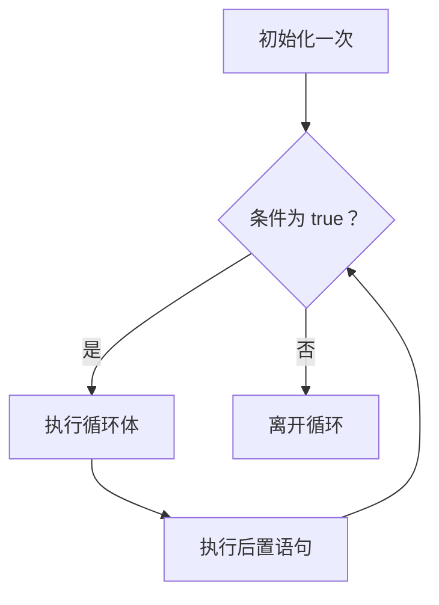

# 第三讲：Go 语言基础语法体系

> 资料核对日期：2026-10-21。语言规则以 [Go 官方语言规范](https://go.dev/ref/spec) 为主，搭配官方教程、博客和标准库文档；三个中文辅助网站作为补充阅读入口。正文是独立组织的学习讲解。
> 版本约定：完整示例按 **Go 1.27 语言语义**编写；特性首次引入时间只用于解释版本差异。实际验证环境和覆盖范围见文末“示例核验说明”。
>
> 本讲沿着程序执行的顺序组织：先声明变量和常量，再理解数据类型，随后学习运算符如何形成表达式，最后用条件与循环控制程序的执行路径。变量、类型和表达式是流程控制的基础，因此后面的例子会反复复用前面建立的概念。

> **统一运行基线：** 建议使用 Go 1.27.3，示例模块声明采用 `go 1.27.0`。文中出现其他 Go 版本时，仅用于说明特性引入时间或历史实现差异；第三方依赖仍以对应模块的版本要求为准。


*图示：Go 语法执行路径。*

## 目录

- [一.主要内容](#section-001)
  - [如何阅读这份笔记](#section-002)
  - [先读懂一段完整程序](#section-003)
  - [这份笔记怎样处理例子与出处](#section-004)
  - [少量语法准备](#section-005)
- [二.变量和常量](#section-006)
  - [1. 变量](#section-007)
    - [1.1 变量的声明](#section-008)
    - [1.2 多个变量声明](#section-009)
    - [1.3 函数内部声明](#section-010)
    - [1.4 变量的零值](#section-011)
  - [2. 常量](#section-012)
    - [2.1 常量的声明方式](#section-013)
    - [2.2 常量的特点](#section-014)
  - [3. 枚举常量](#section-015)
  - [4. Go 语言的自动类型推断](#section-016)
    - [4.1 自动类型推断的两种常见方式](#section-017)
    - [4.2 自动类型推断背后的原理](#section-018)
    - [4.3 注意事项](#section-019)
  - [5. 变量和常量在内存区域的存储](#section-020)
    - [5.1 Go 内存区域划分](#section-021)
    - [5.2 变量的内存存储](#section-022)
      - [5.2.1 全局变量](#section-023)
      - [5.2.2 局部变量](#section-024)
      - [5.2.3 指针变量](#section-025)
    - [5.3 常量的内存存储](#section-026)
      - [5.3.1 编译时常量](#section-027)
      - [5.3.2 只读常量](#section-028)
    - [5.4 栈与堆的差异](#section-029)
    - [5.5 内存逃逸分析](#section-030)
  - [6. 总结](#section-031)
- [三.数据类型](#section-032)
  - [1. 基本数据类型](#section-033)
    - [1.1 整型](#section-034)
    - [1.2 浮点型](#section-035)
    - [1.3 复数类型](#section-036)
    - [1.4 布尔型](#section-037)
    - [1.5 字符串](#section-038)
    - [1.6 字符型](#section-039)
  - [2. 复合数据类型](#section-040)
    - [2.1 数组](#section-041)
    - [2.2 切片](#section-042)
    - [2.3 字典](#section-043)
    - [2.4 结构体（Struct）](#section-044)
    - [2.5 指针](#section-045)
  - [3. 特殊数据类型](#section-046)
    - [3.1 接口](#section-047)
    - [3.2 函数](#section-048)
    - [3.3 通道](#section-049)
  - [4. 数据类型转换](#section-050)
- [四.运算符与表达式](#section-051)
  - [1. 算术运算符](#section-052)
  - [2. 关系运算符](#section-053)
  - [3. 逻辑运算符](#section-054)
  - [4. 位运算符](#section-055)
  - [5. 赋值运算符](#section-056)
  - [6. 指针运算符](#section-057)
  - [7. 其他运算符](#section-058)
  - [8. 表达式](#section-059)
    - [8.1 优先级：先组合哪一部分](#section-060)
    - [8.2 求值顺序：哪些动作先发生](#section-061)
  - [9. 总结](#section-062)
- [五.分支流程控制](#section-063)
  - [1. if 语句](#section-064)
  - [2. if...else 语句](#section-065)
  - [3. if...else if...else 语句](#section-066)
  - [4. switch 语句](#section-067)
  - [5. select 语句](#section-068)
  - [6. 循环控制中的 break 和 continue](#section-069)
  - [7. For 循环](#section-070)
    - [7.1 基本的 for 循环](#section-071)
    - [7.2 省略部分条件的 for 循环](#section-072)
    - [7.3 无限循环](#section-073)
    - [7.4 for...range 循环](#section-074)
    - [7.5 控制循环的语句](#section-075)
    - [7.6 嵌套循环](#section-076)
    - [7.7 循环配合 defer 使用](#section-077)
  - [8. 总结](#section-078)
- [附录 A：综合练习——生成一份学习进度报告](#section-079)
  - [A.1 走一遍执行过程](#section-080)
  - [A.2 可以接着做的四项修改](#section-081)
- [附录 B：复习问题与参考答案](#section-082)
- [附录 C：官方资料与中文补充阅读](#section-083)
  - [C.1 按问题找官方资料](#section-084)
  - [C.2 开发者指定的三个中文网站](#section-085)
- [附录 D：示例核验说明](#section-086)
  - [D.1 如何自己复现](#section-087)
  - [D.2 逃逸实验的观察结果](#section-088)
- [附录 E：示例来源与官方代码许可](#section-089)


<a id="section-001"></a>

## 一.主要内容

这一讲要让开发者能读懂并写出“小规模、逻辑完整的 Go 程序”：知道数据放在什么变量里、哪些类型可以怎样操作、条件判断如何选择路径、循环和通道怎样推进执行。

| 原目录部分 | 要解决的问题 | 学完可以完成的小任务 |
| --- | --- | --- |
| 二.变量和常量 | 怎样给数据命名、确定类型，并理解存储与生命周期？ | 记录阅读进度，定义状态编号，解释默认值与变量遮蔽 |
| 三.数据类型 | 怎样表示数字、文本、一组数据以及可调用、可通信的对象？ | 管理成绩、任务清单、词频表，理解切片共享与接口 |
| 四.运算符与表达式 | 怎样计算、比较、组合条件，以及修改已有数据？ | 拆分时间、检查权限位、交换变量，判断表达式实际结果 |
| 五.分支流程控制 | 程序下一步执行哪里，什么时候重复或停止？ | 分类分数、遍历集合、等待通道、正确安排循环中的清理 |

<a id="section-002"></a>

### 如何阅读这份笔记

每一组知识按“概念—规则—例子—执行过程—边界”讲解。第一次读时，把注意力放在常用写法与运行结果上；第二次再集中看常量精度、栈堆、接口与循环变量这些容易混淆的边界。

原目录中的“只读常量”“复合数据类型”“特殊数据类型”保留为学习标题，但会说明它们与 Go 规范中的正式概念有哪些区别。内存章节则区分**语言保证**和**当前实现行为**，防止把某次编译结果当成所有程序都成立的规律。

可以在 [官方 Go Playground](https://go.dev/play/) 中运行完整例子：粘贴一段带 `package main` 和 `func main()` 的程序，点击 Run。Playground 会编译并在受限环境中执行程序；真实网络访问、机器文件和性能测量不适合依赖它。本讲大多数示例只使用标准输出和标准库，方便在线练习。[官方说明：The Go Playground](https://go.dev/play/)。

如果已经装好 Go，把**一个完整例子**保存为 `main.go`，在对应目录执行：

```sh
go run main.go
```

每个例子都有自己的 `main` 函数，不要把整份笔记的完整程序一起粘进同一个文件。标为“语法片段”的代码需要放入合适的上下文；标为“错误示例”的代码故意展示编译错误或运行时风险，不能与正常示例混在一起运行。

<a id="section-003"></a>

### 先读懂一段完整程序

下面的程序沿用 [官方入门教程](https://go.dev/doc/tutorial/getting-started) 的 `package main`、导入 `fmt`、调用输出函数这一结构，把输出改成一个阅读进度任务；任务逻辑为自编。

```go
// 运行示例：I-01
package main

import "fmt"

func main() {
	const target = 12
	finished := 5
	remaining := target - finished
	fmt.Printf("目标 %d 页，已读 %d 页，还剩 %d 页\n", target, finished, remaining)
}
```

输出：

```text
目标 12 页，已读 5 页，还剩 7 页
```

从整体流程理解这段程序：编译器先检查名称、类型和语法是否正确；运行程序时，所需包完成初始化，随后进入 `main` 函数；函数依次记录数据、计算剩余量、输出结果，最后返回。[官方依据：Program initialization and execution](https://go.dev/ref/spec#Program_initialization_and_execution)。

| 代码位置 | 在程序中的作用 | 当前只需掌握什么 |
| --- | --- | --- |
| `package main` | 声明当前文件属于可执行程序的 `main` 包 | 包用于组织代码；普通库包可以使用其他包名 |
| `import "fmt"` | 使用标准库的格式化输出能力 | 不需要自己编写打印到终端的底层操作 |
| `func main()` | 定义程序入口函数 | 不是所有函数都叫 `main`；这是可执行程序的特殊入口 |
| `const target = 12` | 为固定的目标页数命名 | 常量与可修改变量有不同规则 |
| `finished := 5` | 声明并初始化一个局部变量 | `:=` 会根据右侧推断类型 |
| `target - finished` | 计算一个新的值 | 结果保存到 `remaining` |
| `fmt.Printf(...)` | 把值按指定格式输出 | `%d` 是整数占位符，`\n` 表示换行 |

标准库就是随 Go 一起提供的一组常用包。这里的 `fmt` 负责文本格式化；后面会用到的 `strconv` 负责字符串与基本类型之间的转换，`unicode/utf8` 负责 UTF-8 编码相关操作。遇到新包时，应先弄清它解决什么问题，再阅读函数签名。

<a id="section-004"></a>

### 这份笔记怎样处理例子与出处

- **官方规则**：用就近链接指向规范章节、标准库函数或官方文章，可以直接对照原文。
- **依据规则自编**：根据已核对的语言行为设计小例子，变量名、输入、输出和讲解由本笔记组织。
- **官方示例改编**：注明具体出处和改动目的，例如交换赋值、通道超时或延迟调用。
- **实现观察**：逃逸分析、栈堆分配等说明会标明条件；编译器诊断不是跨版本固定输出。

可以先改动 I-01：把 `finished` 改成 `10`，预测输出，再运行确认；然后想一想，如果已读页数超过目标，应当显示负数还是“已完成”？后者需要用第五部分的条件判断表达业务规则。

<a id="section-005"></a>

### 少量语法准备

**名称与关键字。** `target`、`finished`、`main` 都是程序中的名称，正式称为标识符。关键字如 `var`、`const`、`func`、`if`、`for` 已有固定语法意义，不能拿来命名普通变量。`int`、`string`、`len`、`nil` 则是预声明标识符，不属于关键字；虽然部分名称可以被内层声明遮蔽，初学时应避免给自己的变量起这些名字。[官方依据：Identifiers](https://go.dev/ref/spec#Identifiers)、[Keywords](https://go.dev/ref/spec#Keywords)、[Predeclared identifiers](https://go.dev/ref/spec#Predeclared_identifiers)。

**注释与格式。** `//` 注释到行末，`/* ... */` 可以跨行。通常不手写行末分号；编译器按规则自动插入分号，因此大括号的换行方式并非任意。条件语句的 `else` 通常紧接前一个 `}` 写在同一行，具体原因见第五部分。使用 `gofmt` 或编辑器的 Go 格式化功能统一格式。[官方依据：Comments](https://go.dev/ref/spec#Comments)、[Semicolons](https://go.dev/ref/spec#Semicolons)、[Effective Go—Formatting](https://go.dev/doc/effective_go#formatting)。

**值、字面量、表达式、语句。** `12`、`"Go"` 是直接写在源码中的字面量；`target - finished` 是计算值的表达式；`finished = 8` 是改变变量内容的赋值语句。后续将会看到，这些区别直接决定什么能出现在 `const`、赋值右侧和条件位置。

**先检查编译错误，再分析运行结果。** 名称未定义、类型不匹配、未使用的局部变量等通常在编译期暴露；越界索引、向已关闭通道发送等则可能在运行期触发 `panic`。两者产生的阶段不同，修复时也要分别追踪语法/类型规则与实际执行路径。

---

<a id="section-006"></a>

## 二.变量和常量

这一部分解决三个连续的问题：程序如何给数据命名，编译器如何确定数据的类型，以及数据在程序执行期间如何得到有效存储。先掌握声明、赋值和作用域，再阅读内存部分；不需要先背诵“栈区、堆区”才能正确编写 Go 程序。

本章示例均为**依据相邻所列官方规则自编的示例**。完整程序带有“运行示例”编号，可以单独保存为 `main.go` 运行；“语法片段”需要放入适当的函数或文件位置，“错误示例”用于解释编译器为什么拒绝某种写法。

<a id="section-007"></a>

### 1. 变量

变量是程序中用来保存一个值的位置，名字让我们能够访问这个位置，类型决定可以保存哪些值，以及允许执行哪些操作。可以暂时把它想成贴有标签的格子：`count` 是标签，`int` 是允许存放的数据种类，`3` 是当前内容。

这个类比只解释**语言层面的行为**。经过编译优化后，一个变量不一定对应固定的内存格子：它可能放在寄存器中，甚至整个计算都被提前算好。先把“名字、类型、当前值”分清，再讨论具体存储位置。[官方依据：Variables](https://go.dev/ref/spec#Variables)。

<a id="section-008"></a>

#### 1.1 变量的声明

**声明**是在程序中建立一个变量；**初始化**是给它最初的值；**赋值**则可以在以后改变已有变量的值。这三个动作可能写在同一行，也可能分开完成。

```go
// 语法片段
var count int        // 声明 count，类型是 int，初始值为 0
var limit int = 12   // 声明变量，同时显式给出类型和初始值
var title = "Go 笔记" // 根据右侧初始值推断 title 的类型是 string
count = 3            // 给已有变量赋值，没有声明新变量
```

`var` 的基本形式可以记成：`var 名称 类型 = 初始值`。类型与初始值不能同时省略：不写初始值时，类型告诉编译器应使用哪种零值；不写类型时，初始值提供推断所需的信息。[官方依据：Variable declarations](https://go.dev/ref/spec#Variable_declarations)。

下面用一个“记录已经读完多少页”的任务把声明与赋值连起来。

```go
// 运行示例：II-01
package main

import "fmt"

var courseName = "Go 入门"

func main() {
	var finishedPages int
	var targetPages int = 20

	finishedPages = 6
	finishedPages = finishedPages + 4

	fmt.Println(courseName)
	fmt.Printf("已读 %d 页，目标 %d 页\n", finishedPages, targetPages)
	fmt.Printf("finishedPages 的类型：%T\n", finishedPages)
}
```

预期输出：

```text
Go 入门
已读 10 页，目标 20 页
finishedPages 的类型：int
```

执行过程是：先创建值为 `0` 的 `finishedPages`，再把它改为 `6`；计算 `finishedPages + 4` 时读取旧值 `6`，最后把结果 `10` 写回。`=` 表示赋值，不是数学中的恒等关系。

这里的 `fmt` 是标准库中负责格式化输入输出的包。`Println` 打印参数并换行；`Printf` 按格式串打印，`%d` 显示十进制整数，`%T` 显示传入值的类型，`\n` 表示换行。[官方文档：fmt](https://pkg.go.dev/fmt)。

命名时优先使用能说明用途的名字，例如 `finishedPages`、`retryCount`。名称不能以数字开头，也不能使用 `var`、`func` 等关键字；Go 区分大小写。包级名称如果以 Unicode 大写字母开头，就可以被其他包访问，这叫**导出**；并不是所有位置的大写局部变量都因此变成“公共变量”。[官方依据：Identifiers](https://go.dev/ref/spec#Identifiers)、[Exported identifiers](https://go.dev/ref/spec#Exported_identifiers)。

<a id="section-009"></a>

#### 1.2 多个变量声明

同类变量可以在一行声明，也可以使用 `var (...)` 分组。分组只是组织写法，不会创建一种新的数据类型。

```go
// 语法片段
var width, height int = 12, 8
var userName, active = "Lin", true

var (
    maxRetries int = 3
    serviceName    = "notes"
    enabled        = true
)
```

第一行中 `width` 与 `height` 都是 `int`。第二行没有统一的显式类型，因此分别根据对应的右侧值推断：`userName` 是 `string`，`active` 是 `bool`。分组内也允许每一项采用不同形式。

多个变量还可以接收一个函数返回的多个结果。下面先暂时把 `readProgress()` 理解为“返回已读页数和总页数的工具”；函数的完整定义将在数据类型章节解释。

```go
// 运行示例：II-02
package main

import "fmt"

func readProgress() (int, int) {
	return 8, 24
}

func main() {
	var finished, total = readProgress()
	fmt.Println(finished, total)

	left, right := "草稿", "完成"
	left, right = right, left
	fmt.Println(left, right)

	_, target := readProgress()
	fmt.Println(target)
}
```

预期输出：

```text
8 24
完成 草稿
24
```

`left, right = right, left` 是交换变量：先求出右侧需要的旧值，再执行赋值，因此不会把两个变量都变成同一个字符串。`_` 是**空白标识符**，表示这个位置的结果有意不用；它不创建一个可以读取的普通变量。真实工程中，函数返回的错误通常需要检查，不能因为 `_` 能丢弃值就忽略所有错误。[官方依据：Variable declarations](https://go.dev/ref/spec#Variable_declarations)、[Assignments](https://go.dev/ref/spec#Assignment_statements)、[Blank identifier](https://go.dev/ref/spec#Blank_identifier)。

<a id="section-010"></a>

#### 1.3 函数内部声明

在函数内部，常用 `:=` 进行**短变量声明**：根据右侧值创建变量并推断类型。

```go
// 语法片段：放在函数内部
count := 3
count = 5
count, limit := 6, 10
```

逐行理解：第一行创建 `count`；第二行只更新已有值；第三行中 `count` 已经存在，但 `limit` 是新变量，所以允许使用 `:=`。这次 `count` 得到新值 `6`，`limit` 被声明并初始化为 `10`。

`:=` 有三个必须同时记住的约束：

1. 只能出现在函数内部，不能在包级使用。
2. 左侧至少有一个新的、非 `_` 的变量名，且非空白名字不能重复。
3. 对已存在变量的复用，要求其原先声明在同一个代码块中；函数体还可以复用参数列表中的变量，其类型必须兼容现有声明。

```go
// 错误示例（故意无法编译）：每组错误独立看待
count := 3
count := 5       // 同一块内没有新变量
count, _ := 8, 9 // _ 不算新变量
```

其中“同一代码块”非常重要。**作用域**是某个名字在源代码中的有效范围。进入内层 `{ ... }` 后，可以声明同名的新变量；这个新变量暂时遮住外层变量，称为**变量遮蔽**。

```go
// 运行示例：II-03
package main

import "fmt"

func main() {
	pages := 3
	pages, limit := 5, 20
	fmt.Println("更新后：", pages, limit)

	{
		pages := pages + 1
		fmt.Println("内层：", pages)
	}

	fmt.Println("外层：", pages)
}
```

预期输出：

```text
更新后： 5 20
内层： 6
外层： 5
```

内层 `pages := pages + 1` 的右侧读取外层的 `pages`，因为新变量的作用域从短声明结束处才开始。内层新变量的初始值为 `6`，但外层变量仍是 `5`。如果希望修改外层变量，这里应写 `pages = pages + 1`。

初学时遇到“明明赋值了，出了 `if` 却没变化”，应先检查是不是用了 `:=` 创建内层同名变量。常见的 `err`、`result`、`config` 都容易发生这种问题。[官方依据：Short variable declarations](https://go.dev/ref/spec#Short_variable_declarations)、[Declarations and scope](https://go.dev/ref/spec#Declarations_and_scope)。

标准 Go 编译器会拒绝声明后未使用的局部变量。不要把“编译通过”作为删除 `_ = value` 的唯一判断标准：如果一个变量本来没有用途，通常直接删除声明更清楚；如果稍后会用，可以在实验期间暂时打印它。

<a id="section-011"></a>

#### 1.4 变量的默认值

**零值**是变量没有显式初始值时，语言为其提供的确定值。Go 不要求开发者猜测某段未初始化内存中残留了什么。

| 类型 | 零值 | 初学时要注意的事情 |
| --- | --- | --- |
| 整数、浮点数、复数 | 对应类型的 `0` | 是有类型的零值 |
| `bool` | `false` | 不等同于整数 `0` |
| `string` | `""` | 是空字符串，不是 `nil` |
| 指针、切片、map、通道、函数、接口 | `nil` | 能否直接使用取决于具体操作 |
| 数组 | 每个元素都是元素类型的零值 | 长度依然是类型中写明的长度 |
| 结构体 | 每个字段都是各自类型的零值 | 不代表必然满足当前的业务约束 |

```go
// 运行示例：II-04
package main

import "fmt"

func main() {
	var count int
	var ratio float64
	var ready bool
	var title string
	var p *int
	var tasks []string
	var scores map[string]int

	fmt.Printf("%d %.1f %t %q\n", count, ratio, ready, title)
	fmt.Println(p == nil, tasks == nil, scores == nil)
	fmt.Println(len(tasks), scores["Lin"])

	tasks = append(tasks, "阅读变量声明")
	fmt.Println(tasks)
}
```

预期输出：

```text
0 0.0 false ""
true true true
0 0
[阅读变量声明]
```

这里 `%t` 打印布尔值，`%q` 把字符串显示为带引号的形式，便于看见空字符串。`len(tasks)` 为 `0`；从 `nil` map 读取不存在的键，会得到元素类型的零值，因此 `scores["Lin"]` 是 `0`。

**有零值，不等于所有操作都能直接执行。**`append` 可以接受 `nil` 切片，并返回追加后的切片；但对 `nil` map 写入键值会发生运行时 panic。解引用 `nil` 指针或调用 `nil` 函数也会 panic；直接向 `nil` 通道发送或从中接收会一直阻塞。后续章节会分别解释这些操作。

零值还可能是一个真实业务值。若 `score == 0`，仅凭这个数不能判断“调用方得了零分”还是“根本没查询到调用方”；map 的 `value, ok := m[key]` 模式就是为区分这种情况准备的。[官方依据：The zero value](https://go.dev/ref/spec#The_zero_value)、[Map types](https://go.dev/ref/spec#Map_types)、[Appending to and copying slices](https://go.dev/ref/spec#Appending_and_copying_slices)。

<a id="section-012"></a>

### 2. 常量

常量把一个固定的值与名字关联起来，适合表达协议编号、单位换算、不会改变的限制值等。它不只是“程序员约定不要改的变量”：`const` 的右侧必须符合语言规定的**常量表达式**，编译器会检查其值与类型。[官方依据：Constants](https://go.dev/ref/spec#Constants)、[Constant expressions](https://go.dev/ref/spec#Constant_expressions)。

<a id="section-013"></a>

#### 2.1 常量的声明方式

```go
// 语法片段
const MaxRetries = 3
const AppName string = "study-notes"

const (
    SecondsPerMinute = 60
    MinutesPerHour   = 60
    SecondsPerHour   = SecondsPerMinute * MinutesPerHour
)
```

常量可以声明在包级或函数内部。大写开头的包级常量可被其他包访问，但 Go 并不要求所有常量都使用全大写名称。

常量分组中，后续条目可以省略表达式，表示**重复前一个非空表达式列表及其显式类型**，不是把前一个值自动加一：

```go
// 语法片段
const (
    a = 10
    b      // 相当于 b = 10
    c      // 相当于 c = 10
)
```

下面是常见的错误边界：

```go
// 错误示例（故意无法编译）：需要分别放到合适上下文中观察
const retries       // 缺少可以重复的前项，也没有初始化表达式
const values = []int{1, 2, 3} // 切片不是常量
const missing = nil // nil 不是常量
```

运行时配置也不属于常量。例如，`const n = len("Go")` 合法，因为这里的长度可作为常量求值；从文件读取的字符串长度、调用普通函数得到的结果，不能因为“这次运行不会变化”就声明为 `const`。某些内建函数具有专门的常量求值规则，不能推广为“所有函数调用都允许放进 const”。[官方依据：Constant declarations](https://go.dev/ref/spec#Constant_declarations)、[Length and capacity](https://go.dev/ref/spec#Length_and_capacity)。

<a id="section-014"></a>

#### 2.2 常量的特点

理解常量时，最关键的是区分**有类型常量**与**无类型常量**。

```go
// 语法片段
const n = 12        // 无类型整数常量
const m int64 = 12  // 有类型常量，类型是 int64
```

无类型常量可以理解为“还没有被固定到某个具体 Go 类型上的常量值”，不能理解为“没有规则”或“运行时随意变类型”。当它进入需要具体类型的上下文时，编译器检查能否用目标类型表示这个值。

```go
// 运行示例：II-05
package main

import "fmt"

const lessonCount = 12
const large = 1 << 70

func main() {
	var small int8 = lessonCount
	var wide int64 = lessonCount
	var fraction float64 = lessonCount
	const reduced = large >> 68

	fmt.Printf("%T %v\n", small, small)
	fmt.Printf("%T %v\n", wide, wide)
	fmt.Printf("%T %.1f\n", fraction, fraction)
	fmt.Println(reduced)
}
```

预期输出：

```text
int8 12
int64 12
float64 12.0
4
```

同一个无类型常量 `12` 可以分别初始化 `int8`、`int64`、`float64` 变量，因为这些类型能够表示这个值。`large` 的数值超过常见的 64 位整数范围，但常量计算本身可以保留更高精度；右移后得到的 `4` 可以正常使用。

不能据此写 `var x = large`：没有显式类型时，无类型整数常量会采用默认类型 `int`，而 `1 << 70` 无法用 `int` 表示。也不能写 `const x int8 = 128`，因为 `int8` 的最大值是 `127`。

Go 规范把数值常量描述为精确的高精度值，并对实现的内部精度规定了最低要求；编译器并不因此具备无限计算资源。常量一旦需要表示为具体数值类型，仍要满足相应范围；转成浮点类型时还涉及该类型允许的舍入。[官方依据：Constants](https://go.dev/ref/spec#Constants)、[Representability](https://go.dev/ref/spec#Representability)。

有类型常量则已经带着类型约束：

```go
// 错误示例（故意无法编译）
const m int64 = 12
var n int = m // int64 与 int 是不同类型，不能因此直接赋值
```

如果确实需要转换，应明确写 `int(m)`，并理解目标类型能否容纳相应值。官方博客对无类型常量、默认类型和精度给出了专门解释，可作为本节的延伸阅读：[Go Blog：Constants](https://go.dev/blog/constants)。

<a id="section-015"></a>

### 3. 枚举常量

枚举是在若干具名状态之间做选择，例如“未开始、进行中、已完成”。Go 没有单独的 `enum` 关键字，常用**自定义类型 + 一组常量 + `iota`**表达这类状态。

`iota` 是常量声明中的计数值：在一个 `const` 声明内，它等于当前常量声明项的序号，从 `0` 开始。严格说，计数单位是规范中的 `ConstSpec`，即一项常量声明，而不是“一个变量名”或“一个实际显示的文本行”。[官方依据：Iota](https://go.dev/ref/spec#Iota)。

```go
// 运行示例：II-06
package main

import "fmt"

type StudyStatus uint8

const (
	NotStarted StudyStatus = iota
	Studying
	Finished
)

func main() {
	status := Studying
	fmt.Println(NotStarted, Studying, Finished)
	fmt.Printf("当前状态：%v，类型：%T\n", status, status)
	fmt.Println(status == Finished)
}
```

预期输出：

```text
0 1 2
当前状态：1，类型：main.StudyStatus
false
```

`Studying` 省略了表达式，等价于重新使用 `StudyStatus = iota`，但此时 `iota` 是 `1`。`Finished` 同理得到 `2`。`type StudyStatus uint8` 创建一个新的具名类型，使“学习状态”与普通数字之间的区别可以被类型检查发现。

这仍然不是一个自动限制所有取值的封闭集合：`StudyStatus(99)` 仍是合法的类型转换，因为 `99` 可用 `uint8` 表示。若状态来自网络、文件或调用方输入，还需要显式校验。若这些数值已经成为文件格式或通信协议的一部分，也不要随意在中间插入新的 `iota` 条目，否则后续编号会改变；稳定编号适合显式赋值。

下面集中观察 `iota` 的四个细节：同一项的多次使用值相同；跳过项也占序号；新 `const` 声明重新从零开始；省略表达式会重复上一项。

```go
// 运行示例：II-07
package main

import "fmt"

const (
	a, b = iota, iota
	c, d
	_ = iota
	e = iota
)

const restart = iota

func main() {
	fmt.Println(a, b, c, d, e)
	fmt.Println(restart)
}
```

预期输出：

```text
0 0 1 1 3
0
```

还可以用 `1 << iota` 生成不重叠的二进制标志位：

```go
// 语法片段
const (
    CanRead  uint8 = 1 << iota // 00000001
    CanWrite                 // 00000010
    CanShare                 // 00000100
)
```

普通状态通常“一次选择一个”，标志位则可以用按位或 `|` 组合多个选项；它们不是同一种业务含义。具体的组合与检测方法见“位运算符”。

<a id="section-016"></a>

### 4. Go 语言的自动类型推断

这里的类型推断，是编译器根据初始化表达式确定变量类型，省去开发者重复书写类型的工作。**没有写出类型，不等于变量没有类型，更不等于类型以后能任意改变。**本节讨论普通变量初始化；泛型函数的类型参数推断属于另一个更高级的主题。

<a id="section-017"></a>

#### 4.1 自动类型推断的两种常见方式

```go
// 语法片段
var pages = 12 // var + 初始值：包级或函数内部均可
pagesRead := 4 // 短声明：只能出现在函数内部
```

两种方式都从右侧获得信息。若右侧已经是某个确定类型的表达式，就保留相应类型；若右侧是无类型常量，且没有其他目标类型约束，则使用其默认类型。[官方依据：Variable declarations](https://go.dev/ref/spec#Variable_declarations)。

```go
// 运行示例：II-08
package main

import "fmt"

func main() {
	var pages = 12
	ratio := 0.5
	enabled := true
	title := "Go"
	letter := '学'
	value := 2 + 3i

	var capacity int64 = 128
	copied := capacity
	narrow := float32(0.5)

	fmt.Printf("%T %T %T %T\n", pages, ratio, enabled, title)
	fmt.Printf("%T %T\n", letter, value)
	fmt.Printf("%T %T\n", copied, narrow)
}
```

预期输出：

```text
int float64 bool string
int32 complex128
int64 float32
```

`rune` 是 `int32` 的别名，所以 `%T` 显示 `int32`。`copied` 的类型来自已有变量 `capacity`，是 `int64`；`narrow` 的类型来自显式转换表达式 `float32(0.5)`，因此不是默认的 `float64`。

<a id="section-018"></a>

#### 4.2 自动类型推断背后的原理

可以按下面的顺序判断普通变量声明，不必想象程序会“观察以后出现的值”：

1. **有没有显式目标类型？**如 `var rate float32 = 0.5`，先确定目标为 `float32`，再检查 `0.5` 能否赋给它。
2. **右侧是不是已经有类型？**如 `copy := original`、`result := someFunction()`，根据已有表达式类型或函数返回类型判断。
3. **右侧是不是无类型常量？**如果没有其他目标类型，使用相应默认类型。
4. **信息是否不足，或值是否不能表示？**不足就拒绝，例如 `x := nil`；超出目标范围也拒绝，例如 `var n int8 = 128`。

| 无类型常量示例 | 默认类型 | 常见误解 |
| --- | --- | --- |
| `12` | `int` | 不会因为数值很小就自动选择 `int8` |
| `12.0`、`0.5` | `float64` | `12.0` 不会因数学上是整数就默认成 `int` |
| `'学'` | `rune`，即 `int32` | 单引号形式不是字符串 |
| `2 + 3i` | `complex128` | 与 `complex64` 区别在分量精度 |
| `true` | `bool` | 不会推断为数值 `1` |
| `"Go"` | `string` | 与 `[]byte` 是不同类型 |

上面的步骤是一种便于学习的判断方式，描述的是编译期类型检查的效果，不是在承诺编译器内部一定严格按四段代码实现。规范依据见 [Constants](https://go.dev/ref/spec#Constants) 与 [Variable declarations](https://go.dev/ref/spec#Variable_declarations)。

<a id="section-019"></a>

#### 4.3 注意事项

**第一，变量的静态类型不会因再次赋值而改变。**

```go
// 错误示例（故意无法编译）
value := 3
value = "three" // value 已经是 int
```

接口变量可以保存不同具体类型的值，但接口变量本身仍有固定的接口类型；这与“短变量声明让 Go 变成动态类型语言”是两回事，见后续接口章节。

**第二，不同数值类型通常不能自动混算。**

```go
// 语法片段
var count int = 3
var price int64 = 20
total := int64(count) * price
```

这里先把 `count` 转成 `int64`，使两侧类型一致。不要误以为编译器看到 `price` 比较宽，就会总是自动把其他变量提升到 `int64`。与此不同，无类型常量能在条件满足时适应上下文，例如 `price * 3` 合法。

**第三，`nil` 没有提供足以确定变量类型的信息。**

```go
// 语法片段
var p *int      // p 的类型明确，零值为 nil
q := (*int)(nil) // 转换表达式已经明确类型为 *int
```

但 `var p = nil` 与 `p := nil` 都无法推断出到底是指针、切片、map，还是其他允许为 `nil` 的类型。

**第四，默认类型可能不符合接口或数据格式要求。**若函数参数需要 `int64`、文件字段要求 `uint32`，在相应边界显式使用那个类型，会比到处依赖 `int` 再补转换更清楚。`int` 的位数并非对所有平台固定为 64；语言要求它是 32 位或 64 位。[官方依据：Numeric types](https://go.dev/ref/spec#Numeric_types)、[Assignability](https://go.dev/ref/spec#Assignability)。

<a id="section-020"></a>

### 5. 变量和常量在内存区域的存储

本节开始区分两个层次：

- **语言规则**回答“这个变量的值是什么、能在哪里用、通过指针访问是否合法”。程序的正确性应依据这一层。
- **实现行为**回答“当前编译器把数据放在寄存器、栈、堆还是静态数据中”。这一层影响性能，会随代码上下文、目标平台与编译器版本变化。

Go 官方 FAQ 明确指出，存储位置不会改变合法 Go 程序的语言语义；逃逸分析与分配位置应在性能需要时结合工具观察。[官方依据：FAQ—stack or heap](https://go.dev/doc/faq#stack_or_heap)。

<a id="section-021"></a>

#### 5.1 Go 内存区域划分

可以使用下面的表建立常见标准工具链实现的工作图景，但不要把它当成 Go 语言强制规定的物理布局。

| 概念 | 通俗理解 | 常见内容与限制 |
| --- | --- | --- |
| 程序代码与静态数据 | 程序装载后使用的指令和较长期的数据 | 可能包含包级变量的存储、只读常量数据等；具体段名和布局由工具链与平台决定 |
| goroutine 栈 | 某条执行流程调用函数时使用的工作区 | 可容纳调用帧、部分参数和局部变量；Go 运行时管理它，不能简单等同于固定大小的操作系统线程栈 |
| 堆 | 无法仅按某次函数调用安排存储的对象集合 | 标准 Go 运行时通过垃圾回收管理其可回收对象 |
| 寄存器与优化结果 | CPU 快速使用值的位置，或编译器提前消去的计算 | 源代码里的变量不一定真的拥有独立的内存槽位 |

**作用域不是生命周期。**作用域描述名字在哪些源代码位置可用；生命周期涉及该值的存储需要保持有效多久。一个局部变量的名字在函数返回后不可用，但如果把它的地址返回给调用者，后续仍可以通过那个地址访问相应变量。

“Go 内存模型”也不是这张分区表。官方 [The Go Memory Model](https://go.dev/ref/mem) 讨论的是并发程序中，一个 goroutine 的写入在什么同步条件下能被另一个 goroutine 观察到；不要把“可见性与顺序”混成“栈和堆在哪里”。关于存储与回收，可读 [GC Guide—Where Go Values Live](https://go.dev/doc/gc-guide#Where_Go_Values_Live)。

<a id="section-022"></a>

#### 5.2 变量的内存存储

分析复杂值时，至少分清“变量本身”与“它关联的数据”。例如，切片值包含访问底层数组所需的信息；切片变量的存储与底层数组的存储不是同一个问题。指针变量保存地址，其指向的对象也有自己的存储。

因此，询问“这个切片在栈还是堆”往往不够精确。更好的问题是：切片值保存在哪里？底层数组保存在哪里？谁还持有这个数组的引用？局部变量名退出作用域以后，是否仍能通过别处访问数据？[官方依据：Slice types](https://go.dev/ref/spec#Slice_types)、[GC Guide—Tracing Garbage Collection](https://go.dev/doc/gc-guide#Tracing_Garbage_Collection)。

<a id="section-023"></a>

##### 5.2.1 全局变量

Go 教程中常说的“全局变量”，通常指**包级变量**，即写在函数外的变量。其名字的作用域是包；跨包能否访问还取决于是否导出。它并不是所有包都可以无条件使用的一个公共名字。

```go
// 语法片段：放在包级
var retryCount int
var serviceName = "notes"
var cachedPages []byte
```

包级变量在包初始化过程中得到初始值；依赖包先完成初始化，随后程序才进入 `main.main`。变量初始化还存在依赖关系，不适合简单记成“永远严格照源文件摆放顺序”。本章先掌握先初始化再使用，复杂初始化顺序应查规范的专门章节。[官方依据：Package initialization](https://go.dev/ref/spec#Package_initialization)。

从常见实现看，包级变量本身通常拥有静态存储；它保存的指针、切片或 map 仍可能关联动态分配的数据。例如给 `cachedPages` 赋一个新切片后，底层数组是否仍被引用，取决于 `cachedPages` 和其他位置的引用关系。把 `cachedPages = nil` 只是在改变这个变量：若其他变量仍引用旧数组，旧数组就不能因为这次赋值立即回收。

这里的重点是**存储关系与可达性**：垃圾回收器会从仍然使用的根引用出发追踪对象。包级变量经常可以成为根引用的一部分，所以把大对象长期保存在包级缓存里，可能延长其存活时间；但不能由此断言“全局变量引用过的对象永远不会回收”。[官方依据：GC Guide—Tracing Garbage Collection](https://go.dev/doc/gc-guide#Tracing_Garbage_Collection)。

<a id="section-024"></a>

##### 5.2.2 局部变量

局部变量在函数或更内层代码块中声明。如果编译器能证明它的存储不必在当前调用结束后继续保留，通常可以安排在栈中，或者进一步使用寄存器、消去临时对象。

```go
// 语法片段
func double(n int) int {
    result := n * 2
    return result
}
```

这个函数返回的是整数值，不是 `result` 的地址。调用者拿到结果 `8`，并不意味着 `double` 的局部变量 `result` 必须一直保留。

若返回局部变量的地址，Go 会保证后续合法访问仍然有效，不会按“函数返回，所有局部数据立刻失效”的方式处理。此时编译器需要选择合适的存储；是否真的发生堆分配，还受内联和使用上下文影响。因此，**“局部变量一定在栈上”不成立**。[官方依据：FAQ—stack or heap](https://go.dev/doc/faq#stack_or_heap)、[Effective Go—Constructors and composite literals](https://go.dev/doc/effective_go#composite_literals)。

<a id="section-025"></a>

##### 5.2.3 指针变量

指针是保存某个变量地址的值。`&x` 取得 `x` 的地址，`*p` 访问指针 `p` 指向的变量。要分别讨论 `p` 自己与 `p` 指向的对象，不能把“指针类型”直接等同于“堆对象”。

```go
// 运行示例：II-09
package main

import "fmt"

func makeCount() *int {
	count := 7
	return &count
}

func main() {
	value := 3
	p := &value
	*p = 8
	fmt.Println(value)

	q := makeCount()
	fmt.Println(*q)

	r := new(int)
	fmt.Println(*r)
	*r = 12
	fmt.Println(*r)
}
```

预期输出：

```text
8
7
0
12
```

第一段中，`p` 指向 `value`，所以 `*p = 8` 修改的就是 `value`。第二段中，`makeCount` 返回后，`q` 仍能合法访问所指变量。第三段中，`new(int)` 创建一个初始值为 `0` 的 `int` 变量，并返回其地址。

`new(T)` 描述的是“创建变量并返回 `*T`”的语义，**不是要求编译器一定使用堆**。同样，写了 `&value` 也不能单凭语法就判定 `value` 已逃逸。[官方依据：Address operators](https://go.dev/ref/spec#Address_operators)、[Allocation](https://go.dev/ref/spec#Allocation)、[FAQ—stack or heap](https://go.dev/doc/faq#stack_or_heap)。

**版本补充：**Go 1.26 起，`new` 还接受值表达式，例如 `new(int64(300))` 会创建初始值为 `300` 的 `int64` 变量并返回指针。本章完整程序使用传统的 `new(T)` 形式，以便在较早版本上学习；不能据此说当前 Go 的 `new` 只能接收类型。[官方依据：Effective Go—Allocation with new](https://go.dev/doc/effective_go#allocation_new)。

<a id="section-026"></a>

#### 5.3 常量的内存存储

**常量的首要性质是编译期可确定的值，不是某种指定的内存位置。**`const x = 8` 不等于“在只读区创建一个名称为 x 的变量”。

编译器可以把数值常量直接用在指令中，也可以提前计算整个常量表达式；当实际执行需要某段数据时，才会按目标平台与工具链的方式安排它。不同使用位置可能采用不同方式，规范并不要求每个常量都有独立的存储地址。

```go
// 错误示例（故意无法编译）
const pageSize = 128
p := &pageSize // 常量不是可寻址的变量
```

若确实需要一个可寻址的位置，应创建变量，例如 `size := pageSize; p := &size`。这时指针指向 `size` 变量，而不是“常量自身的地址”。[官方依据：Constants](https://go.dev/ref/spec#Constants)、[Address operators](https://go.dev/ref/spec#Address_operators)。

<a id="section-027"></a>

##### 5.3.1 编译时常量

看一个可以在编译期完全确定的表达式：

```go
// 语法片段
const rows = 3
const columns = 4
const cells = rows * columns
var data [cells]int
```

`cells` 是常量 `12`，可以用作数组长度，`data` 的类型因此确定为 `[12]int`。这不依赖运行程序以后再看 `rows` 和 `columns` 的值。

把它改成 `rows := 3` 和 `columns := 4` 后，`rows * columns` 是涉及变量的表达式。即使程序员知道它们还没有被修改，也不能把它当作语言规定的常量用作数组长度。编译器优化可能提前算出结果，与表达式在 Go 语言中是否属于常量，是两个不同层面的问题。[官方依据：Constant expressions](https://go.dev/ref/spec#Constant_expressions)、[Array types](https://go.dev/ref/spec#Array_types)。

常量计算也遵守运算符规则。例如 `const a = 5 / 2` 是整数常量 `2`；若希望保留小数，可以写 `const b = 5.0 / 2`。高精度常量不会自动把整数除法改成实数除法。

<a id="section-028"></a>

##### 5.3.2 只读常量

这个标题需要作一个术语澄清：**Go 规范没有把常量分成“编译时常量”和“只读常量”两类。**前者通常是在强调求值时机；后者多半是在讨论编译产物中的只读数据。这两个维度不能并列当成 Go 的常量类型体系。

以字符串为例：

```go
// 语法片段
const greeting = "Hello"
var message = greeting
message = "Welcome"
```

`greeting` 是常量，不能赋新值；`message` 是变量，可以改为保存另一个字符串。与此同时，字符串值本身的字节内容不可通过字符串索引原地改写，所以 `message[0] = 'h'` 非法。

常见实现可以让字符串字面量使用只读静态数据，多个使用点也可能共享数据。但即便字符串在运行时由拼接等操作产生，它仍然遵守不可变语义；**字符串不可变不以“它一定在只读段”为前提**。也不要把可重新赋值的字符串变量误认为常量。[官方依据：String types](https://go.dev/ref/spec#String_types)、[Constant declarations](https://go.dev/ref/spec#Constant_declarations)。

<a id="section-029"></a>

#### 5.4 栈与堆的差异

| 比较点 | 栈中存储 | 堆中存储 |
| --- | --- | --- |
| 安排方式 | 编译器能把存储安排到合适的调用帧 | 需要更灵活地保持对象有效 |
| 生命周期管理 | 通常与调用帧和编译器分析配合 | 标准运行时追踪对象可达性并回收不再需要的对象 |
| 常见成本 | 调用帧内的分配与释放通常较简单 | 通常涉及分配器，并可能增加垃圾回收工作 |
| 数据是否可被引用 | 可以，但必须满足有效生命周期等要求 | 可以，常用于需要跨调用保留的对象 |
| 能否从源代码一眼确定 | 很多时候不能 | 很多时候不能，需要结合编译器诊断 |

“栈快、堆慢”只适合作为非常粗的提醒。程序实际性能还受对象大小、复制成本、缓存局部性、分配频率与存活时间影响。为了避免一次小分配而制造复杂共享状态，可能让代码更难维护，甚至引入并发错误。

垃圾回收也不等于“离开某个 `{}` 后立即释放对象”。对象是否还可通过引用访问、编译器如何判断活跃引用，以及回收何时执行，都会影响实际回收时机。通常应先写出清晰正确的代码，再通过基准测试或性能分析确认是否有值得处理的分配成本。[官方依据：GC Guide](https://go.dev/doc/gc-guide)、[FAQ—stack or heap](https://go.dev/doc/faq#stack_or_heap)。

<a id="section-030"></a>

#### 5.5 内存逃逸分析

**逃逸分析**是编译器进行的一类静态分析：在运行程序之前，追踪地址与引用如何流动，判断对象的存储能否安全地放在某个调用帧中，以及是否需要更长久的保存方式。

当前 Go 编译器源码中的说明强调两类约束：不能把会失效的栈对象地址留给堆中的对象；也不能让指向某个栈对象的指针活得比那个对象更久。编译器会分析赋值和调用中的引用关系，并在无法满足这些约束时采用安全的存储安排。[官方源码依据：cmd/compile/internal/escape/escape.go，开头的 Escape analysis 注释](https://go.dev/src/cmd/compile/internal/escape/escape.go)。

下面把“不向外保留地址”和“把地址保存到包级变量”放在同一个小程序中。程序没有打印输出，专门用来观察编译诊断，避免把打印函数本身带来的额外分配混在实验里。

```go
// 运行示例：II-10
package main

var saved *int
var total int

func localValue() int {
	x := 7
	p := &x
	return *p
}

func retainValue() {
	x := 9
	saved = &x
}

func main() {
	total = localValue()
	retainValue()
}
```

将它保存成 `escape.go` 后，可以使用以下命令查看编译器的优化与逃逸判断：

```bash
go version
go build -gcflags="-m=2 -l" escape.go
```

`-m=2` 请求较详细的优化诊断，`-l` 在这次观察中关闭内联，使函数边界更容易辨认。诊断输出的位置和措辞可能随版本变化，应关注类似 `moved to heap: x`、`escapes to heap`、`does not escape` 的信息及其指向的具体行，不要只搜索一个单词就概括整个程序。[官方依据：cmd/compile 的 `-m`、`-l` 选项](https://pkg.go.dev/cmd/compile)、[GC Guide—Escape analysis](https://go.dev/doc/gc-guide#Escape_analysis)。

从引用关系推理：

- `localValue` 虽然取了 `x` 的地址，但这个地址只在函数内部用于读值；函数返回一个 `int` 值，不把地址交出去，因此“取地址就一定上堆”是错误的。
- `retainValue` 把 `&x` 保存到包级 `saved`，函数返回以后仍可能通过 `saved` 访问它，编译器必须保证那个对象继续有效。
- 关闭内联是为了做这个观察实验，不是日常编译推荐设置；恢复正常优化后，其他代码的分配结果可能不同。

学习逃逸分析时还要避免三种误判：

1. **把逃逸当成运行时搬迁。**通常是在编译期决定如何分配，不能简单理解为“先放栈里，发现要返回时再搬到堆”。
2. **把返回指针当成固定判决。**一个函数单独分析时的结果，与内联到调用者之后的优化结果可能不同；最终以具体构建中的诊断和测量为准。
3. **把每次堆分配都当成错误。**需要长期保留的数据自然可能使用堆。只有当分配造成实际成本时，才有必要在不破坏语义的前提下优化。

对象很大、大小在编译时不易确定、地址流入长生命周期结构等情况，都可能影响分配决策，但不要背一份“必然逃逸清单”替代对具体代码的观察。官方 GC 指南也提醒，逃逸算法会随版本变化，穷举固定规则很脆弱。[官方依据：GC Guide—Where Go Values Live](https://go.dev/doc/gc-guide#Where_Go_Values_Live)。

<a id="section-031"></a>

### 6. 总结

| 遇到的问题 | 优先使用的判断方式 |
| --- | --- |
| 我需要创建变量，还是修改已有变量？ | 创建用 `var` 或合适场景下的 `:=`；修改用 `=` |
| 为什么 `:=` 报没有新变量？ | 检查同一块内是否至少引入一个新的非空白名字 |
| 为什么出了内层代码块值没变？ | 检查是否声明了遮蔽外层的同名变量 |
| 没初始化的数据是什么？ | 查该类型的零值，不猜内存残留内容 |
| 这个值能写成 `const` 吗？ | 检查它是否是语言允许的常量表达式 |
| `iota` 为什么跳号？ | 按常量声明项计数，空白项也占序号 |
| 推断出的类型为什么不符合预期？ | 区分有类型表达式与无类型常量，再看默认类型 |
| 局部变量、指针或 `new` 是否必然分配在某处？ | 不能仅凭语法判断；把语义与具体编译器实现分开 |
| 所有常量是否都住在只读区？ | 不存在这种语言保证；常量甚至可能没有独立存储 |

**自测任务：**写一个学习进度记录程序，包含包级课程名称、常量总章节数、函数内已完成数，以及一个表示进度状态的具名枚举类型。要求开发者能解释每个变量的类型从哪里来、初始值是什么、哪些值可以改变。完成后再回答：如果返回一个局部进度变量的地址，为什么调用者仍然能使用它？

---

<a id="section-032"></a>

## 三.数据类型

类型回答三个问题：一个值能表示什么、能做什么操作，以及怎样与其他值组合。例如，`int` 适合计数，`bool` 适合保存判断结果，`[]int` 可以保存一组数量可变的整数，`map[string]int` 可以按名字查找整数。

本章保留目录中的“基本、复合、特殊”三组，方便逐步学习。**这是讲解分组，不是 Go 规范规定的唯一分类**：规范将数组、结构体、指针、函数、接口、切片、map 和通道都列为可用类型字面量构造的复合类型。不要据此推断“特殊类型不属于复合类型”，更不要把“引用类型”理解成“参数按引用传递”。Go 的赋值和实参传递会复制值；某些值内部包含对其他数据的引用，复制后才会出现共享数据的效果。[官方依据：Types](https://go.dev/ref/spec#Types)、[Calls](https://go.dev/ref/spec#Calls)、[Effective Go：Slices](https://go.dev/doc/effective_go#slices)。

<a id="section-033"></a>

### 1. 基本数据类型

先建立用途和限制的对应关系。

| 要表达的内容 | 常用类型 | 先记住的限制 |
|---|---|---|
| 人数、次数、下标 | `int` | 位宽不是固定 64 位 |
| 明确宽度的协议字段 | `uint32`、`int64` 等 | 超过范围会出现编译错误或运行时溢出，取决于场景 |
| 测量值、比例 | `float64` | 很多十进制小数只能近似表示 |
| 实部与虚部 | `complex128` | 不支持用 `<`、`>` 比较大小 |
| 是否通过、是否存在 | `bool` | 只有 `true`、`false`，不把 0、空串自动当作假 |
| 文本或一段不可变字节 | `string` | `len` 数字节；不保证内容是有效 UTF-8 |
| 一个字节 | `byte` | 是 `uint8` 的别名 |
| 一个 Unicode 码点 | `rune` | 是 `int32` 的别名；不等于任意一个视觉字符 |

<a id="section-034"></a>

#### 1.1 整型

**整型保存没有小数部分的数。** 有符号整数能表示负数，无符号整数从 0 开始。固定宽度类型适合与文件格式、网络协议、数据库字段进行明确对应。

对于位宽为 $n$ 的类型：

- 无符号范围是 $0$ 到 $2^n-1$。
- 有符号范围是 $-2^{n-1}$ 到 $2^{n-1}-1$。

| 有符号类型 | 无符号类型 | 位宽 | 有符号范围示例 |
|---|---|---:|---|
| `int8` | `uint8` | 8 位 | -128～127 |
| `int16` | `uint16` | 16 位 | -32768～32767 |
| `int32` | `uint32` | 32 位 | $-2^{31}$～$2^{31}-1$ |
| `int64` | `uint64` | 64 位 | $-2^{63}$～$2^{63}-1$ |
| `int` | `uint` | 32 或 64 位 | 依实现和目标平台确定；两者位宽相同 |

`int` 与 `int32` 是不同类型，即使在某个平台上恰好同为 32 位，也不会因此变成同一种类型。一般的计数和下标优先用 `int`；需要明确宽度时再用 `int32`、`int64` 等。`uintptr` 是能容纳指针位模式的无符号整数，**它本身不是指针类型**，本章不把它用作普通指针的替代品。[官方依据：Numeric types](https://go.dev/ref/spec#Numeric_types)。

**示例来源：根据官方整型、转换和溢出规则自编。**

```go
// 运行示例：III-01
package main

import "fmt"

func main() {
	var small int16 = 100
	count := 5
	fmt.Println(int(small) + count)

	var level uint8 = 255
	level++
	fmt.Println(level)
}
```

输出：

```text
105
0
```

第一行先把 `small` 转成 `int`，再与 `count` 运算；Go 不会为了这次加法自动把两种整数统一成更宽的类型。第二行展示无符号整数的回绕：8 位最多保存 255，增加到 256 时只保留低 8 位，所以得到 0。这不是“Go 会自动扩成更大的整数”。

必须区分常量与变量：下面的赋值在编译时就不合法，因为常量 256 无法表示为 `uint8`；它不会先变成 0 再赋值。

```go
// 错误示例（故意无法编译）
var level uint8 = 256
```

运行时的有符号整数也允许按其表示规则溢出，不会自动抛出异常。对于库存、计费数量等业务数据，是否越界必须由业务校验负责。[官方依据：Integer overflow](https://go.dev/ref/spec#Integer_overflow)、[Representability](https://go.dev/ref/spec#Representability)。

<a id="section-035"></a>

#### 1.2 浮点型

**浮点数用有限位数近似表示实数。** `float32` 与 `float64` 分别对应 IEEE 754 的 32 位和 64 位浮点数。Go 没有名为 `float` 的内置类型，通常写 `x := 1.5` 得到 `float64`。

它可以类比为“有效数字有限的科学计数法”：能覆盖很大的数值范围，但不能保存任意精细的小数。类比仅说明精度与范围的取舍；实际 `float32`、`float64` 使用二进制表示，正是这一点使 `0.1` 等十进制小数常常需要舍入。[官方依据：Numeric types](https://go.dev/ref/spec#Numeric_types)、[官方 FAQ：int 与浮点类型](https://go.dev/doc/faq#int_sizes)。

**示例来源：依据官方浮点类型与常量规则自编，用同一个算式对比变量运算和常量表达式。**

```go
// 运行示例：III-02
package main

import "fmt"

func main() {
	a, b := 0.1, 0.2
	fmt.Printf("%.17f\n", a+b)
	fmt.Println(a+b == 0.3)
	fmt.Println(0.1+0.2 == 0.3)

	priceInCents := 1990
	quantity := 3
	fmt.Println(priceInCents * quantity)
}
```

输出：

```text
0.30000000000000004
false
true
5970
```

前两行中，`a`、`b` 已经是 `float64` 变量，它们各自保存舍入后的二进制数；相加结果与 `float64` 表示的 `0.3` 不完全相等。第三行的两个操作数都是未定型常量，常量表达式按精确值规则处理，所以结果不同。不能仅用 `fmt.Println(0.1+0.2)` 就判断运行时浮点加法是否存在舍入。[官方依据：Constants](https://go.dev/ref/spec#Constants)、[Constant expressions](https://go.dev/ref/spec#Constant_expressions)。

最后一行以“分”为单位表示固定两位小数的价格，得到 5970 分。它说明：业务明确允许固定最小单位时，可以用整数避免这个例子中的二进制小数误差。税率、汇率、任意精度和舍入规则仍需另外设计；改成整数也不能免除溢出检查。

比较计算得到的近似数时，通常应根据业务量纲和误差范围判断是否足够接近，不要随手把所有比较都替换成某个固定的 `0.000001`。误差容限是应用需求，语言本身不会替开发者选择。

<a id="section-036"></a>

#### 1.3 复数类型

复数写作 $a+bi$，其中 $a$ 是实部，$b$ 是虚部的系数。Go 提供：

- `complex64`：实部与虚部分别按 `float32` 保存。
- `complex128`：实部与虚部分别按 `float64` 保存。

内置函数 `complex(a, b)` 组合实部与虚部，`real(z)` 与 `imag(z)` 分别提取两部分。复数在信号处理、频域计算等场景有用；一般的业务开发只需知道怎样读懂它。[官方依据：Numeric types](https://go.dev/ref/spec#Numeric_types)、[Manipulating complex numbers](https://go.dev/ref/spec#Complex_numbers)。

**示例来源：根据官方 `complex`、`real`、`imag` 规则自编。**

```go
// 运行示例：III-03
package main

import "fmt"

func main() {
	z := complex(3.0, 4.0)
	w := 1 - 2i
	fmt.Println(z + w)
	fmt.Println(real(z), imag(z))
	fmt.Printf("%T\n", z)
}
```

输出：

```text
(4+2i)
3 4
complex128
```

这里的加法分别计算实部和虚部。复数可以使用 `==`、`!=` 判断相等，但没有语言内置的大小顺序，因此不能直接写 `z > w`。如果应用需要比较模长，应先明确比较规则，再计算相应的实数指标。[官方依据：Comparison operators](https://go.dev/ref/spec#Comparison_operators)。

<a id="section-037"></a>

#### 1.4 布尔型

**`bool` 保存一个判断结果，值只有 `true` 和 `false`。** 它适合回答“是否允许”“是否存在”“是否完成”，而不是保存多少次、多少个。

声明而不赋初值的 `bool` 变量为 `false`。比较表达式常用来产生布尔值，例如 `age >= 18`；`&&`、`||`、`!` 分别表示与、或、非。[官方依据：Boolean types](https://go.dev/ref/spec#Boolean_types)、[Logical operators](https://go.dev/ref/spec#Logical_operators)。

**示例来源：根据官方布尔类型与逻辑运算规则自编。**

```go
// 运行示例：III-04
package main

import "fmt"

func main() {
	var finished bool
	score := 85
	submitted := true
	passed := submitted && score >= 60

	fmt.Println(finished)
	fmt.Println(passed)
	fmt.Println(!passed)
}
```

输出：

```text
false
true
false
```

`passed` 的推导过程是：`submitted` 为真，`score >= 60` 也为真，所以两个条件同时成立。保存为变量后，后续代码可以直接使用有业务含义的 `passed`，避免反复写条件。

Go 不使用“非零即真”的规则；数字、字符串和布尔值之间没有这种自动转换，也不能用 `bool(1)` 显式转换。

```go
// 错误示例（故意无法编译）
if 1 {
    // 条件不是 bool
}
```

需要根据数量判断时，直接写 `count != 0`；需要把布尔结果编码成 0 或 1 时，使用明确的 `if` 逻辑。这样，编码规则可由代码清楚表达。[官方依据：If statements](https://go.dev/ref/spec#If_statements)、[Conversions](https://go.dev/ref/spec#Conversions)。

<a id="section-038"></a>

#### 1.5 字符串

**`string` 是不可变的字节序列。** “不可变”指已有字符串的字节内容不能通过索引修改；字符串变量仍然可以被重新赋值，改为保存另一个字符串值。

最容易混淆的是三个不同单位：

| 单位 | 含义 | 在 Go 中常见的观察方式 |
|---|---|---|
| 字节 | 原始数据的 8 位单位 | `len(s)`、`s[i]` |
| Unicode 码点 | Unicode 为一个字符元素分配的数值 | `for range` 得到的 `rune` |
| 调用方看到的字符 | 屏幕上感知到的一整个符号 | 可能由多个码点组成，不能简单等同于 `rune` 数 |

Go 源代码文件采用 UTF-8，因此直接写入源代码的中文字符串通常是 UTF-8 文本。但一个运行时字符串也可能来自任意二进制数据，**`string` 类型本身不保证 UTF-8 有效性**。[官方依据：String types](https://go.dev/ref/spec#String_types)、[官方博客：Strings, bytes, runes and characters in Go](https://go.dev/blog/strings)。

**示例来源：依照官方字符串博客的“按字节与按码点观察”思路自编，计数函数依据 `unicode/utf8` 官方文档。**

```go
// 运行示例：III-05
package main

import (
	"fmt"
	"unicode/utf8"
)

func main() {
	s := "Go语言"
	fmt.Println(len(s), utf8.RuneCountInString(s))
	fmt.Println(s[0])
	for index, r := range s {
		fmt.Printf("%d %c\n", index, r)
	}
}
```

输出：

```text
8 4
71
0 G
1 o
2 语
5 言
```

逐步看这几个数字：

1. `G`、`o` 各占 1 个 UTF-8 字节，`语`、`言` 各占 3 个，所以总长度是 $1+1+3+3=8$。
2. 字符串有 4 个码点，所以 `RuneCountInString` 返回 4。
3. `s[0]` 取出一个 `byte`，直接打印整数值为 71；用 `%c` 才是按字符形式显示。
4. `range` 返回的 `index` 是该码点在字符串中的**起始字节下标**，所以最后一个下标是 5，而不是 3。

`utf8.RuneCountInString` 对非法 UTF-8 也有定义，不能拿它替代格式校验；需要校验时使用 `utf8.ValidString`。[官方依据：RuneCountInString](https://pkg.go.dev/unicode/utf8#RuneCountInString)、[ValidString](https://pkg.go.dev/unicode/utf8#ValidString)。

字符串字面量还分为两种：

```go
// 语法片段
escaped := "第一行\n第二行" // 双引号：\n 表示换行
raw := `第一行\n第二行`     // 反引号：保留反斜杠和 n
```

反引号字符串可以跨行，适合保留多行文本；双引号字符串支持 `\n`、`\t`、`\"` 等转义。用 `s[a:b]` 截取字符串时，下标仍按字节解释，随意截到中文字符内部可能产生无效 UTF-8。若目标是按码点截取，需要先按码点处理；若目标是调用方可见字符，还需要更完整的 Unicode 文本分割规则。[官方依据：String literals](https://go.dev/ref/spec#String_literals)、[Slice expressions](https://go.dev/ref/spec#Slice_expressions)。

<a id="section-039"></a>

#### 1.6 字符型

Go 没有独立的 `char` 类型。目录中的“字符型”主要对应两种整数别名：

- `byte` 等同于 `uint8`，适合保存一个字节，例如文件内容、网络报文和 ASCII 数据中的一个单位。
- `rune` 等同于 `int32`，通常用来保存 Unicode 码点，例如 `'语'` 的码点值。

别名表示同一种类型的另一种名字，不会产生新的类型。`byte` 可以与 `uint8` 直接赋值；`rune` 可以与 `int32` 直接赋值。单引号写 rune 字面量，双引号写字符串字面量：`'A'` 和 `"A"` 不是同一种值。[官方依据：Numeric types](https://go.dev/ref/spec#Numeric_types)、[Rune literals](https://go.dev/ref/spec#Rune_literals)。

**示例来源：根据官方 `byte`、`rune` 别名以及字符串转换规则自编。**

```go
// 运行示例：III-06
package main

import "fmt"

func main() {
	var b byte = 'G'
	r := '语'
	fmt.Printf("%T %d %c\n", b, b, b)
	fmt.Printf("%T %d %c\n", r, r, r)
	fmt.Println(len(string(r)))

	original := "您好"
	letters := []rune(original)
	letters[0] = '您'
	fmt.Println(original, string(letters))
}
```

输出：

```text
uint8 71 G
int32 35821 语
3
您好 您好
```

`r` 保存整数 35821，这个数字是码点，而不是 UTF-8 编码后的某一个字节。`string(r)` 把这个有效码点编码成字符串，在这个例子中占 3 个字节。最后三行先生成一个可修改的 rune 切片，再修改其中一个码点，最后构造新字符串；原来的 `original` 没有改变。[官方依据：Conversions to and from a string type](https://go.dev/ref/spec#Conversions_to_and_from_a_string_type)。

也不能断言“一个 rune 就是调用方看到的一个字符”。例如一个字母与组合音调可以是两个码点，却显示成一个带音调的字母；某些表情也由多个码点组合。`rune` 解决的是码点表示问题，没有替代完整的文字排版与分割规则。另一个边界是：`rune` 只是 `int32` 的别名，因此一个 `rune` 变量也可以被赋予不合法的 Unicode 码点值；需要时可用 `utf8.ValidRune` 校验。[官方依据：官方字符串博客](https://go.dev/blog/strings)、[ValidRune](https://pkg.go.dev/unicode/utf8#ValidRune)。

<a id="section-040"></a>

### 2. 复合数据类型

当一个值不足以表达业务对象时，需要把值组合起来。例如，三门课的固定成绩可用数组；不断增加的学习记录可用切片；按课程名查分可用 map；一条记录同时包含标题、分数、完成状态时可用结构体。

这一组最关键的学习目标，是看清**复制了什么、共享了什么**。不能看到两处都发生变化，就直接判断 Go 使用了“引用传参”。

<a id="section-041"></a>

#### 2.1 数组

**数组是固定长度、元素类型相同的一组值。** 写法是 `[长度]元素类型`，例如 `[3]int`。长度属于类型本身：`[3]int` 与 `[4]int` 是不同类型，不能直接相互赋值。

`var a [3]int` 创建的是三个零元素组成的数组，不是 `nil`。`[...]int{10, 20, 30}` 中的 `...` 让编译器根据字面量确定长度，得到的仍是长度固定的 `[3]int`。[官方依据：Array types](https://go.dev/ref/spec#Array_types)、[Composite literals](https://go.dev/ref/spec#Composite_literals)。

**示例来源：根据官方切片博客中的“数组赋值会复制元素”规则自编。**

```go
// 运行示例：III-07
package main

import "fmt"

func changeFirst(values [3]int) {
	values[0] = 500
}

func main() {
	a := [...]int{10, 20, 30}
	b := a
	b[0] = 99
	changeFirst(a)

	fmt.Println(a)
	fmt.Println(b)
	fmt.Printf("%T\n", a)
}
```

输出：

```text
[10 20 30]
[99 20 30]
[3]int
```

`b := a` 复制三个整数，之后修改 `b[0]` 不会改到 `a[0]`。把 `a` 传给 `changeFirst` 时，又复制了一份数组，所以函数中的修改也不会改变调用方的 `a`。需要修改原数组，可以传数组指针，或者传一个引用其底层存储的切片。[官方依据：Go Slices：Arrays](https://go.dev/blog/slices-intro)、[Effective Go：Arrays](https://go.dev/doc/effective_go#arrays)。

这里说的“复制元素”不等于无条件深拷贝：若数组元素本身是指针或切片，复制这些元素后，它们所指向的对象仍可能共享。数组能否使用 `==` 比较，也取决于它的元素类型能否比较。[官方依据：Comparison operators](https://go.dev/ref/spec#Comparison_operators)。

<a id="section-042"></a>

#### 2.2 切片

**切片 `[]T` 是访问某个底层数组片段的值。** 它适合保存长度会变化的序列。理解切片时，可以把它看成三项信息：从哪里开始、当前有几个元素、从起点最多能使用多少个元素。官方博客把这三项解释为指向底层数组的指针、长度和容量；这是理解主流实现的模型，不要据此硬编码切片对象的字节布局。[官方依据：Slice types](https://go.dev/ref/spec#Slice_types)、[Go Slices：Slice internals](https://go.dev/blog/slices-intro)。

| 表达式 | 含义 |
|---|---|
| `len(s)` | 当前长度，直接索引的合法范围是 `0` 到 `len(s)-1` |
| `cap(s)` | 从切片起点算起，可以使用的底层数组容量 |
| `s[a:b]` | 包含下标 `a`，不包含下标 `b` 的片段 |
| `make([]int, 2, 4)` | 长度 2、容量 4，现有元素初始化为 0 |
| `append(s, x)` | 返回追加元素后的切片值 |
| `copy(dst, src)` | 复制元素，数量为两者长度的较小值 |

始终满足 $0 \leq \operatorname{len}(s) \leq \operatorname{cap}(s)$。容量不是可以随意索引的长度：`make([]int, 0, 4)` 不能直接写 `s[0] = 1`，必须先追加元素或适当重新切片。[官方依据：Length and capacity](https://go.dev/ref/spec#Length_and_capacity)、[Making slices, maps and channels](https://go.dev/ref/spec#Making_slices_maps_and_channels)。

**示例来源：根据官方切片博客的共享底层数组模型及规范的 `append`、完整切片表达式规则自编。**

```go
// 运行示例：III-08
package main

import "fmt"

func main() {
	base := [4]int{10, 20, 30, 40}
	s := base[:2]
	alias := s
	fmt.Println(len(s), cap(s))

	alias[0] = 11
	s = append(s, 99)
	fmt.Println(base, alias, s)

	limited := base[:2:2]
	detached := append(limited, 77)
	detached[0] = 88
	fmt.Println(base, detached)

	clone := make([]int, len(s))
	copy(clone, s)
	clone[0] = 100
	fmt.Println(s, clone)
}
```

输出：

```text
2 4
[11 20 99 40] [11 20] [11 20 99]
[11 20 99 40] [88 20 77]
[11 20 99] [100 20 99]
```

这段代码要分四步理解：

1. `s := base[:2]` 的长度为 2，但从起点往后还有 4 个位置，所以容量为 4。
2. `alias := s` 复制切片值，两者仍访问同一个底层数组。`alias[0] = 11` 因而改变 `base[0]`。
3. `s` 的剩余容量够用，`append(s, 99)` 使用原底层数组，把下标 2 写为 99。返回值的长度变为 3；`alias` 自己的长度仍为 2。
4. `base[:2:2]` 把 `limited` 的容量限制为 2。再追加一个元素必须使用新的底层数组，所以修改 `detached[0]` 不再改变 `base[0]`。

`copy` 例子另建了足够长的目标切片，再复制元素，才获得这里需要的独立整数序列。若元素本身是切片、map 或指针，`copy` 也只复制这些元素值，不会递归复制它们引用的数据。[官方依据：Full slice expressions](https://go.dev/ref/spec#Slice_expressions)、[Appending to and copying slices](https://go.dev/ref/spec#Appending_and_copying_slices)。

两个常见误区需要单独记住：

- **不能假设扩容永远翻倍。** 规范保证容量不够时会分配足够大的底层数组，没有把具体增长倍率作为语言承诺。
- **调用方需要接收 `append` 返回值。** 新的长度、可能变化的底层数组引用都在返回的切片值中；给函数传切片时，函数修改自己的切片长度不会自动更新调用方的切片变量。

切片的零值是 `nil`，此时长度、容量都为 0，可以直接 `append`。空但非 `nil` 的切片也可以有长度 0，例如 `[]int{}`。两者都能参与很多相同操作，但 `s == nil` 的结果不同，序列化等场景也可能区分它们。切片通常不能用 `s1 == s2` 比较内容，语言只允许切片与 `nil` 比较；需要按元素比较时，可自行遍历或使用适合元素类型的标准库函数。[官方依据：Slice types](https://go.dev/ref/spec#Slice_types)、[Comparison operators](https://go.dev/ref/spec#Comparison_operators)。

<a id="section-043"></a>

#### 2.3 字典

目录中的“字典”对应 Go 的 **map：把唯一的键映射到值的集合**。例如 `map[string]int` 可以从课程名查到学习时长。数组和切片通常按位置取值；map 按键取值，并且不承诺遍历顺序。

`map[K]V` 的 `K` 是键类型，`V` 是值类型。键必须支持合法的相等比较，因此字符串、整数以及元素可比较的数组等可以做键；切片、map、函数不能直接做键。用接口类型做键时，还要检查装入其中的动态值是否可比较。[官方依据：Map types](https://go.dev/ref/spec#Map_types)。

**示例来源：根据官方 Go maps in action 的“初始化、查找、comma-ok、删除”规则自编。**

```go
// 运行示例：III-09
package main

import "fmt"

func main() {
	var scores map[string]int
	value, ok := scores["Ada"]
	fmt.Println(value, ok, len(scores))

	scores = make(map[string]int)
	scores["Ada"] = 0
	scores["Lin"] = 92
	value, ok = scores["Ada"]
	fmt.Println(value, ok)

	alias := scores
	alias["Lin"] = 95
	fmt.Println(scores["Lin"])

	delete(scores, "Ada")
	fmt.Println(len(scores))
}
```

输出：

```text
0 false 0
0 true
95
1
```

第一行是从 `nil` map 读取，不会报错，得到值类型的零值 0。第二次读取也得到 0，但 `ok` 为真，因为键已经存在。**业务中“没有记录”和“记录的值是 0”可能完全不同**，这就是 `value, ok := m[key]` 两个结果的作用。

`alias := scores` 后，两者访问同一个 map 数据。通过 `alias` 修改条目，`scores` 能看到变化；如果把 `alias` 重新赋成另一个新 map，则不会把 `scores` 变量一起换掉。这仍然是复制 map 值后共享底层数据，不是把两个变量变成同一个变量。[官方依据：Go maps in action](https://go.dev/blog/maps)、[Index expressions](https://go.dev/ref/spec#Index_expressions)。

使用 map 时应掌握以下边界：

| 操作或情况 | 行为 |
|---|---|
| 从 `nil` map 读取 | 返回值类型零值；双结果形式的 `ok` 为 `false` |
| 向 `nil` map 写入 | 发生运行时 panic，应先初始化 |
| 删除不存在的键或从 `nil` map 删除 | 不做任何事，不报错 |
| `make(map[K]V, n)` | `n` 是初始容量提示，不限制最终条目数，也不能通过 `cap(m)` 读取 |
| `for range` 遍历 map | 顺序不由语言保证，不能依赖上一次运行的结果 |
| 多个 goroutine 只读取已经安全发布且不再修改的 map | 可以进行并发读取 |
| 存在并发写入，或读写同时进行 | 需要适当同步；普通 map 不自动替开发者保护 |

需要稳定输出顺序时，可以先收集键，再排序，最后按排好序的键读取。不要把某次看起来有序的输出当作 map 有序的证据。[官方依据：Deletion of map elements](https://go.dev/ref/spec#Deletion_of_map_elements)、[For statements with range clause](https://go.dev/ref/spec#For_range)、[官方 map 博客：Concurrency / Iteration order](https://go.dev/blog/maps)。

另一个实用限制是 map 元素不可寻址：不能用 `&m[key]` 获取条目的指针。若值类型是结构体，也不能直接改 `m[key].Field`；通常先取出结构体副本、修改、再写回，或者在设计上使用指向结构体的指针作为值。[官方依据：Address operators](https://go.dev/ref/spec#Address_operators)、[Assignments](https://go.dev/ref/spec#Assignment_statements)。

<a id="section-044"></a>

#### 2.4 结构体（Struct）

**结构体把一组有名字、可以有不同类型的字段组合成一个值。** 例如一条学习任务需要标题和完成状态，用两个平行的切片容易弄错对应关系，结构体可以把它们放在同一条记录中。

`type Task struct { ... }` 声明类型；`Task{...}` 根据该类型构造一个值；`var task Task` 才是声明变量。理解代码时，应先区分“定义数据形状”和“创建具体数据”。[官方依据：Struct types](https://go.dev/ref/spec#Struct_types)、[Type declarations](https://go.dev/ref/spec#Type_declarations)。

**示例来源：根据官方结构体、复合字面量和方法声明规则自编。**

```go
// 运行示例：III-10
package main

import "fmt"

type Task struct {
	Title string
	Done  bool
}

func (t *Task) Complete() {
	t.Done = true
}

func main() {
	first := Task{Title: "练习Go"}
	second := first
	second.Title = "复习Go"
	second.Complete()

	fmt.Println(first.Title, first.Done)
	fmt.Println(second.Title, second.Done)
}
```

输出：

```text
练习Go false
复习Go true
```

`Task{Title: "练习Go"}` 只给出 `Title`，省略的 `Done` 使用零值 `false`。这种带字段名的构造写法，能让读者直接看到值对应哪个字段，也更不容易因字段顺序变化而误读。

`second := first` 复制结构体值，本例两个字段分别是字符串值和布尔值，所以修改 `second` 的字段不会修改 `first`。如果字段中包含切片、map 或指针，复制后这些字段仍可能引用共同的数据；结构体赋值不是递归深拷贝。

`Complete` 是方法。`(t *Task)` 称为接收者，表示这个方法通过 `*Task` 指针访问任务；`t.Done = true` 修改的是所指向任务的字段。`second` 是可寻址变量，所以 `second.Complete()` 可以由语言规则自动使用 `&second` 来调用指针接收者方法。方法不是结构体里另存的一份函数值，而是与类型关联的行为。[官方依据：Method declarations](https://go.dev/ref/spec#Method_declarations)、[Calls](https://go.dev/ref/spec#Calls)。

字段名以 Unicode 大写字母开头时可导出，能被其他包访问，例如 `Title`。以小写字母开头的字段，例如 `title`，仍可由同一个包中的代码访问，但不向其他包导出。Go 没有在字段前写 `public`、`private` 的规则；它的这层可见性围绕包边界工作。[官方依据：Exported identifiers](https://go.dev/ref/spec#Exported_identifiers)。

<a id="section-045"></a>

#### 2.5 指针

**指针保存对某个变量的引用，通过它可以访问该变量。** 对 `int` 变量的指针类型写作 `*int`。需要分清 `*` 在两个位置的含义：

- `var p *int`：`*int` 是类型，表示“指向 int 的指针”。
- `*p = 10`：`*p` 是解引用表达式，表示“p 指向的那个变量”。

`&x` 获取变量 `x` 的地址，结果类型是指向 `x` 类型的指针。指针的零值为 `nil`；对 `nil` 指针解引用会 panic。普通 Go 指针不支持 C 风格的加减算术。[官方依据：Pointer types](https://go.dev/ref/spec#Pointer_types)、[Address operators](https://go.dev/ref/spec#Address_operators)。

**示例来源：依据官方指针和 `new(T)` 规则自编。**

```go
// 运行示例：III-11
package main

import "fmt"

func addOne(p *int) {
	*p = *p + 1
}

func main() {
	count := 10
	addOne(&count)
	fmt.Println(count)

	p := new(int)
	fmt.Println(*p)
	*p = 7
	fmt.Println(*p)
}
```

输出：

```text
11
0
7
```

调用 `addOne(&count)` 时，复制的是指针值，函数内的 `p` 与调用方提供的指针指向同一个 `count`。因此 `*p = ...` 会修改调用方的数据。假如函数只是把局部参数 `p` 改指向另一个变量，调用方的 `count` 不会因此更换。

`new(int)` 创建一个初始化为零值的 `int` 变量，并返回其地址；因此 `p` 的类型为 `*int`，`*p` 最初为 0。是否需要在堆上分配，由实现和逃逸分析决定，不能只凭 `new` 判断物理存储位置。[官方依据：Allocation](https://go.dev/ref/spec#Allocation)、[官方 FAQ：堆与栈](https://go.dev/doc/faq#stack_or_heap)。

**`new` 与 `make` 的基础对照**：

| 写法 | 返回类型 | 得到什么 |
|---|---|---|
| `new(int)` | `*int` | 指向值为 0 的整数变量 |
| `new(Task)` | `*Task` | 指向各字段为零值的结构体变量 |
| `new([]int)` | `*[]int` | 指向一个值为 `nil` 的切片变量 |
| `make([]int, 3)` | `[]int` | 已初始化的切片，三个元素均为 0 |
| `make(map[string]int)` | `map[string]int` | 可写入的新 map |
| `make(chan int)` | `chan int` | 可用于通信的新无缓冲通道 |

`make` 用于切片、map 和通道的初始化，返回该类型的值，不是指向该值的指针。`new(map[string]int)` 只得到指向一个 `nil` map 变量的指针，不能因此直接向其中添加条目。对于多数切片、map、通道的创建，使用 `make` 就足够，不需要再包一层指针。[官方依据：Making slices, maps and channels](https://go.dev/ref/spec#Making_slices_maps_and_channels)、[Effective Go：Allocation with make](https://go.dev/doc/effective_go#allocation_make)。

**版本补充**：上表讲的是兼容早期版本的 `new(T)`。从 Go 1.26 起，`new` 也可以接收值表达式，例如 `new(7)` 得到指向初值 7 的 `int` 变量的指针。因此不能把“`new` 只能接类型、总是产生零值”作为适用于所有新版本的规则。本章完整运行示例使用 `new(T)`；所有示例统一按 Go 1.27.3 工具链运行。[官方依据：Go 1.26 Changes to the language](https://go.dev/doc/go1.26#language)、[Allocation](https://go.dev/ref/spec#Allocation)。

<a id="section-046"></a>

### 3. 特殊数据类型

下面三种类型分别解决“如何抽象行为”“如何把计算作为值传递”“如何在并发任务之间传递值”的问题。它们不是只能在大型项目中使用，但需要先理解前面的变量、类型和赋值规则。

<a id="section-047"></a>

#### 3.1 接口

**普通接口用一组方法描述需要的行为。** 例如，某段代码只需要“计算面积”，就可以接收一个带 `Area` 方法的接口，而不必依赖某一种具体图形结构体。

一个类型只要具有接口要求的方法，就隐式实现该接口，不需要额外写 `implements`。这里的“具有方法”要求方法名、参数和返回结果符合要求，不是名字相近就行。本节讨论能够作为变量类型使用的普通接口；带 `~int | ~float64` 等类型集合约束的更一般接口主要用于泛型约束，不能一概当作普通变量类型。[官方依据：Interface types](https://go.dev/ref/spec#Interface_types)、[Implementing an interface](https://go.dev/ref/spec#Implementing_an_interface)。

**示例来源：按官方接口规则自编面积示例；`nil` 部分依据官方 FAQ，类型断言部分依据规范。**

```go
// 运行示例：III-12
package main

import "fmt"

type Areaer interface {
	Area() int
}

type Rectangle struct {
	Width, Height int
}

func (r Rectangle) Area() int {
	return r.Width * r.Height
}

func printArea(shape Areaer) {
	fmt.Println(shape.Area())
}

func main() {
	printArea(Rectangle{Width: 3, Height: 4})

	var empty any
	fmt.Println(empty == nil)

	var p *int
	var boxed any = p
	fmt.Println(p == nil, boxed == nil)

	var value any = 42
	number, ok := value.(int)
	fmt.Println(number, ok)
	text, ok := value.(string)
	fmt.Printf("%q %t\n", text, ok)
}
```

输出：

```text
12
true
true false
42 true
"" false
```

第一部分的调用链是：`main` 构造 `Rectangle` → 作为 `Areaer` 传给 `printArea` → 通过接口调用该矩形的 `Area` 方法 → 输出 12。`printArea` 只依赖 `Area()` 这项能力，其他同样实现该方法的类型也能作为参数。

要理解第二部分，区分两个层次：

| 变量 | 变量的静态类型 | 接口中保存的动态类型与值 |
|---|---|---|
| `empty` | `any`，即 `interface{}` 的别名 | 都未设置，因此接口为 `nil` |
| `boxed` | `any` | 动态类型是 `*int`，动态值是一个 nil 指针 |
| `value` | `any` | 动态类型是 `int`，动态值是 42 |

因此，“接口中装着 nil 指针”不等于“接口本身为 nil”。这一点在返回 `error` 接口时尤其容易出错：成功时应返回真正的 `nil`，不要返回一个装进接口的有类型 nil 指针。[官方依据：官方 FAQ：Why is my nil error value not equal to nil?](https://go.dev/doc/faq#nil_error)。

`value.(int)` 是**类型断言**：检查接口中的值是否具有所要求的具体类型，然后取出它。`value.(string)` 在双结果形式下失败，得到字符串零值 `""` 和 `false`。若使用单结果形式 `text := value.(string)`，失败时会 panic。类型断言不负责把整数 42 格式化成字符串 `"42"`。[官方依据：Type assertions](https://go.dev/ref/spec#Type_assertions)。

还要注意方法集合。若方法使用指针接收者，例如 `func (t *Task) Complete()`，要求 `Complete()` 的接口通常由 `*Task` 实现，而不是 `Task`。普通方法调用中的自动取地址便利，不会把 `Task` 的方法集合改成 `*Task` 的方法集合。[官方依据：Method sets](https://go.dev/ref/spec#Method_sets)。

<a id="section-048"></a>

#### 3.2 函数

**函数既是组织步骤的方式，也可以作为值赋给变量、作为参数传入、作为返回值返回。** 它的类型由参数列表和结果列表决定，例如 `func(int) int` 表示接收一个整数、返回一个整数的函数。

Go 支持多个返回值，常用来同时返回“计算结果”和“是否发生错误”。函数体中的局部变量属于每次调用；若返回的匿名函数仍然引用这些变量，它们会继续保持可访问，这种带着外层变量工作的函数称为**闭包**。[官方依据：Function types](https://go.dev/ref/spec#Function_types)、[Function declarations](https://go.dev/ref/spec#Function_declarations)、[Function literals](https://go.dev/ref/spec#Function_literals)。

**示例来源：根据官方函数、多返回值和闭包规则自编。**

```go
// 运行示例：III-13
package main

import "fmt"

func divide(a, b int) (int, error) {
	if b == 0 {
		return 0, fmt.Errorf("除数不能为 0")
	}
	return a / b, nil
}

func counter() func() int {
	n := 0
	return func() int {
		n++
		return n
	}
}

func main() {
	quotient, err := divide(7, 2)
	fmt.Println(quotient, err)

	double := func(x int) int { return x * 2 }
	fmt.Println(double(6))

	next := counter()
	fmt.Println(next(), next())
	another := counter()
	fmt.Println(another())
}
```

输出：

```text
3 <nil>
12
1 2
1
```

`divide` 返回两个结果；本例除数不为 0，所以返回整数除法结果 3 和 `nil` 错误。`double` 保存一个函数值，可以像调用普通函数一样调用。

闭包部分值得完整走一轮：

1. 第一次调用 `counter()`，创建一个局部变量 `n = 0`。
2. 返回的匿名函数引用这个 `n`，并赋给 `next`。
3. 两次调用 `next()` 操作同一个 `n`，所以先得到 1，再得到 2。
4. 再次调用 `counter()` 创建另一份 `n`，因此 `another()` 从 1 开始。

闭包捕获的是可以继续访问的外层变量，不能概括为“定义闭包时把变量值拍成照片”。若多个闭包引用同一个外层变量，它们可以观察到对它的后续修改；如果还存在并发访问，则需要另外处理同步。

函数的所有参数仍按值传递。传结构体会复制结构体值；传指针会复制指针；传切片会复制切片值，底层数组是否共享则是另一层问题。[官方依据：Calls](https://go.dev/ref/spec#Calls)。

可变参数把最后一组同类型参数写成 `...T`，函数内按 `[]T` 使用：

```go
// 语法片段
func sum(values ...int) int {
    total := 0
    for _, value := range values {
        total += value
    }
    return total
}

// 在函数内调用：
// sum(1, 2, 3)
// numbers := []int{1, 2, 3}
// sum(numbers...) // 展开一个已有切片
```

函数类型的零值为 `nil`，调用 nil 函数值会 panic。函数值不能相互使用 `==` 比较是否“代码一样”，但可以与 `nil` 比较。[官方依据：Passing arguments to ... parameters](https://go.dev/ref/spec#Passing_arguments_to_..._parameters)、[Comparison operators](https://go.dev/ref/spec#Comparison_operators)。

<a id="section-049"></a>

#### 3.3 通道

**通道 `channel` 是让并发执行的函数发送和接收特定类型值的通信机制。** `chan int` 传整数；`chan string` 传字符串。通道类型既约束发送的数据类型，也可以约束使用方向。

| 写法 | 可以做什么 |
|---|---|
| `chan T` | 发送和接收 `T` 值 |
| `chan<- T` | 只发送 |
| `<-chan T` | 只接收 |
| `ch <- value` | 向通道发送一个值 |
| `value := <-ch` | 从通道接收一个值 |
| `value, ok := <-ch` | 接收，同时区分正常收到的值与关闭后的零值 |

`make(chan T)` 创建无缓冲通道，发送与接收需要配对才能完成；`make(chan T, n)` 创建容量为 `n` 的缓冲通道，缓冲区未满时发送可以先完成，缓冲区非空时接收可以取得已有值。通道不是自动后台运行的队列服务，是否有人发送、接收，要由程序控制。[官方依据：Channel types](https://go.dev/ref/spec#Channel_types)、[Send statements](https://go.dev/ref/spec#Send_statements)、[Receive operator](https://go.dev/ref/spec#Receive_operator)。

**示例来源：依据官方通道方向、goroutine、发送接收与关闭规则自编，使用确定的结果避免依赖调度顺序。**

```go
// 运行示例：III-14
package main

import "fmt"

func sum(values []int, out chan<- int) {
	total := 0
	for _, value := range values {
		total += value
	}
	out <- total
}

func main() {
	result := make(chan int)
	go sum([]int{2, 3, 5}, result)
	fmt.Println(<-result)

	messages := make(chan string, 2)
	messages <- "A"
	messages <- "B"
	close(messages)

	for i := 0; i < 3; i++ {
		message, ok := <-messages
		fmt.Printf("%q %t\n", message, ok)
	}
}
```

输出：

```text
10
"A" true
"B" true
"" false
```

第一段流程是：

1. `main` 创建无缓冲通道 `result`。
2. `go sum(...)` 启动一个 goroutine，也就是由 Go 运行时管理的并发执行任务；它不是另开一个操作系统进程。
3. `main` 在 `<-result` 处等待结果，`sum` 计算出 10 并发送。
4. 发送与接收配对，`main` 得到整数并打印。无需用 `time.Sleep` 猜测计算什么时候完成。

`out chan<- int` 限定 `sum` 只能通过这个参数发送。调用方的双向通道可以作为这样的参数传入，方向限制帮助编译器发现错误使用。[官方依据：Go statements](https://go.dev/ref/spec#Go_statements)、[Assignability](https://go.dev/ref/spec#Assignability)。

第二段中，容量为 2，所以同一个 goroutine 可以先连续发送两个值，再接收。`close(messages)` 表示不会再发送新值，不会丢弃已经缓冲的 `"A"`、`"B"`。它们读完后，再接收立即得到元素类型零值 `""`，且 `ok` 为 `false`。[官方依据：Close](https://go.dev/ref/spec#Close)。

| 通道状态 | 发送 | 接收 | `close` |
|---|---|---|---|
| `nil` | 一直阻塞 | 一直阻塞 | panic |
| 已初始化、未关闭 | 视缓冲区与接收方而定 | 视缓冲区与发送方而定 | 可以关闭 |
| 已关闭、仍有缓冲值 | panic | 先读缓冲值，`ok == true` | 再次关闭会 panic |
| 已关闭且已读空 | panic | 立即返回零值，`ok == false` | 再次关闭会 panic |

这张表描述运行时状态，还需满足编译时的方向约束：`close` 接受双向通道 `chan T` 或发送专用通道 `chan<- T`，不能接受只读通道 `<-chan T`。发送和接收操作本身也必须符合对应方向。[官方依据：Close](https://go.dev/ref/spec#Close)。

通常由能够确定“不再发送”的发送方负责关闭通道；并不是所有通道都必须关闭，例如只接收一次且生命周期明确的 `result`。`close` 是通信协议的一部分，不是手工释放内存的函数。`len(ch)` 只是某一时刻缓冲的元素数量，不能代替接收，也不能可靠判断未来是否会收到数据。

发送的依然是值。如果发送的是切片，接收方得到的切片仍可能与发送方共享底层数组；通道通信提供相应的同步关系，但不会把整个对象递归复制，也不会自动禁止两端随后同时修改共享数据。[官方依据：The Go Memory Model：Channel communication](https://go.dev/ref/mem#chan)、[Send statements](https://go.dev/ref/spec#Send_statements)。

<a id="section-050"></a>

### 4. 数据类型转换

先区分三个长得相似、目的不同的动作：

| 动作 | 典型写法 | 解决的问题 |
|---|---|---|
| 类型转换 | `int64(n)` | 按语言允许的规则，把一个表达式转换成目标类型 |
| 文本解析或格式化 | `strconv.Atoi(s)`、`strconv.Itoa(n)` | 把文本 `"42"` 与数值 42 相互转换 |
| 类型断言 | `value.(int)` | 检查接口中保存的具体值的类型，并取出它 |

转换的基本形式是 `T(x)`，其中 `T` 是目标类型，`x` 是待转换的表达式。它不表示“任意类型之间都能强制转换”，也不意味着“转换一定没有信息损失”。[官方依据：Conversions](https://go.dev/ref/spec#Conversions)、[Type assertions](https://go.dev/ref/spec#Type_assertions)、[strconv Overview](https://pkg.go.dev/strconv#pkg-overview)。

**数值转换：先确认范围，再确认小数如何处理。**

```go
// 运行示例：III-15
package main

import "fmt"

type Meter int

func main() {
	n := 258
	fmt.Println(uint8(n))

	positive, negative := 3.9, -3.9
	fmt.Println(int(positive), int(negative))

	var distance Meter = 8
	fmt.Println(int(distance) + 2)
}
```

输出：

```text
2
3 -3
10
```

示例依据官方数值转换规则自编。`uint8(n)` 只保留目标宽度能保存的位，所以 258 变为 2，并不会返回一个错误供开发者检查。浮点数转换为整数时，丢弃小数部分，朝零截断，所以 `-3.9` 变成 `-3`，不是四舍五入，也不是向下取整到 -4。如果浮点值超出目标整数可表示范围，不能依赖一个通用、固定的转换结果，实际行为存在实现相关边界，应先做范围检查。[官方依据：Conversions between numeric types](https://go.dev/ref/spec#Conversions)。

`type Meter int` 定义一个新类型，便于表达单位。`Meter` 与 `int` 不会因为底层相同就能任意混合运算；示例显式转换后再计算。对需要避免“米与秒混加”等错误的代码，这种区别有实际价值。若写 `type Meter = int`，则只是给 `int` 起别名，不会得到同样的类型区分。[官方依据：Type definitions](https://go.dev/ref/spec#Type_definitions)、[Alias declarations](https://go.dev/ref/spec#Alias_declarations)。

**文本与数值：使用 `strconv` 明确表达进制和错误处理。** `strconv` 是标准库中的字符串转换工具包，常用函数包括：

| 函数 | 用途 |
|---|---|
| `strconv.Atoi(s)` | 十进制字符串转 `int`，返回结果与错误 |
| `strconv.Itoa(n)` | `int` 转十进制字符串 |
| `strconv.ParseInt(s, base, bitSize)` | 按指定进制和位宽限制解析，返回 `int64` |
| `strconv.ParseUint(s, base, bitSize)` | 解析无符号整数，返回 `uint64` |
| `strconv.ParseFloat(s, bitSize)` | 解析浮点文本，返回 `float64` |
| `strconv.ParseBool(s)` | 按文档允许的布尔文本形式解析 |

**示例来源：依照官方 `Atoi`、`Itoa`、`ParseUint` 文档自编，另外对比整数到字符串的语言转换。**

```go
// 运行示例：III-16
package main

import (
	"fmt"
	"strconv"
)

func main() {
	number, err := strconv.Atoi("42")
	if err != nil {
		fmt.Println(err)
		return
	}
	fmt.Println(number + 1)

	fmt.Println(strconv.Itoa(65))
	r := rune(65)
	fmt.Println(string(r))

	_, err = strconv.Atoi("4x")
	fmt.Println(err != nil)

	value, err := strconv.ParseUint("ff", 16, 8)
	if err != nil {
		fmt.Println(err)
		return
	}
	fmt.Println(value)
}
```

输出：

```text
43
65
A
true
255
```

`Atoi("42")` 按十进制解析后，42 才能参加数值加法。`Itoa(65)` 生成两个字符组成的 `"65"`；而 `string(rune(65))` 按 Unicode 码点编码，得到 `"A"`。这是两种不同操作，不能把 `string(整数)` 当作十进制格式化。整数直接转字符串虽属于语言允许的形式，但很容易误用；读到这样的代码时应确认作者意图。[官方依据：Atoi](https://pkg.go.dev/strconv#Atoi)、[Itoa](https://pkg.go.dev/strconv#Itoa)、[Conversions to and from a string type](https://go.dev/ref/spec#Conversions_to_and_from_a_string_type)。

`Atoi("4x")` 解析失败，所以示例检查到非 `nil` 错误。`ParseUint("ff", 16, 8)` 把十六进制文本解析为 255，并要求值能用 8 位无符号整数表示；它的返回类型仍是 `uint64`。只有成功检查 `err == nil` 后，才可依据这个位宽限制继续使用结果。[官方依据：ParseUint](https://pkg.go.dev/strconv#ParseUint)。

字符串与字节、码点序列之间也能显式转换：`[]byte(s)` 面向字节，`[]rune(s)` 面向 UTF-8 解码后的码点，`string(b)` 或 `string(rs)` 构造相应字符串。这些转换遵守字符串不可变等可观察语义；不能把它们当作“拿到原字符串的可写内存”。编译器在不改变行为时可以做优化，因此也不应把某一种实际复制次数当作语言保证。

**本章自检**：应能解释 `len("开发者好")` 为什么是 6，数组赋值与切片赋值为什么表现不同，`nil` map 为什么能读却不能写，接口装着 nil 指针为什么不一定等于 nil，以及 `int(x)`、`strconv.Atoi(s)`、`value.(int)` 分别在做什么。能够从代码的值和共享关系推导答案，比背“值类型、引用类型”标签更可靠。

---

<a id="section-051"></a>

## 四.运算符与表达式

变量解决“数据放在哪里、叫什么”，类型决定“这些数据允许做什么”，运算符则把数据组合成一次具体计算。本章先理解各类运算，再区分三件容易混淆的事：**运算优先级、求值顺序、赋值发生的时机**。

本章示例均依据 Go 官方规范自编；第 5 节的交换与索引赋值示例改编自规范的赋值示例。具体依据随小节列出。规范使用的“操作数”，就是运算符左右参与计算的值，例如 `a + b` 中的 `a`、`b`。

<a id="section-052"></a>

### 1. 算术运算符

| 运算符 | 意义 | 小例子 | 需要注意 |
| --- | --- | --- | --- |
| `+` | 加法；也可连接字符串 | `3 + 4`；`"Go" + "语言"` | 不能自动把整数变成字符串 |
| `-` | 减法、取负 | `7 - 2`；`-x` | 结果仍受具体数值类型范围约束 |
| `*` | 乘法 | `3 * 4` | 不是乘方 |
| `/` | 除法 | `11 / 4` | 两个整数相除，结果仍是整数 |
| `%` | 取余 | `11 % 4` | 用于整数，不适用于浮点数 |

**完整示例 IV-01：把秒数拆成分钟和剩余秒数。** 依据：[规范——Arithmetic operators](https://go.dev/ref/spec#Arithmetic_operators)。

```go
// 运行示例：IV-01
package main

import "fmt"

func main() {
	seconds := 135
	fmt.Println(seconds/60, seconds%60)
	fmt.Println(11/4, -11/4, -11%4)
	fmt.Println(float64(11) / 4)
	fmt.Println("Go" + "语言")
}
```

输出：

```text
2 15
2 -2 -3
2.75
Go语言
```

`135 / 60` 得到完整的 2 分钟，`135 % 60` 得到剩余 15 秒。Go 的整数除法**向零截断**：`-11 / 4` 得到 `-2`，不是向下取整后的 `-3`。余数满足 `x = (x/y)*y + x%y`；本例 `-11 = (-2)*4 + (-3)`。

想保留小数，要在除法发生前转换：`float64(11) / 4`。写成 `float64(11 / 4)` 会先完成整数除法，再把 `2` 变成 `2.0`，已经丢掉的小数不会恢复。

**边界条件：**

- 整数除以运行时的零会触发 `panic`，即当前正常执行流程被中断的运行时异常；常量表达式中的除零会被编译器拒绝。
- 定宽整数变量的运算可能溢出；Go 的整数溢出不会自动变成大整数，也不保证替开发者报错。常量能否赋给某个类型，要另做可表示性检查。
- `^` 是按位异或或按位取反，不是乘方。一般浮点乘方可查标准库 [`math.Pow`](https://pkg.go.dev/math#Pow)。
- 不要把整数的除零规则直接推广到浮点除法；浮点计算还涉及 IEEE 754 的特殊值和实现细节。基础业务代码应先检查输入范围。

**自增、自减是语句。** 可以单独写 `count++`、`count--`，不能写 `x := count++`，也没有 `++count`。它们不产生一个可继续参与表达式的结果。依据：[规范——IncDec statements](https://go.dev/ref/spec#IncDec_statements)。

<a id="section-053"></a>

### 2. 关系运算符

关系运算回答一个判断问题：两边是否相同，或谁更大。`==`、`!=` 判断相等和不等；`<`、`<=`、`>`、`>=` 判断顺序。普通用法中，把比较结果保存到变量后，通常得到 `bool`。

但“两个值都存在”不代表“可以直接比较”。

| 数据类型 | 可用 `==` / `!=` 吗 | 可比较大小吗 |
| --- | --- | --- |
| 整数、浮点数 | 可以 | 可以，浮点 NaN 要特殊处理 |
| 字符串 | 可以 | 可以，按字节字典序 |
| `bool`、复数 | 可以 | 不可以 |
| 指针、通道 | 可以，比较其身份关系 | 不可以 |
| 数组 | 元素类型可比较时可以 | 不可以 |
| 结构体 | 各字段类型都可比较时可以 | 不可以 |
| 切片、map、函数 | 只能与 `nil` 比较 | 不可以 |
| 接口 | 语法上可比较，但具体动态值可能导致 `panic` | 不可以 |

表格依据：[规范——Comparison operators](https://go.dev/ref/spec#Comparison_operators)。接口的动态值、切片与数组的差别见第三部分。

**完整示例 IV-02：数值、数组和字符串的比较。**

```go
// 运行示例：IV-02
package main

import (
	"fmt"
	"math"
)

func main() {
	score := 85
	fmt.Println(score >= 60, score == 100)
	fmt.Println([2]int{1, 2} == [2]int{1, 2})
	fmt.Println("10" < "2")
	nan := math.NaN()
	fmt.Println(nan == nan, math.IsNaN(nan))
}
```

输出：

```text
true false
true
true
false true
```

字符串 `"10"` 比 `"2"` 小，是因为先比较首字节 `'1'` 与 `'2'`，没有先把它们解析为十进制数字。NaN 表示“非数值”的特殊浮点结果，不等于自身；判断它应使用 [`math.IsNaN`](https://pkg.go.dev/math#IsNaN)。

三个常见错误：

```go
// 错误示例（故意无法编译）：以下每行分别违反一种规则。
// 假设 a、b、c 是 int 变量。
if a < b < c {}                  // 不能写连锁比较，应写 a < b && b < c
_ = []int{1, 2} == []int{1, 2}   // 切片不能直接互相用 == 比较
_ = int32(3) == int64(3)         // 两个具体整数类型不会自动统一
```

第三种情况可明确转换到共同类型，但应先考虑范围是否合适。别把“位宽更大”当成“所有转换都不会丢信息”。

<a id="section-054"></a>

### 3. 逻辑运算符

逻辑运算只处理布尔值：`&&` 要求两边都成立，`||` 要求至少一边成立，`!` 把真假反过来。

| `a` | `b` | `a && b` | `a || b` |
| --- | --- | --- | --- |
| `false` | `false` | `false` | `false` |
| `false` | `true` | `false` | `true` |
| `true` | `false` | `false` | `true` |
| `true` | `true` | `true` | `true` |

Go 采用**短路求值**：先计算左边；如果左边已经决定结果，就不计算右边。因此它不仅影响真假，也影响函数是否被调用。依据：[规范——Logical operators](https://go.dev/ref/spec#Logical_operators)。

**完整示例 IV-03：观察真正执行了哪些检查。**

```go
// 运行示例：IV-03
package main

import "fmt"

func check(name string, result bool) bool {
	fmt.Println("check:", name)
	return result
}

func main() {
	fmt.Println(check("login", false) && check("permission", true))
	fmt.Println(check("cached", true) || check("database", false))
	var p *int
	fmt.Println(p != nil && *p > 0)
}
```

输出：

```text
check: login
false
check: cached
true
false
```

第一次判断中，登录检查已经为假，权限检查不会执行。第二次判断中，缓存检查已经为真，数据库检查不会执行。第三次判断先确认指针不是 `nil`，只有成立后才读取 `*p`，因此不会解引用空指针。

顺序不能随意颠倒：`*p > 0 && p != nil` 会先读取 `*p`，失去前置检查的作用。短路也意味着**不要把必须执行的更新或清理操作藏在右侧**，例如依赖某个函数调用一定增加计数。

`&&` 与 `&` 的区别也要明确：前者组合布尔条件并短路，后者处理整数的二进制位。

<a id="section-055"></a>

### 4. 位运算符

位运算把整数看作一排二进制位。理解时可以暂时只看一个 8 位无符号整数，但实际规则也适用于其他整数类型。

| 运算符 | 对单个位的操作 | 常见用途 |
| --- | --- | --- |
| `&` | 两边都为 1 才为 1 | 检查某些位是否存在 |
| `\|` | 至少一边为 1 就为 1 | 设置标志位 |
| `^`（两边都有操作数） | 两边不同则为 1 | 翻转指定标志位 |
| `^`（只有右操作数） | 把所有位取反 | 构造反向掩码 |
| `&^` | 清除右边为 1 的那些位 | 撤销某些标志位 |
| `<<`、`>>` | 左移、右移 | 位字段、掩码和协议数据 |

这里的**掩码**就是一个用特定位标记“我要操作哪些位置”的整数。Go 中按位取反写 `^x`；`~` 不是按位取反符号，它在泛型约束中有另外的含义。

**完整示例 IV-04：看见每一位怎样变化，并管理权限标志。** 依据：[规范——Integer operators](https://go.dev/ref/spec#Integer_operators) 与 [Iota](https://go.dev/ref/spec#Iota)。

```go
// 运行示例：IV-04
package main

import "fmt"

const (
	canRead uint8 = 1 << iota
	canWrite
	canExecute
)

func main() {
	x := uint8(0b10101100)
	mask := uint8(0b00001111)
	fmt.Printf("%08b\n", x&mask)
	fmt.Printf("%08b\n", x|mask)
	fmt.Printf("%08b\n", x^mask)
	fmt.Printf("%08b\n", x&^mask)
	fmt.Printf("%08b\n", ^x)

	permissions := canRead | canWrite
	fmt.Println(permissions&canWrite != 0)
	permissions &^= canWrite
	fmt.Printf("%03b\n", permissions)
}
```

输出：

```text
00001100
10101111
10100011
10100000
01010011
true
001
```

`%08b` 的意思是按二进制打印，不足 8 位时用零补齐；这是 `fmt.Printf` 的格式，不是 Go 的运算符。权限部分依次使用 `001`、`010`、`100` 表示读、写、执行。`001 | 010 = 011` 表示读写同时具备；清除 `010` 后留下 `001`。

**移位的条件：** 移动位数必须非负；运行时遇到负数位数会 `panic`。有符号数右移会保留符号信息，无符号数右移在高位补零。所以不能无条件把 `x >> 1` 当作 `x / 2`：`-3 >> 1` 是 `-2`，而 `-3 / 2` 是 `-1`。固定宽度变量左移也可能丢掉高位，不能当作无限精度乘法。

依据：[规范——Integer operators](https://go.dev/ref/spec#Integer_operators)、[`fmt` 格式说明](https://pkg.go.dev/fmt#hdr-Printing)。

<a id="section-056"></a>

### 5. 赋值运算符

`=` 把右侧计算结果放入左侧变量；`+=`、`-=`、`*=`、`/=`、`%=` 以及位运算对应的复合赋值，把“读取旧值—计算—写回”写在一起。

```go
// 语法片段：放在函数内，假设 count、flags 已声明。
count += 2
flags &^= 0b0010
```

`x += y` 的效果类似 `x = x + y`，但复杂的左侧表达式只求值一次。例如 `values[nextIndex()] += 1` 不会因为“读取一次、写回一次”而调用两次 `nextIndex()`。这属于语言语义；它**不表示原子操作**，多个 goroutine 同时更新仍需同步。

**完整示例 IV-05：交换变量，以及“旧索引”的含义。** 改编自[规范——Assignment statements](https://go.dev/ref/spec#Assignment_statements)。

```go
// 运行示例：IV-05
package main

import "fmt"

func main() {
	left, right := 8, 3
	left, right = right, left
	fmt.Println(left, right)

	values := []int{10, 20}
	i := 0
	i, values[i] = 1, 99
	fmt.Println(i, values)

	count := 5
	count += 2
	count++
	fmt.Println(count)
}
```

输出：

```text
3 8
1 [99 20]
8
```

多重赋值可以分两步理解：先求出右侧结果和左侧需要使用的索引、指针等，再从左到右执行赋值。因此 `i, values[i] = 1, 99` 中，目标元素已经按旧 `i=0` 确定，最终改的是 `values[0]`。

这也不是数据库意义上的事务：如果后续目标在赋值时触发 `panic`，前面已完成的赋值不保证撤销。不要把一行多重赋值误解成并发原子提交。

`:=` 则是**短变量声明**，不仅是赋值符号。它要满足“函数内部、至少一个新的非空白变量”等规则，详见第二部分 1.3 节。

<a id="section-057"></a>

### 6. 指针运算符

`&x` 取得变量 `x` 的地址；`*p` 访问指针 `p` 所指向的变量。这里“地址”可以理解为找到某个变量的定位信息，但不要因此假设它永远对应固定物理内存位置。

**完整示例 IV-06：通过指针修改同一个变量。** 依据：[规范——Address operators](https://go.dev/ref/spec#Address_operators)。

```go
// 运行示例：IV-06
package main

import "fmt"

func main() {
	count := 4
	p := &count
	*p = *p + 3
	fmt.Println(count, *p)
	fmt.Printf("%T\n", p)
}
```

输出：

```text
7 7
*int
```

这里并没有创建一个独立的“指针中的 count”。`count` 与 `*p` 是访问同一个变量的两种写法。

取地址要求对象可寻址，即能作为一个可定位的存储对象；普通变量、切片元素通常可以，map 元素不能直接取地址。规范还允许对复合字面量取地址，例如 `&Point{X: 1}`。

```go
// 错误示例（故意无法编译）：假设 m 是 map[string]int。
_ = &42          // 常量不是可寻址变量
_ = &m["count"]  // map 元素不允许这样取地址
```

Go 的安全指针不支持 `p + 1` 这种地址算术；对 `nil` 指针进行 `*p` 访问会 `panic`。`*int` 出现在声明中表示“指向 int 的指针类型”，`*p` 出现在表达式中表示“访问所指对象”，`a * b` 才是乘法。读代码要结合语法位置判断。

<a id="section-058"></a>

### 7. 其他运算符

学习目录常把一些符号一起放进“其他运算符”，但其中有些严格说是语法结构或内置函数。先知道用途，比把它们都背成运算符更有用。

| 写法 | 用途 | 示例 |
| --- | --- | --- |
| `<-ch` | 从通道接收 | `value := <-ch` |
| `ch <- value` | 向通道发送，是语句 | `ch <- 8` |
| `x.Field`、`pkg.Name` | 选择字段或包中标识符 | `user.Name`、`fmt.Println` |
| `items[i]` | 索引 | 访问数组、切片、字符串、map 元素 |
| `items[low:high]` | 切片表达式 | 包含 `low`，不包含 `high` |
| `value.(T)` | 类型断言 | 从接口检查或取出动态值 |
| `args...` | 在可变参数调用中展开切片 | `sum(values...)` |
| `T(x)` | 类型转换 | `float64(total)` |

`<-` 与 `...` 最容易被误读。前者出现的位置决定通道方向或通信动作，后者必须按具体上下文理解：`[3]int` 是长度为 3 的数组类型，`[...]int{2, 4, 6}` 则让编译器根据字面量推断数组长度；这不是可变长数组。

**完整示例 IV-07：把切片交给可变参数函数。** 依据：[规范——Passing arguments to `...` parameters](https://go.dev/ref/spec#Passing_arguments_to_..._parameters)。

```go
// 运行示例：IV-07
package main

import "fmt"

func sum(values ...int) int {
	total := 0
	for _, value := range values {
		total += value
	}
	return total
}

func main() {
	scores := []int{4, 6, 8}
	fmt.Println(sum(1, 2))
	fmt.Println(sum(scores...))
}
```

输出：

```text
3
18
```

函数定义中的 `...int` 表示最后一个参数可以接收多个整数，函数内部把 `values` 当作 `[]int` 使用。调用中的 `scores...` 表示把这个切片作为这组参数传入；它不会自动深复制底层数组，因此函数如果修改切片元素，调用者可能看见变化。

Go 没有 `condition ? a : b` 三元条件表达式，按情况使用 `if` 给变量赋值。`len`、`cap`、`append` 是内置函数，不是需要导入的包，也不属于二元运算符。

进一步依据：[规范——Primary expressions](https://go.dev/ref/spec#Primary_expressions)、[Receive operator](https://go.dev/ref/spec#Receive_operator)、[Built-in functions](https://go.dev/ref/spec#Built-in_functions)。

<a id="section-059"></a>

### 8. 表达式

**表达式**负责计算值，如 `price * quantity`、`len(items)`、`score >= 60`。**语句**负责执行一个动作或控制流程，如赋值、`return`、`if`、`for`。它们会嵌套：`total = price * quantity` 整体是赋值语句，右边是乘法表达式。

这一区分解释了为什么 `x := y++` 不合法：`y++` 是语句，没有一个可赋给 `x` 的表达式结果。

<a id="section-060"></a>

#### 8.1 优先级：先组合哪一部分

一元运算符优先级最高。二元运算从高到低为：

| 级别 | 运算符 |
| --- | --- |
| 5 | `* / % << >> & &^` |
| 4 | `+ - \| ^` |
| 3 | `== != < <= > >=` |
| 2 | `&&` |
| 1 | `\|\|` |

同一优先级的二元运算按从左到右结合；括号可以明确分组。尤其注意：Go 的移位与乘法在同一级，不能照搬其他语言的优先级记忆。依据：[规范——Operator precedence](https://go.dev/ref/spec#Operator_precedence)。

**完整示例 IV-08：优先级决定分组，函数调用另有求值顺序。**

```go
// 运行示例：IV-08
package main

import "fmt"

func number(name string, value int) int {
	fmt.Println("evaluate:", name)
	return value
}

func main() {
	fmt.Println(2+3*4, (2+3)*4)
	fmt.Println(8>>1+1, 8>>(1+1))
	result := number("left", 2) + number("right", 3)*4
	fmt.Println(result)
}
```

输出：

```text
14 20
5 2
evaluate: left
evaluate: right
14
```

`8>>1+1` 按 `(8 >> 1) + 1` 分组，所以是 5。最后一条算术表达式中，乘法决定结果如何组合；函数调用依照其词法先后顺序，先调用左边的 `number`，再调用右边的 `number`。

<a id="section-061"></a>

#### 8.2 求值顺序：哪些动作先发生

“乘法优先”不等于“所有乘法参数里的函数都先执行”。规范对函数调用、方法调用、通道接收和二元逻辑运算规定了相应顺序，但并没有把所有普通变量读取与副作用都规定成一个统一的“严格从左到右”。

因此避免在同一表达式中同时读取某变量，又通过另一调用修改它。把操作拆开可以明确意图：

```go
// 语法片段：假设 update 会修改 shared。
before := shared
updated := update()
values := []int{before, updated}
```

这样读者无须猜测“读取 shared 与调用 update 谁先发生”。这里讨论的是单个 goroutine 内的表达式语义，不是多 goroutine 之间的调度顺序。

依据：[规范——Order of evaluation](https://go.dev/ref/spec#Order_of_evaluation)。

<a id="section-062"></a>

### 9. 总结

读一个复杂表达式时，可以按下面顺序分析：

1. **先看类型。** 操作是否允许？整数除法还是浮点除法？两边是否能比较？
2. **再看分组。** 用括号写出实际优先级，特别注意移位、逻辑与、逻辑或。
3. **再看短路。** 哪些函数或指针访问可能根本不执行？
4. **最后看副作用。** 是否修改变量、发送消息或触发运行时异常？

建议先掌握常用的 `+ - * / %`、比较、`&& || !`、赋值和指针访问；位运算在权限标志、二进制协议等场景再反复练习。需要记牢的规则是：`^` 不表示乘方，`++` 不产生表达式值，`:=` 声明变量，切片不能直接互相比相等，多重赋值也不代表并发原子操作。

---

<a id="section-063"></a>

## 五.分支流程控制

程序默认从上到下执行。流程控制负责回答三类问题：某段代码是否执行、多个候选分支选择哪一个，以及一段代码重复执行多少次。本章继续使用小规模、可以预测结果的例子，把判断条件、变量变化和执行位置联系起来。

| 需求 | 常用语句 | 判断依据 |
| --- | --- | --- |
| 条件成立时做一件事 | `if` | 布尔表达式 |
| 根据状态进入某一种处理流程 | `switch` | 值、布尔条件或接口动态类型 |
| 等待若干个通道操作之一能够进行 | `select` | 通道发送、接收是否就绪 |
| 重复处理数据 | `for`、`for ... range` | 条件、索引或可遍历对象 |
| 提前结束或跳过一轮 | `break`、`continue` | 程序中明确写出的条件 |
| 在当前函数结束前做收尾 | `defer` | 当前函数何时返回 |

本章中的“分支流程控制”沿用原目录名称，内容同时包括分支、循环和延迟调用。`select` 需要第三部分的通道基础；如果第一次学习时仍不熟悉通道，可以先掌握它等待的对象和基本规则，稍后再复习并发场景。官方总览见 [Effective Go：Control structures](https://go.dev/doc/effective_go#control-structures)。

<a id="section-064"></a>

### 1. if 语句

**`if` 根据一个布尔条件决定是否执行代码块。** 条件结果为 `true` 时进入花括号；为 `false` 时跳过。条件本身可以是布尔变量，也可以是比较、逻辑运算得到的布尔值。

```go
// 语法片段：condition 必须是布尔表达式。
if condition {
    // 条件为 true 时执行
}
```

Go 的条件两侧不要求写圆括号；代码块即使只有一条语句，也必须有花括号。不能把非零整数、非空字符串当成真值：`if 1 {}`、`if "Go" {}` 都不合法。需要明确写成 `count > 0`、`name != ""`。规则见 [Go 规范：If statements](https://go.dev/ref/spec#If_statements)。

**示例：判断请求数量是否超过库存。** 以下是依据官方 `if` 规则自编的例子。

```go
// 运行示例：V-01
package main

import "fmt"

func main() {
	stock := 5
	requested := 7

	if requested > stock {
		fmt.Println("库存不足")
	}

	if missing := requested - stock; missing > 0 {
		fmt.Println("缺少", missing)
	}

	fmt.Println("检查完成")
}
```

预期输出：

```text
库存不足
缺少 2
检查完成
```

第一处条件是 `7 > 5`，因此进入分支。第二处 `if` 把“准备数据”和“判断数据”写在一起：先执行 `missing := requested - stock`，再判断 `missing > 0`。

`if` 初始化语句声明的变量属于这条 `if` 语句的作用域：可以在条件、相应代码块及后续 `else if`、`else` 中使用，但离开整条 `if` 后不能继续使用。这样，临时变量不会影响后面的代码。依据见 [Go 规范：Declarations and scope](https://go.dev/ref/spec#Declarations_and_scope)。

```go
// 错误示例（故意无法编译）：missing 只属于前面的 if。
if missing := requested - stock; missing > 0 {
    fmt.Println(missing)
}
fmt.Println(missing)
```

另外，Go 会在特定换行处自动插入分号，因此通常把 `{` 与条件写在同一行。这里不是“排版习惯决定程序正确”，而是换行可能改变词法分析得到的语句边界。规则见 [Go 规范：Semicolons](https://go.dev/ref/spec#Semicolons)。

<a id="section-065"></a>

### 2. if...else 语句

**`if ... else` 表示两个互斥分支：条件成立执行前者，否则执行后者。** 每次经过这条语句，只会进入其中一个分支。

```go
// 运行示例：V-02
package main

import "fmt"

func main() {
	amount := 120
	balance := 100

	if balance >= amount {
		balance -= amount
		fmt.Println("支付成功")
	} else {
		fmt.Println("余额不足")
	}
	fmt.Println("剩余余额", balance)
}
```

预期输出：

```text
余额不足
剩余余额 100
```

这是依据 [官方 `if` 语法](https://go.dev/ref/spec#If_statements) 自编的整数余额演示。因为 `100 >= 120` 不成立，扣减语句根本不会执行。这里使用整数单位，目的是观察分支对状态的影响；真实支付系统还需要事务、并发控制和完整的金额模型。

`else` 应与前一个 `}` 放在同一行，即 `} else {`。如果直接把 `else` 移到下一行，前一行的 `}` 后会被插入分号，破坏预期的语句结构。

**什么时候可以不写 `else`？** 如果某个分支已经通过 `return` 结束函数，成功路径可以接着往下写：

```go
// 语法片段：完整函数，需放入包含 fmt 的程序。
func validateCount(count int) error {
    if count <= 0 {
        return fmt.Errorf("数量必须大于 0")
    }
    return nil
}
```

这类写法先排除失败条件，后面只处理成功路径，常称为“提前返回”。它不会改变 `if` 的语义，只是减少代码嵌套。官方写法说明见 [Effective Go：If](https://go.dev/doc/effective_go#if)。

<a id="section-066"></a>

### 3. if...else if...else 语句

多个条件组成一条链时，程序从上到下检查，执行**第一个成立的分支**后跳过后续所有分支。最后的 `else` 用来处理前面条件均不成立的情况，也可以省略。

以下依据 [官方 `if` 规则](https://go.dev/ref/spec#If_statements) 自编成绩分类例子。额外检查 `0～100` 范围，是讲解场景的业务约束，不是 Go 语法要求。

```go
// 运行示例：V-03
package main

import "fmt"

func grade(score int) string {
	if score < 0 || score > 100 {
		return "无效成绩"
	} else if score >= 90 {
		return "优秀"
	} else if score >= 60 {
		return "及格"
	} else {
		return "未及格"
	}
}

func main() {
	fmt.Println(grade(95))
	fmt.Println(grade(75))
	fmt.Println(grade(50))
	fmt.Println(grade(120))
}
```

预期输出：

```text
优秀
及格
未及格
无效成绩
```

以 `95` 为例：范围检查不成立，`score >= 90` 成立，于是返回“优秀”。虽然 `95 >= 60` 也成立，但程序不会再进入第三个分支。

因此，**条件的顺序属于程序逻辑的一部分**。如果先写 `score >= 60`，95 分会提前匹配“及格”，后面的“优秀”分支就没有机会执行。比较边界时，也要决定 60、90 是否属于当前区间，不能只检查 75 这种不在边界上的数字。

<a id="section-067"></a>

### 4. switch 语句

`switch` 把一组相关的候选分支集中写在一起。先掌握最常见的“表达式 switch”：计算一次待判断的值，然后寻找匹配的 `case`。`case` 可以写多个候选值，`default` 处理没有匹配项的情况。匹配后默认结束本次 `switch`，**不需要在每个分支末尾补 `break`**。依据见 [Go 规范：Expression switches](https://go.dev/ref/spec#Expression_switches)。

以下依据官方规则自编，并用打印语句显示待判断表达式的求值次数。

```go
// 运行示例：V-04
package main

import "fmt"

func currentStatus() string {
	fmt.Println("读取状态")
	return "paid"
}

func main() {
	switch currentStatus() {
	case "created":
		fmt.Println("等待付款")
	case "paid", "packing":
		fmt.Println("准备发货")
	case "shipped":
		fmt.Println("运输中")
	default:
		fmt.Println("未知状态")
	}

	score := 82
	switch {
	case score >= 90:
		fmt.Println("优秀")
	case score >= 60:
		fmt.Println("及格")
	default:
		fmt.Println("未及格")
	}
}
```

预期输出：

```text
读取状态
准备发货
及格
```

第一条 `switch` 只调用一次 `currentStatus()`，不会为每个 `case` 重新调用。`case "paid", "packing"` 表示这两个值共享同一段处理代码。匹配 `paid` 后执行“准备发货”，随后直接离开第一条 `switch`。

第二条 `switch` 没有写待判断表达式，效果相当于 `switch true`，因此每个 `case` 是一个布尔条件。这种形式适合区间判断；同样只有第一个成立的分支执行。它不会自动检查“成绩是否有效”，如果业务要求范围限制，仍应显式验证。

`switch` 也支持初始化语句，例如 `switch status := currentStatus(); status { ... }`。初始化变量的可见范围局限于这条 `switch`。普通 `case` 表达式不一定是常量，但应该避免把依赖执行顺序的副作用藏在其中；清楚表达判断条件更便于阅读。

**`fallthrough` 的作用不是“继续判断下一项”。** 它直接进入源代码中下一个 `case` 的语句体，跳过那个 `case` 的条件判断。

```go
// 运行示例：V-05
package main

import "fmt"

func main() {
	n := 1
	switch n {
	case 1:
		fmt.Println("进入 case 1")
		fallthrough
	case 99:
		fmt.Println("也执行 case 99 的语句体")
	default:
		fmt.Println("默认分支")
	}
}
```

预期输出：

```text
进入 case 1
也执行 case 99 的语句体
```

这里 `n` 明明不等于 `99`，第二行仍会输出。`fallthrough` 只允许出现在表达式 `switch` 的非最后一个分支中，并须为该分支最后一条非空语句；类型 `switch` 不允许使用它。来源见 [Go 规范：Fallthrough statements](https://go.dev/ref/spec#Fallthrough_statements)。一般业务分类用多值 `case` 就够了，不必为了模仿其他语言而添加 `fallthrough`。

**类型 switch：根据接口中保存的实际类型分类。** 这是前面“接口与类型断言”的延伸：

```go
// 语法片段：放在函数内，需要导入 fmt。
var value any = "Go"
switch v := value.(type) {
case string:
    fmt.Println("字符串字节数", len(v))
case int:
    fmt.Println("整数", v)
case nil:
    fmt.Println("nil 接口值")
default:
    fmt.Println("其他类型")
}
```

`.(type)` 只用于类型 `switch`，不能当成普通表达式到处使用。`case nil` 匹配的是 nil 接口值，即接口没有保存动态类型与动态值的情形；一个接口中装着 `(*T)(nil)` 时，仍然有动态类型 `*T`，不会因为内部指针为空就匹配 `case nil`。依据见 [Go 规范：Type switches](https://go.dev/ref/spec#Type_switches)。

<a id="section-068"></a>

### 5. select 语句

`select` 专门处理通道操作。可以把它理解为：**当前 goroutine 同时考虑若干种发送或接收，选择一种现在能够进行的操作**。它不会自动创建 goroutine，也不会自动把分支中的工作并行执行。

这里的“就绪”含义具体如下：无缓冲通道的通信通常需要另一方配对；缓冲通道有数据时可以接收，尚未关闭且有空位时可以发送；已关闭且已取空的通道仍可立即接收，此时得到元素零值和 `ok == false`。`nil` 通道上的发送、接收永远不会就绪。向已关闭通道发送的分支也可能被 `select` 选中；一旦选中并执行该发送，就会 panic。若另一个分支被选中，则不会执行这次发送。因此，`default` 或 `select` 本身都不能保证向关闭通道发送的安全性。通道规则见 [Go 规范：Channel types](https://go.dev/ref/spec#Channel_types)、[Receive operator](https://go.dev/ref/spec#Receive_operator)、[Send statements](https://go.dev/ref/spec#Send_statements)。

`select` 的选择规则是：

1. 有一个通信能够进行，就执行它。
2. 有多个通信能够进行，从这些通信中进行均匀伪随机选择；不能依赖代码排列顺序决定优先级，也不能据此推导确定的最大等待时间。
3. 没有通信能够进行，但存在 `default`，则立即执行 `default`。
4. 没有通信能够进行，也没有 `default`，则阻塞当前 goroutine，等待条件变化。

规则来源：[Go 规范：Select statements](https://go.dev/ref/spec#Select_statements)。注意，`default` 是“其他通信当前都不能进行时”的后备分支，并不与已经就绪的通信一起随机竞争。

**示例：先处理已有消息，再进行一次非阻塞检查。** 这是依据官方选择规则自编的例子，不需要额外 goroutine，输出容易核对。

```go
// 运行示例：V-06
package main

import "fmt"

func main() {
	ready := make(chan string, 1)
	ready <- "任务 A"
	var disabled chan string

	select {
	case msg := <-ready:
		fmt.Println("收到", msg)
	case <-disabled:
		fmt.Println("不会进入此分支")
	default:
		fmt.Println("暂时没有消息")
	}

	select {
	case msg := <-ready:
		fmt.Println("收到", msg)
	default:
		fmt.Println("队列当前为空")
	}
}
```

预期输出：

```text
收到 任务 A
队列当前为空
```

第一次 `select` 中，`ready` 有一个缓冲值，`disabled` 为 `nil`，所以只有第一个通信就绪。接收之后，`ready` 的缓冲区为空。第二次检查没有其他发送者，因此执行 `default`。

如果给第二个非空通道也提前放入数据，两个接收就都可能被选中。不要把这种例子的输出写成“必定先 A 后 B”；那是程序没有保证的顺序。

**超时等待示例：** 下例改编自标准库 [`time.After` 的官方示例](https://pkg.go.dev/time#example-After)，缩短等待时间并改成中文输出。

```go
// 运行示例：V-07
package main

import (
	"fmt"
	"time"
)

func main() {
	var result <-chan int

	select {
	case value := <-result:
		fmt.Println("结果", value)
	case <-time.After(10 * time.Millisecond):
		fmt.Println("等待超时")
	}
}
```

预期输出：

```text
等待超时
```

`time.After(d)` 返回一个接收时间值的通道。等待时长过去后，计时器使接收能够进行。这里故意把 `result` 设为 `nil`，因此只有计时器分支可能完成；实际程序中可以把它换成工作 goroutine 返回结果的通道。

这个例子只保证打印超时提示，不保证恰好在第 10 毫秒打印：计时精度和调度会影响实际时刻。如果结果和计时器已经同时就绪，仍适用 `select` 的选择规则。**超时分支只使等待者停止这次等待，不会自动取消后台任务**；任务取消需要另外约定信号，例如后续并发章节会学习的 `context`。

使用 `select` 时还应留意三个问题：

- 在 `for` 中反复执行带 `default` 的 `select`，如果分支中没有阻塞或其他节流措施，可能一直空转消耗 CPU。普通“等消息”通常可以直接阻塞等待。
- 通道关闭后，接收会持续就绪。多通道循环必须通过 `value, ok := <-ch` 识别结束；不再需要该分支时，可将对应通道变量设为 `nil`，或退出循环。否则可能不断处理零值。
- 进入 `select` 时，各通信分支的通道表达式，以及发送分支右侧的值表达式，会按源码顺序求值。比如 `case ch <- buildValue():` 中的 `buildValue()` 不保证只在该分支最终被选中时才调用。昂贵计算和副作用要据此安排。

以上行为均来自 [规范中的 select 执行步骤](https://go.dev/ref/spec#Select_statements)。`select {}` 没有任何可执行分支，会一直阻塞；它不是一般程序等待所有任务完成的通用方法。

<a id="section-069"></a>

### 6. 循环控制中的 break 和 continue

先用两个句子区分它们：

- **`break`：结束当前所指向的循环。** 执行位置转到循环之后。
- **`continue`：结束当前这一轮。** 跳过本轮剩余语句，进入下一轮的推进过程。

以下依据 [Break statements](https://go.dev/ref/spec#Break_statements) 和 [Continue statements](https://go.dev/ref/spec#Continue_statements) 自编，统计不超过 5 的正奇数。

```go
// 运行示例：V-08
package main

import "fmt"

func main() {
	sum := 0
	for n := 1; n <= 10; n++ {
		if n > 5 {
			break
		}
		if n%2 == 0 {
			continue
		}
		sum += n
		fmt.Println("计入", n)
	}
	fmt.Println("总和", sum)
}
```

预期输出：

```text
计入 1
计入 3
计入 5
总和 9
```

`n == 2` 时，`continue` 跳过求和与打印，但仍会执行三段式 `for` 的后置语句 `n++`，随后检查循环条件。`n == 6` 时，`break` 直接离开循环，不会再执行本轮后面的 `n++`。

更准确地说，不带标签的 `break` 退出同一函数中最内层的 `for`、`switch` 或 `select`；不带标签的 `continue` 推进同一函数中最内层的 `for`。因此，`for` 内部如果套了一层 `switch`，写在 `switch` 中的普通 `break` 只退出 `switch`，不会退出外层循环。标签的用法见 7.5。

<a id="section-070"></a>

### 7. For 循环

原目录用“For”作为标题，代码中的关键字必须写成小写 `for`。Go 没有单独的 `while`、`do ... while` 关键字：计数循环、条件循环、无限循环都通过 `for` 表达；遍历集合则使用 `for ... range`。依据见 [Go 规范：For statements](https://go.dev/ref/spec#For_statements)。

<a id="section-071"></a>

#### 7.1 基本的 for 循环

三段式写法是 `for 初始化语句; 条件; 后置语句 { ... }`。执行次序是：初始化一次；判断条件；条件成立则执行循环体；执行后置语句；回到条件判断。



该图描述正常完成循环体时的流程；`continue` 跳到后置语句，`break` 跳到循环之后，`return` 则结束所在函数。

下面依据官方计数循环规则自编一个累加例子：

```go
// 运行示例：V-09
package main

import "fmt"

func main() {
	total := 0
	for i := 1; i <= 3; i++ {
		total += i
		fmt.Println(i, total)
	}
	fmt.Println("最终结果", total)
}
```

预期输出：

```text
1 1
2 3
3 6
最终结果 6
```

| 步骤 | `i` | `i <= 3` | 本轮结束后的 `total` |
| --- | --- | --- | --- |
| 第 1 轮 | 1 | `true` | 1 |
| 第 2 轮 | 2 | `true` | 3 |
| 第 3 轮 | 3 | `true` | 6 |
| 再次判断 | 4 | `false` | 6，循环体不再执行 |

`i := 1` 中的 `i` 只在这条 `for` 的作用域内可用。需要在循环之后使用最终计数时，可在外面先声明，再在循环中赋值。后置语句可以写 `i++`、`i += 2` 等简单语句，但不能写短变量声明 `i := ...`。细节见 [Go 规范：For statements with for clause](https://go.dev/ref/spec#For_clause)。

<a id="section-072"></a>

#### 7.2 省略部分条件的 for 循环

如果只需要“条件仍成立就继续”，可以省略初始化与后置语句，直接写条件。这个形式对应很多语言中的 `while`。

```go
// 运行示例：V-10
package main

import "fmt"

func main() {
	capacity := 1
	for capacity < 10 {
		capacity *= 2
	}
	fmt.Println(capacity)
}
```

预期输出：

```text
16
```

变化过程是 `1 → 2 → 4 → 8 → 16`。每次先检查是否小于 10，再进入循环体，所以最后结果可以大于 10。循环条件并不是“执行过程中绝不能超过这个数”。示例依据 [Go 规范：For statements 中的单条件循环](https://go.dev/ref/spec#For_statements) 自编。

以下形式都合法，但目的不同：

```go
// 语法片段：省略不同组成部分。
for i = 0; i < 3; i++ { /* 三段式，i 已在外面声明 */ }
for ; i < 3; i++ { /* 不写初始化，但保留三段式分号 */ }
for i < 3 { /* 只有条件；推进 i 的代码需要放进循环体 */ }
for { /* 不写条件；需要自行设计退出方式 */ }
```

在只有条件的循环里，`continue` 会直接进入下一次条件判断。如果更新变量的语句写在被跳过的那一段里，条件可能永远不再变化。检查循环时，要同时追踪“退出条件”和“谁负责改变它”。

<a id="section-073"></a>

#### 7.3 无限循环

`for { ... }` 没有显式条件，相当于每次都判断为真。这常用于持续接收任务的服务，但程序一般仍需要正常结束、收到取消信号或出错后的退出路径。

下面是依据 [官方无限循环规则](https://go.dev/ref/spec#For_statements) 自编的有限演示：代码使用无限循环形式，在第 3 次尝试时显式退出，不会真的一直运行。

```go
// 运行示例：V-11
package main

import "fmt"

func main() {
	attempts := 0
	for {
		attempts++
		fmt.Println("尝试", attempts)
		if attempts == 3 {
			break
		}
	}
	fmt.Println("结束")
}
```

预期输出：

```text
尝试 1
尝试 2
尝试 3
结束
```

真实重试任务还应区分可重试错误与不可重试错误，并控制次数或总时长。只有 `for {}` 而没有阻塞点、退出条件或等待间隔的循环，容易形成忙循环。

<a id="section-074"></a>

#### 7.4 for...range 循环

`range` 按被遍历对象的规则依次产生值，减少手工维护索引的工作。**它不是一个对所有类型都返回“索引和值”的统一接口。** 不同对象能提供的迭代值不同：

| 对象 | 第一个迭代值 | 第二个迭代值 | 需要注意 |
| --- | --- | --- | --- |
| 数组、数组指针、切片 | `int` 索引 | 元素值 | 元素值赋给迭代变量时发生值复制 |
| 字符串 | 当前码点起始位置的字节索引 | `rune`，即 Unicode 码点 | 索引不一定每次加 1 |
| `map[K]V` | 键 `K` | 值 `V` | 遍历顺序没有保证 |
| 可接收的通道 | 收到的元素 | 无 | 取完已关闭通道中的数据后结束 |
| 整数 `n`，Go 1.22+ | 从 0 到 `n-1` 的值 | 无 | `n <= 0` 时不迭代 |
| 规定签名的迭代器函数，Go 1.23+ | 由函数提供 | 取决于签名 | 属于可选进阶内容 |

表格按 [Go 规范：For statements with range clause](https://go.dev/ref/spec#For_range) 整理。`nil` 切片和 `nil` map 的循环次数为零；`nil` 通道上的 `range` 则会一直阻塞，不能把这三种 `nil` 的行为混在一起。

**先观察切片和字符串。** 以下是根据官方遍历规则自编的完整示例。

```go
// 运行示例：V-12
package main

import "fmt"

func main() {
	prices := []int{12, 20}
	total := 0
	for index, price := range prices {
		total += price
		fmt.Println(index, price)
	}
	fmt.Println("合计", total)

	for byteIndex, r := range "A中B" {
		fmt.Printf("%d %c\n", byteIndex, r)
	}
}
```

预期输出：

```text
0 12
1 20
合计 32
0 A
1 中
4 B
```

`中` 的 UTF-8 编码占 3 个字节，所以它从字节下标 1 开始，下一个 `B` 从下标 4 开始。第二个迭代值是 `rune`，适合按 Unicode 码点处理文本；但一个调用方眼中的完整字符可能由多个码点组成，`range` 并不自动处理这种组合关系。字符串行为的官方专题见 [Strings, bytes, runes and characters in Go](https://go.dev/blog/strings)。

如果只要索引，可以写 `for i := range prices`；如果只要值，写 `for _, price := range prices`。`_` 是空白标识符，用来明确丢弃不用的值，不能随后读取它。

**迭代变量是值副本，修改它不等于修改元素。** 以下同样依据官方 `range` 与赋值规则自编：

```go
// 运行示例：V-13
package main

import "fmt"

func main() {
	values := []int{2, 4}
	for _, v := range values {
		v *= 10
	}
	fmt.Println(values)

	for i := range values {
		values[i] *= 10
	}
	fmt.Println(values)

	items := []int{1, 2}
	for _, item := range items {
		fmt.Println("遍历", item)
		items = append(items, item+10)
	}
	fmt.Println("最终", items)
}
```

预期输出：

```text
[2 4]
[20 40]
遍历 1
遍历 2
最终 [1 2 11 12]
```

第一轮遍历中，`v` 是 `int` 副本，对 `v` 乘 10 没有修改 `values`。第二轮通过 `values[i]` 写回原切片元素。最后的循环在开始时确定用于遍历的切片值和长度，向变量 `items` 追加元素不会让本次遍历自动扩展到 4 项。不能据此推出“所有 range 都深拷贝整个容器”：切片仍引用底层数组，修改尚未读到的底层元素可能影响之后得到的值。

对于指针、切片、map 等元素，迭代值的复制也不是深拷贝。比如元素本身是 `*User`，复制的是指针，仍然可能通过该指针修改同一个 `User`。理解这一点要同时结合第三部分的“值复制”和“底层对象共享”。

**通道遍历与整数遍历：**

```go
// 语法片段：放在函数内，需要 fmt；整数 range 要求 Go 1.22+。
jobs := make(chan int, 2)
jobs <- 10
jobs <- 20
close(jobs)
for job := range jobs {
    fmt.Println(job) // 依次是 10、20；读完后退出
}

for i := range 3 {
    fmt.Println(i) // 依次是 0、1、2
}
```

上面的通道容量为 2，所以可以先在同一个 goroutine 中放入两个值。若换成无缓冲通道，第一条发送会等待接收者，后面的接收循环尚未开始，程序就无法按预期推进。通道 `range` 不会因为“眼下没有值”而自动结束，它需要观察到关闭并取完剩余数据。

遍历 map 时，如果需要稳定顺序，可以先收集键、排序，再按排序后的键访问；不要把某次实际运行的顺序当成语言保证。遍历期间删除一个尚未访问的项，该项不会再产生；新增项可能在本次遍历出现，也可能不出现。这里说的是同一执行流程里的修改规则，并不授权多个 goroutine 无同步地同时读写同一个 map。来源仍是 [官方 range 规则](https://go.dev/ref/spec#For_range)。

**版本重点：Go 1.22 改变了循环声明变量的作用域。** 对采用 Go 1.22 及以后语言语义的代码，`for` 初始化短声明或 `range` 的 `:=` 声明的循环变量，每轮都有新的变量绑定；如果使用 `=` 给循环外已有变量赋值，则仍复用原变量。官方依据：[Go 1.22 Release Notes](https://go.dev/doc/go1.22#language)、[Fixing For Loops in Go 1.22](https://go.dev/blog/loopvar-preview)。

下面改编自官方循环变量文章的“保存闭包、循环后调用”演示思路，增加 `:=` 与 `=` 的对照。闭包是能访问定义位置附近变量的函数值；这里不用 goroutine，避免把调度顺序引入这个例子。

```go
// 运行示例：V-14
package main

import "fmt"

func main() {
	values := []int{10, 20, 30}

	var fresh []func() int
	for _, v := range values {
		fresh = append(fresh, func() int { return v })
	}

	var reused []func() int
	var v int
	for _, v = range values {
		reused = append(reused, func() int { return v })
	}

	fmt.Println(fresh[0](), fresh[1](), fresh[2]())
	fmt.Println(reused[0](), reused[1](), reused[2]())
}
```

在 Go 1.22+ 语言语义下，预期输出：

```text
10 20 30
30 30 30
```

第一组函数各自引用那一轮新建的 `v`；第二组函数全部引用循环外同一个 `v`，调用时它已被最后一轮赋为 30。新语义解决的是循环变量意外复用，并不会自动为所有共享对象加锁，也不会让多个指针指向的共同数据自动变成副本。

模块工程还要查看 `go.mod` 的 `go` 指令：新工具链运行一个声明使用旧语言版本的模块，不能简单假定整个模块已采用新循环语义。官方兼容说明明确区分了工具链版本与模块采用的语言版本。

Go 1.23 又正式支持遍历具有规定签名的迭代器函数，例如形如 `func(yield func(int) bool)` 的函数可以逐次向循环交付一个整数值。只有符合规定协议的函数可以使用，普通 `func() int` 并不因此可遍历。初学时先掌握容器、字符串、通道与整数遍历即可；拓展阅读：[Go 1.23 语言变化](https://go.dev/doc/go1.23#language)、[`iter` 包](https://pkg.go.dev/iter)。

<a id="section-075"></a>

#### 7.5 控制循环的语句

**break 语句：退出指定层级。** 不带标签时退出最内层的 `for`、`switch` 或 `select`。有嵌套结构时，先看它在语法上属于哪一层，不能只看缩进猜测。

```go
// 语法片段：break 这里只退出 switch，随后仍会打印 i。
for i := 0; i < 3; i++ {
    switch i {
    case 1:
        break
    }
    fmt.Println(i)
}
```

如果想在二维表中找到目标后直接退出整个查找，可以给外层循环加标签。这是依据 [官方带标签 break 示例](https://go.dev/ref/spec#Break_statements) 自编的二维数据查找。

```go
// 运行示例：V-15
package main

import "fmt"

func main() {
	rows := [][]int{{1, 2}, {3, 4}, {5, 6}}
	foundRow, foundColumn := -1, -1

Search:
	for row, values := range rows {
		for column, value := range values {
			if value == 4 {
				foundRow, foundColumn = row, column
				break Search
			}
		}
	}

	fmt.Println(foundRow, foundColumn)
}
```

预期输出：

```text
1 1
```

`Search:` 是标签，`break Search` 结束这条带标签的外层循环，而不是仅结束里面的循环。标签必须指向包围当前语句的合法控制结构，不能随意把任意代码位置作为 `break` 目标。

**continue 语句：推进指定循环的下一轮。** `continue` 的标签必须指向包围它的 `for`。例如处理多行数据时，发现某行有负数后直接跳过该行剩余元素：

```go
// 语法片段：rows 是 [][]int，需放在函数内。
Rows:
for rowIndex, row := range rows {
    for _, value := range row {
        if value < 0 {
            continue Rows
        }
        fmt.Println(rowIndex, value)
    }
}
```

这里已经打印过的该行前半部分不会被撤销。如果业务要求“一行只要有负数，就整行都不处理”，应先完成整行检查，再执行处理。**跳转改变后续执行位置，不具备事务回滚能力。** 语法依据见 [Continue statements](https://go.dev/ref/spec#Continue_statements)。

**goto 语句：跳到同一函数中的标签。** 它可以把控制流转到指定位置，但不会新建函数调用或跨越函数边界。

```go
// 运行示例：V-16
package main

import "fmt"

func main() {
	count := 0
Repeat:
	fmt.Println(count)
	count++
	if count < 3 {
		goto Repeat
	}
	fmt.Println("完成")
}
```

预期输出：

```text
0
1
2
完成
```

这个依据 [官方 goto 规则](https://go.dev/ref/spec#Goto_statements) 自编的例子仅演示跳转。实际计数循环用 `for` 更容易看清初始化、条件和推进过程。

`goto` 不能从代码块外跳进内部代码块，也不能跳过变量声明，使本来尚不在作用域内的变量突然进入作用域：

```go
// 错误示例（故意无法编译）：跳过了 x 的声明。
goto Done
x := 3
Done:
fmt.Println(x)
```

这条限制避免了“运行已经到达使用变量的位置，却根本没有经过它的声明”的情形。普通业务代码优先使用结构化的 `for`、`if`、提前 `return`；需要退出多层循环时，带标签的 `break` 往往比一般跳转更直接。

<a id="section-076"></a>

#### 7.6 嵌套循环

循环体里再写循环，就形成嵌套。它最常见的用途是处理二维数据、比较两组元素、构造组合。每当外层进入一轮，内层循环会重新执行自己的初始化。

```go
// 运行示例：V-17
package main

import "fmt"

func main() {
	for row := 0; row < 2; row++ {
		for column := 0; column < 3; column++ {
			fmt.Printf("(%d,%d)\n", row, column)
		}
	}
}
```

预期输出：

```text
(0,0)
(0,1)
(0,2)
(1,0)
(1,1)
(1,2)
```

示例按 [官方 for 语义](https://go.dev/ref/spec#For_statements) 自编。第一行 `row == 0` 时，`column` 从 0 走到 2；第二行 `row == 1` 时，内层的 `column := 0` 再次执行，所以又从 0 开始。

如果外层固定执行 (m) 次，内层每次固定执行 (n) 次，那么循环体总共执行 (m \times n) 次。本例是 (2 \times 3 = 6) 次。这是对这个程序结构的计数分析，不是“嵌套循环一定是平方复杂度”：如果内层长度随外层变化，或者存在提前退出，应重新计算实际次数。

阅读嵌套循环时，可以先写出一次完整的内层过程，再推进外层。遇到 `break`、`continue`，则明确它们控制哪一层，这通常比同时想象所有变量变化更可靠。

<a id="section-077"></a>

#### 7.7 循环配合 defer 使用

`defer` 把一次函数调用登记为“当前函数结束前执行”。它经常用于关闭文件、释放锁等收尾工作，使“取得资源”和“安排归还资源”靠近书写。

必须牢记三个时间点：

1. 执行到 `defer` 时，保存要调用的函数值，并立即求出调用参数。
2. 当前函数继续执行，延迟函数此时还没有被调用。
3. 当前函数返回前，按登记的逆序调用延迟函数：后登记的先执行，即后进先出。

这些规则见 [Go 规范：Defer statements](https://go.dev/ref/spec#Defer_statements) 和官方博客 [Defer, Panic, and Recover](https://go.dev/blog/defer-panic-and-recover)。普通返回、执行到函数末尾以及 panic 沿调用栈退出当前函数时，会触发相应延迟调用；进程直接退出等情形不能笼统称为“任何情况下都保证执行”。

**参数何时求值，以及多个 defer 的顺序。** 下例改编自官方博客的参数求值和循环延迟打印演示，增加了正常流程的标记。

```go
// 运行示例：V-18
package main

import "fmt"

func show() {
	value := 1
	defer fmt.Println("保存的参数", value)
	value = 9

	for i := 0; i < 3; i++ {
		defer fmt.Println("延迟", i)
	}
	fmt.Println("函数正文", value)
}

func main() {
	show()
	fmt.Println("回到 main")
}
```

预期输出：

```text
函数正文 9
延迟 2
延迟 1
延迟 0
保存的参数 1
回到 main
```

第一次登记时就已经把 `value` 的值 1 保存为 `Println` 的参数，后面把变量改成 9 不会改写已保存的整数参数。循环则登记了三次调用，参数分别是 0、1、2，所以执行顺序是 2、1、0。

这里不依赖 Go 1.22 的循环变量修复，因为传给 `Println` 的参数当场就被求值并保存。要与下面“闭包到执行时才读取变量”的写法区别开：

```go
// 语法片段：延迟函数执行时读取共享变量 value。
value := 1
defer func() {
    fmt.Println(value)
}()
value = 9
```

这段闭包在所属函数返回前读取同一个 `value`，因此会读到 9。是否保存参数值、是否引用外部变量，是两条不同的数据流。

**循环结束不会触发 defer。** 只有当前函数结束，才开始执行属于这个函数的延迟调用。这是循环中资源积累问题的关键。

下面用带打印功能的讲解资源，模拟“打开—处理—关闭”。它不实际打开文件，所以可以直接运行并观察持有时段。示例依据官方 `defer` 语义自编；`openResource` 和 `resource.close` 是本例自定义函数，不是标准库 API。

```go
// 运行示例：V-19
package main

import "fmt"

type resource struct {
	name string
}

func openResource(name string) resource {
	fmt.Println("打开", name)
	return resource{name: name}
}

func (r resource) close() {
	fmt.Println("关闭", r.name)
}

func holdUntilBatchReturns() {
	for _, name := range []string{"A", "B"} {
		r := openResource(name)
		defer r.close()
		fmt.Println("处理", name)
	}
	fmt.Println("批次正文结束")
}

func handleOne(name string) {
	r := openResource(name)
	defer r.close()
	fmt.Println("处理", name)
}

func main() {
	fmt.Println("方式一")
	holdUntilBatchReturns()
	fmt.Println("方式二")
	for _, name := range []string{"A", "B"} {
		handleOne(name)
	}
}
```

预期输出：

```text
方式一
打开 A
处理 A
打开 B
处理 B
批次正文结束
关闭 B
关闭 A
方式二
打开 A
处理 A
关闭 A
打开 B
处理 B
关闭 B
```

第一种方式中，A 处理完后仍保持“打开”，直到整个批次函数退出才关闭。数据量很大时，真实文件描述符、网络连接或锁可能被持有过久。**这不一定是永不释放的资源泄漏，但可能因为释放太晚而耗尽有限资源。** 第二种方式每轮调用 `handleOne`，该函数返回时关闭本轮资源，因此处理 B 前已经关闭 A。

将这个模式用于读取文件，可以写成下面的辅助函数。它需要标准库 `os`、`io`；关闭失败会在没有读取错误时作为结果返回。代码结合 [`os.Open`](https://pkg.go.dev/os#Open)、[`File.Close`](https://pkg.go.dev/os#File.Close)、[`io.ReadAll`](https://pkg.go.dev/io#ReadAll) 与官方 `defer` 规则自编。

```go
// 语法片段：完整辅助函数；需要 import "os" 和 "io"。
func readOne(path string) (data []byte, err error) {
    f, err := os.Open(path)
    if err != nil {
        return nil, err
    }
    defer func() {
        closeErr := f.Close()
        if err == nil {
            err = closeErr
        }
    }()
    return io.ReadAll(f)
}
```

`data`、`err` 是命名返回值：执行 `return io.ReadAll(f)` 时，先给返回值赋值，再运行延迟函数，最后才返回给调用者。于是延迟函数可以保留读取错误，或在读取成功但关闭失败时返回关闭错误。循环里每次调用 `readOne`，资源就会在每次调用结束前关闭。这个例子演示资源生命周期；读取很大的文件时还需要考虑 `ReadAll` 会把全部内容放入内存，应按需求改为流式处理。

因此，检查循环中的 `defer` 时，最重要的问题是：**这个资源应该在每轮结束时释放，还是在整个函数结束时释放？** 先确定期望的生命周期，再决定直接 `defer`、辅助函数，还是在每条路径上显式关闭。

<a id="section-078"></a>

### 8. 总结

| 知识点 | 应该形成的正确理解 | 常见误解 |
| --- | --- | --- |
| `if` | 条件必须产生布尔值 | 非零整数可以直接作为条件 |
| 初始化语句 | 临时变量属于相应控制语句作用域 | 在后面的整个函数中都能使用 |
| `else if` | 从上往下只执行第一个成立分支 | 所有成立分支都会执行 |
| `switch` | 匹配后默认结束本次 switch | 每个 case 都必须补 break |
| `fallthrough` | 直接进入下一分支的语句体 | 继续检查下一分支条件 |
| `select` | 按通信是否就绪进行选择 | 书写在前面的 case 优先 |
| `default` | 无通信就绪时立即执行 | 表示等待一段时间后再执行 |
| `break` | 退出所指向的 for、switch 或 select | 必然退出最外层循环 |
| `continue` | 跳过本轮剩余部分，推进指定循环 | 与 break 相同 |
| `range` | 迭代值的意义取决于对象类型 | 第一项永远是从 0 连续递增的索引 |
| 循环变量 | 区分语言版本及 `:=`、`=` | 所有版本、所有写法都相同 |
| `defer` | 当前函数返回前按逆序执行 | 代码块或单轮循环结束就执行 |

**自测与小任务：**

1. 把成绩分类改为“90～100 优秀，75～89 良好，60～74 及格”，分别检查 59、60、74、75、89、90、100、101。说明为什么先检查有效范围。
2. 用 `for` 累加切片中的正数，遇到负数跳过，遇到 0 结束。输入 `[]int{2, -3, 5, 0, 9}` 时，结果应为 7。
3. 在 `for` 内放一条 `switch`，分别尝试普通 `break` 和指向外层循环的 `break`。先预测，再运行，解释为何循环次数不同。
4. 把 `V-14` 第一组的 `:=` 改为 `=`，补齐外部变量声明，观察闭包为什么会读到同一个最终值。
5. 对比 `V-19` 两种方式：如果资源换成真实文件，画出 A、B 各自从打开到关闭的时间区间，说明哪个版本让同时持有的资源数量更少。

学完本章，应能根据控制流逐步解释程序，而不只是背出语法：哪条条件被检查、哪个分支被选中、变量何时改变、哪一层被跳过，以及资源何时真正释放。

---

<a id="section-079"></a>

## 附录 A：综合练习——生成一份学习进度报告

这个任务把变量、常量、结构体、切片、map、函数、`range` 和条件判断连接起来：给出若干条学习任务，统计已完成任务的分钟数、完成与未完成的数量，并列出下一步要学习的标题。

**输入约定：** 每条任务有标题、预计或实际分钟数、完成状态。`Minutes` 为非负整数；已完成任务的分钟数计入已学时间，未完成任务只计入后续清单。示例数据在程序里直接给定；若来自调用方或网络，需要在入口处校验这些约束。

下面是依据官方规则自编的完整练习。主要依据：[Struct types](https://go.dev/ref/spec#Struct_types)、[Slice types](https://go.dev/ref/spec#Slice_types)、[Map types](https://go.dev/ref/spec#Map_types)、[For statements](https://go.dev/ref/spec#For_statements)、[Function declarations](https://go.dev/ref/spec#Function_declarations)。

```go
// 运行示例：A-01
package main

import "fmt"

type Task struct {
	Title   string
	Minutes int
	Done    bool
}

func summarize(tasks []Task) (int, map[string]int, []string) {
	learnedMinutes := 0
	counts := make(map[string]int)
	var pendingTitles []string

	for _, task := range tasks {
		if !task.Done {
			counts["pending"]++
			pendingTitles = append(pendingTitles, task.Title)
			continue
		}

		counts["done"]++
		learnedMinutes += task.Minutes
	}

	return learnedMinutes, counts, pendingTitles
}

func main() {
	const dailyGoal = 60
	tasks := []Task{
		{Title: "变量", Minutes: 20, Done: true},
		{Title: "切片", Minutes: 30, Done: false},
		{Title: "流程控制", Minutes: 25, Done: true},
	}

	minutes, counts, pending := summarize(tasks)
	fmt.Printf("已完成 %d 项，待完成 %d 项\n", counts["done"], counts["pending"])
	fmt.Printf("已学 %d 分钟\n", minutes)
	fmt.Println("接下来学习：", pending)

	if remaining := dailyGoal - minutes; remaining > 0 {
		fmt.Printf("距离目标还差 %d 分钟\n", remaining)
	} else {
		fmt.Println("今日目标已完成")
	}
}
```

输出：

```text
已完成 2 项，待完成 1 项
已学 45 分钟
接下来学习： [切片]
距离目标还差 15 分钟
```

<a id="section-080"></a>

### A.1 走一遍执行过程

`main` 负责准备输入与展示输出；`summarize` 负责遍历和统计。数据从 `tasks` 进入函数，再以三个结果返回，不依赖隐藏的包级共享变量。

| 当前任务 | 进入哪个分支 | 已学分钟数 | 数量统计 | 待学标题 |
| --- | --- | ---: | --- | --- |
| 变量：20 分钟，已完成 | 累加已完成分支 | 20 | done=1，pending=0 | 空 |
| 切片：30 分钟，未完成 | 记录 pending 后 `continue` | 20 | done=1，pending=1 | 切片 |
| 流程控制：25 分钟，已完成 | 累加已完成分支 | 45 | done=2，pending=1 | 切片 |

`counts["pending"]++` 第一次使用时，原值来自不存在键的零值 `0`；map 已由 `make` 初始化，所以可以写入。`pendingTitles` 虽然最初是 `nil` 切片，但可以直接传给 `append`，并且每次接住返回的新切片值。

`for _, task := range tasks` 中的 `task` 是当前元素的值副本。本例只读取字段，所以没有问题；若想把 `tasks` 中所有任务标成已完成，应按索引修改，例如 `tasks[i].Done = true`，而不是只修改副本 `task.Done`。

最后的 `remaining` 只服务于这条 `if`，因此写在初始化位置可以限制它的作用域。函数返回时，`pendingTitles` 对应的有效数据仍然可以交给调用者使用，这也把前面的生命周期知识串了起来。

<a id="section-081"></a>

### A.2 可以接着做的四项修改

1. 把“切片”改为已完成。预期已完成数变成 3，已学时间变成 75 分钟，输出“今日目标已完成”。
2. 增加一个未完成任务“接口”，预计 15 分钟。保持原始三条数据时，预期待完成数变成 2，已学时间仍为 45 分钟，待学清单顺序为“切片、接口”。
3. 把输入改成空切片或 `nil` 切片。预期两个数量与分钟数均为 0，循环不执行；仍能输出距离目标还差 60 分钟。
4. 增加“分钟数不能为负”的校验。可以让函数额外返回 `error`，遇到非法输入时提前返回；调用者先检查错误，再使用统计结果。错误处理的返回形式可参考第三部分的 `divide` 示例。

<a id="section-082"></a>

## 附录 B：复习问题与参考答案

先自己回答，再对照右侧说明。这里的答案是对正文已讲机制的归纳，具体官方出处见对应小节。

| 问题 | 参考答案与理由 |
| --- | --- |
| `n := 3` 后能否执行 `n = "three"`？ | 不能。短声明只省略类型书写，`n` 已确定为 `int`。 |
| `const n = 3` 与 `var n = 3` 有什么实质区别？ | 前者是无类型整数常量，可在允许的上下文中适应目标类型；后者是可修改的 `int` 变量。数组长度能否使用它们也不同。 |
| `var s []int` 与 `var m map[string]int` 都是 nil，为什么使用方式不同？ | `append(s, 1)` 能返回可用切片；`m["x"] = 1` 要求 map 已初始化。相同零值字样不代表相同操作规则。 |
| `len("开发者好")` 为什么不是 2？ | `len` 数字节，这两个字符各占 3 个 UTF-8 字节，所以是 6。码点数与调用方可见字符数也需区分。 |
| 复制切片后修改一个元素，原切片一定不变吗？ | 不一定。切片值复制后通常仍共享底层数组；修改共享元素会被两边观察到。 |
| `append` 之后能否假定一定复制了底层数组？ | 不能。容量足够时可使用原数组；容量不足时分配新数组。应接住返回值，不依赖未承诺的扩容倍数。 |
| 接口里放着 nil 指针，接口为什么可能不等于 nil？ | 接口还保存动态类型；有动态类型的接口，与没有动态类型也没有动态值的 nil 接口不同。 |
| `if p != nil && *p > 0` 为什么能保护空指针访问？ | `&&` 短路。左侧为假时不计算右侧；把两边交换就失去这一保护。 |
| `switch` 内部的无标签 `break` 能否一定退出外层 `for`？ | 不能。它结束最内层的 `switch`；需要退出指定外层循环时可使用带标签的 `break`。 |
| 每轮 `for` 中调用 `defer cleanup()`，是否每轮末尾都会清理？ | 不会。清理等到当前函数返回，且后登记先执行；需要每轮释放资源时，把每轮工作放入独立函数。 |
| `select` 中把一个 case 放第一行，能否建立严格优先级？ | 不能。多个通信就绪时按规范进行伪随机选择，源码顺序不是严格优先级规则。 |
| 返回局部变量地址会不会天然变成悬空指针？ | 合法 Go 代码中的访问要保持有效；编译器安排合适存储，不能照搬“返回局部地址必错”的其他语言经验。 |

<a id="section-083"></a>

## 附录 C：官方资料与中文补充阅读

<a id="section-084"></a>

### C.1 按问题找官方资料

| 需要核对的内容 | 官方入口 | 在本讲中的位置 |
| --- | --- | --- |
| 精确语法、类型、运算和流程语义 | [The Go Programming Language Specification](https://go.dev/ref/spec) | 全文；各小节提供直达章节的链接 |
| 最小程序、`main`、导入和运行 | [Tutorial: Get started with Go](https://go.dev/doc/tutorial/getting-started) | 一.主要内容 |
| 格式、惯用写法、切片、初始化与控制结构 | [Effective Go](https://go.dev/doc/effective_go) | 变量、数据类型、流程控制 |
| 常量的类型、精度和默认类型 | [Go Blog: Constants](https://go.dev/blog/constants) | 二.2、二.4 |
| 局部变量、指针与栈堆 | [FAQ: stack or heap](https://go.dev/doc/faq#stack_or_heap) | 二.5 |
| 值存储在哪里、可达性与逃逸分析 | [A Guide to the Go Garbage Collector](https://go.dev/doc/gc-guide) | 二.5 |
| 编译器为何判定逃逸 | [escape.go 官方源码说明](https://go.dev/src/cmd/compile/internal/escape/escape.go) | 二.5.5 |
| 编译诊断选项 | [cmd/compile](https://pkg.go.dev/cmd/compile) | 二.5.5 |
| 字节、字符串、rune 和 Unicode | [Strings, bytes, runes and characters in Go](https://go.dev/blog/strings) | 三.1.5～1.6、五.7.4 |
| 数组、切片、底层共享 | [Go Slices: usage and internals](https://go.dev/blog/slices-intro) | 三.2.1～2.2 |
| map 操作与使用边界 | [Go maps in action](https://go.dev/blog/maps) | 三.2.3 |
| 输出格式 | [`fmt`](https://pkg.go.dev/fmt) | 全部可运行示例 |
| 文本解析与格式化 | [`strconv`](https://pkg.go.dev/strconv) | 三.4 |
| UTF-8 计数、检查与解码 | [`unicode/utf8`](https://pkg.go.dev/unicode/utf8) | 三.1.5～1.6 |
| 通道通信与可见性 | [The Go Memory Model](https://go.dev/ref/mem) | 三.3.3；与二.5的物理存储话题区分 |
| 循环变量的新语义 | [Go 1.22 Release Notes](https://go.dev/doc/go1.22#language)、[Fixing For Loops in Go 1.22](https://go.dev/blog/loopvar-preview) | 五.7.4 |
| 函数迭代器的版本边界 | [Go 1.23 Release Notes](https://go.dev/doc/go1.23#language)、[`iter`](https://pkg.go.dev/iter) | 五.7.4 的进阶提示 |
| `new` 接收值表达式 | [Go 1.26 Release Notes](https://go.dev/doc/go1.26#language) | 二.5.2.3、三.2.5 |
| 延迟调用、panic 与 recover | [Defer, Panic, and Recover](https://go.dev/blog/defer-panic-and-recover) | 五.7.7 |
| 超时等待的标准库例子 | [`time.After` 示例](https://pkg.go.dev/time#example-After) | 五.5 |
| 在线运行 | [Go Playground](https://go.dev/play/) | 本讲完整代码的练习入口 |

官方博客适合帮助建立直觉；语言边界优先核对规范，新版本行为再核对发行说明。并发内存模型讨论的是同步与可见性，GC 指南讨论的是存储和回收，两份文档解决的问题不同。

<a id="section-085"></a>

### C.2 开发者指定的三个中文网站

| 网站 | 适合配合本讲怎样阅读 |
| --- | --- |
| [C语言中文网：Go 教程](https://m.biancheng.net/golang/) | 按目录查变量、常量、数据类型、容器和流程控制章节，作为中文知识导航。 |
| [Golang 中文学习文档：基本语法](https://golang.halfiisland.com/essential/base/1.grammer.html) | 对照包、注释、标识符、字面量和运算符的介绍。 |
| [李文周：Go语言基础之变量和常量](https://liwenzhou.com/posts/go/var-and-const/) | 辅助复习变量声明、初始化、短声明、常量和 `iota`。 |

这三个入口已查看其公开页面，用于对照选题与中文讲解顺序。正文的技术结论和示例仍逐项给出官方依据；遇到旧教程中的简化说法，应结合本文列出的类型约束、作用域、版本和实现边界判断。

<a id="section-086"></a>

## 附录 D：示例核验说明

本次核验环境：**Go 1.27.3，Linux/amd64**，验证模块声明 `go 1.27.0`。核验日期为 2026-10-21。

| 示例组 | 完整程序数 | 实际检查结果 |
| --- | ---: | --- |
| I：导读 | 1 | 编译、运行、输出核对通过 |
| II：变量和常量 | 10 | 全部编译、运行通过；9 个有输出示例吻合，II-10 无输出且另查逃逸诊断 |
| III：数据类型 | 16 | 编译、运行、输出核对通过 |
| IV：运算符 | 8 | 编译、运行、输出核对通过 |
| V：流程控制 | 19 | 编译、运行、输出核对通过 |
| A：综合练习 | 1 | 编译、运行、输出核对通过 |
| **合计** | **55** | **55 个程序通过；54 份固定输出逐一吻合；1 个无输出逃逸实验核对通过** |

完整程序统一使用 `gofmt` 排版。语法片段和故意错误示例在正文中明确标识，不计入上述可直接运行的 55 个程序。目录覆盖、代码块闭合以及指向规范的 84 个不同章节锚点也已检查。

这些结果证明给定示例在记录的环境与输入下符合文中输出。并发调度的一般保证、其他架构的位宽和编译器优化规律，仍应依据相应官方规则判断，不能从单次运行推广得出。

<a id="section-087"></a>

### D.1 如何自己复现

从正文复制任意一个完整示例，单独保存成 `main.go`。在装有 Go 的环境执行 `go run main.go`，或使用官方 Playground；不要将多个示例的 `main` 函数拼在一个文件中。

如果要明确使用本讲的基础语言版本，可以在独立练习目录创建如下 `go.mod`，然后运行 `go run .`：

```text
module example.com/go-notes

go 1.27.0
```

`go.mod` 中的版本声明会影响相应语言规则，例如 Go 1.22 引入的循环变量语义。当前示例统一使用 `go 1.27.0`，因此按 Go 1.27 语言规则编译；旧版本变化仅用于解释历史差异。依据：[Go 1.22 Release Notes](https://go.dev/doc/go1.22#language)、[Go 1.23 Release Notes](https://go.dev/doc/go1.23#language)、[Go 1.26 Release Notes](https://go.dev/doc/go1.26#language)。

<a id="section-088"></a>

### D.2 逃逸实验的观察结果

针对 II-10，在同一验证环境中额外使用 `-gcflags="-m=2 -l"` 编译。编译器对 `retainValue` 内保存到包级指针的 `x` 报告了 `x escapes to heap in retainValue` 和 `moved to heap: x`；该次诊断没有把 `localValue` 中的局部 `x` 报为逃逸。这与例子要说明的引用关系一致。

这个结果描述本次代码与编译选项。改变内联、调用方式、引用流或编译器版本，分配决策可能改变。语言保证的是合法访问的有效性，不是每个变量永远固定在同一种区域。

<a id="section-089"></a>

## 附录 E：示例来源与官方代码许可

正文为独立编写的中文讲解；完整示例以依据官方规则自编为主，明确改编的例子在相邻位置标明了来源。附录 A 的任务及其数据也是讲解设计，不是官方测评或基准结果。

Go 官方代码采用 BSD 3-Clause 许可。为保留所参考、改编官方代码片段的许可信息，以下附上 [Go 项目 LICENSE](https://go.dev/LICENSE)；此处许可文本针对相关官方代码，不代表其他中文网站也采用同一种许可。

```text
Copyright 2009 The Go Authors.

Redistribution and use in source and binary forms, with or without
modification, are permitted provided that the following conditions are
met:

   * Redistributions of source code must retain the above copyright
notice, this list of conditions and the following disclaimer.
   * Redistributions in binary form must reproduce the above
copyright notice, this list of conditions and the following disclaimer
in the documentation and/or other materials provided with the
distribution.
   * Neither the name of Google LLC nor the names of its
contributors may be used to endorse or promote products derived from
this software without specific prior written permission.

THIS SOFTWARE IS PROVIDED BY THE COPYRIGHT HOLDERS AND CONTRIBUTORS
"AS IS" AND ANY EXPRESS OR IMPLIED WARRANTIES, INCLUDING, BUT NOT
LIMITED TO, THE IMPLIED WARRANTIES OF MERCHANTABILITY AND FITNESS FOR
A PARTICULAR PURPOSE ARE DISCLAIMED. IN NO EVENT SHALL THE COPYRIGHT
OWNER OR CONTRIBUTORS BE LIABLE FOR ANY DIRECT, INDIRECT, INCIDENTAL,
SPECIAL, EXEMPLARY, OR CONSEQUENTIAL DAMAGES (INCLUDING, BUT NOT
LIMITED TO, PROCUREMENT OF SUBSTITUTE GOODS OR SERVICES; LOSS OF USE,
DATA, OR PROFITS; OR BUSINESS INTERRUPTION) HOWEVER CAUSED AND ON ANY
THEORY OF LIABILITY, WHETHER IN CONTRACT, STRICT LIABILITY, OR TORT
(INCLUDING NEGLIGENCE OR OTHERWISE) ARISING IN ANY WAY OUT OF THE USE
OF THIS SOFTWARE, EVEN IF ADVISED OF THE POSSIBILITY OF SUCH DAMAGE.
```
