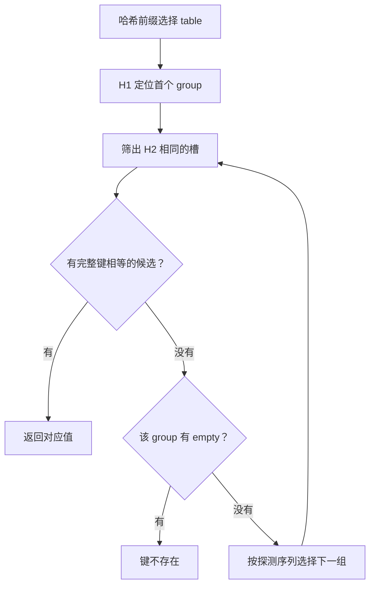

# 第七讲：Go 的 Map 和 Map 底层实现完整学习笔记

> 整理日期：2026-10-21。示例执行环境：Go 1.27.3，linux/amd64。旧版运行时源码固定为 Go 1.23.12；新版实现核对 Go 1.27.3。本文明确区分语言保证、特定版本实现和示例模型。

<a id="reading-notes"></a>

> **统一运行基线：** 建议使用 Go 1.27.3，示例模块声明采用 `go 1.27.0`。文中出现其他 Go 版本时，仅用于说明特性引入时间或历史实现差异；第三方依赖仍以对应模块的版本要求为准。


*图示：Map 查找与更新。*

## 正文导航

- [一、Map 基础](#chapter-1)
  - [1.1 Map 的基本语法](#section-1-1)
  - [1.2 Map 键和值的特性](#section-1-2)
  - [1.3 Map 的内部实现](#section-1-3)
  - [1.4 删除元素](#section-1-4)
  - [1.5 Map 遍历](#section-1-5)
  - [1.6 Map 并发处理](#section-1-6)
    - [1.6.1 并发读写的处理方法](#section-1-6-1)
  - [1.7 Map 性能问题](#section-1-7)
  - [1.8 Map 性能优化](#section-1-8)
  - [1.9 Map 的简单用例](#section-1-9)
  - [1.10 总结](#section-1-10)
- [二、Map 的底层实现（Go 1.23.12 旧实现）](#chapter-2)
  - [2.1 Map 底层数据结构](#section-2-1)
    - [2.1.1 hmap](#section-2-1-1)
    - [2.1.2 hiter 结构体解析](#section-2-1-2)
      - [2.1.2.1 工作机制](#section-2-1-2-1)
      - [2.1.2.2 hiter 与 GC 相关问题](#section-2-1-2-2)
    - [2.1.3 mapextra 结构体](#section-2-1-3)
    - [2.1.4 bmap 结构体](#section-2-1-4)
  - [2.2 Map 的函数调用和类型字段](#section-2-2)
    - [2.2.1 Map 操作的函数调用](#section-2-2-1)
    - [2.2.2 Map 类型 maptype](#section-2-2-2)
      - [2.2.2.1 MapType 结构体解析](#section-2-2-2-1)
        - [辅助方法解析](#heading-056)
      - [2.2.2.2 Type 结构体解析](#section-2-2-2-2)
  - [2.3 Map 创建](#section-2-3)
    - [2.3.1 makemap](#section-2-3-1)
      - [2.3.1.1 函数作用](#section-2-3-1-1)
      - [2.3.1.2 代码分解](#section-2-3-1-2)
      - [2.3.1.3 总结](#section-2-3-1-3)
      - [2.3.1.4 完整代码](#section-2-3-1-4)
    - [2.3.2 makeBucketArray 函数](#section-2-3-2)
      - [2.3.2.1 函数参数](#section-2-3-2-1)
      - [2.3.2.2 返回值](#section-2-3-2-2)
      - [2.3.2.3 代码解读](#section-2-3-2-3)
      - [2.3.2.4 总结](#section-2-3-2-4)
      - [2.3.2.5 完整代码](#section-2-3-2-5)
  - [2.4 Map 读取](#section-2-4)
    - [2.4.1 定位 key 的方式](#section-2-4-1)
    - [2.4.2 mapaccess1 源码解析](#section-2-4-2)
      - [2.4.2.1 函数流程解读](#section-2-4-2-1)
      - [2.4.2.2 重要机制](#section-2-4-2-2)
  - [2.5 Map 删除](#section-2-5)
  - [2.6 Map 修改和写入](#section-2-6)
    - [2.6.1 函数流程解读](#section-2-6-1)
    - [2.6.2 重要机制](#section-2-6-2)
  - [2.7 Map 扩容](#section-2-7)
    - [2.7.1 扩容触发条件](#section-2-7-1)
    - [2.7.2 扩容源码解析](#section-2-7-2)
      - [2.7.2.1 hashGrow 函数](#section-2-7-2-1)
      - [2.7.2.2 growWork 函数](#section-2-7-2-2)
  - [2.8 Map 迭代器](#section-2-8)
    - [2.8.1 mapiterinit 迭代器初始化](#section-2-8-1)
    - [2.8.2 mapiternext 遍历下一个元素](#section-2-8-2)
  - [2.9 补充：Go 1.24 起的 Swiss Table 实现](#section-2-9)
    - [2.9.1 从桶和溢出链，转向 group、table 与 directory](#section-2-9-1)
    - [2.9.2 控制字节怎样减少完整键比较](#section-2-9-2)
    - [2.9.3 查找和组间探测](#section-2-9-3)
    - [2.9.4 删除、墓碑、清理和内存](#section-2-9-4)
    - [2.9.5 增长为什么需要多张表和可扩展目录](#section-2-9-5)
    - [2.9.6 当前 Map 和类型元数据怎样对应](#section-2-9-6)
    - [2.9.7 新版迭代怎样面对增长、删除和清空](#section-2-9-7)
    - [2.9.8 旧版与新版对照，以及应该记住的稳定规则](#section-2-9-8)
- [三、小结](#chapter-3)
- [附录 A：自测题与参考答案](#appendix-a)
  - [A.1 基础与工程使用自测](#section-a-1)
  - [A.2 源码与版本自测](#section-a-2)
- [附录 B：可复用的性能测量练习](#appendix-b)
  - [B.1 测量创建提示和纯查询](#section-b-1)
  - [B.2 应该记录和比较什么](#section-b-2)
- [附录 C：官方资料与版本源码导航](#appendix-c)
  - [C.1 语言规则、使用方式与工具](#section-c-1)
  - [C.2 固定标签的源码入口](#section-c-2)
  - [C.3 中文辅助资料](#section-c-3)
- [附录 D：示例验证与使用边界](#appendix-d)
  - [D.1 本次实际验证记录](#section-d-1)
  - [D.2 如何理解输出和源码结论](#section-d-2)

<a id="chapter-1"></a>

## 一、Map 基础

Map 用来保存“通过一个键找到一个值”的对应关系。例如用课程名称查学习时长、用调用方 ID 查资料、用一个单词查出现次数。声明中的 `map[K]V` 同时确定键类型 `K` 和值类型 `V`；同一个 map 中的键各不相同。Map 不负责维护插入顺序，也不提供按位置访问第几个元素的接口。[官方依据：Map types](https://go.dev/ref/spec#Map_types)。

本章的完整程序按官方规则编写；使用官方示例思路的地方会单独说明。输出涉及键顺序时显式排序，避免把某一次运行观察到的顺序误当成语言保证。

<a id="section-1-1"></a>

### 1.1 Map 的基本语法

<a id="heading-009"></a>

#### 声明与创建

三种写法分别表达“声明一个尚未初始化的 map 值”“创建一个可写入的空 map”“创建并放入初始数据”：

```go
var scores map[string]int
scores = make(map[string]int)
scores = map[string]int{"Go": 90, "SQL": 85}
```

`var` 声明得到的零值为 `nil`。`nil` map 可以查询长度、遍历和清空；在键满足比较要求时，也可以读取和删除，但不能新增或更新元素，写入会触发 panic。接口键的动态值如果不可比较，读取或删除仍可能 panic，后面的接口键小节会解释。`make` 和 map 字面量创建可写入的映射。这里的“空”只表示 `len(m) == 0`，不能据此判断 `m == nil`。[官方依据：Map types](https://go.dev/ref/spec#Map_types)、[Index expressions](https://go.dev/ref/spec#Index_expressions)。

**示例 B-01：nil map 与已初始化的空 map。**

```go
// 运行示例：B-01
package main

import "fmt"

func main() {
	var pending map[string]int
	ready := make(map[string]int)
	literal := map[string]int{}

	fmt.Println(pending == nil, len(pending), pending["Go"])
	fmt.Println(ready == nil, len(ready))
	fmt.Println(literal == nil, len(literal))
	ready["Go"] = 90
	fmt.Println(ready["Go"])
}
```

输出：

```text
true 0 0
false 0
false 0
90
```

需要区分“函数允许返回 nil map”和“调用者要向返回值写数据”。如果一个查询函数只返回结果供读取，nil map 可以表示没有结果；若 API 承诺返回值可继续写入，就应返回已初始化的 map，或者明确说明调用者需要初始化。

<a id="heading-010"></a>

#### 插入、更新、读取与存在性判断

`m[k] = v` 对不存在的键执行插入，对已存在的键执行覆盖。单值读取 `v := m[k]` 在键不存在时得到值类型的零值；双值读取 `v, ok := m[k]` 还能判断是否存在。因此，“值为零”和“键不存在”必须用 `ok` 区分。`len(m)` 计算键值对数量，重复写入同一个键不会增加数量。[官方依据：Index expressions](https://go.dev/ref/spec#Index_expressions)。

**示例 B-02：存在的零值与缺失的键。**

```go
// 运行示例：B-02
package main

import "fmt"

func main() {
	minutes := map[string]int{"Go": 0}
	v, ok := minutes["Go"]
	fmt.Println("Go:", v, ok)
	v, ok = minutes["Rust"]
	fmt.Println("Rust:", v, ok)

	minutes["Go"] = 30
	minutes["Go"] += 15
	minutes["SQL"]++
	fmt.Println(minutes["Go"], minutes["SQL"], len(minutes))
}
```

输出：

```text
Go: 0 true
Rust: 0 false
45 1 2
```

最后的 `minutes["SQL"]++` 能成立，是因为读取缺失键先得到整数零值，再将增加后的结果写回。这个写法适合计数，但并不意味着操作具有并发原子性；多个 goroutine 同时执行时仍需要同步。

<a id="heading-011"></a>

#### make 的第二个参数是容量提示

`make(map[K]V, hint)` 中的 `hint` 帮助实现为预期元素数量安排空间。它不会创建 `hint` 个元素，也不限制后来可以插入多少项。Map 没有供调用方调用的 `cap(m)`；`cap` 的允许类型不包括 map。不能用 `len` 推导出运行时当前分配了多少存储。[官方依据：Making slices, maps and channels](https://go.dev/ref/spec#Making_slices_maps_and_channels)、[Length and capacity](https://go.dev/ref/spec#Length_and_capacity)。

**示例 B-03：提示值与实际元素数量。**

```go
// 运行示例：B-03
package main

import "fmt"

func main() {
	m := make(map[int]string, 2)
	fmt.Println("initial:", len(m))
	for i := 0; i < 5; i++ {
		m[i] = "ready"
	}
	fmt.Println("after insertion:", len(m), m[4])
}
```

输出：

```text
initial: 0
after insertion: 5 ready
```

如果预计约有一万条不同记录，`make(map[Key]Value, 10000)` 表达了合理的初始估计；不能据此承诺“绝不会发生后续分配”。最终行为还取决于实际键数量、键值类型、Go 版本和运行时策略。

<a id="section-1-2"></a>

### 1.2 Map 键和值的特性

<a id="heading-013"></a>

#### 键必须支持相等比较

选择键时，先确定业务上怎样判断“同一个对象”，再选择类型。Go 用键类型的相等比较规则区分键，不会自动调用某个自定义的 `Equal` 方法，也不会自动把字符串转成小写或把空格去掉。[官方依据：Comparison operators](https://go.dev/ref/spec#Comparison_operators)。

| 键类型 | 能否直接用作 map 键 | 判断依据与常见误区 |
| --- | --- | --- |
| 整数、布尔、字符串 | 可以 | 按对应值比较；字符串区分大小写 |
| 浮点数、复数 | 可以 | 需要特别处理 NaN 等业务边界 |
| 指针、通道 | 可以 | 比较身份，不按其所指数据的内容比较 |
| 数组 | 元素类型可比较时可以 | 长度是类型的一部分，按元素比较 |
| 结构体 | 所有字段可比较时可以 | 适合把多个维度组成一个键 |
| 接口，如 `any` | 类型可以作为键 | 实际放入的动态值仍可能不可比较并引发 panic |
| 切片、map、函数 | 不可以 | 不能声明为普通 map 的键类型 |

结构体或数组内部若含接口字段，动态值的可比较性依然要检查。不要把“编译器允许这个键类型”理解成“任何装进这个类型的值都绝不会引起比较 panic”。

**示例 B-04：用结构体表达复合键。** 下例借鉴官方博客使用结构体键表示多个查询维度的思路；城市、课程和数据由本笔记重新设计。[参考：Go maps in action](https://go.dev/blog/maps)。

```go
// 运行示例：B-04
package main

import "fmt"

type EnrollmentKey struct {
	City   string
	Course string
}

func main() {
	counts := make(map[EnrollmentKey]int)
	counts[EnrollmentKey{City: "杭州", Course: "Go"}]++
	counts[EnrollmentKey{City: "杭州", Course: "Go"}]++
	counts[EnrollmentKey{City: "杭州", Course: "SQL"}]++
	fmt.Println(counts[EnrollmentKey{"杭州", "Go"}])
	fmt.Println(counts[EnrollmentKey{"杭州", "SQL"}])
	fmt.Println(len(counts))
}
```

输出：

```text
2
1
2
```

复合键可以避免随意拼接字符串产生的歧义。例如把 `("a:b", "c")` 和 `("a", "b:c")` 都拼成 `"a:b:c"`，就会把不同对象混在一起。若确实要生成字符串键，应定义可靠的编码规则，或直接使用结构体键。

<a id="heading-014"></a>

#### 接口键：动态类型也参与比较

`map[any]V` 不等于“随便什么值都能做键”。当键为接口值时，动态类型和动态值共同决定比较结果。例如 `int(7)` 与 `int64(7)` 作为接口值不同；把 `[]int` 放进接口后，切片仍然不可比较。

**示例 B-05：不同动态类型与受控的 panic 演示。** 程序只记录是否发生 panic，不依赖运行时错误文字的具体措辞。

```go
// 运行示例：B-05
package main

import "fmt"

func tryInsert(m map[any]string, key any) (panicked bool) {
	defer func() {
		panicked = recover() != nil
	}()
	m[key] = "value"
	return false
}

func main() {
	m := map[any]string{int(7): "int", int64(7): "int64"}
	fmt.Println(len(m), m[int(7)], m[int64(7)])
	fmt.Println("slice key panicked:", tryInsert(m, []int{7}))
	fmt.Println("array key panicked:", tryInsert(m, [1]int{7}))
	fmt.Println("entries:", len(m))
}
```

输出：

```text
2 int int64
slice key panicked: true
array key panicked: false
entries: 3
```

实际业务中，能用明确键类型时就优先使用明确类型；通过收窄类型来约束调用者，通常比在大量查询路径上捕获 panic 更清楚。这里的 `recover` 仅用于让边界实验完整运行。

这个动态约束也适用于读取和删除。即使 `var m map[any]int` 是 nil，`m[[]int{1}]` 和 `delete(m, []int{1})` 仍会因为动态键不可比较而 panic；“nil Map 查询返回零值、删除是空操作”以键有效为前提。[示例 O-02](#section-2-4-2-2) 给出完整的受控演示。[官方依据：Map types](https://go.dev/ref/spec#Map_types)。

<a id="heading-015"></a>

#### NaN 可以存进去，却不能按通常方式查回来

浮点 NaN 的一个关键性质是 `NaN != NaN`。因此它虽然属于可比较的浮点类型，但不是一个能通过相等比较再次匹配自身的普通键。同一个 NaN 变量多次作为键写入，可以增加多个条目；按这个 NaN 查询或删除，并不能匹配到这些条目。`clear` 可以清空整个 map，包含这些键。[官方依据：Comparison operators](https://go.dev/ref/spec#Comparison_operators)、[Clear](https://go.dev/ref/spec#Clear)；标准库也明确提醒 `maps` 包不为这类非自反键提供特殊处理：[maps 概览](https://pkg.go.dev/maps)。

**示例 B-06：NaN 键的查找与删除。**

```go
// 运行示例：B-06
package main

import (
	"fmt"
	"math"
)

func main() {
	nan := math.NaN()
	m := make(map[float64]string)
	m[nan] = "first"
	m[nan] = "second"
	_, ok := m[nan]
	fmt.Println(nan == nan, len(m), ok)
	delete(m, nan)
	fmt.Println("after delete:", len(m))
	clear(m)
	fmt.Println("after clear:", len(m))
}
```

输出：

```text
false 2 false
after delete: 2
after clear: 0
```

如果业务把所有缺失测量值归为同一组，应先把它们规范化为明确的状态键；如果要按浮点位模式区分数据，也应明确设计位模式键的含义。不要在没有定义业务等价关系时直接把任意浮点数当标识符。

<a id="heading-016"></a>

#### 值按赋值规则复制，map 元素不可取地址

Map 的值类型可以是整数、结构体、切片、指针或另一个 map。读取结构体值会得到这个值的副本；直接写 `m[k].Count++` 不成立，因为 map 索引表达式不是可寻址的结构体变量。`&m[k]` 也不允许。语言为 `m[k] = v` 和 `m[k]++` 等 map 元素赋值提供了专门规则，但这没有把 map 元素变成普通的可寻址变量。[官方依据：Address operators](https://go.dev/ref/spec#Address_operators)、[Assignment statements](https://go.dev/ref/spec#Assignment_statements)。

两种常见做法是：取出结构体副本、修改后放回；或者在 map 中保存指针，再通过指针修改对象。第二种做法改变了对象共享和生命周期，不能只把它看成一种简写。

**示例 B-07：结构体值与结构体指针。**

```go
// 运行示例：B-07
package main

import "fmt"

type Progress struct {
	Done int
}

func main() {
	values := map[string]Progress{"Go": {Done: 1}}
	item := values["Go"]
	item.Done++
	fmt.Println("before writeback:", values["Go"].Done)
	values["Go"] = item
	fmt.Println("after writeback:", values["Go"].Done)

	pointers := map[string]*Progress{"Go": &Progress{Done: 1}}
	pointers["Go"].Done++
	fmt.Println("through pointer:", pointers["Go"].Done)
}
```

输出：

```text
before writeback: 1
after writeback: 2
through pointer: 2
```

`map[string]*Progress` 中若键缺失，读取结果是 nil 指针，再访问 `.Done` 会 panic。若不同键保存同一个指针，修改其中一个键对应的对象，另一个键也会看到变化；并发保护还需要覆盖对象本身。

<a id="heading-017"></a>

#### Map 赋值共享同一个映射；重新赋值只改当前变量

把 map 赋给另一个变量或作为函数参数传递，会复制 map 值，两个值仍引用同一个映射。通过任一副本增删改元素，其他持有者能看到结果；但在函数里执行 `m = make(...)` 只是让参数变量改为引用另一个映射，调用者的变量不会随之重新绑定。这个区别与“所有参数都按值传递”并不冲突。[官方依据：Representation of values](https://go.dev/ref/spec#Representation_of_values)、[Calls](https://go.dev/ref/spec#Calls)。

**示例 B-08：共享修改和局部重新绑定。**

```go
// 运行示例：B-08
package main

import "fmt"

func update(m map[string]int) {
	m["Go"]++
	m = map[string]int{"Go": 100}
	m["SQL"] = 200
}

func main() {
	original := map[string]int{"Go": 1}
	alias := original
	update(original)
	fmt.Println(original["Go"], alias["Go"], len(original))
	alias["SQL"] = 3
	fmt.Println(original["SQL"])
}
```

输出：

```text
2 2 1
3
```

如果函数需要创建并交回一个新 map，通常直接返回它，由调用者写 `m = buildMap()`；只为向已初始化的 map 中增加元素，不必传 `*map[K]V`。

<a id="heading-018"></a>

#### maps.Clone 是浅拷贝

标准库 `maps.Clone` 对非 nil 输入创建另一份映射，但键和值仍按普通赋值复制；如果输入是 nil，结果也保留为 nil，不会自动变成可写的空 Map。整数值随后独立；切片值复制的是切片描述信息，底层数组仍可能共享。指针、嵌套 map、含引用字段的结构体也有对应的共享关系。[官方依据：maps.Clone](https://pkg.go.dev/maps#Clone)。

**示例 B-09：独立映射与共享的切片内容。** 例子沿用官方 `Clone` 文档“分别观察普通值与切片值”的讲解主题，重写了数据和展示方式。

```go
// 运行示例：B-09
package main

import (
	"fmt"
	"maps"
	"slices"
)

func main() {
	original := map[string][]int{"Go": {1, 2}}
	shallow := maps.Clone(original)
	shallow["Go"][0] = 9
	shallow["SQL"] = []int{3}
	fmt.Println(original["Go"], len(original), len(shallow))

	independent := make(map[string][]int, len(original))
	for key, values := range original {
		independent[key] = slices.Clone(values)
	}
	independent["Go"][1] = 8
	fmt.Println(original["Go"], independent["Go"])
}
```

输出：

```text
[9 2] 1 2
[9 2] [9 8]
```

这里额外复制一层切片就足够，是因为切片元素是 `int`。换成 `[]*Node` 时，`slices.Clone` 仍会复制指针，节点依然共享。“深拷贝到哪一层”应由数据结构和业务所有权决定，不能只看用了几个 `Clone`。

<a id="heading-019"></a>

#### Map 不能直接互相做 == 比较

Map 值只能与 `nil` 比较，不能写 `m1 == m2` 判断内容是否相同。内容比较可以用 `maps.Equal`；值不可比较时可用 `maps.EqualFunc` 提供值比较函数。`Equal` 将没有元素的 nil map 与空 map 视为相等；它们是否为 nil 的区别仍然存在。NaN 键、NaN 值等非自反值还会影响相等结果。[官方依据：maps.Equal](https://pkg.go.dev/maps#Equal)、[maps.EqualFunc](https://pkg.go.dev/maps#EqualFunc)。

**示例 B-10：比较内容与比较是否初始化。**

```go
// 运行示例：B-10
package main

import (
	"fmt"
	"maps"
	"slices"
)

func main() {
	var absent map[string]int
	empty := map[string]int{}
	fmt.Println(maps.Equal(absent, empty), absent == nil, empty == nil)
	fmt.Println(maps.Equal(map[string]int{"Go": 2}, map[string]int{"Go": 2}))
	a := map[string][]int{"Go": {1, 2}}
	b := map[string][]int{"Go": {1, 2}}
	fmt.Println(maps.EqualFunc(a, b, slices.Equal[[]int, int]))
}
```

输出：

```text
true true false
true
true
```

<a id="section-1-3"></a>

### 1.3 Map 的内部实现

从使用者角度，可以先把查找理解为三个步骤：计算键的哈希值、缩小候选位置范围、对候选键做真正的相等比较。哈希值相同并不保证键相等，冲突处理是哈希表必须解决的问题。存储数量增加后，实现还需要调整布局，控制查找和插入的成本。

不过，上述流程不是语言层对内存布局的规定。语言规范规定的是键值关系、操作结果、比较限制和遍历语义；底层结构可以更换。本章的 `hmap`、`bmap`、`hiter`、`hashGrow` 属于旧实现的学习路径，本笔记第二章按 Go 1.23.12 源码讲解；Go 1.24 已引入基于 Swiss Table 的新实现，不能把旧版桶链结构套用到本次使用的 Go 1.27.3。[官方说明：Faster Go maps with Swiss Tables](https://go.dev/blog/swisstable)。

| 层次 | 应掌握的内容 | 是否应写进业务代码的假设 |
| --- | --- | --- |
| 语言规则 | nil 行为、可比较键、零值查询、无固定顺序 | 可以依赖 |
| 标准库契约 | `maps.Clone` 浅拷贝、`sync.Map` 方法语义 | 可以依赖对应版本的公开 API |
| 运行时实现 | 桶或组、哈希片段、探测与迁移方式 | 用来理解源码，不作为跨版本契约 |
| 某次实验 | 分配次数、纳秒数、内存占用 | 记录环境和负载后用于判断，不能泛化 |

Map 的平均查询成本通常可以按常数级理解，但这不是每次操作都具有相同耗时的承诺：字符串长度、哈希成本、缓存命中、冲突、扩容、GC 和锁竞争都可能影响实际表现。对于极小数据集，一段短切片的线性查找也可能合适；应按真实场景测量。

<a id="section-1-4"></a>

### 1.4 删除元素

<a id="heading-022"></a>

#### delete、clear 与重新赋值的区别

`delete(m, key)` 删除一个匹配的键，不返回值；键满足比较要求时，键不存在或 map 为 nil 都不产生额外效果。接口键的动态值不可比较时仍可能 panic。`clear(m)` 删除全部条目，Go 1.21 起可用。两者操作的都是当前映射，其他别名会观察到删除结果。`m = make(map[K]V)` 只改变变量 `m` 的绑定，原映射若还有别名就仍然存在。[官方依据：Deletion of map elements](https://go.dev/ref/spec#Deletion_of_map_elements)、[Clear](https://go.dev/ref/spec#Clear)。

**示例 B-11：删除、清空和换一个 map。**

```go
// 运行示例：B-11
package main

import "fmt"

func main() {
	var absent map[string]int
	delete(absent, "x")
	clear(absent)
	fmt.Println("nil:", absent == nil, len(absent))

	m := map[string]int{"Go": 2, "SQL": 1}
	alias := m
	delete(m, "missing")
	delete(m, "SQL")
	fmt.Println("after delete:", len(m), len(alias))
	clear(m)
	fmt.Println("after clear:", m == nil, len(alias))

	m["Go"] = 5
	m = make(map[string]int)
	fmt.Println("after replacement:", len(m), alias["Go"])
}
```

输出：

```text
nil: true 0
after delete: 1 1
after clear: false 0
after replacement: 0 5
```

删除后 `len` 变小，不等于整张表的分配空间立刻按比例缩小；`clear` 也不承诺把内存马上交还操作系统。若需要在长期持有的大 map 大幅缩减后更换存储，可以构建新 map 并迁移仍需要的条目，但要确认旧 map 和其内容没有其他引用；最终回收时机仍属于 GC 和运行时职责。

<a id="heading-023"></a>

#### 按条件删除

可以在单个 goroutine 中边遍历边删除，或用 `maps.DeleteFunc` 表达条件。以下代码删除计数为零的课程，保留活跃项。它是根据标准库 API 编写的应用例子。[官方依据：maps.DeleteFunc](https://pkg.go.dev/maps#DeleteFunc)。

**示例 B-12：条件过滤。**

```go
// 运行示例：B-12
package main

import (
	"fmt"
	"maps"
)

func main() {
	active := map[string]int{"Go": 2, "SQL": 0, "Rust": 0}
	maps.DeleteFunc(active, func(_ string, count int) bool {
		return count == 0
	})
	fmt.Println(len(active), active["Go"])
	_, exists := active["SQL"]
	fmt.Println(exists)
}
```

输出：

```text
1 2
false
```

谓词应尽量只判断当前键值是否满足删除条件。特别是存在 NaN 键时，不要期待基于键匹配的删除替代 `clear`；若要无条件清空整张 map，直接使用 `clear` 更准确。

<a id="section-1-5"></a>

### 1.5 Map 遍历

<a id="heading-025"></a>

#### 基本写法与稳定输出

`for key, value := range m` 同时取得键和值；只需要键时写 `for key := range m`；只需要值时用 `_` 忽略键。Map 的遍历顺序未指定，同一张 map 的两次遍历也不能假设相同。若要展示排行榜、生成确定的测试输出，先收集键，再按所需规则排序。[官方依据：For statements with range clause](https://go.dev/ref/spec#For_statements)。

**示例 B-13：按键排序后访问。** 写法根据官方博客的排序遍历思路改编，显式展示最终顺序。[参考：Go maps in action](https://go.dev/blog/maps)。

```go
// 运行示例：B-13
package main

import (
	"fmt"
	"sort"
)

func main() {
	minutes := map[string]int{"SQL": 20, "Go": 45, "Rust": 10}
	keys := make([]string, 0, len(minutes))
	for key := range minutes {
		keys = append(keys, key)
	}
	sort.Strings(keys)
	for _, key := range keys {
		fmt.Printf("%s: %d\n", key, minutes[key])
	}
}
```

输出：

```text
Go: 45
Rust: 10
SQL: 20
```

排序的是另一个键切片，并没有改变 map 自身的布局或后续 `range` 顺序。如果需要“按插入先后遍历”，可以另外保存插入顺序切片，并明确重复插入、删除和再次插入如何影响这份顺序。

<a id="heading-026"></a>

#### range 得到的值是副本

`value` 是这一轮接收 map 元素值的变量。对整数或结构体副本赋值，不会自动写回 map；要改映射必须显式使用键。值内若包含指针或切片，修改它所指的数据则可能影响共享对象，这与前面浅拷贝的规则相同。

**示例 B-14：修改循环变量与写回 map。**

```go
// 运行示例：B-14
package main

import "fmt"

func main() {
	m := map[string]int{"a": 1, "b": 2}
	for _, value := range m {
		value *= 10
	}
	fmt.Println(m["a"], m["b"])
	for key := range m {
		m[key] *= 10
	}
	fmt.Println(m["a"], m["b"])
}
```

输出：

```text
1 2
10 20
```

<a id="heading-027"></a>

#### 遍历期间增加或删除元素

在同一个 goroutine 内，语言允许遍历期间修改 map。未到达的条目若被删除，之后不会为它产生迭代值；遍历期间新建的条目，可能被遍历到，也可能跳过。不能用这种遍历方式可靠地“处理所有后来新增的任务”。若必须逐个处理新增工作，显式维护队列更容易保证完成条件。[官方依据：For statements](https://go.dev/ref/spec#For_statements)。

**示例 B-15：删掉尚未到达的条目。** 第一次迭代时，保留当前键并删除其他键。无论哪一个键先出现，总共都只会得到一次迭代。

```go
// 运行示例：B-15
package main

import "fmt"

func main() {
	m := map[string]int{"a": 1, "b": 2, "c": 3}
	visited := 0
	for current := range m {
		visited++
		for key := range m {
			if key != current {
				delete(m, key)
			}
		}
	}
	fmt.Println("visited:", visited, "remaining:", len(m))
}
```

输出：

```text
visited: 1 remaining: 1
```

这里刻意没有输出剩下的具体键，因为它未被规范保证。单 goroutine 内允许这样修改，与“另一个 goroutine 可以无锁修改正在遍历的 map”是不同的问题；后者需要同步。

<a id="heading-028"></a>

#### Go 1.23 起的迭代器辅助函数

`maps.Keys` 返回键迭代器，`maps.Values` 返回值迭代器，`maps.All` 返回键值对迭代器；它们本身仍不提供顺序保证。可以把键迭代器交给 `slices.Sorted` 得到已排序切片。迭代器描述的是如何遍历，不会在调用 `maps.Keys` 的那一刻自动冻结一份快照。[官方依据：maps.Keys](https://pkg.go.dev/maps#Keys)、[slices.Sorted](https://pkg.go.dev/slices#Sorted)、[Go 1.23 Release Notes](https://go.dev/doc/go1.23)。

**示例 B-16：迭代器与排序。** 这组标准库 API 自 Go 1.23 起可用。本例把模块设置为 `go 1.23`；工具链也须具有这些 API。

```go
// 运行示例：B-16
// 运行基线：Go 1.27.3（模块声明 go 1.27.0）
package main

import (
	"fmt"
	"maps"
	"slices"
)

func main() {
	m := map[string]int{"b": 2, "a": 1}
	keys := maps.Keys(m)
	m["c"] = 3
	fmt.Println(slices.Sorted(keys))

	total := 0
	for _, value := range maps.All(m) {
		total += value
	}
	fmt.Println(total)
}
```

输出：

```text
[a b c]
6
```

生成并消费这个迭代器的过程中若有其他 goroutine 写 map，仍然需要对整个相关访问过程进行同步。换成迭代器 API 不会自动获得并发安全性。

<a id="section-1-6"></a>

### 1.6 Map 并发处理

普通 map 的多个读取可以并发进行，前提是它已被正确发布给读者，而且没有任何并发修改。只要一个 goroutine 可能写入、删除或清空，就必须让相关访问遵循共同的同步方案；写入不同键也不代表安全，因为操作仍可能修改同一张表的内部状态。[官方依据：Go maps in action，Concurrency](https://go.dev/blog/maps)、[Go Memory Model](https://go.dev/ref/mem)。

这里的“读取”不只是 `m[k]`，也包括 `len(m)`、`range m`、复制键值的循环，以及 `maps.Clone` 等内部读取 map 的函数。仅给写入代码加锁、让其他读者绕过锁，不能建立完整保护。对于 `map[K]*T`，锁保护映射本身也不自动保护取出的 `*T` 对象；对象字段的读写还需要纳入设计。

运行时可能报告 `concurrent map writes`、`concurrent map read and map write` 或迭代相关的致命错误，但这些检查不是完整的竞态检测器。“跑了很多次都没有报错”不能证明正确，也不能通过 `recover` 把普通 map 变成并发容器。正确做法是消除数据竞争，再用 `go test -race` 或 `go run -race` 帮助检查实际执行到的路径；竞态检测也无法覆盖没有被执行的路径。[官方依据：Data Race Detector](https://go.dev/doc/articles/race_detector)。

<a id="section-1-6-1"></a>

#### 1.6.1 并发读写的处理方法

<a id="heading-031"></a>

##### 方法一：普通 map 配合互斥锁

对于有明确键值类型、需要同时维护多个字段或多个条目一致性的业务，普通 map 配合 `sync.Mutex` 或 `sync.RWMutex` 是直接的选择。互斥锁要保护完整业务操作，例如“读旧计数、加一、写回”应处于同一个临界区；分别锁住读和写，中间释放锁，仍可能丢失更新。

`RWMutex` 允许多个持有读锁的读者同时进入，但写者需要独占访问。它并不保证一定比 `Mutex` 快；临界区很短、写入多或竞争形式不同时，要通过基准比较。持有锁的对象第一次使用后不要复制，封装方法通常使用指针接收者。[官方依据：sync.Mutex](https://pkg.go.dev/sync#Mutex)、[sync.RWMutex](https://pkg.go.dev/sync#RWMutex)。

**示例 B-17：安全计数器与受保护的快照。** 写入在锁内完成，读取也使用同一把锁。快照先在读锁内复制，再交给调用者；本例的值是整数，所以这份浅拷贝足以隔离调用者后续修改。

```go
// 运行示例：B-17
package main

import (
	"fmt"
	"maps"
	"sync"
)

type Counter struct {
	mu   sync.RWMutex
	data map[string]int
}

func (c *Counter) Add(key string, delta int) {
	c.mu.Lock()
	defer c.mu.Unlock()
	if c.data == nil {
		c.data = make(map[string]int)
	}
	c.data[key] += delta
}

func (c *Counter) Value(key string) int {
	c.mu.RLock()
	defer c.mu.RUnlock()
	return c.data[key]
}

func (c *Counter) Snapshot() map[string]int {
	c.mu.RLock()
	defer c.mu.RUnlock()
	snapshot := maps.Clone(c.data)
	if snapshot == nil {
		snapshot = make(map[string]int)
	}
	return snapshot
}

func main() {
	var counter Counter
	emptySnapshot := counter.Snapshot()
	emptySnapshot["local"] = 1
	fmt.Println("empty snapshot:", counter.Value("local"), emptySnapshot["local"])
	var workers sync.WaitGroup
	workers.Add(4)
	for i := 0; i < 4; i++ {
		go func() {
			defer workers.Done()
			for n := 0; n < 100; n++ {
				counter.Add("Go", 1)
			}
		}()
	}
	workers.Wait()
	fmt.Println("count:", counter.Value("Go"))
	snapshot := counter.Snapshot()
	snapshot["Go"] = 0
	fmt.Println("original and snapshot:", counter.Value("Go"), snapshot["Go"])
}
```

输出：

```text
empty snapshot: 0 1
count: 400
original and snapshot: 400 0
```

这里 `Snapshot` 在持有读锁时完成复制，写者无法在复制途中修改映射；释放读锁以后，调用者处理的是新 map。实现还为 nil 数据补建空 Map，因此零值计数器的快照也可写；这一保证来自本例的补充逻辑，单独调用 `maps.Clone(nil)` 不具备它。若值改成切片或指针，快照仍可能共享更深层数据，必须继续明确这些对象能否修改。也不要提供一个 `RawMap()` 直接返回受保护的原 map，让调用者绕过锁。

锁内尽量只保留维护不变量所需的工作。若需要排序或生成报表，可以先在锁内复制所需数据，再在锁外执行耗时的格式化；不能为了缩短锁时间而让关键读写失去保护。

<a id="heading-032"></a>

##### 方法二：由一个 goroutine 独占 map

如果业务本身就围绕事件流或任务队列组织，可以让一个 goroutine 独占 map，其他 goroutine 通过通道发送更新请求。关键在于所有权：在负责处理的 goroutine 之外，不直接访问它正在修改的 map。通道传递 map 值不会深拷贝它，仍要遵守所有权约定。[官方依据：Go Memory Model，Channel communication](https://go.dev/ref/mem#chan)、[Effective Go，Share by communicating](https://go.dev/doc/effective_go#sharing)。

**示例 B-18：汇总多个生产者的计数事件。** 处理者收到关闭信号后结束遍历，把最终 map 交回主 goroutine，此后不再修改它。

```go
// 运行示例：B-18
package main

import (
	"fmt"
	"sync"
)

func main() {
	updates := make(chan string, 8)
	result := make(chan map[string]int)
	go func() {
		counts := make(map[string]int)
		for course := range updates {
			counts[course]++
		}
		result <- counts
	}()

	var producers sync.WaitGroup
	producers.Add(4)
	for i := 0; i < 4; i++ {
		go func() {
			defer producers.Done()
			for n := 0; n < 25; n++ {
				updates <- "Go"
			}
		}()
	}
	producers.Wait()
	close(updates)
	counts := <-result
	fmt.Println(counts["Go"], len(counts))
}
```

输出：

```text
100 1
```

这个结构把更新顺序集中到一个地方，适合事件汇总，但吞吐也会受到这个处理者限制。通道缓冲只允许部分请求排队，不会让一个 map 自动变成多个 goroutine 都可任意操作的共享容器。

<a id="heading-033"></a>

##### 方法三：在适合的访问模式中使用 sync.Map

`sync.Map` 的零值可直接使用，公开方法可以被多个 goroutine 并发调用。标准库把它定位为专门的并发结构，主要优化“每个键写一次、读很多次”和“多个 goroutine 主要访问不同键集合”的场景；一般业务仍应先考虑具有明确类型和统一一致性边界的普通 map 加同步。[官方依据：sync.Map](https://pkg.go.dev/sync#Map)。

**示例 B-19：原子方法与存在性语义。** 这里用顺序调用展示各方法的返回值，避免让并发调度决定示例输出。

```go
// 运行示例：B-19
package main

import (
	"fmt"
	"sync"
)

func main() {
	var limits sync.Map
	value, loaded := limits.LoadOrStore("daily", 10)
	fmt.Println(value, loaded)
	value, loaded = limits.LoadOrStore("daily", 20)
	fmt.Println(value, loaded)
	fmt.Println("changed:", limits.CompareAndSwap("daily", 10, 30))
	value, ok := limits.Load("daily")
	fmt.Println(value, ok)
	value, ok = limits.LoadAndDelete("daily")
	fmt.Println(value, ok)
	_, ok = limits.Load("daily")
	fmt.Println("remaining:", ok)
}
```

输出：

```text
10 false
10 true
changed: true
30 true
30 true
remaining: false
```

`LoadOrStore` 返回的 `loaded == true` 表示原来已有条目；`false` 表示本次保存了给定值。它把“查询是否存在并在缺失时写入”组织成一个操作。不过，传给它的参数表达式会先求值，所以 `LoadOrStore(key, expensiveBuild())` 不保证昂贵的构造函数只调用一次。

`sync.Map` 的键同样要满足可比较要求。它可以保存切片等不可比较的值，但 `CompareAndSwap`、`CompareAndDelete` 对用于比较的 `old` 值另有可比较要求；不能因为能够 `Store` 某个值，就推断所有比较方法都接受它。[官方依据：sync.Map.CompareAndSwap](https://pkg.go.dev/sync#Map.CompareAndSwap)。

使用 `sync.Map` 还要看清四个边界：

- `Load` 后自行计算再 `Store` 不是整体原子的自增；可以使用适合该业务的原子方法、原子计数对象或外部同步。
- 一个键上的原子操作不自动使多个键之间的转账、总量约束或索引更新成为一个事务。
- `Range` 不提供整张 map 在某一时刻的一致快照；并发更新时，各键可反映调用过程中的不同时间点。不能只靠 `Range` 生成要求严格一致的汇总。[官方依据：sync.Map.Range](https://pkg.go.dev/sync#Map.Range)。
- `sync.Map` 第一次使用后不能复制；保存的值若是可变对象，容器方法的安全性不替代对象自身的同步。

<a id="heading-034"></a>

#### 怎样选择同步方式

| 访问特点 | 可优先考虑的组织方式 | 需要保持的约定 |
| --- | --- | --- |
| 初始化后只读 | 普通 map，完成同步发布后共享 | 所有条目以及相关共享对象都不再修改 |
| 多键共同维护业务一致性 | 普通 map 加一把合适的锁 | 所有相关读写遵循同一临界区 |
| 事件流驱动的集中更新 | 一个 goroutine 独占，通道发送请求 | 不把仍在修改的 map 交给外部直接访问 |
| 单键独立、适合公开方法语义 | `sync.Map` | 不把方法级安全扩展为多步业务原子性 |
| 读极多、更新较少且需整版视图 | 明确设计的不可变快照发布 | 写方先构造新版本，发布后不修改旧版本；另行同步发布与写者 |

最后一种模式比本章例子复杂，需要明确快照中引用对象是否也不可变，以及多个写者怎样防止相互覆盖；不能只把 map 指针换成原子变量，就认为所有内部修改都安全。

<a id="section-1-7"></a>

### 1.7 Map 性能问题

性能分析先提出具体问题。例如“批量导入是否产生了很多分配”“读取较长字符串键是否占主要 CPU”“并发更新是否等待同一把锁”。只说“map 太慢”无法决定该改键类型、创建方式、数据结构还是同步策略。

| 可能影响耗时的因素 | 为什么会影响 | 应观察什么 |
| --- | --- | --- |
| 键的构造与哈希 | 每次拼接字符串、格式化、规范化本身也有成本 | CPU 分析中时间是否花在 map 之外 |
| 键比较 | 长字符串或复杂复合键可能需要更多比较工作 | 实际键长度、命中与未命中比例 |
| 值的大小与表示 | 按值读取或写入大结构体可能复制较多数据 | 总分配、复制成本、访问局部性 |
| 增长与删除模式 | 批量插入、频繁增删与稳定查询的负载不同 | 单次延迟分布、存活内存、增长阶段 |
| 同步竞争 | 多个操作等待同一临界区时，哈希本身可能不是瓶颈 | 锁等待、并发度、读写比例 |
| 工作集大小 | 数据远大于缓存时，内存访问成本可能更明显 | 不同数据规模下的基准变化 |

可以用标准 `testing` 包建立可重复基准，结合 `-benchmem` 观察分配，再用 CPU、内存和锁相关分析工具确认瓶颈。基准应接近真实负载，至少区分创建、命中查询、未命中查询、覆盖更新和新增写入；把字符串生成放在计时范围内还是外面，也要与实际问题一致。[官方依据：testing，Benchmarks](https://pkg.go.dev/testing#hdr-Benchmarks)、[Diagnostics](https://go.dev/doc/diagnostics)。

附录 B 给出一份完整可运行的基准文件，同时比较创建时有无大小提示，以及准备好数据后的命中查询。可以直接沿用其命令，再按项目的键类型、规模和命中比例扩展。

重点比较同一环境下的 `ns/op`、`B/op` 和 `allocs/op`，并观察重复运行的波动。本笔记不预设固定纳秒数或提升比例，也不把创建基准的结果推广到全部查找场景。Go 版本、处理器、编译选项、元素规模与键类型都应随结果记录；比较 Go 1.23 与更高版本时，还涉及底层实现变化。

<a id="section-1-8"></a>

### 1.8 Map 性能优化

优化应有对应的证据和取舍。下表中的方法是待评估的选择，不是每个项目都要采用的固定流程。

| 做法 | 可能解决的问题 | 代价与适用边界 |
| --- | --- | --- |
| 有依据地设置 `make` 提示值 | 批量构建时减少增长过程中的工作 | 严重高估会保留多余空间；提示不是上限 |
| 使用明确、紧凑的键类型 | 避免不必要的接口包装或复杂键构造 | 不能为省成本而破坏业务等价关系 |
| 在循环外完成可复用的键转换 | 避免同一输入反复格式化 | 缓存本身也占空间，失效策略需明确 |
| 只在确有需要时同时取值和存在性 | 用一次 `v, ok := m[k]` 完成语义完整的查询 | 不要用“值非零”替代存在性 |
| 评估大值使用指针 | 减少某些大对象的值复制 | 可能增加分配、间接访问、共享与 GC 负担 |
| 缩短锁内的无关工作 | 降低等待时间 | 保持完整业务操作的原子性，不允许无锁绕过 |
| 在合适的数据规模下比较切片或数组 | 稠密小整数索引或很小集合可更简单 | 稀疏键、动态增长、查询模式不同会改变结论 |
| 在长期缩容需求下重建映射 | 让旧的大型存储有机会回收 | 需要额外复制峰值内存，也要消除旧引用 |

例如一个成绩表经常按学生 ID 查询，map 很合适；若 ID 正好是固定范围 `0..999` 且全部存在，用长度固定的切片可能更直观。反过来，若 ID 是任意字符串，不能仅为了避开 map 就建立难以维护的编号转换层。

集合一般可以写为 `map[K]struct{}`，表达“只关心键是否存在”。空结构体不携带业务数据，但整张 map 仍有键、管理信息和分配成本；不要据此说它“完全不占内存”，也不要在没有基准时承诺它一定比 `map[K]bool` 快。

对共享 map，先判断时间到底消耗在查找还是锁等待上。若锁保护的是完整业务状态，贸然拆成多个 map 或多把锁可能破坏一致性；应先设计分片规则、跨分片操作和统计方式，再评估是否值得增加复杂度。

最后，`unsafe` 读取运行时私有 map 布局不是常规性能优化手段。这样做会把代码绑定到具体版本、架构和编译实现，而且无法让依赖变成语言保证。本讲后面的源码解析用于解释机制，业务代码优先使用公开操作和 API。

<a id="section-1-9"></a>

### 1.9 Map 的简单用例

<a id="heading-038"></a>

#### 用例一：词频统计

缺失键读取为整数零值，使 `counts[word]++` 很适合累加。这个例子按 Go Tour 的词频练习思路扩展，额外处理英文大小写并排序输出。[参考：A Tour of Go，Exercise: Maps](https://go.dev/tour/moretypes/23)、[strings.Fields](https://pkg.go.dev/strings#Fields)。

**示例 B-20：统计并稳定展示。**

```go
// 运行示例：B-20
package main

import (
	"fmt"
	"sort"
	"strings"
)

func main() {
	counts := make(map[string]int)
	for _, word := range strings.Fields("Go helps Go learners") {
		counts[strings.ToLower(word)]++
	}
	words := make([]string, 0, len(counts))
	for word := range counts {
		words = append(words, word)
	}
	sort.Strings(words)
	for _, word := range words {
		fmt.Printf("%s=%d\n", word, counts[word])
	}
}
```

输出：

```text
go=2
helps=1
learners=1
```

`strings.Fields` 按空白拆分，并没有实现自然语言分词，也不会自动去掉标点。实际文本处理应先定义怎样区分词，再把 map 用作计数结构。

<a id="heading-039"></a>

#### 用例二：去重并保留第一次出现的顺序

Map 负责判断“见过没有”，切片负责保存输出顺序。把这两个职责分别表达出来，就无需依赖 map 遍历顺序。

**示例 B-21：集合与顺序切片配合。**

```go
// 运行示例：B-21
package main

import "fmt"

func main() {
	input := []string{"Go", "SQL", "Go", "Rust", "SQL"}
	seen := make(map[string]struct{}, len(input))
	unique := make([]string, 0, len(input))
	for _, course := range input {
		if _, exists := seen[course]; exists {
			continue
		}
		seen[course] = struct{}{}
		unique = append(unique, course)
	}
	fmt.Println(unique)
	_, hasGo := seen["Go"]
	_, hasJava := seen["Java"]
	fmt.Println(hasGo, hasJava)
}
```

输出：

```text
[Go SQL Rust]
true false
```

`seen[course]` 的单值结果总是一个空结构体值，不能单靠它判断是否存在；需要 `_, exists := seen[course]`。若以后允许删除项目，也应同步维护对应的顺序记录。

<a id="heading-040"></a>

#### 用例三：分组索引

`map[K][]V` 适合把多条记录归入同一组。读取缺失键得到 nil 切片，而 `append` 可以向 nil 切片追加，所以不必为每个分组先手动创建空切片。仍然必须把 `append` 的返回值赋回 map，因为切片的长度或底层存储可能变化。[官方依据：Appending to and copying slices](https://go.dev/ref/spec#Appending_and_copying_slices)；分组思路也见 [Go maps in action](https://go.dev/blog/maps)。

**示例 B-22：按团队给成员分组。**

```go
// 运行示例：B-22
package main

import (
	"fmt"
	"sort"
)

type Member struct {
	Name string
	Team string
}

func main() {
	members := []Member{
		{Name: "安", Team: "backend"},
		{Name: "博", Team: "frontend"},
		{Name: "晨", Team: "backend"},
	}
	groups := make(map[string][]string)
	for _, member := range members {
		groups[member.Team] = append(groups[member.Team], member.Name)
	}
	teams := make([]string, 0, len(groups))
	for team := range groups {
		teams = append(teams, team)
	}
	sort.Strings(teams)
	for _, team := range teams {
		fmt.Println(team, groups[team])
	}
}
```

输出：

```text
backend [安 晨]
frontend [博]
```

外层团队顺序来自排序后的键切片；每个分组中的成员顺序来自输入切片的处理顺序。这两种顺序都由程序明确控制。

<a id="heading-041"></a>

#### 用例四：嵌套 map 的逐层初始化

`make(map[string]map[string]int)` 只创建外层 map，不会替每个尚未出现的城市创建内层 map。对缺失城市读取得到 nil 内层 map，因此直接写 `counts[city][course]++` 会 panic。应先保证内层已经初始化，或在适合的业务中改用示例 B-04 那样的复合键。

**示例 B-23：两级统计表。**

```go
// 运行示例：B-23
package main

import "fmt"

func add(counts map[string]map[string]int, city, course string) {
	if counts[city] == nil {
		counts[city] = make(map[string]int)
	}
	counts[city][course]++
}

func main() {
	counts := make(map[string]map[string]int)
	add(counts, "杭州", "Go")
	add(counts, "杭州", "Go")
	add(counts, "上海", "Go")
	fmt.Println(counts["杭州"]["Go"], counts["上海"]["Go"])
	fmt.Println(counts["杭州"]["SQL"], len(counts))
}
```

输出：

```text
2 1
0 2
```

嵌套 map 适合“先按一个维度分组，再列出组内所有项目”；复合键适合直接按完整组合查询。两种表示各有便利，应根据主要操作选择，而不是认为层数越多就越规范。

<a id="heading-042"></a>

#### 用例五：缓存默认值结果

缓存不能用 `cache[key] != 0` 判断是否命中，因为真实计算结果也可能为零。下面用平方计算展示存在性判断；平方很便宜，实际项目不需要为它引入缓存，这里只用于看清缓存逻辑。

**示例 B-24：命中状态与缓存值分开。**

```go
// 运行示例：B-24
package main

import "fmt"

func main() {
	cache := make(map[int]int)
	calculations := 0
	square := func(n int) int {
		if value, found := cache[n]; found {
			return value
		}
		calculations++
		value := n * n
		cache[n] = value
		return value
	}

	fmt.Println(square(0), square(0))
	fmt.Println("calculations:", calculations)
	value := square(4)
	fmt.Println(value, "calculations:", calculations)
}
```

输出：

```text
0 0
calculations: 1
16 calculations: 2
```

真实缓存还要决定最大条目数、过期策略、错误是否缓存、并发请求是否重复计算，以及返回值是否可被调用者修改。这些属于缓存设计，普通 map 本身不会自动解决。

<a id="section-1-10"></a>

### 1.10 总结

读完基础部分，应能先判断业务关系，再选择表示和同步方式，而不只是记住几个语法符号。

| 需要记住的问题 | 应掌握的结论 |
| --- | --- |
| nil 与空 map 有什么区别 | 都可以读取；写入前必须确保不是 nil |
| 零值能否表示缺失 | 不能，使用 `value, ok := m[key]` |
| 什么能做键 | 类型支持比较，接口动态值还需满足比较要求 |
| 为什么 NaN 特殊 | 它不等于自身，通常的查询和按键删除不能匹配它 |
| 赋值或传参会复制全部条目吗 | 不会，map 值副本仍引用同一个映射 |
| Clone 能否隔离所有数据 | 它是浅拷贝，需继续检查值内引用 |
| 为什么不能直接改 map 内结构体字段 | map 元素不可寻址，取出修改后写回或明确使用指针 |
| 遍历顺序能否作为业务规则 | 不能；需要时另外排序或记录插入顺序 |
| 能否在遍历中删除 | 单 goroutine 内可以，按规范处理未到达条目 |
| 不同 goroutine 写不同键是否安全 | 对普通 map 仍需要同步 |
| sync.Map 是否能替代所有锁 | 不能，方法级并发安全不等于多步业务一致性 |
| 删除是否立即缩减内存 | 不能据 `len` 或 `clear` 作此保证 |
| 是否应依赖 hmap 字段 | 只用于指定历史版本的源码学习，不用于业务兼容性假设 |

接下来进入底层实现时，要持续把两件事对应起来：语言要求外部能观察到怎样的行为，运行时又用什么结构和步骤实现这些要求。这样读到哈希、迁移、迭代器和 GC 保活字段时，才能理解它们各自要解决的问题。

<a id="chapter-2"></a>

## 二、Map 的底层实现（Go 1.23.12 旧实现）

这一章沿着本章的 `hmap → bmap → maptype → makemap → mapaccess → mapassign → hashGrow → hiter` 展开。它们组成的是 **Go 1.23.12 标准运行时的桶式哈希表实现**。Go 1.24 已开始采用基于 Swiss Tables 的新实现，因此这里的字段、阈值、函数调用路线和内存布局都带有版本前提。新版实现的对照见后面的补充章节。[版本依据：Go 1.24 Runtime](https://go.dev/doc/go1.24#runtime)。

本章采用固定的官方仓库标签 `go1.23.12` 核对源码，避免阅读不断变化的 `master` 时，把不同年代的实现拼在一起。下面的结构表和流程是对源码的解释；标为“示例模型”的完整程序是为观察机制而编写的普通 Go 程序，不导入 `internal` 包，也不访问运行时私有内存。示例模型在当前工具链上运行，不意味着已经用 Go 1.23.12 二进制进行了内部布局实验。

<a id="section-2-1"></a>

### 2.1 Map 底层数据结构

可以把这一版 Map 的内部对象分成三层：

| 层次 | 主要对象 | 回答的问题 |
| --- | --- | --- |
| 每一种 Map 类型的描述 | `maptype`，实际为 `abi.MapType` | 键和值分别是什么类型，怎样哈希、比较、复制和扫描指针 |
| 每一个 Map 实例的状态 | `hmap`，以及按需存在的 `mapextra` | 当前有多少元素，使用多少主桶，是否正在迁移，哪些溢出桶需要保活 |
| 数据与遍历位置 | 实际桶存储、`bmap` 的头部视图、`hiter` | 键值对存在哪里，下一次遍历从哪里继续 |

同一个 `map[string]int` 类型可以有许多实例。它们可以共用类型描述，却各有元素数量、哈希种子、桶数组和迁移进度。把“类型信息”和“实例状态”分开，能避免误以为每个 `hmap` 都要保存键值类型与比较函数。

本节的主要依据是官方 [runtime/map.go](https://github.com/golang/go/blob/go1.23.12/src/runtime/map.go)、[internal/abi/map.go](https://github.com/golang/go/blob/go1.23.12/src/internal/abi/map.go) 和编译器 [MapBucketType](https://github.com/golang/go/blob/go1.23.12/src/cmd/compile/internal/reflectdata/reflect.go#L73)。

<a id="section-2-1-1"></a>

#### 2.1.1 hmap

`hmap` 是一个 Map 实例的管理头。它不是调用方声明 `map[K]V` 时可以直接操作的结构体，也不把所有键值对内嵌在自己内部。Go 1.23.12 中各字段的含义如下。

| 字段 | 类型 | 作用与易错点 |
| --- | --- | --- |
| `count` | `int` | 当前有效键值对数量，对应 `len(m)`；不包含已经删除的元素和空槽 |
| `flags` | `uint8` | 记录写入、迭代器和等量迁移等内部状态；不是供业务使用的锁 |
| `B` | `uint8` | 主桶数量的以 2 为底的对数，主桶数为 `2^B` |
| `noverflow` | `uint16` | 溢出桶计数；主桶很多时采用近似计数，不总是精确数量 |
| `hash0` | `uint32` | 这个实例使用的哈希种子，参与键的哈希计算 |
| `buckets` | `unsafe.Pointer` | 当前主桶数组起点；空的小 Map 可能尚未分配桶 |
| `oldbuckets` | `unsafe.Pointer` | 迁移期间保留的旧桶数组；迁移结束后可清除 |
| `nevacuate` | `uintptr` | 迁移扫描的进度；编号小于它的旧主桶已经完成搬迁 |
| `extra` | `*mapextra` | 按需保存溢出桶保活列表与预分配溢出桶游标 |

**`B` 不是元素数量，也不是 `cap`。** 例如 `B=3` 表示有 8 个主桶，每个主桶有 8 个槽，因此主桶本身合计有 64 个槽；由于负载控制和哈希分布，不能理解为“可以一直等到 `len(m)==64` 才扩容”。Map 没有公开的 `cap(m)` 操作，调用 `make(map[K]V, hint)` 也不能固定 `B` 或承诺永不重新分配。

**`oldbuckets` 不总是当前桶数的一半。** 翻倍增长时，旧数组的主桶数确实是新数组的一半；等量整理时，新旧数组主桶数相等。字段旁的概括性注释需要结合 `sameSizeGrow` 路径理解，不能据此删除等量迁移这个分支。

**`noverflow` 为什么会近似？** 它只有 16 位。Go 1.23.12 在 `B<16` 时逐个增加，在更大的表中按与 `B` 有关的概率增加，使一个小字段仍能表达“溢出桶是否已经多到值得整理”。它服务于增长决策，不是向调用方提供精确统计的接口。[源码依据：incrnoverflow](https://github.com/golang/go/blob/go1.23.12/src/runtime/map.go#L220)。

`flags` 中有四类与本章密切相关的状态：

| 状态名 | 用途 | 不应作出的推论 |
| --- | --- | --- |
| `iterator` | 标记可能存在使用当前桶的迭代器 | 不能据此得到精确的活动迭代器数量 |
| `oldIterator` | 标记可能存在使用旧桶的迭代器 | 不表示其他 goroutine 可以同时写 Map |
| `hashWriting` | 标记内部写操作过程，并参与错误检测 | 它没有互斥锁的等待、排队和同步语义 |
| `sameSizeGrow` | 当前正在进行主桶数量不变的迁移 | 不代表 Map 已经缩小为较少的主桶 |

实际源码里的并发错误检测只是一种运行时检查。没有触发错误不等于没有数据竞争；程序仍须按第一章的方法同步。反过来，Map 的赋值共享同一底层实例，也不能简单说成“复制了整个 `hmap` 和所有桶”：语言层面复制 Map 值不会深拷贝这些数据。

<a id="section-2-1-2"></a>

#### 2.1.2 hiter 结构体解析

`hiter` 保存一次遍历的进度。它要解决的问题比“当前数组下标加一”多：桶内可能有空槽，主桶可能有溢出链，遍历期间同一 goroutine 可能删除或加入元素，旧桶还可能正在迁移。

| 字段组 | 成员 | 含义 |
| --- | --- | --- |
| 本次结果 | `key`、`elem` | 指向当前返回的键和值；结束时用空的 `key` 表示无下一项 |
| 类型和实例 | `t`、`h` | 所遍历的 Map 类型描述和实例头 |
| 桶的引用 | `buckets`、`bptr` | 初始化时保存的桶数组，以及当前扫描的桶 |
| GC 保活引用 | `overflow`、`oldoverflow` | 在无指针桶的情况下，保留新旧溢出桶列表 |
| 随机起点 | `startBucket`、`offset` | 起始主桶与桶内起始槽偏移 |
| 遍历边界 | `wrapped`、`B` | 是否绕回数组开头，以及初始化时记录的桶规模 |
| 扫描游标 | `i`、`bucket`、`checkBucket` | 当前槽位置、接下来的主桶及迁移过程中需要筛选的目标桶 |

`hiter` 的布局同时被编译器和反射使用。Go 1.23.12 中 `key` 和 `elem` 必须位于约定的位置，编译器才能取得 `range` 的两个结果。这里的“必须”是组件间的内部约定，不是允许业务代码依赖私有结构体偏移的公开 ABI。[源码依据：hiter](https://github.com/golang/go/blob/go1.23.12/src/runtime/map.go#L158)、[MapIterType](https://github.com/golang/go/blob/go1.23.12/src/cmd/compile/internal/reflectdata/reflect.go#L248)。

<a id="section-2-1-2-1"></a>

##### 2.1.2.1 工作机制

可以先沿着以下顺序理解一次遍历，再去读后面的 `mapiterinit` 与 `mapiternext`。

1. 初始化迭代状态，记录正在使用的桶数组和 `B`，选择起始主桶及桶内偏移。
2. 在当前主桶及其溢出桶中寻找可返回的槽，跳过空槽和已经搬迁的空位置。
3. 返回一个键值对，并保存“下一次继续扫描”的位置。
4. 当前桶链扫描结束后前往下一个主桶；越过末尾时绕回起点。
5. 回到起始主桶且已经绕过一圈后结束。

这里的“记录桶数组”不是创建全部键值对的快照。迭代器保留的是结构状态和必要引用；当某个槽已经迁移时，它可能需要查当前表来判断键是否被删除、值是否被更新。这样才能既沿已有扫描路线继续，又尊重 Map 遍历期间修改元素的规则。

如果遍历初始化时已经处于增长过程，还需要判断该扫描旧桶还是新桶，并筛选一个旧桶中属于哪个新桶的条目。`checkBucket` 就参与这类判断。对于 `NaN` 等不满足 `k==k` 的键，不能照搬“用这个键重新查询当前表”的办法，源码有单独处理；后面的迭代器小节会展开。

随机起点旨在避免程序依赖稳定顺序。它不提供均匀抽样承诺，也不保证“连续两次遍历必定不同”。因此，用 `for range` 取到的第一个键来实现随机选择，既不满足语言层面的顺序保证，也没有可靠的概率依据。[源码依据：mapiterinit、mapiternext](https://github.com/golang/go/blob/go1.23.12/src/runtime/map.go#L877)。

<a id="section-2-1-2-2"></a>

##### 2.1.2.2 hiter 与 GC 相关问题

理解这里的 GC 问题，需要区分“某块内存里存在一个用于定位对象的数字”和“GC 知道这个位置是指针”。垃圾回收器按类型元信息判断哪里可能含有指针；把地址当成 `uintptr` 存放，并不能自动建立让对象存活的引用。

对于键和值都以无指针形式内联存储的桶，编译器可以把整个桶标记为不含指针，减少 GC 扫描工作。桶尾虽然在操作层面保存溢出桶地址，GC 却不会靠扫描这个被标为无指针的桶，继续发现所有溢出桶。运行时因此还需要一条 **GC 可识别的引用链**。

这条引用链由 `mapextra.overflow` 和 `mapextra.oldoverflow` 提供。`hiter` 又保存指向相应切片头的指针，使迭代期间仍可能访问的溢出桶保持可达。即使 Map 开始增长、头部换成新桶，或者原来的溢出桶列表不再挂在同一个字段上，活跃迭代状态仍能保留它所依赖的对象。

为什么字段类型是“指向切片的指针”，而不只是“复制一个切片值”？因为运行时可能继续向那个列表追加溢出桶；通过共享的切片头对象，可以保留更新后的列表。这个设计解决的是同一受控操作序列中的存活关系，不会使没有同步的并发 `append` 或并发 Map 写入变得安全。

因此要避免两种相反的误解：一是“`map[int]int` 完全不参与 GC”；二是“只要桶中有溢出地址，GC 自然就能找到所有桶”。前者忽略 Map 头、数组与保活列表等对象，后者忽略了指针扫描元信息。这里是运行时与编译器共同实现的优化，业务代码不应仿照它用 `uintptr` 私自保存需要保活的地址。[源码依据：mapextra、mapiterinit 的保活分支](https://github.com/golang/go/blob/go1.23.12/src/runtime/map.go#L126)、[编译器桶指针布局](https://github.com/golang/go/blob/go1.23.12/src/cmd/compile/internal/reflectdata/reflect.go#L117)。

<a id="section-2-1-3"></a>

#### 2.1.3 mapextra 结构体

`mapextra` 把不是所有 Map 都需要的附加信息移出 `hmap`，避免给每一个实例都增加同样多的字段。

| 字段 | 保存的内容 | 什么时候有用 |
| --- | --- | --- |
| `overflow` | 指向当前桶数组所用溢出桶列表的指针 | 桶被标记为无指针时，让 GC 仍能发现溢出桶 |
| `oldoverflow` | 指向旧桶数组所用溢出桶列表的指针 | 增长和迭代并存时，保留旧溢出桶 |
| `nextOverflow` | 下一块尚未使用的预分配溢出桶 | 从预留区域快速取得新溢出桶 |

前两个字段解决“哪些对象还活着”，最后一个字段解决“下一次从哪里取可用空间”。不要把它们都理解成业务元素链表。预分配的空溢出桶不增加 `len(m)`，`nextOverflow` 指向的桶也未必已经连接到某个主桶的查找链。

扩容时，当前溢出桶保活列表可以转为旧列表，为新桶建立新的列表；迁移完成后，Map 头可以放下对旧对象的引用。但如果某个迭代器仍持有必要引用，那些对象仍会按可达性继续存活。是否马上归还物理内存给操作系统，又是分配器和 GC 的另一个问题，不能由一个字段被置空直接推出。

<a id="section-2-1-4"></a>

#### 2.1.4 bmap 结构体

图片把这一项写成了重复的“1.3.bmap 结构体”；正文按顺序整理为 `2.1.4`，不改变主题。

在 `runtime/map.go` 中看到的 `bmap` 只声明了一个 `tophash` 数组。**不能因此认定一个完整桶只占 8 字节。** 编译器会为具体 `map[K]V` 构造完整的桶布局，其中还有 8 个键槽、8 个值槽和末尾的溢出桶链接。

| 桶内区域 | 内容 | 主要用途 |
| --- | --- | --- |
| 桶头 | 8 个 `tophash` 字节 | 快速排除哈希摘要不匹配的槽，并记录空槽、迁移状态 |
| 键区 | 8 个键槽 | 保存键本身，或保存指向大键对象的指针 |
| 值区 | 8 个值槽 | 保存值本身，或保存指向大值对象的指针 |
| 桶尾 | 一个溢出桶链接 | 主桶放不下时继续查找同一条溢出链 |

这里的键区和值区分开排列，与把 `key,value` 成对交错排列相比，有时能减少对齐填充。比如键是 `int64`、值是 `int8` 时，每个二字段小结构体可能为了对齐而占 16 字节；分组放置则不必在每一个小值后面重复补齐到 8 字节边界。

下面用普通调用方结构体观察这种排列差异。它没有读取真实 Map 的私有桶，仅重现“分组与交错布局”的效果。输出中的字节数以本笔记验证环境 `linux/amd64` 为准。[布局依据：MapBucketType](https://github.com/golang/go/blob/go1.23.12/src/cmd/compile/internal/reflectdata/reflect.go#L73)、[unsafe.Sizeof](https://pkg.go.dev/unsafe#Sizeof)。

```go
// 运行示例：L-01
package main

import (
	"fmt"
	"unsafe"
)

type Pair struct {
	Key   int64
	Value int8
}

type GroupedLayout struct {
	Marks  [8]uint8
	Keys   [8]int64
	Values [8]int8
	Link   uintptr
}

type AlternatingLayout struct {
	Marks [8]uint8
	Pairs [8]Pair
	Link  uintptr
}

func main() {
	fmt.Println("pair:", unsafe.Sizeof(Pair{}))
	fmt.Println("grouped:", unsafe.Sizeof(GroupedLayout{}))
	fmt.Println("alternating:", unsafe.Sizeof(AlternatingLayout{}))
}
```

在上述环境中的输出：

```text
pair: 16
grouped: 88
alternating: 144
```

这里的 `Link uintptr` 只用于表示一个机器字大小的尾部槽；程序没有把它当作真实指针使用。不能将这个示意结构强制转换为实际 Map 桶，或者把 88 字节推广为所有 `map[int64]int8` 实现的语言承诺。

**高位筛选与低位定位。** 旧实现先使用哈希值的低 `B` 位确定主桶，再用哈希值最高字节形成 `tophash`，在桶内进行初筛。匹配 `tophash` 之后，仍必须调用键的相等比较。低位相同只能表示落到同一个主桶，高位摘要相同也不能证明两个键相等。

为了给空槽和迁移状态留出标记，正常 `tophash` 不使用 `0`—`4`：最高字节小于 5 时，把它增加 5。这个变换本身会产生摘要碰撞，正说明摘要只是快速筛选器。下面使用人工指定的 64 位哈希值演算，不声称这些值是 Go 对某个实际键计算出的哈希。

```go
// 运行示例：L-02
package main

import "fmt"

func route64(hash uint64, bits uint8) (uint64, uint8) {
	mask := (uint64(1) << bits) - 1
	mark := uint8(hash >> 56)
	if mark < 5 {
		mark += 5
	}
	return hash & mask, mark
}

func main() {
	inputs := []struct {
		hash uint64
		bits uint8
	}{
		{0x010000000000000d, 3},
		{0xa20000000000000d, 3},
		{0xa20000000000000d, 4},
	}
	for _, in := range inputs {
		bucket, mark := route64(in.hash, in.bits)
		fmt.Printf("B=%d bucket=%d tophash=%d\n", in.bits, bucket, mark)
	}
}
```

输出：

```text
B=3 bucket=5 tophash=6
B=3 bucket=5 tophash=162
B=4 bucket=13 tophash=162
```

第三行显示：主桶数翻倍后，多取一个低位，同一个键可能从原来的 5 号桶分流到 13 号桶。具体搬迁规则在 `hashGrow` 与迁移小节继续讨论。

**空槽与迁移标记。** 以下值属于 Go 1.23.12 的实现协议。

| 标记 | 数值 | 含义 |
| --- | --- | --- |
| `emptyRest` | 0 | 当前槽为空，并且该查找方向后面已无有效条目，可用于提前结束查找 |
| `emptyOne` | 1 | 当前槽为空，但不能仅凭它认定后面也没有条目 |
| `evacuatedX` | 2 | 有效条目已迁移到增长后对应的第一组位置 |
| `evacuatedY` | 3 | 有效条目已迁移到增长后对应的第二组位置 |
| `evacuatedEmpty` | 4 | 该空槽所属桶已经被迁移 |
| 正常摘要 | 至少 5 | 该槽存有需要进一步比较键的条目 |

这里的“后面”必须结合源码的桶内与溢出链扫描路线理解；迭代器从随机偏移开始时，不能像普通查询一样简单把遇到 `emptyRest` 当成整个迭代的结束。

**大键与大值。** 该版本中，键或值的类型大小 **大于 128 字节** 时，对应槽改为存放指针；恰好 128 字节仍满足内联大小条件。键和值分别判断，例如大键可以配小值，不能一概说“这个 Map 的所有数据都间接存储”。`[129]byte` 本身没有指针，但当它作为大键而经由指针间接存储后，桶中的键槽就有指针，相关 GC 分支也会改变。[常量依据：internal/abi/map.go](https://github.com/golang/go/blob/go1.23.12/src/internal/abi/map.go)。

<a id="section-2-2"></a>

### 2.2 Map 的函数调用和类型字段

<a id="section-2-2-1"></a>

#### 2.2.1 Map 操作的函数调用

`m[k]`、`m[k]=v` 和 `range m` 是语言语法。编译器会依据类型、上下文和优化条件，把它们降低为适合的代码。下表展示 Go 1.23.12 的常见路线，不表示每一条语句都必须调用表中唯一一个符号。

| 源码写法 | 典型内部路线 | 要理解的结果 |
| --- | --- | --- |
| `make(map[K]V)` 或小的常量 hint | 栈上初始化或 `makemap_small` | 小 Map 不一定立即分配完整桶数组 |
| `make(map[K]V, hint)` | `makemap`、必要时 `makemap64` | 规划 `B`，初始化头，并按条件分配桶 |
| `v := m[k]` | `mapaccess1` 及 `_fast32`、`_fast64`、`_faststr` 等变体 | 找到元素位置，未命中时提供元素零值 |
| `v, ok := m[k]` | `mapaccess2` 及其特化变体 | 除元素位置外，还返回是否找到 |
| `m[k] = v` | `mapassign` 或特化版本，再由生成的代码写值 | 取得可写元素位置；新键时创建条目 |
| `delete(m, k)` | `mapdelete` 或特化版本 | 查到后清理槽并更新计数 |
| `clear(m)` | `mapclear` | 删除全部条目，处理与当前表状态相关的清理 |
| `for k, v := range m` | `mapiterinit`、`mapiternext` | 初始化和推进迭代器 |
| `len(m)` | 编译器按内部约定取计数，nil 时结果为 0 | 不需要遍历桶来重新统计 |

只看 `mapassign` 会产生一个常见疑问：它的参数里没有待写入的 `v`，值究竟什么时候写？答案是它返回元素位置，编译器生成的后续存储把 `v` 放进去。这里得到的地址是内部短暂使用的实现手段，**不代表调用方程序可以写 `&m[k]`**。语言仍规定 Map 元素不可寻址。[编译器依据：walkIndexMap](https://github.com/golang/go/blob/go1.23.12/src/cmd/compile/internal/walk/expr.go#L816)。

`mapaccess1` 未命中时也不能返回一个需要直接解引用的空指针；它会为生成代码提供零值对象的位置。有些特别大的元素还需要其他辅助路线。调用方真正观察到的仍是普通的元素零值，不能保存或依赖这些运行时返回地址。

反射也使用同一套底层能力。例如这个版本的 `reflect_mapassign` 先取得可写位置，再按元素类型复制传入值；`reflect.MapOf` 则负责构造或复用与键值类型匹配的类型元信息。业务代码应调用公开的 `reflect` API，不应通过 `go:linkname` 直接绑定私有 Map 函数。[源码依据：反射赋值桥接](https://github.com/golang/go/blob/go1.23.12/src/runtime/map.go#L1486)、[reflect.MapOf](https://github.com/golang/go/blob/go1.23.12/src/reflect/type.go#L1810)。

<a id="section-2-2-2"></a>

#### 2.2.2 Map 类型 maptype

Go 1.23.12 的 `runtime` 中，`maptype` 是 `abi.MapType` 的别名。它描述一个 Map **类型**，例如 `map[string]int64`，不是某个 Map 实例的元素数量或容量。[定义依据：runtime/type.go](https://github.com/golang/go/blob/go1.23.12/src/runtime/type.go#L238)。

可以通过公开的 `reflect.Type` 观察部分类型信息，而不读取任何私有 ABI。下面的讲解例子只查询种类、键类型、元素类型和可比较性。[官方 API：reflect.Type](https://pkg.go.dev/reflect#Type)。

```go
// 运行示例：L-03
package main

import (
	"fmt"
	"reflect"
)

func main() {
	t := reflect.TypeOf(map[string]int64{})
	fmt.Println("kind:", t.Kind())
	fmt.Println("key:", t.Key())
	fmt.Println("element:", t.Elem())
	fmt.Println("key comparable:", t.Key().Comparable())
	fmt.Println("map comparable:", t.Comparable())
}
```

输出：

```text
kind: map
key: string
element: int64
key comparable: true
map comparable: false
```

“键类型可以比较”与“Map 本身可以比较”是两个不同问题。Map 只能和 `nil` 作特定比较，不能用两个 Map 的 `==` 判断内容相等。公开反射接口也没有承诺把本章介绍的所有私有字段暴露出来。

<a id="section-2-2-2-1"></a>

##### 2.2.2.1 MapType 结构体解析

`abi.MapType` 先包含通用 `Type` 信息，再增加 Map 专有字段。

| 字段 | 描述 | 在操作中的作用 |
| --- | --- | --- |
| 嵌入的 `Type` | 整个 Map 类型的通用元信息 | 描述类型种类、大小、名称和 GC 信息 |
| `Key` | 键类型描述 | 比较键、复制键，并理解键的指针布局 |
| `Elem` | 值类型描述 | 为查找缺失值、复制元素和清理元素提供类型依据 |
| `Bucket` | 编译器构造的具体桶类型 | 分配完整桶，并提供正确的 GC 扫描信息 |
| `Hasher` | 键哈希函数 | 接受键地址及实例种子，生成用于查桶和摘要的哈希值 |
| `KeySize` | 桶内一个键槽的大小 | 计算第几个键槽的位置；间接存储时是指针大小 |
| `ValueSize` | 桶内一个值槽的大小 | 计算第几个值槽的位置；间接存储时是指针大小 |
| `BucketSize` | 一个完整桶的大小 | 计算桶数组中相邻桶的距离以及桶尾链接的位置 |
| `Flags` | Map 类型的内部属性位 | 快速判断间接存储、自反性、键更新和哈希 panic 等性质 |

注意 `KeySize` 与 `Key.Size_` 的差别：前者是“桶里的槽多大”，后者是“完整键值对象多大”。当一个键对象有 200 字节时，桶内可能仅保存一个指针，不能拿 200 直接当作相邻键槽的步长。`ValueSize` 与 `Elem.Size_` 同理。

这些信息由编译器生成，并与运行时对桶的解释保持一致。通过反射在运行时构造 Map 类型时，反射代码也必须生成兼容的描述，否则分配大小、元素地址和 GC 扫描都会出错。这就是为何阅读 Map 实现不能只盯着 `runtime/map.go`。[源码依据：abi.MapType](https://github.com/golang/go/blob/go1.23.12/src/internal/abi/type.go#L467)、[编译器 Map 类型描述生成](https://github.com/golang/go/blob/go1.23.12/src/cmd/compile/internal/reflectdata/reflect.go#L1108)。

<a id="heading-056"></a>

###### 辅助方法解析

以下方法是对 `Flags` 的位测试，方便各条操作路径快速询问某种属性。

| 方法 | 该版本使用的位 | 它实际询问什么 |
| --- | --- | --- |
| `IndirectKey()` | 1 | 键槽是否存放指向键的指针 |
| `IndirectElem()` | 2 | 值槽是否存放指向值的指针 |
| `ReflexiveKey()` | 4 | 该键类型的所有值是否都满足 `k==k` |
| `NeedKeyUpdate()` | 8 | 用相等键覆盖已有条目时，是否还需更新保存的键表示 |
| `HashMightPanic()` | 16 | 对这个键类型求哈希时，是否可能因动态值而 panic |

**可比较不等于自反。** `float64` 是合法键类型，但其中的 `NaN` 不满足自身相等，所以不能笼统标记“所有浮点键都自反”。包含这类值的数组、结构体和接口，也需要相应处理。这一属性在增长和迭代时尤其重要：不能假设拿到某个旧键后，一定可以通过相等查找重新找到它。

**覆盖相等键，也可能需要更新键表示。** `+0.0` 与 `-0.0` 比较相等，但符号位不同；相等字符串也可能指向不同的底层字节存储。Go 1.23.12 因此把浮点、复数、字符串、接口，以及包含相应字段的数组或结构体，纳入需要考虑键更新的类型。对字符串更新保存的表示，还可能避免继续保留较大的旧底层存储；这不等于每次覆盖都会立刻释放内存。[源码依据：needkeyupdate](https://github.com/golang/go/blob/go1.23.12/src/cmd/compile/internal/reflectdata/reflect.go#L856)。

下面用正负零观察“比较相等，但表示不同”。这是与上述实现路径对应的观察例子，不能据它推出所有相等键的内部存储都具有统一的语言保证。

```go
// 运行示例：L-04
package main

import (
	"fmt"
	"math"
)

func main() {
	m := map[float64]string{0: "before"}
	negativeZero := math.Copysign(0, -1)
	m[negativeZero] = "after"
	fmt.Println("length:", len(m))
	for key, value := range m {
		fmt.Println("negative sign:", math.Signbit(key), "value:", value)
	}
}
```

本笔记验证环境中的输出：

```text
length: 1
negative sign: true value: after
```

**`HashMightPanic` 不是“这个键类型绝对不能使用”。** `map[any]int` 的静态键类型是可比较的接口，但如果装入 `[]int` 作为动态值，哈希操作就不能合法完成。数组或结构体里如果含接口字段，也可能遇到同样问题。因此一些看似可以提前返回“没找到”的路径，仍需要保留对非法动态键的检测，不能为了优化而改变应有的运行时行为。[源码依据：hashMightPanic](https://github.com/golang/go/blob/go1.23.12/src/cmd/compile/internal/reflectdata/reflect.go#L885)。

<a id="section-2-2-2-2"></a>

##### 2.2.2.2 Type 结构体解析

通用 `abi.Type` 保存的不只是类型名称。它也向运行时解释：这个值占多大、按什么边界对齐、哪些字节可能是指针、是否能比较，以及用哪种比较逻辑。

| 字段 | 含义 | 与 Map 的联系 |
| --- | --- | --- |
| `Size_` | 该类型值的存储大小 | 与槽大小一起决定分配和复制多少字节 |
| `PtrBytes` | 类型中可能包含指针的前缀范围 | 帮助 GC 确定需要处理的指针区域 |
| `Hash` | 类型本身的哈希标识 | 服务于类型相关查找，不是某一个 Map 键的哈希值 |
| `TFlag` | 补充类型信息的标志 | 指明额外类型描述如何解释 |
| `Align_` | 普通变量的对齐要求 | 用于正确放置值 |
| `FieldAlign_` | 结构体字段中的对齐要求 | 用于组合类型布局 |
| `Kind_` | 类型类别及相关位信息 | 区分 Map、数组、字符串、结构体等 |
| `Equal` | 对该类型两个值作相等判断的函数 | Map 查找用键类型的相等函数确认候选键 |
| `GCData` | 指针位图或相应 GC 程序的信息 | 让分配器和回收器正确处理对象中的引用 |
| `Str` | 类型名称信息的偏移 | 支持类型的字符串表示 |
| `PtrToThis` | 对应指针类型信息的偏移 | 连接类型描述之间的关系 |

`PtrBytes` 不是“整个对象里所有指针字节数简单相加”，而是可能包含指针的前缀边界。例如一个结构体前面有指针、后面有很长的纯数值数组，后面的区域未必需要按指针扫描。

还要区分两种哈希：`Type.Hash` 描述的是类型；`MapType.Hasher(key, seed)` 计算的是键值。两个不同字符串键拥有相同的字符串类型，因此类型哈希相同，却不能用这个事实决定它们在 Map 中的位置。相应地，Map 自己作为值通常不能比较，因而“整个 Map 类型”的比较属性，与 `MapType.Key.Equal` 能否比较键也不能混为一谈。

这里的字段名和组织方式都是特定版本 ABI 的内部细节。实际应用中，需要键类型和值类型信息时使用 `reflect.Type.Key()`、`Elem()` 等公开接口；需要理解分配和 GC 时再回到相应版本的源码。[源码依据：abi.Type](https://github.com/golang/go/blob/go1.23.12/src/internal/abi/type.go#L20)。

<a id="section-2-3"></a>

### 2.3 Map 创建

<a id="section-2-3-1"></a>

#### 2.3.1 makemap

<a id="section-2-3-1-1"></a>

##### 2.3.1.1 函数作用

`makemap` 根据具体 Map 类型和初始数量提示，准备一个可用的 Map 实例。它收到的主要信息是类型描述 `t`、数量提示 `hint`，以及编译器可能已经准备好的头部存储 `h`。返回结果是初始化后的内部头指针。

注意“准备可容纳若干元素的空间”和“创建若干元素”是两件事。执行 `make(map[string]int, 100)` 后，`len(m)` 仍然为 0；`hint` 影响空间规划，不会自动插入 100 个零值条目。

在该版本中，编译器可能让不逃逸的小 Map 的头部和首桶位于栈上，也可能选择 `makemap_small`。因此 `makemap` 是重要的一条创建路线，却不是“每一次 make 都必定调用”的唯一入口。不能仅凭源码里出现 `make`，就给出固定的堆分配次数。[源码依据：walkMakeMap](https://github.com/golang/go/blob/go1.23.12/src/cmd/compile/internal/walk/builtin.go#L313)。

<a id="section-2-3-1-2"></a>

##### 2.3.1.2 代码分解

**第一步：处理提示值与分配范围。** 源码用提示数量和桶类型大小检查乘法溢出、分配上限等边界。某些不能使用的提示会被降为零提示，再按小 Map 路线处理；不要把其他内建操作的参数检查规则未经核对地移植过来。特别是不能把“切片长度必须满足的要求”直接写成这个历史 `makemap` 的全部行为。合法程序也不应依靠超大或负提示获得特殊功能。

**第二步：准备头部并设置哈希种子。** 如果编译器没有传入可用头部，运行时新建 `hmap`；然后为实例设置种子。种子让同类型的不同 Map 不必采用完全相同的哈希分布，但不改变键的相等语义。

**第三步：选择 `B`。** 从较小的主桶数开始检查负载条件，直到所选规模适合提示的元素数量。这里平均负载阈值约为每主桶 6.5 个条目，并且小表有“超过 8 个条目才进入一般增长判断”的条件。

| 提示值示例 | 选出的 `B` | 主桶数量 `2^B` | 解释 |
| --- | --- | --- | --- |
| 0、1、8 | 0 | 1 | 小 Map 的特殊情况；首桶还可能延迟准备 |
| 9、13 | 1 | 2 | 两个主桶在一般负载阈值下对应 13 个条目 |
| 14、26 | 2 | 4 | 需要再增加一位桶索引 |
| 27、52 | 3 | 8 | 8 个主桶的一般负载界限为 52 |
| 100 | 4 | 16 | 16 个主桶的一般负载界限为 104 |

表中的数字是 Go 1.23.12 创建逻辑的解释，不是当前 Go 的 `cap` 查询结果，也不表示某个具体数据分布下不会分配溢出桶。相同元素数量可能有不同的碰撞分布。

**第四步：按需准备桶数组。** 当 `B!=0` 时调用 `makeBucketArray`。当 `B==0` 时，此函数本身不会主动分配新桶，首次插入可以再分配；如果编译器此前已安排了首桶，则使用其已有存储。由此，“小 Map 延迟分配桶”必须与编译器预置首桶这个条件一起说明。

**第五步：记录预留溢出桶。** 如果 `makeBucketArray` 额外预留了溢出桶区域，建立必要的 `mapextra`，把可用区域的起点记为 `nextOverflow`。这些只是将来可能使用的存储，此时 `count` 仍为零。[源码依据：makemap](https://github.com/golang/go/blob/go1.23.12/src/runtime/map.go#L318)、[overLoadFactor](https://github.com/golang/go/blob/go1.23.12/src/runtime/map.go#L1183)。

<a id="section-2-3-1-3"></a>

##### 2.3.1.3 总结

创建过程可以概括为“校验空间规划 → 准备实例头 → 设置哈希种子 → 选择桶规模 → 按需准备桶和附加状态”。它没有把初始提示变成真实元素，也没有向调用方暴露容量。是否走堆、是否立即有桶，还受到编译器优化和提示大小的影响。

理解这条路线后，可以正确解释两个现象：预估元素数量有时能减少后续重分配；一个仅创建后就返回或局部使用的小 Map，其实际分配表现可能不同。具体性能仍需针对代码、工具链和数据分布测量。

<a id="section-2-3-1-4"></a>

##### 2.3.1.4 完整代码

Go 1.23.12 的原始完整函数见 [官方 makemap 源码](https://github.com/golang/go/blob/go1.23.12/src/runtime/map.go#L318)。它依赖 `runtime` 的分配器、私有类型、平台常量和随机数设施，不能只复制一个函数到普通项目中就得到等价实现。

下面给出一个**完整可运行的空间规划讲解程序**。它按该版本的负载选择规则演算 `B`，把实际内存操作改为清晰的计划值。它没有实现真正的哈希表、GC、随机种子、逃逸分析或运行时分配上限；人为把演示输入限制在 `0..1_000_000`，以免把无关的溢出处理引入这个模型。

```go
// 运行示例：L-05
package main

import "fmt"

type InitialPlan struct {
	Bits             uint8
	PrimaryBuckets   int
	AllocateArrayNow bool
}

func planInitialSpace(want int) (InitialPlan, error) {
	if want < 0 || want > 1_000_000 {
		return InitialPlan{}, fmt.Errorf("demo hint outside 0..1000000")
	}
	var bits uint8
	if want > 8 {
		for uint64(want)*2 > 13*(uint64(1)<<bits) {
			bits++
		}
	}
	return InitialPlan{
		Bits:             bits,
		PrimaryBuckets:   1 << bits,
		AllocateArrayNow: bits != 0,
	}, nil
}

func main() {
	for _, want := range []int{0, 8, 9, 13, 14, 100} {
		plan, err := planInitialSpace(want)
		if err != nil {
			panic(err)
		}
		fmt.Printf("hint=%d B=%d primary=%d allocate=%t\n",
			want, plan.Bits, plan.PrimaryBuckets, plan.AllocateArrayNow)
	}
}
```

输出：

```text
hint=0 B=0 primary=1 allocate=false
hint=8 B=0 primary=1 allocate=false
hint=9 B=1 primary=2 allocate=true
hint=13 B=1 primary=2 allocate=true
hint=14 B=2 primary=4 allocate=true
hint=100 B=4 primary=16 allocate=true
```

这里 `primary=1, allocate=false` 并不矛盾：前者描述逻辑上的主桶规模，后者描述这条创建路线是否马上分配桶数组。讲解函数主动拒绝负数是模型自己的输入约束，**不能把这条错误返回当成 Go 内建 `make(map, hint)` 的统一规则**。

<a id="section-2-3-2"></a>

#### 2.3.2 makeBucketArray 函数

`makemap` 决定大体规模；`makeBucketArray` 根据具体桶类型，准备实际承载主桶和预留溢出桶的存储。这一层要同时考虑类型大小、内存分配粒度、旧内存复用和 GC 指针清理。

<a id="section-2-3-2-1"></a>

##### 2.3.2.1 函数参数

| 参数 | 含义 | 必须满足的关系 |
| --- | --- | --- |
| `t` | 具体 Map 的类型描述 | 决定完整桶的大小、对齐以及是否包含指针 |
| `b` | 主桶数量指数 | 主桶至少有 `2^b` 个 |
| `dirtyalloc` | 可以清零复用的原有桶存储，或 nil | 非 nil 时，须是按同样的 `t` 和 `b` 由相同机制准备的兼容存储 |

`dirtyalloc` 不是任意调用方切片、任意大小内存或另一个 Map 的桶地址。这个参数属于运行时受控调用链，复用方必须遵守存储布局与大小约定。

<a id="section-2-3-2-2"></a>

##### 2.3.2.2 返回值

| 返回值 | 含义 |
| --- | --- |
| `buckets` | 包含主桶及可能的预留溢出桶区域的存储起点 |
| `nextOverflow` | 若存在预留溢出桶，指向第一个尚未使用的预留桶；否则为空 |

`nextOverflow` 不是最后一个已经链接的溢出桶，也不是“当前 Map 中元素最多的桶”。它是一个分配游标，供以后需要新溢出桶时消费。

<a id="section-2-3-2-3"></a>

##### 2.3.2.3 代码解读

**先确定主桶数。** 令 `base=2^b`。哈希低位的掩码只对这 `base` 个主桶进行索引；即使后面分配了额外区域，也不会把那个区域加入主桶掩码。

**再估算预留溢出桶。** 当 `b<4` 时，这条函数省去预估过程；当 `b>=4` 时，先在主桶数量上增加 `2^(b-4)` 个预留桶，即主桶数的约十六分之一。例如 `b=5` 时，初步计划是 32 个主桶加 2 个预留溢出桶。

这个“十六分之一”是该版本的预分配策略，不能推导为“运行过程中最多只能有这些溢出桶”。预留区域用尽后，仍可单独分配新的溢出桶。也不能反推它是实际碰撞率的承诺。

**然后考虑分配器的取整。** 把初步桶数乘以完整桶大小，得到所需字节数，再按分配器的粒度向上调整。如果取整后的空间能容纳更多完整桶，运行时会据此调整总桶数。由此实际预留数量可能大于最初的 `2^(b-4)`；它还依赖桶大小、平台和该版本分配器规则。

**接着分配或清零复用。** `dirtyalloc==nil` 时按桶类型分配数组，否则复用已有区域。清理含指针对象和不含指针对象使用不同的底层路径：前者需要照顾 GC 对引用更新的要求，不能简单视为任意时机写一串零字节。对学习者来说，重要的是清零行为必须与类型的指针信息匹配。

**最后建立预留区边界。** 如果确实存在预留桶，`nextOverflow` 指向紧接主桶数组之后的第一个预留桶。最后一个预留桶的溢出链接被设置为一个安全的非空标记，源码借用存储起点作为哨兵。

这个非空值不是业务查找链的真正“下一个桶”。消耗预留桶时，普通的空链接表示后面还有连续预留空间，可以把游标前移；遇到最后一个桶的非空哨兵，则把它清除，并将 `nextOverflow` 置空。之后该桶才按实际需要接到查找链中，不能把尚未消费的预留区按普通链表盲目遍历。

这套设计把“当前有哪些溢出链”与“还有哪些连续空桶可以分配”分开管理，同时避免单独增加一套复杂的预留区边界结构。[源码依据：makeBucketArray](https://github.com/golang/go/blob/go1.23.12/src/runtime/map.go#L359)、[newoverflow](https://github.com/golang/go/blob/go1.23.12/src/runtime/map.go#L239)。

<a id="section-2-3-2-4"></a>

##### 2.3.2.4 总结

`makeBucketArray` 的核心不只是 `make([]bucket, 1<<b)`。它还预留一部分溢出空间、适配分配器粒度、支持兼容存储的清零复用，并用游标与哨兵管理预留区域。这里实际分配的总桶数，与决定哈希路由的主桶数，是两个需要分开记忆的量。

<a id="section-2-3-2-5"></a>

##### 2.3.2.5 完整代码

Go 1.23.12 的原始完整函数见 [官方 makeBucketArray 源码](https://github.com/golang/go/blob/go1.23.12/src/runtime/map.go#L359)。下面提供一个原创示例模型，用切片下标表示预留区位置，用布尔标记表示“最后一个预留桶”。它完整演示预留、逐个消费和复用清零，但**省略真实键值布局、分配器向上取整、指针哨兵及 GC 写屏障**，也不提供实际 Map 的查找能力。

```go
// 运行示例：L-06
package main

import "fmt"

type DemoBucket struct {
	Used        bool
	LastReserve bool
}

type DemoArray struct {
	Storage      []DemoBucket
	Primary      int
	NextReserved int
}

func prepareDemoBuckets(bits uint8, reuse []DemoBucket) (DemoArray, error) {
	if bits > 12 {
		return DemoArray{}, fmt.Errorf("demo supports B <= 12")
	}
	primary := 1 << bits
	reserved := 0
	if bits >= 4 {
		reserved = 1 << (bits - 4)
	}
	total := primary + reserved
	storage := reuse
	if storage == nil {
		storage = make([]DemoBucket, total)
	} else {
		if len(storage) != total {
			return DemoArray{}, fmt.Errorf("incompatible reusable storage")
		}
		clear(storage)
	}
	array := DemoArray{Storage: storage, Primary: primary, NextReserved: -1}
	if reserved > 0 {
		array.NextReserved = primary
		array.Storage[total-1].LastReserve = true
	}
	return array, nil
}

func (a *DemoArray) takeReserved() (int, bool) {
	if a.NextReserved < 0 {
		return -1, false
	}
	index := a.NextReserved
	if a.Storage[index].LastReserve {
		a.NextReserved = -1
	} else {
		a.NextReserved++
	}
	a.Storage[index].LastReserve = false
	a.Storage[index].Used = true
	return index, true
}

func main() {
	array, err := prepareDemoBuckets(5, nil)
	if err != nil {
		panic(err)
	}
	fmt.Printf("primary=%d reserved=%d next=%d\n",
		array.Primary, len(array.Storage)-array.Primary, array.NextReserved)
	for range 3 {
		index, ok := array.takeReserved()
		fmt.Printf("take=%d ok=%t next=%d\n", index, ok, array.NextReserved)
	}
	oldStart := &array.Storage[0]
	reused, err := prepareDemoBuckets(5, array.Storage)
	if err != nil {
		panic(err)
	}
	fmt.Printf("same storage=%t cleared=%t next=%d\n",
		oldStart == &reused.Storage[0], !reused.Storage[32].Used, reused.NextReserved)
}
```

输出：

```text
primary=32 reserved=2 next=32
take=32 ok=true next=33
take=33 ok=true next=-1
take=-1 ok=false next=-1
same storage=true cleared=true next=32
```

模型的第三次申请返回失败，仅表示预留区域已经用完；真实运行时接下来可以另行分配一个溢出桶。复用一行显示原有存储得到保留、旧的使用标记被清掉、预留游标恢复。至于真实 `makeBucketArray` 在某个平台会因为分配粒度多取得几个桶，必须结合该版本桶大小与分配器继续计算，不能用这段简化程序冒充实际测量结果。

<a id="section-2-4"></a>

### 2.4 Map 读取

本节到 2.8 节继续使用 **Go 1.23.12 的 `runtime/map.go`**。这里的“旧桶”“溢出桶”“搬迁标记”均指该版本的数据结构。可以把一次查询分成三个问题：哈希值把键指向哪个主桶；目标主桶现在属于旧数组还是新数组；桶链中哪个槽位的完整键与查询键相等。理解这三个问题，比背诵一个函数的全部分支更有用。[官方源码：Go 1.23.12 `mapaccess1`](https://github.com/golang/go/blob/go1.23.12/src/runtime/map.go#L409-L472)。

<a id="section-2-4-1"></a>

#### 2.4.1 定位 key 的方式

对于普通键，运行时先使用键类型对应的哈希函数以及当前 map 的种子 `hash0`，得到一个机器字宽度的哈希值。这个值承担两种不同工作。

| 使用的部分 | 计算/用途 | 能否证明两个键相等 |
| --- | --- | --- |
| 哈希值的低 `B` 位 | 与 `2^B-1` 做按位与，得到主桶下标 | 不能，只是决定去哪里找 |
| 哈希值的最高一个字节 | 经保留状态值调整后成为 `tophash`，先筛掉明显不匹配的槽位 | 不能，仍可能有碰撞 |
| 完整键与类型对应的相等函数 | 对候选槽位执行键的相等比较 | 这是最终匹配依据 |

`tophash` 的普通取值需要避开 `emptyRest`、`emptyOne`、`evacuatedX` 等状态编码。如果最高字节小于 `minTopHash`，旧实现会把它加上 `minTopHash`；因此不能把桶中的全部 `tophash` 字节都理解成未经处理的哈希高位。键越复杂、完整比较越贵，先看一个短标记就越有价值，但该标记从来不取代完整比较。

**示例 O-01：用人为指定的哈希值观察两层筛选。** 下列数字是为讲解选取的固定数据，程序没有访问 Go 内部哈希函数，也不声称真实字符串会得到这些哈希值。

```go
// 运行示例：O-01
package main

import "fmt"

func locate(hash uint64, bucketBits uint) (uint64, byte) {
	index := hash & ((uint64(1) << bucketBits) - 1)
	tag := byte(hash >> 56)
	if tag < 5 {
		tag += 5
	}
	return index, tag
}

func main() {
	keys := []string{"alpha", "beta"}
	hashes := []uint64{0x9200000000000005, 0x920000000000000d}
	for i, key := range keys {
		bucket, tag := locate(hashes[i], 3)
		fmt.Printf("%s bucket=%d tag=%d\n", key, bucket, tag)
	}
	fmt.Println("same key:", keys[0] == keys[1])
}
```

输出：

```text
alpha bucket=5 tag=146
beta bucket=5 tag=146
same key: false
```

两条记录连桶号和 `tophash` 都一样，仍然是两个不同的键。反过来，两个键即使所在对象的地址不同，只要该键类型规定它们相等，就应当命中同一个映射；例如内容相同的字符串。因此业务代码不能用字符串底层地址替代字符串键的相等规则。[官方源码：`tophash` 与 `mapaccess1`](https://github.com/golang/go/blob/go1.23.12/src/runtime/map.go#L188-L202)、[官方规范：Comparison operators](https://go.dev/ref/spec#Comparison_operators)。

<a id="section-2-4-2"></a>

#### 2.4.2 mapaccess1 源码解析

`mapaccess1` 对应“一值查询”的通用运行时路径，它的内部返回值是元素存储的指针。调用方写 `value := m[key]` 时，得到的是按元素类型读取的值；调用方并没有因此获得一个可长期保存的桶内地址。双返回值查询通常走 `mapaccess2` 等路径，并额外携带“是否存在”的布尔值。字符串、整数等键还可能走专门优化后的函数，不能把这里的通用函数当成每次查询唯一的机器码入口。

<a id="section-2-4-2-1"></a>

##### 2.4.2.1 函数流程解读

| 顺序 | 源码中的主要动作 | 为什么需要这一步 |
| --- | --- | --- |
| 1 | 进行相应的竞态、内存检查插桩 | 在启用工具的构建中记录访问，不能用它代替业务同步 |
| 2 | 处理 `h == nil` 或 `count == 0` | 不需要扫描桶，但仍需检查键本身是否合法 |
| 3 | 检查 `hashWriting` | 检测到读写冲突时终止；这不是加读锁 |
| 4 | 计算带种子的哈希与新数组主桶位置 | 建立正常查询入口 |
| 5 | 如存在 `oldbuckets`，找对应旧桶并检查是否已搬迁 | 决定本次查询应扫描哪一代桶 |
| 6 | 在选中的主桶及其溢出链中检查 `tophash` | 廉价地缩小完整比较的范围 |
| 7 | 对候选完整键调用相等函数 | 排除桶下标和短哈希均相同的碰撞 |
| 8 | 命中则返回元素位置；未命中则返回零值位置 | 兑现语言层“缺失键返回元素零值”的行为 |

第五步最容易被画错。假设当前新数组有 `2^B` 个桶：普通翻倍扩容的旧数组只有 `2^(B-1)` 个主桶，所以查旧桶时要少取一位；同规模整理则新旧主桶数量相同，使用相同掩码。找到对应旧桶以后，如果它尚未搬迁，就从旧桶查；已经搬迁，则从新桶查。**查询通常不必把两代桶都完整搜索一遍。** 旧桶的搬迁状态已经告诉查询者哪一代包含有效位置。

下面是对这段控制流的原创伪代码；它省略了类型描述、工具插桩和内存布局，不是可替换的 runtime 源码。

```text
得到查询键的 hash
候选桶 = 新数组[hash 的低 B 位]
如果存在旧数组：
    旧桶 = 旧数组[hash 的低 oldB 位]
    如果旧桶尚未搬迁：
        候选桶 = 旧桶
从候选桶开始，依次扫描主桶和溢出桶：
    短标记匹配以后，比较完整键
    命中则取元素
    遇到“后面全部为空”的标记则结束
未命中则产生元素零值
```

读取路径没有调用 `growWork`；它适应“搬了一部分”的状态，却不会为了普通查询而推进旧桶搬迁。这个分工使只读操作不承担该版 map 的迁移写入工作，但不意味着读操作可以与其他 goroutine 的写入无同步地并发。[官方源码：`mapaccess1` 与 `mapaccess2`](https://github.com/golang/go/blob/go1.23.12/src/runtime/map.go#L409-L544)。

<a id="section-2-4-2-2"></a>

##### 2.4.2.2 重要机制

**空 map 并不能让非法动态键变合法。** `map[any]int` 的静态键类型满足要求，但某次 `any` 中装着切片时，这个实际键不可比较、不可哈希。旧版读取函数在提前返回零值前仍调用键错误检查；`delete` 也保留类似检查。因此“nil map 读取安全”必须以本次操作的键合法为前提。

**示例 O-02：区分“没有元素”和“键不能用”。** 示例主动捕获预期 panic，只打印是否发生，以免把某一工具链的报错措辞写成语言保证。

```go
// 运行示例：O-02
package main

import "fmt"

func panics(action func()) (didPanic bool) {
	defer func() {
		if recover() != nil {
			didPanic = true
		}
	}()
	action()
	return
}

func main() {
	var m map[any]int
	fmt.Println("legal lookup:", m["absent"])
	fmt.Println("invalid lookup:", panics(func() {
		_ = m[[]int{1}]
	}))
	fmt.Println("invalid delete:", panics(func() {
		delete(m, []int{1})
	}))
}
```

输出：

```text
legal lookup: 0
invalid lookup: true
invalid delete: true
```

**`emptyOne` 与 `emptyRest` 的含义不同。** `emptyOne` 只说明当前槽空着，后面的槽或溢出桶还可能有目标键；`emptyRest` 则允许整个查询提前结束。如果删除一个中间元素后，把它错误标为“后面全部为空”，原本在后面的键就会查不到。状态标记实际上编码了查找算法的不变量。

**间接存储需要多走一次指针。** 对超过内联阈值的大键或大值，桶中存的是指向对象的指针。比较完整键前要解引用键槽，返回值位置前也可能解引用元素槽；因此“槽内字节”不一定就是业务对象本体。

**运行时返回地址不等于语言允许取地址。** 源码里的地址是编译器与 runtime 配合的内部通道。语言仍禁止 `&m[key]`；元素可能搬迁，内部函数签名也不是受兼容承诺保护的公共 API。未命中的零值地址同样不能拿来写入。源码还提醒，这样的内部地址可能让整个 map 保持可达，所以不应通过不受支持的手段长期保存它。[官方源码：`mapaccess1` 注释及实现](https://github.com/golang/go/blob/go1.23.12/src/runtime/map.go#L403-L472)。

<a id="section-2-5"></a>

### 2.5 Map 删除

旧版通用删除函数是 `mapdelete`。理解删除时，需要分开看**映射关系消失**、**对象可被 GC 回收**、**桶数组占用减少**三件事；一次 `delete` 不会自动同时完成这三件事。[官方源码：Go 1.23.12 `mapdelete`](https://github.com/golang/go/blob/go1.23.12/src/runtime/map.go#L741-L864)。

删除流程可按以下顺序阅读：

1. nil/空 map 先做必要的动态键合法性检查，合法且无元素时返回。
2. 非空 map 检查写入标志，计算哈希；哈希成功后才设置 `hashWriting`。
3. 如果正在扩容，调用 `growWork`，先迁移这次操作关联的旧桶，再从新桶中查找。
4. 用与查询相同的“短哈希筛选、完整键比较”定位槽位。
5. 清理元素存储及需要清理的键指针，把槽位标为空，并减少元素计数。
6. 根据后续槽位状态，把连续的尾部空槽调整成 `emptyRest`，最后清除写入标志。

对间接键或元素，清除槽位中的指针可以断开 map 对该对象的引用；对内联但含指针的键或元素，使用知道指针布局的清理方式，配合 GC 写屏障。无指针的内联键不一定逐字节清零，而元素存储会相应清理。因此“删除就是把 key/value 所有字节都置零”并不准确。

如果外部变量仍引用被删值，对象依然可达。即使对象已不可达，GC 何时发现和回收它、分配器何时复用内存、操作系统何时看到常驻内存下降，也不是一次 `delete` 承诺的时间点。旧版删除路径不会因为 `count` 变小就主动把主桶数组缩为更小的数组；空槽和已有空间通常留给后续使用。

当最后一项被删除时，旧实现会重新设置哈希种子，降低重复利用已知碰撞分布的机会。它不会因此把 map 变量改成 nil，也不等于把所有桶空间交还给操作系统。`clear(m)` 的旧版实现则统一清理内容、重置计数和搬迁状态，并复用现有主桶规模；它也不是“压缩到最小占用”的 API。[官方源码：`mapdelete`、`mapclear`](https://github.com/golang/go/blob/go1.23.12/src/runtime/map.go#L741-L1133)。

删除时的两个空标记可以用一条思想实验理解。一个桶前面曾有 A、B、C 三项：删 B 后，C 还在，因此 B 的位置只能表示“这里空”；随后删 C，查找路径尾部已经没有其他元素，就可能把 B、C 对应的尾部空状态合并成“从这里开始后面都空”。实际实现还会处理溢出链边界，不能只看当前主桶的八个槽。

语言允许在同一 goroutine 的 `range` 循环体中删除项，运行时需要使未产出的删除项不再出现。这个保证不允许另一 goroutine 无锁同时删除，也不意味着刚刚已经复制到循环变量中的值会随删除一起消失。

<a id="section-2-6"></a>

### 2.6 Map 修改和写入

从调用方语法看，`m[k] = v` 既可能新增键，也可能更新现有键；旧版底层通用入口是 `mapassign`。这里最值得注意的细节是：**`mapassign` 接收键并返回元素槽位，元素值的实际写入还要由编译器生成的后续操作完成。** 因此阅读函数时找不到完整的参数 `v`，并不是源码遗漏了赋值。[官方源码：`mapassign`](https://github.com/golang/go/blob/go1.23.12/src/runtime/map.go#L615-L735)、[编译器对 map 索引赋值的处理](https://github.com/golang/go/blob/go1.23.12/src/cmd/compile/internal/walk/assign.go)。

<a id="section-2-6-1"></a>

#### 2.6.1 函数流程解读

| 阶段 | 找到旧键时 | 没找到旧键时 |
| --- | --- | --- |
| 前置检查 | nil map 写入 panic；检查并发写状态；计算哈希 | 相同 |
| 确保可写桶 | 首次写入时可能创建第一个桶；正在增长时先做迁移 | 相同 |
| 扫描桶链 | 完整键相等后定位已有元素槽 | 同时记住最早可复用的空槽 |
| 类型相关更新 | 某些键需刷新已有键的存储表示 | 准备保存新键，必要时分配间接对象 |
| 是否触发增长 | 已经命中时，不进入“新键插入”的增长判断 | 未在增长且负载/溢出条件成立时，启动增长并重新定位 |
| 容量准备 | 复用已有槽 | 无空槽时申请溢出桶 |
| 计数 | 不增加 `count` | 新键成功放置后增加 `count` |
| 返回 | 返回最终元素位置，由后续代码写入值 | 相同 |

为什么增长后要重新定位？因为 `B`、主桶数组地址以及空槽的位置可能已经改变。第一次扫描记住的 `inserti`、`insertk` 和元素位置，只对那一代桶布局有效。直接继续使用旧地址，就可能把新元素写进已被替换的存储。

已有键更新也可能执行 `growWork`，因为迁移工作在查询现有键之前发生；但它不因这一条更新而增加键数量，也不会走“找不到键后才检查新增负载”的分支。不要把“更新不增加长度”误读成“更新绝不会分配或参与内部维护”。

<a id="section-2-6-2"></a>

#### 2.6.2 重要机制

**先求哈希，再设置写入标志。** 接口键的动态值可能让哈希过程 panic。如果尚未写任何结构就先留下写入标志，恢复后的 map 状态可能错误地表现为“另一个写入还未结束”。旧代码有意在哈希成功后才设置该标志；这解释了看似细小的语句顺序。

**`hashWriting` 不是互斥锁。** 它不提供 goroutine 等待队列，不把一组操作变成原子事务，也不保证检测全部竞态。它用于发现一部分错误交错并终止程序。没有出现 `concurrent map writes` 只能说明本次未被这种检查捕获，不能证明没有数据竞争。`m[k]++` 还包含读取、计算、写回，应用层需要把整个逻辑纳入同步范围。

**键“相等”与键的存储表示“完全相同”不同。** 浮点数正零与负零相等，内容相等的字符串也可能引用不同的底层存储。`NeedKeyUpdate` 告诉运行时某些相等键在更新时仍应刷新存储的键。例如保留一个短字符串的新存储表示，可能避免继续保留旧字符串背后的较大对象。这个标志与 `Key.Equal` 分工不同：后者判断映射是否已存在，前者决定命中以后是否还需要刷新键的表示。

**元素槽的内部地址不能当成应用层稳定地址。** 元素复制、写屏障、间接对象以及编译器生成的后续赋值共同完成操作。直接通过 `unsafe` 假装拿到了一个永久有效的 map 元素指针，会破坏对迁移和生命周期的基本假设。若业务需要稳定对象身份，应明确采用 `map[K]*T` 等设计，并单独管理对象的并发访问，而不是依赖桶布局。

<a id="section-2-7"></a>

### 2.7 Map 扩容

旧版 map 的增长包含两种情况：主桶数量翻倍，或者主桶数量不变但重新整理分布。共同点是创建新一代桶并逐步搬迁；不同点是是否多用一个哈希低位，以及原有溢出链能否因此被摊开。[官方源码：`hashGrow`、`overLoadFactor`、`tooManyOverflowBuckets`](https://github.com/golang/go/blob/go1.23.12/src/runtime/map.go#L1136-L1205)。

<a id="section-2-7-1"></a>

#### 2.7.1 扩容触发条件

触发检查发生在**新增键未命中已有项之后**，并要求当前不在增长过程。它有两个独立条件，满足任意一个即可启动增长。

| 条件 | Go 1.23.12 中的判断 | 对应问题 |
| --- | --- | --- |
| 新增后的负载过高 | 对 `count+1` 调用 `overLoadFactor`；须同时超过 8 项，并超过 `6.5 × 2^B` | 主桶平均承载过多，需要增加主桶数量 |
| 溢出桶过多 | `noverflow` 达到 `2^min(B,15)` | 经过分布偏斜和插删后，存在较多稀疏溢出桶，需要整理 |

这里的 `count` 指旧元素数，真正用于判断的候选元素数是 `count+1`。比较符是严格“大于”，不能写成“一达到 6.5 就立即翻倍”。源码使用整数参数表达负载：分子 13，分母 2，并包含“小于等于一个主桶的项数不因此增长”的额外判断。在 `B=0` 时，这个额外判断意味着 8 项仍可放进一个主桶；第 9 个不同键才会因为负载条件增长。

`noverflow` 也不能始终当作精确的物理桶数。较小 map 中它可逐个计数；`B` 较大时采用概率方式递增，使有限宽度的字段能够近似反映溢出比例。所以对大 map，`2^min(B,15)` 是对该计数字段的判定阈值，不是宣称“所有大 map 都恰好在 32768 个实际溢出桶时整理”。[官方源码：`incrnoverflow`](https://github.com/golang/go/blob/go1.23.12/src/runtime/map.go#L220-L244)。

**示例 O-03：计算旧规则的若干边界。** 这是针对小数值的讲解计算器，不读取真实 map 容量；简化表达式的整数乘法未处理超大输入溢出，不能用作通用分配器。

```go
// 运行示例：O-03
package main

import "fmt"

func overloaded(nextCount int, bits uint) bool {
	return nextCount > 8 && nextCount*2 > 13*(1<<bits)
}

func overflowLimit(bits uint) uint {
	if bits > 15 {
		bits = 15
	}
	return uint(1) << bits
}

func main() {
	for _, c := range []struct {
		bits  uint
		count int
	}{
		{0, 8}, {0, 9},
		{1, 13}, {1, 14},
		{2, 26}, {2, 27},
	} {
		fmt.Printf("B=%d next=%d grow=%t\n", c.bits, c.count, overloaded(c.count, c.bits))
	}
	fmt.Println("overflow counter limits:", overflowLimit(3), overflowLimit(16))
}
```

输出：

```text
B=0 next=8 grow=false
B=0 next=9 grow=true
B=1 next=13 grow=false
B=1 next=14 grow=true
B=2 next=26 grow=false
B=2 next=27 grow=true
overflow counter limits: 8 32768
```

若负载条件成立，增长选择翻倍；若负载尚低、仅溢出条件成立，则选择同规模整理。后者主要把稀疏分散的有效项重新紧凑装入桶链，不能保证消除由大量同桶哈希造成的碰撞。它也不表示把主桶数量减半，更不是删除操作提供的自动缩容接口。

<a id="section-2-7-2"></a>

#### 2.7.2 扩容源码解析

阅读这组函数时，可以把职责分为“建立新旧两代状态”“分摊迁移工作”“搬迁具体桶链”三个层次。`hashGrow` 主要做第一层，`growWork` 安排第二层，`evacuate` 执行第三层；不要把函数名中的 grow 都理解为立即复制完整 map。

<a id="section-2-7-2-1"></a>

##### 2.7.2.1 hashGrow 函数

`hashGrow` 首先决定 `bigger` 为 1 还是 0：翻倍时把 `B` 加 1，同规模整理时保持 `B` 并设置对应标志。然后按目标规模创建新桶数组，把原来的 `buckets` 保存在 `oldbuckets`，新数组接到 `buckets`，并把迁移进度 `nevacuate` 以及新一代溢出计数初始化。

| 状态 | 翻倍增长 | 同规模整理 |
| --- | --- | --- |
| 新 `B` | 旧 `B+1` | 旧 `B` |
| 一个旧主桶的目标主桶 | 两个：原下标 X 与原下标加旧桶数 Y | 一个：相同下标 X |
| `oldbuckets` | 保存旧桶数组 | 保存旧桶数组 |
| 原有溢出保活信息 | 转移到旧一代的保活记录 | 同样处理 |
| 具体键值搬迁 | 后续渐进执行 | 后续渐进执行 |

迭代状态也要随之调整：原本可能使用当前桶的迭代器，在切换以后可能仍然依赖旧桶。旧代码据此维护 `iterator`、`oldIterator` 与旧溢出桶引用，不能只改两个数组指针就释放原存储。

对于翻倍增长，为什么每个旧桶只需分成 X、Y 两路？旧桶号使用低 `oldB` 位，新桶号增加使用下一位。这一位要么是 0、保留原桶号；要么是 1、增加 `2^oldB`。无需任意地散到全部新桶。重算哈希的目的之一，就是读取这个决定分流的新位。[官方源码：`hashGrow` 与 `evacuate`](https://github.com/golang/go/blob/go1.23.12/src/runtime/map.go#L1136-L1380)。

**示例 O-04：观察一次翻倍的 X/Y 分流。** 哈希值依然是人为指定的简化数据。

```go
// 运行示例：O-04
package main

import "fmt"

func main() {
	oldBuckets := uint64(4)
	newBuckets := oldBuckets * 2
	for _, hash := range []uint64{2, 6, 10, 14} {
		oldIndex := hash & (oldBuckets - 1)
		newIndex := hash & (newBuckets - 1)
		direction := "X"
		if hash&oldBuckets != 0 {
			direction = "Y"
		}
		fmt.Printf("hash=%d old=%d new=%d destination=%s\n", hash, oldIndex, newIndex, direction)
	}
}
```

输出：

```text
hash=2 old=2 new=2 destination=X
hash=6 old=2 new=6 destination=Y
hash=10 old=2 new=2 destination=X
hash=14 old=2 new=6 destination=Y
```

同规模整理没有额外新位，只向 X 侧搬；Y 侧不仅不需要使用，源码还避免计算无效的 Y 指针，因为 GC 可能观察运行时保存的指针值。内存安全与垃圾回收约束会影响看似纯粹的哈希算法写法。

<a id="section-2-7-2-2"></a>

##### 2.7.2.2 growWork 函数

每次调用 `growWork`，先迁移即将访问的新桶所对应的旧桶；如果此后仍在增长，再从 `nevacuate` 指向的进度位置迁移一个旧桶。前者使当前写入能够在新数组正确进行，后者保证即使业务持续访问某几个热点桶，迁移也会向其余部分推进。

注意“调用两次 `evacuate`”不等于“每次必搬两个新的主桶”。当前操作对应的目标旧桶可能早已搬完，或者第一次处理完以后增长已结束。若首次目标就是迁移前沿，`evacuate` 会推进前沿，第二次调用不会再次以相同下标为目标。更不能把它解释成“每次最多搬 16 个元素”：搬迁单位包含一个主桶以及它的整条溢出链，链内元素数并无这种固定上限。[官方源码：`growWork`](https://github.com/golang/go/blob/go1.23.12/src/runtime/map.go#L1231-L1240)。

**示例 O-05：只模拟迁移调度。** 程序用布尔数组代表旧桶是否搬完，没有实现真实键值复制、随机种子、溢出链、GC 或运行时的扫描预算。它用于解释“操作关联桶 + 顺序推进”的合作方式。

```go
// 运行示例：O-05
package main

import "fmt"

type migration struct {
	done [4]bool
	next int
}

func (m *migration) move(bucket int) {
	if m.done[bucket] {
		return
	}
	m.done[bucket] = true
	fmt.Println("move old bucket", bucket)
	for m.next < len(m.done) && m.done[m.next] {
		m.next++
	}
}

func (m *migration) writeTo(newBucket int) {
	if m.next == len(m.done) {
		return
	}
	m.move(newBucket & (len(m.done) - 1))
	if m.next < len(m.done) {
		m.move(m.next)
	}
}

func main() {
	var m migration
	m.writeTo(6)
	fmt.Println("state:", m.done, "next:", m.next)
	m.writeTo(3)
	fmt.Println("state:", m.done, "finished:", m.next == len(m.done))
}
```

输出：

```text
move old bucket 2
move old bucket 0
state: [true false true false] next: 1
move old bucket 3
move old bucket 1
state: [true true true true] finished: true
```

`evacuate` 逐项识别空槽和有效项，把有效键值写到 X/Y 的下一个空位置；目标桶满了就接续目标溢出桶。旧位置的 `tophash` 被改为“已经去 X”“已经去 Y”或“该位置为空且已处理”的状态，从而使后续查询、迁移和迭代识别进展。大键、大值的间接存储可搬指针，内联存储则按类型复制；不能概括成“所有元素都只拷贝一个指针”。

`nevacuate` 表示顺序完成的前沿，不是“任意已搬桶的总数”。热点操作可以提前搬好前沿之后的桶；前沿追上时便跳过这些已完成位置。实际 `advanceEvacuationMark` 对一次向前跳过的检查设置了预算，以免单次推进无限扫过大量已完成桶。完成全部旧主桶后，运行时清除 map 对旧主桶数组和旧溢出集合的相应引用；仍持有引用的迭代器可能继续维持旧对象存活。

还有一个不能略过的浮点边界：**NaN 键不满足 `k == k`**。它的哈希可以带随机成分，重新计算不能作为迭代与搬迁之间一致的分流依据。存在相关迭代器时，旧实现用原 `tophash` 的最低位决定 NaN 去 X 还是 Y，并为新一代重新产生相应短标记。`evacuatedX` 与 `evacuatedY` 的低位差别正好配合这个规则。这解释了为什么搬迁源码中会出现一个看似与普通哈希分流不同的分支。

最后，增量搬迁降低的是“每次都复制整个 map”的成本；它不承诺任何一次写入绝无明显延迟。申请新桶数组、搬一条较长溢出链、复制大键值，以及 GC 相关工作，都可能影响单次耗时。平均复杂度也不是实时系统的延迟上界。

<a id="section-2-8"></a>

### 2.8 Map 迭代器

`for k, v := range m` 的实现比“从第零个槽走到最后一个槽”复杂，因为 Go 允许同一个执行流程在遍历时删除、更新和新增项，map 也可能在循环期间发生增长。运行时既要避免重复产出原有项，又要把已经删除或更新的状态正确反映到后续迭代中。[官方规范：For statements with range clause](https://go.dev/ref/spec#For_range)、[旧版实现：`mapiterinit` 与 `mapiternext`](https://github.com/golang/go/blob/go1.23.12/src/runtime/map.go#L877-L1061)。

<a id="section-2-8-1"></a>

#### 2.8.1 mapiterinit 迭代器初始化

初始化先处理 nil/空 map；非空时记住 map、类型信息、当时的 `B` 和桶数组位置。源码注释把其中一部分叫桶状态的 snapshot，但它保存的是用于走访的结构状态，**没有复制全部键值组成业务快照**。后续删除和修改仍然会影响产出。

| 初始化保存/设置的状态 | 对迭代的作用 |
| --- | --- |
| 当时的 `B` 与 `buckets` | 保留这一轮走访的桶范围和起点所在存储 |
| 当前/旧溢出桶引用 | 对不由桶内指针扫描保活的布局，维持相关对象可达 |
| `startBucket` | 从随机选择的主桶开始，而非总从 0 开始 |
| `offset` | 在桶的八个槽中轮转起始位置 |
| `iterator`、`oldIterator` 状态 | 让后续增长知道可能仍有迭代器依赖旧存储 |
| 第一次 `mapiternext` 调用 | 把第一个可产出的键值准备好 |

原子设置迭代标志支持多个只读迭代器同时初始化时的内部状态维护，不能推出“普通 map 因此支持读写并发”。只读并发仍以没有无同步写入、且发布方式正确为前提。

随机起点的直接目的之一是让业务不能依赖某种固定桶次序。它并不为“取 `range` 遇到的第一个键”提供均匀随机抽样保证：不同桶的占用数、空槽和溢出链会影响第一个产出项的分布。需要稳定顺序时收集键再排序；需要随机样本时使用明确的随机抽样算法。

<a id="section-2-8-2"></a>

#### 2.8.2 mapiternext 遍历下一个元素

每次推进先检查并发写入状态，然后恢复上次桶、槽位偏移和增长过滤条件。它按保存的桶数范围轮转，扫描主桶及溢出链，跳过空槽；绕回起点且已完成一轮时，将当前键、值指针设为空，表示遍历结束。

增长期间要分两类情况理解：

| 迭代器与增长的关系 | 遍历路径怎样处理 |
| --- | --- |
| 迭代器在增长前就开始 | 仍沿保存的那一代桶范围走访；遇到已经搬迁的普通键时，再查当前 map 取得有效的新位置 |
| 迭代器在增长过程中开始 | 若目标新桶对应的旧桶尚未搬迁，可扫描旧桶，但只产出应分流到这个目标新桶的项 |
| 旧位置的键后来被删除 | 当前 map 中查不到时跳过 |
| 旧位置的键后来被更新 | 重新取当前键/值，而不是返回旧桶里可能过时的元素 |
| 非自反的键，例如 NaN | 采用配合搬迁标记的特殊路径，不能依靠再次按相同 NaN 成功查找 |

第二行中的过滤不可省略。翻倍后，两个新桶对应同一个旧桶；如果两次访问都把该旧桶的全部项产出一遍，就重复了。普通键根据哈希的新位判断归属，NaN 则配合前面介绍的 `tophash` 低位规则作一致选择。

普通查找遇到 `emptyRest` 可以结束整条链，迭代却不能机械地照搬，因为迭代从桶内随机偏移开始，会轮转回前面的槽位。源码因此逐个跳过空状态，而不是把查询中的提前结束条件直接套进遍历。

**示例 O-06：删除未产出的项，以及更新后续项。** 两个场景都在一个 goroutine 内完成，输出不依赖哪个键先出现。第一次场景在拿到第一项后删去所有其他项；第二次场景在第一项之后把其余值改为 10。

```go
// 运行示例：O-06
package main

import "fmt"

func deletePending() {
	m := map[int]int{1: 0, 2: 0, 3: 0, 4: 0}
	visited := 0
	for key := range m {
		visited++
		for other := range m {
			if other != key {
				delete(m, other)
			}
		}
	}
	fmt.Println("delete: visited", visited, "remaining", len(m))
}

func updatePending() {
	m := map[int]int{1: 0, 2: 0, 3: 0, 4: 0}
	visited, total := 0, 0
	for key, value := range m {
		visited++
		total += value
		if visited == 1 {
			for other := range m {
				if other != key {
					m[other] = 10
				}
			}
		}
	}
	fmt.Println("update: visited", visited, "total", total)
}

func main() {
	deletePending()
	updatePending()
}
```

输出：

```text
delete: visited 1 remaining 1
update: visited 4 total 30
```

第一项的 `value` 已在进入循环体时复制，所以仍为 0；随后取得的三项为新值 10。若循环中新增此前不存在的键，语言允许该项在本轮出现，也允许不出现，因此不能给“边遍历边新增”的示例写出唯一保证的键列表。要处理一个确定集合，可以在满足同步要求时先复制键/数据，再按复制结果执行后续流程。

**示例 O-07：NaN 项能遍历，却不能用同一个 NaN 查回。** 该程序验证语言层可观察行为，运行结果不用于证明当前工具链仍采用本节的旧桶结构。加入大量普通键只说明这种键行为不会因为 map 项数增多而消失。

```go
// 运行示例：O-07
package main

import (
	"fmt"
	"math"
)

func main() {
	nan := math.NaN()
	m := make(map[float64]int)
	m[nan] = 1
	m[nan] = 2
	for i := 0; i < 1024; i++ {
		m[float64(i)] = i
	}
	fmt.Println("entries:", len(m))
	_, ok := m[nan]
	fmt.Println("lookup NaN:", ok)
	count, total := 0, 0
	for key, value := range m {
		if math.IsNaN(key) {
			count++
			total += value
		}
	}
	fmt.Println("NaN entries:", count, "sum:", total)
	delete(m, nan)
	fmt.Println("after delete:", len(m))
	clear(m)
	fmt.Println("after clear:", len(m))
}
```

输出：

```text
entries: 1026
lookup NaN: false
NaN entries: 2 sum: 3
after delete: 1026
after clear: 0
```

NaN 具有可比较的浮点类型，但相等比较结果不满足反身性。两次写入都未命中现有 NaN 键，因而保留两项；`delete` 同样找不到相等键。`clear` 不靠逐个键相等查找来删除所有内容，能够清除它们。这也是“可用作键”与“适合充当业务标识”之间需要分辨的一处边界。[官方规范：Comparison operators](https://go.dev/ref/spec#Comparison_operators)、[Clear](https://go.dev/ref/spec#Clear)、[Go 1.23.12 非自反键的迁移和迭代路径](https://github.com/golang/go/blob/go1.23.12/src/runtime/map.go#L937-L1061)。

学习到这里，可以把旧 map 的操作串成一个完整关系：查询根据搬迁标记选择有效一代；写入和删除推进迁移；迁移维护供查询与迭代使用的状态；迭代保留结构进度，并在必要时重新查询当前数据。这些机制共同兑现 map 的语言行为。后面阅读 Swiss Table 实现时，应重新识别对应的数据组织和增长算法，而不是把 `hmap` 的字段名直接换个名字套过去。

<a id="section-2-9"></a>

### 2.9 补充：Go 1.24 起的 Swiss Table 实现

这一节是针对章节目录的版本补充。Go 1.24 默认换用了基于 Swiss Table 的 Map；下面进一步以 **Go 1.27.3、未启用额外 GOEXPERIMENT** 的官方源码核对结构和控制流。不能把本节每个内部字段都反推为 Go 1.24 初版已经完全相同。[版本起点：Go 1.24 Release Notes](https://go.dev/doc/go1.24#runtime)；[官方设计介绍](https://go.dev/blog/swisstable)；[固定版本实现目录](https://github.com/golang/go/tree/go1.27.3/src/internal/runtime/maps)。

<a id="section-2-9-1"></a>

#### 2.9.1 从桶和溢出链，转向 group、table 与 directory

旧实现把一次哈希碰撞处理成“检查主桶，再检查溢出桶”。Swiss Table 采用开放寻址：元素仍存放在表内的槽位，当前组找不到时，按探测序列访问其他组。为了避免大 Map 的一次增长必须搬迁全部元素，Go 又在普通 Swiss Table 上增加了多张表和目录。

| 层次 | 解决的问题 | Go 1.27.3 中的含义 |
| --- | --- | --- |
| slot，槽位 | 一个键值对存在哪里 | 一个键及其对应值的位置 |
| group，组 | 一次怎样筛选多个候选 | 8 个槽位，加上 8 字节控制信息 |
| table，表 | 哈希冲突怎样继续查找 | 若干 group 构成独立的开放寻址表 |
| directory，目录 | 大 Map 怎样分成多张表 | 根据哈希前缀选择 table；不同目录项可能指向同一张表 |
| Map | 整体大小和状态由谁维护 | 记录总元素数、种子、目录、深度和迭代相关状态 |

不要把这四种“大小”混在一起：`len(m)` 是有效元素数；一个 group 的槽位数是 8；一张 table 有自己的槽位容量；目录长度则是指针项数。Go 公开语法仍没有 `cap(m)`，也没有让调用方固定某张内部表容量的 API。

**小 Map 另有快速路径。** 当 Map 使用单组小表表示时，`dirLen == 0`，组已经分配时 `dirPtr` 直接指向它，不需要分配正常的目录和 table 对象；尚未分配组时，`dirPtr` 也可能为 nil，首次写入再分配，或由编译器预先准备栈上组。小表最多可以填满 8 个槽位；一般 table 的查找需要保留空槽来终止探测，两者不要混为一谈。小表和完整目录结构之间的选择还受创建提示、历史增长等因素影响，不能仅凭当前 `len(m) <= 8` 就断言一定是小表表示。[源码：Map、NewMap、growToTable](https://github.com/golang/go/blob/go1.27.3/src/internal/runtime/maps/map.go)。

<a id="section-2-9-2"></a>

#### 2.9.2 控制字节怎样减少完整键比较

一次哈希计算的结果用于多个目的。在本讲验证的 linux/amd64 环境下，可把 64 位哈希理解为两部分：`H2` 是最低 7 位，`H1` 是其余较高的 57 位。目录另外使用高位前缀选择 table；table 内使用 H1 开始探测。32 位哈希路径的高位数量不同，“57 位”不是全部架构上的固定事实。

每个槽对应一个控制字节：

| 控制字节 | 含义 | 查找时的作用 |
| --- | --- | --- |
| `0x00`—`0x7f` | 槽位已占用，值是该键的 H2 | H2 一致才成为完整键比较候选 |
| `0x80` | empty，空槽 | 该组的候选比较完仍未命中，就能结束本次查找 |
| `0xfe` | deleted，墓碑 | 该槽已删除，但不能据此提前结束探测 |

控制信息放在一起，便于一次操作筛出同一组中多个可能匹配的位置。H2 只保留 7 位，不同键当然可能有相同 H2；因此它只负责筛选，最后仍须执行键类型的相等比较。即使两个键的完整哈希值相同，也不能省略这一步。

下面是**原创筛选模型**，用固定的假定哈希解释过程。它没有调用 Go 内置 Map 的哈希函数，也没有模拟运行时的位运算优化；循环比较只是为了让候选筛选直观可见。[依据：h1/h2](https://github.com/golang/go/blob/go1.27.3/src/internal/runtime/maps/map.go)、[控制字节与 matchH2](https://github.com/golang/go/blob/go1.27.3/src/internal/runtime/maps/group.go)。

```go
// 运行示例：S-01
package main

import "fmt"

func main() {
	hashes := []uint64{0x12ab, 0x92ab}
	for _, h := range hashes {
		fmt.Printf("hash=%04x H1=%d H2=%d\n", h, h>>7, h&0x7f)
	}

	controls := [8]byte{43, 17, 43, 0x80, 0x80, 0x80, 0x80, 0x80}
	keys := [8]string{"pear", "plum", "apple"}
	want, fingerprint := "apple", byte(43)
	var candidates []int
	found := -1
	for i, c := range controls {
		if c == fingerprint {
			candidates = append(candidates, i)
			if keys[i] == want {
				found = i
			}
		}
	}
	fmt.Println("candidates:", candidates)
	fmt.Println("matching key slot:", found)
}
```

输出：

```text
hash=12ab H1=37 H2=43
hash=92ab H1=293 H2=43
candidates: [0 2]
matching key slot: 2
```

`pear` 所在槽和 `apple` 所在槽的短指纹相同，只代表两个槽都值得检查；字符串比较排除了 `pear`。这正是“减少昂贵比较”与“保证查找正确”分别承担的工作。

<a id="section-2-9-3"></a>

#### 2.9.3 查找和组间探测

一般表的查找可以按下面的控制流理解。图中“有空槽”是在该组的 H2 候选已经全部比较完以后判断，不能看到组内某个空字节就跳过同组其他候选。



Go 1.27.3 的组间探测使用三角数增量。设组数为 `N`，`N` 是 2 的幂，则从起点 `s` 开始访问：

```text
第 i 个候选组 = (s + i×(i+1)/2) mod N
i 从 0 开始
```

它不是“遇到冲突就始终加 1”的普通线性探测。组数取 2 的幂，使掩码计算可用，也使这条序列能够遍历组位置。[源码：probeSeq](https://github.com/golang/go/blob/go1.27.3/src/internal/runtime/maps/table.go)。

```go
// 运行示例：S-02
package main

import "fmt"

func probeOrder(start, groups int) []int {
	if groups <= 0 || groups&(groups-1) != 0 {
		panic("groups must be a positive power of two")
	}
	order := make([]int, 0, groups)
	position := start & (groups - 1)
	for step := 0; step < groups; step++ {
		order = append(order, position)
		position = (position + step + 1) & (groups - 1)
	}
	return order
}

func main() {
	fmt.Println(probeOrder(3, 8))
}
```

输出：

```text
[3 4 6 1 5 2 0 7]
```

模型给出全部 8 个候选组，只为展示序列。实际查找命中键或遇到能够终止探测的空组状态时就结束，不会每次都把所有组访问一遍。

<a id="section-2-9-4"></a>

#### 2.9.4 删除、墓碑、清理和内存

墓碑解决的是**查找连续性**。假设某个键因为起始组已满，被放到后续组。若删除前面组的某一项时直接把它改为 empty，后来的查找就可能误以为探测已到尽头，无法到达仍然存在的键。

因此，一般表删除元素后有两种处理：删除前该组已有 empty，就可以把删除位置标成 empty；如果该组原本没有 empty，则保留 deleted 标记。键和值所占的存储会按类型和间接存储方式做必要清理，但“槽里没有业务元素”与“该槽能否作为探测终止标记”是两件事。[源码：table.Delete](https://github.com/golang/go/blob/go1.27.3/src/internal/runtime/maps/table.go)。

下面的原创模型保留两个组、每组 8 个槽，只模拟“短指纹候选 → 完整键比较 → empty 终止”的查找原则。两组探测起点固定为 0，不实现通用哈希、插入、增长或 GC。

```go
// 运行示例：S-03
package main

import "fmt"

const (
	empty   byte = 0x80
	deleted byte = 0xfe
)

type group struct {
	ctrl [8]byte
	keys [8]string
}

func lookup(groups [2]group, key string, h2 byte) bool {
	for _, g := range groups {
		for i, c := range g.ctrl {
			if c == h2 && g.keys[i] == key {
				return true
			}
		}
		for _, c := range g.ctrl {
			if c == empty {
				return false
			}
		}
	}
	return false
}

func main() {
	var groups [2]group
	for i := range groups[0].ctrl {
		groups[0].ctrl[i] = 37
		groups[0].keys[i] = fmt.Sprintf("other-%d", i)
		groups[1].ctrl[i] = empty
	}
	groups[1].ctrl[0] = 37
	groups[1].keys[0] = "wanted"

	groups[0].ctrl[3] = deleted
	groups[0].keys[3] = ""
	fmt.Println("keep tombstone:", lookup(groups, "wanted", 37))

	groups[0].ctrl[3] = empty
	fmt.Println("incorrectly mark empty:", lookup(groups, "wanted", 37))
}
```

输出：

```text
keep tombstone: true
incorrectly mark empty: false
```

这不是“所有删除都必须留下墓碑”。单组小 Map 没有组间探测链，删除不需要上述墓碑；一般表也会根据该组是否已有空槽决定标记。

**Go 1.27.3 还包含墓碑清理步骤。** 当插入缺少可用增长额度时，`PutSlot` 可以调用 `pruneTombstones`。它检查哪些墓碑组仍被现存键的探测路径依赖，只移除可安全移除的墓碑，不移动现存元素。为避免花一遍扫描的代价却只收回一两个位置，该版本在候选墓碑数量和实际可收回数量上都使用约 10% 容量的门槛；具体整数比较以源码为准。清理不足时再走增长或分裂。[源码：PutSlot、pruneTombstones](https://github.com/golang/go/blob/go1.27.3/src/internal/runtime/maps/table.go)。

阅读源码时要留意：设计说明可能概括早期方案，而实现函数随后演进了。因此，不应把“墓碑只能在扩容时消失”当成所有 Swiss Table 版本的结论，也不应把该清理过程理解成原地重新排列全部键值对。

`clear(m)` 清空元素、重置相应控制信息，并维护清空序号和哈希种子。Go 1.27.3 的 `Map.Clear` 仍保留目录和表供复用，不能承诺清空后立即返还所有内存。若应用确实需要用较小的新 Map 替换大 Map，应按业务所有权和同步要求重新创建、复制保留项并替换引用；只有所有旧引用都不再可达时，GC 才有机会回收旧对象。[源码：Map.Clear](https://github.com/golang/go/blob/go1.27.3/src/internal/runtime/maps/map.go)、[table.Clear](https://github.com/golang/go/blob/go1.27.3/src/internal/runtime/maps/table.go)。

<a id="section-2-9-5"></a>

#### 2.9.5 增长为什么需要多张表和可扩展目录

普通 Swiss Table 的探测序列依赖组数。一旦整张表的组数变化，原来的槽位安排便不再适用，需要重新放置这张表的元素。如果一个很大的 Map 只有一张表，一次增长就可能搬迁大量数据。

Go 的做法是限制单张 table 的规模，让 Map 使用多张相互独立的 table。Go 1.27.3 中 `maxTableCapacity = 1024`，这里的 **1024 是槽位容量上限，不是保证能装满的有效键值对数量**。一般表的目标负载上限是 `7/8`，还要把墓碑对探测容量的占用考虑进去。例如容量 1024 的表，正常增长额度对应 896 个“有效元素加墓碑”位置；已有键的覆盖更新无需新增槽位，小表表示另有例外。[源码：maxTableCapacity、maxGrowthLeft、PutSlot](https://github.com/golang/go/blob/go1.27.3/src/internal/runtime/maps/table.go)、[maxAvgGroupLoad](https://github.com/golang/go/blob/go1.27.3/src/internal/runtime/maps/group.go)。

大体控制顺序是：

1. 若找到同一键，更新现有位置，不消耗新键额度。
2. 新键可以复用墓碑时，优先复用合适的墓碑位置。
3. 新键没有可用增长额度时，尝试清理不再必要的墓碑。
4. 仍需空间，且表容量翻倍后不超过 1024，就建立较大 table，迁移该表元素。
5. 否则把当前 table 按更多的哈希前缀位分裂为两张 table，并更新目录。

这里的增长发生在 table 粒度，区别于旧版 Map 的 `oldbuckets + nevacuate` 逐桶搬迁。二者都在控制大 Map 的增长代价，但控制流和数据结构并不相同。

**目录深度和局部深度。** `globalDepth` 表示目录使用多少个高位；目录项数量通常为 `2^globalDepth`。每张 table 的 `localDepth` 表示它负责的前缀已经区分到了多少位。某张表没有参与最近一次分裂时，多个目录项可以继续指向它。

例如全局深度是 2：

| 哈希高两位 | 指向的表 | 该表局部深度 | 解释 |
| --- | --- | --- | --- |
| `00` | A | 1 | A 负责整个 `0` 前缀 |
| `01` | A | 1 | 这不是 A 的第二份数据，只是第二个指针项 |
| `10` | B | 2 | 原 `1` 前缀已经继续分裂 |
| `11` | C | 2 | 与 B 共同覆盖原 `1` 前缀 |

下面用 8 位假定哈希演示**目录选择**，只为了让最高两位容易观察。真实运行时使用其平台哈希宽度，并根据全局深度计算移位量。

```go
// 运行示例：S-04
package main

import "fmt"

func main() {
	directory := [4]string{"A", "A", "B", "C"}
	for _, hash := range []byte{0x10, 0x60, 0x80, 0xf0} {
		index := hash >> 6
		fmt.Printf("hash=%08b prefix=%02b table=%s\n",
			hash, index, directory[index])
	}
}
```

输出：

```text
hash=00010000 prefix=00 table=A
hash=01100000 prefix=01 table=A
hash=10000000 prefix=10 table=B
hash=11110000 prefix=11 table=C
```

当被分裂表的 `localDepth` 已等于 `globalDepth`，目录需要扩展，以便使用下一位哈希；如果前面其他表的分裂已经让目录有足够的深度，当前分裂只需改写它覆盖的目录项。多个目录项指向同一表，也解释了遍历为何必须避免把同一张表扫描多次。[源码：installTableSplit、table.split](https://github.com/golang/go/blob/go1.27.3/src/internal/runtime/maps/map.go)、[table.grow](https://github.com/golang/go/blob/go1.27.3/src/internal/runtime/maps/table.go)。

限制单表规模限制的是一次表迁移所涉及的槽位规模，不能据此承诺每次插入都具有严格恒定的耗时。键和值大小、哈希计算、目录调整、分配、GC 和系统调度仍会影响延迟。性能要求必须落到真实负载的测量上。

<a id="section-2-9-6"></a>

#### 2.9.6 当前 Map 和类型元数据怎样对应

下面是按职责归纳的字段导航，不是可以从业务代码依赖的公开结构体定义。

| 结构 | 关键字段 | 作用 |
| --- | --- | --- |
| `maps.Map` | `used` | 整个 Map 的有效元素数，支持 `len` |
| `maps.Map` | `seed` | 当前 Map 使用的哈希种子 |
| `maps.Map` | `dirPtr`、`dirLen` | 指向目录，或在小 Map 路径指向单组 |
| `maps.Map` | `globalDepth`、`globalShift` | 目录索引所需的前缀位和移位量 |
| `maps.Map` | `writing` | 辅助发现不允许的并发访问；不是互斥锁 |
| `maps.Map` | `tombstonePossible`、`clearSeq` | 墓碑存在性的快速信息，以及迭代期间是否经历清空 |
| `table` | `used`、`capacity`、`growthLeft` | 表中有效数量、槽位容量和剩余增长额度 |
| `table` | `localDepth`、`index`、`groups` | 表负责的哈希前缀、目录位置及实际组数组 |
| `abi.MapType` | `Key`、`Elem`、`Group`、`Hasher` | 键和值类型、组布局以及类型对应哈希函数 |
| `abi.MapType` | `KeysOff`、`KeyStride`、`ElemsOff`、`ElemStride` | 按偏移和步长定位组中的第 i 个键和值 |

官方当前实现仍可能出现 `runtime.mapaccess1`、`runtime.mapassign` 等名称，但参数类型已连接到 `internal/runtime/maps.Map` 和当前 `abi.MapType`。**函数名相同不表示函数背后的数据布局相同。** 查到一个名字以后，应继续查看它的参数、版本、链接声明和真正实现的位置。[源码：runtime/map.go](https://github.com/golang/go/blob/go1.27.3/src/runtime/map.go)、[internal/abi/map.go](https://github.com/golang/go/blob/go1.27.3/src/internal/abi/map.go)。

Go 1.27.3 的组布局元数据使用偏移和步长，编译器还包含 `mapsplitgroup` 实验分支：默认路径交错存放键值槽，实验路径可把键数组和值数组分开。本文不启用该实验，也不把组物理布局当作语言保证。这里提及它，是为了说明即便“每组 8 个槽”没有变，槽的具体地址计算也可能演进。[源码：编译器 MapGroupType](https://github.com/golang/go/blob/go1.27.3/src/cmd/compile/internal/reflectdata/map.go)、[实验字段](https://github.com/golang/go/blob/go1.27.3/src/internal/goexperiment/flags.go)。

<a id="section-2-9-7"></a>

#### 2.9.7 新版迭代怎样面对增长、删除和清空

迭代期间允许同一 goroutine 修改 Map，是 Go 语言给实现提出的约束。简单地在每次 `Next` 时切换到最新的组数组，会因为元素位置变化而重复返回或遗漏应遵循规则的元素；把所有数据复制一份又会引入昂贵的快照成本。

当前迭代器保留正在扫描的 table 的引用。即使这张表已经被更大的表或两张分裂表替代，迭代器仍可沿旧表的位置继续选出候选键，以稳定自己的扫描进度；需要确认数据有效性时，再去当前 Map 中查该键。这样能够区分：键已删除，应该跳过；键仍在但值已更新，应使用新值。新增元素是否在这次遍历中出现，依旧受语言规范允许的不确定性约束。[源码：Iter、Iter.Next、grownKeyElem](https://github.com/golang/go/blob/go1.27.3/src/internal/runtime/maps/table.go)。

这也是为什么迭代器会暂时延长旧表存储的存活时间。它保存的是完成迭代所需的引用和进度，**不等于在遍历开始时复制了一份业务数据快照**。更不意味着一个 goroutine 遍历、另一个 goroutine 无锁写入就安全。

还要处理 `NaN` 这类“不等于自身”的键：从旧表拿到 NaN 后，用这个键去新表查找也找不回原项。此时实现会结合键是否自反和 `clearSeq` 判断能否继续使用旧位置中的键值；若经历过 `clear`，就不能把已经被清掉的 NaN 项重新返回。这个额外状态源自公开语义之间的组合，而不是无关紧要的特例。

目录扩展后，迭代器还需根据全局与局部深度跳过重复指向同一逻辑表的目录项。起始目录偏移和条目偏移具有随机化处理，但这一点仍不提供“每次顺序一定不同”或“第一个元素均匀随机”的保证。[源码：Iter.Init、nextDirIdx](https://github.com/golang/go/blob/go1.27.3/src/internal/runtime/maps/table.go)。

<a id="section-2-9-8"></a>

#### 2.9.8 旧版与新版对照，以及应该记住的稳定规则

| 对比点 | Go 1.23.12 旧实现 | Go 1.27.3 当前实现 |
| --- | --- | --- |
| 基本组织 | 主桶和溢出桶 | group、table 和 directory |
| 一组直接槽位 | 一个桶最多 8 对 | 一个 group 有 8 个槽位 |
| 短哈希筛选 | `tophash`，使用高位并避开状态编码 | 控制字节保存低 7 位 H2 |
| 冲突后的路径 | 查桶内槽位，再沿溢出链 | 在 table 内按组探测 |
| 增长组织 | `oldbuckets`、`nevacuate`、逐桶 evacuation | 一张 table 增长或分裂，必要时扩展目录 |
| 空间问题之一 | 过多溢出桶，可触发等量增长 | 墓碑消耗增长额度，可清理、增长或分裂 |
| 迭代状态 | `hiter` 保存桶与增长相关状态 | `Iter` 保存表、组、目录和清空序号等状态 |
| 语法、键相等规则和同步责任 | 遵循语言规则 | 仍遵循语言规则 |

跨版本最值得记住的是：Map 按键相等性关联值；哈希和短指纹服务于快速定位；内存位置和遍历顺序不是公开承诺；共享写访问必须由应用同步；`make` 的提示帮助分配决策，不能限制元素个数。需要排查具体性能或运行时问题时，再沿项目实际工具链的源码查看实现。

<a id="chapter-3"></a>

## 三、小结

Map 的学习可以分成三层。第一层是**语言语义**：键决定值，读取可能返回零值，`comma-ok` 区分存在性；赋值复制 Map 值而共享底层映射；遍历顺序不受保证。第二层是**工程使用**：明确谁能修改共享状态，选择适合的锁或所有者模型，决定何时需要快照、排序和独立复制。第三层是**实现机制**：看清哈希怎样缩小查找范围，数据怎样安置，增长和迭代怎样共同维护语言规则。

图片第二章以旧版实现为主题，理解 `hmap` 的字段和增量搬迁仍有助于阅读历史代码。项目使用 Go 1.24 或更高版本时，则要继续查看实际工具链的 Swiss Table 实现，不能把旧结构体字段、旧增长阈值或旧函数控制流直接用于解释当前对象。

<a id="heading-097"></a>

### 从语法到源码的对应关系

| 业务代码 | 语言层面的意思 | 阅读运行时源码时应关注什么 |
| --- | --- | --- |
| `make(map[K]V, hint)` | 建立可写的空 Map，提供初始大小提示 | 创建路径、延迟分配、编译器是否预置存储、分配边界 |
| `v := m[k]` | 取得值，不存在时返回元素零值 | 哈希、短指纹筛选、完整键相等比较、零值返回 |
| `v, ok := m[k]` | 同时判断键是否存在 | 与单值查找的返回约定差异 |
| `m[k] = v` | 新增键或更新已有键的值 | 槽位查找、键复制、值写回、增长和写屏障 |
| `delete(m, k)` | 删除满足键相等关系的条目 | 元素清理、桶或槽的空状态、墓碑、容量是否保留 |
| `clear(m)` | 删除所有条目，包括普通查找无法定位的 NaN 键 | 整体清理、迭代状态和存储复用 |
| `for k, v := range m` | 按未指定顺序遍历 | 迭代进度、增长时旧存储保留、删除及更新的可见性 |
| 在 goroutine 中共享 Map | 多个执行流访问同一映射 | 应用同步责任；运行时检测不是同步机制 |

这些是同一组业务操作在不同层次的解释。源码函数名不是 Go 程序必须遵循的公开 API；编译器也可能为特定键类型选择专门路径。实践中先用语义判断正确性，再用测量定位性能问题，最后阅读相应版本的实现解释现象。[依据：语言规范](https://go.dev/ref/spec#Map_types)、[Go 内存模型](https://go.dev/ref/mem)、[官方 Map 博客](https://go.dev/blog/maps)。

<a id="appendix-a"></a>

## 附录 A：自测题与参考答案

<a id="section-a-1"></a>

### A.1 基础与工程使用自测

**题 1：`var m map[string]int` 与 `m := map[string]int{}` 有什么不同？**

两者的 `len` 都是 0，合法键的查询都返回元素零值，遍历都没有元素。前者是 nil Map，向它赋值会 panic；后者是已初始化的空 Map，可以添加条目。不能用 `len(m) == 0` 判断是否可写。注意“合法键”这个条件：接口动态值不可比较导致的哈希错误，不会因为 Map 为 nil 而自动消失。[依据：Map types](https://go.dev/ref/spec#Map_types)、[Index expressions](https://go.dev/ref/spec#Index_expressions)。

**题 2：`m := make(map[string]int, 100)` 的长度、容量上限分别是多少？**

长度是 0。100 是初始大小提示，不是元素数上限；继续插入可以超过 100。Go 没有对 Map 提供 `cap` 操作，不能通过 `cap(m)` 读取内部槽位数。提示值怎样换算成桶或表，属于具体版本实现。[依据：Making slices, maps and channels](https://go.dev/ref/spec#Making_slices_maps_and_channels)、[Length and capacity](https://go.dev/ref/spec#Length_and_capacity)。

**题 3：`m["x"] == 0` 能说明 `"x"` 不存在吗？**

不能，因为它也可能存在且保存了 0。使用 `v, ok := m["x"]`；对集合 `map[T]struct{}` 同样应查看 `ok`，不能用空结构体零值判断成员资格。[依据：Index expressions](https://go.dev/ref/spec#Index_expressions)。

**题 4：`map[any]int` 是否允许把 `[]int{1}` 作为键？**

Map 类型本身合法，但该切片作为接口动态值不可比较；执行需要哈希它的查询、写入或删除会 panic。把切片藏进含接口字段的结构体，也不会让这种动态值变得可比较。若要按固定序列的内容做键，可以根据业务选择可比较数组或明确的编码方式。[依据：Map types](https://go.dev/ref/spec#Map_types)、[Comparison operators](https://go.dev/ref/spec#Comparison_operators)。

**题 5：假设 `type Item struct { Count int }`，为什么 `m[k].Count++` 对 `map[string]Item` 不能编译，而 `m[k]++` 对 `map[string]int` 可以？**

Map 索引结果不是可寻址变量，结构体字段不能通过这个临时结果直接修改；但规范专门允许 Map 索引表达式作为赋值、复合赋值及自增自减的目标。结构体值可先取出、修改、再写回，也可在业务确实需要共享对象时使用指针元素。两种选择的对象共享和并发责任不同。[依据：Assignments](https://go.dev/ref/spec#Assignment_statements)、[IncDec statements](https://go.dev/ref/spec#IncDec_statements)。

**题 6：`b := a`、`maps.Clone(a)`、深复制有什么区别？**

赋值让两个 Map 值关联同一映射；`maps.Clone` 复制映射条目，顶层插入或删除互不影响，但键和值仍按普通赋值复制。若值里包含切片、指针或 Map，它们所引用的数据可能继续共享。真正需要独立对象图时，须按业务类型逐层复制，并考虑循环引用和共享身份是否应该保留。[依据：maps.Clone](https://pkg.go.dev/maps#Clone)、[Representation of values](https://go.dev/ref/spec#Representation_of_values)。

**题 7：把 `m = make(map[K]V)` 与 `clear(m)` 互换，会影响其他别名吗？**

会。重新赋值只改变当前变量保存的 Map 值，原先的其他别名仍指向旧映射；`clear(m)` 修改的是共享映射本身，别名也会观察到条目被清空。需要并发访问时，两者都还涉及相应变量或共享 Map 的同步问题。[依据：Assignments](https://go.dev/ref/spec#Assignment_statements)、[Clear](https://go.dev/ref/spec#Clear)。

**题 8：在同一个 goroutine 的 Map 遍历里删掉尚未访问的键，会怎样？新加的键呢？**

遍历尚未到达的条目若被删除，就不会在后续产生。新添加的条目可能出现，也可能被跳过；不同条目、不同遍历之间可以不同。不能依赖新增条目在本轮一定处理，也不要把这些规则推广为不同 goroutine 无锁读写是安全的。[依据：For statements with range clause](https://go.dev/ref/spec#For_statements)。

**题 9：为什么 `for k := range m { return k }` 不能作为均匀随机抽样？**

规范只说顺序未指定，没有承诺每个键成为第一项的概率相同。运行时的随机起点也会受到桶或组布局、空槽分布和遍历方式影响。若业务要求均匀抽样，需使用明确的随机算法，例如先收集键后随机选下标，或采用有适当随机源的蓄水池抽样。[依据：For statements](https://go.dev/ref/spec#For_statements)；概率要求是应用层新增的要求，不能从“无序”推出。

**题 10：两个 goroutine 写不同的键是否需要同步？**

需要。它们可能修改同一 Map 的公共元数据、存储结构或增长状态。即使当前数据碰巧分布在不同位置，语言也没有为内置 Map 的并发写提供这种例外。`m[k]++` 还包含完整的读取、计算和写回，锁必须覆盖整个复合操作。[依据：官方 Map 并发说明](https://go.dev/blog/maps)、[Go 内存模型](https://go.dev/ref/mem)。

**题 11：`sync.Map` 能否让“读取余额、判断、扣减、再写回”自动成为事务？**

不能。单次方法的同步保证不等于多个方法组合成一个业务事务。可以用合适的比较交换循环，或改用受同一互斥锁保护的类型化 Map，把业务不变量纳入锁的范围。`sync.Map.Range` 也不保证遍历到的是某个统一时刻的快照。[依据：sync.Map](https://pkg.go.dev/sync#Map)。

**题 12：运行没有出现 `concurrent map writes`，是否证明没有数据竞争？**

不能。运行时检测只发现部分不允许的重叠访问，未报错不是正确性证明。应首先通过同步设计保证正确，再用竞争检测器检查实际执行过的路径；竞争检测器没有覆盖到的路径仍需审查。[依据：Data Race Detector](https://go.dev/doc/articles/race_detector)。

<a id="section-a-2"></a>

### A.2 源码与版本自测

**题 13：Go 1.23.12 中 `hmap.B == 4` 能推出 `len(m) == 16` 吗？**

不能。它表示主桶数量为 `2^4 == 16`；每桶有多个槽位，还可能存在溢出桶。有效键值对数量由 `count` 记录。增长过程中还须区分旧桶数组与新桶数组。[依据：Go 1.23.12 hmap](https://github.com/golang/go/blob/go1.23.12/src/runtime/map.go)。

**题 14：旧版 Map 的扩容条件能简单写成“负载因子大于 6.5”吗？**

这不足以完整描述源码。插入新键时检查预期元素数，`overLoadFactor` 还有超过 8 项的前提；溢出桶过多也是增长条件。旧实现可能选择主桶数量翻倍，也可能保持主桶数量进行等量增长，以整理过多溢出桶。已有键更新不会按同样方式增加元素数。[依据：Go 1.23.12 mapassign、overLoadFactor、tooManyOverflowBuckets、hashGrow](https://github.com/golang/go/blob/go1.23.12/src/runtime/map.go)。

**题 15：旧版 `growWork` 是否保证每调用一次就搬完两个不同的桶？**

不保证。它先尝试搬迁当前操作对应的旧桶，再在仍处于增长时推进 `nevacuate` 指向的桶；目标可能已经搬过，增长也可能在第一步结束。每个主桶还可能带着溢出链，所以“两个调用”也不等于恒定的数据量。[依据：Go 1.23.12 growWork、evacuate](https://github.com/golang/go/blob/go1.23.12/src/runtime/map.go)。

**题 16：一个 NaN 键存在 Map 中，为什么拿同一个 NaN 变量查询或删除也找不到？如何清空？**

因为 NaN 与自身也不相等，Map 的键匹配遵循相等性；反复赋值还可能增加多个无法通过普通相等比较定位的 NaN 条目。遍历可以看到这些条目，`clear(m)` 则可以一次清空，不需要为每个键重新查找。含 NaN 字段的可比较结构体或数组也可能出现类似现象。[依据：Comparison operators](https://go.dev/ref/spec#Comparison_operators)、[Clear](https://go.dev/ref/spec#Clear)。

**题 17：新版 Swiss Table 为什么不能把每个删除槽都立即标记为 empty？**

因为检查完当前组中哈希片段匹配的候选键后，若仍未找到目标，而且该组至少存在一个 empty 槽位，就可以终止后续探测。若某个键因前面组已满而落在后续组，把前面的删除位置直接设为空可能让该键无法再被找到。墓碑保留“这里曾占用、还需要继续找”的信息；在能够证明不会截断其他键探测路径时才可移除。[依据：Go 1.27.3 table.Delete、pruneTombstones](https://github.com/golang/go/blob/go1.27.3/src/internal/runtime/maps/table.go)。

**题 18：新版目录中有 4 项，是否一定存在 4 张不同的 table？**

不一定。目录扩展后，未分裂的表可以被多个连续目录项共同引用。这取决于全局深度与该表局部深度的差别；迭代器也因此必须跳过重复指向同一逻辑表的目录项。[依据：Map 的目录设计](https://github.com/golang/go/blob/go1.27.3/src/internal/runtime/maps/map.go)、[Iter.nextDirIdx](https://github.com/golang/go/blob/go1.27.3/src/internal/runtime/maps/table.go)。

**题 19：把 `go.mod` 改成 `go 1.22`，能在 Go 1.27.3 工具链中恢复旧版 `hmap` 吗？**

不能。模块的 `go` 指令参与语言版本和工具链要求等判断，它不把已选工具链内的运行时换成历史版本。本笔记在当前工具链上运行语言示例，旧版实现结论来自固定标签的源码核对和明确标注的模型，不宣称已经执行过 Go 1.23.12 的运行时。[依据：Go Modules Reference](https://go.dev/ref/mod#go-mod-file-go)。

**题 20：删除大量元素后，怎样判断有没有必要重建 Map？**

先确认 Map 是否仍有别名或被长期持有，观察真实服务的堆内存、存活对象和延迟；区分桶/组存储、键值引用的数据、分配器保留内存与操作系统可见内存。只有测量表明保留的大表是问题，且业务允许替换时，才重建较小映射并处理好同步和旧引用。`delete`、`clear` 和触发 GC 都不能被当作立即归还指定字节数的接口。[依据：Go GC Guide](https://go.dev/doc/gc-guide)、[当前 Map.Clear](https://github.com/golang/go/blob/go1.27.3/src/internal/runtime/maps/map.go)。

<a id="appendix-b"></a>

## 附录 B：可复用的性能测量练习

<a id="section-b-1"></a>

### B.1 测量创建提示和纯查询

“预分配通常有帮助”应当落实为可重复的对照实验。下面给出独立的完整基准文件：创建测试只改变 `make` 的大小提示；查询测试先准备数据，再开始计时。使用标准 `testing` 包，不引入第三方依赖。代码是依据官方基准接口编写的原创练习。[官方依据：testing — Benchmarks](https://pkg.go.dev/testing#hdr-Benchmarks)、[B.ReportAllocs](https://pkg.go.dev/testing#B.ReportAllocs)、[B.ResetTimer](https://pkg.go.dev/testing#B.ResetTimer)。

将以下代码保存为 `map_bench_test.go`，与其他学习示例分开放在一个新模块中。本文件是测试包，不是 `go run` 的主程序。

```go
// 基准示例：P-01
package mapnotes

import "testing"

var mapResult map[int]int
var sumResult int

func BenchmarkBuild(b *testing.B) {
	const count = 2048
	cases := []struct {
		name string
		hint int
	}{
		{name: "NoHint", hint: 0},
		{name: "WithHint", hint: count},
	}
	for _, tc := range cases {
		b.Run(tc.name, func(b *testing.B) {
			b.ReportAllocs()
			for i := 0; i < b.N; i++ {
				m := make(map[int]int, tc.hint)
				for k := 0; k < count; k++ {
					m[k] = k
				}
				mapResult = m
			}
		})
	}
}

func BenchmarkLookup(b *testing.B) {
	const count = 2048
	m := make(map[int]int, count)
	for k := 0; k < count; k++ {
		m[k] = k
	}
	b.ReportAllocs()
	b.ResetTimer()
	sum := 0
	for i := 0; i < b.N; i++ {
		sum += m[i&(count-1)]
	}
	sumResult = sum
}
```

运行命令：

```sh
go mod init example.com/mapbench
go mod edit -go=1.22
go test -run '^$' -bench . -benchmem -count=5
```

模块只需初始化一次。该基准使用传统 `b.N` 循环，便于和基础示例的语言设置一致；当前版本 `testing` 也提供 `b.Loop`，如果采用它，需遵循该 API 对最低工具链版本和循环写法的要求。[官方依据：B.Loop](https://pkg.go.dev/testing#B.Loop)。

<a id="section-b-2"></a>

### B.2 应该记录和比较什么

| 输出或环境项 | 解释 | 避免的误读 |
| --- | --- | --- |
| `ns/op` | 每次基准操作的平均时间 | 创建基准的一次操作是建好一张 2048 项 Map，不是一次插入 |
| `B/op` | 每次操作累计分配的字节数 | 不等于程序结束后的存活内存，也不等于 RSS |
| `allocs/op` | 每次操作的分配次数 | 不是每个键是否必然单独分配的直接证明 |
| 工具链、平台和实验开关 | 决定实际实现与机器路径 | 不把另一版本、另一架构上的数据直接套用 |
| 多次测量与真实键值类型 | 估计波动和业务相关性 | 不用一次微基准宣布某方案永远更快 |

包级结果变量让创建或读取结果在循环外可观察，减少无用计算被优化掉的可能。创建测试有意让生成的 Map 逃逸并保留最近一份；它测量的是这段工作负载，不能代表所有局部临时 Map。查询测试只包含命中查询，也不代表大量 miss、字符串长键、并发锁竞争或频繁增删的性能。

可以沿一个维度继续扩展：把整型键换成长字符串，增加查询 miss 比例，比较不同 Map 规模，或在另外的基准中比较 `Mutex` 与 `RWMutex`。每次只改一个核心因素，并把字符串构造、日志输出等非目标工作移出计时区间。若问题来自生产负载，先采集并分析 profile，再决定是否需要这种局部优化。[官方依据：Diagnostics](https://go.dev/doc/diagnostics)、[runtime/pprof](https://pkg.go.dev/runtime/pprof)。

本笔记对上述基准做编译和执行检查，以确认命令与代码可用；不把验证环境的一次短运行当作性能结论，因此不提供虚构的通用加速百分比或固定耗时。

<a id="appendix-c"></a>

## 附录 C：官方资料与版本源码导航

<a id="section-c-1"></a>

### C.1 语言规则、使用方式与工具

| 官方资料 | 对应阅读目的 |
| --- | --- |
| [Go Specification — Map types](https://go.dev/ref/spec#Map_types) | Map 类型、键类型约束、nil 和创建 |
| [Index expressions](https://go.dev/ref/spec#Index_expressions) | 缺失值、comma-ok 与索引表达式 |
| [Comparison operators](https://go.dev/ref/spec#Comparison_operators) | 可比较类型、接口动态值、NaN |
| [For statements](https://go.dev/ref/spec#For_statements) | Map 遍历顺序及遍历期间修改的规定 |
| [Deletion of map elements](https://go.dev/ref/spec#Deletion_of_map_elements) | `delete` 的语言语义 |
| [Clear](https://go.dev/ref/spec#Clear) | `clear` 对 Map 的清空规则 |
| [A Tour of Go — Maps](https://go.dev/tour/moretypes/19) | 从类型声明、创建与访问入门 |
| [A Tour of Go — Mutating Maps](https://go.dev/tour/moretypes/22) | 添加、查询、删除和存在性判断 |
| [Go maps in action](https://go.dev/blog/maps) | 计数、集合、结构体键、并发和遍历的官方示例思路 |
| [Effective Go — Maps](https://go.dev/doc/effective_go#maps) | 常见 Map 使用习惯与零值利用 |
| [maps 标准库](https://pkg.go.dev/maps) | Clone、Equal、Copy、DeleteFunc 与迭代器 API |
| [sync 标准库](https://pkg.go.dev/sync) | Mutex、RWMutex、WaitGroup 和 sync.Map |
| [The Go Memory Model](https://go.dev/ref/mem) | 共享访问的同步关系 |
| [Data Race Detector](https://go.dev/doc/articles/race_detector) | 用 `-race` 检查实际执行路径 |
| [Go Modules Reference](https://go.dev/ref/mod#go-mod-file-go) | 模块语言设置与实际工具链的关系 |
| [Go GC Guide](https://go.dev/doc/gc-guide) | 分配、可达性、堆存活和回收的关系 |

<a id="section-c-2"></a>

### C.2 固定标签的源码入口

读源码时优先打开带版本标签的链接，避免以后网页更新导致字段和本笔记对不上。若镜像页面临时无法访问，可在官方仓库选择相同标签，再按所列文件和函数名搜索。

| 版本和文件 | 本讲关注的内容 |
| --- | --- |
| [Go 1.23.12 runtime/map.go](https://github.com/golang/go/blob/go1.23.12/src/runtime/map.go) | 旧版 hmap、bmap、hiter、mapextra 与主要操作函数 |
| [Go 1.23.12 internal/abi/type.go](https://github.com/golang/go/blob/go1.23.12/src/internal/abi/type.go) | Type、MapType、辅助标志和类型元信息 |
| [Go 1.23.12 internal/abi/map.go](https://github.com/golang/go/blob/go1.23.12/src/internal/abi/map.go) | 桶槽位数和直接存储大小阈值 |
| [Go 1.23.12 reflectdata/reflect.go](https://github.com/golang/go/blob/go1.23.12/src/cmd/compile/internal/reflectdata/reflect.go) | 编译器生成 Map 桶及类型信息 |
| [Go 1.23.12 walk/assign.go](https://github.com/golang/go/blob/go1.23.12/src/cmd/compile/internal/walk/assign.go) | 赋值语句的编译器改写 |
| [Go 1.23.12 walk/builtin.go](https://github.com/golang/go/blob/go1.23.12/src/cmd/compile/internal/walk/builtin.go) | make、delete、clear 等内建操作的处理 |
| [Go 1.23.12 官方 Gitiles 镜像](https://go.googlesource.com/go/+/refs/tags/go1.23.12/src/runtime/map.go) | 旧版 runtime/map.go 的另一官方查看入口 |
| [Go 1.27.3 internal/runtime/maps/map.go](https://github.com/golang/go/blob/go1.27.3/src/internal/runtime/maps/map.go) | 新版 Map 总体结构、目录、小 Map、创建与清空 |
| [Go 1.27.3 internal/runtime/maps/table.go](https://github.com/golang/go/blob/go1.27.3/src/internal/runtime/maps/table.go) | table 查找、写入、删除、墓碑清理、增长与 Iter |
| [Go 1.27.3 internal/runtime/maps/group.go](https://github.com/golang/go/blob/go1.27.3/src/internal/runtime/maps/group.go) | 控制字节、位掩码匹配与组访问 |
| [Go 1.27.3 internal/abi/map.go](https://github.com/golang/go/blob/go1.27.3/src/internal/abi/map.go) | 当前 MapType、group 布局偏移与步长 |
| [Go 1.27.3 reflectdata/map.go](https://github.com/golang/go/blob/go1.27.3/src/cmd/compile/internal/reflectdata/map.go) | 编译器构造的 Map 和 group 类型 |
| [Go 1.27.3 runtime/map.go](https://github.com/golang/go/blob/go1.27.3/src/runtime/map.go) | 当前编译器和运行时之间的 Map 操作入口 |
| [Go 1.24 Release Notes](https://go.dev/doc/go1.24#runtime) | 默认实现改为 Swiss Table 的版本依据 |
| [Faster Go maps with Swiss Tables](https://go.dev/blog/swisstable) | 官方对算法动机及 Go 特有约束的解释 |

<a id="section-c-3"></a>

### C.3 中文辅助资料

| 链接 | 在本讲中的定位 |
| --- | --- |
| [C 语言中文网 Go 教程](https://m.biancheng.net/golang/) | 可从容器章节继续复习 Map 用法 |
| [Golang 中文学习文档：基本语法](https://golang.halfiisland.com/essential/base/1.grammer.html) | 复习声明、运算符和语法，站内另有映射表章节 |
| [李文周：Go 语言基础之变量和常量](https://liwenzhou.com/posts/go/var-and-const/) | 补充理解变量声明与初始化；该页不是 Map 底层实现资料 |

本文的技术规则和版本结论以官方资料核对，中文网址作为辅助阅读入口，不把语法入门文章当作新版运行时的来源。示例以官方规则为基础重新组织输入、业务场景和输出，明确标明改编来源或示例模型。源码字段名、函数名用于对照阅读；大段运行时实现通过固定版本链接提供，没有把原创简化模型冒充官方源码。Go 项目的源码和网站内容分别适用其公布的授权说明。[官方授权说明](https://go.dev/copyright)、[Go 源码 LICENSE](https://github.com/golang/go/blob/go1.27.3/LICENSE)。

<a id="appendix-d"></a>

## 附录 D：示例验证与使用边界

<a id="section-d-1"></a>

### D.1 本次实际验证记录

本次共验证 **41 个完整主程序**，全部编译运行成功，实际标准输出与文中给出的输出逐项一致。实际工具链为 `go version go1.27.3 linux/amd64`，平台为 `linux/amd64`，未启用额外的 `GOEXPERIMENT`。

| 示例组 | 内容 | 完整程序数 |
| --- | --- | --- |
| B | Map 基础、并发组织和业务案例 | 24 |
| L | 旧版布局、类型元信息和创建示例模型 | 6 |
| O | 旧版查找、增长、搬迁和迭代示例 | 7 |
| S | Swiss Table 指纹、探测、墓碑和目录模型 | 4 |

其中 40 个程序使用 `go 1.27.0` 模块语言设置；B-16 使用 `go 1.23`，用于 Go 1.23 引入的标准库迭代器 API 和函数迭代形式。这些设置没有切换运行时实现。

另有 **1 个完整基准文件 P-01**，包含创建时无提示、创建时有提示和命中查询三种基准路径，已编译并各执行一轮。这只确认代码和命令可运行，不构成性能优劣的统计结论。

针对语言边界，还验证了 **5 个应被编译器拒绝的片段**：切片直接作键、两个 Map 直接比较、对 Map 元素取地址、直接修改 Map 中结构体值的字段、对 Map 调用 `cap`。同时运行了一个合法更新的对照程序，核对取出结构体、修改、写回的正确写法。

并发示例 **B-17（锁保护）和 B-18（单 goroutine 所有权）** 另用竞争检测器执行，本次执行未报告数据竞争，输出也与正文一致。竞争检测覆盖本次实际执行路径，不替代所有输入和调度下的设计审查。

最终文档中的完整程序和基准源码已与验证版本核对一致；目录覆盖、内部导航及规范链接锚点也已检查。故意错误的局部片段、伪代码和源码名称对照不计入成功运行的主程序数量。所有可运行代码仅依赖标准库和文中完整提供的示例代码。

<a id="section-d-2"></a>

### D.2 如何理解输出和源码结论

完整业务示例用正常 Go 语法运行；旧版算法例子和 Swiss Table 小模型用普通数据结构表达机制，不读写 Go 运行时私有内存。因此，“模型运行通过”表示该模型与其说明的输入输出一致，不表示在当前工具链中重新执行了旧版 `hmap` 实现。

引用旧源码得出的阈值、标志位和增长过程，均限定在 Go 1.23.12；新实现内部字段和墓碑清理等细节限定在 Go 1.27.3。对遍历顺序、地址、实际分配、性能和 GC 时机，本文只陈述规则允许的范围，或明确说明具体测量环境，不依赖一次运行的偶然结果。

以后在项目中复现现象时，先记下 `go version`、平台、`go.mod` 和相关构建设置，再选择对应标签的源码。将基础规则与版本实现分别记忆，才能在升级工具链后继续正确使用这些笔记。
