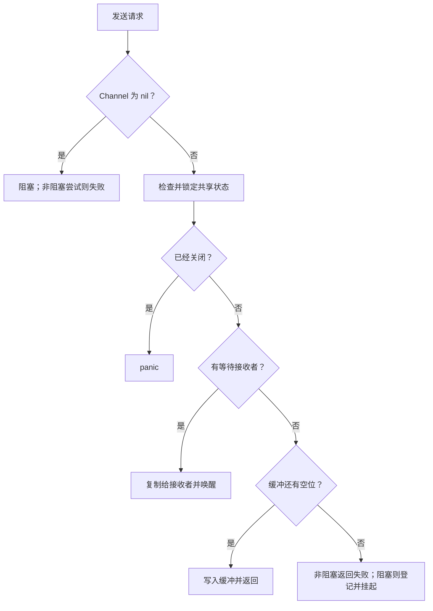

# 第九讲：Go Channel 及其底层原理完整学习笔记

> 本讲逐项展开 Channel 的语义、使用方法、并发协议、源码路径、完整示例和自测。整理日期：2026-10-21（UTC）。语言规则以 Go 官方规范与内存模型为准；内部实现固定到 Go 1.27.3。

<a id="section-001"></a>

> **统一运行基线：** 建议使用 Go 1.27.3，示例模块声明采用 `go 1.27.0`。文中出现其他 Go 版本时，仅用于说明特性引入时间或历史实现差异；第三方依赖仍以对应模块的版本要求为准。


*图示：Channel 的数据与同步。*

## 正文导航

- [一、Channel 的基本用法](#section-002)
  - [1.1 Channel 的定义](#section-003)
  - [1.2 无缓冲区](#section-006)
    - [一次发送需要一次接收参与](#section-007)
  - [1.3 有缓冲区](#section-010)
  - [1.4 Channel 里面几个现象](#section-014)
  - [1.5 关闭 Channel](#section-017)
  - [1.6 Channel 的遍历](#section-021)
    - [1.6.1 for range 遍历无缓冲区的 Channel](#section-022)
    - [1.6.2 for range 遍历有缓冲区的 Channel](#section-023)
    - [1.6.3 遍历时候的性能问题考虑](#section-024)
  - [1.7 Channel 和 select 联合使用，实现定时任务](#section-025)
    - [1.7.1 可结束的周期任务](#section-026)
    - [1.7.2 Go 1.23 以后的计时器语义](#section-027)
    - [1.7.3 关闭的输入要从 select 中移除](#section-028)
  - [1.8 Channel 的组合使用](#section-029)
    - [1.8.1 流水线：每个阶段只关闭自己的输出](#section-030)
    - [1.8.2 扇出与扇入：固定工作者处理任务](#section-031)
    - [1.8.3 请求 Channel 中携带响应 Channel](#section-032)
    - [1.8.4 信号量：控制并发，不负责结果和错误](#section-033)
  - [1.9 通道的内存管理](#section-034)
    - [1.9.1 复制切片内容，建立清楚的所有权边界](#section-035)
    - [1.9.2 close 与垃圾回收是两件事](#section-036)
    - [1.9.3 队列容量与元素大小要一起估算](#section-037)
    - [1.9.4 大数组元素与指针元素的取舍](#section-038)
  - [1.10 使用 Context 进行取消控制](#section-039)
    - [1.10.1 消费者提前退出，生产者仍应能够结束](#section-040)
    - [1.10.2 已取消 Context 下的准入检查](#section-041)
    - [1.10.3 取消、关闭、等待分别负责什么](#section-042)
  - [1.11 Channel 的主要特点](#section-043)
- [二、Channel 的底层实现机制](#section-044)
  - [2.1 Channel 的基本结构](#section-045)
    - [2.1.1 环形队列为什么不需要每次移动元素](#section-046)
    - [2.1.2 等待记录 sudog 与 goroutine 不是一一对应](#section-047)
    - [2.1.3 哪些状态组合不应出现](#section-048)
  - [2.2 Channel 创建](#section-049)
    - [2.2.1 函数概述](#section-050)
    - [2.2.2 关键步骤](#section-051)
  - [2.3 Channel 的发送](#section-052)
    - [2.3.1 存在等待接收的 Goroutine](#section-053)
    - [2.3.2 当缓冲区未满时](#section-054)
      - [2.3.2.1 阻塞发送](#section-055)
    - [2.3.3 状态推演：缓冲已有 A、B，再发送 C](#section-056)
  - [2.4 Channel 接收](#section-057)
    - [2.4.1 存在等待发送的 Goroutine](#section-058)
      - [2.4.1.1 缓冲区 buf 中还有数据](#section-059)
    - [2.4.2 阻塞接收](#section-060)
    - [2.4.3 非阻塞接收需要三个逻辑结果](#section-061)
  - [2.5 Channel 关闭](#section-062)
    - [2.5.1 关闭时的接收者与缓冲](#section-063)
    - [2.5.2 关闭时的阻塞发送者](#section-064)
    - [2.5.3 close 是广播事件，但不是广播普通消息](#section-065)
    - [2.5.4 default 不会兜住关闭发送的 panic](#section-066)
- [三、小结](#section-067)
- [附录 A：内存同步与 select 的精确边界](#section-068)
  - [A.1 发送与接收到底发布了哪些写入](#section-069)
  - [A.2 无缓冲的反向同步为何不能照搬到有缓冲](#section-070)
  - [A.3 select 的表达式求值与分支执行不是一回事](#section-071)
  - [A.4 随机选择、取消优先级与业务截止边界](#section-072)
  - [A.5 len、cap 与快照观察](#section-073)
- [附录 B：综合设计案例](#section-074)
  - [B.1 并发计算后按输入顺序输出](#section-075)
  - [B.2 可并发提交、可重复关闭的有界服务](#section-076)
  - [B.3 调用方超时之后，一次结果怎样避免卡住工作者](#section-077)
  - [B.4 先写状态与关闭责任，再写 goroutine](#section-078)
- [附录 C：故障定位与验证方法](#section-079)
  - [C.1 先判断是正常等待，还是没有退出路径](#section-080)
  - [C.2 全局死锁报告与局部泄漏不同](#section-081)
  - [C.3 race detector 检查的是数据竞争](#section-082)
  - [C.4 阻塞分析、trace 与基准分别回答什么](#section-083)
  - [C.5 怎样写不依赖运气的并发示例](#section-084)
  - [C.6 审查 Channel API 时的具体问题](#section-085)
- [附录 D：30 道自检题与答案](#section-086)
  - [1. `var ch chan int` 与 `make(chan int)` 有什么区别？](#section-087)
  - [2. 无缓冲发送返回，能证明消费者已经处理完数据吗？](#section-088)
  - [3. 有缓冲 Channel 可以在没有接收者时发送多少次？](#section-089)
  - [4. `len(ch) == 0` 是否说明接收肯定会阻塞？](#section-090)
  - [5. 接收到 0 能否说明 Channel 已关闭？](#section-091)
  - [6. 关闭 Channel 后，缓冲里的值会消失吗？](#section-092)
  - [7. 为什么通常由发送生命周期的拥有者关闭？](#section-093)
  - [8. `sync.Once` 能彻底解决 send 与 close 冲突吗？](#section-094)
  - [9. 没有消费者继续接收，给 Channel 增大容量能解决泄漏吗？](#section-095)
  - [10. for range 一个 Channel 为什么可能一直不结束？](#section-096)
  - [11. select 中第一个 case 是否优先执行？](#section-097)
  - [12. 为什么把某个 Channel 变量设为 nil 可以关闭一个 select 分支？](#section-098)
  - [13. 已关闭的 Channel 留在 select 中会怎样？](#section-099)
  - [14. 向 Channel 发送切片后，双方是否得到独立数据？](#section-100)
  - [15. 容量是 100 的 `chan []byte` 能限制总内存为 100 个小对象吗？](#section-101)
  - [16. 无缓冲 Channel 是否没有任何内部数据结构？](#section-102)
  - [17. sudog 是否就是一个 goroutine？](#section-103)
  - [18. 缓冲满了、有发送者等待，接收会先拿新发送者的值吗？](#section-104)
  - [19. Channel 阻塞是否意味着对应操作系统线程永久阻塞？](#section-105)
  - [20. 关闭 done 后读取共享变量为什么可能安全？](#section-106)
  - [21. 把无缓冲改成容量 1，为什么可能引入数据竞争？](#section-107)
  - [22. select 没选中发送分支，发送右侧函数还会运行吗？](#section-108)
  - [23. Ticker.Stop 是否使 `for range ticker.C` 结束？](#section-109)
  - [24. cancel 返回能证明 worker 已退出吗？](#section-110)
  - [25. 接收结果都正确，为什么输出顺序仍可能错？](#section-111)
  - [26. 工作池为什么既要限制工作者，也要限制排队？](#section-112)
  - [27. 没有 race 报告，是否说明没有死锁或业务重复？](#section-113)
  - [28. 为什么不能在每个发送者退出时都 close 同一个结果通道？](#section-114)
  - [29. runtime 的 sendq 顺序能否保证业务公平性？](#section-115)
  - [30. 一个可靠的 Channel 示例至少应解释哪些边界？](#section-116)
- [附录 E：官方资料与运行核验](#section-117)
  - [E.1 官方资料索引](#section-118)
  - [E.2 怎样运行这些程序](#section-119)
  - [E.3 实际核验记录](#section-120)

<a id="section-002"></a>

## 一、Channel 的基本用法

<a id="section-003"></a>

### 1.1 Channel 的定义

<a id="section-004"></a>

#### 通道把数据交换与同步关系放在一起

Channel 是 Go 提供的一种有类型的通信机制。发送者把元素交给通道，接收者从通道取得元素；元素类型在编译期确定。通道操作还建立特定的同步关系，因此它不只是一个并发版切片。通过发送与接收，程序既能转交数据，也能表达“这一步已经发生，下一步才可以继续”。[Channel types](https://go.dev/ref/spec#Channel_types)、[Go Memory Model](https://go.dev/ref/mem#chan)。

“通过通信共享内存”是一种组织思路：让一个 goroutine 拥有可变状态，其他 goroutine 通过消息请求操作，有时比多方同时持有数据并争用锁更容易理解。但 Go 并没有禁止共享内存，也不是所有场景都应该用 Channel 替代 Mutex。选择依据是数据流、所有权和同步需求，而不是把一句口号当成所有设计的强制要求。[Effective Go — Concurrency](https://go.dev/doc/effective_go#concurrency)。

| 写法 | 含义 | 初学时要分清什么 |
| --- | --- | --- |
| `var ch chan int` | 声明一个可收发 int 的通道变量，初值 nil | 声明变量不等于创建可用通道 |
| `make(chan int)` | 创建无缓冲通道 | 需要发送与接收配对 |
| `make(chan int, 3)` | 创建容量为 3 的缓冲通道 | 容量限制未被接收的元素数 |
| `ch <- value` | 发送 | 可能阻塞，也可能因关闭 panic |
| `value := <-ch` | 接收 | 可能阻塞，关闭耗尽后得到零值 |
| `value, ok := <-ch` | 接收并观察是否来自有效发送 | ok 为 false 表示关闭且已耗尽 |
| `close(ch)` | 表示不会再发送 | 不会立即清除已有缓冲元素 |

通道元素可以是数值、结构体、接口、指针，甚至另一个通道。通道值本身可复制，复制后通常引用同一个底层通道；它不像数组赋值那样复制所有排队元素。函数参数传递一个 chan，也是在共享这个通信对象，而不是获得一个私人队列。

**例 CH-01：声明、创建与共享通道。**

```go
// 运行示例：CH-01
package main

import "fmt"

func main() {
	var missing chan int
	fmt.Println("declared nil:", missing == nil)
	ch := make(chan int, 2)
	alias := ch
	alias <- 7
	fmt.Println("same channel:", ch == alias)
	fmt.Println("value:", <-ch)
	fmt.Println("length/capacity:", len(ch), cap(ch))
}
```

输出：

```text
declared nil: true
same channel: true
value: 7
length/capacity: 0 2
```

`alias <- 7` 后从 ch 接收到了同一个元素，说明两个变量指向同一通信对象。把某个变量重新赋为 nil，也只是改变这个变量，不会让其他持有者的通道失效，更不会替它们发送关闭通知。

<a id="section-005"></a>

#### 用方向表达函数的能力边界

`chan<- T` 表示只发送，`<-chan T` 表示只接收，`chan T` 表示可收发。方向属于静态类型约束，可以让编译器阻止消费者误发数据。双向通道可以交给只需要单向能力的函数，但不能随意把单向参数升级成双向能力。[Channel types](https://go.dev/ref/spec#Channel_types)。

**例 CH-02：生产函数只拿发送端，消费函数只拿接收端。**

```go
// 运行示例：CH-02
package main

import "fmt"

func produce(out chan<- int) {
	defer close(out)
	out <- 3
	out <- 4
}

func consume(in <-chan int) int {
	sum := 0
	for value := range in {
		sum += value
	}
	return sum
}

func main() {
	ch := make(chan int)
	go produce(ch)
	fmt.Println("sum:", consume(ch))
}
```

输出：

```text
sum: 7
```

本例的 produce 是唯一发送者，所以可以在发送结束后关闭。方向约束并没有从类型层面声明“这个发送者是唯一关闭者”：多个函数拿到发送端时都可能在语法上调用 close，因此关闭所有权仍要写进协议。只读通道可以接收，不能发送或关闭；这使返回 `<-chan T` 的数据流 API 更容易表达使用者边界。

<a id="section-006"></a>

### 1.2 无缓冲区

<a id="section-007"></a>

#### 一次发送需要一次接收参与

无缓冲通道容量为零，不能让发送者仅把值存起来就继续执行。发送需要接收者配对，接收也需要发送者配对。可以把它类比为面对面交接：双方至少要在交接处碰面。类比的边界是，交接完成不代表对方已经完成后续业务处理，更不保证双方下一条语句的执行顺序。

**例 CH-03：用无缓冲通道发布计算结果。** 这沿用官方 Tour 的求和思路，增加明确完成信号。

```go
// 运行示例：CH-03
package main

import "fmt"

func main() {
	result := make(chan int)
	exited := make(chan struct{})
	go func() {
		defer close(exited)
		sum := 0
		for _, n := range []int{2, 4, 6} {
			sum += n
		}
		result <- sum
	}()
	fmt.Println("sum:", <-result)
	<-exited
	fmt.Println("worker finished")
}
```

输出：

```text
sum: 12
worker finished
```

result 传业务值，exited 表示工作 goroutine 已走完自己的流程。这两个通知不应随意混为一谈。例如工作者发送结果后还需要关闭资源，仅收到结果并不代表资源已经关闭。可以根据实际接口约定省去多余信号，但要先确认发送之后还有没有必须等待的工作。

<a id="section-008"></a>

#### 同一个 goroutine 不能先堵住自己，再去执行配对操作

下面是故意错误的局部片段，不属于正常运行示例：

```go-invalid
ch := make(chan int)
ch <- 1
fmt.Println(<-ch)
```

执行到发送时，没有其他 goroutine 接收，它不会越过这一行去执行后面的接收。如果整个程序没有其他能唤醒它的工作，运行时可能报告全局死锁。增加 goroutine 只有在职责清楚、生命周期可管理时才是解决办法；若只是想在同一流程临时存一个值，普通变量或合适缓冲队列更直接。

<a id="section-009"></a>

#### 同步的含义不是替后续数据访问加锁

内存模型规定：一次发送发生在对应接收完成之前；对无缓冲通道，对应接收又发生在发送完成之前。它使交接前的相关写入对交接后的读者有序，但并不保护交接之后双方同时修改同一个指针对象。

**例 CH-04：接收方先准备状态，再允许发送者继续。** 利用无缓冲接收与发送完成之间的同步关系，而不是依赖 Sleep。

```go
// 运行示例：CH-04
package main

import "fmt"

func main() {
	handshake := make(chan struct{})
	observed := make(chan int, 1)
	value := 0
	go func() {
		handshake <- struct{}{}
		observed <- value
	}()
	value = 9
	<-handshake
	fmt.Println("published:", <-observed)
}
```

输出：

```text
published: 9
```

如果把 handshake 改成容量 1，发送者可能在 main 写 value 前完成发送并读取 value，原来的同步证明就不成立，可能产生数据竞争。缓冲大小不仅改变性能和排队能力，还可能改变程序依赖的先后关系。不能把“无缓冲改为缓冲通常更快”当成无条件安全的优化。[Go Memory Model：Channel communication](https://go.dev/ref/mem#chan)。

<a id="section-010"></a>

### 1.3 有缓冲区

<a id="section-011"></a>

#### 容量允许有限度地分离发送者和接收者

缓冲通道在队列有空位时可以接受发送，不要求接收者此刻已到达；队列有元素时可以接收，不要求发送者此刻仍在运行。它缓和瞬时速率差，但容量是有限的：队列满时发送等待，队列空且未关闭时接收等待。

**例 CH-05：观察长度变化与容量不变。**

```go
// 运行示例：CH-05
package main

import "fmt"

func main() {
	ch := make(chan string, 2)
	ch <- "A"
	ch <- "B"
	fmt.Println("full:", len(ch), cap(ch))
	fmt.Println("receive:", <-ch)
	fmt.Println("remaining:", len(ch), cap(ch))
	ch <- "C"
	fmt.Println(<-ch, <-ch)
}
```

输出：

```text
full: 2 2
receive: A
remaining: 1 2
B C
```

同一发送者按顺序放入 A、B、C，接收保持对应队列顺序。多个 goroutine 并发发送时，谁先进入通道取决于实际执行和同步，不能仅按启动顺序给所有消息一个全局确定顺序。若业务必须按编号处理，就需要传编号并重排，或由一个有序入口接纳。

<a id="section-012"></a>

#### 背压：让上游感知下游来不及处理

“背压”指下游处理能力不足时，通过阻塞、拒绝或限速把压力传回上游，而不是无界地积累任务。缓冲通道的满队列阻塞可以形成一种背压，但是否合理要看调用者：阻塞 HTTP handler 可能增加请求占用；丢弃指标样本可能允许，丢弃订单通常不允许。

**例 CH-06：使用非阻塞发送实现明确的“队列满则拒绝”。**

```go
// 运行示例：CH-06
package main

import "fmt"

func trySend(ch chan<- int, value int) bool {
	select {
	case ch <- value:
		return true
	default:
		return false
	}
}

func main() {
	queue := make(chan int, 1)
	fmt.Println("first:", trySend(queue, 10))
	fmt.Println("second:", trySend(queue, 20))
	fmt.Println("kept:", <-queue)
}
```

输出：

```text
first: true
second: false
kept: 10
```

这是一个明确的接纳策略，不是普通发送的等价替换。调用者必须处理 false，否则就是悄悄丢数据。default 也不能用来保护对已关闭通道的发送；关闭的发送分支会导致 panic，稍后的状态表会展示。

<a id="section-013"></a>

#### len 适合观察，不适合先检查再操作

`len(ch)` 返回当前排队元素数，它不是未来一次操作的许可证。即使看到 len 小于 cap，其他发送者也可能先填满；看到 len 大于零，其他接收者也可能先取走。正确的“尝试操作”应使用 select/default，正确的“等待并可取消”应把 Done 放进同一个 select。

对无缓冲通道 len 总是零，但它可能有等待的发送者或接收者，通信能够立即配对。因此 len 不是“是否存在可接收值”的通用查询。对有缓冲通道来说，len 是一种快照；它能辅助监控排队趋势，不能单独证明整体没有堵塞，因为任务还可能积压在 goroutine、连接池和外部队列里。[Length and capacity](https://go.dev/ref/spec#Length_and_capacity)、[Select statements](https://go.dev/ref/spec#Select_statements)。

<a id="section-014"></a>

### 1.4 Channel 里面几个现象

<a id="section-015"></a>

#### 用状态表统一理解 nil、打开和关闭

| 状态 | 发送 | 接收 | close |
| --- | --- | --- | --- |
| nil 通道 | 永久阻塞 | 永久阻塞 | panic |
| 打开的无缓冲通道 | 等待接收配对 | 等待发送配对 | 首次关闭成功 |
| 打开的缓冲通道且未满 | 通常可入队或直接配对 | 有数据可取，否则等待 | 首次关闭成功 |
| 打开的缓冲通道已满 | 等待接收腾位 | 可取最早元素 | 首次关闭成功 |
| 已关闭但缓冲未空 | panic | 继续取得缓冲元素，ok=true | 再次关闭 panic |
| 已关闭且耗尽 | panic | 立即返回元素零值，ok=false | 再次关闭 panic |

表中发送和接收的条件描述的是操作判断时的状态，不是让调用者先 len/检查再执行两步协议。在并发程序中，状态会变化，语言操作和运行时在内部完成相应同步。[Send statements](https://go.dev/ref/spec#Send_statements)、[Receive operator](https://go.dev/ref/spec#Receive_operator)、[Close](https://go.dev/ref/spec#Close)。

**例 CH-07：nil 分支被禁用，但关闭且耗尽的接收立即就绪。**

```go
// 运行示例：CH-07
package main

import "fmt"

func main() {
	var disabled <-chan int
	select {
	case <-disabled:
		fmt.Println("unexpected")
	default:
		fmt.Println("nil channel not ready")
	}
	closed := make(chan int)
	close(closed)
	value, ok := <-closed
	fmt.Println("closed receive:", value, ok)
}
```

输出：

```text
nil channel not ready
closed receive: 0 false
```

nil 通道与已经关闭的通道恰好相反：前者在 select 中永远不就绪，后者的接收总能就绪。处理多个输入通道时，耗尽的通道可设为 nil 来禁用对应分支；若一直保留已经关闭的通道，它会不断返回零值，可能形成忙循环。

**例 CH-08：可控地观察三个关闭相关 panic。**

```go
// 运行示例：CH-08
package main

import "fmt"

func panics(fn func()) (yes bool) {
	defer func() { yes = recover() != nil }()
	fn()
	return false
}

func main() {
	fmt.Println("close nil:", panics(func() {
		var ch chan int
		close(ch)
	}))
	ch := make(chan int)
	close(ch)
	fmt.Println("close twice:", panics(func() { close(ch) }))
	fmt.Println("send after close:", panics(func() { ch <- 1 }))
}
```

输出：

```text
close nil: true
close twice: true
send after close: true
```

recover 只用于把讲解中的预期 panic 变成可继续观察的结果。真实设计应通过清楚的发送与关闭所有权避免这些错误，而不是在每次 close 或 send 外层包一个 recover 来吞掉问题。尤其并发 close 与 send 的协议冲突，不能靠“偶尔没 panic”判断安全。

<a id="section-016"></a>

#### 发送复制元素，不自动深复制引用的数据

发送 `[]byte` 时，复制的是切片值，其中包含对底层数组的引用；发送指针时复制指针；发送结构体时按值复制结构体，但它内部的切片、map、指针仍可能共享底层对象。数据到达接收方之后，发送方继续修改共享内容，需要遵守明确的所有权移交或同步协议。

**例 CH-09：值副本和共享底层数据的区别。** 本例按顺序操作，故意不制造 data race。

```go
// 运行示例：CH-09
package main

import "fmt"

type Item struct{ Count int }

func main() {
	values := make(chan Item, 1)
	item := Item{Count: 1}
	values <- item
	item.Count = 2
	fmt.Println("struct copy:", (<-values).Count)
	slices := make(chan []int, 1)
	nums := []int{1, 2}
	slices <- nums
	nums[0] = 9
	fmt.Println("shared array:", <-slices)
}
```

输出：

```text
struct copy: 1
shared array: [9 2]
```

如果需要独立快照，应复制数据本身，例如 `append([]byte(nil), data...)`。如果希望减少复制，可以把缓冲区所有权移交给消费者，发送后不再访问，等消费者明确归还后才复用。通道传递不会从类型系统里自动撤销发送方已有的指针，因此“移交后不再用”仍是程序设计纪律。[Representation of values](https://go.dev/ref/spec#Representation_of_values)。

<a id="section-017"></a>

### 1.5 关闭 Channel

<a id="section-018"></a>

#### close 表达的是发送结束，不是销毁资源

关闭数据通道的含义是“从此不会再有发送”。它不会等待所有接收者处理完数据，不会主动清空缓冲区，也不是像 Close 文件那样归还一个操作系统句柄。通道不再可达时可由垃圾回收处理，是否 close 取决于通信协议是否需要结束通知。

**例 CH-10：关闭后先读完缓冲，再观察 ok=false。**

```go
// 运行示例：CH-10
package main

import "fmt"

func main() {
	ch := make(chan int, 2)
	ch <- 0
	ch <- 8
	close(ch)
	for i := 0; i < 4; i++ {
		value, ok := <-ch
		fmt.Println(value, ok)
	}
}
```

输出：

```text
0 true
8 true
0 false
0 false
```

第一个零是有效数据，第三个零是通道耗尽后的零值，只有 ok 能区分。关闭后继续接收不会等到“未来再打开”，因为通道不能重新打开；如果要启动新一轮独立数据流，应创建新通道并重新建立所有权。

<a id="section-019"></a>

#### 多发送者由协调者在全部结束后关闭

一个接收者不能仅因为自己不想再读，就 close 一个仍可能有人发送的通道。多个发送者也不能各自 defer close 同一通道。常见方式是用 WaitGroup 记录发送者退出，协调 goroutine 在 Wait 返回后关闭结果通道，消费者用 range 读到结束。

**例 CH-11：三个发送者共同产出，统一关闭。**

```go
// 运行示例：CH-11
package main

import (
	"fmt"
	"sort"
	"sync"
)

func main() {
	out := make(chan int)
	var wg sync.WaitGroup
	for n := 1; n <= 3; n++ {
		wg.Add(1)
		go func(n int) {
			defer wg.Done()
			out <- n * n
		}(n)
	}
	go func() { wg.Wait(); close(out) }()
	values := []int{}
	for value := range out {
		values = append(values, value)
	}
	sort.Ints(values)
	fmt.Println(values)
}
```

输出：

```text
[1 4 9]
```

排序只让展示稳定，生产者的真实发送先后没有被规定。WaitGroup 的 Add 在启动 goroutine 之前执行，避免协调者可能过早看到计数为零；关闭发生在所有发送完成之后，因此不存在一部分发送者还在提交而通道已经关闭的冲突。[官方 Pipelines 的 merge 模式](https://go.dev/blog/pipelines)、[sync.WaitGroup](https://pkg.go.dev/sync#WaitGroup)。

<a id="section-020"></a>

#### 广播停止与关闭数据流可以使用不同通道

数据通道 close 通常由发送方决定；消费者提前停止时，可以关闭专门的 done 通道，或调用 Context 的 cancel，让发送方在自己的 select 中退出并关闭数据通道。这把“接收方不再需要数据”和“发送方确认不会再发送”区分开来，避免让两方都争夺同一个 close 权限。

若多个来源都可能请求停止，可以让唯一协调者关闭 done，或者使用 sync.Once 保护专门的停止操作。但 Once 只保证 close 执行一次，不保证没有其他 goroutine 正在向同一数据通道发送。因此它适合防止重复关闭通知通道，不能单独证明数据发送与关闭协调正确。

<a id="section-021"></a>

### 1.6 Channel 的遍历

<a id="section-022"></a>

#### 1.6.1 for range 遍历无缓冲区的 Channel

`for value := range ch` 持续接收，直到通道关闭并耗尽。它不会因为当前暂时没有值就结束，也不会因为生产者函数返回而自动猜到结束；生产者应通过协议关闭数据流，或者消费者使用另一个取消条件停止。

**例 CH-12：无缓冲数据流的遍历。**

```go
// 运行示例：CH-12
package main

import "fmt"

func main() {
	ch := make(chan int)
	go func() {
		defer close(ch)
		for n := 1; n <= 3; n++ {
			ch <- n
		}
	}()
	sum := 0
	for value := range ch {
		sum += value
	}
	fmt.Println("sum:", sum)
}
```

输出：

```text
sum: 6
```

range 只接收值，不提供第二个 ok 变量；它内部按关闭状态决定停止。想同时等待取消时，通常改成 for+select，并在接收分支检查 ok。对 nil 通道直接 range 会一直等，因此返回只读通道的 API 应明确是否可能返回 nil。

<a id="section-023"></a>

#### 1.6.2 for range 遍历有缓冲区的 Channel

缓冲区改变的是发送接收可以错开多少，不改变 range 的结束条件。先填入有限数据再关闭，range 会消费全部缓冲数据后结束。如果只填数据却不关闭，读完后仍会等待下一项。

**例 CH-13：关闭前入队的数据全部被遍历。**

```go
// 运行示例：CH-13
package main

import "fmt"

func main() {
	ch := make(chan string, 3)
	for _, value := range []string{"go", "chan", "range"} {
		ch <- value
	}
	close(ch)
	for value := range ch {
		fmt.Println(value)
	}
	fmt.Println("drained:", len(ch) == 0)
}
```

输出：

```text
go
chan
range
drained: true
```

本例容量足够容纳已知三项数据，所以同一 goroutine 能先填满再遍历。若把容量改为 2，第三次发送会在开始 range 之前阻塞。不要把这段写法机械用于数量未知的数据源，实际流式生产应让发送和接收能同时推进。

<a id="section-024"></a>

#### 1.6.3 遍历时候的性能问题考虑

range 通道与显式循环接收应首先按语义可读性选择，不能只凭语法短长推断明显性能差异。真正成本可能来自每个元素的处理、调度、同步、复制、跨核缓存访问和分配。若每项业务工作只有几个整数加法，Channel 开销可能比工作本身更突出；若每项是网络调用，调度成本可能相对很小。

批量传输可以摊薄每项通信成本，但同时增加等待批次填满的延迟、单次复制大小和内存占用。批次多大需要结合吞吐与延迟目标测量，不能只用一个不含真实工作的微基准得出所有业务结论。

**例 CH-14：按批传递独立数据快照。**

```go
// 运行示例：CH-14
package main

import "fmt"

func main() {
	batches := make(chan []int, 2)
	source := []int{1, 2, 3, 4, 5}
	for start := 0; start < len(source); start += 3 {
		end := min(start+3, len(source))
		batch := append([]int(nil), source[start:end]...)
		batches <- batch
	}
	close(batches)
	count, sum := 0, 0
	for batch := range batches {
		count++
		for _, value := range batch {
			sum += value
		}
	}
	fmt.Println("batches:", count)
	fmt.Println("sum:", sum)
}
```

输出：

```text
batches: 2
sum: 15
```

此处复制是为了让各批拥有独立切片数据，便于解释所有权。如果源数据不会再修改，或采用严格的缓冲归还协议，可以选择不同策略。避免以减少复制为由让生产者在消费者读取时复用同一个数组，这会把性能优化变成数据竞争。

衡量 Channel 方案时至少分开三项指标：每秒完成多少工作、单项从进入到完成的延迟、峰值在途数据与 goroutine 数量。缓冲变大可能提升短时吞吐，也可能只是把等待从发送者转移到队列，延迟反而增长。没有测量和工作负载说明，就不应给出“缓冲越大越快”或“无缓冲必慢”的结论。[Go 诊断指南](https://go.dev/doc/diagnostics)、[testing 基准工具](https://pkg.go.dev/testing#hdr-Benchmarks)。

<a id="section-025"></a>

### 1.7 Channel 和 select 联合使用，实现定时任务

`select` 等待的是一组通信操作。它不是按代码顺序检查的 `if/else`：进入 `select` 时，所有通信操作的 Channel 表达式，以及发送语句右侧的值表达式，都先按源码顺序求值；有一个或多个通信可以立即进行时，从可执行分支中作统一伪随机选择；都不能执行且有 `default` 时执行 `default`；否则阻塞，直到某个通信可以进行。这里的随机选择不构成业务优先级，也不保证某个分支在有限次数内必然获选。[规范：select](https://go.dev/ref/spec#Select_statements)。

定时任务通常需要回答四件事：谁创建计时器，谁接收时钟事件，谁要求退出，以及退出时如何回收其他资源。`time.NewTicker` 适合周期性信号，`time.NewTimer` 适合单次信号。Ticker 不代表每个周期都必须执行一次业务：当接收者来不及处理时，它可能调整间隔或丢弃 tick。若每个时间窗口必须完成一次独立结算，应另建任务记录、补偿与幂等机制，不能只凭计时 Channel 证明任务没有遗漏。[time.Ticker](https://pkg.go.dev/time#Ticker)。

<a id="section-026"></a>

#### 1.7.1 可结束的周期任务

下面的短程序实际消费三个 tick，然后退出。这里使用毫秒周期只是减少演示等待；不打印实际时间，因此不会把系统调度延迟当成固定输出。循环体代表串行执行的工作，本轮工作没有完成时不会开始下一轮。

```go
// 运行示例：CH-15
package main

import (
	"context"
	"fmt"
	"time"
)

func run(ctx context.Context, limit int) int {
	ticker := time.NewTicker(time.Millisecond)
	defer ticker.Stop()
	completed := 0
	for completed < limit {
		select {
		case <-ctx.Done():
			return completed
		case <-ticker.C:
			completed++
		}
	}
	return completed
}

func main() {
	fmt.Println("ticks:", run(context.Background(), 3))
}
```

输出：

```text
ticks: 3
```

真实业务若在每次 tick 后直接 `go doWork()`，当任务耗时超过周期时就会不断增加并发。这时必须明确策略：等待当前工作完成、跳过本次、合并重复请求，或者提交到有容量上限的工作队列。`select` 本身不会替开发者限制业务并发。

`Ticker.Stop` 停止后续 tick，**不会关闭 `ticker.C`**；因此 `for range ticker.C` 不能依靠 Stop 自动结束。退出信号应来自 Context、独立的 done Channel 或其他明确条件。对取消的响应还取决于业务函数是否检查 Context：如果选中了 tick 分支后进入一个永不返回的调用，外层 `select` 无法将它强行打断。

<a id="section-027"></a>

#### 1.7.2 Go 1.23 以后的计时器语义

Go 1.23 调整了 Channel 计时器的实现与 Stop、Reset 的保证。按新语义，Channel 计时器对外表现为同步 Channel，`len(t.C)`、`cap(t.C)` 为 0，Stop/Reset 返回后不会再收到旧配置产生的过期值。新旧行为还受主模块 `go` 版本和 `GODEBUG=asynctimerchan` 影响，因此“使用新编译器”与“启用新计时器语义”不是同一个判断条件。[官方迁移说明](https://go.dev/wiki/Go123Timer)、[Timer.Stop](https://pkg.go.dev/time#Timer.Stop)、[Timer.Reset](https://pkg.go.dev/time#Timer.Reset)。

```go
// 运行示例：CH-16
// 运行基线：Go 1.27.3（模块声明 go 1.27.0）
package main

import (
	"fmt"
	"time"
)

func main() {
	timer := time.NewTimer(time.Hour)
	fmt.Println("capacity:", cap(timer.C))
	fmt.Println("stopped:", timer.Stop())
	fmt.Println("was active:", timer.Reset(0))
	<-timer.C
	fmt.Println("received one tick")
}
```

在主模块 `go 1.23` 或更高、未启用旧行为的条件下，输出：

```text
capacity: 0
stopped: true
was active: false
received one tick
```

示例把首次到期设为很远的未来，保证演示中的 Stop 发生在初次到期前。`Reset(0)` 则把它重新设置为立即到期。生产代码中的超时时间应按需求设置；这里的一个小时不是推荐业务阈值。

对于需要兼容旧模块语义的代码，要按相应版本文档设计停止、排空和重新设置的协议，并确保只有一个接收者管理计时器。不能无条件写 `if !timer.Stop() { <-timer.C }`：如果 tick 已由其他接收者取走，这个接收可能永久阻塞。新版本示例与旧版本兼容实现应分开解释，不要把两个协议揉成一个“万能模板”。

<a id="section-028"></a>

#### 1.7.3 关闭的输入要从 select 中移除

关闭的 Channel 总能立即接收。若写成 `case v := <-closedCh:`，它会不断得到零值，可能形成忙循环，并把业务零值误当成新消息。多个输入合并时，常用 `ok` 识别结束，再把局部 Channel 变量设置为 nil，以禁用那个分支。将变量设为 nil 不会改变其他 goroutine 持有的 Channel，也不负责关闭它。

```go
// 运行示例：CH-17
package main

import "fmt"

func main() {
	a := make(chan int, 2)
	b := make(chan int, 1)
	a <- 1
	a <- 2
	b <- 3
	close(a)
	close(b)
	count, sum := 0, 0
	for a != nil || b != nil {
		select {
		case v, ok := <-a:
			if !ok {
				a = nil
				continue
			}
			count++
			sum += v
		case v, ok := <-b:
			if !ok {
				b = nil
				continue
			}
			count++
			sum += v
		}
	}
	fmt.Println("count:", count)
	fmt.Println("sum:", sum)
}
```

输出：

```text
count: 3
sum: 6
```

各元素被接收的跨通道顺序可能不同，但元素集合和总和相同。该示例体现一个很实用的原则：并发测试应断言协议承诺的结果，不应把某次偶然打印顺序当成正确性要求。

<a id="section-029"></a>

### 1.8 Channel 的组合使用

组合 Channel 的困难通常不在语法，而在生命周期。一个阶段需要知道输入何时结束、输出由谁关闭、下游提前停止时自己怎样退出，以及谁等所有阶段真正结束。Go 官方的流水线文章把这些问题放在一起讲解：阶段读完输入后关闭自己的输出，下游不再消费时应通知上游停止。[Go Concurrency Patterns: Pipelines and cancellation](https://go.dev/blog/pipelines)。

<a id="section-030"></a>

#### 1.8.1 流水线：每个阶段只关闭自己的输出

下面将整数生成与平方计算分成两个阶段。两个输出都只有一个发送 goroutine，因此关闭责任明确。两个可能阻塞的发送点都与取消信号一起参与 `select`；平方阶段的接收也可以响应取消。WaitGroup 负责最终等待，Context 负责发出取消通知。

```go
// 运行示例：CH-18
package main

import (
	"context"
	"fmt"
	"sync"
)

func generate(ctx context.Context, wg *sync.WaitGroup, values ...int) <-chan int {
	out := make(chan int)
	wg.Add(1)
	go func() {
		defer wg.Done()
		defer close(out)
		for _, v := range values {
			select {
			case <-ctx.Done():
				return
			case out <- v:
			}
		}
	}()
	return out
}

func square(ctx context.Context, wg *sync.WaitGroup, in <-chan int) <-chan int {
	out := make(chan int)
	wg.Add(1)
	go func() {
		defer wg.Done()
		defer close(out)
		for {
			select {
			case <-ctx.Done():
				return
			case v, ok := <-in:
				if !ok {
					return
				}
				select {
				case <-ctx.Done():
					return
				case out <- v * v:
				}
			}
		}
	}()
	return out
}

func main() {
	ctx, cancel := context.WithCancel(context.Background())
	defer cancel()
	var wg sync.WaitGroup
	output := square(ctx, &wg, generate(ctx, &wg, 1, 2, 3))
	total := 0
	for v := range output {
		total += v
	}
	wg.Wait()
	fmt.Println("sum of squares:", total)
}
```

输出：

```text
sum of squares: 14
```

如果消费者只要第一个结果，可以接收一次后调用 cancel，再 `wg.Wait()`。不能直接返回并希望上游“自然结束”：生成器可能卡在下一个发送，平方阶段也可能卡在输出发送。扩大缓冲只能让这种错误晚一点出现，不能证明任意输入规模下都没有泄漏。

该示例保证退出过程可收敛，不承诺取消与就绪发送同时发生时零次额外发送。当 `ctx.Done()` 与发送都可执行时，select 可以选择任一分支。如果业务要求取消后绝不提交新任务，需要在单一协调者内串行化“接受任务”和“关闭入口”的状态，或使用其他能建立原子边界的协议。

<a id="section-031"></a>

#### 1.8.2 扇出与扇入：固定工作者处理任务

扇出是多个工作者从同一个输入取任务，扇入是把多个工作者的结果汇总到同一输出。多个工作者不能各自 `defer close(results)`；第一个工作者结束时，其他工作者仍可能发送。正确的关闭者应先等所有发送者结束，再关闭共享结果 Channel。

```go
// 运行示例：CH-19
package main

import (
	"fmt"
	"sort"
	"sync"
)

func main() {
	jobs := make(chan int, 2)
	results := make(chan int, 2)
	producerDone := make(chan struct{})
	go func() {
		defer close(producerDone)
		defer close(jobs)
		for _, v := range []int{1, 2, 3, 4} {
			jobs <- v
		}
	}()

	var workers sync.WaitGroup
	workers.Add(2)
	for i := 0; i < 2; i++ {
		go func() {
			defer workers.Done()
			for n := range jobs {
				results <- n * n
			}
		}()
	}
	go func() {
		workers.Wait()
		close(results)
	}()

	var got []int
	for result := range results {
		got = append(got, result)
	}
	<-producerDone
	sort.Ints(got)
	fmt.Println(got)
}
```

输出：

```text
[1 4 9 16]
```

这里的工作者数量限制同时执行的任务数，jobs 容量限制已经排队而尚未被接收的任务数；两者代表不同资源。缓冲容量为 2，不意味着进程最多持有 2 个任务：任务还可能在生产者局部变量中、两个工作者中、结果队列中及消费者中。估算内存上限时要把各阶段的在途对象都计算进去。

该有限批次示例由主 goroutine 完整排空结果，因此不需要额外取消路径。如果将其改成服务中的长期工作池，或者允许消费者中途返回，就必须把 Context 传入生产者、工作者和结果发送点，并设计关闭入口、等工作者、排空或丢弃结果的顺序。

<a id="section-032"></a>

#### 1.8.3 请求 Channel 中携带响应 Channel

Channel 的元素可以是结构体，结构体又可以包含 Channel。于是可以把“发送任务”和“接收该任务的响应”分开建模。每个请求拥有独立响应通道，避免多个调用方从同一个结果通道争抢不属于自己的结果。[Effective Go：Channels of channels](https://go.dev/doc/effective_go#chan_of_chan)。

```go
// 运行示例：CH-20
package main

import "fmt"

type Request struct {
	Value int
	Reply chan<- int
}

func main() {
	requests := make(chan Request)
	stopped := make(chan struct{})
	go func() {
		defer close(stopped)
		for req := range requests {
			req.Reply <- req.Value * 2
		}
	}()

	reply := make(chan int, 1)
	requests <- Request{Value: 21, Reply: reply}
	fmt.Println("reply:", <-reply)
	close(requests)
	<-stopped
}
```

输出：

```text
reply: 42
```

响应通道容量为 1，且协议只发送一次，因此服务端提交结果时不必等待调用方恰好正在接收。它不是通用的防泄漏方案：如果协议会发送很多条响应，或者服务端在其他地方阻塞，还需额外设计。响应 Channel 不必关闭，因为双方已通过“一次请求对应一次响应”的协议知道接收次数。向一个 Channel 发送完成后是否关闭，取决于接收方是否需要 EOF 信号，不取决于它是否局部创建。

<a id="section-033"></a>

#### 1.8.4 信号量：控制并发，不负责结果和错误

有缓冲 Channel 可以作为令牌池。向容量为 N 的 Channel 发送一个空结构体代表占用名额，接收代表归还。要限制 goroutine 数量，最好先获取名额再启动 goroutine；如果先启动一百万个 goroutine，再让它们在内部争抢令牌，只限制了同时工作的数量，没有限制等待的 goroutine 数量。[Effective Go：Channels](https://go.dev/doc/effective_go#channels)。

```go
// 运行示例：CH-21
package main

import (
	"fmt"
	"sync"
	"sync/atomic"
)

func main() {
	slots := make(chan struct{}, 2)
	var wg sync.WaitGroup
	var completed atomic.Int64
	for i := 0; i < 5; i++ {
		slots <- struct{}{}
		wg.Add(1)
		go func() {
			defer wg.Done()
			defer func() { <-slots }()
			completed.Add(1)
		}()
	}
	wg.Wait()
	fmt.Println("completed:", completed.Load())
	fmt.Println("slots in use:", len(slots))
}
```

输出：

```text
completed: 5
slots in use: 0
```

令牌只表达准入，不携带任务错误，也不自动取消兄弟任务。需要错误聚合和失败取消时，可在更高层组合 Context、结果结构体或官方扩展模块 errgroup。不要关闭作为信号量使用的 slots：关闭后发送获取名额会 panic，而接收归还令牌会失去原来的计数约束。

<a id="section-034"></a>

### 1.9 通道的内存管理

理解 Channel 的内存，应分开三层：Channel 变量中的引用、运行时维护的队列与等待者、元素自身可达的对象。传递 Channel 值通常让多个变量指向同一个通信对象；向 Channel 发送元素则按元素类型进行赋值拷贝。字符串、切片、map、指针、接口等元素可能进一步引用其他数据，复制元素不等于复制整棵对象图。[规范：Channel 类型](https://go.dev/ref/spec#Channel_types)、[赋值](https://go.dev/ref/spec#Assignment_statements)。

<a id="section-035"></a>

#### 1.9.1 复制切片内容，建立清楚的所有权边界

CH-09 展示过切片描述符拷贝仍共享底层数组。下面在发送前显式复制，接收方就能得到独立快照。发送前后都在同一个 goroutine 中顺序执行，避免用有数据竞争的程序演示共享效果。

```go
// 运行示例：CH-22
package main

import "fmt"

func main() {
	source := []int{1, 2, 3}
	queue := make(chan []int, 1)
	snapshot := append([]int(nil), source...)
	queue <- snapshot
	source[0] = 99
	received := <-queue
	fmt.Println("source:", source)
	fmt.Println("snapshot:", received)
}
```

输出：

```text
source: [99 2 3]
snapshot: [1 2 3]
```

另一种方案是所有权移交：发送者把缓冲交给接收者后，不再访问它，直到对方显式归还。Go 的类型系统一般不会替普通 `[]byte` 自动强制这种线性所有权，因此必须靠 API 约定和同步协议落实。使用对象池时尤其要小心，`Put(buf)` 后仍把 buf 放在待处理 Channel 中，会让其他任务复用同一块内存。

<a id="section-036"></a>

#### 1.9.2 close 与垃圾回收是两件事

`close(ch)` 的语义是宣布后续不再发送。它不会把 Channel 的现有缓冲清空，也不会立即释放缓冲及其中引用的对象。只要程序还可以通过 Channel 取出某个元素，该元素引用的对象就必须仍然存活。即使 Channel 已关闭，未消费的 `[]byte`、指针等仍可能保留大块内存。

反过来，Channel 不需要关闭才能被回收。当 Channel 及其可达数据不再被任何活跃执行路径引用，GC 可按通常规则回收。无法继续推进、却仍被运行时维护的阻塞 goroutine，可能通过栈及等待记录保留 Channel 和其他对象；因此泄漏 goroutine 经常同时表现为内存占用无法下降。

现代运行时从缓冲区取出元素后会清理对应槽位，避免已消费的指针还留在队列里造成不必要的引用保留。但这只能处理 Channel 自己的槽位；如果消费者把元素放进一个长期 map，或者某个闭包捕获它，内存仍然可达。不能把所有增长都归因于 Channel，也不能用一次 `runtime.GC()` 作为资源生命周期的正确性证明。[当前运行时接收路径](https://go.dev/src/runtime/chan.go)。

<a id="section-037"></a>

#### 1.9.3 队列容量与元素大小要一起估算

对纯数值元素，容量乘以元素大小可以粗略估计缓冲本体。对 `chan []byte`，缓冲里主要存放切片描述符，真正的数据在各自底层数组中。容量 1000 并不等于只占几万个字节：若每个元素引用数 MiB 的响应体，队列可能保留数 GiB 数据。此外还有 goroutine 栈、任务局部变量、网络缓冲和消费者暂存区。

因此背压设计应以实际资源为单位：只限制任务数量是否足够，是否还需要按字节配额，单个请求是否有大小上限，消费者故障时队列如何处理。这里不能从 Channel 的 `cap` 单独推导整个系统的内存上限。

<a id="section-038"></a>

#### 1.9.4 大数组元素与指针元素的取舍

`chan [1024]byte` 每次发送都具有数组值的拷贝语义；`chan *[1024]byte` 发送的是指针，但生产者和消费者可能共享同一个数组。前者更容易明确独立值，后者可能减少数据复制却增加所有权管理难度。是否存在实际复制开销、是否发生堆分配，还受编译器优化和逃逸分析影响。先保证数据生命周期正确，再对真实路径做基准、分配与阻塞分析，不要通过把所有元素改成指针来“优化”尚未测量的问题。

<a id="section-039"></a>

### 1.10 使用 Context 进行取消控制

Channel 的发送和接收会因对方不再配合而阻塞，Context 提供统一取消信号。它并不会自动感知并停止普通 `ch <- value`；需要让该通信与 `ctx.Done()` 放在同一个 select 中。对可能长时间计算或调用外部服务的阶段，还要在内部传递和检查 Context。[context 包](https://pkg.go.dev/context)、[Go 博客：Context](https://go.dev/blog/context)。

<a id="section-040"></a>

#### 1.10.1 消费者提前退出，生产者仍应能够结束

下面先拿一个值，再取消并等待生产者关闭 done。无缓冲 out 保证第二次发送若无接收者就不能完成，取消分支给它提供退出路径。主 goroutine 等 done 后再结束，因此验证的是后台任务已经退出，不只是 cancel 已经调用。

```go
// 运行示例：CH-23
package main

import (
	"context"
	"fmt"
)

func main() {
	ctx, cancel := context.WithCancel(context.Background())
	defer cancel()
	values := make(chan int)
	done := make(chan struct{})
	go func() {
		defer close(done)
		defer close(values)
		for n := 1; ; n++ {
			select {
			case <-ctx.Done():
				return
			case values <- n:
			}
		}
	}()
	fmt.Println("first:", <-values)
	cancel()
	<-done
	fmt.Println("producer stopped")
}
```

输出：

```text
first: 1
producer stopped
```

取消发生时，第二次无缓冲发送无法进行，因为已没有接收者；因此取消是唯一可执行分支。这正是该示例输出确定的原因。如果 out 是有空位的缓冲 Channel，发送与取消可能同时可执行，程序仍能通过后续检查退出，但不能声称“一次额外元素也不会进入队列”。

<a id="section-041"></a>

#### 1.10.2 已取消 Context 下的准入检查

常见写法 `select { case ch <- v: case <-ctx.Done(): }` 不具有取消优先级。若希望拒绝函数开始前就已明确取消的请求，可以先检查 `ctx.Err()`，再执行 select。这能缩小不必要工作，仍不能在并发取消与入队之间建立原子事务。

```go
// 运行示例：CH-24
package main

import (
	"context"
	"errors"
	"fmt"
)

func submit(ctx context.Context, queue chan<- int, value int) error {
	if err := ctx.Err(); err != nil {
		return err
	}
	select {
	case <-ctx.Done():
		return ctx.Err()
	case queue <- value:
		return nil
	}
}

func main() {
	ctx, cancel := context.WithCancel(context.Background())
	cancel()
	queue := make(chan int, 1)
	err := submit(ctx, queue, 7)
	fmt.Println("canceled:", errors.Is(err, context.Canceled))
	fmt.Println("queued:", len(queue))
}
```

输出：

```text
canceled: true
queued: 0
```

若任务已进入队列后调用方超时，不能仅凭超时就断言任务没有执行；任务可能尚未开始、正在执行、已经提交但响应还未送达。涉及数据库提交、消息发送等副作用时，需要请求标识、幂等或结果查询机制。Channel 和 Context 只能表达本进程的协调状态，不能自动回滚已经发生的外部行为。

<a id="section-042"></a>

#### 1.10.3 取消、关闭、等待分别负责什么

| 动作 | 表达的含义 | 不自动保证的事情 |
|---|---|---|
| `cancel()` | 不再需要继续工作，广播取消请求 | goroutine 已退出、外部副作用已撤销 |
| `close(data)` | 不再发送新数据，剩余数据仍可接收 | 所有消费者已处理完缓冲内容 |
| `close(done)` | 按协议发布一个完成事件 | 未约定的任意资源都已回收 |
| `wg.Wait()` | 加入该 WaitGroup 的任务都 Done | 未加入组的后台 goroutine 已结束 |

设计 API 时，把这些职责写进文档，比在函数末尾机械地补几个 close 更有效。谁拥有 Channel 的关闭权，谁执行 cancel，谁等待工作结束，都应能在代码中找到一个明确位置。

<a id="section-043"></a>

### 1.11 Channel 的主要特点

Channel 是带元素类型的通信机制，可以在 goroutine 间传值、建立同步关系，并通过阻塞形成背压。它支持有缓冲与无缓冲、双向与单向、select 多路等待、关闭后的 EOF 语义。它同时也是可比较的值：两个 Channel 相等，当且仅当它们来自同一次 make 或都为 nil；方向转换不会产生新队列。[规范：比较运算](https://go.dev/ref/spec#Comparison_operators)。

```go
// 运行示例：CH-25
package main

import "fmt"

func main() {
	queue := make(chan int, 1)
	other := make(chan int, 1)
	var receiveOnly <-chan int = queue
	names := map[<-chan int]string{receiveOnly: "primary"}
	fmt.Println("same:", receiveOnly == queue)
	fmt.Println("different:", queue == other)
	fmt.Println("name:", names[queue])
}
```

输出：

```text
same: true
different: false
name: primary
```

FIFO 应按具体操作顺序理解。一个发送者依次发送 A、B，接收者会按队列语义先取 A 再取 B；多个 goroutine 并发发送时，“源码里先启动的 goroutine”不等于“实际先成功发送的 goroutine”。多个接收者即使按某种次序收到值，也可能按另一种次序完成业务处理。需要保持结果顺序时，应携带序号并在汇总阶段排序或重排。

Channel 也不是每种共享状态的最佳表示。保护一张短小的内存表，Mutex 可能更直接；对单个计数做简单并发更新，atomic 可能合适；将任务从阶段 A 交给阶段 B 并协调生命周期，Channel 往往更清楚。选择依据是数据所有权和协议，而不是把“通过通信共享内存”当成禁止其他同步原语的口号。[Effective Go：共享与通信](https://go.dev/doc/effective_go#sharing)。

<a id="section-044"></a>


*图示：Channel 发送、接收与阻塞唤醒。*

## 二、Channel 的底层实现机制

这一章以实际核对的 Go 1.27.3 `runtime/chan.go` 为阅读对象。类型名、字段和函数属于运行时内部实现，不属于业务程序可依赖的稳定 API；语言规范和内存模型规定程序必须观察到的行为，运行时负责实现这些行为。阅读时先判断“对外必须保证什么”，再看“当前版本怎样实现”，不要反过来把内部队列形状当成语言承诺。[Channel 源码](https://go.dev/src/runtime/chan.go)、[固定版本源码](https://github.com/golang/go/blob/go1.27.3/src/runtime/chan.go)。

<a id="section-045"></a>

### 2.1 Channel 的基本结构

当前运行时用 `hchan` 维护一个 Channel。它不只有环形缓冲区，还维护阻塞发送者、阻塞接收者以及保护状态的锁。无缓冲 Channel 没有可存放调用方元素的队列容量，却仍然需要保存等待信息和同步状态。

| 字段或结构 | 含义 | 阅读时要避免的误解 |
|---|---|---|
| `qcount` | 缓冲区内已排队元素个数 | 不包含阻塞发送者持有、尚未入缓冲的值 |
| `dataqsiz` | 环形队列的容量 | 普通 Channel 创建后容量不变 |
| `buf` | 缓冲存储位置 | 无缓冲或零大小元素不需要普通的数据区 |
| `elemsize`、`elemtype` | 元素大小、类型信息 | 类型信息参与复制、清零和 GC 协作 |
| `sendx` | 下一个缓冲写入位置 | 走到末端后回绕，不是累计发送次数 |
| `recvx` | 下一个缓冲读取位置 | 走到末端后回绕，不是累计接收次数 |
| `sendq` | 等待发送的记录队列 | 等待者不等于已进入缓冲的数据 |
| `recvq` | 等待接收的记录队列 | 一个 goroutine 在 select 中可关联多个等待记录 |
| `closed` | 关闭标记 | 关闭不代表缓冲已空，也不表示对象被释放 |
| `lock` | 保护 Channel 状态和部分等待记录 | 不是供应用代码操作的 `sync.Mutex` |
| `timer` | 与特定计时器关联的内部状态 | 不应据此推断普通 Channel 的计时能力 |
| `bubble` | 当前版本与 synctest 隔离测试有关的信息 | 属于实现细节，不是通用业务属性 |

<a id="section-046"></a>

#### 2.1.1 环形队列为什么不需要每次移动元素

设容量为 3，开始 `sendx=0`、`recvx=0`、`qcount=0`。发送 A 后写位置移到 1，发送 B 后移到 2；接收 A 后读位置移到 1。再发送 C、D 时，写位置依次从 2 回到 0，再到 1。逻辑队列是 B、C、D，但它们在数组中的物理顺序可能是 D、B、C。靠两个索引和元素数，运行时就能识别队头、队尾和是否已满。

这种结构使正常单次入队、出队不必把整个队列向前搬动。元素本身的复制仍可能有成本，唤醒 goroutine、锁竞争和调度也有成本，因此“环形队列操作常数级”不等于“Channel 的所有性能成本都固定且很小”。

下面是**单线程示例模型**，只演示数组下标如何回绕。它不具有 Channel 的并发安全、阻塞、select、关闭或内存同步语义，不能拿去替代 Channel。把模型写成可运行程序，是为了核对状态推演，不是伪装运行时源码。

```go
// 运行示例：CH-26
package main

import "fmt"

type Ring struct {
	data               [3]string
	read, write, count int
}

func (r *Ring) Push(v string) bool {
	if r.count == len(r.data) {
		return false
	}
	r.data[r.write] = v
	r.write = (r.write + 1) % len(r.data)
	r.count++
	return true
}

func (r *Ring) Pop() (string, bool) {
	if r.count == 0 {
		return "", false
	}
	v := r.data[r.read]
	r.data[r.read] = ""
	r.read = (r.read + 1) % len(r.data)
	r.count--
	return v, true
}

func main() {
	var q Ring
	q.Push("A")
	q.Push("B")
	first, _ := q.Pop()
	q.Push("C")
	q.Push("D")
	fmt.Println("first:", first)
	fmt.Println("indices:", q.read, q.write, "count:", q.count)
	fmt.Println("accept extra:", q.Push("E"))
	var remaining []string
	for {
		v, ok := q.Pop()
		if !ok {
			break
		}
		remaining = append(remaining, v)
	}
	fmt.Println("remaining:", remaining)
}
```

输出：

```text
first: A
indices: 1 1 count: 3
accept extra: false
remaining: [B C D]
```

注意 `read == write` 既可能表示空，也可能表示满；模型用 count 区分，运行时同样维护 qcount。不能仅比较两个索引就决定队列是否可以发送。

<a id="section-047"></a>

#### 2.1.2 等待记录 sudog 与 goroutine 不是一一对应

当 goroutine 需要等待一次 Channel 通信时，运行时使用 `sudog` 描述这次等待，其中关联 goroutine、Channel、元素位置、链表指针以及完成状态等信息。它是“某个 goroutine 对某次通信的等待关系”，不应简单理解成 goroutine 本身。

一个 select 可以同时等待多个 Channel，因此一个 goroutine 可以关联多个 sudog。某个 case 获选后，需要让其他 case 的等待记录失效或移除，避免同一次 select 被多个 Channel 重复唤醒为多次完成。读取 `waitq.dequeue` 时会看到与 select 获选状态有关的处理，这正是复杂性的一部分。[select 实现](https://go.dev/src/runtime/select.go)、[运行时数据结构](https://go.dev/src/runtime/runtime2.go)。

<a id="section-048"></a>

#### 2.1.3 哪些状态组合不应出现

源码开头明确写出了实现不变量。一般情况下，sendq 和 recvq 至少有一个为空，因为如果双方都在等待，通常就可以直接配对。例外是**同一个 goroutine 在无缓冲 Channel 的同一个 select 中同时登记发送和接收**；运行时不能让它与自己配对，因此两侧可能同时存在等待记录。省略这个例外会把源码原意讲错。

对普通有缓冲 Channel，还可以用两条约束帮助理解路径：缓冲内有元素时，不应存在只能等数据的接收者；缓冲未满时，不应存在只能等空位的发送者。也就是 `qcount > 0` 推出 recvq 为空，`qcount < dataqsiz` 推出 sendq 为空。这些约束解释了为什么某些源码分支在特定条件下能直接复制，而不必同时处理所有可能状态。

不变量是在运行时规定的同步边界下维护的内部事实，应用代码不能通过 unsafe 随意读取字段后自行验证。没有遵守内部锁协议的读本身就不可靠，而且字段布局随版本可以改变。

<a id="section-049"></a>

### 2.2 Channel 创建

`make(chan T)` 创建无缓冲 Channel，`make(chan T, n)` 创建容量为 n 的 Channel。n 必须是非负整数，常量容量超出规则时会在编译阶段报错；运行时计算得到负容量或不可表示、过大的容量时也会被拒绝。它不同于 `new(chan T)`：后者得到一个指向 Channel 变量的指针，该变量初始仍为 nil，并没有创建通信对象。[规范：创建 slice、map 和 Channel](https://go.dev/ref/spec#Making_slices_maps_and_channels)。

<a id="section-050"></a>

#### 2.2.1 函数概述

图片中“数概述”按上下文补全为“函数概述”。阅读当前版本源码时，重点看 `makechan`，以及处理较宽容量参数的 `makechan64`。编译器可能根据表达式和优化选择具体调用路径；业务代码不应直接链接或调用这些内部函数。

创建过程接收元素类型和容量，检查内存大小与表示范围，分配头部及必要的元素空间，初始化元素类型、容量、锁及其他字段，然后返回运行时对象。新 Channel 的 qcount、读写索引、关闭标记和等待队列处于初始状态。发送与接收何时开始，是调用者启动并发工作之后的问题。

```go
// 运行示例：CH-27
package main

import "fmt"

func negativeCapacityPanics() (panicked bool) {
	defer func() { panicked = recover() != nil }()
	n := -1
	_ = make(chan int, n)
	return false
}

func main() {
	pointer := new(chan int)
	fmt.Println("pointer exists:", pointer != nil)
	fmt.Println("channel still nil:", *pointer == nil)
	*pointer = make(chan int, 1)
	*pointer <- 8
	fmt.Println("received:", <-*pointer)
	fmt.Println("negative capacity panics:", negativeCapacityPanics())
}
```

输出：

```text
pointer exists: true
channel still nil: true
received: 8
negative capacity panics: true
```

示例中的负容量是运行时变量，因此展示运行时 panic。若直接写 `make(chan int, -1)`，编译器会拒绝，不能把它放进声称可成功运行的主程序。正常业务不应靠 recover 处理已知非法配置，而应在读入配置后做范围校验。

<a id="section-051"></a>

#### 2.2.2 关键步骤

当前实现先根据元素大小乘以容量计算缓冲所需空间，检查乘法溢出及分配上限。然后大致分成三类：

1. **缓冲总字节数为 0。** 可能是无缓冲，也可能是元素本身大小为 0，例如 `chan struct{}`。这时仍要分配管理状态，但不需要普通的元素数据区。零大小元素不意味着队列容量失去作用；容量仍控制可同时占用的逻辑名额。
2. **元素不包含 GC 需要追踪的指针。** 当前实现可以把 hchan 和数据区放在一次分配中，减少分配数量，并避免对纯数据区做指针扫描。
3. **元素包含指针。** 头部与元素缓冲按实现所需分别分配，缓冲携带正确的类型信息，让 GC 能发现其中引用的对象。

这里的“指针”按运行时类型信息理解，不是只看源码是否出现 `*T`。切片、字符串、map、Channel 和某些接口值都涉及引用。`chan []byte` 与 `chan [32]byte` 因此具有不同的元素引用特征。

这也不意味着调用方能据此断言某一表达式永远分配固定次数、总在堆上或有固定字节数。编译器可能优化、逃逸分析会影响可观察分配，架构和版本也影响结构大小。对性能敏感的路径，可用逃逸诊断和基准测量确认实际结果；笔记不把内部布局当成跨版本的 ABI。

<a id="section-052"></a>

### 2.3 Channel 的发送

从语言层看，`ch <- value` 要么完成发送，要么阻塞，或者因向已关闭 Channel 发送而 panic。运行时要把这个简单接口分解成 nil、关闭、等待接收者、缓冲可用、等待空位等路径。普通发送与 select 的非阻塞尝试也需要区分：后者允许报告“目前不能完成”，让 select 考虑其他分支。



这个图省略了竞争检测、计时器、测试隔离以及若干快路径，只表示分支关系。不能把图当成可直接替换源码的伪实现。真正的运行时还需要保证在状态检查与挂起之间不会错过唤醒。

<a id="section-053"></a>

#### 2.3.1 存在等待接收的 Goroutine

如果发送者取得锁后发现有可用的等待接收者，可以把待发送元素复制到对方的接收位置，然后把对方变为可运行。无缓冲 Channel 最容易理解这条路径：没有队列可供存储，两端通过一次配对完成传递。

有缓冲 Channel 也可能走直接交接。当缓冲为空而已有接收者等待时，先把元素写入缓冲再立刻取出没有必要；当前实现可以直接复制给接收者。由于前面提到的不变量，有等待接收者时普通缓冲应为空，因此直接交接不会跳过更早排队的元素。

直接复制不意味着共享调用栈可以任意访问。等待记录可能指向接收者的栈位置，而 goroutine 栈可以增长或缩小，GC 也有自己的写屏障要求。运行时为直接传递使用专门逻辑，协调栈移动和指针写入；业务代码不能仿照内部指针操作来实现“更快的 Channel”。

发送者完成复制、更新等待状态和释放锁后，才按运行时要求唤醒对方。**被唤醒意味着可以被调度，不意味着马上执行下一行代码。** 发送方和接收方之后的先后顺序，仍受可用 P、其他 runnable goroutine、系统调度和程序额外同步约束影响。要知道接收者业务处理完成，仍需独立完成信号。

<a id="section-054"></a>

#### 2.3.2 当缓冲区未满时

若没有等待接收者，而缓冲 `qcount < dataqsiz`，当前实现把元素复制到 sendx 对应槽位，推进 sendx 并按容量回绕，递增 qcount，释放锁后返回。发送者不需要等某个接收者当场取走数据。

这说明“发送返回”在有缓冲场景下通常只意味着值已进入协议允许的传递状态。它不意味着接收者已经调用外部服务，也不意味着数据已写入持久化存储。要实现持久化队列，必须额外定义入队持久化、确认、重试和崩溃恢复；内存 Channel 本身不提供这些能力。

把结构体放入缓冲时复制的是结构体值；其中的引用仍按 Go 赋值规则处理。指针指向的对象是否允许后续修改，需要协议自己约束。即使 Channel 内部锁保护了队列，也不会持续保护消费者拿到的对象内容。

<a id="section-055"></a>

##### 2.3.2.1 阻塞发送

图片把“阻塞发送”放在“当缓冲区未满时”下面，正文保留该目录位置，但应纠正条件：**普通缓冲未满时发送不需要等待空位；无缓冲没有接收方，或有缓冲已满且无法立即交接时，才可能进入等待路径。**

阻塞发送不是一个在调用方态循环检查 `len(ch)` 的忙等。当前实现取得一个 sudog，记录 goroutine、待发送元素和 Channel，将等待记录放入 sendq，再通过调度器挂起当前 G。挂起的 G 暂时不运行，执行它的线程可以在运行时调度安排下去执行其他工作，不应描述成“每次 Channel 阻塞都永久占用一个操作系统线程”。

挂起与解锁必须协调。如果发送者先把锁释放、后标记自己休眠，另一个 goroutine 可能在两步之间完成接收并尝试唤醒它，导致信号丢失或状态冲突。因此运行时把提交挂起状态和释放 Channel 锁纳入受控流程。`chanparkcommit` 就与这种协调有关。

等待结束后，发送者恢复执行，检查本次通信是否成功，移除或释放等待相关状态。它可能因为接收者接走数据而成功，也可能因为 Channel 被关闭而恢复后 panic。被“唤醒”本身不是成功标志；运行时通过等待记录中的结果区分两者。

源码还要保证发送值在等待期间保持有效。普通函数局部变量可能位于栈上，优化器和 GC 不能在等待尚未结束时把它视为已经无用；因此相关路径会使用当前实现所需的保活与栈协调操作。学习重点是数据必须活到传递完成，不能把这些内部辅助函数当成调用方层手工同步工具。

<a id="section-056"></a>

#### 2.3.3 状态推演：缓冲已有 A、B，再发送 C

设容量为 2，缓冲中已按顺序有 A、B。第三次发送 C 如果先于任何接收，就必须等待；若某个接收已经腾出空位，则可直接入队。这是并发交错的区别，不能仅凭“启动了发送 goroutine”就断言它此刻一定已经进入 sendq。

```go
// 运行示例：CH-28
package main

import "fmt"

func main() {
	ch := make(chan string, 2)
	ch <- "A"
	ch <- "B"
	started := make(chan struct{})
	sent := make(chan struct{})
	go func() {
		close(started)
		ch <- "C"
		close(sent)
	}()
	<-started
	first := <-ch
	<-sent
	second := <-ch
	third := <-ch
	fmt.Println(first, second, third)
}
```

输出：

```text
A B C
```

started 只证明 goroutine 已执行到关闭 started 的位置，**不证明它已经挂在 sendq**。无论随后发生“先阻塞再被接收释放”还是“接收先腾出空位”，语言保证的 FIFO 结果都一致。测试运行时内部特定分支需要专门的运行时测试设施或跟踪证据，不能用一个 Sleep 或 started 信号伪造这种证据。

<a id="section-057"></a>

### 2.4 Channel 接收

接收语法可以只取值，也可以同时取布尔状态：`v := <-ch` 与 `v, ok := <-ch`。`ok` 表示该值来自一次正常发送，还是因为 Channel 已关闭且缓冲耗尽而产生的零值；它不表示值是否满足业务校验。一个发送者完全可以正常发送零值，因此需要 EOF 判断时不能只检查 `v == 0`。[规范：接收操作](https://go.dev/ref/spec#Receive_operator)。

从源码看，接收同样需要处理 nil、关闭、等待发送者、缓冲数据、非阻塞失败和挂起等路径。关闭且非空与关闭且空是不同状态；前者仍能接收已经排队的元素，后者立即得到零值和 false。

<a id="section-058"></a>

#### 2.4.1 存在等待发送的 Goroutine

取得锁并发现等待发送者时，先区分无缓冲与有缓冲。无缓冲 Channel 可以直接把等待发送者的值复制给当前接收者，完成配对后唤醒发送者。这条路径中没有一个可长期保留元素的普通缓冲槽位；元素通过双方等待位置完成移交。

如果是有缓冲 Channel，按照不变量，存在因等待空位而阻塞的发送者时，缓冲应当已满。此时不能直接把新发送者的值交给当前接收者，否则会让它越过缓冲中更早的元素，破坏队列顺序。正确处理需要同时完成“从队头取旧值”和“让等待者补入队尾”。

<a id="section-059"></a>

##### 2.4.1.1 缓冲区 buf 中还有数据

当前运行时 `recv` 的有缓冲分支处理的正是满队列情形：先把 recvx 指向的旧元素复制给接收者，再把等待发送者的元素复制进刚腾出的那个槽位，推进读写索引，最后唤醒发送者。因为队列原本已满，逻辑队头和逻辑队尾对应同一个可复用物理槽位；操作后 qcount 保持不变。

用容量为 2、缓冲 A、B、等待发送 C 推演如下。物理槽位顺序与逻辑队列顺序应分开看：

| 时刻 | 物理槽位 0、1 | recvx | sendx | qcount | 接收者得到的值 |
|---|---|---:|---:|---:|---|
| 初始已满 | A、B | 0 | 0 | 2 | 尚未接收 |
| 取队头并补入 C | C、B | 1 | 1 | 2 | A |
| 再接收一次，无其他等待发送者 | C、空 | 0 | 1 | 1 | B |
| 再接收一次 | 空、空 | 1 | 1 | 0 | C |

第一行到第二行是一个持锁协调的操作。若把它拆成“先释放锁让任意发送者抢槽位，再慢慢唤醒原等待者”，会产生不同的竞争行为；当前源码采用直接补位帮助保持所维护的队列关系。这里解释的是实现路径，而不是承诺所有等待 goroutine 获得严格的应用级公平性。

对没有等待发送者、但缓冲已有数据的情况，接收直接复制 recvx 槽位，清理该槽位，推进 recvx，减少 qcount。清理对包含指针的元素尤其重要，否则已经出队的对象仍可能被缓冲残留引用所保留。对于纯数值元素，它也保持内部状态整洁，但不能把清槽理解成“立即释放元素引用的所有对象”。

<a id="section-060"></a>

#### 2.4.2 阻塞接收

当 Channel 尚未关闭、缓冲为空、没有可立即配对的发送者时，普通接收必须等待。运行时登记接收 sudog，把接收目标位置关联到等待记录，加入 recvq，然后通过调度器挂起当前 G。后续发送可直接复制数据到该位置；后续 close 也可能使它恢复，但得到的是零值和 false。

若接收写成 `<-ch` 而没有接收变量，运行时无需把调用方元素复制到某个业务变量，但仍必须执行接收、队列更新与同步。丢弃值不是“没有发生通信”，更不能被随意优化成什么也不做。

与发送一样，挂起当前 goroutine 与释放 Channel 锁是一个需要避免错失唤醒的协调过程。运行时还记录等待原因，让 trace、goroutine profile 和阻塞分析能将这种等待与其他状态区分开。看到 goroutine 栈停在 `chan receive` 只能说明它正在等待接收，不能单凭这一行判定程序错误；它可能是正常工作者，也可能是等待永远不会到来的任务。

<a id="section-061"></a>

#### 2.4.3 非阻塞接收需要三个逻辑结果

普通 `v, ok := <-ch` 有两个返回值，非阻塞尝试还需要表达“根本没有选中接收”。空但未关闭、收到业务零值、关闭并耗尽，是三种不同状态。下面通过 select 返回第三个标志 selected，便于观察区别。

```go
// 运行示例：CH-29
package main

import "fmt"

func tryReceive(ch <-chan int) (value int, ok bool, selected bool) {
	select {
	case value, ok = <-ch:
		return value, ok, true
	default:
		return 0, false, false
	}
}

func show(name string, ch <-chan int) {
	value, ok, selected := tryReceive(ch)
	fmt.Println(name, value, ok, selected)
}

func main() {
	open := make(chan int, 1)
	show("empty", open)
	open <- 0
	show("zero", open)
	close(open)
	show("closed", open)
	show("nil", nil)
}
```

输出：

```text
empty 0 false false
zero 0 true true
closed 0 false true
nil 0 false false
```

selected 为 false 时，value 与 ok 是本函数约定的占位值，不能当作从 Channel 读取的事实。这种区分也帮助理解 runtime 中非阻塞接收函数为何需要分别描述“是否选中”和“是否收到正常元素”。

<a id="section-062"></a>

### 2.5 Channel 关闭

`close` 没有要传递给接收者的普通元素。它改变 Channel 的状态，使之后发送非法，使尚未消费的缓冲继续可读，并在缓冲耗尽后使接收立刻返回零值和 false。关闭 nil Channel 或重复关闭都会 panic。[规范：close](https://go.dev/ref/spec#Close)。

当前 `closechan` 的主要工作可概括为：检查对象和关闭状态，持锁设置 closed，处理等待接收者与等待发送者，释放锁，然后将被唤醒的 goroutine 放入可运行状态。它不是只把一个布尔变量设为 true，更不是把所有使用该 Channel 的 goroutine 直接终止。

<a id="section-063"></a>

#### 2.5.1 关闭时的接收者与缓冲

等待接收者的目标值会被清零，并以未收到正常发送值的状态被唤醒。对普通有缓冲 Channel，根据不变量，存在等待接收者时缓冲应为空；因此这不会把已经排队的元素任意丢弃。若关闭时缓冲非空，后续接收仍依次得到这些旧元素，直到耗尽。

```go
// 运行示例：CH-30
package main

import (
	"fmt"
	"sort"
	"sync"
)

func main() {
	values := make(chan int, 2)
	values <- 10
	values <- 20
	close(values)
	observations := make(chan string, 4)
	var wg sync.WaitGroup
	wg.Add(4)
	for i := 0; i < 4; i++ {
		go func() {
			defer wg.Done()
			v, ok := <-values
			observations <- fmt.Sprintf("%d/%t", v, ok)
		}()
	}
	wg.Wait()
	close(observations)
	var output []string
	for line := range observations {
		output = append(output, line)
	}
	sort.Strings(output)
	for _, line := range output {
		fmt.Println(line)
	}
}
```

输出：

```text
0/false
0/false
10/true
20/true
```

哪个 goroutine 拿到 10、哪个拿到 20 不确定，结果集合确定。示例先关闭再启动接收者，核验的是公开接收语义，不声称观察了 close 唤醒 recvq 的内部时序。

<a id="section-064"></a>

#### 2.5.2 关闭时的阻塞发送者

已经阻塞在发送上的 goroutine 并不会因为 close 就视为“发送成功”。当前实现会让它们恢复，并通过等待结果告诉发送路径这次通信未成功；发送者恢复后触发向已关闭 Channel 发送的 panic。它持有的待发送值不会被偷偷塞入已经关闭的队列。

因此消费者不能通过随手关闭输入 Channel 来阻止上游继续发送。消费者通常应发送取消信号，上游确认停止发送后，再由负责发送生命周期的一方关闭输出。对于多个发送者，应有协调者等待所有发送者结束后 close，前面的 CH-11、CH-19 就是这种结构。

这里也需要区分两种问题：重复 close 可以通过集中所有权或某些一次执行机制避免；**send 与 close 的并发冲突**还需要证明关闭时不再有人发送。仅把 close 包进 `sync.Once` 只能保证 close 函数体执行一次，不能自动等待正在发送的 goroutine，也不能建立发送已全部停止的顺序。

<a id="section-065"></a>

#### 2.5.3 close 是广播事件，但不是广播普通消息

一个值放入普通 Channel 后，通常只被一个接收操作取走；close 则使所有接收者都能观察到结束状态。用 `chan struct{}` 作为 done 通道时，关闭它就能广播一次事件，不需要为每个等待者分别发送一个空结构体。

更重要的是，关闭操作与观察到“因关闭而返回”的接收之间建立内存模型规定的同步关系。只要共享数据在 close 之前完成写入，并且之后不再并发修改，等待者可以在 `<-ready` 之后读取这些数据。

```go
// 运行示例：CH-31
package main

import (
	"fmt"
	"sort"
	"sync"
)

func main() {
	ready := make(chan struct{})
	reports := make(chan string, 3)
	config := ""
	var wg sync.WaitGroup
	wg.Add(3)
	for i := 0; i < 3; i++ {
		go func(id int) {
			defer wg.Done()
			<-ready
			reports <- fmt.Sprintf("worker%d:%s", id, config)
		}(i)
	}
	config = "v1"
	close(ready)
	wg.Wait()
	close(reports)
	var got []string
	for report := range reports {
		got = append(got, report)
	}
	sort.Strings(got)
	for _, report := range got {
		fmt.Println(report)
	}
}
```

输出：

```text
worker0:v1
worker1:v1
worker2:v1
```

如果 main 在 close 后继续把 config 改为 v2，等待者读 config 就可能与后续写入发生数据竞争。广播只发布它之前的写入，不会给未来所有访问自动加锁。需要动态更新的配置，应使用 Mutex、atomic.Value 或其他明确的更新与读取协议。[Go 内存模型：Channel 通信](https://go.dev/ref/mem#chan)。

<a id="section-066"></a>

#### 2.5.4 default 不会兜住关闭发送的 panic

`select` 的 default 只在没有通信可以进行时使用。向已关闭 Channel 发送不是“暂时没有空间，等未来再试”，而是非法操作；如果该发送分支被选择，会 panic。下面用受控 recover 观察这个事实，不能把 recover 当作生产系统中正常发送与关闭协调的替代方案。

```go
// 运行示例：CH-32
package main

import "fmt"

func sendAfterClose() (panicked bool) {
	defer func() { panicked = recover() != nil }()
	ch := make(chan int, 1)
	close(ch)
	select {
	case ch <- 1:
	default:
	}
	return false
}

func main() {
	fmt.Println("panic despite default:", sendAfterClose())
}
```

输出：

```text
panic despite default: true
```

程序中只有这个已关闭发送分支与 default，因此结果确定。如果 select 还包含其他可执行通信，哪一分支被选择可能不同；这也不能成为正确性依据，因为非法发送分支依然存在。正确方案是在协议上排除关闭后的发送，而不是希望 select 恰好选中别的分支。

<a id="section-067"></a>

## 三、小结

Channel 可以从三个层次复习。第一层是值和状态：元素类型、方向、容量，nil、打开、关闭且有数据、关闭且耗尽四类状态，以及对应操作是完成、阻塞还是 panic。第二层是协议：谁发送，谁关闭，谁取消，谁等待完成，消费者提前退出时上游怎样停止。第三层是实现：hchan 的缓冲与等待队列如何支持这些行为，goroutine 怎样挂起和唤醒，哪些状态不变量帮助源码减少分支。

遇到问题时先回到协议层。一个死锁通常不需要通过 unsafe 检查 hchan 才能发现：画出“谁等谁”，检查是否还有可能执行的发送者或接收者，往往就能定位。底层知识的价值，是解释为什么某种等待、背压和内存保留会出现，并帮助选择观测工具，而不是绕开语言语义。

| 常见目标 | 适合的基本结构 | 必须补充的约束 |
|---|---|---|
| 传递一批数据 | 生产者、数据 Channel、消费者 | 发送结束后由拥有者关闭，消费者排空 |
| 多工作者并发处理 | 有界 jobs、固定工作者、results | 限制工作者数量，协调关闭共享结果 |
| 广播取消或完成 | 关闭一个 done Channel，或 Context | 谁触发，触发前哪些状态已完成 |
| 获取一次异步结果 | 容量 1 的结果 Channel | 最多发送一次，调用方超时后的处理 |
| 限制资源名额 | 容量 N 的令牌 Channel | 获取与归还配对，不随意关闭 |
| 持久化消息处理 | 外部存储与确认协议 | Channel 仅作本进程协调，不提供崩溃恢复 |

下面的补充部分把图中没有展开但实际使用经常遇到的内存同步、select 求值、保序和诊断问题补齐。它们属于讲解扩展，不冒充从本章目录识别出的新目录。

<a id="section-068"></a>

## 附录 A：内存同步与 select 的精确边界

<a id="section-069"></a>

### A.1 发送与接收到底发布了哪些写入

Channel 的价值不仅是把一个值放到另一端，还在于建立内存同步顺序。通常的“发送前写数据、接收后读数据”模式成立，是因为对某个 Channel 的一次发送，同步先于对应接收完成；再结合各 goroutine 内的程序顺序，发送前写入就能对接收后的读取可见。[Go 内存模型](https://go.dev/ref/mem#chan)。

这个规则必须对应**同一次通信**。假设发送者写共享变量、向 Channel 发送一个通知，然后又修改共享变量；接收者得到通知后读共享变量。第一次写可以被发布，但后一次写与接收者的读仍可能没有同步顺序。Channel 不是为共享变量安装了一把永久锁。

一种稳妥做法是直接发送不可变的值快照，避免发送之后继续修改同一对象；另一种做法是把对象所有权交给接收者，在收到归还信号前不再访问；再一种是独立用 Mutex 或 atomic 保护会继续变化的共享状态。这三种思路解决的是不同的所有权需求，不必强行统一成一种写法。

<a id="section-070"></a>

### A.2 无缓冲的反向同步为何不能照搬到有缓冲

无缓冲 Channel 还有一个额外保证：一次接收同步先于对应发送完成。CH-04 因而能让接收方在接收前写入变量，发送方在发送返回后安全读取它。这是双方会合的重要性质。

若把这个 Channel 换成容量 1，第一次发送可以在接收发生前就返回，原来的反向顺序便不成立。程序可能仍常常打印预期结果，但缺少同步关系，不能靠“本机跑了很多次都没问题”证明安全。更改 Channel 容量不只是性能调参，也可能改变程序依赖的同步边界。

有缓冲 Channel 适用更一般的规则：容量为 C 时，第 k 次接收同步先于第 k+C 次发送完成。这解释了为何容量为 C 的 Channel 可以表示 C 个名额：前面 C 次发送可以占满名额，之后的发送需要相应接收释放容量。

```go
// 运行示例：CH-33
package main

import "fmt"

func main() {
	ch := make(chan int, 1)
	observed := make(chan int, 1)
	shared := 0
	go func() {
		ch <- 1
		ch <- 2
		observed <- shared
	}()
	shared = 7
	<-ch
	fmt.Println("after second send:", <-observed)
	fmt.Println("remaining:", <-ch)
}
```

输出：

```text
after second send: 7
remaining: 2
```

这里 shared 的写入在第一次接收之前；容量为 1，使第一次接收同步先于第二次发送完成；发送方在第二次发送返回后读取 shared。因此这条访问链有明确顺序。若去掉第二次发送、直接在第一次发送后读取 shared，就会失去这条论证。讲解中要把“是哪一次发送/接收”说清楚，不能只泛泛说“两边用了 Channel，所以没竞争”。

<a id="section-071"></a>

### A.3 select 的表达式求值与分支执行不是一回事

进入 select 时，Channel 表达式和发送值表达式会求值，即使最终没有选择对应分支。接收赋值的左侧表达式则在该接收分支被选中后才求值。若把昂贵计算写在 `case ch <- expensive()` 中，它不会因为该分支没获选就自动省掉；若函数有副作用，副作用也已经发生。[规范：select 执行步骤](https://go.dev/ref/spec#Select_statements)。

```go
// 运行示例：CH-34
package main

import (
	"fmt"
	"strings"
)

func main() {
	var events []string
	var disabled chan int
	ready := make(chan int, 1)
	ready <- 7
	values := []int{0}
	firstChannel := func() chan int {
		events = append(events, "channel A")
		return disabled
	}
	payload := func() int {
		events = append(events, "payload A")
		return 99
	}
	secondChannel := func() chan int {
		events = append(events, "channel B")
		return ready
	}
	index := func() int {
		events = append(events, "receive index")
		return 0
	}
	select {
	case firstChannel() <- payload():
	case values[index()] = <-secondChannel():
	}
	fmt.Println(strings.Join(events, " -> "))
	fmt.Println("received:", values[0])
}
```

输出：

```text
channel A -> payload A -> channel B -> receive index
received: 7
```

发送通道为 nil，因此该发送分支不可能完成，但 payload 依然执行。接收分支是唯一可执行通信，所以最终接收 7，并计算赋值左侧的索引。这个例子把“构造候选通信”和“执行选中的分支”分开观察，常用于排查 select 中意料之外的开销或副作用。

Channel 表达式只在进入该次 select 时求值一次。若另一个 goroutine 不加同步地修改某个被 select 使用的 Channel 变量，不但会产生数据竞争，也不能期待当前已阻塞的 select 自动重新读取新变量值。动态切换输入应由协调 goroutine 在循环迭代之间更新自己的局部 Channel，或通过专门的控制消息通知它。

<a id="section-072"></a>

### A.4 随机选择、取消优先级与业务截止边界

select 对已就绪分支的选择规则可以避免程序固定偏向源码第一项，但它不等于实时调度器，也不是带严格优先级的队列。把取消 case 写在最上面，不会让它天然优先；把高优先级任务 case 写在前面，也不能保证低优先级任务永远让路。

如果需求是“尽可能优先处理取消”，可以在耗时操作前先检查 ctx.Err，或者在外层先尝试读取取消信号，再进入普通 select。这样能减少取消已经明确可见时的额外工作，却仍存在检查与操作之间的竞争窗口。应把这种方案描述成响应策略，而非严格的原子保证。

如果需求是“关闭入口这个线性化点之后，不再接受任何新任务”，需要将入口状态检查和入队动作放在同一个受控协议里，例如由同一协调 goroutine处理命令，或在很短的互斥区内完成状态检查与非阻塞入队。后面的服务示例会采用后一种方法。具体方案应围绕业务需要的边界设计，不能只反复叠加 select。

<a id="section-073"></a>

### A.5 len、cap 与快照观察

len 和 cap 是安全的内置操作，但它们提供的是特定含义的观察，不是预留资源。`if len(ch) < cap(ch) { ch <- v }` 在多发送者下并不能保证不阻塞：另一发送者可能在检查后先占用最后一个槽位。非阻塞尝试应直接用 select，使“能否发送”由通信操作本身决定。

同样，`if len(ch) > 0 { <-ch }` 也不能保证接收立即完成，另一个接收者可能先取走元素。对无缓冲 Channel，len 始终为 0，但此刻可能正有对端等待，通信依然可以立即完成。len 反映缓冲中的排队数量，不包含全部等待者，也不代表程序是否还有工作。

监控队列长度仍有价值，只要把它当成趋势信号：持续接近容量可能提示消费速度不足，长时间为零也可能说明上游没有流量或消费者极快。它需要与吞吐、处理延迟、拒绝数、活跃工作者等指标结合分析，不能单凭一个瞬时值做业务正确性判断。

<a id="section-074"></a>

## 附录 B：综合设计案例

<a id="section-075"></a>

### B.1 并发计算后按输入顺序输出

固定工作池提升并发处理能力，但任务完成顺序可能与提交顺序不同。若业务需要保序，应该显式携带序号，在单个汇总者处恢复顺序。不要把工作者的打印顺序当成 Channel FIFO 的证明，因为 FIFO 约束接收顺序，并不约束工作者耗时。

下面用两个工作者处理四个任务。输入和结果 Channel 都有有限缓冲，结果汇总只有 main 修改切片，因此切片写入不需要额外锁。每个工作者仍然只有发送结果的责任，协调者等待全部工作者结束后关闭 results。

```go
// 运行示例：CH-35
package main

import (
	"fmt"
	"sync"
)

type Job struct{ Index, Value int }
type Result struct{ Index, Value int }

func main() {
	input := []int{4, 1, 3, 2}
	jobs := make(chan Job, 2)
	results := make(chan Result, 2)
	producerDone := make(chan struct{})
	go func() {
		defer close(producerDone)
		defer close(jobs)
		for i, value := range input {
			jobs <- Job{i, value}
		}
	}()
	var wg sync.WaitGroup
	wg.Add(2)
	for i := 0; i < 2; i++ {
		go func() {
			defer wg.Done()
			for job := range jobs {
				results <- Result{job.Index, job.Value * job.Value}
			}
		}()
	}
	go func() { wg.Wait(); close(results) }()
	ordered := make([]int, len(input))
	for result := range results {
		ordered[result.Index] = result.Value
	}
	<-producerDone
	fmt.Println("input:", input)
	fmt.Println("ordered output:", ordered)
}
```

输出：

```text
input: [4 1 3 2]
ordered output: [16 1 9 4]
```

这个有限批次方案会保留全部输出。如果输入是无限流，不能无限扩张结果切片；应设计有限的重排窗口，并限制还未完成的早期任务导致后续结果积压的规模。某个低序号任务一直不完成时，严格保序会使后续结果无法向下游发布，这种队头阻塞是语义要求带来的代价，需要超时、错误占位或业务允许的放宽规则。

如果允许任务失败，Result 应包含 error，并约定每个已接受任务是否必定产生一个结果。若某个工作者遇到错误直接返回且没有对应结果，汇总者仅按预期计数等待可能永久阻塞；如果依赖关闭 results，则要保证失败路径同样执行 Done，最终关闭者仍能完成。取消、错误与保序必须作为一个协议一起检查。

<a id="section-076"></a>

### B.2 可并发提交、可重复关闭的有界服务

常见服务 API 提供 Submit 和 Close。实现难点是 Close 与并发 Submit 的竞争：既不能向已关闭队列发送，也不能在关闭开始后接受自己不打算执行的任务。下面的示例在互斥区内完成“检查关闭状态与非阻塞入队”，Close 在同一互斥区内改变状态并关闭 jobs。因而这两个动作有明确顺序。

服务采用**排空已接受任务**的策略。Close 等工作者完成，才返回总和；队列满时 Submit 立即返回 ErrFull，调用者可以选择拒绝、稍后重试或另行等待。示例不在锁内等待队列空位，因此 Close 不会因为某个 Submit 卡在持锁发送上而无法修改入口状态。

```go
// 运行示例：CH-36
package main

import (
	"errors"
	"fmt"
	"sync"
)

var ErrClosed = errors.New("service closed")
var ErrFull = errors.New("queue full")

type Service struct {
	mu     sync.Mutex
	closed bool
	jobs   chan int
	done   chan struct{}
	total  int
}

func NewService(capacity int) *Service {
	s := &Service{jobs: make(chan int, capacity), done: make(chan struct{})}
	go func() {
		defer close(s.done)
		for value := range s.jobs {
			s.total += value
		}
	}()
	return s
}

func (s *Service) Submit(value int) error {
	s.mu.Lock()
	defer s.mu.Unlock()
	if s.closed {
		return ErrClosed
	}
	select {
	case s.jobs <- value:
		return nil
	default:
		return ErrFull
	}
}

func (s *Service) Close() int {
	s.mu.Lock()
	if !s.closed {
		s.closed = true
		close(s.jobs)
	}
	s.mu.Unlock()
	<-s.done
	return s.total
}

func main() {
	service := NewService(3)
	for _, value := range []int{1, 2, 3} {
		if err := service.Submit(value); err != nil {
			panic(err)
		}
	}
	fmt.Println("drained total:", service.Close())
	fmt.Println("closed rejects:", errors.Is(service.Submit(4), ErrClosed))
	fmt.Println("repeat close:", service.Close())
}
```

输出：

```text
drained total: 6
closed rejects: true
repeat close: 6
```

这里 main 提交的总数不超过容量，即使工作者尚未运行也能全部接受，所以不会因调度变化出现 ErrFull。真实调用中 ErrFull 当然可能发生，返回值必须处理。

total 只由工作者写入，Close 在观察 done 关闭后才读取，因此写入被发布；多个 Close 调用可以同时等待同一个 done，之后只读不再变化的 total。mu 保护的是入口状态及关闭与入队的边界，并没有包住工作者的全部业务处理。这是不同数据由不同同步关系保护的例子。

该方案不保证无限期运行的工作也能被 Close 终止。若把求和替换成网络或数据库调用，需要工作函数接收 Context，并为 Close 设置合理的等待预算；超过预算时还要定义未完成任务如何记录或恢复。不要为了让 Close 尽快返回就关闭 done：done 必须准确表示它承诺的完成状态。

<a id="section-077"></a>

### B.3 调用方超时之后，一次结果怎样避免卡住工作者

“一次异步操作对应一个容量为 1 的结果 Channel”是一种常见结构。调用方可能先超时离开，工作者仍可把唯一结果放入缓冲并结束。它解决的是这一次结果发送的阻塞问题，不自动终止工作、不撤销副作用，也不意味着结果被调用方接收。

下面用 release 控制工作者何时产生结果，确定性演示调用方先取消、工作者随后完成。没有靠 Sleep 猜测谁先运行。main 为了讲解观察仍保留结果引用；真实 API 若直接返回，应由它的生命周期设计决定结果是否丢弃、记录或稍后查询。

```go
// 运行示例：CH-37
package main

import (
	"context"
	"fmt"
)

func main() {
	ctx, cancel := context.WithCancel(context.Background())
	result := make(chan int, 1)
	release := make(chan struct{})
	finished := make(chan struct{})
	go func() {
		defer close(finished)
		<-release
		result <- 42
	}()
	cancel()
	<-ctx.Done()
	fmt.Println("caller canceled")
	close(release)
	<-finished
	fmt.Println("worker finished")
	fmt.Println("late result:", <-result)
}
```

输出：

```text
caller canceled
worker finished
late result: 42
```

如果改成无缓冲 result，main 在等待 finished 时不接收结果，而工作者必须发送后才能关闭 finished，两者便形成循环等待。容量 1 在“最多发送一次”的已知协议下解决这个环；如果工作者发送两次，或者发送前做了永远不返回的工作，原问题仍可能出现。

因此选择缓冲容量时，要有可解释的上界。为了绕过一次卡住临时把容量从 1 改成 1000，没有证明下一次输入规模是否会超过 1000，也没有解释取消后剩余任务如何回收。容量应由在途任务限制、批次规模或一次响应协议推导，而不是由“目前没有再卡住”决定。

<a id="section-078"></a>

### B.4 先写状态与关闭责任，再写 goroutine

准备实现一个新 Channel 组件时，可以先写一张小表，而不是立即堆叠 go 和 select。表中至少列出每条 Channel 的唯一职责、发送者集合、关闭者、缓冲容量依据、消费者提前退出策略。这样能在代码之前发现“两个模块都以为对方会关闭”或“任何一方都不知道对方何时退出”的设计缺口。

| 对象 | 示例职责 | 建议明确的生命周期问题 |
|---|---|---|
| jobs | 接受待处理任务 | 停止接收新任务的边界在哪里？谁负责拒绝新请求？ |
| results | 发布已接受任务的结果 | 每个任务是否一定有结果？最后一个发送者如何被识别？ |
| done | 表示某项工作全部完成 | 关闭前具体完成哪些清理？是否还存在附属 goroutine？ |
| cancel | 广播不再需要继续工作 | 阻塞的发送、接收和外部调用是否都能观察？ |
| tokens | 限制资源占用 | 获取失败、任务 panic、提前 return 是否都正确归还？ |

这张表不必在每个小函数旁都重复，但对有多阶段、取消与多发送者的组件非常有帮助。它让代码审查可以检查具体承诺，而不只看有没有 defer close、有没有 WaitGroup。

<a id="section-079"></a>

## 附录 C：故障定位与验证方法

<a id="section-080"></a>

### C.1 先判断是正常等待，还是没有退出路径

goroutine 停在发送或接收上并不自动意味着死锁。工作池的空闲工作者等待 jobs，是正常状态；生产者因有界队列暂时满而等待，可能是预期背压。错误在于没有任何可行路径让等待结束，或等待时间、资源占用已经超过系统允许的范围。

定位时可以按一条具体等待链向前追踪：当前 goroutine 等待哪个 Channel，谁可能执行对端操作，对端是否又在等待结果、锁或外部服务。若发现 A 等 B、B 又等 A，且没有额外取消或关闭路径，就是值得重点检查的循环依赖。若消费者已经返回，而生产者仍可能执行普通阻塞发送，则通常是生命周期缺口。

不要通过在接收后临时补一个 close 来“解除所有阻塞”。关闭可能让发送者 panic，并且改变了协议含义。正确修复通常是让停止消费的一方发出取消，让发送者在可取消的通信点退出，再由关闭所有者结束输出；或者明确完整排空数据。这两种退出策略要按业务需求选择。

<a id="section-081"></a>

### C.2 全局死锁报告与局部泄漏不同

运行时在某些条件下能发现程序没有可继续执行的工作，并报告所有 goroutine 都睡眠的死锁。但一个服务器即使有几十个 goroutine 永久卡住，也可能因为还有网络处理、计时器或其他活跃任务而继续运行，不会触发全局死锁诊断。没有出现 fatal deadlock 不能证明没有泄漏。

反过来，测试程序退出也不能证明所有 goroutine 都完成。main 返回会结束整个程序，某些后台任务可能还没有完成它们的清理。示例因此使用 WaitGroup 或 done 明确等待，而不把“终端命令结束”当成任务回收的证据。

长期运行的服务应观察 goroutine 数量是否随同样请求模式持续增长，并结合栈样本定位重复的等待位置。单次 goroutine 数量比某个阈值高，不足以判断泄漏；系统可能本来就有稳定的大量连接或后台工作。趋势、业务容量与具体等待链共同决定结论。[Go 诊断指南](https://go.dev/doc/diagnostics)。

<a id="section-082"></a>

### C.3 race detector 检查的是数据竞争

可将独立示例保存为 main.go，再用支持的本机工具链执行：

```bash
go run -race .
```

Go 的竞争检测器可以发现一次实际执行中出现的未同步共享内存访问，适合检查“通过 Channel 传递了指针，但发送后仍继续修改”的问题，以及共享 map、计数和关闭协调中的不当访问。它不能证明所有潜在路径都安全；没有覆盖的交错不会自动变成已验证事实。[官方竞争检测器说明](https://go.dev/doc/articles/race_detector)。

数据竞争、死锁和业务顺序错误也不是同一类问题。全部访问都在 Mutex 下仍可能锁顺序死锁；所有任务没有共享内存竞争，也可能重复执行外部副作用；结果集合正确但顺序错误，可能是业务协议没要求或没实现保序。需要按缺陷类别选择证据，而不是只运行一次 -race 就结束分析。

本笔记中有意展示非法语法或危险行为的片段，会标明不可直接当成正常示例运行。受控 panic 示例仅用于观察规范行为，不把持续制造 send/close 冲突作为常规测试。实际运行核验范围见文末记录，不把未执行命令当成执行结果。

<a id="section-083"></a>

### C.4 阻塞分析、trace 与基准分别回答什么

goroutine profile 回答“此刻很多 goroutine 在哪里等待”；block profile 用来分析累计阻塞位置和耗时，需按官方 API 启用采样；execution trace 展示调度、阻塞、唤醒和垃圾回收等事件之间的时间关系；基准则用于在指定工作负载下比较吞吐、耗时和分配。[runtime/pprof](https://pkg.go.dev/runtime/pprof)、[runtime.SetBlockProfileRate](https://pkg.go.dev/runtime#SetBlockProfileRate)、[runtime/trace](https://pkg.go.dev/runtime/trace)。

如果应用响应慢而 CPU 使用率低，可能是 Channel 背压、锁等待、数据库或网络等待，也可能是请求本来就很少。先从请求路径和等待证据定位，不要立即增加 GOMAXPROCS 或把所有 Channel 改成大缓冲。如果 CPU 很高，观察是否有 `for { select { default: } }` 一类忙循环，也要检查业务计算本身是否耗时。

比较两个 Channel 设计时，至少控制任务大小、生产者与消费者数量、容量、GOMAXPROCS、是否启用竞争检测、输入分布及工具链版本。微基准中的 ns/op 不能直接预测真实服务的端到端延迟，特别是外部 I/O、排队和尾延迟占主导时。笔记给出的容量选择讨论属于机制解释，不声称做过未展示的性能实测。

<a id="section-084"></a>

### C.5 怎样写不依赖运气的并发示例

确定性示例应该等待一个有语义的事件，例如“接收完成”“工作者已经退出”“结果已经全部聚合”。`time.Sleep(100*time.Millisecond)` 只让当前 goroutine 暂停一段时间，不能证明另一个 goroutine 已执行到特定行。机器负载变高、race 模式变慢或调度器变化，都可能打破这种假设。

对跨工作者顺序本来不确定的输出，先收集结果再排序，或者断言集合、总数和不变量。需要验证协议顺序时，用专门的 Channel 作为握手，且准确说明握手发生在哪一行；CH-28 的 started 就特意说明它不证明发送者已进入运行时等待队列。

Go 的 `testing/synctest` 为合适的并发和时间测试提供受控环境，但 API 和可用版本有演进，使用时应以目标版本文档为准。它也不能替代真实网络、数据库和性能测试。这里的完整 main 程序尽量使用普通同步手段，方便入门阶段在 Playground 或本机逐个运行。[testing/synctest](https://pkg.go.dev/testing/synctest)、[官方介绍](https://go.dev/blog/testing-time)。

<a id="section-085"></a>

### C.6 审查 Channel API 时的具体问题

在代码审查中，可以逐条问：调用方传 nil 会发生什么？取消发生在发送前、等待中、提交后分别怎样处理？消费者提前返回时谁通知上游？所有已接受任务是否都有结果或明确的丢弃记录？Close 返回时究竟保证什么？是否存在两个关闭者？一个共享输出由多个发送者写入时，关闭者怎样确认它们全都停止？

对于外部副作用，还要问：调用方超时能否查询结果？重试是否可能重复执行？工作者失败后由谁重建或恢复队列？如果进程崩溃，内存中的任务怎么办？这些问题已经超出 Channel 的内存通信语义，但正是把示例放进服务时需要补充的边界。清楚说明边界比把示例包装成“生产级万能实现”更有帮助。

<a id="section-086"></a>

## 附录 D：30 道自检题与答案

<a id="section-087"></a>

### 1. `var ch chan int` 与 `make(chan int)` 有什么区别？

前者只声明一个零值为 nil 的 Channel 变量，没有可用通信对象；后者创建容量为 0 的无缓冲 Channel。两者的 len 和 cap 都可以是 0，但发送、接收、close 行为不同。nil 的普通发送和接收永远阻塞，close(nil) 会 panic；无缓冲 Channel 可以与对端配对，也可以合法关闭一次。判断是否初始化应与 nil 比较，不能只看 cap。

<a id="section-088"></a>

### 2. 无缓冲发送返回，能证明消费者已经处理完数据吗？

不能。它建立的是发送与对应接收的通信关系。接收者拿到值之后还可能进行很长的业务处理，发送者不应把接收动作当成完成确认。需要业务完成时，应让接收者在完成后发出独立确认，或者把处理结果通过响应 Channel 返回；若要等多个任务结束，可使用 WaitGroup。

<a id="section-089"></a>

### 3. 有缓冲 Channel 可以在没有接收者时发送多少次？

在未关闭且没有其他操作影响的前提下，可以成功发送至缓冲容量被占满。下一次发送会等待接收释放空间。这里统计的是尚未被接收的元素，不是已启动任务数；接收者把元素取出后，元素即使仍在业务处理，也已经不占 Channel 的那个缓冲槽位。因此容量不是业务并发数。

<a id="section-090"></a>

### 4. `len(ch) == 0` 是否说明接收肯定会阻塞？

不说明。无缓冲 Channel 的 len 永远为 0，但可能正有发送者等待；已关闭并耗尽的 Channel len 也是 0，接收会立即得到零值和 false。多 goroutine 情况下，len 观察后状态还可能改变。要做非阻塞接收，应让实际接收与 default 组成 select，并分别处理未选中、正常值和关闭三种结果。

<a id="section-091"></a>

### 5. 接收到 0 能否说明 Channel 已关闭？

不能，因为 int 的正常业务值可以是 0。`v, ok := <-ch` 的 ok 才表示本次是否来自正常发送；关闭但尚有缓冲数据时，ok 仍为 true。只有关闭且缓冲耗尽后，接收才以零值和 false 返回。对指针、接口或结构体同样如此，业务零值与结束状态不能混为一谈。

<a id="section-092"></a>

### 6. 关闭 Channel 后，缓冲里的值会消失吗？

不会。先前成功发送进入缓冲的元素仍按队列语义被接收，耗尽后才返回零值和 false。close 宣告没有后续新发送，不是删除队列数据。因此一个关闭的大队列仍可能保留元素引用的对象，直到数据被消费或整个对象不再可达；close 不能用作立即释放内存的按钮。

<a id="section-093"></a>

### 7. 为什么通常由发送生命周期的拥有者关闭？

因为关闭需要知道“以后不会再发送”，这个事实通常由发送侧或协调全部发送者的一方掌握。消费者知道自己不再需要数据，不代表其他 goroutine 已停止发送。多个发送者时，可由协调者等待它们全部完成再 close；消费者提前退出则通常通过 Context 或 done 通知上游停止。

<a id="section-094"></a>

### 8. `sync.Once` 能彻底解决 send 与 close 冲突吗？

不能。Once 可以确保关闭函数体最多执行一次，但发送操作若没有参加同一个生命周期协议，仍可能与关闭重叠或在关闭后发生。需要证明全部发送者已结束，或让状态检查与发送准入受同一协调机制保护。CH-36 把非阻塞入队和关闭放在同一互斥区中，正是为了建立这个边界。

<a id="section-095"></a>

### 9. 没有消费者继续接收，给 Channel 增大容量能解决泄漏吗？

只有在能证明剩余发送次数有固定上界且容量足够时，缓冲才可能解决那个特定阻塞点，例如最多一次结果。对无限流或未知批次，扩大容量只是推迟填满。完整方案应有取消、排空或明确丢弃策略，并等待后台工作者结束；不能用某次压力测试没有卡住代替上界证明。

<a id="section-096"></a>

### 10. for range 一个 Channel 为什么可能一直不结束？

range 会不断接收，直到 Channel 关闭且缓冲耗尽。生产者只发送完数据但忘记 close，消费者无法凭空知道未来是否还会有值，因此会等待下一次接收。若协议已规定固定接收次数，可以按次数循环而不依赖关闭；若输入可变长度，则由拥有者正确发出结束状态。

<a id="section-097"></a>

### 11. select 中第一个 case 是否优先执行？

不是。有多个可执行通信时，规范要求按统一伪随机方式选择，而不是依源码顺序优先。源码顺序影响候选表达式的求值顺序，不能据此推导分支优先级。取消 case 放最前面仍可能与已就绪发送竞争；严格业务优先级需要更明确的调度或状态协议。

<a id="section-098"></a>

### 12. 为什么把某个 Channel 变量设为 nil 可以关闭一个 select 分支？

nil Channel 上的发送和接收永远不能立即完成，所以它不会成为可执行分支。设置的是当前变量，不是修改或关闭其他地方引用的 Channel。常用于某个输入已经结束后，从多路合并循环中移除该输入。若所有分支都变成 nil 且没有 default 或退出条件，select 会一直阻塞。

<a id="section-099"></a>

### 13. 已关闭的 Channel 留在 select 中会怎样？

接收分支会持续可执行，并不断得到零值与 false。如果程序不检查 ok，可能把结束状态当成大量业务零值，或者产生高 CPU 的忙循环。正确处理通常是检测 ok=false 后退出整个循环，或把对应局部 Channel 置 nil，继续等待其他仍活跃的输入。

<a id="section-100"></a>

### 14. 向 Channel 发送切片后，双方是否得到独立数据？

不一定。发送复制切片值，通常仍引用同一个底层数组。发送之后若双方并发读写同一元素，可能产生数据竞争。可发送前复制内容、采用明确的所有权移交协议，或为共享数组访问单独同步。Channel 内部的锁只保护通信过程，不替调用方长期保护元素引用的对象。

<a id="section-101"></a>

### 15. 容量是 100 的 `chan []byte` 能限制总内存为 100 个小对象吗？

不能。队列只限制描述符数量，每个切片可能引用很大的数组；生产者、工作者、结果队列和消费者还可能分别持有额外对象。需要结合单任务大小和各阶段在途数量估算，必要时引入字节配额、请求大小限制或分块处理。只观察 cap 无法得出整个进程的内存上限。

<a id="section-102"></a>

### 16. 无缓冲 Channel 是否没有任何内部数据结构？

不是。它不提供存放调用方元素的缓冲容量，但仍要记录类型、关闭状态、等待发送者、等待接收者、锁等信息。双方会合时还要协调调度、栈位置和 GC。把它理解成“没有缓冲数组”可以，把它理解成“什么都不分配、什么状态都没有”就不正确。

<a id="section-103"></a>

### 17. sudog 是否就是一个 goroutine？

不是。它描述一次 goroutine 与同步对象的等待关系。一个 goroutine 在 select 中可能同时登记多个通信等待，因此关联多个 sudog。某个分支获选后，还要清理其他候选等待。区分执行实体与等待记录，才能理解为何 sendq/recvq 的条目数不能直接等同整个进程 goroutine 数。

<a id="section-104"></a>

### 18. 缓冲满了、有发送者等待，接收会先拿新发送者的值吗？

不会越过已有缓冲元素。当前运行时先取缓冲队头旧值，再把等待发送者的值补到队尾对应槽位，保持队列关系。只有无缓冲直接配对，或者缓冲为空且有等待接收者等相应条件下，才适合直接交接。把所有路径概括成“有等待者就直接复制新值”会漏掉满缓冲的重要分支。

<a id="section-105"></a>

### 19. Channel 阻塞是否意味着对应操作系统线程永久阻塞？

不能这样等同。Channel 等待由 Go 运行时协调，通常挂起当前 G，让调度器安排其他 runnable goroutine。底层可能涉及锁、调度器和线程停车，但不能据此建立一个阻塞 G 对应一个永远占用的线程的模型。外部阻塞系统调用、cgo 等又有自己的调度细节，应分开分析。

<a id="section-106"></a>

### 20. 关闭 done 后读取共享变量为什么可能安全？

关闭操作同步先于因该关闭而完成的接收，再结合程序顺序，可以发布 close 之前的写入。但这个结论不覆盖 close 之后继续发生的并发写入，也不覆盖没有通过对应同步事件建立关系的读。典型安全模式是初始化不可变配置、close ready、等待者读配置；动态更新需要额外协议。

<a id="section-107"></a>

### 21. 把无缓冲改成容量 1，为什么可能引入数据竞争？

无缓冲接收先于对应发送完成，有缓冲第一次发送却可以在接收之前返回。如果原程序依赖接收方在接收前的写入对发送方在发送后的读取可见，增大容量就改变了这条顺序。容量不仅影响性能和排队，也影响可依赖的同步关系。修改后应重新检查 happens-before 论证。

<a id="section-108"></a>

### 22. select 没选中发送分支，发送右侧函数还会运行吗？

会。进入 select 时就求值发送右侧表达式，不以最终获选为条件。若函数昂贵、有 I/O 或修改状态，应提前考虑这种行为。接收赋值的左侧索引等表达式则在对应分支获选后求值。CH-34 的事件列表可以逐步核对这两个阶段，避免只记住模糊的“select 懒执行”。

<a id="section-109"></a>

### 23. Ticker.Stop 是否使 `for range ticker.C` 结束？

不会，因为 Stop 不关闭 C。循环退出需要独立条件，例如 Context 或 done。Ticker 还可能在接收慢时丢弃 tick，所以它适合周期性触发信号，不自动保证每个时间窗口都执行一次业务。要求补跑、幂等或持久化调度时，需要另行设计任务记录与恢复机制。

<a id="section-110"></a>

### 24. cancel 返回能证明 worker 已退出吗？

不能。cancel 发布取消请求，worker 需要在自己的检查点观察它并执行退出。若 worker 正在不可取消的阻塞调用中，可能仍然停在那里。调用方要确认退出，需要等待 done、WaitGroup 或其他完成协议。取消、停止发送、关闭结果、资源清理应有明确先后，不能互相替代。

<a id="section-111"></a>

### 25. 接收结果都正确，为什么输出顺序仍可能错？

多个工作者处理耗时不同，接收任务顺序和完成顺序不是同一件事。Channel FIFO 不会替应用排序结果。若需要输入顺序，应携带序号并在汇总阶段重排；若输入无限，还需限制重排缓冲和处理早期任务卡住的问题。先明确业务是否要求顺序，再决定是否承担保序成本。

<a id="section-112"></a>

### 26. 工作池为什么既要限制工作者，也要限制排队？

工作者上限控制同时执行的任务数，队列容量控制等待任务数。仅限制工作者但允许无限排队，仍可能积累大量对象和长尾延迟；仅限制队列但无限启动 goroutine，又可能把等待转移到 goroutine 栈上。完整容量预算需要同时考虑入口、排队、执行和结果保留。

<a id="section-113"></a>

### 27. 没有 race 报告，是否说明没有死锁或业务重复？

不是。race detector 检查实际执行中的数据竞争，不检查所有业务语义。锁顺序错误、相互等待、取消遗漏、重复扣费或未按顺序输出，都可能在没有共享内存竞争的程序中发生。应结合状态协议、定向测试、trace 和业务幂等设计验证，而不是让一种工具承担全部正确性判断。

<a id="section-114"></a>

### 28. 为什么不能在每个发送者退出时都 close 同一个结果通道？

第一个退出的发送者无法证明其他发送者也已经完成，提前关闭会使后续发送 panic；后续发送者再次 close 还会重复关闭。应由一个协调者等待所有发送者退出，再关闭共享输出。每个发送者只负责 Done 和自己的资源清理，关闭权集中在知道全局完成状态的一方。

<a id="section-115"></a>

### 29. runtime 的 sendq 顺序能否保证业务公平性？

不能直接推导。内部等待队列与唤醒策略属于实现细节，select 获选、goroutine 被重新调度、业务处理耗时以及后续锁竞争都会影响最终服务顺序。需要公平排队或优先级时，应明确任务序号、配额和调度政策，并通过自己的协议实现，而不是依赖某版运行时的队列布局。

<a id="section-116"></a>

### 30. 一个可靠的 Channel 示例至少应解释哪些边界？

应说明发送者与接收者是谁，缓冲容量为什么这样设，谁拥有关闭权，正常结束和提前取消怎样进行，后台任务何时真正退出，输出哪些部分是确定的，以及共享对象是否允许后续修改。若涉及外部副作用，还应说明超时、重试和提交结果不确定性的边界。这样示例才可被读者改造，而不只是在特定机器上打印一次预期结果。

<a id="section-117"></a>

## 附录 E：官方资料与运行核验

<a id="section-118"></a>

### E.1 官方资料索引

本笔记的规则以 Go 官方规范、内存模型、标准库文档和对应版本源码为准。示例按官方机制重新组织为可独立运行的讲解程序，并在相关小节附上来源；未把多个程序共享的全局变量或省略的依赖留给读者猜测。

| 资料 | 对应阅读内容 |
|---|---|
| [语言规范：Channel 类型](https://go.dev/ref/spec#Channel_types) | 类型、容量、nil、方向与 FIFO |
| [语言规范：发送](https://go.dev/ref/spec#Send_statements) | 阻塞与关闭后的非法发送 |
| [语言规范：接收](https://go.dev/ref/spec#Receive_operator) | 两值接收与关闭后的零值 |
| [语言规范：select](https://go.dev/ref/spec#Select_statements) | 求值顺序、随机选择、default |
| [语言规范：range](https://go.dev/ref/spec#For_statements) | Channel 遍历结束条件 |
| [语言规范：make](https://go.dev/ref/spec#Making_slices_maps_and_channels) | 创建与容量约束 |
| [语言规范：close](https://go.dev/ref/spec#Close) | 关闭规则 |
| [Go 内存模型](https://go.dev/ref/mem#chan) | 发送、接收、关闭的同步关系 |
| [Effective Go：并发](https://go.dev/doc/effective_go#concurrency) | 通信、信号量与通道组合 |
| [官方流水线文章](https://go.dev/blog/pipelines) | 分阶段、扇入与取消 |
| [context 文档](https://pkg.go.dev/context) | 跨层取消与截止时间 |
| [time 文档](https://pkg.go.dev/time) | Timer、Ticker 与停止语义 |
| [Go 1.23 计时器变更](https://go.dev/wiki/Go123Timer) | 新旧模块语义及兼容边界 |
| [runtime/chan.go](https://go.dev/src/runtime/chan.go) | hchan、创建、发送、接收、关闭 |
| [固定 Go 1.27.3 chan.go](https://github.com/golang/go/blob/go1.27.3/src/runtime/chan.go) | 本次底层讲解的固定版本 |
| [runtime/select.go](https://go.dev/src/runtime/select.go) | 多个候选等待的协调 |
| [竞争检测器](https://go.dev/doc/articles/race_detector) | 共享对象并发访问排查 |
| [诊断指南](https://go.dev/doc/diagnostics) | profile、trace 与性能分析 |
| [testing/synctest](https://pkg.go.dev/testing/synctest) | 有控制的并发与时间测试 |

相关的中文教程可用于辅助阅读和术语对照：[C 语言中文网 Go 教程](https://m.biancheng.net/golang/)、[Golang 学习文档](https://golang.halfiisland.com/essential/base/1.grammer.html)、[李文周的 Go 教程](https://liwenzhou.com/posts/go/var-and-const/)。本篇涉及并发语义与新版本计时器时，以前表官方来源为依据，避免把较早教程中的实现描述直接当成当前保证。

<a id="section-119"></a>

### E.2 怎样运行这些程序

每个 `CH-xx` 都是独立程序，不能把多个 package main 原样拼进同一个文件。普通标准库示例可先复制到 [Go Playground](https://go.dev/play/) 运行；涉及计时器版本时，注意 Playground 当前使用的语言与模块设置，本机可更精确控制。

本机做法是新建空目录，保存一个程序为 main.go，然后执行：

```bash
go mod init example.com/channel-notes
go mod edit -go=1.22
go run .
```

CH-16 需要把模块语言版本改为 `1.23` 或更高，并确保未通过 GODEBUG 强制启用旧计时器行为。本文使用的较新工具链能够编译这些基础语言版本，但不声称在所有历史工具链和所有操作系统上都进行了重复实测。运行时内部章节与固定源码版本对应，其他版本可能增加字段或调整优化路径。

<a id="section-120"></a>

### E.3 实际核验记录

本次对 **37 个完整 Go 主程序**逐个编译运行，全部成功，实际标准输出与相应示例给出的输出一致。实际工具链：`go version go1.27.3 linux/amd64`。

本篇所有完整示例统一采用 `go 1.27.0` 模块语言设置，并使用 Go 1.27.3 工具链核验。文中出现更早版本时，仅用于说明特性首次引入时间或历史实现差异。

| 模块语言设置 | 完整程序数 |
| --- | ---: |
| `go 1.27.0` | 37 |

另对 **11 个涉及共享状态发布、退出或回调协调的程序**运行 `go run -race`：`CH-04`、`CH-11`、`CH-18`、`CH-19`、`CH-21`、`CH-23`、`CH-31`、`CH-33`、`CH-35`、`CH-36`、`CH-37`。本次执行未报告数据竞争，输出也一致；这不构成对所有可能交错的形式化证明。

最终文件的完整程序源码已与验证版本核对一致；内部导航、代码围栏及 Go 规范链接锚点均已检查。源码流程、配置片段、故意错误示例和未执行的外部环境实验，均不计入成功运行主程序数量。

所有标注“输出”的完整运行示例都以具体程序为核验单位；不确定的并发接收顺序通过排序或只比较协议不变量处理。错误片段、内部流程图和单线程环形队列模型均明确标注用途，不混入可运行 Channel 实现的承诺。
