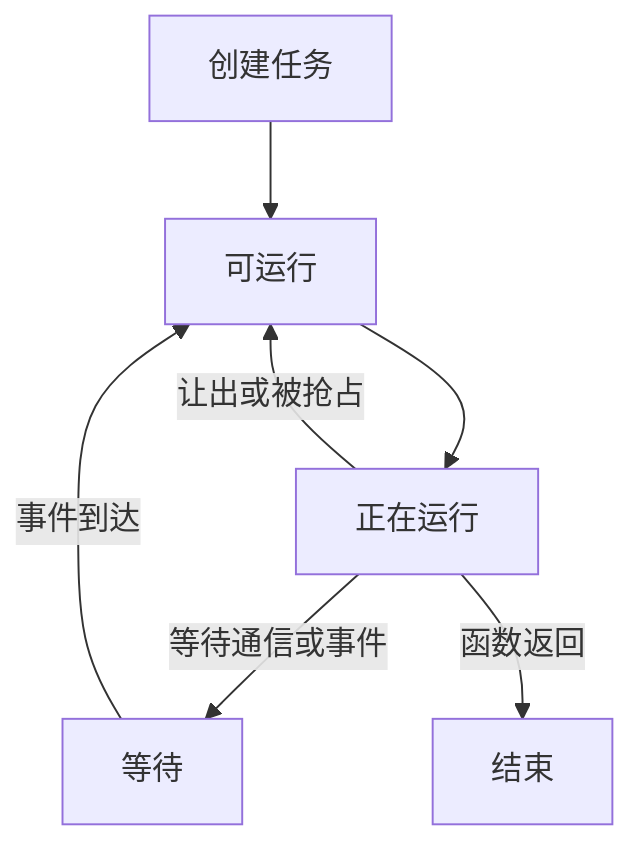

# 第十讲：Go 并发编程与 GMP 调度模型完整学习笔记

> 本讲围绕并发执行、GMP 调度和同步工具展开。每一节同时说明问题、机制、完整程序或状态过程、边界和常见误解；示例依据 Go 官方规则原创或改写，并给出来源。整理日期：2026-10-21（UTC）。语言语义以 Go 规范和内存模型为准，运行时结构以 Go 1.27.3 源码为准。

<a id="section-001"></a>

> **统一运行基线：** 建议使用 Go 1.27.3，示例模块声明采用 `go 1.27.0`。文中出现其他 Go 版本时，仅用于说明特性引入时间或历史实现差异；第三方依赖仍以对应模块的版本要求为准。


*图示：GMP 调度关系。*

## 正文导航

  - [运行方式与版本](#section-004)
- [一、主要内容](#section-005)
- [二、进程、线程和协程的关系](#section-006)
  - [2.1 进程](#section-007)
    - [2.1.1 特点](#section-008)
    - [2.1.2 使用场景](#section-009)
  - [2.2 线程](#section-010)
    - [2.2.1 特点](#section-011)
    - [2.2.2 使用场景](#section-012)
  - [2.3 协程](#section-013)
    - [2.3.1 特点](#section-014)
    - [2.3.2 适用场景](#section-015)
  - [2.4 Go 的协程（goroutine）](#section-016)
  - [2.5 进程、线程与协程的比较](#section-017)
  - [2.6 总结](#section-018)
- [三、Goroutine 的使用](#section-019)
  - [3.1 启动 goroutine](#section-020)
  - [3.2 使用匿名函数](#section-021)
  - [3.3 同步 goroutine](#section-022)
  - [3.4 Goroutine 和 Channel 的结合](#section-023)
- [四、并发控制](#section-024)
  - [4.1 Goroutine 和 sync.WaitGroup](#section-025)
  - [4.2 sync.Mutex 和 sync.RWMutex](#section-026)
    - [用 Mutex 保护一组不变量](#section-027)
    - [RWMutex 允许并行读，写仍需独占](#section-028)
  - [4.3 sync.Cond](#section-029)
  - [4.4 使用 Channel 做消息传输](#section-030)
  - [4.5 Context 在并发里面的使用](#section-031)
- [五、select 关键字](#section-032)
  - [5.1 基本使用](#section-033)
  - [5.2 监听多个 Channel 的数据](#section-034)
  - [5.3 Select 的执行原则](#section-035)
  - [5.4 超时控制](#section-036)
  - [5.5 退出 goroutine](#section-037)
  - [5.6 循环里面监听多个 channel](#section-038)
  - [5.7 select 和 switch](#section-039)
  - [5.8 select 的总结](#section-040)
- [六、Goroutine 实际用例](#section-041)
  - [6.1 并发 HTTP 请求](#section-042)
  - [6.2 并行的文件处理](#section-043)
  - [6.3 并发的计算任务](#section-044)
  - [6.4 并发处理数据库查询](#section-045)
    - [实用扩展：先限制任务进入，再启动 goroutine](#section-046)
- [七、调度器与 goroutine 生命周期【补充组织】](#section-047)
  - [7.1 goroutine 的主要状态【补充】](#section-048)
  - [7.2 G、M、P 各负责什么【补充】](#section-049)
  - [7.3 Goroutine 调度的核心机制](#section-050)
    - [7.3.1 抢占式调度](#section-051)
    - [7.3.2 协作式调度](#section-052)
  - [7.4 Goroutine 的栈管理](#section-053)
    - [7.4.1 栈增长](#section-054)
    - [7.4.2 栈缩减](#section-055)
  - [7.5 Goroutine 调度中的垃圾回收](#section-056)
  - [7.6 Go 调度器与 GOMAXPROCS](#section-057)
  - [7.7 总结](#section-058)
- [八、GMP 调度模型深入](#section-059)
  - [8.1 GMP 模型发展历程](#section-060)
  - [8.2 为什么需要协程](#section-061)
  - [8.3 GMP 模型的演变过程](#section-062)
    - [8.3.1 GM 模型](#section-063)
    - [8.3.2 GMP 模型](#section-064)
  - [8.4 GMP 调度时机](#section-065)
- [九、本章小结](#section-066)
- [十、阅读者问题](#section-067)
  - [10.1 怎么能写出一个最小内存的情况](#section-068)
    - [先明确各类内存由谁持有](#section-069)
    - [纯通知使用 chan struct{}](#section-070)
    - [不要让小切片长期保留大数组](#section-071)
    - [流式处理与有界结果](#section-072)
    - [先减少持有，再考虑复用](#section-073)
- [附录 A：从内存模型检查程序正确性](#section-074)
  - [A.1 先画出读写与同步边](#section-075)
  - [A.2 原子操作保护一个操作，不自动保护复合业务](#section-076)
  - [A.3 panic 的恢复边界属于发生它的 goroutine](#section-077)
- [附录 B：自测题与参考答案](#section-078)
  - [B.1 执行与同步](#section-079)
  - [B.2 channel、select 与取消](#section-080)
  - [B.3 调度、资源与性能](#section-081)
- [附录 C：官方资料与源码导航](#section-082)
- [附录 D：实际验证与使用边界](#section-083)

<a id="section-005"></a>

## 一、主要内容

设想一个页面需要查询调用方资料、最近订单和通知数。三个查询可能相互独立，串行执行会把等待时间叠加；启动三个 goroutine 后，等待可以重叠。但是，页面必须知道三个任务何时完成、失败怎样传播、请求取消后谁退出，以及连接池够不够用。写三个 `go` 只解决了“允许独立执行”，尚未解决这些生命周期问题。

本讲按照三个层次展开。第一层是业务组织：哪些任务可以独立做，什么数据必须共享，结果由谁汇总。第二层是语言和库：`go`、channel、`select`、锁、等待组和 Context 怎样表达关系。第三层才是运行时：大量 goroutine 怎样映射到操作系统线程，哪些 goroutine 在运行、在等待或可运行，为什么有时 CPU 空闲却服务仍然很慢。

| 学习问题 | 对应工具或概念 | 不应误以为 |
| --- | --- | --- |
| 把任务交出去继续执行 | `go` 语句 | 调用返回就等于任务完成 |
| 等一组任务结束 | `sync.WaitGroup` | 等待组同时传回错误和取消信号 |
| 保护共享数据 | `Mutex`、`RWMutex`、原子操作 | 每个 goroutine 有不同栈就没有共享内存 |
| 把值或所有权交给其他任务 | channel | 发送指针会深复制对象 |
| 等待多种通信条件 | `select` | 按 case 源码顺序挑选第一个 |
| 让一组任务停止 | Context 或关闭通知 channel | 调用取消函数会强制杀死所有任务 |
| 限制在途任务 | worker 池、信号量、队列边界 | `GOMAXPROCS` 等于业务并发上限 |
| 解释运行与等待 | G/M/P、运行队列、网络轮询 | 每个 goroutine 固定绑定一个线程 |

“并发”强调多个任务的执行区间可以交错；“并行”强调某一时刻真的由多个执行资源同时推进。单核机器可以有并发，多个 goroutine 也可能被同一线程轮流执行。对于 I/O 等待，交错推进可能有价值；对于纯计算，能否加速取决于有效 CPU 并行度、任务拆分和协调开销。官方讲解也明确区分这两个概念。[官方参照：Concurrency is not parallelism](https://go.dev/blog/waza-talk)、[Effective Go — Concurrency](https://go.dev/doc/effective_go#concurrency)。

一份可靠的并发设计至少能回答六个问题：由谁启动；任务的输入在哪里；共享状态由谁保护；遇到错误如何通知；什么条件下退出；由谁确认已经退出。后文的每个程序都可用这六问检查。调度器负责把可运行任务安排到资源上，却不会替业务定义这些答案。

<a id="section-006"></a>

## 二、进程、线程和协程的关系

<a id="section-007"></a>

### 2.1 进程

进程可以理解为操作系统管理的一个程序运行实例。它拥有地址空间以及文件描述符等资源；一个程序可以启动多个进程。同一台机器上两个 Go 服务即使使用相同源码，也不会因为变量名字相同就自动共享那块变量内存。需要交换数据时，通常使用网络、管道、共享内存等明确的跨进程机制。

这个模型有助于理解部署边界。例如 HTTP 服务和 PostgreSQL 通常是不同进程：Go 的 `sync.Mutex` 只能协调使用同一个锁对象的 goroutine，无法替数据库中来自其他进程的事务加锁。把本地变量加锁与保证跨服务一致性是不同问题。[Go 的进程 API：os.Process](https://pkg.go.dev/os#Process)、[os/exec](https://pkg.go.dev/os/exec)。

<a id="section-008"></a>

#### 2.1.1 特点

进程提供较强的资源和故障隔离。一个服务的普通堆指针不能直接拿到另一个服务进程中使用；一个进程退出后，操作系统回收它的许多资源。不过，隔离并不代表完全独立：多个进程仍竞争 CPU、磁盘、网络和内存，还可能通过共享文件或数据库互相影响。

启动进程一般涉及可执行文件、环境、标准输入输出、退出状态等工作。Go 中 `exec.Command` 创建命令描述，`Run` 等待命令完成，`Start` 与 `Wait` 将启动和等待分开。这个生命周期与“先启动 goroutine，再等待完成”有相似之处，但成本、隔离性和通信方式不同，不应只根据语法短长比较。

<a id="section-009"></a>

#### 2.1.2 使用场景

当组件需要单独部署、单独升级、不同权限或故障隔离时，进程边界很有价值。例如把外部转换工具作为子进程运行，可以通过退出码判断结果，并将输入输出限制在明确通道中。反过来，为程序里每个很短的字符串处理任务启动一个进程，通常会让创建和通信成本压过计算本身。

并发任务是否应该跨进程，不只取决于“任务数量多不多”。还要看共享状态多少、故障隔离需求、调用频率和资源所有权。Go 的 goroutine 适合一个服务内部组织工作，不能自动替代进程层面的安全或运维边界。[官方 API 参照：os/exec.CommandContext](https://pkg.go.dev/os/exec#CommandContext)。

<a id="section-010"></a>

### 2.2 线程

线程是操作系统调度的执行载体之一。同一进程内的多个线程通常共享进程地址空间，但有各自的执行栈、寄存器状态等执行现场。因此，线程之间交换普通内存数据方便，也更容易产生共享数据竞争。

在 Go 的运行时模型里，M 对应操作系统线程。它可能执行调用方 Go 代码、运行时工作、系统调用，也可能处于空闲状态。理解这一点，就不会把“当前正在执行 Go 代码的线程数”“进程总线程数”和“goroutine 数”当成同一个指标。[官方源码说明：Gs, Ms, Ps](https://github.com/golang/go/blob/go1.27.3/src/runtime/HACKING.md)。

<a id="section-011"></a>

#### 2.2.1 特点

线程的调度由操作系统参与，切换需要保存和恢复相应执行状态。线程可以在系统调用中阻塞；进程也可能创建更多线程以保持其他工作的进展。但线程不是免费的，线程栈、内核管理和调度都需要资源。固定说“一条线程一定消耗某个 MB 数”并不严谨：操作系统、配置、实际提交内存和运行时行为都会影响结果。

同进程线程共享堆并不意味着共享操作自动安全。两个线程同时更新同一个计数器，读改写可能互相覆盖；两个 goroutine 即使偶然在同一个 M 上交替运行，也不能据此绕过内存模型要求。正确性需要程序明确的同步关系，而不是猜测调度布局。[官方依据：Go Memory Model](https://go.dev/ref/mem)。

<a id="section-012"></a>

#### 2.2.2 使用场景

业务 Go 程序通常无需自己创建和调度操作系统线程。某些外部库或平台 API 要求调用发生在同一线程时，可以使用 `runtime.LockOSThread`，但必须理解对应的解锁和资源要求。普通数据库查询或网络请求不应仅为了“更快”就把每个 goroutine 固定到线程上，这会妨碍运行时自由安排任务。

`LockOSThread` 锁定的是当前 goroutine 与当前 OS 线程的关系，并没有为共享变量建立互斥，也没有保证该线程独占一个 CPU 核心。函数名里的 Lock 容易误导入门阶段，它和 `sync.Mutex.Lock` 解决的是完全不同的约束。[官方依据：runtime.LockOSThread](https://pkg.go.dev/runtime#LockOSThread)。

<a id="section-013"></a>

### 2.3 协程

协程是对可暂停、可恢复的执行单元的一类称呼，不同语言和库的实现差异很大。有些协程必须主动让出控制，有些由运行时安排，有些直接以状态机形式编译。仅凭“协程”二字无法推出它是否并行、是否抢占、是否有独立栈。

在 Go 学习语境中，常把 goroutine 称作轻量协程。这个称呼强调它比“一任务一系统线程”的组织方式更适合大量活动，但不能把它理解成只靠手写 `yield` 才会切换的执行对象。现代 Go 运行时具备安全点及异步抢占机制，后文会单独说明。[官方依据：Go 1.14 运行时变化](https://go.dev/doc/go1.14#runtime)、[runtime/preempt.go](https://github.com/golang/go/blob/go1.27.3/src/runtime/preempt.go)。

<a id="section-014"></a>

#### 2.3.1 特点

调用方态调度可以针对语言运行时提供较轻的任务创建和等待机制。一个任务等待 channel 时，可以把执行资源让给另一个任务，而不要求每个任务永久占据一条操作系统线程。代价是运行时必须维护任务状态、队列、栈和唤醒关系；大量小任务仍可能造成调度与分配成本。

“轻量”是相对的，不能推出“无限创建没有成本”。如果每个 goroutine 捕获一个大缓冲区，即使任务本身的栈较小，总内存也会很大；如果任务永久阻塞，运行时不会因为它没有用就随意取消业务逻辑。控制任务数量和生命周期仍然是程序责任。

<a id="section-015"></a>

#### 2.3.2 适用场景

有较多独立 I/O 等待、可分割计算、消息处理和后台维护任务时，goroutine 通常能把流程写得清楚。每个请求沿自己的顺序执行，运行时在任务之间切换，程序员不必把所有步骤写成显式回调状态机。但若任务之间共享大量可变状态，增加 goroutine 也会增加同步复杂度。

任务太细时，串行循环可能更合适。例如对 100 个整数分别启动 goroutine 只做一次加法，创建、排队、收集结果的成本可能比加法本身高。应该根据任务粒度、等待比例和测量结果决定拆分方式，而不是把 `go` 当作通用加速前缀。

<a id="section-016"></a>

### 2.4 Go 的协程（goroutine）

goroutine 是 Go 程序中的独立执行活动，由 `go` 语句启动。函数值和参数在调用者所在 goroutine 中按规则求值；新 goroutine 执行函数调用。原 goroutine 不等待被调用函数返回，返回值也不会自动交还给启动者，需要通过 channel、共享结果加同步等方式取得。[官方依据：Go statements](https://go.dev/ref/spec#Go_statements)。

下面程序只有两个参与者：主 goroutine 提交数字 7，工作 goroutine 计算平方，再通过 channel 交回结果。接收操作同时承担“取得数据”和“等结果可用”的作用，不需要猜测工作需要多少毫秒。

```go
// 运行示例：GMP-01
package main

import "fmt"

func square(n int, out chan<- int) {
	out <- n * n
}

func main() {
	result := make(chan int)
	go square(7, result)
	fmt.Println("square:", <-result)
}
```

输出：

```text
square: 49
```

运行次序可以从依赖关系推导：`go square` 使任务具备执行机会；主 goroutine 接收时，如果结果尚未产生就等待；发送和接收配对后，49 进入主 goroutine；随后打印。这不是说工作一定先运行或主 goroutine 一定先阻塞，两条实际调度路径都符合相同语义。

goroutine 不自动继承可供调用方识别的稳定业务 ID。不要解析 `runtime.Stack` 文本来给请求设计身份标识；业务 ID 应显式传入。类似地，业务代码不应依赖某个 goroutine 永远运行在同一线程上，除非确实通过相应 API 建立了线程约束。

<a id="section-017"></a>

### 2.5 进程、线程与协程的比较

| 维度 | 进程 | 操作系统线程 | Go goroutine |
| --- | --- | --- | --- |
| 主要管理者 | 操作系统 | 操作系统与运行时配合 | Go 运行时，最终仍靠 OS 线程执行 |
| 地址空间 | 通常各自拥有 | 同进程线程共享 | 同进程 goroutine 共享可达对象 |
| 调度关系 | 承载程序和资源 | M 对应的执行载体 | 多个 G 映射到多个 M |
| 典型通信 | 网络、管道等 | 共享内存加同步 | channel 或共享内存加同步 |
| 隔离能力 | 较强 | 同进程内隔离较弱 | 同进程内隔离较弱 |
| 生命周期控制 | 启动、信号、等待退出 | 依赖 OS 与运行时接口 | 通过函数返回、取消协议和等待完成 |
| 常见误解 | 进程越多一定越快 | 线程数等于 CPU 核数 | goroutine 数等于同时运行数 |

表中的比较是为了理解职责，不是性能排名。相同任务在不同层次拆分，通信方式、故障范围和资源开销都改变了。不能用一个 goroutine 示例比一个外部进程快，就得出进程隔离永远没有价值；两者承担的要求本来就不同。

<a id="section-018"></a>

### 2.6 总结

Go 服务是一个进程，进程中可能有多条 OS 线程，运行时将大量 goroutine 安排到这些线程上。GOMAXPROCS 影响同时执行调用方 Go 代码的调度资源数量，却不直接限制总线程数或总 goroutine 数。学习后续 API 时，先明确开发者要解决的是资源隔离、共享数据同步、任务完成等待，还是业务并发上限，这四类问题不能互相替代。

<a id="section-019"></a>

## 三、Goroutine 的使用

<a id="section-020"></a>

### 3.1 启动 goroutine

启动形式是 `go f(args...)`。这是一条语句，不是能赋值给变量的表达式，不能写成 `x := go f()`。如果 `f` 有返回值，新 goroutine 的返回值不会自动变成父 goroutine 的结果。新 goroutine 结束也不会自动阻止 `main` 返回；当主函数返回，程序退出，不会自动等待所有后台任务。[官方依据：Go statements](https://go.dev/ref/spec#Go_statements)、[Program execution](https://go.dev/ref/spec#Program_execution)。

对启动语句应读出三件事：函数从哪里取得输入、结果放哪里、结束由谁观察。如果函数接收一个指针，参数求值复制的是指针，不是把它指向的对象深复制一份。若启动者随后修改同一个对象，仍需要同步。

错误也需要显式传递。把会失败的函数放到 goroutine 中，不会让错误自行浮现到父函数。常见结构是结果类型同时携带值与错误，或使用任务组。无论采用哪一种，都要避免某条错误路径提前返回后，其他任务永久阻塞在发送结果上。

<a id="section-021"></a>

### 3.2 使用匿名函数

匿名函数让短任务靠近启动位置，便于看出捕获了哪些变量。为了清晰地表达每个任务的输入，可以把循环索引作为参数传入。Go 1.22 对循环内声明变量的语义作了调整，但显式参数依然是清楚的讲解方式；它也不能解决对同一共享对象字段的并发访问问题。[官方依据：Go 1.22 语言变化](https://go.dev/doc/go1.22#language)、[Function literals](https://go.dev/ref/spec#Function_literals)。

```go
// 运行示例：GMP-02
package main

import (
	"fmt"
	"sort"
)

func main() {
	results := make(chan int, 3)
	for i := 1; i <= 3; i++ {
		go func(n int) { results <- n * n }(i)
	}
	values := make([]int, 0, 3)
	for i := 0; i < 3; i++ {
		values = append(values, <-results)
	}
	sort.Ints(values)
	fmt.Println(values)
}
```

输出：

```text
[1 4 9]
```

排序发生在结果汇总后，只为稳定展示，不约束三个平方任务的完成顺序。缓冲容量为 3，让三个结果即使在主 goroutine 开始接收前产生，也有空间写入。因为主 goroutine 明确接收三次，不需要依赖关闭通知判断数量；这是一种已知任务数的协议，不应直接套用于未知长度流。

下面进一步区分“参数按值传入”和“闭包读取共享变量”。使用两个通知 channel 建立时序后，工作 goroutine 能合法地读到更新后的共享变量；参数则保留启动时求出的值。若去掉通知再并发读写共享变量，就会产生数据竞争，不是一个可预测的新输出。

```go
// 运行示例：GMP-03
package main

import "fmt"

func main() {
	value := 10
	proceed := make(chan struct{})
	done := make(chan struct{})
	go func(snapshot int) {
		<-proceed
		fmt.Println("argument:", snapshot)
		fmt.Println("shared variable:", value)
		close(done)
	}(value)
	value = 20
	close(proceed)
	<-done
}
```

输出：

```text
argument: 10
shared variable: 20
```

`close(proceed)` 发生在写入 20 之后，对关闭状态的接收发生在读取共享变量之前，因此建立了可见性关系。这个例子说明同步不仅用于防止“同时修改”，也用于明确什么时候读取的数据已经准备好。[官方依据：Channel communication](https://go.dev/ref/mem#chan)。

<a id="section-022"></a>

### 3.3 同步 goroutine

同步可以表示互斥、完成等待、通知、屏障或数据交接，要明确具体含义。`WaitGroup` 适合“这组任务都结束后再继续”，并不约束每个任务彼此之间的执行次序。对于固定任务集合，可以让每个任务写不同的结果元素，然后在 `Wait` 返回后读取所有元素。[官方依据：sync.WaitGroup](https://pkg.go.dev/sync#WaitGroup)。

```go
// 运行示例：GMP-04
package main

import (
	"fmt"
	"sync"
)

func main() {
	inputs := []int{2, 3, 4}
	results := make([]int, len(inputs))
	var wg sync.WaitGroup
	for i, n := range inputs {
		wg.Add(1)
		go func(index, value int) {
			defer wg.Done()
			results[index] = value * value
		}(i, n)
	}
	wg.Wait()
	fmt.Println(results)
}
```

输出：

```text
[4 9 16]
```

这里没有多个 goroutine 同时写同一个元素，也没有并发 `append` 修改共享切片头；输入长度和目标存储在启动前已准备好。不同元素可被独立写入，主 goroutine 则等全部任务完成后读取。若把 `results[index] = ...` 改成所有任务共同 `append`，就改变了共享状态和同步需求。

主 goroutine 负责等待而不是睡眠。睡眠只能保证当前 goroutine 在某段时间内不运行，不能保证指定任务已经完成，更不能替代内存同步。机器变慢、任务耗时增加或者调度变化，都可能让“睡 100 毫秒应该够了”的代码失效。

<a id="section-023"></a>

### 3.4 Goroutine 和 Channel 的结合

channel 适合表达生产者、处理者、消费者之间的数据流。每个阶段接收输入、产生输出；生产者知道不再发送时关闭自己的输出，消费者可以用 `range` 等到流结束。这种职责划分比由多个接收方随意关闭共享 channel 更容易证明正确。[官方示例主题：Go Concurrency Patterns — Pipelines](https://go.dev/blog/pipelines)。

```go
// 运行示例：GMP-05
package main

import "fmt"

func generate(values ...int) <-chan int {
	out := make(chan int)
	go func() {
		defer close(out)
		for _, value := range values {
			out <- value
		}
	}()
	return out
}

func square(in <-chan int) <-chan int {
	out := make(chan int)
	go func() {
		defer close(out)
		for value := range in {
			out <- value * value
		}
	}()
	return out
}

func main() {
	total := 0
	for value := range square(generate(2, 3, 4)) {
		total += value
	}
	fmt.Println("sum of squares:", total)
}
```

输出：

```text
sum of squares: 29
```

本例中的发送没有取消分支，因为最后一个消费者承诺读到输出关闭。只要消费者提前离开，这个承诺就不成立，上游可能卡在发送上。因此，学习管道时不能只复制 `go` 和 `range`，还必须说明下游早退时谁通知上游停止。第四、五章会加入取消协议。

多个 worker 从同一个任务 channel 取值，可以分散工作。它们完成后由一个协调者关闭结果 channel，接收者持续收集。关闭时刻必须晚于全部发送者退出，否则会造成向已关闭 channel 发送的 panic。

```go
// 运行示例：GMP-06
package main

import (
	"fmt"
	"sort"
	"sync"
)

func main() {
	jobs := make(chan int)
	results := make(chan int)
	var workers sync.WaitGroup
	for i := 0; i < 2; i++ {
		workers.Add(1)
		go func() {
			defer workers.Done()
			for n := range jobs {
				results <- n * n
			}
		}()
	}
	go func() {
		defer close(jobs)
		for _, n := range []int{1, 2, 3, 4} {
			jobs <- n
		}
	}()
	go func() { workers.Wait(); close(results) }()
	var values []int
	for value := range results {
		values = append(values, value)
	}
	sort.Ints(values)
	fmt.Println(values)
}
```

输出：

```text
[1 4 9 16]
```

一个任务值只会被某一次接收取走，不会自动广播给全部 worker。两个 worker 处理多少个任务也没有均分保证；若所有工作都很短，其中一个可能拿到更多。worker 池保证的是执行者数量和共同消费协议，不是按 goroutine 编号公平分配业务任务。

<a id="section-024"></a>

## 四、并发控制

<a id="section-025"></a>

### 4.1 Goroutine 和 sync.WaitGroup

`WaitGroup` 维护尚未完成的任务计数。`Add(n)` 增加计数，`Done()` 相当于减一，`Wait()` 等计数归零。计数不是 goroutine ID 列表，也没有记录每个任务的错误。可以把它理解为“这一批还有几件事没有交卷”，但只有程序正确登记和销账，它才反映真实状态。

在传统写法中，先在启动者中 `Add(1)`，再启动 goroutine，任务中 `defer Done()`。如果把 `Add` 放到新 goroutine 内，主 goroutine 可能先执行 `Wait()` 看见计数仍为零并返回；任务稍后才登记。这个问题来自生命周期顺序，不是给 Wait 多加一次调用就能修复。[官方依据：WaitGroup.Add](https://pkg.go.dev/sync#WaitGroup.Add)。

Go 1.25 新增 `WaitGroup.Go`，把增加计数、启动任务和结束登记组合起来。以下例子只在这个位置使用新版 API，并明确要求传入函数不能 panic。它不是错误收集器；需要报告错误时，仍然应设计结果存储或采用合适的任务组。[官方依据：WaitGroup.Go](https://pkg.go.dev/sync#WaitGroup.Go)、[Go 1.25 Release Notes](https://go.dev/doc/go1.25#sync)。

```go
// 运行示例：GMP-07
// 运行基线：Go 1.27.3（模块声明 go 1.27.0）
package main

import (
	"fmt"
	"sync"
)

func main() {
	values := []int{3, 5, 7}
	doubled := make([]int, len(values))
	var wg sync.WaitGroup
	for i, value := range values {
		i, value := i, value
		wg.Go(func() { doubled[i] = value * 2 })
	}
	wg.Wait()
	fmt.Println(doubled)
}
```

输出：

```text
[6 10 14]
```

使用等待组时还要注意复用边界：上一批全部 `Wait` 返回后，再开始互相独立的新一批计数。把一个仍在等待的组重置成零值或复制到其他结构里，会破坏正在进行的协议。`WaitGroup` 第一次使用后不能复制；放在结构体里时，结构体的方法通常也应避免不经意的值复制。

`Done` 在它解除阻塞的 `Wait` 返回之前建立同步关系，因此上面的结果写入在 `Wait` 后可见。但等待组不会保护两名 worker 对同一位置的同时写入。把“最终等到了大家结束”误当成“执行过程中没有竞争”，是两层不同条件的混淆。[官方依据：sync.WaitGroup 的内存模型说明](https://pkg.go.dev/sync#WaitGroup)。

<a id="section-026"></a>

### 4.2 sync.Mutex 和 sync.RWMutex

<a id="section-027"></a>

#### 用 Mutex 保护一组不变量

互斥锁保证同一时刻只有持有该锁的 goroutine 进入相应临界区。锁不属于某个变量的自动属性；程序必须让所有相关访问遵循同一把锁。一个写路径加锁、另一个读路径裸读，仍然不安全。

```go
// 运行示例：GMP-08
package main

import (
	"fmt"
	"sync"
)

func main() {
	var mu sync.Mutex
	count := 0
	var wg sync.WaitGroup
	for worker := 0; worker < 4; worker++ {
		wg.Add(1)
		go func() {
			defer wg.Done()
			for i := 0; i < 100; i++ {
				mu.Lock()
				count++
				mu.Unlock()
			}
		}()
	}
	wg.Wait()
	fmt.Println("count:", count)
}
```

输出：

```text
count: 400
```

`count++` 包含读取、计算和写回，不是因为语法只有一个符号就自动原子化。锁使每次更新作为相互排斥的临界区执行；等待组使主 goroutine 在全部更新后再读。若用锁保护账户余额，临界区还应包括与余额一起成立的检查和更新，例如“确认足额，再扣款”，不能只把最后一行赋值加锁。[官方依据：sync.Mutex](https://pkg.go.dev/sync#Mutex)、[Go Memory Model — Locks](https://go.dev/ref/mem#locks)。

锁的零值可直接使用，但第一次使用后不能复制。锁也不是可重入锁：同一 goroutine 在未解锁时再次锁同一 `Mutex` 会阻塞。API 不提供通过 `ctx` 取消普通 `Lock` 的能力；如果业务需要可取消的资源获取，要在设计阶段选择相应协议。

<a id="section-028"></a>

#### RWMutex 允许并行读，写仍需独占

`RWMutex` 提供多个读锁同时持有和单个写锁独占的语义。适合读操作确实可以安全并行、写相对较少且临界区有实际成本的情况。读多并不自动意味着 `RWMutex` 比 `Mutex` 快，锁本身的管理开销、缓存争用和临界区长度都需要测量。

```go
// 运行示例：GMP-09
package main

import (
	"fmt"
	"sync"
)

type Cache struct {
	mu     sync.RWMutex
	values map[string]int
}

func (c *Cache) Set(key string, value int) {
	c.mu.Lock()
	defer c.mu.Unlock()
	c.values[key] = value
}

func (c *Cache) Get(key string) (int, bool) {
	c.mu.RLock()
	defer c.mu.RUnlock()
	value, ok := c.values[key]
	return value, ok
}

func main() {
	cache := &Cache{values: make(map[string]int)}
	cache.Set("go", 22)
	results := make([]int, 3)
	var wg sync.WaitGroup
	for i := range results {
		wg.Add(1)
		go func(index int) {
			defer wg.Done()
			results[index], _ = cache.Get("go")
		}(i)
	}
	wg.Wait()
	fmt.Println(results)
}
```

输出：

```text
[22 22 22]
```

这个 Get 返回整数副本，因此解锁后调用者没有拿到可修改 Map 内部对象的引用。如果返回 `*Entry` 或切片，解锁后对象是否仍被共享修改必须另行约定。对 Map 的查找加锁，不等于从 Map 取出的整个对象图以后都自动受保护。

不能把读锁直接升级为写锁，也不能把写锁直接降级为读锁。持有 `RLock` 时调用 `Lock`，会等待包括自己在内的读者离开。等待写者时，新读者可能被阻塞，以避免写者长期无法前进，因此递归取得读锁也不应被当作可靠操作。[官方依据：sync.RWMutex](https://pkg.go.dev/sync#RWMutex)。

<a id="section-029"></a>

### 4.3 sync.Cond

条件变量解决的是“共享状态尚未满足条件时，先睡下，状态变化后再检查”。它不保存业务条件，条件通常是由锁保护的字段，例如队列是否非空、系统是否准备好。`Cond` 保存的是等待和通知机制；把条件放在另一个不受同一锁保护的位置，会使协议难以成立。

调用 `Wait` 时必须持有对应的锁。它把解锁与进入等待结合起来，随后被通知唤醒，再重新取得锁后返回。Go 的 `Cond.Wait` 不会无缘无故返回，但仍应放在 `for !condition` 循环里：被唤醒后，其他 goroutine 可能先拿到锁并改变条件；通知意味着“值得重新检查”，不等于“这次一定轮到开发者使用资源”。[官方依据：sync.Cond.Wait](https://pkg.go.dev/sync#Cond.Wait)。

```go
// 运行示例：GMP-10
package main

import (
	"fmt"
	"sync"
)

func main() {
	var mu sync.Mutex
	cond := sync.NewCond(&mu)
	queue := []int{}
	closed := false
	result := make(chan int)
	go func() {
		total := 0
		mu.Lock()
		for {
			for len(queue) == 0 && !closed {
				cond.Wait()
			}
			if len(queue) == 0 && closed {
				break
			}
			value := queue[0]
			queue = queue[1:]
			total += value
		}
		mu.Unlock()
		result <- total
	}()
	mu.Lock()
	queue = append(queue, 2, 3, 5)
	closed = true
	cond.Broadcast()
	mu.Unlock()
	fmt.Println("total:", <-result)
}
```

输出：

```text
total: 10
```

无论消费者先进入等待，还是生产者先把数据放入队列，程序都正确。若通知早于 `Wait`，通知本身不会作为信号额度永久保存，但共享状态已经改变，消费者检查条件后不必等待。正确性依赖状态，而不是必须碰巧接住某一次通知。

`Signal` 唤醒一个等待者，`Broadcast` 唤醒所有等待者。唤醒不提供调度优先权，也不把锁直接移交给指定等待者。若只有一次“准备好了，所有人都可以继续”的广播，关闭一个 channel 往往更直观；若条件可能多次变化，且已有共享状态和锁，Cond 可能更合适。

```go
// 运行示例：GMP-11
package main

import (
	"fmt"
	"sync"
)

func main() {
	ready := make(chan struct{})
	config := ""
	seen := make([]string, 3)
	var wg sync.WaitGroup
	for i := range seen {
		wg.Add(1)
		go func(index int) {
			defer wg.Done()
			<-ready
			seen[index] = config
		}(i)
	}
	config = "ready-v1"
	close(ready)
	wg.Wait()
	fmt.Println(seen)
}
```

输出：

```text
[ready-v1 ready-v1 ready-v1]
```

这个广播只表示一次从未准备到已准备的变化，channel 关闭后无法“重新打开”。如果配置以后要更新，不能重新给 `config` 赋值并认为最初的关闭仍然保护所有新读写；必须设计新的发布机制或锁。同步关系需要对应实际发生的读写，而不是某个对象曾经同步过就永久安全。

<a id="section-030"></a>

### 4.4 使用 Channel 做消息传输

消息传输的一种设计是由一个 goroutine 独占可变状态，其他 goroutine 通过请求 channel 让它执行操作。这样可以减少共享对象的写入口，但状态拥有者也可能成为吞吐瓶颈。并不是用了 channel 就没有同步成本，只是把锁竞争转换成排队和消息处理。

```go
// 运行示例：GMP-12
package main

import "fmt"

type Request struct {
	Delta int
	Reply chan int
}

func counter(requests <-chan Request, done chan<- struct{}) {
	total := 0
	for request := range requests {
		total += request.Delta
		request.Reply <- total
	}
	close(done)
}

func main() {
	requests := make(chan Request)
	done := make(chan struct{})
	go counter(requests, done)
	for _, delta := range []int{2, 3, -1} {
		reply := make(chan int, 1)
		requests <- Request{Delta: delta, Reply: reply}
		fmt.Println(<-reply)
	}
	close(requests)
	<-done
}
```

输出：

```text
2
5
4
```

请求使用值传递，回复 channel 容量为一，让拥有者在调用者还没接收时也能交出单个结果。本例调用方顺序提交，所以结果次序确定；如果多个客户端并发提交，请求处理次序应以拥有者实际收到的次序为准，不等于客户端编号。

发送消息中的切片或指针时，复制的是相应描述符或指针。发送者在发送后继续修改底层数据，而接收者同时读取，仍可能竞争。所谓“通过通信共享内存”更适合理解为明确数据所有权和交接规则，而不是认为 channel 会替每个对象做深复制。[官方依据：Effective Go — Share by communicating](https://go.dev/doc/effective_go#sharing)、[Representation of values](https://go.dev/ref/spec#Representation_of_values)。

<a id="section-031"></a>

### 4.5 Context 在并发里面的使用

Context 表达一组有关联操作的取消、截止时间及请求范围值。`Done()` 返回一个在取消时关闭的通知 channel；`Err()` 给出结束原因类别。取消函数发出通知，不会跳进某个 goroutine 强制终止它。工作函数必须在合适位置观察取消并结束。[官方依据：context](https://pkg.go.dev/context)、[Go Concurrency Patterns — Context](https://go.dev/blog/context)。

```go
// 运行示例：GMP-13
package main

import (
	"context"
	"fmt"
)

func main() {
	ctx, cancel := context.WithCancel(context.Background())
	ready := make(chan struct{})
	done := make(chan error, 1)
	go func() {
		close(ready)
		<-ctx.Done()
		done <- ctx.Err()
	}()
	<-ready
	cancel()
	fmt.Println("worker:", <-done)
}
```

输出：

```text
worker: context canceled
```

这里的 `ready` 只让示例明确展示工作已启动；`done` 才确认工作观察了取消并返回结果。两者不能混淆。“调用了 cancel”与“全部资源已释放”之间可能还有清理步骤，正式服务应等待这些步骤完成，再关闭共同依赖的数据库或输出资源。

超时是取消的一种触发方式。为了让演示不依赖机器时钟精度，下一例直接创建已经到期的截止时间，观察稳定的错误类别。真实请求应根据剩余预算传递同一个 Context，而不是每一层重新获得完整的超时额度。

```go
// 运行示例：GMP-14
package main

import (
	"context"
	"errors"
	"fmt"
	"time"
)

func main() {
	ctx, cancel := context.WithDeadline(context.Background(), time.Unix(0, 0))
	defer cancel()
	<-ctx.Done()
	fmt.Println("deadline exceeded:", errors.Is(ctx.Err(), context.DeadlineExceeded))
}
```

输出：

```text
deadline exceeded: true
```

`defer cancel()` 仍然有意义：正常完成时尽快解除相关资源和父子关系，而不是只能等定时器到期。Context 也不携带任务结果，不应作为随意传递所有业务参数的袋子；调用方 ID、查询条件等明确参数通常直接放在函数签名里更清楚。

<a id="section-032"></a>

## 五、select 关键字

<a id="section-033"></a>

### 5.1 基本使用

`select` 在多个 channel 通信操作之间选择一个能推进的分支。若有一个或多个分支就绪，就选择其中一个；若没有就绪分支但有 `default`，执行 default；两者都没有则阻塞。它检查的是通信能否进行，不是普通布尔条件。[官方依据：Select statements](https://go.dev/ref/spec#Select_statements)。

```go
// 运行示例：GMP-15
package main

import "fmt"

func main() {
	values := make(chan int, 1)
	select {
	case value := <-values:
		fmt.Println("unexpected:", value)
	default:
		fmt.Println("empty now")
	}
	values <- 7
	select {
	case value := <-values:
		fmt.Println("received:", value)
	default:
		fmt.Println("unexpected default")
	}
}
```

输出：

```text
empty now
received: 7
```

default 表示“不愿在这一次选择上等待”，不表示永远没有数据。把 default 放在无限循环里持续重试，可能把等待变成消耗 CPU 的忙循环。使用它之前应明确丢弃、拒绝、执行其他工作或返回的业务策略，而不是只为了避免阻塞。

<a id="section-034"></a>

### 5.2 监听多个 Channel 的数据

同时消费多个输入时，每个输入结束的时间可能不同。已关闭且缓冲已空的 channel 会一直可接收零值；如果不处理 `ok`，循环可能不断读到无意义数据。常见写法是读到关闭后把对应变量设为 nil，禁用该 select 分支，直到所有输入都结束。

```go
// 运行示例：GMP-16
package main

import (
	"fmt"
	"sort"
)

func main() {
	first := make(chan int, 2)
	second := make(chan int, 2)
	first <- 1
	first <- 3
	close(first)
	second <- 2
	second <- 4
	close(second)
	var values []int
	for first != nil || second != nil {
		select {
		case value, ok := <-first:
			if !ok {
				first = nil
				continue
			}
			values = append(values, value)
		case value, ok := <-second:
			if !ok {
				second = nil
				continue
			}
			values = append(values, value)
		}
	}
	sort.Ints(values)
	fmt.Println(values)
}
```

输出：

```text
[1 2 3 4]
```

设为 nil 的是当前函数保存的 channel 变量，不会重新打开或关闭底层 channel，也不会改变其他 goroutine 手里的引用。这个技巧适用于在一个选择循环里动态启用和禁用通信来源。若全部 case 都是 nil 且没有 default，这次 select 永久等待，所以外层循环必须有相应终止条件。[官方依据：Channel types](https://go.dev/ref/spec#Channel_types)、[Select statements](https://go.dev/ref/spec#Select_statements)。

<a id="section-035"></a>

### 5.3 Select 的执行原则

规范描述的关键顺序是：进入 select 时，各接收操作的 channel 表达式、各发送操作的 channel 表达式与右侧待发送值，按源码顺序求值一次；随后在能够推进的通信中选择；真正执行被选中的通信；最后执行该分支语句。接收赋值左侧的求值有自己的时机，不能把所有表达式都概括成“只执行被选分支才求值”。

```go
// 运行示例：GMP-17
package main

import "fmt"

func makeValue(label string) int {
	fmt.Println("evaluate:", label)
	return 1
}

func main() {
	var unavailable chan int
	select {
	case unavailable <- makeValue("send value"):
		fmt.Println("sent")
	default:
		fmt.Println("default selected")
	}
}
```

输出：

```text
evaluate: send value
default selected
```

虽然 nil channel 的发送不可能就绪，待发送表达式仍被求值。因此，把昂贵计算、带副作用函数或可能 panic 的操作直接放在发送右侧，要考虑它在未选择该分支时也可能执行。select 不是对整个 case 表达式的惰性包装。

多个通信就绪时，规范规定进行均匀的伪随机选择，而不是优先选源码靠前的 case。这种选择规则不等于业务层面的公平排队、每个任务在固定时间内被服务，或者取消分支具有最高优先级。对于取消与普通消息同时就绪，任一可用分支都可能被选中。[官方依据：Select statements](https://go.dev/ref/spec#Select_statements)。

<a id="section-036"></a>

### 5.4 超时控制

为一次等待建立 `Timer` 或 Context，可以让等待具有截止条件。时间到期只让相应通道可接收，真正执行超时处理还需要 goroutine 获得调度机会；不能把“设定 10 毫秒”理解为严格实时系统中绝不会超过 10 毫秒的完成保证。

```go
// 运行示例：GMP-18
package main

import (
	"fmt"
	"time"
)

func main() {
	var unavailable <-chan int
	timer := time.NewTimer(0)
	defer timer.Stop()
	select {
	case value := <-unavailable:
		fmt.Println(value)
	case <-timer.C:
		fmt.Println("timeout branch")
	}
}
```

输出：

```text
timeout branch
```

本例用零时长仅验证分支，不测量延迟。真实循环中，若希望给“整个任务”一个总超时，就不应每次迭代重新 `time.After(timeout)`，否则每轮可能重新获得完整预算。若希望的是“每次等待最多多久”，每轮新建计时器才符合需求。先定义时间约束属于哪一层，再选择 Timer 或 Context。

Go 1.23 改变了 channel 型定时器的垃圾回收和发送语义；行为还可能受主模块 `go` 版本和兼容开关影响。旧教材中“所有 Stop 后必须一律 drain”或“未 Stop 的 Timer 必然永久保留到到期”的说法不能脱离版本直接使用。本文示例避免依赖这些版本差异，具体 Reset/Stop 规则以当前 `time` 文档为准。[官方依据：time.NewTimer](https://pkg.go.dev/time#NewTimer)、[Go 1.23 Timer Channel Changes](https://go.dev/wiki/Go123Timer)。

<a id="section-037"></a>

### 5.5 退出 goroutine

goroutine 退出的正常方式是其顶层函数返回。select 中收到取消通知后，需要明确 `return` 或跳出外层循环。仅写一个普通 `break`，通常只离开 select，不会离开包围它的 for，从而继续下一轮。

```go
// 运行示例：GMP-19
package main

import (
	"context"
	"fmt"
)

func worker(ctx context.Context, jobs <-chan int, stopped chan<- struct{}) {
	defer close(stopped)
	for {
		select {
		case <-ctx.Done():
			return
		case _, ok := <-jobs:
			if !ok {
				return
			}
		}
	}
}

func main() {
	ctx, cancel := context.WithCancel(context.Background())
	jobs := make(chan int)
	stopped := make(chan struct{})
	go worker(ctx, jobs, stopped)
	cancel()
	<-stopped
	fmt.Println("worker stopped")
}
```

输出：

```text
worker stopped
```

worker 同时支持输入结束和取消结束。它不关闭 `jobs`，因为它不是该输入的所有者；退出后通知 `stopped`。如果 worker 内部还执行不能取消的长时间调用，外层这个 select 只能在调用返回后再次检查取消，不能中断已经进入的任意函数。

<a id="section-038"></a>

### 5.6 循环里面监听多个 channel

长期事件循环需要明确所有输入的生命周期与结果输出的生命周期。一个可靠模式是：输入关闭后禁用对应分支，全部输入结束后关闭输出；任何可能长时间阻塞的转发操作，也要考虑取消。不要只给接收端 select 加取消，而在得到值之后用无法取消的发送把任务卡住。

```go
// 运行示例：GMP-20
package main

import (
	"context"
	"fmt"
	"sort"
)

func merge(ctx context.Context, a, b <-chan int) <-chan int {
	out := make(chan int)
	go func() {
		defer close(out)
		for a != nil || b != nil {
			var value int
			var ok bool
			select {
			case <-ctx.Done():
				return
			case value, ok = <-a:
				if !ok {
					a = nil
					continue
				}
			case value, ok = <-b:
				if !ok {
					b = nil
					continue
				}
			}
			select {
			case out <- value:
			case <-ctx.Done():
				return
			}
		}
	}()
	return out
}

func main() {
	a := make(chan int, 1)
	a <- 2
	close(a)
	b := make(chan int, 1)
	b <- 5
	close(b)
	ctx, cancel := context.WithCancel(context.Background())
	defer cancel()
	var values []int
	for value := range merge(ctx, a, b) {
		values = append(values, value)
	}
	sort.Ints(values)
	fmt.Println(values)
}
```

输出：

```text
[2 5]
```

这里把输入生产者做成预填充、已关闭 channel，让例子聚焦转发者。若生产者本身也使用 goroutine，它们必须共享取消协议或者拥有其他可证明的退出路径。取消 merge 并不会神奇地关闭所有上游生产者，这也是完整管道比一个函数多出的设计责任。

<a id="section-039"></a>

### 5.7 select 和 switch

`switch` 根据表达式值或条件选择代码分支；`select` 根据 channel 通信的可推进状态选择分支。switch 的普通 case 匹配有源码顺序，select 多个就绪分支的选择没有相同的优先次序。不能把 channel 的 `len` 放进 switch 就认为得到了与 select 等价的原子通信检查，因为检查后状态可能变化。

```go
// 运行示例：GMP-21
package main

import "fmt"

func classify(n int) string {
	switch {
	case n < 0:
		return "negative"
	case n == 0:
		return "zero"
	default:
		return "positive"
	}
}

func main() {
	jobs := make(chan int, 1)
	jobs <- -2
	select {
	case value := <-jobs:
		fmt.Println(classify(value))
	default:
		fmt.Println("no job")
	}
}
```

输出：

```text
negative
```

本例先使用 select 取得一个可用任务，再使用 switch 按业务数据分类。二者在同一流程中承担不同职责；把功能拆清楚之后，就不会为了“都是多分支”而混用语义。

<a id="section-040"></a>

### 5.8 select 的总结

| 情况 | 结果 | 设计含义 |
| --- | --- | --- |
| 某一个通信就绪 | 可执行该通信 | 处理其数据和状态 |
| 多个通信就绪 | 伪随机选择一个 | 不提供 case 优先级 |
| 全部不能推进，有 default | 执行 default | 明确非阻塞策略 |
| 全部不能推进，无 default | 挂起等待 | 需要外部事件或取消路径 |
| 从已关闭且排空 channel 接收 | 立即得到零值和 false | 关闭后禁用分支或退出 |
| 从 nil channel 接收或发送 | 该 case 不就绪 | 可用来临时禁用输入 |
| 取消与数据同时可用 | 都可能被选中 | 取消通常是合作式边界 |

理解 select 最重要的不是背代码模板，而是把每个 case 看作一条可能阻塞的协议操作，再检查协议有没有终点、有没有失去对端的情况。它能帮助表达等待关系，却无法替程序判断谁该关闭、多少消息才算结束，或怎样处理发送后对端提前退出。

<a id="section-041"></a>

## 六、Goroutine 实际用例

<a id="section-042"></a>

### 6.1 并发 HTTP 请求

并发 HTTP 请求适合互相独立的查询。例如一个页面同时取三项资料，每项请求有自己的响应体，但共享一个可复用的 `http.Client`。启动者负责控制并发数和请求预算；每个请求负责关闭自己的响应体；汇总者在所有请求结束后检查错误并组织结果。把这几个职责写清楚，比只看 `go client.Get` 更接近真实业务。

`http.Client` 和 `http.Transport` 设计为可并发使用并应尽量复用。为每个请求随意建立新 Transport 会妨碍连接复用。HTTP 响应状态为 404 或 500 通常不直接表现为 `Client.Do` 的 Go error；网络请求成功收到响应与业务返回成功是两种状态，调用者应分别检查。[官方依据：http.Client](https://pkg.go.dev/net/http#Client)、[http.Transport](https://pkg.go.dev/net/http#Transport)。

以下例子启动本地测试服务，不依赖外部网站。三个路径的响应分别为 `A`、`BB`、`CCC`。任务可交错执行，结果按输入下标存放，最后统一打印。

```go
// 运行示例：GMP-22
package main

import (
	"context"
	"fmt"
	"io"
	"net/http"
	"net/http/httptest"
	"sync"
	"time"
)

func main() {
	bodies := map[string]string{"/a": "A", "/b": "BB", "/c": "CCC"}
	server := httptest.NewServer(http.HandlerFunc(func(w http.ResponseWriter, r *http.Request) {
		body, ok := bodies[r.URL.Path]
		if !ok {
			http.NotFound(w, r)
			return
		}
		fmt.Fprint(w, body)
	}))
	defer server.Close()
	client := server.Client()
	defer client.CloseIdleConnections()
	ctx, cancel := context.WithTimeout(context.Background(), 5*time.Second)
	defer cancel()
	paths := []string{"/a", "/b", "/c"}
	values := make([]string, len(paths))
	errs := make([]error, len(paths))
	var wg sync.WaitGroup
	for i, path := range paths {
		wg.Add(1)
		go func(index int, path string) {
			defer wg.Done()
			req, err := http.NewRequestWithContext(ctx, http.MethodGet, server.URL+path, nil)
			if err != nil {
				errs[index] = err
				return
			}
			resp, err := client.Do(req)
			if err != nil {
				errs[index] = err
				return
			}
			defer resp.Body.Close()
			if resp.StatusCode != http.StatusOK {
				errs[index] = fmt.Errorf("unexpected status: %d", resp.StatusCode)
				return
			}
			data, err := io.ReadAll(io.LimitReader(resp.Body, 1024))
			values[index], errs[index] = string(data), err
		}(i, path)
	}
	wg.Wait()
	for i, path := range paths {
		if errs[i] != nil {
			panic(errs[i])
		}
		fmt.Printf("%s=%s\n", path, values[i])
	}
}
```

输出：

```text
/a=A
/b=BB
/c=CCC
```

这里的 1024 字节上限只是为讲解服务的小响应设置的读取边界；正式 API 若要拒绝过大响应，需要读取上限加一并判断是否超限，或者使用协议中明确的长度限制，不能把“截断后的部分内容”当作完整成功结果。错误路径关闭响应体，正常路径读取完成并关闭响应体，资源职责保持一致。

从时序上看，主 goroutine 先创建共同预算，再发出三个任务，最后等待全部任务结束。某个任务失败时，本例保留错误并等其他任务完成；这与“任一失败立即取消其他任务”的策略不同。两种策略都可合理使用，但要根据页面是否允许部分成功决定，不能把错误传播方式隐藏在不透明的后台日志里。

如果独立请求耗时分别为 (t_1,t_2,t_3)，忽略资源竞争时，串行耗时接近 (t_1+t_2+t_3)，理想并发耗时接近最大值。这只是示例模型：DNS、连接池、服务端限流、带宽、重试和调度都会增加耗时。并发量增加过度还会让服务端排队更久，反而提高尾延迟，因此不能从“等待可以重叠”推导“启动越多越快”。

增加并发上限时，还要区分业务任务数、连接数和 HTTP/2 流数量。一个任务可能重试多个请求，一条连接也可能承载多个请求。先在业务层限制在途工作，再根据 Transport 和下游能力调整连接设置，比简单把所有数值设为同一个常量更可靠。

<a id="section-043"></a>

### 6.2 并行的文件处理

文件处理常被拆成“列出路径 → 读取 → 计算摘要或解析 → 汇总”。可以并发的通常是互不依赖的文件，但磁盘带宽和文件描述符数量是共享资源。对机械硬盘随机访问、网络文件系统或单个巨大文件，增加 goroutine 不一定加速。读取和计算也可采用不同的并发度，避免所有任务同时持有大文件内容。

示例只创建三个很小的临时文件，完成后删除临时目录。每个任务读取一个文件，把字节数放到固定位置。这个例子根据标准库文件和等待组接口组织，演示正确生命周期，不声称测量了文件系统性能。[官方依据：os.ReadFile](https://pkg.go.dev/os#ReadFile)、[os.MkdirTemp](https://pkg.go.dev/os#MkdirTemp)。

```go
// 运行示例：GMP-23
package main

import (
	"fmt"
	"os"
	"path/filepath"
	"sync"
)

func main() {
	dir, err := os.MkdirTemp("", "go-concurrent-files-")
	if err != nil {
		panic(err)
	}
	defer os.RemoveAll(dir)
	names := []string{"a.txt", "b.txt", "c.txt"}
	contents := []string{"Go", "channel", "context"}
	for i, name := range names {
		if err := os.WriteFile(filepath.Join(dir, name), []byte(contents[i]), 0600); err != nil {
			panic(err)
		}
	}
	sizes := make([]int, len(names))
	errs := make([]error, len(names))
	var wg sync.WaitGroup
	for i, name := range names {
		wg.Add(1)
		go func(index int, name string) {
			defer wg.Done()
			data, err := os.ReadFile(filepath.Join(dir, name))
			sizes[index], errs[index] = len(data), err
		}(i, name)
	}
	wg.Wait()
	for i, name := range names {
		if errs[i] != nil {
			panic(errs[i])
		}
		fmt.Printf("%s: %d bytes\n", name, sizes[i])
	}
}
```

输出：

```text
a.txt: 2 bytes
b.txt: 7 bytes
c.txt: 7 bytes
```

如果有十万个文件，直接启动十万个 `ReadFile` 任务可能同时持有大量缓冲区、队列元素和打开的文件。更合适的做法是先用有限 worker 处理路径流，再把小结果交给汇总者。文件越大，按“每个任务可能持有多少字节”估算内存就越重要，而不只是数 goroutine。

另外，文件名列表本身也有一致性边界：列目录后文件可能被删除或修改，读取可能失败，两个文件可能来自不同时间点。应用若需要某个一致快照，必须使用文件系统或上层协议提供的相应保证；并发读取不会自动创造快照语义。

在循环中 `defer file.Close()` 时，要注意 defer 在所属函数返回时才执行。如果同一个函数循环打开大量文件，defer 可能把很多文件留到循环结束；可以把“打开、处理、关闭一个文件”放进一个小函数，让每次调用完成时及时关闭。ReadFile 自己管理打开和关闭，但对于流式处理就需要自己设计这个边界。

<a id="section-044"></a>

### 6.3 并发的计算任务

纯计算任务若能够拆成独立分片，可以由多个 goroutine 处理，最后合并结果。设计时首先检查合并运算是否满足需要的性质。整数求和在不溢出的范围内可以按分片相加；浮点求和因为舍入，改变合并次序可能改变低位结果，不能把不同结果一概当成数据竞争。

```go
// 运行示例：GMP-24
package main

import (
	"fmt"
	"sync"
)

func main() {
	values := make([]int, 100)
	for i := range values {
		values[i] = i + 1
	}
	const workers = 4
	partial := make([]int, workers)
	var wg sync.WaitGroup
	for worker := 0; worker < workers; worker++ {
		start := worker * len(values) / workers
		end := (worker + 1) * len(values) / workers
		wg.Add(1)
		go func(index, start, end int) {
			defer wg.Done()
			total := 0
			for _, value := range values[start:end] {
				total += value
			}
			partial[index] = total
		}(worker, start, end)
	}
	wg.Wait()
	total := 0
	for _, value := range partial {
		total += value
	}
	fmt.Println("partial:", partial)
	fmt.Println("total:", total)
}
```

输出：

```text
partial: [325 950 1575 2200]
total: 5050
```

本例只有 100 个整数，串行通常已经足够快；这里的目的只是看清分片边界和结果归并。正式性能评估应该采用足够大且代表业务的数据，比较串行、不同 worker 数和不同分片大小，并检查总分配与 CPU 使用，而不是给一次 `time.Now` 差值赋予过强意义。[官方依据：testing.B](https://pkg.go.dev/testing#B)、[Diagnostics](https://go.dev/doc/diagnostics)。

可以用一个简单的成本模型理解加速边界：总耗时包含不能并行的串行部分、被分摊的计算部分，以及调度、同步和结果合并开销。即使理想计算部分随 worker 数下降，串行部分与协调开销仍存在。实际机器还受缓存、内存带宽和 CPU 配额影响，因此 worker 数超过有效并行度后不一定有收益。

分片也要关注负载均衡。如果每个文件大小差异巨大，按文件个数平均分组可能让一个 worker 长时间独占最后的大任务。任务队列允许空闲 worker 动态领取下一项，通常更能适应不均匀耗时；但若任务很小，频繁领取又会增加通信成本。固定分片与动态队列各有代价，应根据任务分布选择。

<a id="section-045"></a>

### 6.4 并发处理数据库查询

数据库调用里至少有四层并发：请求层启动多少任务、`sql.DB` 允许多少连接、数据库同时执行多少查询、查询内部怎样使用锁和 CPU。Go 侧的 goroutine 数量只是第一层。`sql.DB` 是可并发使用的连接池句柄，并非一条永久独占的连接。[官方依据：Managing connections](https://go.dev/doc/database/manage-connections)。

下面先用一个内存实现演示查询编排：两个并发额度、三个独立名称查询、固定位置收集结果、等待全部完成。它验证调用方的并发组织，不冒充真实数据库或驱动行为。

```go
// 运行示例：GMP-25
package main

import (
	"context"
	"fmt"
	"sync"
)

type Counter interface {
	Count(context.Context, string) (int, error)
}

type MemoryCounts map[string]int

func (m MemoryCounts) Count(ctx context.Context, name string) (int, error) {
	if err := ctx.Err(); err != nil {
		return 0, err
	}
	value, ok := m[name]
	if !ok {
		return 0, fmt.Errorf("missing category: %s", name)
	}
	return value, nil
}

func load(ctx context.Context, source Counter, names []string) ([]int, error) {
	results := make([]int, len(names))
	errs := make([]error, len(names))
	slots := make(chan struct{}, 2)
	var wg sync.WaitGroup
	for i, name := range names {
		select {
		case slots <- struct{}{}:
		case <-ctx.Done():
			wg.Wait()
			return nil, ctx.Err()
		}
		wg.Add(1)
		go func(index int, name string) {
			defer wg.Done()
			defer func() { <-slots }()
			results[index], errs[index] = source.Count(ctx, name)
		}(i, name)
	}
	wg.Wait()
	for _, err := range errs {
		if err != nil {
			return nil, err
		}
	}
	return results, nil
}

func main() {
	source := MemoryCounts{"users": 12, "orders": 8, "alerts": 3}
	result, err := load(context.Background(), source, []string{"users", "orders", "alerts"})
	if err != nil {
		panic(err)
	}
	fmt.Println(result)
}
```

输出：

```text
[12 8 3]
```

这个例子的源 Map 创建后只读，因此并发查询没有写竞争。若真实实现包含可变缓存，必须重新审查并发契约。接口本身只约束方法形式，不会自动给具体实现加锁；这是从“可替换接口”进入真实并发系统时需要额外检查的一层。

真实 `database/sql` 接入可采用下面的函数结构。它是集成片段，`db` 的驱动和连接配置由应用提供，不计入独立主程序；SQL 占位符的具体语法也由数据库/驱动决定。

```go
func loadNames(ctx context.Context, db *sql.DB) ([]string, error) {
    rows, err := db.QueryContext(ctx, "SELECT name FROM users ORDER BY id")
    if err != nil { return nil, err }
    defer rows.Close()
    var names []string
    for rows.Next() {
        var name string
        if err := rows.Scan(&name); err != nil { return nil, err }
        names = append(names, name)
    }
    if err := rows.Err(); err != nil { return nil, err }
    return names, nil
}
```

这段代码同时检查建立查询、扫描每行和迭代结束阶段的错误。遗漏 `rows.Err()` 可能把读取中途失败当成正常读完；遗漏 Close 则可能使连接迟迟不能复用。使用 `QueryContext` 使取消意图传入数据库层，但驱动、网络和服务端是否及时响应，仍要看具体实现。[官方依据：Querying for multiple rows](https://go.dev/doc/database/querying)、[Canceling in-progress operations](https://go.dev/doc/database/cancel-operations)。

不能把同一个事务对象当成无限并行执行器。事务通常绑定一条连接；把多个事务内查询放进 goroutine，并不意味着数据库会在同一事务中为它们建立多条独立连接。若一致性要求这些查询看到同一个事务快照，拆成多个并行事务又会改变语义。先决定一致性要求，再讨论并发形式。

连接池上限过小也可能形成业务等待环：某个任务持有事务连接，同时等待另一个必须从同一池拿连接的任务；若池中没有空位，两个任务可能互相等待。官方连接管理文档明确提醒连接数限制会像信号量一样产生等待与死锁风险。调优不能只看“最多连接越少越节约”，还应审查嵌套获取资源的路径。

<a id="section-046"></a>

#### 实用扩展：先限制任务进入，再启动 goroutine

如果先启动一百万个 goroutine，再在每个 goroutine 内获取一个容量 20 的信号量，正在执行的任务可能只有 20 个，但已经存在的一百万个等待 goroutine 仍然占资源。若目的包括控制 goroutine 数量，应该在启动前获得额度，或者使用固定 worker 和有界任务队列。

```go
// 运行示例：GMP-26
package main

import (
	"fmt"
	"sync"
	"sync/atomic"
)

func main() {
	const limit = 3
	slots := make(chan struct{}, limit)
	var active atomic.Int64
	var peak atomic.Int64
	var wg sync.WaitGroup
	values := make([]int, 20)
	for i := range values {
		slots <- struct{}{}
		wg.Add(1)
		go func(index int) {
			defer wg.Done()
			defer func() { <-slots }()
			now := active.Add(1)
			for old := peak.Load(); now > old; old = peak.Load() {
				if peak.CompareAndSwap(old, now) {
					break
				}
			}
			values[index] = index + 1
			active.Add(-1)
		}(i)
	}
	wg.Wait()
	total := 0
	for _, value := range values {
		total += value
	}
	fmt.Println("sum:", total)
	fmt.Println("peak within limit:", peak.Load() <= limit)
}
```

输出：

```text
sum: 210
peak within limit: true
```

程序不打印具体峰值，因为调度可能使峰值为 1、2 或 3；它只验证协议保证的上界。并发上限是允许多少任务在途，不是强制始终有这么多任务同时执行。原子计数用于观测，不承担业务任务的互斥；真正的额度来自 slots。

在真实请求中，启动前获取额度也可能需要取消分支，否则调用者取消后仍卡在排队获取阶段。任务预算应覆盖排队和执行，而不是等拿到额度才开始计时，否则排队时间会悄悄从超时定义中消失。吞吐、延迟和内存往往在这里发生权衡。

<a id="section-047"></a>

## 七、调度器与 goroutine 生命周期


<a id="section-048"></a>

### 7.1 goroutine 的主要状态

从业务角度看，可以把 goroutine 分成正在执行、能够执行但在排队、等待某个事件、已经结束几类。运行时实际状态还有系统调用、栈扫描等更细分的标志；讲解图只用于解释主要转换，不是私有状态常量的完整列表。[源码依据：runtime/runtime2.go](https://github.com/golang/go/blob/go1.27.3/src/runtime/runtime2.go)、[runtime/proc.go](https://github.com/golang/go/blob/go1.27.3/src/runtime/proc.go)。



“可运行”与“正在运行”是性能诊断里的关键区别。一个任务已收到网络数据，可能仍在运行队列里等待 CPU；此时业务看到的延迟不是网络等待，而是调度等待。反过来，一个任务等待数据库响应时，增加 Go 侧 CPU 并行度未必能让数据库更快返回。

等待状态本身不是错误。健康服务中大多数后台 goroutine 可能在等待事件；问题在于它等待的事件是否仍可能发生，是否有取消路径，等待数量是否随请求持续增长。把所有 waiting 都叫“阻塞故障”，会误判正常的资源节约行为；只看 CPU 低也可能遗漏已经形成的等待环。

任务结束后，运行时可以复用某些 goroutine 管理结构或栈存储，业务不应依赖它们的身份和值。goroutine 返回不等于进程 RSS 立即下降：内存可能留在运行时管理的池或堆中供后续复用，也可能晚些交还操作系统。理解存储复用有助于区分泄漏与正常的内存保留。

<a id="section-049"></a>

### 7.2 G、M、P 各负责什么

G 表示 goroutine 及其执行状态、栈和调度相关信息；M 表示操作系统线程；P 表示执行调用方 Go 代码所需的一组调度和分配资源。当前标准运行时中，P 的数量对应 GOMAXPROCS。一个 M 要执行调用方 Go 代码，需要取得 P；G 则被安排到具有 P 的 M 上运行。[官方说明：Scheduler structures](https://github.com/golang/go/blob/go1.27.3/src/runtime/HACKING.md)。

可以把三者放到一个具体情境中：有 100 个请求 G、4 个 P，以及若干 M。最多大约 4 个对应的执行资源同时推进调用方 Go 代码；一些 G 在等待网络，另一些处于可运行队列。某个 M 进入阻塞系统调用后，运行时可能让 P 被其他 M 使用，从而继续处理其他 G。总 M 数因此不必等于 4。

这个比喻的边界是：P 不是一颗物理核，也不是一个专属于某个请求的“工位”。操作系统仍然会调度 M，容器 CPU 配额也可能限制它们实际获得的 CPU 时间。运行时管理的是可用并行度和任务分配，不拥有随时独占硬件的权利。

| 结构 | 保存或代表什么 | 不等价于什么 |
| --- | --- | --- |
| G | goroutine 的执行状态和调用方栈等 | 调用方请求 ID；每条请求也可能创建多个 G |
| M | OS 线程及相关运行时状态 | 只执行一个固定 G 的线程 |
| P | 调度器、分配器等可分配执行资源 | 物理 CPU 核；永久绑定某条 M 的对象 |
| 本地运行队列 | 某个 P 上等待执行的 G | 该进程全部 G 的列表 |
| 全局运行队列 | 可跨 P 分发的可运行工作 | 每次调度都必须先加锁经过的唯一入口 |
| 网络轮询与计时器 | 使等待事件完成的 G 重新可运行 | 等价于每个等待连接占一个线程 |

这些结构的职责为后文提供解释工具，但不能通过直接改写它们的私有字段编写正常业务程序。运行时使用自己的锁、原子操作和安全点协议，源码里的某个操作不能随便复制到应用层当作同步技巧。

<a id="section-050"></a>

### 7.3 Goroutine 调度的核心机制

调度器需要同时解决利用资源、保持进展、减少无谓切换，以及与阻塞和垃圾回收协作。它不是一条“从队列取一个任务”的简单循环；当前运行时还会处理系统监控、定时器、网络事件、GC 工作、全局队列公平性和从其他 P 寻找工作等情况。

对入门阶段，更有用的是区分“任务为什么停止占用当前执行资源”。一种原因是任务主动进入需要等待的操作，例如接收空 channel；另一种是任务让出；还有一种是运行时要求任务在安全位置暂停。无论哪一种，业务不能因此认为临界区里的多步更新天然不可被打断。

<a id="section-051"></a>

#### 7.3.1 抢占式调度

抢占意味着任务即使没有主动调用 yield，运行时也可能让它暂停，以便其他任务或运行时工作取得进展。Go 1.14 引入了重要的异步抢占改进，使一些没有函数调用的长时间循环不再像早期实现那样轻易阻碍调度和 GC。这里说的是演进方向，不能简化成“任何机器指令都可随意安全打断”。[官方依据：Go 1.14 Runtime](https://go.dev/doc/go1.14#runtime)。

当前 `preempt.go` 区分阻塞安全点、同步安全点和异步安全点。安全点是运行时能正确理解执行状态、暂停任务并处理栈扫描等工作的合适位置。同步安全点常借助函数入口的栈边界检查；异步抢占会借助平台机制暂停线程并检查是否处于适合抢占的位置，再调整执行现场进入抢占处理。[源码：runtime/preempt.go](https://github.com/golang/go/blob/go1.27.3/src/runtime/preempt.go)。

运行时的某些临界区、不能被安全抢占的位置、平台差异和系统调用路径都有特殊处理。因此，异步抢占不能替应用提供严格实时保证，也不能替业务取消长计算。一个计算任务是否应停止，仍应由业务在合理粒度检查 Context 或其他停止条件。

抢占也不是同步。即使 GOMAXPROCS 为 1，两个 goroutine 仍能在读写之间交错。程序没有获得“现在只有一个 CPU，就可以不加锁”的许可。数据竞争的定义与是否在同一个纳秒物理同时访问不是一回事；缺少必要的先后关系同样有问题。[官方依据：Go Memory Model](https://go.dev/ref/mem)。

有些材料把一个内部监控阈值直接描述为每个 goroutine 固定拥有的时间片。这会误导性能判断。运行时何时提出抢占、何时能实际执行、是否存在系统调用或运行时临界区，都是不同环节；源码中的当前常量不能当作每次切换严格发生在某毫秒的承诺。

<a id="section-052"></a>

#### 7.3.2 协作式调度

协作意味着代码进入运行时已知的等待或让出路径，让其他工作得到机会。例如 channel 阻塞、锁等待、`time.Sleep`、网络等待等都可能让当前 G 暂停。具体路径是否让 M 也阻塞，要看操作种类及平台支持，不能说“所有阻塞都只阻塞 G”。

`runtime.Gosched()` 让出当前 goroutine 的执行机会，但不使它永久停止，也不等待某个指定任务完成。它仍可再次被安排运行。下面示例只用 Gosched 展示“让出后仍需继续执行”，结果的确定性来自 channel，不来自 Gosched。[官方依据：runtime.Gosched](https://pkg.go.dev/runtime#Gosched)。

```go
// 运行示例：GMP-27
package main

import (
	"fmt"
	"runtime"
)

func main() {
	done := make(chan int, 1)
	go func() {
		total := 0
		for i := 1; i <= 3; i++ {
			total += i
			runtime.Gosched()
		}
		done <- total
	}()
	fmt.Println("result:", <-done)
}
```

输出：

```text
result: 6
```

在忙循环中不停调用 Gosched，可能缓解对 CPU 的独占，却仍不如让任务等待真正的事件那样清楚和节约。若等待队列非空，应使用 channel 或条件变量；若等待任务结束，应使用等待组。调度提示没有给共享变量增加内存可见性协议，也没有指定下一个被执行的 goroutine。

现代调度同时包含协作路径与抢占路径，因此不应争论“Go 到底只能是哪一种”。更实际的问题是：当前阻塞点发生在何处、是否可取消、什么事件把任务变为可运行，以及被唤醒后是否还需要等待锁或执行资源。

<a id="section-053"></a>

### 7.4 Goroutine 的栈管理

每个 goroutine 有自己的调用方栈，保存调用帧、部分局部变量和返回所需的信息。栈和堆的区分是实现层面的存储选择；源码中声明一个局部变量，不保证它一定在栈上。变量是否逃逸、被闭包捕获、大小与编译器分析结果都会影响存储位置。[官方参照：A Guide to the Go Garbage Collector](https://go.dev/doc/gc-guide)。

Go 的调用方栈从较小规模开始，可随需要增长或缩减，使大量 goroutine 不必像固定大栈那样立即保留同样规模的实际存储。不过“起始栈永远恰好 2 KB”不是适合所有版本和平台的结论。Go 1.27.3 源码中的 `stackMin` 为 2048，同时还有平台相关调整、分配粒度和 `startingStackSize` 的动态选择。[源码：runtime/stack.go](https://github.com/golang/go/blob/go1.27.3/src/runtime/stack.go)。

<a id="section-054"></a>

#### 7.4.1 栈增长

当函数调用需要更多栈空间时，当前标准运行时通常通过栈检查进入增长路径，分配更大的栈存储并复制活动内容，调整相关指针，随后继续执行。因为 Go 运行时知道哪些位置是指针，可以在受控条件下维护指向栈内对象的关系。正常 Go 指针的语义必须保持正确，应用不需要自己修复变量地址。

下面例子用递归建立多层调用，取一个外层变量的指针，在深层仍能正确修改它。它只验证语言层面的指针有效性，不以深度或打印结果声称某次运行一定发生了多少次栈扩容；具体扩容属于实现细节。

```go
// 运行示例：GMP-28
package main

import "fmt"

func descend(depth int, value *int) int {
	if depth == 0 {
		*value = 42
		return 0
	}
	return 1 + descend(depth-1, value)
}

func main() {
	value := 0
	depth := descend(1000, &value)
	fmt.Println("depth:", depth)
	fmt.Println("value:", value)
}
```

输出：

```text
depth: 1000
value: 42
```

不能从这个例子推导递归深度没有限制。无限递归仍然可以耗尽资源或超过运行时栈限制；把大量数据放在每层调用中也会快速增加需求。业务算法若只需维护一个显式工作栈，迭代形式可能更容易控制内存上限，但应根据可读性和真实成本选择。

普通 Go 指针与 `uintptr` 也必须区分。`uintptr` 是整数，不是保持对象存活或随栈移动自动调整的指针。用整数长期保存栈地址，再企图转回指针，会越过语言和 `unsafe` 的约束；本讲不采用这种办法观察栈。[官方依据：unsafe.Pointer](https://pkg.go.dev/unsafe#Pointer)。

<a id="section-055"></a>

#### 7.4.2 栈缩减

一个任务曾经经过深调用，后来回到浅调用状态，它的栈可能有较多未使用空间。运行时会在适当时机考虑缩小栈，把活动内容迁到更小存储，减少保留内存。当前实现存在安全条件和占用阈值，缩减不是每次函数返回立即执行，也不是只要手动调用 GC 就保证按某个字节数缩小。

栈缩减需要与栈扫描、等待状态和指针调整协调。若任务正在某些不安全的状态，运行时可能推迟处理。因此，观察一次内存曲线时，“调用结束后内存没有立刻下降”不足以证明泄漏；应结合存活 goroutine、栈使用、堆可达对象和运行时保留内存一起判断。

程序员更直接能做的是让不再需要的任务及时返回，避免一个长期闲置的 goroutine 始终保留巨大对象引用。即使栈本身后来变小，只要仍可达的局部变量或闭包持有大缓冲区，缓冲区对应的堆对象仍可能存活。栈容量与对象可达性是两个不同维度。

<a id="section-056"></a>

### 7.5 Goroutine 调度中的垃圾回收

垃圾回收器需要找出仍然可达的对象并回收不再需要的存储。goroutine 的栈是寻找可达指针的重要根来源之一；调度器和 GC 必须协调，确保扫描时能正确理解栈。当前标准 Go GC 大部分工作与应用并发进行，但仍存在需要暂停应用或协调安全状态的阶段。[官方依据：GC Guide](https://go.dev/doc/gc-guide)。

这里至少有三种不同成本：扫描活跃对象与栈的 CPU 成本；分配速度触发更频繁 GC 的成本；以及应用与 GC 竞争 CPU、出现辅助标记工作或暂停的延迟成本。增加 goroutine 可能让并行 I/O 更充分，也可能增加栈和捕获对象，从而提高 GC 负担。不能只比较每个 goroutine 初始栈大小就估算总成本。

官方 GC 指南用活跃堆和分配速度解释 CPU 与内存的权衡。对于并发程序，一个常见优化是减少重复创建大临时对象或无界缓存；另一个是限制在途任务，使它们同时持有的对象数有上界。直接关闭 GC 通常不是正确的业务级解决方案，因为程序仍需要处理持续分配和内存增长。

使用 `sync.Pool` 可以在某些路径复用临时对象，但 Pool 不是永久对象仓库，也不保证 Get 一定拿到之前 Put 的那个对象。池中对象可能在任何时候被移除；因此不能把它作为持久状态、连接生命周期或必须归还的固定资源池。真正有数量和关闭语义的资源，应使用适合的显式池或生命周期管理。[官方依据：sync.Pool](https://pkg.go.dev/sync#Pool)。

<a id="section-057"></a>

### 7.6 Go 调度器与 GOMAXPROCS

GOMAXPROCS 控制可同时执行调用方 Go 代码的调度资源规模。在当前 G/M/P 实现中，它对应 P 的数量。它不等于总 goroutine 上限，也不等于进程能创建的 OS 线程上限；线程可能阻塞在系统调用或执行其他工作。[官方依据：runtime.GOMAXPROCS](https://pkg.go.dev/runtime#GOMAXPROCS)。

```go
// 运行示例：GMP-29
package main

import (
	"fmt"
	"runtime"
	"sync"
)

func main() {
	old := runtime.GOMAXPROCS(1)
	defer runtime.GOMAXPROCS(old)
	values := make([]int, 4)
	var wg sync.WaitGroup
	for i := range values {
		wg.Add(1)
		go func(index int) {
			defer wg.Done()
			values[index] = index + 10
		}(i)
	}
	wg.Wait()
	fmt.Println("GOMAXPROCS:", runtime.GOMAXPROCS(0))
	fmt.Println("results:", values)
}
```

输出：

```text
GOMAXPROCS: 1
results: [10 11 12 13]
```

即使设为 1，也可以启动多个 goroutine，并以明确的同步关系得到正确结果。这证明并发组织不要求多个任务物理同时运行。它没有证明未同步共享变量在单 P 下安全，也没有证明实际操作系统线程总数等于 1。

当前版本还有一个不能忽略的变化：Go 1.25 起，默认 GOMAXPROCS 增加了对 Linux 容器 CPU 带宽限制的感知，并可随相关资源变化调整。默认计算还会考虑逻辑 CPU 数、CPU affinity 等条件；具体规则和兼容开关应查对应版本文档。旧结论“默认永远等于机器逻辑核数”已经不充分。[官方依据：Container-aware GOMAXPROCS](https://go.dev/blog/container-aware-gomaxprocs)、[Go 1.25 Runtime](https://go.dev/doc/go1.25#runtime)。

手动调用 `GOMAXPROCS` 设置正值或通过环境配置覆盖默认值，会影响自动更新行为。`runtime.SetDefaultGOMAXPROCS` 可恢复按照运行时默认规则选择与更新的模式，属于较新 API。旧模块语言版本对应的默认 GODEBUG 行为也可能不同；本讲统一使用 `go 1.27.0` 模块语言设置；历史默认策略的差异另行说明。

对 CPU 密集服务，过多可运行任务竞争有限 P 会增加排队；对 I/O 密集服务，业务在途请求数可以大于 P 数，但仍应受连接、内存、下游额度等约束。调大 GOMAXPROCS 不是数据库慢、锁竞争或网络限流的通用解决办法，先判断瓶颈属于哪一层。

<a id="section-058"></a>

### 7.7 总结

从任务角度看，goroutine 在运行、可运行、等待和结束之间变化；从执行资源角度看，G、M、P 协作完成工作；从系统角度看，网络、计时器、系统调用、GC 和 CPU 配额都影响实际进展。任何性能现象都应放回这三个层次分析，不能只拿一个“协程轻量”口号作解释。

正确性仍然由程序中的同步关系决定。调度器可能优化执行顺序，却不能替程序补上遗漏的结果等待、取消观察和共享状态保护。先得到在允许调度下都正确的程序，再用测量决定是否需要改变任务粒度、并发上限或资源配置。

还可以把一次阻塞接收拆成三个时间点：调用者执行接收语句，尚无数据时进入等待；发送者后来提供数据，使接收者重新具备运行条件；接收者真正取得执行机会后继续执行下一句。第二个时刻与第三个时刻之间可能有调度排队。这个区分解释了为什么“消息已经到达”并不总等于“处理函数已经完成”，也解释了业务超时必须覆盖端到端的等待与执行，而不只覆盖网络传输。

<a id="section-059"></a>

## 八、GMP 调度模型深入

<a id="section-060"></a>

### 8.1 GMP 模型发展历程

理解发展历程的目的，是知道旧材料为何可能不适用于当前程序，而不是背下若干版本号。调度模型会随着多核、网络服务器、垃圾回收和容器部署需求演进；语言层面的 `go` 和 channel 语义保持稳定，但这些语义的执行方式可以变化。

早期模型常被讲解材料概括为 G 与 M 之间通过集中结构分配工作；可扩展调度设计进一步引入 P，把一部分与执行相关的状态分散，使多条执行路径不必在每一次操作中都争用同一中心位置。这里的“GM”是解释演变动机的简化模型，不是宣称历史运行时只有两个结构体、没有其他全局状态。历史设计入口可见 [Scalable Go Scheduler Design](https://go.dev/s/go11sched)，当前具体字段应按 [Go 1.27.3 runtime/proc.go](https://github.com/golang/go/blob/go1.27.3/src/runtime/proc.go) 阅读。

| 阶段或版本 | 与本讲直接相关的变化 | 阅读旧教程时要重新检查什么 |
| --- | --- | --- |
| 早期集中调度到可扩展调度 | 分散运行队列和执行资源管理，引入 P 的职责 | 不把每次调度都画成必须经过唯一全局队列 |
| Go 1.5 | 默认 GOMAXPROCS 从 1 调整为可用 CPU 规模，并发 GC 和 trace 工具等变化 | 不再要求所有多核程序先手动开启并行 |
| Go 1.14 | 异步抢占的重要改进 | 不再用早期紧循环行为断言现代 Go 只能主动让出 |
| Go 1.25 | 容器感知默认 GOMAXPROCS、自动调整及 WaitGroup.Go 等 | 默认并行度不再只看机器逻辑 CPU 数 |
| Go 1.27.3，本讲源码基准 | 具体运行队列、抢占、栈和 GC 协作实现 | 内部字段、策略和阈值以这个标签核对 |

版本依据：[Go 1.5 Release Notes](https://go.dev/doc/go1.5)、[Go 1.14 Release Notes](https://go.dev/doc/go1.14)、[Go 1.25 Release Notes](https://go.dev/doc/go1.25)。表格仅列与本讲有关的节点，不是完整运行时发展史。

很多教程把“最初每个 G 都分配一条线程，后来才有 GMP”当作故事开头，但是否如此必须核对具体实现和时期，不能为了讲故事编造演化过程。更稳妥的理解是：Go 从语言设计上提供 goroutine，标准运行时不断改进如何把它们复用到线程上；当前观察到的机制不能倒推所有历史版本必然相同。

<a id="section-061"></a>

### 8.2 为什么需要协程

考虑一万个网络请求，其中大量时间在等远端数据。如果每个活动都长期占用一个专属 OS 线程，即使没有进行计算，也会消耗线程管理与栈等资源。goroutine 让程序保留顺序写法，同时由运行时在等待时把执行载体交给其他任务。它带来的直接收益是“活动数量与正在占用 CPU 的线程数量可以分开”，不只是让启动语句更短。

然而，一万个 goroutine 仍然代表一万个生命周期、栈和可能被保留的对象。假设每个请求额外持有一个 64 KiB 缓冲区，仅缓冲区就约为 625 MiB；即使任务初始栈较小，这部分业务数据也不会消失。这个数字是按讲解假设进行的算术示例，不是 Go 运行时实测。

更细地说，goroutine 支持两个常见的结构目标。第一是 I/O 并发：某个请求等待时，其他请求可以推进。第二是任务分解：可以把一个工作流分成生产、处理、汇总阶段，或者分片计算。前者主要重叠等待，后者只有在有足够执行资源且协调开销可接受时，才可能体现 CPU 并行收益。

还有一个容易忽略的目标是可维护的生命周期。一个函数可以按“取输入、调用依赖、处理结果、返回”的直线顺序书写，用 Context 和 channel 明确边界。但如果每一层都擅自创建不受管理的后台 goroutine，代码虽然看起来没有阻塞，却会失去所有权。goroutine 的便利应该用于让流程更清楚，而不是把等待和失败藏起来。

与显式状态机相比，独立栈使每个任务可以保留调用链和局部状态；代价是需要管理栈以及更多活动对象。与操作系统线程相比，运行时掌握语言类型、栈扫描和等待事件等信息，可作相应优化；代价是运行时调度和 OS 调度共同影响延迟。理解这些取舍，才不会把某一种抽象宣传成所有场景下的绝对优势。

<a id="section-062"></a>

### 8.3 GMP 模型的演变过程

<a id="section-063"></a>

#### 8.3.1 GM 模型

为了理解分散结构的动机，先看一个简化示例模型：所有可运行任务排在一个公共队列，多条 M 每次取得任务都访问它。若每个任务工作很短且频繁阻塞，调度次数很高，那么公共队列的同步操作可能成为热点。即使有更多 CPU，大家也可能在争用同一个中心位置。

这个模型还有局部性问题。刚刚产生的新任务往往与当前任务共享数据，如果总是送到完全无关的执行路径，缓存中的数据可能不能充分复用。同时，线程进入系统调用后，若一些执行相关状态跟它绑得太紧，也会影响其他线程继续使用这些资源。

上述分析是帮助理解设计方向的模型，不是当前 Go 每次调度的真实流程，也不意味着全局队列完全无用。全局队列仍可以用于跨执行资源分发和公平性处理；需要改进的是不让所有常见操作都被迫集中争用它。是否有锁竞争，要由具体路径和工作负载测量，而不是看到“全局”二字就宣布一定慢。

<a id="section-064"></a>

#### 8.3.2 GMP 模型

P 把一组可供执行调用方 Go 代码的状态独立出来，包括调度队列及与内存分配有关的本地状态等。M 取得 P 后可以在其上运行 G；M 阻塞时，P 在合适条件下可被其他 M 接手。这个分离让线程生命周期与执行资源生命周期不必完全一致。[官方依据：runtime/HACKING.md](https://github.com/golang/go/blob/go1.27.3/src/runtime/HACKING.md)。

当前 `p` 有本地运行队列，并有 `runnext` 等用于调度关联任务的机制。常见路径可以先从本地找到工作，减少全局同步；没有工作时，还可检查全局队列、网络事件、计时器或者从其他 P 获取一部分任务。这些行为都属于当前实现，队列长度和具体扫描顺序不属于 Go 语言保证。

**工作窃取的含义。** 一个 P 空闲，而另一个 P 有多个可运行 G 时，空闲执行资源可以取得其中一部分工作。这里“窃取”只是一种调度术语，不是把正在执行的函数代码复制一份，也不是同时让两个 M 运行同一个 G。转移的是尚待执行任务的调度归属，程序仍保持一个 G 的顺序执行语义。

**为什么不永远只看本地队列？** 如果两个关联任务不断在本地互相唤醒，完全忽略全局队列可能让其他工作长期得不到机会。Go 1.27.3 的 `findRunnable` 中有周期检查全局队列的逻辑，并穿插其他运行时职责。源码中的具体计数阈值用于当前实现，不是应用可以依赖的“每 N 个任务必定轮到我”。[源码：findRunnable](https://github.com/golang/go/blob/go1.27.3/src/runtime/proc.go)。

**为什么有自旋 M？** 某些工作即将出现时，让少量线程短暂寻找任务，可能比频繁睡眠再唤醒更快；但太多线程自旋又浪费 CPU。运行时要在唤醒延迟与无效寻找之间平衡，并确保没有把新工作遗漏在队列里。业务看到的 idle thread、spinning thread 等指标，要结合负载和版本解释，而不能机械规定某个数值永远正常或异常。

**网络等待如何协作？** 支持运行时网络轮询的网络操作，可以让 G 等待事件，而 M 去执行其他 G。事件到达后，等待的 G 被标为可运行。读到事件不等于立刻取得 CPU，更不等于数据已经全部处理完。文件 I/O、某些系统调用和 cgo 路径可能有不同的阻塞行为，所以不能把“网络轮询帮助复用线程”推广成“任何阻塞都不占线程”。[源码：runtime/netpoll.go](https://github.com/golang/go/blob/go1.27.3/src/runtime/netpoll.go)。

**系统调用如何协作？** 进入系统调用时，运行时需要保存 G 和 M 的相关状态。短调用返回时可能恢复原来的 P；较长阻塞或某些明确阻塞路径会使 P 被其他 M 接手。返回后若没有可用 P，G 可能重新进入可运行队列等待。实际路径比“所有系统调用一进入就立即解绑 P”更细致，应以 `entersyscall`、`entersyscallblock`、`exitsyscall` 等源码为准。[源码：runtime/proc.go](https://github.com/golang/go/blob/go1.27.3/src/runtime/proc.go)。

<a id="section-065"></a>

### 8.4 GMP 调度时机

“什么时候可能发生调度”应同时从语言事件和运行时事件观察。创建任务使新的 G 可运行；通信或锁可能让当前 G 等待；事件完成让等待的 G 回到队列；函数返回释放当前 G；抢占和 GC 协作也会影响执行。这里列的是可能触发调度安排的事件，不保证每次操作一定切换到另一个 G。

| 事件 | 当前任务可能发生什么 | 后续如何继续 |
| --- | --- | --- |
| `go f()` | 当前 G 通常继续，新的 G 被创建 | 新 G 等待调度，不保证立即运行 |
| channel 无法收发 | 当前 G 等待对端或缓冲条件 | 对应事件让其重新可运行 |
| 锁竞争 | 当前 G 可能自旋或等待 | 解锁与唤醒路径使其继续竞争 |
| 网络等待 | G 等待网络事件 | netpoll 发现就绪，安排 G |
| 某些阻塞系统调用 | M 进入内核等待，P 可能被接手 | 返回后恢复或重新排队 |
| `Gosched` | 当前 G 主动让出 | 保持可运行，之后继续 |
| 抢占请求 | 在满足安全条件时暂停 | 排队后继续或配合运行时工作 |
| 顶层函数返回 | 当前 G 结束 | M/P 可以执行其他工作 |

为了把概念和可观测证据连接起来，可以采集执行跟踪。`runtime/trace` 记录任务创建、阻塞、唤醒、GC 等事件，适合回答“时间花在等待什么”以及“可运行后等了多久”。CPU profile 则主要回答 CPU 正在执行哪类代码，二者不能完全互相替代。[官方依据：runtime/trace](https://pkg.go.dev/runtime/trace)、[Diagnostics](https://go.dev/doc/diagnostics)。

```go
// 运行示例：GMP-30
package main

import (
	"bytes"
	"context"
	"fmt"
	"runtime/trace"
)

func main() {
	var buffer bytes.Buffer
	if err := trace.Start(&buffer); err != nil {
		panic(err)
	}
	ctx, task := trace.NewTask(context.Background(), "demo")
	done := make(chan int, 1)
	finished := make(chan struct{})
	go func() {
		trace.WithRegion(ctx, "calculate", func() { done <- 6 * 7 })
		close(finished)
	}()
	result := <-done
	<-finished
	task.End()
	trace.Stop()
	fmt.Println("result:", result)
	fmt.Println("trace captured:", buffer.Len() > 0)
}
```

输出：

```text
result: 42
trace captured: true
```

此程序把数据写到内存，只验证跟踪 API 能工作；不展示或伪造某个实际 trace 的调度时间线。真实分析可把跟踪写入文件，再用 `go tool trace trace.out` 查看。记录本身有成本，应选择代表性但可控的时间窗口，并注意跟踪中可能包含业务标注信息。

也可以用 `runtime/metrics` 读取稳定的公共指标名。指标集合会随版本扩展，读取前应检查名称和 Value.Kind；不要假定每个版本都支持同一批新指标。下面只演示获取两个长期存在的指标，并检查返回类型，避免把依赖环境的具体数值当成固定输出。[官方依据：runtime/metrics](https://pkg.go.dev/runtime/metrics)。

```go
// 运行示例：GMP-31
package main

import (
	"fmt"
	"runtime/metrics"
)

func main() {
	samples := []metrics.Sample{
		{Name: "/sched/goroutines:goroutines"},
		{Name: "/memory/classes/heap/stacks:bytes"},
	}
	metrics.Read(samples)
	for _, sample := range samples {
		fmt.Println(sample.Name, sample.Value.Kind() == metrics.KindUint64)
	}
}
```

输出：

```text
/sched/goroutines:goroutines true
/memory/classes/heap/stacks:bytes true
```

指标名中的单位就是解释数据的一部分：goroutines 是数量，bytes 是字节，seconds 可能是累计时间或直方图。`/sched/latencies:seconds` 描述任务处于 runnable 但尚未运行的时间分布，不等于一次业务请求的总延迟。把不同层次指标混成一张“响应时间”表，会导致错误归因。

诊断时可以从一个具体问题逐步收敛。例如接口尾延迟升高，但 CPU 使用不高：先看任务是否在等下游、连接池或锁；若大量任务 runnable，再看有效 CPU 配额与调度等待；若分配和 GC CPU 增加，再检查对象生命周期。每一步都应让下一份证据回答一个剩余问题，而不是同时打开所有诊断功能后凭印象判断。

<a id="section-066"></a>

## 九、本章小结

本讲从任务组织走到运行时实现。`go` 建立独立执行活动；channel、锁和等待组表达数据交接与同步；Context 把停止意图传给相关任务；有限并发控制在途资源；G/M/P 则解释这些任务怎样获得执行机会。每一层都需要明确边界，工具之间没有万能替代关系。

可以用一个“批量查询”过程检验理解：入口接收请求并建立预算；任务在获取额度后启动；任务调用支持 Context 的依赖；结果写入各自位置或发给汇总者；发生失败时按策略继续或取消；汇总者确认所有任务结束后释放共同资源。调度器可能改变具体执行交错，但不会改变开发者为这个流程规定的正确同步关系。

| 设计目标 | 首先考虑的机制 | 验证重点 |
| --- | --- | --- |
| 等全部完成 | WaitGroup | 登记早于等待，退出路径都销账 |
| 任一失败后停止关联工作 | Context 加错误汇总或任务组 | 取消到达实际阻塞点，并等待退出 |
| 共享状态的一致更新 | Mutex 或单所有者 | 所有访问遵循同一协议，覆盖完整不变量 |
| 多个输入流汇总 | select 或 fan-in | 关闭、nil 禁用、取消和输出结束 |
| 限制在途任务 | 有界队列、固定 worker、信号量 | 排队也可取消，任务数与资源量都有上限 |
| 找到性能瓶颈 | profile、trace、metrics | 区分 CPU、等待、调度和内存成本 |

一个经常有效的顺序是先写出串行的正确逻辑，再识别独立任务和共享数据，再添加并发和同步，最后测量。这样可以判断并发引入了什么好处、付出了什么代价。若一开始就把每一步都放进 goroutine，后面往往需要花更多时间重新寻找业务上的先后关系。

<a id="section-067"></a>

## 十、阅读者问题

<a id="section-068"></a>

### 10.1 怎么能写出一个最小内存的情况

“最小内存”需要先确定比较对象：是单个通知值的大小、单个任务的额外内存、整个服务的常驻内存，还是某个峰值时刻的总占用？这些指标不同，优化办法也不同。用空结构体替代 bool，可以减少某些元素存储，但不能据此宣布整个 channel 或 goroutine 不占内存。

<a id="section-069"></a>

#### 先明确各类内存由谁持有

并发服务的内存可以从持有者角度拆分：goroutine 栈和运行时元数据；任务输入与结果；channel 缓冲；连接或文件相关缓冲；缓存与临时对象；运行时保留但暂未使用的存储。某个局部优化只作用于其中一项，最终峰值还取决于有多少任务同时持有这些对象。

作为粗略示例模型，可以写成：

\[
M_{\text{peak}}\approx M_{\text{base}}+N_{\text{active}}m_{\text{task}}
+Qm_{\text{queued}}+M_{\text{shared}}+M_{\text{runtime}}.
\]

其中 (N_{\text{active}}) 是同时活动的任务数，(m_{\text{task}}) 是每个任务额外持有的数据量，(Q) 是排队元素数。这个公式只是估算结构，不是精确运行时计费：对象可能共享、对齐、逃逸、被复用，运行时保留也不等于立即提交的物理内存。它的价值在于提醒我们同时限制任务数和每个任务携带的数据。

<a id="section-070"></a>

#### 纯通知使用 chan struct{}

如果只需要通知，不传递业务数值，`chan struct{}` 能清楚表达意图。空结构体的大小为零，但 channel 本身仍需要管理收发状态、缓冲容量以及等待者；关闭通知也仍需要相应协议。

```go
// 运行示例：GMP-32
package main

import (
	"fmt"
	"unsafe"
)

func main() {
	fmt.Println("empty struct bytes:", unsafe.Sizeof(struct{}{}))
	done := make(chan struct{})
	go func() { close(done) }()
	<-done
	fmt.Println("notification received")
}
```

输出：

```text
empty struct bytes: 0
notification received
```

这里使用 `unsafe.Sizeof` 只是公开的大小查询，没有读取私有布局。不能把这个 0 乘以 channel 容量，就说带缓冲 channel 总内存为零；它只说明元素类型本身不需要存放字段。容量和收发同步的管理开销是另一部分。[官方依据：Size and alignment guarantees](https://go.dev/ref/spec#Size_and_alignment_guarantees)、[unsafe.Sizeof](https://pkg.go.dev/unsafe#Sizeof)。

<a id="section-071"></a>

#### 不要让小切片长期保留大数组

把大缓冲区的一小段交给长期任务时，切片仍可能引用整个底层数组，导致大数组保持可达。若任务只需要很小的一段、生命周期又很长，可以复制需要的部分，使长期引用不再依附原大数组。复制会增加一次分配和拷贝，所以应根据大小和生命周期判断是否值得。

```go
// 运行示例：GMP-33
package main

import "fmt"

func main() {
	large := make([]byte, 1024*1024)
	copy(large, "Go")
	view := large[:2]
	independent := make([]byte, len(view))
	copy(independent, view)
	large[0] = 'N'
	fmt.Println("shared view:", string(view))
	fmt.Println("independent copy:", string(independent))
	fmt.Println("copied capacity:", cap(independent))
}
```

输出：

```text
shared view: No
independent copy: Go
copied capacity: 2
```

结果验证的是独立性，不是某个瞬间 RSS 降了多少。原变量 `large` 或 `view` 仍然可达时，大数组当然还可能存活；只有所有相应引用都不再需要，GC 才有回收条件。对切片使用三索引表达式限制容量，可以限制后续 append 的共享范围，但不会把底层数组自动缩小或切断已有引用。[官方依据：Slice expressions](https://go.dev/ref/spec#Slice_expressions)。

<a id="section-072"></a>

#### 流式处理与有界结果

若任务只需要总和，就不必保留每个结果。每处理一个值就归并到汇总状态，可以把结果存储从与输入数量相关降到固定规模；但如果下游确实需要全部明细，所谓“不保存结果”就改变了需求，不能当作同一问题的无代价优化。

```go
// 运行示例：GMP-34
package main

import "fmt"

func main() {
	values := make(chan int, 4)
	go func() {
		defer close(values)
		for i := 1; i <= 100; i++ {
			values <- i
		}
	}()
	total := 0
	count := 0
	for value := range values {
		total += value
		count++
	}
	fmt.Println("count:", count)
	fmt.Println("sum:", total)
	fmt.Println("buffer capacity:", cap(values))
}
```

输出：

```text
count: 100
sum: 5050
buffer capacity: 4
```

生产者最多能在有界缓冲里暂存有限数量的值，消费端慢时发送会等待，这就是背压：下游的处理能力通过队列边界影响上游推进。背压防止队列无限增长，但也可能把等待传回请求入口，需要超时、拒绝或降级策略配合。若仅把容量改成足够大来避免所有等待，就是用内存换取临时排队，不是消除了处理能力不足。

<a id="section-073"></a>

#### 先减少持有，再考虑复用

通常可先检查是否能减少同时活动的任务、避免整文件读入、缩短大对象的引用生命周期、把大结果按批处理，然后再考虑对象池。复用能够减少分配，但池也可能保留过大的缓冲区；为了一个很小请求取出曾经扩容到数 MB 的对象，可能反而提高长期内存。

逃逸分析和编译器优化也有影响。可以用 `go build -gcflags=-m` 观察编译器诊断，但“逃逸到堆”不等于泄漏，也不自动说明代码慢。堆对象仍可被 GC 正常回收；为了减少一次小分配而把复杂所有权和数据竞争风险引入代码，通常需要很强的测量依据。

内存评估应包含稳态和峰值两种情况。稳态看长期存活的数据与缓存；峰值看高并发、慢下游、异常重试和结果堆积。一个空闲时占用很小、过载时无限排队的程序，不能称为有良好内存边界的设计。并发上限与队列容量应和可接受延迟、下游容量一起确定。

<a id="section-074"></a>

## 附录 A：从内存模型检查程序正确性

<a id="section-075"></a>

### A.1 先画出读写与同步边

内存模型描述的是跨 goroutine 的读写在什么条件下可被可靠观察。直观地说，如果写入发生在某个同步操作之前，而读取发生在与它建立关系的操作之后，就可以按照相应规则推导可见性。只有“两个操作在我的电脑上通常先后发生”，并不构成语言保证。[官方依据：Go Memory Model](https://go.dev/ref/mem)。

可以把每个共享对象的访问写成小表：谁写，谁读，在哪一条同步边后读取。GMP-03 是 `value=20`，随后关闭 proceed，worker 收到关闭，再读取 value；GMP-04 是 worker 写自己的结果，随后 Done，主 goroutine Wait 返回，再读取结果。这样能直接看出正确性来自哪里。

若一个字段有多条写路径，不能只证明其中一条同步。缓存初始化时通过 Once 安全发布，但之后又允许无锁修改同一个 Map，最初的发布关系不能保护后续写入。程序需要保证每一次实际共享修改都遵循协议，或者发布后把对象视为不可变快照。

<a id="section-076"></a>

### A.2 原子操作保护一个操作，不自动保护复合业务

原子类型适合计数、状态标记等明确的共享访问。它们按文档提供相应同步语义，但业务中的“检查库存大于零，再减一”仍可能需要把判断和更新组合为可重试的 CAS 或锁保护的整体操作。多个原子字段也不自动构成一个一致快照。

```go
// 运行示例：GMP-35
package main

import (
	"fmt"
	"sync"
	"sync/atomic"
)

func main() {
	var count atomic.Int64
	var wg sync.WaitGroup
	for i := 0; i < 4; i++ {
		wg.Add(1)
		go func() {
			defer wg.Done()
			for n := 0; n < 100; n++ {
				count.Add(1)
			}
		}()
	}
	wg.Wait()
	fmt.Println("count:", count.Load())
}
```

输出：

```text
count: 400
```

本例中任务只是独立增加同一个数，`Add` 正好表达所需操作。若更新还必须同时修改余额、日志序号和状态，就要重新设计一致性边界。不要因为原子操作名含有“安全”，就把复杂业务拆成若干原子字段后宣称整体一定正确。[官方依据：sync/atomic](https://pkg.go.dev/sync/atomic)。

<a id="section-077"></a>

### A.3 panic 的恢复边界属于发生它的 goroutine

父 goroutine 中的 defer recover 不能恢复另一条 goroutine 的 panic。每个 goroutine 有自己的调用栈；需要把异常转换为任务错误时，应在任务内部的适当边界恢复，并保留可诊断的信息。恢复也不意味着被破坏的共享状态自动修复。

```go
// 运行示例：GMP-36
package main

import "fmt"

func main() {
	result := make(chan error, 1)
	go func() {
		defer func() {
			if value := recover(); value != nil {
				result <- fmt.Errorf("task failed: %v", value)
			}
		}()
		panic("demo")
	}()
	fmt.Println(<-result)
}
```

输出：

```text
task failed: demo
```

这个例子故意只走 panic 路径，为了展示恢复位置；真正的任务包装器还应覆盖正常返回、普通 error、取消以及清理行为。对 `WaitGroup.Go`，应遵守文档中传入函数不能 panic 的约定；需要恢复的工作可以在函数内部完整处理，而不是假定等待组会替开发者转成 error。[官方依据：Handling panics](https://go.dev/ref/spec#Handling_panics)、[WaitGroup.Go](https://pkg.go.dev/sync#WaitGroup.Go)。

<a id="section-078"></a>

## 附录 B：自测题与参考答案

<a id="section-079"></a>

### B.1 执行与同步

**题 1：启动一百个 goroutine 是否就会创建一百个 OS 线程？**

不会有这种一一对应保证。goroutine 是 G，OS 线程是 M；运行时把可运行 G 复用到 M 上，并通过 P 管理执行调用方 Go 代码所需的资源。阻塞系统调用、cgo 和线程约束可能影响 M 数量，所以既不能按 G 数直接计算线程数，也不能按 GOMAXPROCS 直接计算总线程数。[依据：runtime/HACKING.md](https://github.com/golang/go/blob/go1.27.3/src/runtime/HACKING.md)。

**题 2：main 中启动后台任务后 Sleep 一秒，为什么仍不是正确的等待方式？**

一秒只是对时间的猜测，不是对任务完成的观察。负载、依赖和调度变化都可能让任务晚于这个时间结束。Sleep 也不为任意共享变量建立所需同步。应根据实际协议使用接收结果、WaitGroup 或完成通知，明确知道任务已经返回；如果有超时，再把超时作为单独的失败策略。

**题 3：把 WaitGroup.Add 放到新 goroutine 内为什么危险？**

启动后子任务未必立刻执行，主 goroutine 可能先 Wait 并看见计数为零，直接继续或退出。正确做法是在启动者中先登记再启动，或者在支持的版本使用 WaitGroup.Go。WaitGroup 记录的是程序维护的任务计数，不会自动扫描所有 goroutine 并推断哪些任务属于这一批。[依据：WaitGroup.Add](https://pkg.go.dev/sync#WaitGroup.Add)。

**题 4：等待全部任务结束后读取 counter，能否保证之前各任务的 counter++ 没有竞争？**

不能。Wait 约束汇总者何时读取，不会给任务之间的同时更新加互斥。多个任务仍可能争用同一个读改写操作。应使用同一把 Mutex、合适的原子更新，或者让单个状态拥有者顺序处理消息。必须同时证明执行期间的访问安全和汇总时的完成关系。

**题 5：多个 goroutine 分别写同一个切片的不同元素，是否总是需要一把锁？**

固定长度、已分配好存储且各任务确实写不同元素时，可以各自写入，再通过等待组等同步后统一读取。若同时 append、修改共享切片头、写同一个元素，或者元素内部引用同一个可变对象，条件就改变了。“不同下标”必须落实到实际内存访问和对象共享关系上。

**题 6：一个匿名函数接收结构体指针参数，是否相当于获得结构体副本？**

不是。参数传递复制指针值，被指向对象仍然相同。发送者或启动者随后修改对象，而工作任务同时读取，仍需要同步。若需要独立数据，可以复制对象并处理其内部引用字段；简单的结构体赋值也不会自动深复制切片、Map 或其他指针所引用的数据。

**题 7：为什么 Mutex 能保证互斥，却不能指定任务 A 一定先于 B？**

锁只决定谁在某一时刻能进入临界区，哪个竞争者先获得锁并不是业务编号顺序。若 B 先抢到锁，它完全可以先执行。要求 A 完成后 B 才开始时，应传递完成通知、使用顺序队列或明确的状态条件。先后关系与互斥关系是两个不同设计目标。

**题 8：Cond.Wait 在 Go 中没有虚假唤醒，为什么仍然写 for 而不是 if？**

Wait 返回前会重新拿锁，而在它等待和重新竞争锁的过程中，其他 goroutine 可能已经改变条件或消费了资源。通知只保证某次 Signal/Broadcast 唤醒了等待者，不保证它最终持锁时业务条件仍为真。因此需要再次检查，直到条件真正满足。[依据：Cond.Wait](https://pkg.go.dev/sync#Cond.Wait)。

<a id="section-080"></a>

### B.2 channel、select 与取消

**题 9：向 channel 发送指针，会自动把对象所有权变成接收者独有吗？**

不会。channel 复制指针值，语言没有自动禁止发送方继续使用原指针。独占所有权是设计约定，需要让发送方在交接后停止不受同步保护的访问。也可以共享不可变数据或采用锁，但必须说明规则。使用 channel 的项目同样可能发生数据竞争。

**题 10：多个 select case 同时就绪时，会优先选择写在前面的取消分支吗？**

不会。规范要求从可进行的通信中作均匀伪随机选择，源码顺序不是优先级。取消到达后仍可能有某个普通消息被处理。若业务需要严格的提交截止规则，应建立单独的状态或序列化决策点，不能仅凭把 Done 放在第一行就宣称零延迟取消。[依据：Select statements](https://go.dev/ref/spec#Select_statements)。

**题 11：为什么关闭后把 channel 变量设为 nil？**

排空后的已关闭 channel 永远可以接收，继续留在循环中会反复得到零值。设为 nil 使当前 select 分支失去就绪条件，从而不再被选择。它只修改当前变量，不会影响其他引用。外层仍需在所有输入结束后退出，避免全部分支 nil 后永久等待。

**题 12：select 的 default 是否表示这个 channel 永远不会有数据？**

它只说明这一次选择时没有可推进通信。状态稍后可能变化。default 应对应一个明确的非阻塞决定，例如本次拒绝、丢弃或去做其他工作；如果在无限循环里空转，则会占 CPU。需要真正等待事件时，应让 select 阻塞或加入明确的计时与取消条件。

**题 13：调用 cancel 后马上关闭数据库，是否就完成优雅退出？**

不一定。取消只是通知，工作任务可能还在返回、清理响应体、回写结果或执行不可取消调用。应先停止接收新工作，通知当前任务结束，再等待它们退出，最后关闭它们共享的资源。具体超时和强制终止策略由服务要求决定，不能让资源关闭与任务清理无序竞争。

**题 14：为什么管道的接收端支持取消还不够？**

它收到一个输入后可能阻塞在输出发送上。如果输出消费者已经离开，而发送没有取消分支，任务仍无法退出。还要检查生产者、处理中间阶段及汇总者的所有阻塞点。取消应该沿整个任务树传播，每个拥有 goroutine 的组件都要提供退出与确认完成的机制。

**题 15：已知只有一个结果，容量为一的结果 channel 能解决哪些问题？**

它允许生产者在接收者尚未读取时完成一次发送；若调用者因取消不再接收，这一次结果也不会把生产者永久卡住。但它不能中断生产者内部的无限计算或不可取消 I/O，也不能承载无限数量的结果。它解决一个明确发送点的容量问题，不能替代整个生命周期设计。

<a id="section-081"></a>

### B.3 调度、资源与性能

**题 16：GOMAXPROCS=1 是否意味着程序没有数据竞争？**

不是。多个 goroutine 可以交错执行，共享读写仍需明确同步；语言内存模型不能由某个当前调度参数替代。单 P 也不代表进程只有一条 OS 线程。GMP-29 的正确性来自不同结果位置和等待组，不来自设置为 1。[依据：Go Memory Model](https://go.dev/ref/mem)。

**题 17：P 是物理 CPU 核吗？**

不是。P 表示执行 Go 代码需要的运行时资源，M 才是操作系统线程。线程最终得到多少 CPU 时间仍由操作系统、CPU affinity、容器配额等影响。一个 P 可以先后由不同 M 持有，不能把它画成永久固定的硬件核与线程组合。

**题 18：为什么网络等待通常不用让每个请求永久占一条线程？**

在支持运行时网络轮询的路径里，G 可以等待网络事件，而 M 去执行其他可运行 G；事件就绪后，等待的 G 重新进入可运行状态。这个结论有操作类型和平台前提，不能推广到全部文件操作、所有系统调用或任意 cgo 调用。[依据：runtime/netpoll.go](https://github.com/golang/go/blob/go1.27.3/src/runtime/netpoll.go)。

**题 19：异步抢占是否会替计算任务响应业务取消？**

不会。抢占让其他工作获得进展，任务稍后通常继续原来的计算。业务是否已经不再需要该结果，只有业务协议知道。长计算可以按分片检查 Context，并在合适边界返回；检查太频繁会有额外开销，太稀疏则取消延迟较长，应根据任务粒度权衡。

**题 20：goroutine 的初始栈是否永远是 2 KiB？**

不应作这种绝对表述。当前源码有 2048 字节的最小基础常量，但还存在平台调整和可根据已扫描栈情况改变的起始大小。调用方栈可以增长和缩减，整个 goroutine 的成本也不只有栈。使用固定的“2 KB × G 数”估算总内存会遗漏大量业务对象和运行时成本。

**题 21：CPU profile 很低，为什么请求仍可能很慢？**

CPU profile 主要记录正在消耗 CPU 的代码；请求可能把大部分时间花在网络、数据库、连接池、锁或调度排队上。应结合 trace、阻塞/互斥 profile、依赖延迟和资源指标找等待原因。CPU 低并不证明服务空闲，也可能是关键资源堵住后所有任务都在等待。[依据：Diagnostics](https://go.dev/doc/diagnostics)。

**题 22：限制连接池大小为什么也可能形成死锁？**

如果一个任务已经持有连接，却等待另一个需要从同一耗尽池取得连接的任务，资源获取和任务等待就可能组成环。解决需要重新安排获取顺序、避免在持有资源时等待后继资源，或调整事务边界。简单扩大连接数可能掩盖某个输入规模下的问题，不等于协议已经没有环。

**题 23：用信号量把正在执行的任务限制为 20，是否一定只有约 20 个 goroutine？**

取决于额度在哪里取得。如果先启动大量 goroutine，再在各自内部等待额度，等待的 goroutine 数仍可能很大。要限制任务对象和栈的数量，可在启动前取得额度或使用固定 worker；还要让输入队列有界并支持取消，否则排队数据仍可能无限增长。

**题 24：sync.Pool 可以用来保存必须一直存在的数据库连接吗？**

不合适。Pool 中的对象可能随时被移除，它适合可重新创建的临时对象复用，不提供永久保留、精确数量和关闭生命周期的保证。数据库连接应交给 database/sql 或相应驱动提供的连接池，让连接上限、空闲、寿命和关闭语义得到明确管理。[依据：sync.Pool](https://pkg.go.dev/sync#Pool)。

**题 25：通过 -race 没有发现问题，能否证明程序永远没有竞争？**

不能。竞争检测只观察本次实际执行到的访问与同步关系，未覆盖路径和输入仍可能有问题。应结合明确的共享状态设计、审查和具有代表性的测试。检测器也不负责找出所有死锁、逻辑顺序错误或资源泄漏；它针对的是数据竞争这一类问题。[依据：Data Race Detector](https://go.dev/doc/articles/race_detector)。

**题 26：做并发优化时，怎样避免把结果变化误当成性能提升？**

先保持业务语义与错误策略一致：相同输入、相同完成条件、相同数据量、相同一致性要求。然后比较串行与并发版本的吞吐、延迟分布、峰值内存和总工作量，而不只比较一条平均耗时。若并发版本提前返回、丢弃错误或减少结果，它解决的已经不是同一任务，不能直接宣称更快。

<a id="section-082"></a>

## 附录 C：官方资料与源码导航

| 资料 | 建议阅读目的 |
| --- | --- |
| [Go statements](https://go.dev/ref/spec#Go_statements) | 启动 goroutine、参数求值和返回值规则 |
| [Channel types](https://go.dev/ref/spec#Channel_types) | channel、缓冲、方向和 nil |
| [Select statements](https://go.dev/ref/spec#Select_statements) | case 求值、选择、阻塞与 default |
| [Go Memory Model](https://go.dev/ref/mem) | channel、锁、Once、原子操作的同步关系 |
| [Effective Go — Concurrency](https://go.dev/doc/effective_go#concurrency) | 通过通信与共享状态组织工作 |
| [Pipelines and cancellation](https://go.dev/blog/pipelines) | 阶段、fan-out、fan-in 和提前停止 |
| [Context](https://go.dev/blog/context) | 请求树、取消和截止时间 |
| [sync](https://pkg.go.dev/sync) | WaitGroup、Mutex、RWMutex、Cond、Once、Pool |
| [sync/atomic](https://pkg.go.dev/sync/atomic) | 原子类型及其内存模型契约 |
| [runtime](https://pkg.go.dev/runtime) | GOMAXPROCS、Gosched、LockOSThread 等公开接口 |
| [Container-aware GOMAXPROCS](https://go.dev/blog/container-aware-gomaxprocs) | 容器 CPU 配额与默认并行度 |
| [GC Guide](https://go.dev/doc/gc-guide) | 分配、活跃堆、CPU/内存权衡 |
| [Diagnostics](https://go.dev/doc/diagnostics) | 根据问题选择 profile、trace、metrics |
| [runtime/trace](https://pkg.go.dev/runtime/trace) | 执行事件、任务与区域标注 |
| [runtime/metrics](https://pkg.go.dev/runtime/metrics) | 指标类型、单位与版本边界 |
| [Race Detector](https://go.dev/doc/articles/race_detector) | 检测方式、报告解释与覆盖限制 |
| [Database connections](https://go.dev/doc/database/manage-connections) | sql.DB 并发安全、连接池与资源等待 |
| [Cancel database operations](https://go.dev/doc/database/cancel-operations) | QueryContext 与取消传播 |
| [runtime/HACKING.md](https://github.com/golang/go/blob/go1.27.3/src/runtime/HACKING.md) | G、M、P 与调用方栈/系统栈职责 |
| [runtime/proc.go](https://github.com/golang/go/blob/go1.27.3/src/runtime/proc.go) | 创建、调度、队列、系统调用和 P 管理 |
| [runtime/runtime2.go](https://github.com/golang/go/blob/go1.27.3/src/runtime/runtime2.go) | G/M/P 结构与状态 |
| [runtime/preempt.go](https://github.com/golang/go/blob/go1.27.3/src/runtime/preempt.go) | 同步与异步安全点 |
| [runtime/stack.go](https://github.com/golang/go/blob/go1.27.3/src/runtime/stack.go) | 栈复制、增长、缩减与起始大小 |
| [runtime/netpoll.go](https://github.com/golang/go/blob/go1.27.3/src/runtime/netpoll.go) | 网络等待与任务唤醒 |
| [sync/waitgroup.go](https://github.com/golang/go/blob/go1.27.3/src/sync/waitgroup.go) | 计数和等待实现，按版本理解 Go 方法 |
| [sync/cond.go](https://github.com/golang/go/blob/go1.27.3/src/sync/cond.go) | 等待、解锁、唤醒和重获锁 |

相关的 [C 语言中文网 Go 教程](https://m.biancheng.net/golang/)、[Golang 中文学习文档](https://golang.halfiisland.com/essential/base/1.grammer.html)、[李文周 Go 基础](https://liwenzhou.com/posts/go/var-and-const/) 可以辅助复习语法。当前运行时行为、版本变化和 API 契约以官方来源为准，不把第三方旧文章中的实现细节自动当成当前版本事实。

<a id="section-083"></a>

## 附录 D：实际验证与使用边界

本次对 **36 个完整 Go 主程序**逐个编译运行，全部成功，实际标准输出与相应示例给出的输出一致。实际工具链：`go version go1.27.3 linux/amd64`。

本篇所有完整示例统一采用 `go 1.27.0` 模块语言设置，并使用 Go 1.27.3 工具链核验。文中出现更早版本时，仅用于说明特性首次引入时间或历史实现差异。

| 模块语言设置 | 完整程序数 |
| --- | ---: |
| `go 1.27.0` | 36 |

最终文件的完整程序源码已与验证版本核对一致；内部导航、代码围栏及 Go 规范链接锚点均已检查。源码流程、配置片段、故意错误示例和未执行的外部环境实验，均不计入成功运行主程序数量。

并发示例的固定输出来自程序中明确的同步或汇总排序。验证运行只能覆盖本次执行路径，不能替代对所有输入、失败和取消时序的审查。这里的任务规模为了讲解而保持很小；没有用这些小程序报告生产性能排名，也没有根据一次分配或调度观察声称普遍的开销数字。

阅读源码时建议先选一个语言现象，例如发送阻塞、任务创建或系统调用返回，找到相应入口，再沿控制流阅读状态改变和唤醒条件。不要一开始就试图背完全部 runtime 私有字段。业务程序最需要保持稳定的是 API 契约和正确同步，而不是依赖某个版本的队列长度或调度阈值。
