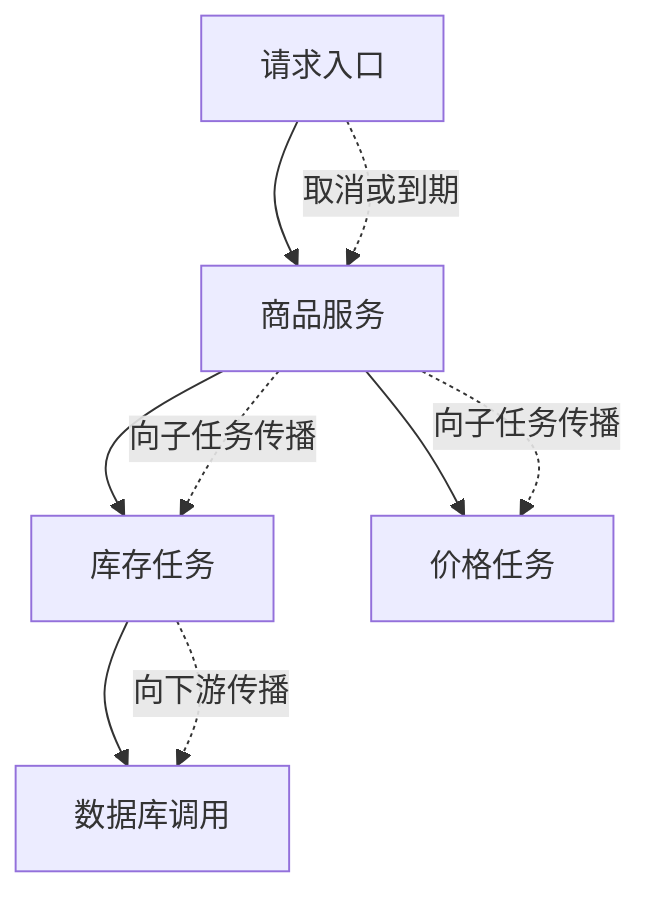

# 第十一讲：Go Context 最佳开发实践完整学习笔记

> 本讲围绕 Context 的使用场景、取消传播与核心实现展开。概念、API 契约和例子以 Go 官方文档为依据；源码阅读固定到 Go 1.27.3。整理日期：2026-10-21（UTC）。每个 `CTX-编号` 是一个独立程序，代码中的业务名称和输入是为讲解重新组织的内容。

<a id="section-001"></a>

> **统一运行基线：** 建议使用 Go 1.27.3，示例模块声明采用 `go 1.27.0`。文中出现其他 Go 版本时，仅用于说明特性引入时间或历史实现差异；第三方依赖仍以对应模块的版本要求为准。


*图示：Context 取消传播。*

## 正文导航

- [一、Context 基本概念](#section-002)
  - [1.1 Context 介绍](#section-003)
  - [1.2 Context 最佳实践](#section-008)
- [二、Context 的使用场景](#section-014)
  - [2.1 信号同步与取消](#section-015)
  - [2.2 超时](#section-020)
  - [2.3 上下文传递](#section-024)
  - [2.4 默认上下文](#section-028)
- [三、Context 核心实现](#section-031)
  - [3.1 Context 接口](#section-032)
  - [3.2 取消和超时](#section-036)
  - [3.3 上下文传播](#section-041)
  - [3.4 上下文值](#section-046)
  - [3.5 主要函数和类型](#section-052)
  - [3.6 实现细节](#section-055)
- [四、本章小结](#section-061)
  - [一次请求生命周期的完整走读](#section-062)
  - [用五个问题审查任何带 ctx 的 API](#section-063)
- [附录 A：综合实践与设计推演](#section-064)
  - [A.1 同时查询多个来源，失败后取消其余工作](#section-065)
  - [A.2 子调用的错误应保留可检查性](#section-067)
  - [A.3 清理工作为何有时需要独立预算](#section-068)
  - [A.4 请求范围值里的 typed nil](#section-070)
  - [A.5 期限预算的分配推演](#section-071)
  - [A.6 如何测试取消，而不依赖碰巧的时间顺序](#section-072)
  - [A.7 接入现有项目时逐层改造](#section-073)
- [附录 B：自测题与参考答案](#section-074)
  - [B.1 基础概念与职责](#section-075)
  - [B.2 超时、取消和错误](#section-076)
  - [B.3 值传递与对象生命周期](#section-077)
  - [B.4 源码、回调与工程边界](#section-078)
- [附录 C：排查案例与实践任务](#section-079)
  - [C.1 调用方断开后，数据库仍在工作](#section-080)
  - [C.2 请求结束后出现大量等待发送的 goroutine](#section-081)
  - [C.3 内存随请求量增长，但 goroutine 数量正常](#section-082)
  - [C.4 子请求总是立刻超时](#section-083)
  - [C.5 关闭服务时 Shutdown 马上返回错误](#section-084)
  - [C.6 取消后偶尔仍处理一条消息](#section-085)
  - [C.7 分层练习与验收标准](#section-086)
- [附录 D：官方资料、版本与验证记录](#section-087)
  - [D.1 官方文档阅读路线](#section-088)
  - [D.2 固定版本源码导航](#section-089)
  - [D.3 相关的辅助学习入口](#section-090)
  - [D.4 实际验证记录](#section-091)

<a id="section-002"></a>

## 一、Context 基本概念

<a id="section-003"></a>

### 1.1 Context 介绍

<a id="section-004"></a>

#### 先看一次请求中的参与者

Context 是一个接口类型，表达某项工作共有的生命周期信息。接口本身不执行任务，也不负责调度 goroutine。它让需要协作的函数约定：沿调用链接受同一个或派生的 Context，遇到取消时按照自身业务语义停止继续工作。

以查询商品页面为例，HTTP handler 接收请求，调用商品服务；商品服务并发请求库存和价格；库存服务进一步访问数据库。在进程内部，Context 作为参数逐层传递。跨网络时，发送端和接收端要由协议、客户端库或服务端框架建立对应关系，不是把 Go 接口的内存原样发过去。[官方 Context 文章](https://go.dev/blog/context)、[net/http.Request.Context](https://pkg.go.dev/net/http#Request.Context)。

| 参与者 | 负责什么 | 不应该混淆的职责 |
| --- | --- | --- |
| 请求入口 | 获得请求 Context，决定业务总预算 | 不应给每一层重新创建独立 Background |
| 任务拥有者 | 派生子 Context，持有 cancel 函数 | 能取消子任务不等于有权取消父请求 |
| 业务函数 | 接受 ctx，向下游传递，检查取消 | 不应把取消信号当成成功结果 |
| 阻塞操作 | 将 Done 接入 select，或调用支持 Context 的 API | 普通 Mutex.Lock、普通计算不会自动被 ctx 打断 |
| 汇总者 | 收集结果并等待所有已启动工作结束 | cancel 返回不代表 goroutine 已退出 |



图中的实线表示调用关系，虚线表示取消沿派生关系传播。它不表示父 goroutine 能强制杀死子 goroutine，也不表示传入 ctx 的函数一定响应取消。最后一点要阅读具体 API 的契约或实现才能确认。

<a id="section-005"></a>

#### 四项能力分别回答什么问题

`Context` 的四个方法可以用四个问题记住：最晚做到什么时候、是否已经收到停止信号、为什么停止、有哪些请求范围的数据。这里的“截止时间”是一个时间点；“超时”是一个时长，`WithTimeout` 用创建时刻加上时长得到时间点。

| 方法 | 返回内容 | 常见用法 |
| --- | --- | --- |
| `Deadline()` | 截止时间及是否存在 | 判断剩余预算，传递下游调用期限 |
| `Done()` | 只读通知通道 | 在 select 中等待取消或到期 |
| `Err()` | nil、Canceled 或 DeadlineExceeded | 判断 Context 的停止状态 |
| `Value(key)` | 请求范围值，找不到返回 nil | 请求标识、认证后身份、跟踪信息 |

`Err` 不是整项业务的结果容器。数据库约束错误、解析错误、没有找到商品等业务结果仍应通过函数的 `error` 返回值表达；取消原因可以用 `Cause` 补充，但它也不会自动收集所有任务错误。[Context 接口文档](https://pkg.go.dev/context#Context)、[Cause](https://pkg.go.dev/context#Cause)。

**例 CTX-01：观察一个可取消 Context 的状态变化。** 依据官方 WithCancel 契约改写，先创建再取消，不依赖任何 goroutine 的调度速度。

```go
// 运行示例：CTX-01
package main

import (
	"context"
	"fmt"
)

func main() {
	ctx, cancel := context.WithCancel(context.Background())
	defer cancel()
	fmt.Println("before:", ctx.Err())
	fmt.Println("done exists:", ctx.Done() != nil)
	cancel()
	<-ctx.Done()
	fmt.Println("after:", ctx.Err())
	cancel()
	fmt.Println("again:", ctx.Err())
}
```

输出：

```text
before: <nil>
done exists: true
after: context canceled
again: context canceled
```

`cancel` 可以重复调用，后续调用不改变已经确定的取消状态。使用 `<-ctx.Done()` 是观察“通知已关闭”，不是从通道里取一条带错误内容的消息。真正的错误状态从 `Err()` 读取。这个例子也没有任何需要等待结束的后台任务，因此不能从它推断一般程序调用 cancel 后已经完全清理完毕。

<a id="section-006"></a>

#### 为什么 Done 是关闭通知而不是发送一个值

如果一个通道只发送一次值，通常只有一个接收者取得该值；而关闭通道后，所有等待接收的 goroutine 都能得到通知，之后才开始等待的 goroutine 也会立即观察到关闭。Context 的 Done 利用的是这种广播性质。接口只暴露 `<-chan struct{}`，接收者不能向它发送，也不能关闭它。

取消权限由创建者拿到的 `CancelFunc` 表达。把 Context 传给下游，通常只给它观察当前任务状态的能力；下游如果需要提前结束自己的子任务，可以派生一个子 Context，并只取消这个子范围。这种权限区分降低了某个底层操作无意取消整项请求的机会。[官方 Context 设计解释](https://go.dev/blog/context)、[CancelFunc](https://pkg.go.dev/context#CancelFunc)。

**例 CTX-02：一次取消通知三个观察者。** 收集完成消息后排序，避免把无保证的调度顺序写成固定输出。

```go
// 运行示例：CTX-02
package main

import (
	"context"
	"fmt"
	"sort"
)

func main() {
	ctx, cancel := context.WithCancel(context.Background())
	defer cancel()
	exited := make(chan int, 3)
	for id := 1; id <= 3; id++ {
		go func(id int) {
			<-ctx.Done()
			exited <- id
		}(id)
	}
	cancel()
	ids := make([]int, 0, 3)
	for range 3 {
		ids = append(ids, <-exited)
	}
	sort.Ints(ids)
	fmt.Println("stopped:", ids)
}
```

输出：

```text
stopped: [1 2 3]
```

三个观察者收到的是同一项取消事实，不是依次消耗三条不同消息。`exited` 则是另外建立的完成通道，用于确认它们实际执行到了退出位置。取消广播和退出确认分开，程序的资源回收边界才清楚。实际任务可能还要关闭文件、回滚事务或归还连接，因此两者之间可以有明显时间差。

<a id="section-007"></a>

#### Context 不等于线程、全局字典或远程对象

把 ctx 想成“这项工作带着的一张说明卡”有助于理解：上面写了截止时间、停止通知和请求标识。类比到这里就应停止。Context 不是可随意修改的一张共享纸；派生操作返回新的 Context，原来的父对象不会被 WithValue 改写。取消状态由同步机制维护，值本身是否可变则是另一个问题。

也不要把 Context 当作 goroutine 的身份。一个 goroutine 可以依次处理多个带不同 ctx 的任务；多个 goroutine 可以共享同一个 ctx。Context 的树描述任务范围，不等同于 goroutine 的创建树。Go 也没有“父 goroutine 结束，所有子 goroutine 自动结束”的结构化退出规则，这正是需要显式取消与等待的原因。[Go 语言规范：Go statements](https://go.dev/ref/spec#Go_statements)、[Context 包说明](https://pkg.go.dev/context)。

<a id="section-008"></a>

### 1.2 Context 最佳实践

<a id="section-009"></a>

#### 把 Context 放在函数第一个参数

常见签名是 `func Load(ctx context.Context, id string) (Item, error)`。第一个参数便于读者立即看见任务范围，其余参数明确表达业务输入。ctx 只是控制和请求信息，商品 ID 仍是商品 ID；不要为了少写参数，把函数运行所必需的所有业务字段都塞进 Value。

官方建议需要 Context 的函数显式接收它，不把每次请求的 Context 长期存进服务结构体。服务结构体通常寿命较长，单次请求的 ctx 可能很快取消；如果构造服务时保存了某个 ctx，之后所有请求可能意外共享了错误的截止时间和取消来源。存在为了兼容旧 API 而把 Context 放入某个结构体的历史设计，但不应据此默认采用同样的设计。[Contexts and structs](https://go.dev/blog/context-and-structs)。

**例 CTX-03：服务结构体存依赖，每次调用单独传 ctx。** 这里一个预取消的调用失败，不影响下一次有效调用。

```go
// 运行示例：CTX-03
package main

import (
	"context"
	"fmt"
)

type Store struct{ Prefix string }

func (s Store) Load(ctx context.Context, id string) (string, error) {
	if err := ctx.Err(); err != nil {
		return "", err
	}
	return s.Prefix + id, nil
}

func main() {
	store := Store{Prefix: "item:"}
	expired, cancel := context.WithCancel(context.Background())
	cancel()
	_, err := store.Load(expired, "42")
	fmt.Println("first:", err)
	item, err := store.Load(context.Background(), "42")
	fmt.Println("second:", item, err)
}
```

输出：

```text
first: context canceled
second: item:42 <nil>
```

这个例子的 ctx 检查只发生在计算前，因为剩余工作是极短的内存字符串拼接。真实的长计算应在合适的循环边界重复检查；网络/数据库调用应把 ctx 传给支持它的 API。仅在函数入口检查一次，不能使之后所有阻塞都自动取消。

<a id="section-010"></a>

#### 派生者负责释放自己创建的资源

拿到 cancel 后，通常立即 `defer cancel()`。理由不只是“以后可能超时”：子 Context 可能被父 Context 的子节点集合保留，带截止时间的 Context 还可能保留定时器和相关闭包。工作提前结束时主动取消，让这些关联及时释放。父对象最终会取消或截止时间最终会到达，不代表中途的保留没有成本。[context 包总览](https://pkg.go.dev/context)、[取消数据库操作](https://go.dev/doc/database/cancel-operations)。

但 defer 的执行点是当前函数返回，不是当前循环迭代结束。若一个长寿命函数循环处理一万项工作，每次循环都 `defer cancel()`，这些清理会积累到整个函数结束。可以抽出一个每项工作的辅助函数，在里面 defer；也可以确保每条路径都显式调用 cancel。两种写法的目标相同：清理与工作范围一致。

**例 CTX-04：每项工作有自己的期限和清理范围。** 这里用完成通知验证取消回调已结束，而不是用睡眠猜测清理完成。

```go
// 运行示例：CTX-04
package main

import (
	"context"
	"fmt"
	"time"
)

func runOne(parent context.Context, id int) int {
	ctx, cancel := context.WithTimeout(parent, time.Hour)
	finished := make(chan struct{})
	context.AfterFunc(ctx, func() { close(finished) })
	cancel()
	<-finished
	return id
}

func main() {
	for id := 1; id <= 3; id++ {
		fmt.Println("released:", runOne(context.Background(), id))
	}
}
```

输出：

```text
released: 1
released: 2
released: 3
```

例子为观察生命周期显式等待 AfterFunc 的通知，并不意味着普通的 `defer cancel()` 都需要再装一个回调。生产代码应按自己的任务完成协议等待 goroutine；如果根本没有异步工作，cancel 后无需制造一个额外等待对象。

<a id="section-011"></a>

#### 不传 nil，不悄悄重置父任务

Context 参数应传非 nil 的 Context。暂时不知道正确来源时用 `context.TODO()` 表达尚未完成的设计；明确建立任务根时用 `context.Background()`。这两者不是为了绕过调用方的取消而随意替换父 ctx 的工具。

一个常见错误是在仓储函数内部写 `context.WithTimeout(context.Background(), 5*time.Second)`。这个查询虽然有自己的五秒上限，却不再响应原 HTTP 请求取消。通常应从传入的 ctx 派生：`context.WithTimeout(ctx, localLimit)`。这样既继承总请求的终止条件，又能限制某一个步骤的预算。[WithTimeout](https://pkg.go.dev/context#WithTimeout)、[官方数据库取消示例](https://go.dev/doc/database/cancel-operations)。

**例 CTX-05：正确传播与重新建立根的区别。** 不进行真实等待，只观察已经取消的父任务能否影响子任务。

```go
// 运行示例：CTX-05
package main

import (
	"context"
	"fmt"
	"time"
)

func main() {
	parent, stop := context.WithCancel(context.Background())
	stop()
	inherited, c1 := context.WithTimeout(parent, time.Hour)
	defer c1()
	detached, c2 := context.WithTimeout(context.Background(), time.Hour)
	defer c2()
	fmt.Println("derived from request:", inherited.Err())
	fmt.Println("new root:", detached.Err())
}
```

输出：

```text
derived from request: context canceled
new root: <nil>
```

第二个对象是否应该独立，不由语法判断，而由任务归属判断。例如服务启动后的周期维护任务确实可能有独立寿命，但它应由服务生命周期管理；请求已结束后仍必须完成的异步业务，往往需要持久化队列、任务表和重试协议，仅换成 Background 并不能提供可靠执行保证。

<a id="section-012"></a>

#### 将取消、返回错误和等待退出分开

取消是请求对方停止；返回错误是报告这次函数调用的结果；等待退出是确认资源和 goroutine 已经收敛。这三件事可能同时出现在同一个函数，但不能互相代替。例如工作函数返回 error 后，它自己启动的两个 goroutine 可能还在运行；调用 cancel 后，工作函数可能还在执行清理；WaitGroup.Wait 能等待完成，但不会自己通知任务放弃工作。

**例 CTX-06：cancel 返回后，清理尚未完成。** 用两个握手通道安排可重复的顺序。

```go
// 运行示例：CTX-06
package main

import (
	"context"
	"fmt"
)

func main() {
	ctx, cancel := context.WithCancel(context.Background())
	observed := make(chan struct{})
	allowCleanup := make(chan struct{})
	exited := make(chan struct{})
	go func() {
		<-ctx.Done()
		close(observed)
		<-allowCleanup
		close(exited)
	}()
	cancel()
	<-observed
	select {
	case <-exited:
		fmt.Println("already exited")
	default:
		fmt.Println("canceled; cleanup pending")
	}
	close(allowCleanup)
	<-exited
	fmt.Println("cleanup complete")
}
```

输出：

```text
canceled; cleanup pending
cleanup complete
```

此处 `allowCleanup` 只是讲解握手，用来确定地展示两个状态，不是建议真实服务用一个永远没人关闭的通道拖住清理。真实清理也应有明确上限、可终止操作和资源所有者，否则只是把工作泄漏转移到了清理路径。

<a id="section-013"></a>

#### 让 API 的失败语义明确

接收 Context 的函数需要说明：取消发生前已经产生的部分结果是否返回；取消和正常完成同时发生时是否允许返回成功；是否有外部副作用；是否等内部任务全部退出再返回。这些不是 Context 接口统一替所有业务决定的内容。

例如一个发送函数使用 `select { case out <- v: case <-ctx.Done(): }`，当发送和取消都已就绪时，select 不保证优先取消。只在入口再检查一次 Err 也无法消除检查与发送之间的竞态窗口。若业务要求“取消确认后绝不接纳新任务”，需要队列拥有者把接纳和关闭状态放在同一套串行协议里。Context 能参与该协议，不能单独提供跨多个动作的原子性。[Select statements](https://go.dev/ref/spec#Select_statements)。

**实践检查表**不是机械地在每行加 `ctx.Err()`，而是找出真正可能长期等待的位置：排队、读写网络、等待锁、下游调用、结果发送、重试退避。每一个位置都应回答“取消由谁观察，观察后怎样退出，已经发生的动作如何处理”。这样才能解释代码为什么不会无限等待，而不是仅凭函数带一个 ctx 参数就宣布它可取消。

<a id="section-014"></a>

## 二、Context 的使用场景

<a id="section-015"></a>

### 2.1 信号同步与取消

<a id="section-016"></a>

#### 生成数据的 goroutine 怎样停止

官方 `WithCancel` 例子展示了一个持续生成数字的函数：调用者只取一部分数据后退出，如果生成者一直等着向通道发送下一项，就会留下不能结束的 goroutine。解决办法不是盲目增大缓冲区，而是把停止条件放进发送处的 select，让生成者即使没有下游接收者也能离开。[官方 WithCancel 示例](https://pkg.go.dev/context#example-WithCancel)、[Pipelines and cancellation](https://go.dev/blog/pipelines)。

**例 CTX-07：消费者提前停止，生成者仍能退出。** 本例在官方思路上增加退出确认通道，确保 main 结束前生成者已收尾。

```go
// 运行示例：CTX-07
package main

import (
	"context"
	"fmt"
)

func numbers(ctx context.Context) (<-chan int, <-chan struct{}) {
	out := make(chan int)
	done := make(chan struct{})
	go func() {
		defer close(done)
		defer close(out)
		for n := 1; ; n++ {
			select {
			case out <- n:
			case <-ctx.Done():
				return
			}
		}
	}()
	return out, done
}

func main() {
	ctx, cancel := context.WithCancel(context.Background())
	defer cancel()
	values, done := numbers(ctx)
	for i := 0; i < 3; i++ {
		fmt.Println(<-values)
	}
	cancel()
	<-done
	fmt.Println("producer exited")
}
```

输出：

```text
1
2
3
producer exited
```

这里无缓冲通道使生产者不能无界超前；消费者读完第三项后不再接收，后续发送不能就绪，取消分支就能让它返回。若 out 改为有缓冲通道，取消时发送分支仍可能就绪，允许多发送有限或若干项；不能据此保证“取消之后绝不再放进一个值”。需要严格业务边界时，应设计明确的停止确认协议。

也不能由“通道关闭了”反推生产结果全部成功。关闭 out 只说明不会再发值；生产过程失败还是正常完成，应该通过另一个结果通道、返回错误或封装的结果类型传达。把所有关闭都解释为成功会吞掉失败原因。

<a id="section-017"></a>

#### 取消树：父影响子，子不影响父或兄弟

派生关系通常构成一棵树。父请求取消会影响依附它的库存、价格、数据库调用；库存子任务自己的超时不应直接取消价格分支，除非上层聚合策略决定整项请求已经无继续价值，并主动取消共同父范围。

**例 CTX-08：先取消一个分支，再取消共同父范围。**

```go
// 运行示例：CTX-08
package main

import (
	"context"
	"fmt"
)

func main() {
	parent, cancelParent := context.WithCancel(context.Background())
	defer cancelParent()
	left, cancelLeft := context.WithCancel(parent)
	defer cancelLeft()
	right, cancelRight := context.WithCancel(parent)
	defer cancelRight()
	leaf, cancelLeaf := context.WithCancel(left)
	defer cancelLeaf()

	cancelLeft()
	fmt.Println("left:", left.Err())
	fmt.Println("leaf:", leaf.Err())
	fmt.Println("parent:", parent.Err())
	fmt.Println("right:", right.Err())
	cancelParent()
	fmt.Println("right after parent:", right.Err())
}
```

输出：

```text
left: context canceled
leaf: context canceled
parent: <nil>
right: <nil>
right after parent: context canceled
```

一次取消传播的范围由“从谁派生”决定，不由函数调用名或 goroutine 编号决定。某个函数拿了 left，却在内部从 Background 创建工作，就主动断开了这条生命周期关系。审查代码时应同时检查参数传递和派生来源，不能只搜索有没有出现 `context.WithCancel`。

<a id="section-018"></a>

#### 取消通知也可以发布已经完成的状态，但不能保护后续修改

Go 内存模型规定，关闭通道发生在因该关闭而返回零值的接收之前。因此，在关闭之前完成的数据写入，可以通过对应的接收建立同步关系。Context 的标准取消通知也建立在通道关闭之上，但使用共享数据时仍要明确读写发生在哪一侧，不能因为存在 ctx 就允许任意时刻并发修改 map。[Go 内存模型：Channel communication](https://go.dev/ref/mem#chan)。

**例 CTX-09：先写入停止原因，再发布取消，接收者随后读取。** 本例的字符串只有一次写入，而且发生在 cancel 之前。

```go
// 运行示例：CTX-09
package main

import (
	"context"
	"fmt"
)

func main() {
	ctx, cancel := context.WithCancel(context.Background())
	var reason string
	reported := make(chan string, 1)
	go func() {
		<-ctx.Done()
		reported <- reason
	}()
	reason = "maintenance"
	cancel()
	fmt.Println(<-reported)
}
```

输出：

```text
maintenance
```

如果取消之后又在另一个 goroutine 里修改 reason，同时观察者读取，就需要额外同步；上面的先后关系不覆盖以后发生的每一次写入。实际只想传达取消原因时，优先使用 `WithCancelCause`，让状态和原因由同一个接口管理，避免自己发明额外共享变量。

<a id="section-019"></a>

#### 取消 CPU 密集任务需要检查点

一个无限的纯计算循环不会因为 ctx 被取消自动跳出。调度器可能抢占这个 goroutine，让其他 goroutine 得到运行机会，但抢占解决的是调度公平性，不是替业务判断“这项工作不需要了”。计算循环应按块检查 ctx，检查频率决定取消响应上限的一部分。

**例 CTX-10：分块计算，预取消时不继续处理。**

```go
// 运行示例：CTX-10
package main

import (
	"context"
	"fmt"
)

func sum(ctx context.Context, values []int) (int, error) {
	total := 0
	const block = 64
	for start := 0; start < len(values); start += block {
		if err := ctx.Err(); err != nil {
			return total, err
		}
		end := min(start+block, len(values))
		for _, value := range values[start:end] {
			total += value
		}
	}
	return total, nil
}

func main() {
	good, err := sum(context.Background(), []int{1, 2, 3})
	fmt.Println("complete:", good, err)
	ctx, cancel := context.WithCancel(context.Background())
	cancel()
	partial, err := sum(ctx, []int{1, 2, 3})
	fmt.Println("canceled:", partial, err)
}
```

输出：

```text
complete: 6 <nil>
canceled: 0 context canceled
```

若每块最多处理 (B) 个元素、每个元素耗时至多 (c)，且没有额外阻塞，那么仅由检查粒度引入的响应等待约为一个块的工作量 (Bc)。这只是建立在有界单步耗时上的讲解估计；真实调度延迟、缓存、垃圾回收和底层调用也会影响耗时。不能把“每 64 项检查”当成所有算法的最佳参数。循环很短时，检查成本可能反而显眼；每次计算很重时，需要更细的可取消边界。

<a id="section-020"></a>

### 2.2 超时

<a id="section-021"></a>

#### 相对时长与绝对截止时间

`WithTimeout(parent, duration)` 表达“从现在起最多允许这么久”，内部依据当前时间计算截止时间；`WithDeadline(parent, when)` 直接使用给定时间点。二者都不能把父任务已有的截止时间往后延长。有效期限受父范围和当前范围中更早的终止条件约束。[WithTimeout](https://pkg.go.dev/context#WithTimeout)、[WithDeadline](https://pkg.go.dev/context#WithDeadline)。

**例 CTX-11：已经过去的截止时间立即形成到期状态。** 使用过去时间可以稳定展示 DeadlineExceeded，不依赖机器是否足够快。

```go
// 运行示例：CTX-11
package main

import (
	"context"
	"errors"
	"fmt"
	"time"
)

func main() {
	ctx, cancel := context.WithDeadline(context.Background(), time.Now().Add(-time.Second))
	defer cancel()
	<-ctx.Done()
	fmt.Println("error:", ctx.Err())
	fmt.Println("deadline exceeded:", errors.Is(ctx.Err(), context.DeadlineExceeded))
	_, ok := ctx.Deadline()
	fmt.Println("has deadline:", ok)
}
```

输出：

```text
error: context deadline exceeded
deadline exceeded: true
has deadline: true
```

真实服务不应把每一步都设成独立的完整总预算。假设请求总预算为 300 毫秒，排队用了 40 毫秒，认证用了 30 毫秒，业务剩余预算最多约 230 毫秒。若数据库阶段又从 Background 新建 300 毫秒，整体就可能超出入口承诺。把同一父 Context 向下传递，才保留总预算；局部超时则进一步收紧某一段。

**例 CTX-12：子范围不能延长父范围。** 不打印真实时间，只比较期限关系。

```go
// 运行示例：CTX-12
package main

import (
	"context"
	"fmt"
	"time"
)

func main() {
	deadline := time.Now().Add(time.Hour)
	parent, stopParent := context.WithDeadline(context.Background(), deadline)
	defer stopParent()
	longer, stopLonger := context.WithTimeout(parent, 2*time.Hour)
	defer stopLonger()
	shorter, stopShorter := context.WithDeadline(parent, deadline.Add(-time.Minute))
	defer stopShorter()
	p, _ := parent.Deadline()
	a, _ := longer.Deadline()
	b, _ := shorter.Deadline()
	fmt.Println("longer inherits parent:", a.Equal(p))
	fmt.Println("shorter really earlier:", b.Before(p))
}
```

输出：

```text
longer inherits parent: true
shorter really earlier: true
```

预算不仅用于停止已经开始的工作，也用于决定是否值得开始。一个平均耗时 100 毫秒的远程步骤，当请求只剩 2 毫秒时，可能应立即放弃、走已准备的缓存结果或返回降级响应。这里的策略来自服务目标和业务允许的退化方式，不由 Context 自动判断。

<a id="section-022"></a>

#### 超时不能撤销已经提交的外部副作用

“我等超时了”说明调用者没有在预算内拿到正常结果，不证明下游没有执行。发起支付、写订单或发布消息时，可能出现：服务器已经提交，但响应途中丢失；客户端先超时，服务端随后才观察取消。重试必须结合幂等键、状态查询或事务协议，而不能凭一个 DeadlineExceeded 就重复执行副作用。

**例 CTX-13：业务状态已经改变，后续等待才观察到取消。** 用内存记录模拟“已提交”，不模拟真实数据库的回滚保证。

```go
// 运行示例：CTX-13
package main

import (
	"context"
	"fmt"
)

func main() {
	ctx, cancel := context.WithCancel(context.Background())
	committed := make(chan struct{})
	result := make(chan error, 1)
	var stored bool
	go func() {
		stored = true
		close(committed)
		<-ctx.Done()
		result <- ctx.Err()
	}()
	<-committed
	cancel()
	fmt.Println("returned:", <-result)
	fmt.Println("side effect remains:", stored)
}
```

输出：

```text
returned: context canceled
side effect remains: true
```

真实系统还要区分服务器停止计算、数据库取消语句、事务回滚和已经完成的提交。`database/sql` 的事务与 driver 的 Context 支持有明确契约，不能拿这个内存例子替代数据库语义。它只证明一个通用逻辑：取消信号本身没有时间倒流和自动撤销能力。[取消数据库操作](https://go.dev/doc/database/cancel-operations)、[database/sql.BeginTx](https://pkg.go.dev/database/sql#DB.BeginTx)。

<a id="section-023"></a>

#### 重试等待也必须可取消

一个操作支持 ctx，但两次操作之间直接 `time.Sleep(10*time.Second)`，整个重试过程仍可能在取消后多等十秒。退避阶段应等待一个 timer 和 ctx.Done 的竞争，并在函数退出时停止自己的 timer。何时重试、退避多久、有无随机扰动、重试总次数，都需要根据错误种类和下游承载能力决定。

**例 CTX-14：退避函数同时支持正常等待和已取消的上下文。** 例子使用零时长和预取消状态使输出稳定，实际调用可以传正时长。

```go
// 运行示例：CTX-14
package main

import (
	"context"
	"fmt"
	"time"
)

func wait(ctx context.Context, delay time.Duration) error {
	if err := ctx.Err(); err != nil {
		return err
	}
	timer := time.NewTimer(delay)
	defer timer.Stop()
	select {
	case <-ctx.Done():
		return ctx.Err()
	case <-timer.C:
		return nil
	}
}

func main() {
	fmt.Println("normal:", wait(context.Background(), 0))
	ctx, cancel := context.WithCancel(context.Background())
	cancel()
	fmt.Println("canceled:", wait(ctx, time.Hour))
}
```

输出：

```text
normal: <nil>
canceled: context canceled
```

函数前置 Err 检查使“调用时已经取消”有明确结果；检查后才发生取消，与 timer 同时就绪时仍由 select 规则决定。这没有提供绝对的取消优先级。timer 在这里不复用，因此无需展示复杂 Reset 协议；Go 1.23 的 timer 通道语义有变化，阅读老式 Stop/排空教程要同时看模块设置和当前工具链。[time.NewTimer](https://pkg.go.dev/time#NewTimer)、[Go 1.23 timer 变更](https://go.dev/wiki/Go123Timer)。

<a id="section-024"></a>

### 2.3 上下文传递

<a id="section-025"></a>

#### 服务调用链怎样保持同一任务范围

Context 参数应沿入口、业务服务、仓储或远程客户端传递。每一层可以派生更短的超时、加上当前请求需要的元信息，但不应该无意丢弃父范围。函数如果完全不执行可能阻塞的工作，也不需要为了形式统一接收一个从不使用的 ctx；API 是否需要它应由实际行为决定。

**例 CTX-15：三层调用传递取消和请求标识。** 为便于独立运行，仓储只读取内存中的请求信息；实际数据库应把同一 ctx 交给 QueryContext 等接口。

```go
// 运行示例：CTX-15
package main

import (
	"context"
	"fmt"
)

type requestKey struct{}

func repository(ctx context.Context) (string, error) {
	if err := ctx.Err(); err != nil {
		return "", err
	}
	id, _ := ctx.Value(requestKey{}).(string)
	return "request=" + id, nil
}

func service(ctx context.Context) (string, error) { return repository(ctx) }

func main() {
	ctx := context.WithValue(context.Background(), requestKey{}, "req-42")
	text, err := service(ctx)
	fmt.Println(text, err)
	canceled, stop := context.WithCancel(ctx)
	stop()
	_, err = service(canceled)
	fmt.Println("same chain after cancel:", err)
}
```

输出：

```text
request=req-42 <nil>
same chain after cancel: context canceled
```

请求 ID 是便于把多个步骤的日志关联起来的元信息；商品 ID、金额、数据库连接和可选参数不应顺手全部塞进这个机制。一个必须有调用方 ID 才能执行的业务函数，通常应显式声明参数或接收明确的业务对象，避免运行到很深的地方才从 Value 的空值推断调用方忘了传什么。

<a id="section-026"></a>

#### HTTP 入口怎样获得请求 Context

对于服务端请求，`r.Context()` 表示请求范围；文档规定它会在客户端连接关闭、HTTP/2 请求取消或 ServeHTTP 返回等情况下取消。对于出站请求，`http.NewRequestWithContext` 把 ctx 关联到请求生命周期，包括获取连接、发送请求及读取响应。客户端和服务端的 Context 是各进程中的对象，连接和协议事件把它们的生命周期联系起来。[Request.Context](https://pkg.go.dev/net/http#Request.Context)、[NewRequestWithContext](https://pkg.go.dev/net/http#NewRequestWithContext)。

**例 CTX-16：中间件添加请求信息，下游继续使用派生 Context。** 使用 `httptest` 直接执行 handler，不访问网络；不把这个测试当成真实网络断连的测试。

```go
// 运行示例：CTX-16
package main

import (
	"context"
	"fmt"
	"net/http"
	"net/http/httptest"
)

type traceKey struct{}

func trace(next http.Handler) http.Handler {
	return http.HandlerFunc(func(w http.ResponseWriter, r *http.Request) {
		ctx := context.WithValue(r.Context(), traceKey{}, "trace-demo")
		next.ServeHTTP(w, r.WithContext(ctx))
	})
}

func main() {
	endpoint := http.HandlerFunc(func(w http.ResponseWriter, r *http.Request) {
		if err := r.Context().Err(); err != nil {
			http.Error(w, "request canceled", http.StatusRequestTimeout)
			return
		}
		value, _ := r.Context().Value(traceKey{}).(string)
		fmt.Fprint(w, value)
	})
	handler := trace(endpoint)
	request := httptest.NewRequest(http.MethodGet, "/", nil)
	recorder := httptest.NewRecorder()
	handler.ServeHTTP(recorder, request)
	fmt.Println("status:", recorder.Code)
	fmt.Println("body:", recorder.Body.String())
	fmt.Println("original unchanged:", request.Context().Value(traceKey{}) == nil)
}
```

输出：

```text
status: 200
body: trace-demo
original unchanged: true
```

`r.WithContext(ctx)` 返回请求的浅拷贝，其中 Context 被替换；它没有深复制请求所有字段，也不是把一个原请求直接原地改掉。中间件应把新的请求对象交给 next。若写了 WithValue 却仍将原 r 交下游，下游看不到新值。这种“派生对象返回后忘记使用”的错误在 Context 中很常见。[Request.WithContext](https://pkg.go.dev/net/http#Request.WithContext)。

跨网络传递请求标识时，通常由中间件在允许的 header 中编码，再由接收方校验和重建；Context.Value 里的任意 Go 值不会自动序列化。尤其不能把任意客户端声明的 user-id 直接当成认证后身份。携带信息和验证信息是两件不同的事，Context 不是认证机制。

<a id="section-027"></a>

#### 异步工作怎样选择父范围

一个 handler 返回后，基于 `r.Context()` 的后台工作可能很快被取消。这不是 bug，而是它仍声明自己属于已经结束的请求。若任务必须持续，应先问：它只是可丢失的诊断工作，还是必须可靠完成的业务操作？前者可由明确的服务级任务管理器接收；后者通常应持久化后再确认接纳，不应仅启动一个 goroutine 后立即向调用方宣布完成。

`context.WithoutCancel` 可以保留父值访问，却不继承父取消和期限。它适合明确需要这种语义的小范围处理，但返回对象的 Done 为 nil、没有截止时间，必须考虑额外设置新的上限。它不自动使任务可靠，不自动接入服务关停等待，也不对 Value 中的可变数据深复制。[WithoutCancel](https://pkg.go.dev/context#WithoutCancel)。

**例 CTX-17：有意脱离取消，但保留值，并重新设置独立上限。**

```go
// 运行示例：CTX-17
package main

import (
	"context"
	"fmt"
	"time"
)

type idKey struct{}

func main() {
	base := context.WithValue(context.Background(), idKey{}, "r-9")
	request, stopRequest := context.WithCancel(base)
	independent := context.WithoutCancel(request)
	bounded, stopBounded := context.WithTimeout(independent, time.Hour)
	defer stopBounded()
	stopRequest()
	fmt.Println("request:", request.Err())
	fmt.Println("independent:", independent.Err())
	fmt.Println("independent done nil:", independent.Done() == nil)
	fmt.Println("kept value:", bounded.Value(idKey{}))
	_, ok := bounded.Deadline()
	fmt.Println("new deadline:", ok)
	stopBounded()
	fmt.Println("bounded stopped:", bounded.Err())
}
```

输出：

```text
request: context canceled
independent: <nil>
independent done nil: true
kept value: r-9
new deadline: true
bounded stopped: context canceled
```

本例选择一小时是为了使演示不依赖毫秒级调度，不是建议真实日志或审计任务设置一小时超时。业务上限应按允许的收尾时间选择。独立任务还应纳入服务关停时的等待机制，避免进程结束时直接丢失正在执行的工作。

<a id="section-028"></a>

### 2.4 默认上下文

<a id="section-029"></a>

#### Background 与 TODO 的共同点和语义区别

两者都返回非 nil、空的 Context：没有截止时间，Done 为 nil，Err 为 nil，Value 返回 nil。区别在表达意图：Background 通常表示明确的根范围；TODO 表示当前接口还没完成 Context 设计或来源尚待补齐。TODO 不会自动在未来变成正确的父 Context，不能把它当作生命周期问题的永久解决方式。[Background](https://pkg.go.dev/context#Background)、[TODO](https://pkg.go.dev/context#TODO)。

**例 CTX-18：查看两个默认 Context 的公共行为。**

```go
// 运行示例：CTX-18
package main

import (
	"context"
	"fmt"
)

func report(name string, ctx context.Context) {
	_, deadline := ctx.Deadline()
	fmt.Printf("%s: doneNil=%t deadline=%t err=%v value=%v\n",
		name, ctx.Done() == nil, deadline, ctx.Err(), ctx.Value("missing"))
}

func main() {
	report("background", context.Background())
	report("todo", context.TODO())
}
```

输出：

```text
background: doneNil=true deadline=false err=<nil> value=<nil>
todo: doneNil=true deadline=false err=<nil> value=<nil>
```

这里读取一个不存在的字符串键只是展示空上下文行为；创建自定义值时仍应使用自己定义的键类型。不要以两个对象当前的格式化字符串、内部具体类型或是否分配作为 API 设计依据，公共方法行为才是可依赖的契约。

<a id="section-030"></a>

#### Done 为 nil 在 select 中意味着什么

nil 通道的接收永远不会就绪，因此 `case <-ctx.Done()` 在 Background 下等价于一个被禁用的候选分支。这让同一函数可以接受“有取消能力”和“没有取消能力”的 Context，不必每次先判断 Done 是否 nil。可是如果整个函数只等待 `<-ctx.Done()`，传入 Background 就会永久阻塞；是否允许这种输入应写入函数契约。

**例 CTX-19：默认 Context 的取消分支不会就绪。**

```go
// 运行示例：CTX-19
package main

import (
	"context"
	"fmt"
)

func main() {
	ctx := context.Background()
	ready := make(chan string, 1)
	ready <- "work"
	select {
	case <-ctx.Done():
		fmt.Println("canceled")
	case value := <-ready:
		fmt.Println(value)
	}
}
```

输出：

```text
work
```

如果代码原本必须在服务关停时停止，却长期传 Background，那么取消分支虽然写了，却从来没有实际停止来源。排查泄漏时不要只看函数内部 select，还要从调用点追踪 Context 的创建者和 cancel 的调用路径。没有发信号的人，再完整的等待代码也不会凭空退出。

<a id="section-031"></a>

## 三、Context 核心实现

<a id="section-032"></a>

### 3.1 Context 接口

<a id="section-033"></a>

#### 接口契约是使用边界，具体类型是实现选择

`context.Context` 的方法签名如下。这里是接口定义片段，不是独立主程序。

```go
type Context interface {
    Deadline() (deadline time.Time, ok bool)
    Done() <-chan struct{}
    Err() error
    Value(key any) any
}
```

这四个方法中没有 `Cancel`、`SetValue`、`Wait` 或 `Result`。这个选择分别意味着：观察者通常没有取消父任务的权限；请求范围值通过派生建立；Context 不负责等待工作完成；业务结果从函数自己的返回值或结果通道传递。理解“没有哪些能力”，有助于避免把它误当作一套完整的任务框架。

一个第三方类型在签名上实现四个方法，还要遵守行为契约。例如同一个 Context 多次调用 Done 应返回相同通道；没有期限时 Deadline 的 ok 为 false；Err 一旦非 nil，之后应保持同一个终止原因类别；这些方法应支持并发调用。接口的编译检查只能检查方法集合，不能证明行为满足约定。[Context 接口完整契约](https://pkg.go.dev/context#Context)。

<a id="section-034"></a>

#### 只读通道限制的是调用者能力

`Done() <-chan struct{}` 的返回类型允许接收，不允许发送或关闭。内部具体类型持有的是可关闭通道，但对外只暴露观察能力。通过类型别名或另写一个函数不会改变这个权限；语言也不允许把一个只读通道随意转成双向通道。取消应调用自己持有的 cancel，而不是想办法关闭 Done。

同样，一个函数接收 Context 并不意味着它不能创建子 Context。它可以调用 WithCancel(ctx)，拿到子范围和取消函数，提前终止自己启动的子任务。但这只取消子范围，不取消传进来的父范围。这种由接口和工厂函数共同表达的权限，很适合“调用方负责总体生命周期，子操作负责局部资源”的组织方式。[Channel types](https://go.dev/ref/spec#Channel_types)、[WithCancel](https://pkg.go.dev/context#WithCancel)。

<a id="section-035"></a>

#### 标准实现的基本组成

当前源码并不是一个带很多可选字段的单一 Context。不同派生操作使用不同的小类型，组合出所需能力。下表描述 Go 1.27.3 的实现，不是承诺其他实现必须具有同名类型或相同内存布局。[固定版本 context.go](https://github.com/golang/go/blob/go1.27.3/src/context/context.go)。

| 当前类型 | 保存的主要信息 | 特殊行为 |
| --- | --- | --- |
| `backgroundCtx` / `todoCtx` | 基于空上下文的根对象 | 无期限、无值、永不取消 |
| `cancelCtx` | 父 Context、取消状态、Done、子节点集合、原因 | 取消自身并传播给注册的子节点 |
| `timerCtx` | cancelCtx 加截止时间及定时器 | 到期触发取消，并能提前停定时器 |
| `valueCtx` | 父 Context、一个键和一个值 | 匹配自己的键，否则沿父链查找 |
| `withoutCancelCtx` | 父 Context | 保留值访问，屏蔽取消和期限 |
| `afterFuncCtx` | cancelCtx、回调函数、一次性执行控制 | 取消时安排回调在独立 goroutine 中执行 |

这些类型的组合使常见操作不用复制整棵树或整张值表。WithValue 返回一个新节点，父节点保持原样；WithCancel 可以在可识别的父取消节点上登记子节点；WithDeadline 通过定时器在时间点到达时触发同一套取消流程。组合带来的代价也应理解：值查找可能沿链向上走，取消则可能遍历子树。

<a id="section-036"></a>

### 3.2 取消和超时

<a id="section-037"></a>

#### 取消是一条不可逆的状态转换

可取消 Context 的公开状态可以理解为“活动”与“已取消”两个阶段。活动时 Err 为 nil；取消或到期后 Err 为非 nil，Done 被关闭，之后不会恢复为活动。若同一任务要重试，通常是在仍有效的父范围下为新尝试创建新子 Context，而不是寻找某个 Reset 方法。

| 触发事件 | Err 的典型值 | Cause 的典型值 | 是否恢复 |
| --- | --- | --- | --- |
| 普通 cancel 调用 | `context.Canceled` | Canceled，或已确定的先前原因 | 不恢复 |
| 普通超时/截止时间到达 | `context.DeadlineExceeded` | DeadlineExceeded | 不恢复 |
| CancelCauseFunc(err) | `context.Canceled` | 传入的非 nil err | 不恢复 |
| 带原因期限到达 | `context.DeadlineExceeded` | 创建时提供的 cause | 不恢复 |
| 父取消向子传播 | 继承父取消类别，除非子更早结束 | 继承父原因，除非子已确定原因 | 不恢复 |

表中“典型”很重要：如果子 Context 已经因为自己的原因取消，之后父取消不会覆盖这个子原因。并发发生的触发条件由实际先确定状态的那次取消获胜，不能凭源码先写了哪条 goroutine 就断言谁先执行。[CancelCauseFunc](https://pkg.go.dev/context#CancelCauseFunc)。

**例 CTX-20：业务取消原因与通用取消类别分开。**

```go
// 运行示例：CTX-20
package main

import (
	"context"
	"errors"
	"fmt"
)

func main() {
	rejected := errors.New("quota exhausted")
	ctx, cancel := context.WithCancelCause(context.Background())
	cancel(rejected)
	fmt.Println("err:", ctx.Err())
	fmt.Println("cause:", context.Cause(ctx))
	fmt.Println("is canceled:", errors.Is(ctx.Err(), context.Canceled))
	fmt.Println("is business cause:", errors.Is(context.Cause(ctx), rejected))
	cancel(errors.New("later reason"))
	fmt.Println("first cause retained:", context.Cause(ctx) == rejected)
}
```

输出：

```text
err: context canceled
cause: quota exhausted
is canceled: true
is business cause: true
first cause retained: true
```

调用方可以用 Err 判断生命周期类别，用 Cause 保留更具体的停止原因。但函数最终返回什么 error 仍是 API 决策：有的函数返回业务错误，有的返回 ctx.Err，有的用 `%w` 包装。有一致的约定才能让上层可靠分类。不要一边返回普通字符串，一边期待上层 errors.Is 自动识别它。

**例 CTX-21：父与子先后取消，分别保留谁的原因。**

```go
// 运行示例：CTX-21
package main

import (
	"context"
	"errors"
	"fmt"
)

func main() {
	parent, cancelParent := context.WithCancelCause(context.Background())
	child, cancelChild := context.WithCancelCause(parent)
	cancelChild(errors.New("child stopped first"))
	cancelParent(errors.New("parent stopped later"))
	fmt.Println("parent:", context.Cause(parent))
	fmt.Println("child:", context.Cause(child))

	p2, stopP2 := context.WithCancelCause(context.Background())
	c2, stopC2 := context.WithCancelCause(p2)
	stopP2(errors.New("parent first"))
	stopC2(errors.New("child later"))
	fmt.Println("second child:", context.Cause(c2))
}
```

输出：

```text
parent: parent stopped later
child: child stopped first
second child: parent first
```

先子后父时，子已经有了自己的终止原因；先父后子时，父传播已经为子确定状态。若要记录所有任务失败，不能反复调用 CancelCauseFunc 试图累积原因；应该另设结果收集，必要时用 errors.Join 组合。Cause 代表取消的首个原因，不是错误日志列表。

<a id="section-038"></a>

#### deadline 原因与手动 cancel 原因不同

`WithTimeoutCause`、`WithDeadlineCause` 的 cause 是“期限到达时采用的原因”。它们返回的 cancel 仍是普通 CancelFunc，不接收 error。若提前手动 cancel，不能误以为 Cause 一定等于创建时写的超时说明。[WithTimeoutCause](https://pkg.go.dev/context#WithTimeoutCause)。

**例 CTX-22：到期与手动取消走不同原因。**

```go
// 运行示例：CTX-22
package main

import (
	"context"
	"errors"
	"fmt"
	"time"
)

func main() {
	cause := errors.New("pricing budget exhausted")
	expired, stopExpired := context.WithTimeoutCause(context.Background(), -time.Second, cause)
	defer stopExpired()
	fmt.Println("expired err:", expired.Err())
	fmt.Println("expired cause:", context.Cause(expired))
	manual, stopManual := context.WithTimeoutCause(context.Background(), time.Hour, cause)
	stopManual()
	fmt.Println("manual err:", manual.Err())
	fmt.Println("manual cause:", context.Cause(manual))
}
```

输出：

```text
expired err: context deadline exceeded
expired cause: pricing budget exhausted
manual err: context canceled
manual cause: context canceled
```

为每个步骤设置不同 cause 可以帮助定位是总请求预算用完，还是某一局部调用先到期。但原因中不应隐式携带需要长期保密的大对象或不受控的全部请求体；它是 error 值，也可能被日志输出和父子引用保留。错误信息应该足够诊断，又遵守本层 API 的数据边界。

<a id="section-039"></a>

#### cancelCtx 如何关闭通知并传播

Go 1.27.3 的 cancelCtx 使用互斥锁保护需要一起改变的状态，Done 通道和 Err 的读取还使用原子容器加速常见路径。首次取消会记录 err 和 cause、关闭已创建的 Done 或使用共享的已关闭通道、取消已登记的子节点、清空子节点集合；必要时还从父节点中移除自己。再次取消看到状态已经确定，就返回。

这里的关键不是背操作排列，而是理解三个不变量：终止原因只确定一次；观察者最终能通过 Done 和 Err 看见同一个终止状态；子节点不会在父取消后无故保持活动。当前实现中的 Err 在观察到非 nil 错误后还确保 Done 已关闭，避免读到一半发布的状态。具体字段是否使用 atomic.Value、锁粒度如何变化属于版本细节，不应让业务直接依赖。[源码：cancelCtx.Done、Err、cancel](https://github.com/golang/go/blob/go1.27.3/src/context/context.go)。

公开接口文档允许 Done 的关闭相对取消函数返回存在异步情况；无论底层是否使用当前标准实现，调用方需要确认通知时就等待 Done，需要确认任务结束时就等待自己的完成机制。不要把在某个标准实现上看到的调用栈顺序推广成所有 Context 实现都必须同步递归执行完清理。

<a id="section-040"></a>

#### timerCtx 的资源怎样释放

带截止时间的 Context 在取消结构上增加一个 deadline 和定时器。到期时定时器回调触发取消；如果业务提前完成后调用 cancel，取消路径会停止仍在等待的 timer。父期限比要求的新期限更早时，当前实现可以直接采用派生取消关系来保留较早期限，不需要为一个更晚时间再创建实际有用的 timer。

不要因此写出“每调用一次 WithTimeout 就创建一个 goroutine”的固定结论。定时器调度和 Context 传播有专门实现，常见标准父子关系不需要每个子对象都配置一个专属等待 goroutine。另一方面，定时器和子节点仍可能消耗内存、回调及管理开销，因此也不能说创建任意多的 Context 完全免费。[源码：WithDeadlineCause、timerCtx](https://github.com/golang/go/blob/go1.27.3/src/context/context.go)。

<a id="section-041"></a>

### 3.3 上下文传播

<a id="section-042"></a>

#### 传播时先检查父状态，再选择登记方式

标准派生函数需要解决一个竞争：创建子对象的同时，父对象可能正被取消。如果只是“先看父没取消，再把子放进某个列表”，中间没有同步，就可能让新子对象错过取消。当前源码通过不同路径和必要的锁，把“已取消立即传递”与“登记到有效父节点”协调起来。

按概念顺序，可以分为几种情况：

1. 父 Done 为 nil，说明它没有取消通知来源，子只需要保留父关系。
2. 父已经取消，立刻让子接收父的 Err 与 Cause。
3. 能找到标准的 cancelCtx，且它对应的 Done 与父对象暴露的 Done 一致，把子登记到父的 children 中。
4. 父支持 AfterFunc 风格的取消回调，注册一个回调并保存停止关联的方法。
5. 其余自定义父 Context，通过一个等待 goroutine 同时观察父取消或子自身取消。

这是 Go 1.27.3 `propagateCancel` 的实现结构，不是公共接口额外规定的五种类别。正确的语义对所有路径相同：保留父的取消关系，同时允许子自己提前结束并清理关联。[源码：propagateCancel、parentCancelCtx](https://github.com/golang/go/blob/go1.27.3/src/context/context.go)。

<a id="section-043"></a>

#### 包装 Context 时为什么不能随意改 Done

如果一个包装类型嵌入 Context，默认会转发已有方法；它也可以覆写某个方法。但若把 Done 换成另一个通道，同时仍返回原来的 Err、Deadline，就可能破坏方法之间的关系。框架若错误地越过包装，直接使用里面的标准取消节点，也可能忽略包装者设计的新通知语义。因此当前源码识别标准父节点时，还要核对 Done 是否一致。

除非要实现明确的基础设施，不建议为普通请求自己实现整个 Context。用标准派生函数和私有键访问器就能覆盖大多数需求。确实实现自定义 Context 时，需要测试并发调用、重复返回值、已取消父派生、期限、原因和回调退出，而不仅是让四个方法编译通过。

**例 CTX-23：透明包装可以增加自己的说明，但保留公共契约。**

```go
// 运行示例：CTX-23
package main

import (
	"context"
	"fmt"
)

type namedContext struct {
	context.Context
	name string
}

func main() {
	parent, stop := context.WithCancel(context.Background())
	wrapped := namedContext{Context: parent, name: "request"}
	child, stopChild := context.WithCancel(wrapped)
	defer stopChild()
	stop()
	<-child.Done()
	fmt.Println("name:", wrapped.name)
	fmt.Println("same parent notification:", wrapped.Done() == parent.Done())
	fmt.Println("child error:", child.Err())
}
```

输出：

```text
name: request
same parent notification: true
child error: context canceled
```

这个类型是一个演示接口嵌入的包装，并不是推荐把每个请求再包一层名字对象。需要名字作为请求元信息时，WithValue 与类型安全访问器通常更清楚。例子要说明的是：包装能保留原契约，真正改变某个方法则需要承担相应一致性责任。

<a id="section-044"></a>

#### 取消传播和业务错误传播不是同一棵树

Context 的父子关系记录停止范围，业务错误的返回路径记录函数结果。它们经常相似，却不能互相替代。例如价格查询失败后，服务可以决定使用缓存，不取消库存；也可以决定整项请求失败，取消其他分支。库存 Context 的取消原因不一定是库存自己的错误，而可能是兄弟分支让聚合者停止整个请求。

因此日志和监控应区分“这个操作自身失败”和“因为上层已不需要结果而取消”。如果把每一次 context.Canceled 都计成数据库服务故障，就可能在调用方主动断连或上游超时时放大错误告警。分类需要结合调用链和业务约定，不能仅看 error 字符串。

<a id="section-045"></a>

#### 多个取消来源如何合并

Context 通常只有一个父链。有时一个任务既属于请求，又必须响应服务关停。可以让其中一个作为父范围，另一个取消来源通过 AfterFunc 触发该任务的 cancel。关键是保存停止关联的函数，在任务正常完成后解除额外回调；否则可能延长捕获变量的生命周期。

**例 CTX-24：请求取消与服务关停共同控制任务。** 依据官方 AfterFunc 的 Merge 例子改写，保留取消原因。

```go
// 运行示例：CTX-24
package main

import (
	"context"
	"errors"
	"fmt"
)

func merge(parent, shutdown context.Context) (context.Context, context.CancelFunc) {
	ctx, cancel := context.WithCancelCause(parent)
	stop := context.AfterFunc(shutdown, func() {
		cancel(context.Cause(shutdown))
	})
	return ctx, func() {
		stop()
		cancel(context.Canceled)
	}
}

func main() {
	server, stopServer := context.WithCancelCause(context.Background())
	task, finish := merge(context.Background(), server)
	defer finish()
	stopServer(errors.New("server shutting down"))
	<-task.Done()
	fmt.Println("task err:", task.Err())
	fmt.Println("task cause:", context.Cause(task))
}
```

输出：

```text
task err: context canceled
task cause: server shutting down
```

这里合并的是停止来源，deadline 查询仍来自主父范围；额外来源的较早期限到达会通过回调取消任务，但 `task.Deadline()` 不会因此提前报告那个额外期限。需要下游在开始前知道两个期限的最小值时，应显式比较并派生相应 Deadline，而不是把取消合并误当成完整期限合并。

同时，stop 不等待已经开始的回调结束。本例回调只调用并发安全、幂等的取消函数，没有访问需要在返回前销毁的资源，所以这种退出协议足够；若回调会关闭可复用连接或写共享状态，则要另设等待完成的机制。[AfterFunc Merge 官方示例](https://pkg.go.dev/context#example-AfterFunc-Merge)。

<a id="section-046"></a>

### 3.4 上下文值

<a id="section-047"></a>

#### WithValue 形成新节点，不修改父对象

WithValue 产生一个带键值的派生 Context。读取时先看当前节点是否匹配；不匹配则沿父链查询。同名键在子范围覆盖父范围的可见结果，但父 Context 的读取结果不变。这类似词法作用域中的遮蔽，不过它发生在运行时的 Context 链上，且只有可比较键才能参与查找。

**例 CTX-25：子范围覆盖，父范围不变。**

```go
// 运行示例：CTX-25
package main

import (
	"context"
	"fmt"
)

type key int

const languageKey key = 0

func main() {
	parent := context.WithValue(context.Background(), languageKey, "zh")
	child := context.WithValue(parent, languageKey, "en")
	fmt.Println("parent:", parent.Value(languageKey))
	fmt.Println("child:", child.Value(languageKey))
	fmt.Println("missing:", child.Value(key(1)))
}
```

输出：

```text
parent: zh
child: en
missing: <nil>
```

值节点没有提供删除方法。再派生一个相同键且值为 nil 的节点，会让这个查找返回 nil，但不等于把祖先节点及其对象从内存中删除。只要子仍引用父链，父链上的其他数据仍可能被保留。不要用一条极长的请求 Context 链作为持续增长的配置或缓存结构。

<a id="section-048"></a>

#### 键为什么应使用私有类型

如果两个互不知情的包都使用字符串 `"user"` 作为键，一个包可能覆盖另一个包的数据，或把不相同的类型取出后发生断言失败。定义一个包内未导出的键类型，可以让相同文本也具有不同类型身份，从而避免与别的包碰撞。公开访问器则把键的选择和断言细节封装起来。[WithValue 的键约定](https://pkg.go.dev/context#WithValue)。

**例 CTX-26：文本相同，类型不同，键仍不同。**

```go
// 运行示例：CTX-26
package main

import (
	"context"
	"fmt"
)

type authKey string
type auditKey string

func main() {
	ctx := context.WithValue(context.Background(), authKey("id"), "user-7")
	ctx = context.WithValue(ctx, auditKey("id"), "audit-2")
	fmt.Println("auth:", ctx.Value(authKey("id")))
	fmt.Println("audit:", ctx.Value(auditKey("id")))
	fmt.Println("plain string:", ctx.Value("id"))
}
```

输出：

```text
auth: user-7
audit: audit-2
plain string: <nil>
```

使用私有 `struct{}` 类型作键也很常见，但要理解类型身份：同一包内同一个空结构体类型的所有值相等，因此适合表示一个固定槽位；如果需要多个独立键，应使用不同定义类型或枚举值。不要只依赖空结构体指针地址来制造唯一性，因为零大小对象的地址比较有特别规则；简单的私有枚举通常足够清楚。[Comparison operators](https://go.dev/ref/spec#Comparison_operators)。

**例 CTX-27：类型安全访问器使调用者不用知道键。**

```go
// 运行示例：CTX-27
package main

import (
	"context"
	"fmt"
)

type userKey struct{}
type User struct{ ID string }

func WithUser(ctx context.Context, user User) context.Context {
	return context.WithValue(ctx, userKey{}, user)
}

func UserFrom(ctx context.Context) (User, bool) {
	user, ok := ctx.Value(userKey{}).(User)
	return user, ok
}

func main() {
	user, ok := UserFrom(WithUser(context.Background(), User{ID: "u-8"}))
	fmt.Println("present:", user.ID, ok)
	_, ok = UserFrom(context.Background())
	fmt.Println("missing:", ok)
}
```

输出：

```text
present: u-8 true
missing: false
```

访问器返回 bool，避免单结果断言把缺失信息变成 panic。是否缺失就拒绝请求、使用匿名身份，或返回调用错误，应由使用该信息的业务边界决定。若某个函数无条件需要 User，显式参数往往比隐式可缺失的 Context 值更合适。

<a id="section-049"></a>

#### 键可比较，不等于所有 any 都能作键

WithValue 的 key 不能是 nil，也必须具有可比较的类型；切片、map、函数不能直接作键。规则不是“这个类型实现了某个接口”或者“可以打印就可以作键”。它来自查找时使用相等比较的需求。业务通常只需要少量预定义私有键，无需为动态调用方输入设计一整套任意键机制。

**例 CTX-28：错误的键被拒绝，普通可比较键可以使用。** 本例只用 recover 观察契约，不建议生产代码靠捕获 panic 处理普通参数校验。

```go
// 运行示例：CTX-28
package main

import (
	"context"
	"fmt"
)

func rejected(key any) (panicked bool) {
	defer func() { panicked = recover() != nil }()
	_ = context.WithValue(context.Background(), key, "value")
	return false
}

func main() {
	fmt.Println("nil key:", rejected(nil))
	fmt.Println("slice key:", rejected([]int{1}))
	fmt.Println("integer key:", rejected(1))
}
```

输出：

```text
nil key: true
slice key: true
integer key: false
```

最后一行仅说明整数键合法，不代表鼓励在跨包 API 中使用裸整数。合法性与避免碰撞是两层要求；私有定义类型能同时满足可比较性和隔离命名空间的需要。

<a id="section-050"></a>

#### Context 并发安全，不代表 Value 里的对象自动加锁

Context 的方法可以被多个 goroutine 同时调用。但是 Value 返回一个 map 指针、切片或结构体指针后，对其内容的读写是否安全，由那个对象自己的同步协议决定。WithValue 不会深复制它们，也不会为每次字段访问加锁。初学时可以优先传小的不可变值，或者传明确提供并发安全操作的对象。

**例 CTX-29：派生后仍共享指针指向的数据。** 这里只在一个 goroutine 中修改，明确展示共享关系，不制造数据竞争。

```go
// 运行示例：CTX-29
package main

import (
	"context"
	"fmt"
)

type stateKey struct{}
type State struct{ Count int }

func main() {
	state := &State{Count: 1}
	ctx := context.WithValue(context.Background(), stateKey{}, state)
	state.Count = 2
	stored := ctx.Value(stateKey{}).(*State)
	fmt.Println("same pointer:", stored == state)
	fmt.Println("observed:", stored.Count)
}
```

输出：

```text
same pointer: true
observed: 2
```

如果多个 goroutine 同时增加 Count，就需要互斥锁、原子操作或单所有者消息处理。把指针藏进 Context 只是改变了访问路径，没有改变 Go 的内存模型。相同道理也适用于 logger、追踪对象和认证调用方结构：它们若被共享，应有明确的可变性约定。

<a id="section-051"></a>

#### 查找复杂度与生命周期成本

当前 valueCtx 的查询按父链向上搜索，最坏情况下需要检查多个值节点。假设经过 (d) 个相关节点、键比较成本近似常数，一次未命中查找的工作量可以随 (d) 增长。这是对当前链式实现的讲解分析，不是公开 API 对耗时复杂度的永久承诺。不要为了展示这一点，测一次纳秒数就得出“Context 很慢”的泛化结论。

需要频繁使用的值可以在合理的业务边界读取一次并传入局部变量；大量业务状态应留在明确结构体里。更应注意对象保留：一个长寿命子 Context 可以沿父链间接保留请求范围的数据。即使取消已发生，只要引用仍存在，值也不会自动变成不可访问或立即清空。取消用于终止生命周期关系，不是安全擦除机制。

<a id="section-052"></a>

### 3.5 主要函数和类型

<a id="section-053"></a>

#### 用一张选择表决定从哪里开始

| 需求 | API | 创建者还需要负责什么 |
| --- | --- | --- |
| 明确建立任务根 | `Background` | 给长寿命服务另设关停来源 |
| 临时占位，尚未明确来源 | `TODO` | 后续修订真实传递关系 |
| 主动通知子任务停止 | `WithCancel` | 及时 cancel，并等待实际退出 |
| 主动停止且保留业务原因 | `WithCancelCause` | 明确首个原因与业务结果关系 |
| 绝对时间上限 | `WithDeadline` | 提前完成时释放关联资源 |
| 相对持续时间上限 | `WithTimeout` | 从正确父范围派生 |
| 期限到达时记录具体原因 | `WithDeadlineCause` / `WithTimeoutCause` | 不把手动 cancel 混成到期 |
| 增加请求元信息 | `WithValue` | 使用私有可比较键与访问器 |
| 取消时触发额外动作 | `AfterFunc` | 处理回调开始/停止/完成竞争 |
| 保留值而有意脱离父取消 | `WithoutCancel` | 补充独立期限与任务管理 |
| 读取具体停止原因 | `Cause` | 不把它当作全部错误集合 |

不要先找一个“所有场景的万能 Context 构造函数”，再把每项能力都打开。比如纯查询只需要取消和期限时，不必额外塞一张任意值表；没有独立生命周期需求时，不要使用 WithoutCancel；不需要回调时，用普通 select 观察 Done 更直接。[context 包索引](https://pkg.go.dev/context)。

<a id="section-054"></a>

#### AfterFunc：注册、停止、开始、完成是不同状态

AfterFunc 在 ctx 取消后安排 f 在自己的 goroutine 中执行。多个注册相互独立。返回的 stop 如果返回 true，表示成功阻止这个回调被执行；返回 false 可能表示回调已开始，也可能表示它早已被 stop 停掉。它不表示“回调一定完成”，也不会等待回调完成。

**例 CTX-30：在取消前停止注册，回调不会开始。**

```go
// 运行示例：CTX-30
package main

import (
	"context"
	"fmt"
	"sync/atomic"
)

func main() {
	ctx, cancel := context.WithCancel(context.Background())
	var called atomic.Bool
	stop := context.AfterFunc(ctx, func() { called.Store(true) })
	fmt.Println("first stop:", stop())
	fmt.Println("second stop:", stop())
	cancel()
	fmt.Println("called:", called.Load())
}
```

输出：

```text
first stop: true
second stop: false
called: false
```

这里第一次 stop 成功为“不会开始”建立了保证，因此无需用 Sleep 等待看看它是否会运行。第二次 false 并不是回调在后台工作；它只是已经停止。这正是不能把 false 单独解读为“正在执行”的原因。[AfterFunc](https://pkg.go.dev/context#AfterFunc)。

**例 CTX-31：回调已开始时，stop 不等待其完成。**

```go
// 运行示例：CTX-31
package main

import (
	"context"
	"fmt"
)

func main() {
	ctx, cancel := context.WithCancel(context.Background())
	started := make(chan struct{})
	release := make(chan struct{})
	finished := make(chan struct{})
	stop := context.AfterFunc(ctx, func() {
		close(started)
		<-release
		close(finished)
	})
	cancel()
	<-started
	fmt.Println("stop after start:", stop())
	select {
	case <-finished:
		fmt.Println("already finished")
	default:
		fmt.Println("callback still running")
	}
	close(release)
	<-finished
	fmt.Println("joined callback")
}
```

输出：

```text
stop after start: false
callback still running
joined callback
```

回调如果会修改连接期限，清理代码就必须考虑这种并发。一个典型错误是 stop 返回 false 后立即重置连接 deadline，随后迟到的回调又把 deadline 设成过去，导致连接被下一次操作复用时立即失败。正确模式应在回调已经开始的情况下等待它结束，再恢复需要复用的状态。

<a id="section-055"></a>

### 3.6 实现细节

<a id="section-056"></a>

#### 把取消桥接到不接受 Context 的阻塞 I/O

有些底层 API 本身没有 ctx 参数，但支持设置截止时间。例如 `net.Conn.Read` 接受字节切片，没有 Context；Conn 提供 SetReadDeadline，可以使阻塞读取在期限到达后返回。官方 AfterFunc 的 Connection 示例把取消转成读截止时间，并处理回调和恢复 deadline 的竞争。[官方 Connection 示例](https://pkg.go.dev/context#example-AfterFunc-Connection)、[net.Conn](https://pkg.go.dev/net#Conn)。

**例 CTX-32：取消正在等待的内存管道读取。** `net.Pipe` 是进程内的双向连接，不打开外部端口。代码采用官方例子的停止并等待思路，返回 ctx.Err 便于分类。

```go
// 运行示例：CTX-32
package main

import (
	"context"
	"fmt"
	"net"
	"time"
)

func readContext(ctx context.Context, conn net.Conn, buffer []byte) (int, error) {
	callbackDone := make(chan struct{})
	stop := context.AfterFunc(ctx, func() {
		_ = conn.SetReadDeadline(time.Now())
		close(callbackDone)
	})
	n, err := conn.Read(buffer)
	if !stop() {
		<-callbackDone
		_ = conn.SetReadDeadline(time.Time{})
		return n, ctx.Err()
	}
	return n, err
}

func main() {
	reader, writer := net.Pipe()
	defer reader.Close()
	defer writer.Close()
	ctx, cancel := context.WithCancel(context.Background())
	result := make(chan error, 1)
	go func() {
		_, err := readContext(ctx, reader, make([]byte, 8))
		result <- err
	}()
	cancel()
	fmt.Println("read returned:", <-result)
}
```

输出：

```text
read returned: context canceled
```

本例拥有连接读取和 deadline 管理权，管道没有其他并发读取者，也没有事先设置需要恢复的旧 deadline。把这个函数直接套到共享连接并不安全：不同调用可能互相覆盖读取期限，取消一个读取影响另一个读取。API 适配不只是加一个回调，还必须明确连接所有权、是否允许并发读取以及原有期限怎样保存。

若底层操作既不接受 Context，也没有 deadline、关闭或其他中断机制，单纯在外面启动 goroutine，再 select 等 ctx，只能让外层提前返回，不能保证那个 goroutine 停止。它可能继续持有文件、连接或内存。此时需要更换可中断 API、重新设计工作边界，或让任务由有界后台管理器接管；不能把“调用者已经返回”描述成“阻塞操作已经取消”。

<a id="section-057"></a>

#### 取消条件变量等待需要避免丢失唤醒

`sync.Cond` 用于等待共享条件变化，Wait 会在锁保护下释放锁并休眠，醒来后重新获取锁。它本身没有 ctx 参数。可以用 AfterFunc 在取消时取得同一把锁并 Broadcast，使等待者重新检查条件和 ctx.Err。回调取同一把锁的目的，是协调“检查条件”和“进入等待”的边界，避免取消通知发生在真正等待之前却没人再唤醒。[官方 AfterFunc Cond 示例](https://pkg.go.dev/context#example-AfterFunc-Cond)、[sync.Cond](https://pkg.go.dev/sync#Cond)。

**例 CTX-33：等待条件或取消。** 例子同时展示条件已满足和预取消两条路径，不依赖随机时序。

```go
// 运行示例：CTX-33
package main

import (
	"context"
	"fmt"
	"sync"
)

func waitCondition(ctx context.Context, cond *sync.Cond, ready *bool) error {
	stop := context.AfterFunc(ctx, func() {
		cond.L.Lock()
		defer cond.L.Unlock()
		cond.Broadcast()
	})
	defer stop()
	for !*ready {
		if err := ctx.Err(); err != nil {
			return err
		}
		cond.Wait()
	}
	return nil
}

func main() {
	cond := sync.NewCond(&sync.Mutex{})
	ready := true
	cond.L.Lock()
	fmt.Println("ready:", waitCondition(context.Background(), cond, &ready))
	cond.L.Unlock()
	ready = false
	ctx, cancel := context.WithCancel(context.Background())
	cancel()
	cond.L.Lock()
	fmt.Println("canceled:", waitCondition(ctx, cond, &ready))
	cond.L.Unlock()
}
```

输出：

```text
ready: <nil>
canceled: context canceled
```

使用者必须持有 cond.L 再调用本例函数，ready 的所有并发访问也必须遵守同一锁。这里只演示协议，不建议把 bool 指针和锁作为随意组合的公共 API；实际可以封装成具有明确方法的状态对象。等待返回后若回调已开始，它仍可能短暂等待锁，但会在获得锁、广播后退出；若需严格确认回调结束，应加入完成等待，且不能持锁等待一个同样需要该锁的回调。

当大量等待者各自注册取消回调，每个取消都 Broadcast，可能造成许多无关唤醒和重复检查。这种代价随等待人数增长，不能把 Cond 适配当成所有取消问题的最优方案。若每项任务有独立结果通道，直接 select 往往更简单；Cond 适合真正围绕共享条件等待的场景。

<a id="section-058"></a>

#### 使用 Context 实现有界任务接纳

并发限制通道可以表示可用名额：获得名额后才执行，完成时归还。等待名额的过程应观察 ctx，避免请求已取消却仍堵在入口。名额只限制正在执行的数量；如果在获得名额之前就无限启动 goroutine，等待者本身仍会无界增长。

**例 CTX-34：名额不可用时可以取消，任务完成后归还。**

```go
// 运行示例：CTX-34
package main

import (
	"context"
	"fmt"
)

func acquire(ctx context.Context, slots chan struct{}) error {
	if err := ctx.Err(); err != nil {
		return err
	}
	select {
	case slots <- struct{}{}:
		return nil
	case <-ctx.Done():
		return ctx.Err()
	}
}

func main() {
	slots := make(chan struct{}, 1)
	fmt.Println("first:", acquire(context.Background(), slots))
	ctx, cancel := context.WithCancel(context.Background())
	cancel()
	fmt.Println("second:", acquire(ctx, slots))
	<-slots
	fmt.Println("returned capacity:", len(slots) == 0)
}
```

输出：

```text
first: <nil>
second: context canceled
returned capacity: true
```

如果获得名额后、开始任务前发生取消，业务可以再检查 ctx 并归还名额。但检查和执行之间仍可能发生新取消，因此需要根据副作用性质决定可以容忍怎样的边界。绝对禁止取消后开始操作，需要接纳与停止在同一状态机中排序；对数据库提交这样的外部效果，还要使用数据库自己的事务和幂等协议。

<a id="section-059"></a>

#### 生命周期、作用域和资源保留的三种关系

可以把一次工作分成三条链来审查：Context 派生链说明停止传播；函数调用链说明返回值和错误返回；资源所有权链说明谁关闭文件、连接和通道。三条链经常重合，但不一定。例如共享数据库连接池由整个服务拥有，不应由单个请求的 cancel 关闭；某个查询占用的连接由数据库库在查询结束后归还；请求自己的临时文件则可能由当前函数 defer Close 和 Remove。

取消也不等于垃圾回收。一个对象即使所属任务已经取消，只要仍被全局表、闭包、缓存或 Context 值链引用，垃圾回收就不能把它当作不可达对象。释放资源和解除引用要在适当边界发生，不能把所有内存增长都归因于没有调用 cancel，也不能认为调用了 cancel 就排除了其他泄漏。

<a id="section-060"></a>

#### 自定义值、回调和原因不要制造引用环式的长寿命保留

Go 垃圾回收能够处理不可达的环，但“能收集环”不意味着所有有环结构都会被收集。如果一个服务级根仍可达，它的已登记子节点或尚未解除的回调也可能可达；回调闭包又可能捕获整个请求对象，间接保留大量缓冲区。这时真正的问题是存在从长寿命对象到短寿命数据的可达路径。

处理方式应从所有权入手：工作结束时取消自己派生的 Context；不再需要的 AfterFunc 调用 stop；回调只捕获必要的小数据；不把请求 Context 保存到长期缓存；异步任务需要什么数据就提取什么数据。无须为了“内存安全”到处手工清空所有字段，也不要写运行时私有字段修改代码。[context 包清理约定](https://pkg.go.dev/context)、[官方 Context 与结构体讨论](https://go.dev/blog/context-and-structs)。

<a id="section-061"></a>

## 四、本章小结

Context 使一组相关操作共享任务范围：传递停止信号、截止时间和少量请求元信息。调用方可以限制总请求，局部函数可以进一步收紧子任务预算，接收者可以在阻塞位置响应取消。真正的业务工作、并发数量、结果汇总、资源关闭与副作用处理仍由业务协议负责。

学习时可以沿同一条链检查五个环节：**入口获得 ctx → 子操作从它派生 → 阻塞点观察取消 → 工作退出并归还资源 → 所有者确认完成**。只把 ctx 加进函数签名，却在下面使用 Background、不可中断等待或无人接收的结果发送，不能算完成了 Context 改造。

<a id="section-062"></a>

### 一次请求生命周期的完整走读

假设请求最多 500 毫秒，需要库存和价格两个结果。入口拿到请求 ctx，业务层从它派生局部范围并立即保存 cancel。两个任务各自把 ctx 传给下游；某个任务失败后，聚合者取消公共子范围，另一个任务在网络等待、计算检查点或结果发送处看到取消，然后执行自己的 defer。聚合者最后等待两个任务都返回，才能保证自己拥有的后台工作已经收敛。

这个过程里有三种“完成”：某个子查询返回、公共 Context 取消、整项聚合函数结束。成功时未必因为 Context 到期而结束；也应主动 cancel，解除还存在的关联。失败时调用 cancel 后不能直接假定其他 goroutine 已停，除非函数的契约明确把它们移交给了别的生命周期管理者。

在真实 HTTP 场景中，handler 返回会结束请求范围；如果聚合函数在返回前留下未管理的 goroutine，这些 goroutine 仍可能继续运行。它们不能因为还持有 `r.Context()` 就自动拥有一个可靠的执行容器。Go 调度器管理运行机会，不管理业务任务必须完成或必须回滚的承诺。

<a id="section-063"></a>

### 用五个问题审查任何带 ctx 的 API

| 问题 | 正确的回答应该具体到哪里 |
| --- | --- |
| 谁拥有取消权？ | 哪一层创建派生范围、在哪里调用 cancel |
| 总预算是否保留？ | 有没有在内部无意换成 Background，子期限是否更早 |
| 哪些等待能被打断？ | 网络、队列、结果发送、重试退避、锁分别使用什么机制 |
| 取消后有哪些残留？ | 已提交副作用、缓冲结果、仍在清理的 goroutine、引用保留 |
| 如何确认完成？ | WaitGroup、完成通道、任务管理器或其他明确协议 |

这五问比“是否用了 WithTimeout”更能说明代码是否正确。它们也能帮助判断何时不需要 Context：一个纯数学函数没有外部调用、耗时很短、只处理固定大小输入时，显式业务参数和返回值可能已经足够；给它机械地增加 ctx 不会自动提升任何实际能力。

<a id="section-064"></a>

## 附录 A：综合实践与设计推演

<a id="section-065"></a>

### A.1 同时查询多个来源，失败后取消其余工作

下面把前面零散的知识放进一个完整聚合流程。输入是一组任务函数；每个任务接收 ctx 并返回名字与 error。聚合者为每项任务启动一个 goroutine，用足够容量的结果通道接收每个任务的一次结果；观察到第一个错误后取消共同范围，但继续收齐所有已启动任务的结果。最后才返回。

为什么结果通道容量等于任务数？每个任务最多发送一次，所以即使聚合者暂时正在处理别的结果，工作 goroutine 也能完成结果提交。这个容量来自明确上界，不是“随便放一个很大的缓冲区来消除泄漏”。如果每个任务可能持续发送无数结果，这个推理不成立，就必须使用可取消发送或持续消费协议。

**例 CTX-35：成功聚合与失败收尾。** 失败案例中，一个任务立即报告确定的业务错误，另一个任务等待取消后返回。结果排序只用于稳定显示，不改变并发执行方式。

```go
// 运行示例：CTX-35
package main

import (
	"context"
	"errors"
	"fmt"
	"sort"
)

type task func(context.Context) (string, error)
type result struct {
	name string
	err  error
}

func collect(parent context.Context, tasks []task) ([]string, error) {
	ctx, cancel := context.WithCancel(parent)
	defer cancel()
	results := make(chan result, len(tasks))
	for _, work := range tasks {
		go func(work task) {
			name, err := work(ctx)
			results <- result{name, err}
		}(work)
	}
	names := make([]string, 0, len(tasks))
	var first error
	for range tasks {
		item := <-results
		if item.err != nil {
			if first == nil {
				first = item.err
				cancel()
			}
			continue
		}
		names = append(names, item.name)
	}
	sort.Strings(names)
	return names, first
}

func main() {
	success := []task{
		func(context.Context) (string, error) { return "stock", nil },
		func(context.Context) (string, error) { return "price", nil },
	}
	names, err := collect(context.Background(), success)
	fmt.Println("success:", names, err)
	failure := []task{
		func(context.Context) (string, error) { return "", errors.New("price unavailable") },
		func(ctx context.Context) (string, error) { <-ctx.Done(); return "", ctx.Err() },
	}
	names, err = collect(context.Background(), failure)
	fmt.Println("failure:", names, err)
}
```

输出：

```text
success: [price stock] <nil>
failure: [] price unavailable
```

这段代码依赖一个重要前提：每个任务最终会返回，而且能够正确响应它接收的 Context。如果某个任务无期限地执行不可取消的阻塞操作，collect 继续收齐结果就会一直等待。改成发现错误立即返回，可以让调用者更快结束，却不能消除那个任务本身的泄漏。需要在任务实现或底层 API 上修复，不应通过丢弃等待来掩盖。

如果两个独立任务都可能先失败，本例返回哪个错误取决于到达结果通道的顺序。某些 API 允许“任意第一个错误”，某些业务要求固定优先级或全部错误；后两者就需要按任务编号保存结果、按政策组合，而不是把运行时顺序误当成业务优先级。使用 `errgroup` 之类工具也应先确认它的错误与取消契约。[官方并发流水线](https://go.dev/blog/pipelines)、[golang.org/x/sync/errgroup](https://pkg.go.dev/golang.org/x/sync/errgroup)。

<a id="section-066"></a>

#### 把所有任务都完成才算成功的条件写清楚

对商品页面而言，库存和价格可能都是必需字段；对搜索而言，三个来源中任意一个成功就可能足够；对监控而言，允许返回部分结果。Context 不会替开发者选择聚合策略。先写业务定义，再选择“全部完成”“第一个成功”“多数成功”“尽力收集”等策略。

若采用第一个成功，获胜后应取消失败或未完成分支，并考虑等待它们退出；若保留部分结果，要明确结果中如何标记缺失来源；若需要多数成功，计数要基于实际成功来源，而不能把取消当作失败或把重复来源当成独立贡献。这些是一般并发组织原则，本例不声称提供容错共识或分布式多数协议。

<a id="section-067"></a>

### A.2 子调用的错误应保留可检查性

多层调用增加上下文时，错误消息应该说明当前操作，同时保留能供上层判断的原因。`fmt.Errorf("load item: %w", err)` 既提供位置，又让 errors.Is 检查其中的 Canceled 或 DeadlineExceeded。使用 `%v` 只是把文本拼进去，不建立错误包装关系。

**例 CTX-36：包装后仍可以识别取消。**

```go
// 运行示例：CTX-36
package main

import (
	"context"
	"errors"
	"fmt"
)

func load(ctx context.Context) error {
	if err := ctx.Err(); err != nil {
		return fmt.Errorf("load item: %w", err)
	}
	return nil
}

func main() {
	ctx, cancel := context.WithCancel(context.Background())
	cancel()
	err := load(ctx)
	fmt.Println(err)
	fmt.Println("recognizable:", errors.Is(err, context.Canceled))
}
```

输出：

```text
load item: context canceled
recognizable: true
```

不要因为所有取消都能归类，就把它们全部静默吞掉。调用方主动断开、服务关停、预算不足、操作被管理员停止，可能有不同记录需求；Cause 或调用边界可以提供这种上下文。相反，也不应每层都重复记录同一错误堆栈，造成一次请求生成大量重复错误日志。通常下层补充可检查的上下文，边界层决定最终展示与统计。[Working with Errors in Go 1.13](https://go.dev/blog/go1.13-errors)。

对于外部 API 返回的 error，不要无条件看到 `ctx.Err()!=nil` 就覆盖原 error。两者可能几乎同时发生：真实数据错误已经出现，随后 ctx 才取消。哪一个对调用者更有意义，要看本层约定以及底层接口是否承诺返回取消错误。覆盖所有错误会丢失诊断信息，甚至改变重试策略。

<a id="section-068"></a>

### A.3 清理工作为何有时需要独立预算

某些清理必须在业务已取消后继续做一小段，例如释放外部租约、发送结束通知或完成审计记录。此时继续使用已经取消的业务 ctx，清理 API 可能立即返回，根本没有机会完成。合理做法是明确创建一个有限的清理范围，同时把它纳入当前函数或服务的收尾等待。

不是所有清理都应脱离原请求：本地文件 Close、释放内存和简单锁操作通常没有必要创建新 ctx；某些外部清理可以失败并交给后台补偿；有些事务处理必须遵循数据库驱动自己的 Rollback 语义。应先确认清理是否需要网络、是否幂等、最长能等多久，再选 Context 结构。

**例 CTX-37：业务已取消，清理使用独立有界范围。** 只展示范围选择，不把它描述成真实外部补偿已成功。

```go
// 运行示例：CTX-37
package main

import (
	"context"
	"fmt"
	"time"
)

func cleanup(ctx context.Context) error { return ctx.Err() }

func main() {
	request, cancelRequest := context.WithCancel(context.Background())
	cancelRequest()
	fmt.Println("same request:", cleanup(request))
	scope, stop := context.WithTimeout(context.WithoutCancel(request), time.Hour)
	defer stop()
	fmt.Println("independent cleanup:", cleanup(scope))
	_, ok := scope.Deadline()
	fmt.Println("still bounded:", ok)
}
```

输出：

```text
same request: context canceled
independent cleanup: <nil>
still bounded: true
```

本例的一小时用于把期限设置在足够远的未来，使演示专注于两个范围之间的关系；它不是实际清理任务的推荐超时。正确的结论是“此范围不受原取消直接影响，仍受自身期限约束”，不是保证外部清理一定成功。真实清理预算应按业务允许的收尾时间选择，测试到期行为则应使用专门的时间控制或明确等待。

<a id="section-069"></a>

#### 服务关停中的两种 Context

服务运行范围与收尾范围通常不同。服务运行范围取消意味着停止接收或启动新工作，并通知后台任务退出。收尾范围则给正在进行的任务留一个有限完成窗口。把已经取消的运行 ctx 直接传给 `http.Server.Shutdown`，可能使等待立即因该 ctx 结束，无法表达“再等最多五秒”的意图。

典型顺序是：收到关闭信号，停止接纳新工作；创建独立、有限的关停 Context；调用 Shutdown 并等待它返回；等待自己管理的后台 goroutine；必要时执行最后的强制释放策略。HTTP Shutdown 不会自动知道应用内部所有额外任务，也不负责关闭所有被 hijack 的连接，特殊连接需要应用登记并处理。[Server.Shutdown](https://pkg.go.dev/net/http#Server.Shutdown)。

`signal.NotifyContext` 可以把操作系统信号变成可观察的取消来源，并返回 stop 用于解除关联。它不是自动退出函数；收到信号后程序如何关停仍由业务决定。不同系统的信号支持不同，因此本篇可运行示例不向当前进程真的发送终止信号，只在源码阅读中说明其用途。[signal.NotifyContext](https://pkg.go.dev/os/signal#NotifyContext)。

<a id="section-070"></a>

### A.4 请求范围值里的 typed nil

`Value` 返回 any，仍遵守接口的动态类型和值规则。把一个 nil 指针作为值存入 Context，取出的接口可能非 nil；断言成该指针类型成功，但指针仍是 nil。不能只写 `if ctx.Value(key) != nil` 就认为对象有效，也不能因为断言成功就直接访问字段。

**例 CTX-38：键存在、类型正确和对象非 nil 是三个问题。**

```go
// 运行示例：CTX-38
package main

import (
	"context"
	"fmt"
)

type userKey struct{}
type User struct{ ID string }

func main() {
	var user *User
	ctx := context.WithValue(context.Background(), userKey{}, user)
	raw := ctx.Value(userKey{})
	restored, ok := raw.(*User)
	fmt.Println("raw equals nil:", raw == nil)
	fmt.Println("type matches:", ok)
	fmt.Println("pointer equals nil:", restored == nil)
}
```

输出：

```text
raw equals nil: false
type matches: true
pointer equals nil: true
```

一个好的访问器应定义自己的有效性规则，例如返回 `(*User, bool)` 时只在类型匹配且指针非 nil 时给 true；或者通过构造函数禁止 nil 值。规则一旦确定，就不要让所有使用者重复猜测。不可变的小结构体按值存储有时更简单，但其中若含切片、map 或指针，仍需理解浅复制关系。[Go FAQ：nil 接口](https://go.dev/doc/faq#nil_error)。

<a id="section-071"></a>

### A.5 期限预算的分配推演

设总剩余预算为 (R)，当前阶段预计排队和网络开销分别为 (q)、(n)，希望留给后续收尾的余量为 (m)。可以用一个讲解估计 (b = \max(0, R-q-n-m)) 表示当前实际工作预算，再与本阶段允许上限 (L) 取较小值。这里每个量都来自估计或策略，并不是 Context 提供的统计数据。

举例：总剩余 240 毫秒，估计排队 20 毫秒、网络往返 30 毫秒、预留收尾 20 毫秒，则工作预算约 170 毫秒；如果数据库阶段的自身上限为 100 毫秒，就采用 100 毫秒。若剩余只有 40 毫秒，上述估计已不足，系统可能选择不发起该调用，而返回明确的预算不足或使用已允许的降级结果。

这个公式的限制必须一起看：耗时分布有尾部，排队不是固定常数，各阶段可能并行而非简单串行，时钟和跨机器期限传播也有误差。不能把一次平均值估算变成严格完成保证。实际系统可以采用分位数预算、动态上限和监控反馈，但仍要保证不无意延长父请求期限。

重试更容易破坏预算。若每次尝试都设置完整的 100 毫秒，再重复三次，还加入退避，整体可能远超 100 毫秒。总请求 Context 应覆盖整个重试过程，每次尝试再派生局部限制；在发起下一次尝试前检查剩余预算与幂等条件。这样能把“总工作允许多久”和“单次尝试最多多久”表达成两个清楚的范围。

<a id="section-072"></a>

### A.6 如何测试取消，而不依赖碰巧的时间顺序

可靠测试应观察协议状态，而不是用一段 Sleep 猜测 goroutine 已经运行到某一行。本篇用 started、release、finished 等通道明确安排阶段：先确认任务进入所需状态，再触发取消，再等待退出。读者看到预期输出时，能说明每一步为什么发生，而不是依赖本机恰好调度得快。

可以把测试分为三类。第一类验证已有状态：预取消的 ctx 传入后应怎样处理，过去的截止时间应返回什么；第二类验证并发协议：任务正在阻塞时取消，确认它能释放；第三类验证时间行为：确实等待到期再取消，检查可接受的范围而不是精确毫秒。前两类通常能用明确同步完成，第三类需要更谨慎地控制时间。

Go 1.25 起标准库提供正式的 `testing/synctest`，可以在测试隔离环境中使用受控时间并等待适用的 goroutine 阻塞状态。它适合测试时间和并发，仍有适用范围：不是任意外部网络、系统调用或真实进程都能被一个测试气泡完全控制。阅读 Go 1.24 的实验性文章时应区分当时 API 与正式版本，本篇基础例子不依赖这个新包。[Testing Time](https://go.dev/blog/testing-time)、[testing/synctest](https://pkg.go.dev/testing/synctest)。

竞争检测用于发现本次实际执行路径中的未同步访问。一个测试没有报告 data race，不代表所有路径都没有死锁、资源泄漏或错误顺序；反过来，某个程序输出看起来正确，也不能证明没有 race。并发测试需要同时检查数据访问与协议终止条件。[官方 Data Race Detector](https://go.dev/doc/articles/race_detector)。

<a id="section-073"></a>

### A.7 接入现有项目时逐层改造

若已有项目完全没有 Context，不必一次把所有函数都改成复杂的任务框架。可以从真正的入口和阻塞边界开始：HTTP handler 获得 r.Context；业务服务接收并传递；仓储改用 QueryContext、ExecContext 或相应驱动接口；外部 HTTP 请求用 NewRequestWithContext；队列发送和重试等待接入 Done。每改一段，就补一条能够证明取消能抵达的测试。

纯工具函数如果只处理局部数据且迅速返回，可以暂不加 ctx；长期循环或大计算则增加明确检查点。结构体中已有的 ctx 字段要审查其寿命：它究竟是服务生命周期根，还是误存的某一次请求？服务级管理器可以拥有运行范围，但公开业务方法通常仍应接收当次请求范围，避免所有请求共用一份期限。

迁移期间使用 TODO 可以标记尚未接入的位置，但要把它视作待解决的边界。实际请求下游若仍从 TODO 建根，取消链在那里就断开了；工具不会自动从调用栈猜到正确父 ctx。代码审查可以追踪几条关键业务链，逐层核对同一个取消事件能否抵达最终等待处。

当项目使用 Gin、Echo 等框架时，还要区分框架自己的请求包装对象与标准 `context.Context`。传入下游标准库或数据库的通常应是请求上的标准 Context；框架对象可能复用、包含响应写入器或具有自己的并发限制，不能仅凭名称中有 Context 就在任意后台 goroutine 中长期保存。具体桥接以所用框架官方契约为准。

<a id="section-074"></a>

## 附录 B：自测题与参考答案

<a id="section-075"></a>

### B.1 基础概念与职责

**题 1：Context 到底是任务、协程，还是一份共享参数？**

它是表达任务范围信息的接口，不是正在执行的任务，也不是 goroutine 的句柄。它携带截止时间、取消通知和请求范围值，使调用链中的函数协作。具体函数仍自己执行计算、发起 I/O、返回业务结果。把它称为“共享参数”也不够准确：取消状态由同步机制维护，值通过派生形成新范围，而不是一张可任意并发修改的通用 map。[Context](https://pkg.go.dev/context#Context)。

**题 2：为什么 Context 没有 Cancel 方法？**

观察者和拥有者的权限不同。下游通常只应观察父任务是否结束，不应随意停止整个父请求。派生函数额外返回 cancel，由创建者保留。如果下游需要控制自己的工作，可以从父派生子范围，再取消子范围。这让取消权沿代码所有权分配，而不是任何拿到 ctx 的函数都能干预所有兄弟任务。[官方 Context 设计](https://go.dev/blog/context)。

**题 3：CancelFunc 可以调用多次吗？可以从多个 goroutine 调用吗？**

标准契约允许。第一次有效取消确定状态，后续调用不会把对象重置，也不会重复关闭 Done。需要区分“CancelFunc 本身可以并发调用”和“伴随取消的自定义清理函数天然并发安全”：如果开发者在 cancel 前后额外操作共享 map，那个操作仍需自己的同步。取消函数的幂等性不会自动扩展到任意包裹它的代码。[CancelFunc](https://pkg.go.dev/context#CancelFunc)。

**题 4：为什么接收 Done 不需要检查 ok？**

Done 用来通知关闭，调用者关心的是取消事件已经发生，而不是收到业务数据；通常写 `<-ctx.Done()` 或 select 分支就够了。接口不承诺通过 Done 发送带含义的 struct{} 值，取消原因应从 Err 或 Cause 读取。自己定义的数据通道则不同：其中零值可能是有效数据，常常需要逗号 ok 区分通道关闭。[Context.Done](https://pkg.go.dev/context#Context)。

**题 5：Background 的 Done 是 nil，为什么把它放进 select 不会 panic？**

从 nil 通道接收会永远阻塞，不会因为这个接收本身 panic。在 select 中，它是永远不能就绪的分支，其他就绪分支仍可执行。若所有候选分支都是永远阻塞的通道，且没有 default，整个 select 就会等待；若程序剩余所有 goroutine 都无法进展，运行时才可能报告全局死锁。因此要区分一个通道操作的规则与整个程序的进展状态。[Receive operator](https://go.dev/ref/spec#Receive_operator)、[Select statements](https://go.dev/ref/spec#Select_statements)。

**题 6：请求处理函数结束，里面启动的 goroutine 会自动结束吗？**

不会。HTTP 请求 Context 可能随 handler 返回取消，但 goroutine 必须自己观察并响应这个信号。它若堵在没有取消分支的发送或不可中断 I/O 上，仍可能留下。函数返回也不是 Go 的子 goroutine 回收机制。正确设计需要取消传播、可退出的等待和明确的完成确认，不能只依赖启动者的栈已经返回。[Go statements](https://go.dev/ref/spec#Go_statements)、[Request.Context](https://pkg.go.dev/net/http#Request.Context)。

<a id="section-076"></a>

### B.2 超时、取消和错误

**题 7：子任务设置十秒超时，父请求只剩一秒，实际按哪个限制？**

不会因为子设置十秒就延长父期限。父的取消仍会影响子，子对外可见的截止时间不能晚于父的更早期限。正确用法是从父 ctx 派生。若开发者在内部换成 Background 再设十秒，就建立了独立范围，失去原本的一秒限制。这不是 WithTimeout 的问题，而是派生来源改变了。[WithDeadline](https://pkg.go.dev/context#WithDeadline)。

**题 8：超时到达后，底层操作是不是必须在那个纳秒立刻停止？**

不是。到期触发取消通知，实际操作还要获得运行机会、观察通知并完成退出路径。CPU 检查粒度、不可中断 API、调度延迟和清理工作都可能增加实际返回时间。Context 适合表达合作式停止，不提供任意代码的强制终止承诺。如果 API 必须严格限制资源占用，应同时设计可中断边界和可控的资源拥有关系。[Context](https://pkg.go.dev/context)。

**题 9：为什么即使设置了超时，成功路径也要 cancel？**

成功可能远早于期限。及时 cancel 能解除父对子范围的关联，并停止相关定时器等资源，避免它们继续保留到父取消或期限到达。代价取决于具体实现，但清理责任是公开契约的一部分。`defer cancel()` 通常可以覆盖多个返回路径；长循环里则要注意 defer 的执行范围，避免所有迭代的清理都堆到函数末尾。[包概览](https://pkg.go.dev/context)。

**题 10：在 select 里把 ctx.Done 分支写在第一行，就会优先取消吗？**

不会。多个通信操作都能进行时，select 从可进行的候选中按语言规定选择，不按源码位置提供优先级。前置 Err 检查可以明确处理调用开始前已取消的情况，但无法消除检查后到实际操作之间的窗口。需要严格顺序或停止后不再接纳任务时，要用拥有状态的组件建立协议，不能把分支顺序当同步机制。[Select statements](https://go.dev/ref/spec#Select_statements)。

**题 11：返回 DeadlineExceeded 能证明数据库写入没有提交吗？**

不能。它说明当前范围到期，或者相关 API 报告了到期，不单独证明远端执行位置。请求可能已提交但响应未返回，也可能在等待连接时就超时。必须依具体数据库/事务/驱动契约判断。如果允许重试有副作用的操作，还应有幂等标识、状态查询或明确事务边界。取消不是自动补偿或撤销协议。[取消数据库操作](https://go.dev/doc/database/cancel-operations)、[DB.BeginTx](https://pkg.go.dev/database/sql#DB.BeginTx)。

**题 12：Err 与 Cause 有什么区别？**

Err 主要报告 Context 生命周期类别：主动取消或期限到达；Cause 可以保留让任务停止的更具体原因。调用 WithCancelCause 并传入业务错误时，Err 仍是 Canceled，Cause 才返回业务错误。两者都是停止状态观察，业务函数自己的错误返回仍需要明确设计，不能把 Cause 当成任务的通用结果槽。[Cause](https://pkg.go.dev/context#Cause)。

**题 13：后来的取消原因会覆盖前一个原因吗？**

不会覆盖已经确定的原因。子先取消时保留自己的原因，随后父取消不改写它；父先取消并传播时，子后来的 cancel 原因不能替换父传播的原因。并发触发时只能以真正先确定状态的那条路径为准，不能根据 goroutine 启动顺序推断。如果要保留多个错误，使用单独结果收集机制。[CancelCauseFunc](https://pkg.go.dev/context#CancelCauseFunc)。

**题 14：WithTimeoutCause 的 cancel 会使用创建时的超时原因吗？**

通常不会：创建时的 cause 用于期限真正到达；提前调用返回的普通 CancelFunc 会形成手动取消原因，除非 Context 先前已经因其他条件结束。这个区分有助于分辨“预算耗尽”和“工作提前终止”。把所有手动收尾都报告成超时，会误导监控和重试策略。[WithTimeoutCause](https://pkg.go.dev/context#WithTimeoutCause)。

<a id="section-077"></a>

### B.3 值传递与对象生命周期

**题 15：WithValue 是否会修改原来的父 ctx？**

不会。它返回一个带键值的新派生节点，父对象读取结果不变。相同键在子范围遮蔽父范围的值，是查找顺序发生变化，不是父存储被覆盖。因此必须把新 Context 继续传给下游；只调用 WithValue 却丢弃返回值，下游不会凭空看见新信息。它也不会深复制值指向的数据。[WithValue](https://pkg.go.dev/context#WithValue)。

**题 16：为什么不建议使用字符串键？字符串不是可比较的吗？**

字符串在类型规则上合法，但通用字符串容易在不同包之间碰撞。可比较性解决“能否查询”，私有定义类型解决“不同模块是否会误用同一槽位”。包内私有键加公开的 WithX/FromX 访问器，把键名、值类型和缺失规则一起封装，比让每个调用者自己做字符串和类型断言更稳妥。[WithValue 键规则](https://pkg.go.dev/context#WithValue)。

**题 17：同一个 Context 可并发使用，里面保存的 map 也可以并发写吗？**

不能由此前提推出。Context 的方法并发安全只覆盖它自己的读取和取消状态操作；返回 map 后，对 map 的修改仍是普通 Go 数据访问，需要遵守 map 和内存模型规则。把它放入 Value 没有复制一份私有 map，也没有附带互斥锁。需要共享可变对象时，应让对象本身提供同步能力，或者按值传不可变数据。[Context](https://pkg.go.dev/context#Context)、[Go Memory Model](https://go.dev/ref/mem)。

**题 18：取消后 Value 是否变成 nil？**

标准 Context 不会因为取消就清空所有值。取消控制工作是否应继续，值查询仍沿原关系进行，只要对象仍可达就可能保留。长寿命对象继续持有某个请求 Context，也可能间接持有该请求的数据。不要把取消当安全擦除或自动去引用；应控制对象作用域，避免把整个请求范围缓存到服务全局。[context.go](https://github.com/golang/go/blob/go1.27.3/src/context/context.go)。

**题 19：Value 返回非 nil，为什么取出的调用方指针还可能为 nil？**

any 是接口。接口可以携带具体类型 `*User` 和该类型的 nil 值，此时接口本身非 nil，断言为 `*User` 也成功，但具体指针依然 nil。访问器应根据业务约定检查指针有效性，或禁止存入 nil。不要把“键有返回值”“动态类型正确”“对象可以使用”压缩成一个判断。[FAQ：nil error](https://go.dev/doc/faq#nil_error)。

**题 20：Context 里的请求标识会自动传到下一台机器吗？**

不会任意自动传输。Go 对象留在本进程；跨进程要由 HTTP header、RPC metadata 或其他协议字段编码，再由对方构造自己的 Context。框架可能已经集成追踪传播，但那是框架和协议的功能。传递调用方身份还要有认证与校验，不能因为 header 被写入 Value 就变成可信身份。[官方 Context 文章](https://go.dev/blog/context)。

<a id="section-078"></a>

### B.4 源码、回调与工程边界

**题 21：每个 WithCancel 都会启动一个后台 goroutine 吗？**

不能这样概括。当前标准实现能识别常见父取消节点时，主要通过父的子节点集合建立关系；父支持回调时可使用回调；无法采用这些机制的自定义父 Context 才可能需要额外等待 goroutine。具体路径是实现细节，但足以反驳“每个派生必有专属 goroutine”。同样不能由此断言任意派生零成本。[propagateCancel 源码](https://github.com/golang/go/blob/go1.27.3/src/context/context.go)。

**题 22：为什么 Done 通道可以按需创建？**

有些 Context 从创建到结束从未被等待，提前分配一个独立通道可能没有必要。当前实现可以在第一次 Done 调用时创建；若先取消而通道尚未创建，也可以使用共享的已关闭通知。对外仍满足同一 Context 多次 Done 返回同一结果和取消可观察的契约。业务不应根据这类优化推算固定分配次数。[cancelCtx.Done 源码](https://github.com/golang/go/blob/go1.27.3/src/context/context.go)。

**题 23：AfterFunc 的 stop 返回 false，能否马上销毁回调会用到的资源？**

不能只凭 false 作这个判断。它可能表示回调已开始，也可能表示已经停止过；stop 不负责等待回调完成。回调若可能访问正在销毁或复用的资源，需要用完成通道或其他同步机制确认它结束。还要避免持有某把锁等待回调，而回调也必须先获得这把锁，形成清理路径死锁。[AfterFunc](https://pkg.go.dev/context#AfterFunc)。

**题 24：WithoutCancel 是不是更方便的 Background？**

两者语义不同。WithoutCancel 保留父值访问，却屏蔽父期限、取消和原因；Background 是空根，没有这些父值。如果独立任务还需要请求标识，前者可能适合，但会继续引用父值链，并且默认无终止来源。应重新加上有限期限或服务生命周期管理，不把它当作“让 goroutine 永远继续”的快捷方式。[WithoutCancel](https://pkg.go.dev/context#WithoutCancel)。

**题 25：只在外层 goroutine select 等超时，底层阻塞就算支持 Context 吗？**

不一定。外层可以返回，但底层 goroutine 若仍堵在不可取消操作里，就会留下资源。需要给底层 API 传 Context、设置截止时间、关闭由当前调用拥有的资源，或更换可中断实现。一个结果通道缓冲区只能解决“发送最后一个结果没人接”的某些情况，无法让根本不会完成的外部调用自己终止。[官方 Pipeline 取消讨论](https://go.dev/blog/pipelines)。

**题 26：为什么等待 Cond 时还要循环检查共享条件？**

被唤醒表示应重新检查条件，不代表条件在获得锁时仍为真。其他 goroutine 可能已先消费资源，取消广播也可能只是为了让等待者检查 Err。Go 的 Cond 不采用允许无原因虚假唤醒的契约，仍需要循环，这是共享条件可能变化带来的逻辑要求。将取消桥接到 Cond 时，所有条件访问还必须遵守同一锁。[sync.Cond](https://pkg.go.dev/sync#Cond)。

**题 27：Context 可以让普通 Mutex.Lock 支持超时吗？**

不能直接做到。Mutex.Lock 没有 ctx 参数，等待它的 goroutine 不会因为别处关闭 Done 就自动停止等待。可以重新设计锁保护范围、减少竞争、用拥有者消息循环表达资源接纳，或者选择具有明确取消接口的机制。反复 TryLock 加 Sleep 可能形成忙等、延迟和公平性问题，不是通用替代方案。[sync.Mutex](https://pkg.go.dev/sync#Mutex)。

**题 28：调用 cancel 后再调用 WaitGroup.Wait，会不会重复？**

不会，它们解决不同问题。cancel 通知工作应停止，WaitGroup.Wait 等待登记的工作实际结束。若工作没有观察取消，Wait 仍可能一直等；若只 cancel 不 Wait，调用者可能在清理完成前退出。应先确保每个任务的可退出路径，然后用等待机制确认实际收尾。不要因为同时用了两个工具就认为功能冗余。[CancelFunc](https://pkg.go.dev/context#CancelFunc)、[WaitGroup](https://pkg.go.dev/sync#WaitGroup)。

**题 29：怎样给取消功能设计一条有意义的测试？**

先用握手信号确认任务进入指定阻塞状态，再触发 cancel，最后等待一个明确退出事件并检查结果。这样验证的是取消从入口传到等待点的整条路径。只在 main 睡眠后看有没有打印、或只检查 ctx.Err 是否改变，不能证明业务 goroutine 已退出。时间行为可另用受控时间测试，竞争检测则检查数据访问同步，两者互补。[Testing Time](https://go.dev/blog/testing-time)。

**题 30：如何判断一个操作需要取消优先级还是结果优先级？**

先写业务契约。若结果已经完成，允许把成功交给调用者，通常无需为几乎同时的取消强行丢弃结果；若关闭确认后不能再接纳新任务，应让接纳者维护明确状态机。select 自身不提供业务优先级。对外部副作用，顺序还必须由外部系统的事务、幂等或提交协议保证，不能只靠本地 ctx 判断。[Select statements](https://go.dev/ref/spec#Select_statements)。

<a id="section-079"></a>

## 附录 C：排查案例与实践任务

<a id="section-080"></a>

### C.1 调用方断开后，数据库仍在工作

先画真实链路：请求 Context 来自 r.Context，是否一路传到仓储？仓储有没有内部改用 Background/TODO？使用的是 Query 还是 QueryContext，所选驱动是否支持相关取消路径？若调用已进入数据库执行阶段，还要看数据库对中断、事务和清理的具体语义。问题可能在传递、API 选择或驱动与服务端协作，而不只是“没有写 defer cancel”。

随后区分证据。客户端超时日志证明调用者没及时拿到结果；服务端查询日志证明数据库是否仍执行；连接池指标说明资源何时归还；goroutine 堆栈显示本进程停在哪里。把这些观测对齐，才能判断是取消根本没传下去，还是已经传达但底层收尾尚未结束。不要仅凭一条错误文本推断整个远端状态。[官方数据库取消说明](https://go.dev/doc/database/cancel-operations)。

<a id="section-081"></a>

### C.2 请求结束后出现大量等待发送的 goroutine

重点检查“消费者提前退出、生产者仍要提交结果”的边界。若每个生产者最多发送一次且数量有明确上界，可以用足够容量的结果通道并等待任务；若是流式生产，发送处应包含取消分支，且消费者停止后应触发取消。缓冲区只是让一部分生产者暂时不堵住，若工作量无界，它会再次填满。

还要检查 close 的拥有者。消费者直接 close 一个仍有发送者使用的通道，会把泄漏问题变成发送到关闭通道的 panic。合适模式通常是发送者或确认所有发送者结束的协调者关闭结果通道。Context 负责通知停止，关闭数据流负责说明不再发送，两种通知不要混用。[Pipelines and cancellation](https://go.dev/blog/pipelines)。

<a id="section-082"></a>

### C.3 内存随请求量增长，但 goroutine 数量正常

没有 goroutine 泄漏不代表没有对象保留。检查超时 Context 是否在快速成功后未取消、服务级对象是否保存请求 ctx、AfterFunc 是否捕获大缓冲区但未解除、追踪或日志对象是否保留完整请求。然后用堆分析判断具体对象来自哪里，而不是仅按类型名字猜测。

处理时应修复引用关系和生命周期：把清理移动到每次调用范围，避免长循环末尾才执行 defer；将异步任务所需的小字段提取出来；解除不再需要的回调。不要未经证据就把所有 WithValue 删除或到处加 nil 赋值。需要运行时证据时，可使用官方诊断工具和 heap profile，但这份笔记没有伪造任何性能测量结果。[Diagnostics](https://go.dev/doc/diagnostics)。

<a id="section-083"></a>

### C.4 子请求总是立刻超时

先检查是不是复用了已经结束的 Context。一个服务结构体若保存了第一次请求的 ctx，第一次请求取消后，以后所有调用都可能立刻失败。另一种情况是把前一次尝试的超时子 Context 作为下一次重试的父范围：子已经取消，所有后代自然也取消。新尝试应从仍有效的总请求范围派生。

还要检查总期限是否本来已经不足、单位是否写错，以及业务是否在进入下游前排队很久。把毫秒误写成纳秒，或把入口总预算当成每段还能完整享有的预算，会产生看似神秘的“下游没运行就超时”。记录剩余预算可以帮助定位，但不要把真实业务数据全部塞进日志。

<a id="section-084"></a>

### C.5 关闭服务时 Shutdown 马上返回错误

检查传给 Shutdown 的 Context 是否已经被运行取消信号关闭。运行范围和收尾范围可能需要分开，收尾使用独立有限预算。同时确认 main 是否等待 Shutdown 与后台工作结束：在 goroutine 里调用 Shutdown，main 却立即返回，会让整个进程退出，根本没有完成优雅关停。

还要列出 HTTP 服务器之外的资源：消费者循环、定时任务、后台写入、特殊长连接、数据库连接池。HTTP Shutdown 的职责有边界，不能自动替应用理解所有额外资源。按照资源所有权逆序关闭，明确每一步最长等待和超时后的处理，才是完整的关停协议。[Server.Shutdown](https://pkg.go.dev/net/http#Server.Shutdown)。

<a id="section-085"></a>

### C.6 取消后偶尔仍处理一条消息

若消息通道和 ctx.Done 同时就绪，select 可能选择消息分支，这是语言允许的行为，不自动构成数据竞争。先决定业务是否允许这种“边界附近多处理一条”：只读统计可能允许，停止接纳支付命令可能需要更严格协议。不要仅把 Done 分支挪到第一行，或加一个不严密的入口判断就声称完全解决。

严格停止可以由队列拥有者串行处理“接纳任务”和“进入关闭状态”两类事件，给请求者明确的接纳确认；取消只是请求状态转换的一个来源。停止确认前已接纳的任务如何处理，也要另有策略。这是状态机设计问题，Context 提供信号但不会自动替代协议。[Select statements](https://go.dev/ref/spec#Select_statements)。

<a id="section-086"></a>

### C.7 分层练习与验收标准

**练习一：修复会泄漏的数字生成器。** 从 CTX-07 出发，先故意删除发送 select 中的取消分支，解释消费者提前退出后生成者堵在哪里，再恢复取消。验收不是“终端少打印几行”，而是消费者结束后明确收到生产者完成信号；不要运行永久阻塞版本后只靠关闭进程当成正常收尾。

**练习二：为两级服务分配预算。** 总预算 300 毫秒，第一步局部上限 80 毫秒，第二步局部上限 150 毫秒。画父子 Context 关系，解释第一步已经用掉 200 毫秒时第二步实际还能获得什么。验收要区分总剩余预算与局部上限，并说明网络响应丢失时副作用状态仍需查询。

**练习三：设计一个安全的调用方访问器。** 私有键类型、WithUser、UserFrom 三部分齐全；测试缺失、正常值和 typed nil。验收要求调用者不直接使用裸字符串键，也不因缺失元信息发生无意 panic；必需业务参数仍显式传递。

**练习四：把回调清理接入连接读取。** 参考 CTX-32，解释 stop 返回 false 后为何要等待；再说明共享连接情况下为什么不能简单复用同一实现。验收不仅包括取消能返回，还包括旧回调不会在连接复用后再次覆盖 deadline。

**练习五：设计可关停的后台任务管理器。** 入口拥有服务运行范围，任务接纳有限制，所有已接纳任务有完成记录，关停使用有界等待。验收要给出“收到停止信号”“不再接纳”“已接纳任务处理完”“资源关闭”四个状态，而不是只有一个 canceled 布尔变量。

<a id="section-087"></a>

## 附录 D：官方资料、版本与验证记录

<a id="section-088"></a>

### D.1 官方文档阅读路线

| 资料 | 本篇用途 |
| --- | --- |
| [context 包文档](https://pkg.go.dev/context) | 全部公开 API 的契约和官方示例 |
| [Go Concurrency Patterns: Context](https://go.dev/blog/context) | 请求生命周期、取消权限和跨调用链传递 |
| [Pipelines and cancellation](https://go.dev/blog/pipelines) | 消费者提前退出、生产者停止、阶段资源收尾 |
| [Contexts and structs](https://go.dev/blog/context-and-structs) | 请求 Context 与长期服务对象的寿命区分 |
| [Canceling in-progress operations](https://go.dev/doc/database/cancel-operations) | 数据库调用的 Context 传播与清理 |
| [Go Memory Model](https://go.dev/ref/mem) | 通道关闭与接收的同步，区分 Context 和共享对象同步 |
| [Select statements](https://go.dev/ref/spec#Select_statements) | 多个就绪分支不按源码顺序优先 |
| [Request.Context](https://pkg.go.dev/net/http#Request.Context) | 服务端请求取消的触发条件 |
| [NewRequestWithContext](https://pkg.go.dev/net/http#NewRequestWithContext) | 出站 HTTP 请求的生命周期范围 |
| [Server.Shutdown](https://pkg.go.dev/net/http#Server.Shutdown) | HTTP 服务收尾的作用和边界 |
| [signal.NotifyContext](https://pkg.go.dev/os/signal#NotifyContext) | 把进程信号变成 Context 取消来源 |
| [Go 1.20 发布说明](https://go.dev/doc/go1.20#context) | WithCancelCause 与 Cause |
| [Go 1.21 发布说明](https://go.dev/doc/go1.21#context) | AfterFunc、WithoutCancel 与期限原因 |
| [Testing Time](https://go.dev/blog/testing-time) | 并发测试中的受控时间与同步 |
| [Data Race Detector](https://go.dev/doc/articles/race_detector) | 动态检查实际执行路径上的数据竞争 |

建议第一次先读 API 文档和本篇前两章，运行普通取消、期限和值传递；第二次再把源码里的类型与可观察状态对应起来。官方 2014 年文章早于后来的 Cause、AfterFunc 等 API，因此“文章没有介绍”不代表当前标准库没有这个能力。反过来，也不能把新 API 无版本说明地写入旧版本兼容代码。

<a id="section-089"></a>

### D.2 固定版本源码导航

统一入口：[Go 1.27.3 src/context/context.go](https://github.com/golang/go/blob/go1.27.3/src/context/context.go)。按下面的问题读函数，比从第一行一直读到最后一行更容易建立联系。

| 问题 | 重点定位 |
| --- | --- |
| 为什么根 Context 没有取消通道 | emptyCtx、backgroundCtx、todoCtx |
| 取消权限从哪里来 | WithCancel、WithCancelCause、CancelFunc |
| 为什么取消状态只确定一次 | cancelCtx.cancel、锁与 err 状态 |
| Done 是否必须提前分配 | cancelCtx.Done、closedchan |
| 标准父子关系为何常常不需要等待 goroutine | propagateCancel、parentCancelCtx |
| 自定义父 Context 怎样被接入 | afterFuncer、stopCtx、等待分支 |
| 期限如何触发同一取消流程 | WithDeadlineCause、timerCtx.cancel |
| 值查找为什么沿父链 | valueCtx.Value、value |
| 为什么 WithoutCancel 不继承 Cause | withoutCancelCtx 与 value 特殊分支 |
| 回调为何只启动一次且 stop 不 join | afterFuncCtx、sync.Once |

私有字段不作为业务 API，不使用 unsafe 修改 Context 内存。性能结论若要落到某个项目，应结合该项目调用形态、具体工具链和测量结果；本篇没有声称某次派生固定分配多少字节、耗时多少纳秒，也没有把内部数据结构描述成永久不变的语言规则。

<a id="section-090"></a>

### D.3 相关的辅助学习入口

- [C 语言中文网 Go 教程](https://m.biancheng.net/golang/)：配合并发、通道和基础语法章节复习。
- [Golang 中文学习文档：基本语法](https://golang.halfiisland.com/essential/base/1.grammer.html)：补充函数、接口、控制流等前置知识。
- [李文周：变量和常量](https://liwenzhou.com/posts/go/var-and-const/)：复习声明、作用域和类型基础。

本文按官方规则与示例主题重新编写示例代码，并在相应段落列出处；不把中文基础语法页当作 Context 内部实现的证据。源码内容受 Go 项目许可证管理，完整定义可通过原始链接阅读。[Go 版权说明](https://go.dev/copyright)、[Go 源码许可证](https://github.com/golang/go/blob/go1.27.3/LICENSE)。

<a id="section-091"></a>

### D.4 实际验证记录

本次对 **38 个完整 Go 主程序**逐个编译运行，全部成功，实际标准输出与相应示例给出的输出一致。实际工具链：`go version go1.27.3 linux/amd64`。

本篇所有完整示例统一采用 `go 1.27.0` 模块语言设置，并使用 Go 1.27.3 工具链核验。文中出现更早版本时，仅用于说明特性首次引入时间或历史实现差异。

| 模块语言设置 | 完整程序数 |
| --- | ---: |
| `go 1.27.0` | 38 |

另对 **5 个涉及共享状态发布、退出或回调协调的程序**运行 `go run -race`：`CTX-09`、`CTX-31`、`CTX-32`、`CTX-33`、`CTX-35`。本次执行未报告数据竞争，输出也一致；这不构成对所有可能交错的形式化证明。

最终文件的完整程序源码已与验证版本核对一致；内部导航、代码围栏及 Go 规范链接锚点均已检查。源码流程、配置片段、故意错误示例和未执行的外部环境实验，均不计入成功运行主程序数量。

示例刻意区分三类证据：独立程序的实际输出；按官方契约解释的 API 行为；明确版本源码中的实现路径。内存替身不冒充真实数据库结果，直接调用 handler 不冒充真实连接断开的测试；过去时间、远期期限和握手通道用于使讲解结果可重复，不是给生产系统推荐的时间参数。
