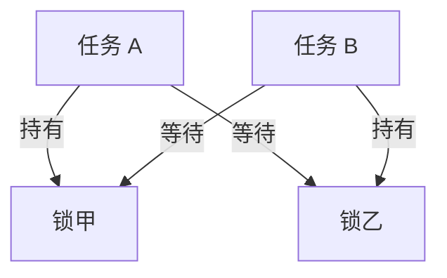

# 第十二讲：Go 语言常见并发问题与解决策略

> 本笔记围绕并发问题的原因、修复方法与适用边界展开，依据 Go 语言规范、内存模型、标准库文档、官方博客和固定版本源码解释原因、修复方法与适用边界。程序的目的不仅是得到正确的某一次输出，还要说明为什么所有被允许的执行方式都满足所需条件。
> **版本口径**：标准库与运行时以 Go 1.27.3 核对；普通完整示例采用 Go 1.27 语言基线。`golang.org/x/sync` 示例固定为 v0.22.0，该模块要求 Go 1.25.0；对应程序单独注明最低版本。这里选择可复现版本，不将它称为最新版本。代码标为 `go-invalid` 时是故意错误的反例，不属于正常运行示例。没有标注“完整程序”的结构片段不能单独执行。

<a id="section-001"></a>

> **统一运行基线：** 建议使用 Go 1.27.3，示例模块声明采用 `go 1.27.0`。文中出现其他 Go 版本时，仅用于说明特性引入时间或历史实现差异；第三方依赖仍以对应模块的版本要求为准。


*图示：并发问题排查流程。*

## 正文导航

- [一、数据竞争问题](#section-003)
  - [1.1 数据竞争概述](#section-004)
  - [1.2 实际案例](#section-005)
    - [1.2.1 错误反例：WaitGroup 不能保护计数器](#section-006)
    - [1.2.2 用 Mutex 保护完整的读改写](#section-007)
    - [1.2.3 无竞争也可能丢更新：错误地拆开事务](#section-008)
    - [1.2.4 单一计数器可以使用类型化原子操作](#section-009)
    - [1.2.5 固定位置写入：用所有权减少共享](#section-010)
    - [1.2.6 单一所有者维护 map](#section-011)
    - [1.2.7 通过原子指针发布不可变快照](#section-012)
    - [1.2.8 常见修复误区与排查次序](#section-013)
- [二、死锁](#section-014)
  - [2.1 什么是死锁](#section-015)
  - [2.2 实际案例](#section-016)
    - [2.2.1 死锁的原因](#section-017)
    - [2.2.2 解决策略](#section-018)
    - [2.2.3 使用 TryLock 实现非阻塞锁定](#section-019)
    - [2.2.4 使用 context 设置超时](#section-020)
- [三、资源的泄漏](#section-021)
  - [3.1 什么是资源泄漏](#section-022)
  - [3.2 资源泄漏的实际案例](#section-023)
    - [3.2.1 解决方案一：传播取消并等待子任务结束](#section-024)
    - [3.2.2 解决方案二：在最小有效作用域内释放外部资源](#section-025)
    - [3.2.3 解决方案三：完整管理定期任务、清理动作和关闭协议](#section-026)
- [四、并发瓶颈](#section-027)
  - [4.1 什么是并发瓶颈](#section-028)
  - [4.2 实际用例](#section-029)
    - [4.2.1 优化策略](#section-030)
- [五、通道阻塞](#section-031)
  - [5.1 什么是通道阻塞](#section-032)
  - [5.2 实际用例](#section-033)
    - [5.2.1 解决方案一：明确生产者、消费者和关闭协调者](#section-034)
    - [5.2.2 解决方案二：合理缓冲并理解背压](#section-035)
    - [5.2.3 解决方案三：使用可取消的阻塞协议](#section-036)
- [六、不确定的执行顺序](#section-037)
  - [6.1 goroutine 的执行顺序不确定](#section-038)
  - [6.2 实际用例](#section-039)
    - [6.2.1 运行输出](#section-040)
    - [6.2.2 解决方案](#section-041)
      - [6.2.2.1 使用锁来确保顺序：校订为“互斥不等于顺序”](#section-042)
      - [6.2.2.2 使用通道进行同步控制](#section-043)
- [七、过度并发](#section-044)
  - [7.1 什么是过度并发](#section-045)
  - [7.2 实际用例](#section-046)
    - [7.2.1 解决方案](#section-047)
      - [7.2.1.1 使用 goroutine 池](#section-048)
      - [7.2.1.2 使用 errgroup 和限制并发的库](#section-049)
      - [7.2.1.3 分批次处理](#section-050)
- [八、总结](#section-051)
  - [8.1 七类问题的判断与修复入口](#section-052)
  - [8.2 综合推演：一次批量查询应该怎样结束](#section-053)
  - [8.3 实用排查流程](#section-054)
- [附录 A：26 道自测题与参考答案](#section-055)
  - [A01：单核机器或 GOMAXPROCS=1 能自动消除数据竞争吗？](#section-056)
  - [A02：两个 goroutine 都对 count++，主 goroutine 最后 Wait，为什么仍有竞争？](#section-057)
  - [A03：每次读写都加锁，为何仍可能发生丢更新？](#section-058)
  - [A04：把结构体指针发送进 channel 后，发送者能继续修改它吗？](#section-059)
  - [A05：不同 goroutine 写同一切片的不同下标，一定需要一把全局锁吗？](#section-060)
  - [A06：sync.Map 能保证多个键的更新作为一个事务吗？](#section-061)
  - [A07：运行时没有报告 deadlock，是否说明请求不会死锁？](#section-062)
  - [A08：避免两个账户转账死锁，为什么要给锁建立一致顺序？](#section-063)
  - [A09：TryLock 返回 false 后，能读受锁保护的字段吗？](#section-064)
  - [A10：用 goroutine 调用 mu.Lock，再 select 超时，能实现可取消锁吗？](#section-065)
  - [A11：为什么消费者只取一个结果就返回，可能留下 goroutine？](#section-066)
  - [A12：Go 有 GC，为什么还需要关闭文件和 HTTP 响应体？](#section-067)
  - [A13：for 循环里 defer Close 是否一定错误？](#section-068)
  - [A14：Ticker.Stop 为什么不能让 for range ticker.C 自动退出？](#section-069)
  - [A15：并发量增加，吞吐不变而延迟变长，应该先做什么？](#section-070)
  - [A16：把 map 拆成很多分片，就可以得到全局一致快照吗？](#section-071)
  - [A17：看到 len(ch) < cap(ch)，下一次发送是否保证不阻塞？](#section-072)
  - [A18：多个生产者为何通常不能各自 defer close(results)？](#section-073)
  - [A19：select 中把 ctx.Done 放第一项，取消就一定优先吗？](#section-074)
  - [A20：Mutex 能保证先启动的 goroutine 先执行吗？](#section-075)
  - [A21：Cond.Wait 为什么要放在条件循环里？](#section-076)
  - [A22：先创建一百万个 goroutine，再用容量十的 channel 限流，限制了什么？](#section-077)
  - [A23：errgroup.WithContext 全部成功后，返回的 Context 还能用于下一阶段吗？](#section-078)
  - [A24：errgroup.SetLimit(0) 表示自动选择并发数吗？](#section-079)
  - [A25：Weighted.Acquire 失败后，为了保险是否应该 Release？](#section-080)
  - [A26：分批处理与固定工作者池有什么实质差别？](#section-081)
- [附录 B：官方资料与源码阅读导航](#section-082)
- [附录 C：示例与验证说明](#section-083)

<a id="section-003"></a>

## 一、数据竞争问题

<a id="section-004"></a>

### 1.1 数据竞争概述

数据竞争不是“两个 goroutine 恰好同时占用两个 CPU”。按 Go 内存模型理解，对同一内存位置发生至少一次写入的并发访问，若没有建立足够的同步顺序，就可能构成数据竞争。一个 goroutine 写、另一个读也会竞争。两个操作在现实时间上看似没有重叠，也不能代替程序定义的 happens-before 关系；操作系统调度恰好把它们错开，并没有给程序增加同步保证。[官方依据：Go 内存模型](https://go.dev/ref/mem)

这里“同一内存位置”比“同一个变量名”更精确。两个不同的切片变量可能共享底层数组；两个结构体字段可能指向同一份 map；把指针通过 channel 发出，也只传递指针值，不会自动深拷贝指向的对象。反过来，不同 goroutine 写预先分配切片中的不同元素，且没人同时修改切片头或读取这些元素，可以采用分区所有权实现安全并发。要判断竞争，应追踪真实的存储和别名关系。

内存模型给无数据竞争的程序提供顺序一致性的理解基础，即常说的 DRF-SC：若程序没有数据竞争，其结果可以按符合同步约束的某种交错顺序解释。它不是“程序只有唯一输出”的承诺；两个合法的互斥加锁顺序仍然可能产生不同、但都被业务允许的结果。也不是“只要 race detector 没报警，程序一定正确”：检测器只能分析本次实际执行到的路径，业务上的丢更新、错误顺序、死锁也未必属于数据竞争。[官方依据：内存模型的介绍及 Advice](https://go.dev/ref/mem)

可以把正确性要求分成三个层次：第一，所有共享可变状态都得到正确同步，避免读写竞争；第二，跨多个字段的业务不变量被同一协议保护，例如库存和已售数量应一起变化；第三，发生错误、取消或退出时，仍然释放资源、停止子任务并返回合适结果。只给计数器换成原子变量，往往只处理了第一层的一小部分。

| 情况 | 是否天然安全 | 必须检查的条件 |
|---|---|---|
| 多个 goroutine 只读已安全发布且之后不变的数据 | 通常可以 | 发布发生在读取之前，内部引用也不再写入 |
| 多个 goroutine 对同一整数执行 `n++` | 否 | 读、加、写的整体需要互斥或原子操作 |
| 多个 goroutine 只读普通 map | 可以有条件成立 | 必须确保没有并发写，不能把“此刻没有写”当永久协议 |
| 多个 goroutine 分别写不同切片下标 | 可以有条件成立 | 下标不重叠，不并发 `append`，读取方等待完成 |
| 通过 channel 发送指针后双方继续修改目标 | 否 | 通信同步不等于转移之后的无限期共享保护 |
| 一个读用 `atomic.Load`，另一个写用普通赋值 | 否 | 同一共享位置不能混用未经协调的普通和原子访问 |

官方竞态检测器可用 `go test -race ./...` 或 `go run -race .` 开启。它报告相冲突的访问栈和 goroutine 创建栈，适合结合真实负载与覆盖面足够的测试使用。其支持平台、运行时开销和要求以当前官方页面为准；不应将带检测器的耗时当作生产性能基线。报告中的一个访问栈并不是“只有这一行有错”，修复应针对共享状态的整个访问协议。[官方依据：Data Race Detector](https://go.dev/doc/articles/race_detector)

<a id="section-005"></a>

### 1.2 实际案例

<a id="section-006"></a>

#### 1.2.1 错误反例：WaitGroup 不能保护计数器

下面是故意错误的完整反例，使用 `go-invalid` 标记，不加入正常成功程序的批量运行。`Wait` 让主 goroutine 等待工作结束，但两个工作 goroutine 之间的 `count++` 仍然没有被互斥保护。即便某一次打印了正确答案，也不能证明没有竞争。

```go-invalid
package main

import (
    "fmt"
    "sync"
)

func main() {
    var wg sync.WaitGroup
    count := 0
    for i := 0; i < 2; i++ {
        wg.Add(1)
        go func() {
            defer wg.Done()
            for j := 0; j < 1000; j++ {
                count++ // 故意的数据竞争。
            }
        }()
    }
    wg.Wait()
    fmt.Println(count) // 不把任何一次观察到的值当成保证。
}
```

单独保存后运行 `go run -race main.go`，应把竞态诊断视为反例的观察目标，而不是要求一个固定的错误计数。检测器的具体栈路径、行号、退出状态文本可能随环境变化。不要在正常讲解例子的输出位置写一个貌似稳定的错误数值，例如“输出必为 1732”；Go 从未给这个数作保证。

<a id="section-007"></a>

#### 1.2.2 用 Mutex 保护完整的读改写

`Mutex` 的保护对象是一个由程序员约定的共享状态区域。所有访问 `count` 的 goroutine 必须遵守同一约定，不能只有写入方加锁而读取方直接读。这里主 goroutine 在 `Wait` 返回后读结果，所有工作已经结束，因此没有并发读取问题。`Add` 放在启动 goroutine 之前，使计数增加先于可能发生的 `Wait`。[官方依据：sync.Mutex 与 sync.WaitGroup](https://pkg.go.dev/sync)

```go
// 运行示例：CON-01
package main

import (
	"fmt"
	"sync"
)

func main() {
	var mu sync.Mutex
	var wg sync.WaitGroup
	count := 0
	for worker := 0; worker < 4; worker++ {
		wg.Add(1)
		go func() {
			defer wg.Done()
			for i := 0; i < 100; i++ {
				mu.Lock()
				count++
				mu.Unlock()
			}
		}()
	}
	wg.Wait()
	fmt.Println(count)
}
```

输出：

```text
400
```

注意临界区覆盖的是 `count++` 整体。如果把读值和写值各自加一次锁，中间释放锁，则每一步可能没有数据竞争，整体仍然可能丢更新。锁的粒度应由业务不变量决定，不是机械地把每个赋值包起来。包含锁的结构体也不应在首次使用后被复制，否则两份锁可能分别保护同一个底层数据，互斥关系被意外拆开。[官方依据：sync 包的不可复制约束](https://pkg.go.dev/sync)

<a id="section-008"></a>

#### 1.2.3 无竞争也可能丢更新：错误地拆开事务

下面通过明确的屏障，让两名工作者都先读到零，再分别把各自的旧值加一写回。所有共享读写都在锁内，所以这个程序没有数据竞争；但它最终只得到一次有效增加。这是一个可重复的逻辑错误示范，用来区分“访问安全”和“业务原子性”。

```go
// 运行示例：CON-02
package main

import (
	"fmt"
	"sync"
)

func main() {
	var mu sync.Mutex
	var wg sync.WaitGroup
	readDone := make(chan struct{}, 2)
	writeAllowed := make(chan struct{})
	value := 0
	for i := 0; i < 2; i++ {
		wg.Add(1)
		go func() {
			defer wg.Done()
			mu.Lock()
			old := value
			mu.Unlock()
			readDone <- struct{}{}
			<-writeAllowed
			mu.Lock()
			value = old + 1
			mu.Unlock()
		}()
	}
	<-readDone
	<-readDone
	close(writeAllowed)
	wg.Wait()
	fmt.Println(value)
}
```

输出：

```text
1
```

正确修复应让读、判断和修改属于同一临界区，或使用能表达整个状态变迁的原子比较交换重试。不能通过增加 `Sleep`、换成 `RWMutex`、提高 `GOMAXPROCS` 修复这个问题。数据库中的“先查询库存，再另起一个无条件更新”也会出现类似的逻辑层问题，不过其隔离级别和事务机制需要另行分析，不能直接拿 Go 的锁替代数据库事务。

<a id="section-009"></a>

#### 1.2.4 单一计数器可以使用类型化原子操作

对独立的统计计数器，`atomic.Int64.Add` 能表达一个不可分割的加法操作。Go 的原子操作按内存模型提供顺序一致的原子语义；这不意味着多个不同原子变量的多次更新自动组成事务。若两个字段必须始终一致，应考虑一把锁或发布不可变的整体快照。[官方依据：sync/atomic](https://pkg.go.dev/sync/atomic)

```go
// 运行示例：CON-03
package main

import (
	"fmt"
	"sync"
	"sync/atomic"
)

func main() {
	var count atomic.Int64
	var wg sync.WaitGroup
	for i := 0; i < 4; i++ {
		wg.Add(1)
		go func() {
			defer wg.Done()
			for j := 0; j < 100; j++ {
				count.Add(1)
			}
		}()
	}
	wg.Wait()
	fmt.Println(count.Load())
}
```

输出：

```text
400
```

原子类型适用于经过推理的局部同步，不能被视为“性能必然优于锁”的替换规则。高度竞争下，多个 CPU 仍会争用同一缓存行；把全局计数改成工作者局部计数，最后归并，可能比每次做原子加法更合适。具体效果需要测量，不能仅凭源代码中没有 `Lock` 就断言无竞争、无阻塞或成本为零。

<a id="section-010"></a>

#### 1.2.5 固定位置写入：用所有权减少共享

以下程序预先分配结果切片，每个 goroutine 只写自己拥有的下标。`results` 的切片头不变，底层数组的元素互不重叠，主 goroutine 等待完成后才读取全部结果。它没有“并发 append”这个风险，也不需要给每个写入加同一把全局锁。若结果元素中包含共同指向的 map 或指针，还需进一步判断内部别名。

```go
// 运行示例：CON-04
package main

import (
	"fmt"
	"sync"
)

func main() {
	input := []int{3, 1, 4, 2}
	results := make([]int, len(input))
	var wg sync.WaitGroup
	for i, value := range input {
		wg.Add(1)
		go func(index, n int) {
			defer wg.Done()
			results[index] = n * n
		}(i, value)
	}
	wg.Wait()
	fmt.Println(results)
}
```

输出：

```text
[9 1 16 4]
```

这个例子也区分了完成顺序和呈现顺序。四个计算可能以任意顺序结束，但结果根据原始下标存储，所以打印顺序固定。许多“必须按顺序执行”的需求实际上只是“最终结果与输入对应”，正确选择结果组织方式就能保留并发能力。

<a id="section-011"></a>

#### 1.2.6 单一所有者维护 map

当更新可以表达为消息时，可以让一个 goroutine 独占 map；其他 goroutine 只提交消息。最终读取必须等所有消息处理完毕。并不是“用了 channel，整个程序自然安全”，而是“只有一个执行者访问 map，生命周期又由通道结束协议明确控制”。如果把内部 map 返回给外界继续修改，就破坏了这个所有权约定。[官方依据：Effective Go 的共享与通信](https://go.dev/doc/effective_go#sharing)

```go
// 运行示例：CON-05
package main

import (
	"fmt"
	"sort"
)

func main() {
	words := make(chan string)
	finished := make(chan map[string]int, 1)
	go func() {
		counts := make(map[string]int)
		for word := range words {
			counts[word]++
		}
		finished <- counts // 此后不再访问或修改 counts。
	}()
	for _, word := range []string{"go", "map", "go", "chan"} {
		words <- word
	}
	close(words)
	counts := <-finished
	keys := make([]string, 0, len(counts))
	for key := range counts {
		keys = append(keys, key)
	}
	sort.Strings(keys)
	for _, key := range keys {
		fmt.Printf("%s=%d\n", key, counts[key])
	}
}
```

输出：

```text
chan=1
go=2
map=1
```

这里排序是为了固定展示顺序；普通 map 的迭代顺序不属于程序可依赖的保证。单所有者模型可能把处理集中为一个吞吐瓶颈，因此要结合工作量评估：更新很简单、消息量可控时，它清楚而可靠；每条消息要执行很长的外部调用时，应重新划分状态管理和耗时计算的职责。

<a id="section-012"></a>

#### 1.2.7 通过原子指针发布不可变快照

配置经常同时包含多个相关字段。逐字段更新，即使每个字段各自原子，读者仍可能看到新旧混合。把一组字段放进一个发布后不再修改的对象，然后原子替换指针，读者一次 `Load` 就得到某一个完整版本。原子指针只保护指针的发布和读取，不保护发布后对目标对象的普通修改。

```go
// 运行示例：CON-06
package main

import (
	"fmt"
	"sync/atomic"
)

type Config struct {
	Name  string
	Limit int
}

func main() {
	var current atomic.Pointer[Config]
	current.Store(&Config{Name: "old", Limit: 2})
	published := make(chan struct{})
	go func() {
		next := &Config{Name: "new", Limit: 4}
		current.Store(next)
		close(published)
	}()
	<-published
	snapshot := current.Load()
	fmt.Println(snapshot.Name, snapshot.Limit)
}
```

输出：

```text
new 4
```

例子加了发布完成通知，所以输出明确为新版本；真实读路径未必等待每次更新，它可以合法地读取旧快照或新快照，但不应读取半份快照。若 `Config` 内含切片或 map，构建新版本时要避免复用仍被旧快照读者访问的可变底层对象。深度不可变性不是 Go 类型系统替开发者自动保证的，需要构造和访问规范共同维护。

<a id="section-013"></a>

#### 1.2.8 常见修复误区与排查次序

普通 map 的并发读写有时会触发运行时的 fatal 错误，但没有触发不代表安全；不能把 panic/recover 当作并发保护。`sync.Map` 支持文档定义的并发操作，不过 `Load` 后再 `Store` 仍是两个独立操作，内部存储的指针对象也不会自动受保护。它适合特定访问模式；涉及多个键共同不变量时，普通 map 加锁通常更容易表达正确事务边界。Go 1.27.3 的 `sync.Map` 实现已使用内部哈希 trie，不能把早期文章中的 read/dirty 双 map 结构当成永久事实。[官方依据：sync.Map](https://pkg.go.dev/sync#Map)，[固定源码：go1.27.3 sync/map.go](https://github.com/golang/go/blob/go1.27.3/src/sync/map.go)

读到竞态报告后，先找到冲突位置所属的业务状态，再列出所有读写入口，包括调试日志、指标采样、回调和关闭路径。接着确定状态应由谁拥有、使用哪种同步手段发布、何时不再访问。最后才修改具体代码。只在报告指到的某一行加锁容易漏掉其他入口；用新的锁保护一部分路径，也不能和已有的另一把锁形成互斥。

复查时还应问：是否复制过包含 `Mutex`、`RWMutex` 或原子类型的对象；是否把指向内部可变切片的引用交给调用者；是否让读锁下的代码修改了共享值；是否在 `Wait` 已开始且计数为零时才添加第一批任务。这些问题往往来自 API 边界和生命周期，而不是 `++` 本身。

<a id="section-014"></a>

## 二、死锁

<a id="section-015"></a>

### 2.1 什么是死锁

死锁意味着一组参与者等待某些事件或资源，而这些事件只能由同样陷入等待的参与者推进，导致协议不能继续。典型例子是 A 持有锁甲等待锁乙，B 持有锁乙等待锁甲；也可以没有任何互斥锁，例如双方都先对无缓冲通道发送，谁也没有进入接收阶段。死锁的本质是依赖无法满足，而不是某一类 API “容易卡住”。[官方依据：Channel 类型与发送语句](https://go.dev/ref/spec#Channel_types)、[sync.Mutex](https://pkg.go.dev/sync#Mutex)

“长时间等待”还可能是外部系统慢、锁被长任务占用、任务队列过载或某一路径漏掉通知。它们都可能表现为请求无响应，但解决方式不同。对锁争用，可以缩短临界区；对下游慢，需要超时、容量控制或降级；对循环等待，应改变依赖关系。仅提高等待超时有可能推迟问题暴露，而没有使协议更正确。

Go 运行时在某些全局无进展状态会报告 `all goroutines are asleep - deadlock!`，但它不是通用业务死锁检测器。服务里可能还有网络监听、定时任务或别的可运行 goroutine；其中一组请求即使永久相互等待，进程也未必触发这个提示。不能把“进程没有自动崩溃”当作排除了局部死锁的证据。具体实现属于运行时，不是语言规范对所有运行环境承诺的一项诊断功能。[固定源码：runtime.checkdead](https://github.com/golang/go/blob/go1.27.3/src/runtime/proc.go)

排查时可以画等待关系：节点是执行者或资源，边是“等待此事件发生”。找到环路很有帮助，但还要检查唯一唤醒者是否早已退出、通道是否永远不会关闭、计数是否永远不会归零。有些永久等待是等待一个根本不存在的参与者，图中不一定表现为两个活跃 goroutine 之间的经典循环。



这张图解释的是锁的循环依赖；“持有”边与“等待”边含义不同，不能仅因两条路径都访问同一把锁就认定存在死锁。只要所有任务都按同一全序获取锁，且不会引入别的逆向依赖，就能排除这类锁顺序环路。

<a id="section-016"></a>

### 2.2 实际案例

<a id="section-017"></a>

#### 2.2.1 死锁的原因

**反例一：非重入锁被同一执行路径再次获取。** `sync.Mutex` 不是可重入锁；持锁函数调用另一个也会获取同一把锁的函数，可以把自己堵住。Go 的 Mutex 不绑定 goroutine 所有者，允许一个 goroutine 锁定、另一个解锁，但这不赋予它“同一个调用者再次加锁直接通过”的能力。设计内部辅助方法时，可明确区分“调用前需要持锁”的私有方法与“自行加锁”的公开方法，并让命名和注释表达这个条件。[官方依据：Mutex](https://pkg.go.dev/sync#Mutex)

**反例二：拿着锁等待另一个需要该锁的 goroutine。** A 持锁后调用 `Wait`，但工作者 B 需要获得同一把锁才能完成并调用 `Done`，于是 A 等 B，B 等 A。这种死锁不是 WaitGroup 的缺陷，而是把“保护共享状态”和“等待生命周期结束”放进了互相依赖的区域。

**反例三：结果通道无人消费。** 主 goroutine 先 `wg.Wait()`，等所有工作者完成后才 `range results`；工作者却必须先往无缓冲 `results` 发送，之后才执行 `Done`。正确协调通常是让消费者立即接收，并另起一个只负责 `Wait` 后关闭结果通道的协调者。不要无条件把通道缓冲扩大到输入数量；当输入无界或消息巨大时，这会把死锁风险换成内存风险。[官方依据：Go Concurrency Patterns: Pipelines and cancellation](https://go.dev/blog/pipelines)

**反例四：条件变量的条件永远不会更新。** `Cond.Wait` 在等待前解锁并在返回前重新加锁，因此使用方法不同于手写“拿锁后睡眠”。如果修改条件的代码永远不运行、通知了错误的 Cond，或者把不成立的条件当成已经成立，等待仍会失败。通知是状态变化的提示，状态本身才是判断能否继续的依据。

**反例五：数据库连接池被自己耗尽。** 一个请求占用连接执行事务，又通过同一个已经没有空闲连接的 `DB` 等另一项操作；后者要取得连接才能完成，前者却只有在后者完成后才释放连接。`SetMaxOpenConns` 有限时尤其要检查事务内嵌套操作和未关闭的 Rows。这是资源池层面的等待环，不会因为 Go 代码里看不到 `Mutex` 就自动消失。[官方依据：Managing connections](https://go.dev/doc/database/manage-connections)

<a id="section-018"></a>

#### 2.2.2 解决策略

先改变等待结构，再考虑监测和超时。常用的结构性措施有：同类锁建立一致获取顺序；将慢 I/O、回调和通道等待移出临界区；由清晰的协调者关闭通道；让等待任务完成的代码同时维持必要的结果消费；为每个阻塞点设计能够实际使它返回的取消路径。锁顺序文档应覆盖所有入口，不能只在一段示例中遵守。

**完整示例：账户间转移按固定编号获取两把锁。** 两个并发方向都使用相同的锁顺序，因此不会形成反向环路。余额修改在同时持有两把锁时完成，保留总额不变。为了专注并发协议，金额固定为正整数，两个账户编号唯一，示例的初始余额足够；生产代码还要处理金额校验、溢出、持久化和事务边界。

```go
// 运行示例：CON-07
package main

import (
	"fmt"
	"sync"
)

type Account struct {
	id      int
	mu      sync.Mutex
	balance int
}

func transfer(from, to *Account, amount int) {
	if from == to {
		return
	}
	first, second := from, to
	if first.id > second.id {
		first, second = second, first
	}
	first.mu.Lock()
	second.mu.Lock()
	defer first.mu.Unlock()
	defer second.mu.Unlock()
	from.balance -= amount
	to.balance += amount
}

func main() {
	a := &Account{id: 1, balance: 100}
	b := &Account{id: 2, balance: 100}
	var wg sync.WaitGroup
	wg.Add(2)
	go func() {
		defer wg.Done()
		for i := 0; i < 100; i++ {
			transfer(a, b, 1)
		}
	}()
	go func() {
		defer wg.Done()
		for i := 0; i < 100; i++ {
			transfer(b, a, 1)
		}
	}()
	wg.Wait()
	fmt.Println(a.balance, b.balance, a.balance+b.balance)
}
```

输出：

```text
100 100 200
```

如果编号并不唯一，两个不同对象可能被不同路径排出不同顺序，所以编号唯一性本身是该方案的前置条件。多层系统还会同时获取缓存锁、账户锁、数据库连接等异类资源；只给账户锁排序并不证明整个系统无死锁。应明确全局获取顺序，或减少同时持有的资源数量，避免跨层持锁调用不受控代码。

**完整示例：先复制状态，再发送结果。** 在锁内取得需要的值，释放锁后再做可能阻塞的通道发送。这里得到的是某一时刻的值快照；如果发送时必须验证状态仍然有效，就需要版本号或更完整的提交协议，不能声称“释放锁后状态仍永久不变”。

```go
// 运行示例：CON-08
package main

import (
	"fmt"
	"sync"
)

type Store struct {
	mu    sync.Mutex
	value int
}

func (s *Store) snapshot() int {
	s.mu.Lock()
	defer s.mu.Unlock()
	return s.value
}

func main() {
	s := &Store{value: 42}
	results := make(chan int)
	done := make(chan struct{})
	go func() {
		defer close(done)
		value := s.snapshot()
		results <- value // 等待发生时不持有 s.mu。
	}()
	fmt.Println(<-results)
	<-done
}
```

输出：

```text
42
```

`defer Unlock` 通常能覆盖正常返回和 panic 展开路径，但不能神奇地解决当前函数永远不返回的问题。若持锁函数在死循环或永久 I/O 上停住，defer 也没有执行机会。异常路径安全和等待关系安全是两项不同检查，不应仅看到 `defer` 就结束审查。

<a id="section-019"></a>

#### 2.2.3 使用 TryLock 实现非阻塞锁定

`Mutex.TryLock` 自 Go 1.18 提供，它立即报告本次尝试是否成功。成功时与 `Lock` 成功取得锁有相应的同步效果；失败时**没有建立可用于读取受保护状态的同步关系**。失败并不是一张可以绕过锁读取字段的通行证，也不表示该锁之后一段时间始终被占用。[官方依据：Mutex.TryLock](https://pkg.go.dev/sync#Mutex.TryLock)

```go
// 运行示例：CON-09
package main

import (
	"fmt"
	"sync"
)

func main() {
	var mu sync.Mutex
	mu.Lock()
	first := mu.TryLock()
	fmt.Println(first)
	mu.Unlock()
	second := mu.TryLock()
	fmt.Println(second)
	if second {
		mu.Unlock()
	}
}
```

输出：

```text
false
true
```

合理的使用场景是“工作可被明确跳过，并且跳过语义可接受”，例如低优先级采样遇到正在更新的快照时直接记录本轮未采样。资金扣减、必须执行的任务、资源释放不能因为一次失败就静默略过。若失败后用无限循环反复 `TryLock`，可能制造忙等、CPU 浪费和饥饿；即使每次 `Gosched`，也没有得到业务公平性和确定的完成上界。

对于要同时取得多把锁的算法，“第一把锁成功，第二把失败时释放第一把并重试”可破坏某种等待环，但仍需处理活锁：两个参与者反复同样退让，系统一直很忙却没有进展。重试上限、退避策略与取消机制可以帮助控制成本，不过若能用固定锁顺序表达业务，通常更容易推理。TryLock 是一个工具，不是一般死锁修复模板。

<a id="section-020"></a>

#### 2.2.4 使用 context 设置超时

`context` 通过取消信号让协作的操作有机会返回，它不能从外部强制终止任意 goroutine，也不能让已经调用的 `Mutex.Lock` 自动变成可取消等待。把 `Lock` 放进新 goroutine，再让调用者 `select` 超时返回，可能留下一个迟早获得锁却无人管理的后台任务，甚至锁被取得后永远无人释放。必须选择本身支持取消的等待方式，或重新设计锁的临界区与调用边界。[官方依据：context](https://pkg.go.dev/context)

**完整示例：可取消的容量令牌等待。** 容量为一的 channel 表示单个资源名额。只有成功放入令牌的调用者才可以释放；取消路径不释放它没有取得的令牌。例子预先占满名额，再取消 Context，因此错误结果确定，不靠计时精度碰运气。

```go
// 运行示例：CON-10
package main

import (
	"context"
	"errors"
	"fmt"
)

func acquire(ctx context.Context, slots chan struct{}) error {
	if err := ctx.Err(); err != nil {
		return err
	}
	select {
	case slots <- struct{}{}:
		return nil
	case <-ctx.Done():
		return ctx.Err()
	}
}

func main() {
	slots := make(chan struct{}, 1)
	slots <- struct{}{}
	ctx, cancel := context.WithCancel(context.Background())
	cancel()
	err := acquire(ctx, slots)
	fmt.Println(errors.Is(err, context.Canceled))
	fmt.Println(len(slots))
	<-slots
}
```

输出：

```text
true
1
```

开头检查 `ctx.Err` 让已经观察到的取消直接返回，但检查后仍可能发生新的取消。若槽位和取消同时就绪，`select` 不提供取消优先级，因而可能成功取得名额。协议应允许这一竞态，或在取得后再次检查并归还名额。即使第二次检查通过，后续仍可能立即取消；因此不能承诺“只要返回成功，Context 在未来一定有效”。取消和成功边界必须由业务定义，而不是靠多写一次 `if` 消灭时间。

**完整示例：让取消动作真正解除阻塞 I/O。** `net.Conn` 支持关闭和 deadline。这里用内存中的 `net.Pipe`，取消观察者关闭连接，使可能阻塞的 `Read` 返回，再等待观察者结束。演示没有外网，也没有用 `Sleep` 猜测读取是否已开始。[官方依据：net.Conn](https://pkg.go.dev/net#Conn)、[net.Pipe](https://pkg.go.dev/net#Pipe)

```go
// 运行示例：CON-11
package main

import (
	"context"
	"fmt"
	"net"
)

func main() {
	reader, writer := net.Pipe()
	defer reader.Close()
	defer writer.Close()
	ctx, cancel := context.WithCancel(context.Background())
	defer cancel()
	watcherDone := make(chan struct{})
	readDone := make(chan error, 1)
	go func() {
		defer close(watcherDone)
		<-ctx.Done()
		reader.Close()
	}()
	go func() {
		buffer := make([]byte, 1)
		_, err := reader.Read(buffer)
		readDone <- err
	}()
	cancel()
	err := <-readDone
	<-watcherDone
	fmt.Println(err != nil)
	fmt.Println("stopped")
}
```

输出：

```text
true
stopped
```

在这份例子中，关闭连接的所有权是明确的，读取错误被当作取消导致的结束信号。真实程序中，一个连接可能复用给别的请求，不能随意由某个请求取消者关闭；此时应使用适当的请求级 Context、独立连接或库提供的取消接口。给整个共享连接设置 deadline 同样会影响其他正在使用该连接的操作。

超时只是给等待提供预算，不自动回滚已经发生的业务副作用。请求超时返回时，下游可能已经完成写入但响应丢失；需要幂等键、事务或状态查询处理不确定结果。并发正确性包括“还能继续”和“结果含义正确”，不能在超时后直接重试所有动作而不考虑重复执行。

<a id="section-021"></a>

## 三、资源的泄漏

<a id="section-022"></a>

### 3.1 什么是资源泄漏

资源泄漏指某项资源已经不再服务于有效工作，却仍被保留或占用，没有按预期归还。Go 的垃圾回收主要管理可达性意义上的内存，不会替程序判断“这个等待中的 goroutine 对业务已经没有用”。一个 goroutine 永久停在 channel 发送上，仍然是活着的执行实体，它的栈和引用到的对象也可能继续存活。GC 不能通过猜测业务意图自动将它终止。[官方依据：Pipelines and cancellation](https://go.dev/blog/pipelines)、[A Guide to the Go Garbage Collector](https://go.dev/doc/gc-guide)

常见资源包括 goroutine、文件描述符、网络连接、HTTP 响应体、数据库连接或 Rows、定时器相关资源、缓存条目以及任务队列里尚未处理的大对象。资源数量增加不必然代表泄漏：系统负载增加、缓存预热和连接复用都会提高占用。判断依据应是“请求结束或负载回落后，资源是否按设计回到稳定范围”，而不是单看一个瞬时数值。

goroutine 泄漏还可能被主进程退出掩盖。一个短命命令行程序启动了后台任务后直接结束，操作系统会清理进程资源；把同样的代码放到长期服务的每个请求中，残留 goroutine 会不断累积。示例中 `main` 可以结束，并不等于内部 API 的生命周期契约正确。因此本章完整例子除了停止信号，还明确等待后台工作结束。

可以为每个资源写一张简单的责任表：谁创建，谁拥有，谁允许使用，什么事件表示工作结束，谁释放，错误路径和取消路径是否一样能到达释放点。如果“所有人都可以关闭”或“没人知道由谁关闭”，通常说明 API 的所有权设计仍不完整。对 channel 来说，不需要为了“释放内存”见到通道就关闭；只有协议需要结束通知时才关闭，且关闭必须与所有发送者协调。

| 资源 | 常见遗留原因 | 可观察的信号 | 主要修复方向 |
|---|---|---|---|
| goroutine | 发送、接收或等待永久无法完成 | 相同阻塞栈持续累积 | 取消可达、结束可等待、上下游协议完整 |
| HTTP 响应体 | 成功返回后漏掉 Close | 连接复用下降、连接数或句柄增长 | 及时关闭，结合响应大小决定读取策略 |
| 文件 | 在外层长循环中堆积 defer | 打开的句柄随循环增长 | 把单次处理包进短生命周期函数 |
| 数据库 Rows/Tx | 结果未关闭或事务未结束 | 连接池等待和占用增长 | Close/Commit/Rollback 的明确责任 |
| 队列内对象 | 生产持续超过消费，队列无限增长 | 排队时间和内存共同上升 | 有界队列、入场限制、拒绝或背压 |
| 定期任务 | 停止 ticker 却没有结束等待者 | 后台循环仍阻塞接收 | 使用独立取消信号并等待循环退出 |

检查资源时不能把“内存仍然可达”直接归类为程序 bug，也不能把“GC 已经运行”当成没有泄漏的证明。对逻辑泄漏，需要业务生命周期与运行时观测互相印证。诊断剖析可以指出资源停在哪里，最终仍要回到谁应当结束这项工作的问题。[官方依据：Diagnostics](https://go.dev/doc/diagnostics)

<a id="section-023"></a>

### 3.2 资源泄漏的实际案例

设想一个生成器不停产生数字，下游只取第一个就返回。若生产者执行的是裸 `out <- value`，第二次发送便可能永久阻塞。给 channel 加一个缓冲区，只会允许它多发送若干项；对于无限流或未知长度流，缓冲容量最终仍会用完。真正需要的是下游提前结束时通知上游，并让上游在发送点观察通知。

另一个常见场景是请求发起多个查询，只需要最快的结果。剩余查询既可能继续占用连接，也可能在发送结果时卡住。如果任务数量固定且每个任务只发送一次，可以为结果提供足够容量，使已完成者不会因调用者离开而堵塞；但这只解决“结果发送”问题，不能中止正在进行的慢查询。对可取消的下游调用，仍然应传播 Context。

资源泄漏往往不是成功路径的问题，而发生在“只取部分结果”“第一个错误就返回”“请求超时”“客户端断开”“关闭服务”这些分支。阅读一段并发代码时，不妨先假设消费者在任意一次接收后离开，追踪所有生产者还有没有可能停在不可取消的操作上。这个检查比仅观察正常情况下所有结果都读完更容易发现协议缺口。

<a id="section-024"></a>

#### 3.2.1 解决方案一：传播取消并等待子任务结束

生成器的每次潜在阻塞发送都把 `ctx.Done()` 放入同一个 `select`。调用者消费一个值后取消，再等待 `done`，确保停止不只是“已经请求”，而是“工作者已退出”。关闭 `out` 的责任在生产者，因为它能保证不会再有发送。不要让下游为了退出而关闭上游仍在发送的 channel，否则可能触发 send on closed channel。

```go
// 运行示例：CON-12
package main

import (
	"context"
	"fmt"
)

func numbers(ctx context.Context) (<-chan int, <-chan struct{}) {
	out := make(chan int)
	done := make(chan struct{})
	go func() {
		defer close(done)
		defer close(out)
		for n := 1; ; n++ {
			select {
			case out <- n:
			case <-ctx.Done():
				return
			}
		}
	}()
	return out, done
}

func main() {
	ctx, cancel := context.WithCancel(context.Background())
	defer cancel()
	values, done := numbers(ctx)
	fmt.Println(<-values)
	cancel()
	<-done
	fmt.Println("stopped")
}
```

输出：

```text
1
stopped
```

这个模式对纯 CPU 工作还需要增加合适粒度的取消检查。若工作者先计算几分钟，最后才到发送处检查 Context，取消就不会及时结束计算。检查过密会带来开销，过疏则影响响应；应围绕可分割的工作单元做检查，并让任务具有合理的最坏执行时间。对无法被中断的第三方调用，把 Context 传进一个没有使用它的函数也不会产生取消能力。

取消者和等待者也不一定是同一个 goroutine，但责任应被明确封装。例如服务关闭函数先关闭入口，再发出根 Context 取消，最后等待所有工作者完成；如果工作者退出前还要把结果写回已经停止消费的队列，关闭流程仍可能卡住。因此取消路径不能只覆盖接收输入，也要覆盖发送输出与获取资源的阻塞点。

**完整示例：一次性结果的缓冲容量承担有限的交付责任。** 工作只有一个，最多发送一次，因此容量一足以让生产者完成结果交付。程序通过握手先让调用方结束等待，再允许工作完成，证明生产者结束不依赖调用方继续接收。

```go
// 运行示例：CON-13
package main

import (
	"context"
	"fmt"
)

func main() {
	result := make(chan int, 1)
	mayFinish := make(chan struct{})
	workerDone := make(chan struct{})
	go func() {
		defer close(workerDone)
		<-mayFinish
		result <- 42
	}()
	ctx, cancel := context.WithCancel(context.Background())
	cancel()
	select {
	case <-result:
		panic("结果尚未允许产生")
	case <-ctx.Done():
		fmt.Println("caller canceled")
	}
	close(mayFinish)
	<-workerDone
	fmt.Println("worker stopped")
	fmt.Println(<-result) // 仅在示例中检查已交付的缓冲结果。
}
```

输出：

```text
caller canceled
worker stopped
42
```

这不是万能的“通道容量设一就不会泄漏”规则。若一个工作者发送两次、工作者数量增加，或者缓冲通道存进全局集合永远不释放，结论就变了。该示例的证明依赖明确的消息上界和有限任务执行；无限流应采用取消，必要时让上游停止生产。

<a id="section-025"></a>

#### 3.2.2 解决方案二：在最小有效作用域内释放外部资源

`http.Client.Do` 在成功返回响应后，把关闭响应体的责任交给调用者。非 2xx 状态通常不是 `Do` 的调用错误，所以不能只在 `err != nil` 分支考虑清理。即使业务决定不处理响应，也要执行合适的关闭。若要提高 HTTP/1.x 持久连接复用机会，通常还要按协议消费到 EOF；但遇到巨大或不可信响应，不能为复用无上限地读取，应该设定响应大小与时间预算。[官方依据：Client.Do](https://pkg.go.dev/net/http#Client.Do)

下面用自定义标准库 `RoundTripper` 返回有限的内存响应，精确验证读取后执行了 `Close`，不会访问互联网。它演示清理责任，不模拟 TCP 连接池性能，也不把“已经 Close”与“连接必然可以复用”画等号。

```go
// 运行示例：CON-14
package main

import (
	"context"
	"fmt"
	"io"
	"net/http"
	"strings"
)

type body struct {
	io.Reader
	closed *bool
}

func (b *body) Close() error { *b.closed = true; return nil }

type transport func(*http.Request) (*http.Response, error)

func (f transport) RoundTrip(r *http.Request) (*http.Response, error) { return f(r) }

func fetch(ctx context.Context, client *http.Client) (string, error) {
	req, err := http.NewRequestWithContext(ctx, http.MethodGet, "http://example.invalid", nil)
	if err != nil {
		return "", err
	}
	resp, err := client.Do(req)
	if err != nil {
		return "", err
	}
	defer resp.Body.Close()
	data, err := io.ReadAll(resp.Body)
	return string(data), err
}

func main() {
	closed := false
	client := &http.Client{Transport: transport(func(r *http.Request) (*http.Response, error) {
		return &http.Response{
			StatusCode: http.StatusOK,
			Header:     make(http.Header),
			Body:       &body{Reader: strings.NewReader("ok"), closed: &closed},
			Request:    r,
		}, nil
	})}
	text, err := fetch(context.Background(), client)
	if err != nil {
		panic(err)
	}
	fmt.Println(text)
	fmt.Println(closed)
}
```

输出：

```text
ok
true
```

外层循环里 `defer file.Close()` 会把所有关闭动作推迟到外层函数返回。若循环处理成千上万个文件，虽然最终会关闭，过程中的峰值资源仍可能超限。解决方式之一是把“打开—处理—关闭”封装为单次调用，让 defer 对应真正的资源生命周期。对于写文件，除了写入错误还要考虑 `Close` 可能报告尚未提交的写入错误；下面只做读取，展示作用域关系。

```go
// 运行示例：CON-15
package main

import (
	"fmt"
	"io"
	"os"
	"path/filepath"
)

func sizeByReading(path string) (int64, error) {
	file, err := os.Open(path)
	if err != nil {
		return 0, err
	}
	defer file.Close()
	return io.Copy(io.Discard, file)
}

func main() {
	directory, err := os.MkdirTemp("", "con-resource-")
	if err != nil {
		panic(err)
	}
	defer os.RemoveAll(directory)
	var total int64
	for i, text := range []string{"a", "bb", "ccc"} {
		path := filepath.Join(directory, fmt.Sprintf("%d.txt", i))
		if err := os.WriteFile(path, []byte(text), 0600); err != nil {
			panic(err)
		}
		n, err := sizeByReading(path)
		if err != nil {
			panic(err)
		}
		total += n
	}
	fmt.Println(total)
}
```

输出：

```text
6
```

同样的原则适用于 `sql.Rows` 和事务。`QueryContext` 成功后通常应及时 `defer rows.Close()`，迭代结束还要检查 `rows.Err()`；事务成功要 `Commit`，失败要 `Rollback`，不能只依赖请求 Context 或最终 GC 判断数据库资源何时归还。不要对长期共享的 `*sql.DB` 每次请求都 Close，它是并发安全的连接池句柄，生命周期与单次 Rows 不同。[官方依据：Querying for multiple rows](https://go.dev/doc/database/querying)、[Executing transactions](https://go.dev/doc/database/execute-transactions)

<a id="section-026"></a>

#### 3.2.3 解决方案三：完整管理定期任务、清理动作和关闭协议

`Ticker.Stop` 停止后续 tick，但不会关闭 `Ticker.C`。因此一个只写 `for range ticker.C` 的 goroutine，不能依靠另一个 goroutine 调用 `Stop` 自动结束。应该有独立的退出信号，循环同时监听它，退出时停止 ticker，并通过等待机制确认后台任务已结束。[官方依据：time.Ticker.Stop](https://pkg.go.dev/time#Ticker.Stop)

```go
// 运行示例：CON-16
package main

import (
	"context"
	"fmt"
	"time"
)

func main() {
	ctx, cancel := context.WithCancel(context.Background())
	defer cancel()
	ready := make(chan struct{})
	done := make(chan struct{})
	go func() {
		defer close(done)
		ticker := time.NewTicker(time.Hour)
		defer ticker.Stop()
		close(ready)
		for {
			select {
			case <-ticker.C:
				// 真实业务可在这里执行一次短小、可取消的周期任务。
			case <-ctx.Done():
				return
			}
		}
	}()
	<-ready
	cancel()
	<-done
	fmt.Println("ticker worker stopped")
}
```

输出：

```text
ticker worker stopped
```

Go 1.23 起，定时器实现和未被引用的 timer/ticker 可回收条件有变化，因此不能沿用“任何未 Stop 的 ticker 都永久不能被 GC 回收”的旧式绝对描述。这里仍显式调用 Stop，是为了表达停止产生事件的业务意图与可控生命周期；而真正让 goroutine 退出的是 Context 分支。还要注意程序采用的模块 Go 版本和兼容设置可能影响定时器行为，阅读历史资料时应核对版本。[官方依据：Go 1.23 Timer changes](https://go.dev/doc/go1.23#timer-changes)、[time 包](https://pkg.go.dev/time)

由 `WithCancel`、`WithTimeout`、`WithDeadline` 返回的取消函数通常应在不再需要子 Context 时调用，释放关联资源并解除父子引用。`defer cancel()` 是基本习惯，但在长期循环中每轮创建 Context 时，应把每轮任务放进子函数或在本轮结束立即 cancel，避免所有清理延后到长期函数返回。取消函数可以被重复调用，重复取消不是重复关闭 channel 的同类错误。

回调式清理也有并发边界。`context.AfterFunc` 返回的 stop 函数用于阻止尚未开始的回调；它并不等待已经开始的回调执行完。如果资源将被复用，而回调可能还在操作它，仅调用 stop 后立即复用可能出现竞争。正确做法是依据 stop 的结果和回调完成通知协调，且确保通知不会漏掉。不能把“尝试阻止回调”当成“回调必然已经结束”。[官方依据：context.AfterFunc](https://pkg.go.dev/context#AfterFunc)

关闭服务时可按资源依赖规划步骤：先拒绝新任务，再对已有任务发出取消或给予清理预算，然后等待任务结束，最后关闭它们依赖的共享设施。某些系统需要先关闭监听器来解除 Accept 等待，某些工作者需要输出消费者一直存活到结果处理完毕，具体顺序取决于依赖图。机械地先关闭所有 channel 可能造成发送 panic；机械地先等所有任务也可能因为等待者没有收到停止信号而挂住。

验证泄漏修复时，应在固定输入、固定工作完成条件下重复执行任务，再观察是否能回到稳定状态。单纯比较两次 `runtime.NumGoroutine()` 的精确差值容易受运行时后台任务影响；更可靠的局部证明是每个自己创建的 goroutine 都有退出路径和完成确认，然后用 goroutine profile 或 trace 检查长期负载下是否仍有异常累积。指标是证据的一部分，不能替代协议推理。

<a id="section-027"></a>

## 四、并发瓶颈

<a id="section-028"></a>

### 4.1 什么是并发瓶颈

并发描述多个任务的组织方式，允许它们在一段时间内交错推进；并行描述多个计算在同一时刻实际执行。程序启动一千个 goroutine，并不表示有一千个 CPU 核心同时执行它们，也不表示吞吐量提高一千倍。CPU 计算能否并行受到可用处理资源、`GOMAXPROCS`、任务依赖和运行时开销等限制；I/O 型工作还受下游服务、带宽、连接池和请求配额影响。[官方依据：Concurrency is not parallelism](https://go.dev/blog/waza-talk)、[runtime.GOMAXPROCS](https://pkg.go.dev/runtime#GOMAXPROCS)

瓶颈是当前负载与配置下限制系统进展的因素，而不是源代码里“看起来最慢”的那一行。CPU 忙可能意味着真正的计算瓶颈，也可能是忙等；CPU 不忙可能是正常等待 I/O，也可能是所有任务排队等一把锁。增加 goroutine 数量只会给已经饱和的资源增加等待者时，吞吐可能不变，尾延迟和内存却继续增长。

分析时至少区分服务时间、排队时间和端到端响应时间。服务时间是任务真正占用某项处理资源的时间，排队时间是等名额、等锁或等下游连接的时间；调用方看到的延迟通常还包含网络与多个阶段。若只计函数内部计算，不计进入函数前排队，会错误地判断“每个任务都很快，所以系统没有问题”。时间点需要沿请求生命周期统一定义，而不是随意比较不同位置的耗时。

并发优化必须保留正确性约束。例如去掉锁能减少等待，但如果破坏余额一致性，就不是优化；给通道设置巨大缓冲能让短期吞吐曲线看起来更好，却可能只把等待搬到内存队列。评价应同时看吞吐、延迟分布、错误率、资源占用和负载持续时间。没有测量数据时，应把某个改动描述为候选方案，不给出虚构的性能提升百分比。

| 观测现象 | 可调查的方向 | 不能直接下的结论 |
|---|---|---|
| CPU 利用率高，吞吐到达平台 | CPU 热点、GC、忙等、缓存竞争 | “再加 goroutine 一定更快” |
| CPU 低，响应慢，mutex profile 集中 | 临界区时间、锁粒度、持锁 I/O | “Go 调度器没有工作” |
| goroutine 数和队列年龄持续上升 | 入场速率、下游吞吐、资源泄漏 | “所有等待都属于死锁” |
| 数据库 WaitCount/WaitDuration 上升 | 连接池排队、慢查询、长事务 | “连接数越大越好” |
| 大量分配，GC 成本上升 | 数据复制、结果缓存、对象生命周期 | “必须换无锁代码” |
| 平均延迟正常，少量请求极慢 | 尾部排队、热点键、批次屏障 | “平均数足以代表体验” |

Go 1.25 以后，默认 `GOMAXPROCS` 可根据容器 CPU 限制等条件确定并更新，相关默认行为还受到模块语言版本和兼容设置影响。因此不要把旧教程中的“始终等于机器逻辑 CPU 数”当成所有新环境的事实，也不要把它等同于线程总数。实际性能实验应记录运行环境和当前值，并区分手动设置与默认更新行为。[官方依据：Container-aware GOMAXPROCS](https://go.dev/blog/container-aware-gomaxprocs)、[Go 1.25 runtime](https://go.dev/doc/go1.25#runtime)

<a id="section-029"></a>

### 4.2 实际用例

一个词频统计服务如果在每读取一个词时都锁住全局 map，任务越细碎、并发越多，共享锁的争用次数就越多。可以先让每个工作者使用自己的局部 map，再归并局部结果。这样不改变“相同词的计数求和”语义，但减少了更新共享状态的次数。是否更快取决于输入规模、词分布、局部 map 的分配成本和归并成本；下面只验证算法结果，不宣称测得了加速比。

```go
// 运行示例：CON-17
package main

import (
	"fmt"
	"sort"
	"strings"
	"sync"
)

func main() {
	texts := []string{"go map go", "chan go", "map go"}
	partials := make(chan map[string]int)
	var wg sync.WaitGroup
	for _, text := range texts {
		wg.Add(1)
		go func(text string) {
			defer wg.Done()
			local := make(map[string]int)
			for _, word := range strings.Fields(text) {
				local[word]++
			}
			partials <- local
		}(text)
	}
	go func() { wg.Wait(); close(partials) }()
	total := make(map[string]int)
	for partial := range partials {
		for word, count := range partial {
			total[word] += count
		}
	}
	keys := make([]string, 0, len(total))
	for word := range total {
		keys = append(keys, word)
	}
	sort.Strings(keys)
	for _, word := range keys {
		fmt.Printf("%s=%d\n", word, total[word])
	}
}
```

输出：

```text
chan=1
go=4
map=2
```

这里工作者在发送 map 之后不再修改它，汇总者只读发送来的 map，并更新自己独占的 `total`。如果工作者为了复用内存在发送后立刻清空局部 map，就会破坏这个所有权交接，产生竞争或错误计数。优化分配时必须重新审视引用生命周期，而不是只看到“复用内存能够减少 GC”。

另一种候选方案是分片：按键选择不同的 map 和锁，让彼此独立的键有机会同时更新。它能减少某些均匀负载的共享争用，但热点键仍然落在同一片上，跨多个键的事务还需要额外协议。分片数量增加也会提高管理成本，并不存在线程数乘某个常数的万能最优值。

```go
// 运行示例：CON-18
package main

import (
	"fmt"
	"hash/fnv"
	"sync"
)

type shard struct {
	mu     sync.Mutex
	values map[string]int
}

type Counters struct{ shards [4]shard }

func newCounters() *Counters {
	c := &Counters{}
	for i := range c.shards {
		c.shards[i].values = make(map[string]int)
	}
	return c
}

func (c *Counters) forKey(key string) *shard {
	hash := fnv.New32a()
	_, _ = hash.Write([]byte(key))
	return &c.shards[hash.Sum32()%uint32(len(c.shards))]
}

func (c *Counters) add(key string) {
	s := c.forKey(key)
	s.mu.Lock()
	s.values[key]++
	s.mu.Unlock()
}

func (c *Counters) get(key string) int {
	s := c.forKey(key)
	s.mu.Lock()
	defer s.mu.Unlock()
	return s.values[key]
}

func main() {
	counters := newCounters()
	var wg sync.WaitGroup
	for i := 0; i < 3; i++ {
		wg.Add(1)
		go func() {
			defer wg.Done()
			for _, key := range []string{"go", "map", "go", "chan"} {
				counters.add(key)
			}
		}()
	}
	wg.Wait()
	fmt.Println(counters.get("go"), counters.get("map"), counters.get("chan"))
}
```

输出：

```text
6 3 3
```

如果要提供“所有键在同一时刻的快照”，逐片加锁读取得到的可能是不同时间点的组合。必须决定这种弱快照是否可以接受；若不能，应有固定顺序同时获取所有相关锁、使用版本化快照，或改用单一事务管理。分片提升了局部并行机会，也把跨片一致性变成显式设计问题。

<a id="section-030"></a>

#### 4.2.1 优化策略

**第一步：把假设转成可验证的观察。** 记录输入规模、请求速率、并发上限、队列长度、任务服务时间以及错误数量。区分冷启动、缓存预热与稳定阶段；测试要有足够长的持续负载，避免短时间将队列填满的过程被误认为可持续吞吐。输入分布也要接近真实场景：均匀随机键和少数热点键对分片锁的结果会很不同。

**第二步：选择对应的诊断工具。** CPU profile 主要帮助查找正在消耗 CPU 的调用栈；heap profile 观察分配与存活对象；goroutine profile 观察栈；block profile 观察同步阻塞；mutex profile 帮助定位锁争用相关开销；execution trace 提供调度、阻塞、网络和 GC 等事件的时间线。工具解决的是不同问题，不能用“CPU profile 没热点”排除一个锁等待瓶颈。[官方依据：Diagnostics](https://go.dev/doc/diagnostics)、[runtime/pprof](https://pkg.go.dev/runtime/pprof)、[runtime/trace](https://pkg.go.dev/runtime/trace)

block profile 与 mutex profile 需要合适的采样配置，采样本身有成本。某些统计具有累积性，比较时需要说明采样窗口或前后差值。不同 profile 的栈归因也不同，不能把 mutex profile 中的热点直接理解成“获得锁这行消耗了全部时间”，而应结合锁的持有者、等待者和临界区代码分析。给请求或阶段增加 trace task/region，可以帮助将调度事件与业务工作关联起来。

**第三步：减少不必要的共享和工作。** 优先检查算法复杂度、重复计算、重复解析和无效复制，再考虑局部聚合、合理批处理、状态快照、减少锁内工作。能在锁外构造的数据尽量在锁外构造，但最终提交需要检查版本或前置条件是否仍满足。不要为了缩短临界区把原本必须原子的“检查并更新”拆成两个可穿插步骤。

**第四步：按瓶颈配置容量。** CPU 密集任务的工作者数量常与有效计算并行度相关，I/O 密集任务可能需要更多在途任务以覆盖等待，但最终还受下游容量与内存预算限制。并发上限、连接池容量和队列容量应相互匹配；一处允许几千个任务进来，下一处只允许十个连接，余下任务并没有获得处理能力，只是在别处等待。这里不存在一个普遍适用的固定倍数。

**第五步：在同等条件下复测，并检查副作用。** 正确性测试与竞态检查先证明没有引入明显同步问题；性能实验则在相近环境、相同负载下比较多次测量。除了吞吐还要检查内存、GC、排队年龄、尾延迟与错误率。一次波动不能证明改进，变化很小时更应考虑测量噪声。报告应保留失败条件和适用范围，而不是只摘取最漂亮的一次运行结果。

可以在项目中使用标准 `testing` 基准测试，配合 `go test -bench=. -benchmem` 观察操作成本与分配。微基准适合比较局部实现，但不代表服务在真实网络、数据库、缓存和负载混合下的端到端表现；端到端负载测试也不能替代定位局部热点。二者应服务于同一明确问题。[官方依据：testing.B](https://pkg.go.dev/testing#B)、[Go test command](https://pkg.go.dev/cmd/go#hdr-Test_packages)

还要区分“限并发”和“限速”。限制同时运行十个任务，并不固定每秒只能处理十个任务；若任务很短，每秒可以完成很多批。按每秒额度控制请求需要时间相关的速率策略；保护内存或连接数则通常需要在途数量限制。两种限制可以一起使用，但参数含义和观测指标应分别命名，避免把 `workers=10` 解释成“QPS=10”。

<a id="section-031"></a>

## 五、通道阻塞

<a id="section-032"></a>

### 5.1 什么是通道阻塞

通道通过发送与接收协调任务。对无缓冲通道，发送需要和接收配对；对有缓冲通道，发送需要空位，接收需要已有元素或已经关闭的状态。等待本身是通道协议的正常功能，它既提供流量控制，也能表示“数据尚未就绪”。问题是等待条件永远不能满足、没有取消通路，或者等待者数量失去控制。[官方依据：Channel types](https://go.dev/ref/spec#Channel_types)、[Send statements](https://go.dev/ref/spec#Send_statements)、[Receive operator](https://go.dev/ref/spec#Receive_operator)

| 通道状态 | 发送 | 接收 | `close` |
|---|---|---|---|
| nil channel | 永久阻塞；放在 select 中该通信不就绪 | 永久阻塞；可用来禁用 select 分支 | panic |
| 未关闭的无缓冲 channel | 等待匹配接收 | 等待匹配发送 | 成功一次；需有关闭责任 |
| 未关闭的有缓冲 channel | 满时等待，未满可放入 | 空时等待，有元素取出 | 关闭后仍可读剩余元素 |
| 已关闭且仍有缓冲元素 | panic | 依次取得已有元素，`ok=true` | 再次关闭 panic |
| 已关闭且已耗尽 | panic | 立即得到零值，`ok=false` | 再次关闭 panic |

从已关闭通道接收零值，不能仅凭值为零判断结束，因为零本来就可能是有效业务数据。应使用 `value, ok := <-ch`，或用 `for value := range ch` 持续消费直到关闭且耗尽。`range` 不会自动关闭通道，也不知道生产者是否已经“看起来没事做”；没有明确关闭时，它会继续等待。

`len(ch)` 表示观察时缓冲区中尚未被取走的元素数，不是“下一次发送必然不阻塞”的许可。即使 `len(ch) < cap(ch)`，检查之后其他发送者也可能抢先填满空间；即使 `len(ch)==0`，无缓冲通道也可能已有等待接收者。需要非阻塞尝试时，使用带 `default` 的 select 表达原子意义上的通信选择，不能用先检查长度再操作代替。[官方依据：Length and capacity](https://go.dev/ref/spec#Length_and_capacity)、[Select statements](https://go.dev/ref/spec#Select_statements)

<a id="section-033"></a>

### 5.2 实际用例

下面的状态示例先展示 nil 分支被禁用，再展示关闭后的缓冲元素仍可读取。它把通道状态的保证变成可重复输出，不依赖任何调度时序。虽然这个程序没有启动 goroutine，理解这些状态是写并发协议的前提。

```go
// 运行示例：CON-19
package main

import "fmt"

func main() {
	var disabled chan int
	select {
	case <-disabled:
		panic("nil channel 不会就绪")
	default:
		fmt.Println("nil disabled")
	}
	values := make(chan int, 1)
	values <- 7
	close(values)
	first, ok1 := <-values
	second, ok2 := <-values
	fmt.Println(first, ok1)
	fmt.Println(second, ok2)
}
```

输出：

```text
nil disabled
7 true
0 false
```

如果一个 select 循环持续保留已关闭的输入分支，它会不断立即读到零值，可能形成忙循环并干扰其他分支。检测到 `ok=false` 后可将本地通道变量设为 nil，禁用这个分支；这不会改变其他持有同一通道引用者的变量。应给循环设置终止条件，例如所有输入都变为 nil 时返回，否则 `select` 只剩 nil 分支又会永久阻塞。

对关闭中的发送者，不能写“先判断 channel 没关闭，再发送”来保证安全，因为检查与发送之间仍可能被关闭。Go 没有一个能把任意关闭检查与后续发送绑定起来的 `isClosed` 操作。应通过所有权和生命周期协议保证发送结束后再关闭，或在共享互斥区域维护封闭的发送/关闭协议，而不是通过 recover 掩盖结构问题。

<a id="section-034"></a>

#### 5.2.1 解决方案一：明确生产者、消费者和关闭协调者

通常由能证明“不会再有发送”的一方关闭数据通道。单一生产者最容易满足这个条件；多个生产者时，可用 WaitGroup 记录发送者完成，由专门协调者在 `Wait` 返回后关闭输出。消费者从一开始就接收，不能先等待发送者全部结束再开始读无缓冲输出。

```go
// 运行示例：CON-20
package main

import (
	"fmt"
	"sort"
	"sync"
)

func main() {
	left := make(chan int, 2)
	right := make(chan int, 2)
	left <- 1
	left <- 3
	close(left)
	right <- 2
	right <- 4
	close(right)
	output := make(chan int)
	var senders sync.WaitGroup
	for _, input := range []<-chan int{left, right} {
		senders.Add(1)
		go func(input <-chan int) {
			defer senders.Done()
			for value := range input {
				output <- value
			}
		}(input)
	}
	go func() { senders.Wait(); close(output) }()
	var values []int
	for value := range output {
		values = append(values, value)
	}
	sort.Ints(values)
	fmt.Println(values)
}
```

输出：

```text
[1 2 3 4]
```

排序只固定展示，不声称两个转发者的消息跨通道全局有序。每个转发者按自己的输入顺序发送，但合并后的交错顺序由调度和通信决定。若需要按全局序号交付，应显式添加序号和重排机制；如果缺失序号迟迟不来，还要定义等待预算与错误处理。

该例消费者完整读取所有输出，因此发送者能自然退出。若把消费者改成读一个值就返回，就必须把取消传播给两个转发者，而且转发者等待输入和发送输出两处都要有退出通路。一个“正常读完”的 fan-in 示例并不自动具备“随时提前结束”的能力，API 文档要明确是完整消费契约还是可取消消费契约。

<a id="section-035"></a>

#### 5.2.2 解决方案二：合理缓冲并理解背压

缓冲把生产和消费在有限范围内解耦：生产者可以先存入若干结果，直到容量耗尽才等待。它不改变最终吞吐受慢阶段限制的事实。缓冲大小可以吸收短暂突发，但不能让长期生产速率超过消费速率而不付出代价。随着消息数和单条消息占用增加，内存与排队延迟也会上升。

**完整示例：容量一确实只允许一个尚未消费的元素。** 生产者发送第一个值后发出通知，然后尝试发送第二个值。主 goroutine 尚未消费时，第二次发送无法完成；主 goroutine 接收之后，生产者才获得继续机会。整个证明由通道状态构成，不需要猜测多少毫秒足以让生产者执行。

```go
// 运行示例：CON-21
package main

import "fmt"

func main() {
	queue := make(chan int, 1)
	firstSent := make(chan struct{})
	bothSent := make(chan struct{})
	go func() {
		queue <- 1
		close(firstSent)
		queue <- 2
		close(bothSent)
	}()
	<-firstSent
	select {
	case <-bothSent:
		panic("没有消费时第二个值不能进入容量一的队列")
	default:
		fmt.Println("second waiting")
	}
	fmt.Println(<-queue)
	<-bothSent
	fmt.Println(<-queue)
}
```

输出：

```text
second waiting
1
2
```

严格说，`second waiting` 表示“第二次发送尚不能完成”，不要求操作系统已经将工作者实际挂起在那一条指令。通知之后工作者也可能暂时未获调度。这个区别很有用：测试需要证明协议性质，无须猜测底层调度精确停在哪一行。

背压意味着容量不足时让上游等候，使负载不能无限向下游堆积。它通常是保护资源的有效机制，但等待也必须受请求期限和生命周期约束。若调用者不能等待，可以拒绝新工作、合并重复更新或按业务允许的规则丢弃；必须明确记录结果，不能让关键任务默默消失。

**完整示例：非阻塞提交采用明确的拒绝策略。** 队列容量为二，在消费者尚未启动时提交五个任务，前两个被接收，后三个明确计为拒绝。这个示例固定了提交阶段和消费阶段，所以输出可重复；真实并发消费时被接收的是哪些任务可能不同，应把接收/拒绝作为调用结果返回。

```go
// 运行示例：CON-22
package main

import "fmt"

func offer(queue chan<- int, value int) bool {
	select {
	case queue <- value:
		return true
	default:
		return false
	}
}

func main() {
	queue := make(chan int, 2)
	rejected := 0
	for value := 1; value <= 5; value++ {
		if !offer(queue, value) {
			rejected++
		}
	}
	close(queue)
	var accepted []int
	for value := range queue {
		accepted = append(accepted, value)
	}
	fmt.Println(accepted)
	fmt.Println("rejected:", rejected)
}
```

输出：

```text
[1 2]
rejected: 3
```

有 `default` 不代表永远不会 panic。若 queue 已关闭，发送分支会导致发送到已关闭通道的错误；因此 offer 的调用方仍要满足“提交期间通道不会被关闭”的协议。关闭和提交并发存在时，通常需要入口状态、提交者计数或其他生命周期协调。单独的 select default 只解决“不等待容量”，不解决通道所有权。

还应避免把 `for { select { case ...: default: } }` 当成普遍的非阻塞监听方式。没有事件时循环会持续运行，消耗 CPU。若确实无事可做，应阻塞等待事件或取消；若需要定时处理，用定时事件定义节奏。为了让 CPU 看起来没那么忙而加入任意 `Sleep`，会引入额外延迟，也没有从根本上表达等待条件。

<a id="section-036"></a>

#### 5.2.3 解决方案三：使用可取消的阻塞协议

如果任务允许因请求结束而放弃等待，阻塞接收应同时监听 `ctx.Done()`，发送也同理。取消的含义是“我不再参与”，不等于“我可以替所有参与者关闭共享通道”。多个消费者共享一个队列时，某个消费者取消，应停止自己的循环，不能关闭其他生产者仍使用的输入。

```go
// 运行示例：CON-23
package main

import (
	"context"
	"errors"
	"fmt"
)

func receive(ctx context.Context, input <-chan int) (int, error) {
	select {
	case value, ok := <-input:
		if !ok {
			return 0, errors.New("input closed")
		}
		return value, nil
	case <-ctx.Done():
		return 0, ctx.Err()
	}
}

func main() {
	input := make(chan int, 1)
	ctx, cancel := context.WithCancel(context.Background())
	cancel()
	_, err := receive(ctx, input)
	fmt.Println(errors.Is(err, context.Canceled))
	input <- 42 // 接收者取消并未擅自关闭共享输入。
	fmt.Println(<-input)
	close(input)
}
```

输出：

```text
true
42
```

示例中输入为空，所以取消是唯一可选择的分支。如果输入和取消同时就绪，Go 的 select 可以选择其中任何一个就绪通信，并没有“越靠上优先级越高”的规则。函数返回某项结果是否可接受，应由调用契约规定。需要收到结果后再次确认 Context 的场景可以额外检查，但仍然要承认检查与后续使用之间可能发生取消；真正重要的是定义清楚“结果已经交付”的边界。

给循环每次创建 `time.After` 可以表达一次等待超时，但如果需求是整个请求的总预算，应该让同一个 Context deadline 覆盖全程，避免每轮重置预算造成总耗时无限延长。若复用 Timer，必须按当前版本文档处理 Stop/Reset 与旧事件语义，尤其留意模块 Go 版本的兼容行为。定时器只决定何时让超时分支就绪，不保证 goroutine 在该纳秒立即运行。[官方依据：time.Timer](https://pkg.go.dev/time#Timer)、[context.WithDeadline](https://pkg.go.dev/context#WithDeadline)

最终检查一条通道链路时，应同时回答四个问题：消息数量有没有上界，发送者什么时候结束，消费者提前离开如何通知发送者，谁能够证明可以安全关闭。只回答“通道是并发安全的”远远不够；它的内部操作可以安全，并不意味着围绕它写出的协议有进展或满足业务语义。

<a id="section-037"></a>

## 六、不确定的执行顺序

<a id="section-038"></a>

### 6.1 goroutine 的执行顺序不确定

`go f()` 创建一个与调用者并发执行的函数调用；调用者可以继续下一条语句，但语言并没有承诺新 goroutine 何时第一次运行、何时完成，或多个新 goroutine 按启动语句的文本顺序执行。`go A(); go B()` 不能推出 A 完成早于 B 开始。执行先后如果属于业务正确性要求，就必须用同步协议明确表达。[官方依据：Go statements](https://go.dev/ref/spec#Go_statements)、[Goroutine creation](https://go.dev/ref/mem#go)

需要区分四种顺序：提交顺序、开始顺序、完成顺序和最终展示顺序。调用方按编号提交任务，不意味着工作者按编号取得任务；按编号开始的任务，因为计算时长不同，也未必按编号完成；完成后如果按原始下标存结果，最终可以按编号展示。把这些概念混为一谈，会让程序为了不必要的“顺序”失去并发能力，或以为排序输出就修复了业务依赖。

日志的行序也不是可靠的共享内存同步说明。日志设施可能为了保护自身缓冲加锁，但业务代码不能把不相关的打印操作当成正式的跨 goroutine 通知；改掉日志、开启异步输出或调整代码后，这种偶然关系就会变化。应直接使用 channel、锁保护的状态条件、WaitGroup 或其他有明确定义的同步原语。[官方依据：Go 内存模型的同步规则](https://go.dev/ref/mem#synchronization)

`time.Sleep` 只让当前 goroutine 至少暂停相应时长附近的一段调度过程，不保证另一个任务已经完成；系统繁忙、任务变慢或测试环境不同，都可能让“睡一毫秒应该够了”失效。`runtime.Gosched` 允许其他 goroutine 有机会执行，同样不是等待某个指定事件。真正的等待条件应是事件本身，例如结果收到、完成通道关闭、WaitGroup 归零。

<a id="section-039"></a>

### 6.2 实际用例

设想初始化配置 A、启动请求处理 B。如果 B 读取 A 尚未建立的数据，问题不只是日志顺序乱，还可能是数据竞争或使用未初始化状态。正确设计应使配置在启动 B 前就构造完毕，或者 B 必须先等待“配置已发布”事件。反过来，两个独立文件的摘要计算并不互相依赖，只需要最终按文件名输出，就可以并发计算再整理结果。

<a id="section-040"></a>

#### 6.2.1 运行输出

下面是用于解释不确定性的结构反例，不作为完整运行示例。没有等待还会让 `main` 可能先结束；即便补上 WaitGroup，WaitGroup 也只保证最终都结束，不保证 A 和 B 的内部打印先后。

```go-invalid
// 结构反例，省略 package/import；不能依赖打印的先后。
go func() { fmt.Println("A") }()
go func() { fmt.Println("B") }()
```

在有正确等待且每个任务只打印一次的前提下，观察到 A 再 B 或 B 再 A 都不能单独证明业务有错；要看业务是否要求顺序。不能把某次运行截图当成调度规范，也不能通过连续运行几十次恰好相同就声称顺序固定。测试应断言协议允许的性质，例如结果集合、每项出现一次、某个通知前绝不使用某个资源。

为了展示一种合法的“先得到 B、后得到 A”，以下完整程序在主 goroutine 已持锁时启动工作者 A。A 告知自己已经开始，然后等待同一把锁；主 goroutine 先在自己的临界区记录 B，再解锁，A 才能记录。它不试图复现某个随机调度，而是说明“任务已启动”与“它已经完成受保护操作”不是同一事件。

```go
// 运行示例：CON-24
package main

import (
	"fmt"
	"sync"
)

func main() {
	var mu sync.Mutex
	started := make(chan struct{})
	done := make(chan struct{})
	var order []string
	mu.Lock()
	go func() {
		close(started)
		mu.Lock()
		order = append(order, "A")
		mu.Unlock()
		close(done)
	}()
	<-started
	order = append(order, "B")
	mu.Unlock()
	<-done
	fmt.Println(order)
}
```

输出：

```text
[B A]
```

这里对 `order` 的访问遵守同一把锁，读取又发生在完成通知之后，所以它不是数据竞争反例。它证明的只是：启动顺序不是完成顺序，互斥也不会把程序自动改写成 A 先 B 后。若真正要求 A 先完成，就必须把 B 的执行条件连接到 A 的完成事件。

<a id="section-041"></a>

#### 6.2.2 解决方案

先用一句话描述需要的关系，例如“配置构建完成后才能处理请求”“所有分片结果到齐后才能归并”“第 i 项输出之前必须已经输出第 i−1 项”。只有关系明确，才知道应该等待哪个事件。对没有依赖的任务，不必为好看的日志顺序串行执行；对有副作用依赖的任务，也不能只在最后对结果排序来弥补执行错误。

<a id="section-042"></a>

##### 6.2.2.1 使用锁来确保顺序：校订为“互斥不等于顺序”

本章将锁描述为确保顺序的方式，并标注“不推荐，可能影响性能”。关键问题先是语义：**单独一把 Mutex 不承诺竞争者按照期望顺序入场**，因此不是“能保证，只是速度慢”，而是“没有表达这个业务顺序”。`Lock` 的获得次序取决于运行时、竞争情况和调度，API 没有为调用者提供通用的 FIFO 业务排序保证。[官方依据：sync.Mutex](https://pkg.go.dev/sync#Mutex)

可以在互斥锁保护下增加一个状态变量，例如 `turn`，并使用 `Cond` 等待轮到自己。这时保证顺序的是“锁保护的轮次条件 + 正确通知协议”，不是锁本身。所有读取和修改 turn 的操作都要持有同一把锁，等待时用循环检查条件；被唤醒后重新得到锁，其他任务可能已经改变状态，所以不能只在 Wait 前检查一次。[官方依据：sync.Cond](https://pkg.go.dev/sync#Cond)

```go
// 运行示例：CON-25
package main

import (
	"fmt"
	"sync"
)

func main() {
	var mu sync.Mutex
	cond := sync.NewCond(&mu)
	turn := 1
	var order []int
	var wg sync.WaitGroup
	for id := 3; id >= 1; id-- {
		wg.Add(1)
		go func(id int) {
			defer wg.Done()
			mu.Lock()
			defer mu.Unlock()
			for turn != id {
				cond.Wait()
			}
			order = append(order, id)
			turn++
			cond.Broadcast()
		}(id)
	}
	wg.Wait()
	fmt.Println(order)
}
```

输出：

```text
[1 2 3]
```

工作者的创建顺序故意是 3、2、1，最终仍按 turn 输出。这里使用 Broadcast 是为了让等待不同轮次条件的工作者重新检查；如果只 Signal，可能唤醒当前仍不满足条件的任务，而真正轮到的任务继续等待，且此后没有其他通知，就会停止进展。不是所有 Cond 场景都必须 Broadcast，但唤醒策略必须与条件结构相匹配。

Go 的 `Cond.Wait` 不会无缘无故地自行返回，它由 Signal 或 Broadcast 唤醒；要求使用循环的理由仍然存在，因为唤醒和重新获得锁之间共享条件可能变化。不要从其他语言直接搬来“Go 必须循环是因为允许虚假唤醒”的说法。循环保护的是条件在实际继续执行时确实成立，而不是把通知本身当成业务状态。[官方依据：Cond.Wait](https://pkg.go.dev/sync#Cond.Wait)

这个有限任务示例还依赖每个编号都会正常到达。如果任务 2 在递增 turn 前错误退出，任务 3 可能一直等不到轮次。生产代码应设计失败状态、取消通知和等待者退出条件，例如在同一把锁下记录终止错误并 Broadcast，让所有等待者检查“轮到我或者流程已经终止”。只实现成功路径的顺序，不等于完整的状态机。

<a id="section-043"></a>

##### 6.2.2.2 使用通道进行同步控制

对少量清晰的阶段依赖，通道通常直观：A 完成后关闭一个通知通道，B 等待该通道，B 完成再通知 C。关闭事件可同时唤醒多个接收者，并且内存模型定义了相应的可见性关系。需要注意通知必须代表真正完成，不能在写入结果前就关闭通道。[官方依据：Channel communication](https://go.dev/ref/mem#chan)

```go
// 运行示例：CON-26
package main

import "fmt"

func main() {
	aDone := make(chan struct{})
	bDone := make(chan struct{})
	allDone := make(chan struct{})
	var order []string
	go func() {
		<-bDone
		order = append(order, "C")
		close(allDone)
	}()
	go func() {
		<-aDone
		order = append(order, "B")
		close(bDone)
	}()
	go func() {
		order = append(order, "A")
		close(aDone)
	}()
	<-allDone
	fmt.Println(order)
}
```

输出：

```text
[A B C]
```

这里不同 goroutine 修改同一个切片，却没有并发访问：A 的修改完成后关闭 aDone，B 收到后才修改；C 同理；主 goroutine 等待 allDone 后才读。安全性来自明确的 happens-before 链，不能概括成“切片无需加锁”。若让 A 通知完 B 后又继续 append，就重新引入了并发修改风险。

单向通知通道适合完成事件，一次关闭就是永久完成；如果是反复发生的阶段，可发送序号、使用新的通道实例，或采用可重复的状态协议。一个已关闭的通道不能重新打开，把同一个通知通道用于下一轮会让所有接收立即通过。WaitGroup 的复用也要在上一轮所有 Wait 返回之后开始，不能让两轮生命周期交叉而没有约束。[官方依据：sync.WaitGroup](https://pkg.go.dev/sync#WaitGroup)

**完整示例：只要求结果有序时，保留任务并发并按编号收集。** 各工作者向一个结果通道发送带下标的数据，唯一的收集者写最终切片。这个方式也适合结果处理本身需要集中进行的场景；若最终输出量很大，还需考虑结果缓存大小，而不是无限等待一个很慢的早期序号。

```go
// 运行示例：CON-27
package main

import (
	"fmt"
	"sync"
)

type Result struct{ Index, Value int }

func main() {
	inputs := []int{5, 2, 7, 1}
	results := make(chan Result)
	var wg sync.WaitGroup
	for i, value := range inputs {
		wg.Add(1)
		go func(index, value int) {
			defer wg.Done()
			results <- Result{Index: index, Value: value * 2}
		}(i, value)
	}
	go func() { wg.Wait(); close(results) }()
	ordered := make([]int, len(inputs))
	for result := range results {
		ordered[result.Index] = result.Value
	}
	fmt.Println(ordered)
}
```

输出：

```text
[10 4 14 2]
```

这个方案只保证输出对应输入，不约束执行顺序。若任务 2 的外部副作用必须在任务 1 成功提交后才能发生，仍需把这项依赖放进执行协议。可以让依赖链上的任务串行，而彼此无依赖的分支并发，最后在汇合处等待；并发设计的价值是显式表达依赖，不是把所有工作强行并行化。

顺序测试应使用握手、屏障和可控的替身来安排条件，而不是随机 Sleep。比如要测试“消费者取消后生产者退出”，先确保生产者已经进入指定阶段，再触发取消并等待完成；要测试乱序结果整理，可人工给结果发送顺序加门控，而不是希望机器偶然调度出某个顺序。这样的测试在快机器、慢机器和竞态检测环境下都更稳定。

<a id="section-044"></a>

## 七、过度并发

<a id="section-045"></a>

### 7.1 什么是过度并发

过度并发是指程序允许的在途工作超过资源预算或系统能够有效处理的范围，导致调度、排队、内存、连接、GC 或下游压力成为额外负担。goroutine 比操作系统线程轻量，并不代表创建和保留它没有成本。每个 goroutine 都需要运行时状态和栈，栈还可能随调用深度增长；它引用的任务输入和中间结果往往比初始栈本身更大。[官方依据：runtime HACKING](https://github.com/golang/go/blob/go1.27.3/src/runtime/HACKING.md)、[GC Guide](https://go.dev/doc/gc-guide)

例如输入有一百万条任务，先为每条任务启动 goroutine，再让每个 goroutine 竞争容量十的令牌通道，只限制了十个任务进入实际处理阶段，却已经创建了近一百万个等待者。若等待者还各自捕获大型请求数据，内存占用会很大。正确的入场控制应尽量发生在创建 goroutine 和分配大型工作对象之前，或者使用固定数量工作者从有界输入队列取任务。

“并发上限为十”也不是完整的容量说明。它可能指十个工作 goroutine、十个下游请求、十个数据库连接或十个正在处理的批次；每个批次内部若又产生上百个任务，实际在途数量仍会放大。系统应定义资源边界，避免多层组件都认为对方已经限流，最终出现乘法式扩张。

队列也是资源预算的一部分。固定十个工作者，但队列无限增长，仍可能因排队内容占用内存而失败。反过来，没有队列或队列很小，系统在瞬时高峰时会更早拒绝工作；这可能符合低延迟服务的需求，也可能不适合必须持久化的离线任务。应明确超载时是阻塞上游、返回错误、写入持久化队列、合并任务还是允许丢弃，不能用一个任意大的缓冲掩盖决策。

可以用一个定性的资源账本思考容量：正在执行的任务内存、排队输入内存、已经完成但尚未消费的结果内存，以及运行时和共享缓存内存，都要纳入预算。任务大小不均匀时，仅按任务个数限流不能控制内存峰值；这正是带权重的信号量有价值的场景。权重是业务估计，必须考虑估计误差，不能因为使用了信号量就声称精确限制了真实 RSS。

<a id="section-046"></a>

### 7.2 实际用例

一个批量摘要程序若对每个文件直接 `go process(path)`，文件数巨大时会同时打开过多文件或积压大量等待者。若给每个任务再启动下载、解析和写库三个子 goroutine，负载还会继续扩张。工作者池可以把“任务数量”与“同时处理任务的执行者数量”分离，让有限资源重复服务大量输入。

同样的思想适用于 HTTP 扇出：调用方一次请求指定几千个目标时，不能把目标数量直接转成几千个网络请求。应同时考虑整个服务共享的下游容量和单个请求的公平性。如果每个请求都拥有独立上限一百，而同时有一千个调用方请求，系统总量仍可能达到十万。局部上限与全局上限需要共同设计。

在 CPU 任务中，也不应默认“工作者越多越容易跑满”。任务很小而工作者很多时，调度、同步与内存访问成本可能超过计算本身；可以增大任务块、减少交接，或使用局部批处理。I/O 任务则要结合连接池、超时与下游允许的在途量选择参数。所有这些判断应由第四章的观测流程验证，而不是由 goroutine 轻量这一句口号推导。[官方依据：Pipelines 的有界并行](https://go.dev/blog/pipelines)

<a id="section-047"></a>

#### 7.2.1 解决方案

选择方案时先问三个问题：工作是否持续到来，单项资源消耗是否接近，提交阶段能否阻塞。如果是长期任务流、每个任务成本相近，固定工作者通常清晰；若任务有限且提交者可以等待，创建前取得名额的模式很直接；若任务成本差异大，带权重信号量能更贴近资源预算；若有自然批次边界，分批处理可能更容易运维，但会引入批次屏障。

<a id="section-048"></a>

##### 7.2.1.1 使用 goroutine 池

固定工作者池通常包括任务队列、有限个工作者、结果队列和关闭协调。生产者结束时关闭任务队列；工作者读完任务后退出；协调者等所有工作者结束后关闭结果队列；消费者持续收集结果。不要让每个工作者各自关闭公共结果通道，也不要先等待工作者结束再开始消费无缓冲结果。

```go
// 运行示例：CON-28
package main

import (
	"fmt"
	"sort"
	"sync"
)

func main() {
	const workers = 3
	jobs := make(chan int, 2)
	results := make(chan int)
	var wg sync.WaitGroup
	for i := 0; i < workers; i++ {
		wg.Add(1)
		go func() {
			defer wg.Done()
			for value := range jobs {
				results <- value * value
			}
		}()
	}
	go func() {
		defer close(jobs)
		for value := 1; value <= 6; value++ {
			jobs <- value
		}
	}()
	go func() { wg.Wait(); close(results) }()
	var all []int
	for result := range results {
		all = append(all, result)
	}
	sort.Ints(all)
	fmt.Println(all)
}
```

输出：

```text
[1 4 9 16 25 36]
```

这个池固定为三个计算工作者，但还包含一个生产者和一个关闭协调者，所以“workers=3”不等于整个进程只有三个 goroutine。队列容量二也不意味着整个系统最多保留两个任务：工作者手里可以各有一个，生产者可能正在准备一个，已完成的结果也有自己的存储。容量说明应明确统计边界，避免把某一个 channel 的 cap 当作系统总资源上限。

此例输入有限且消费者完整读取，因此自然关闭足够。长期服务的池还需要取消、拒绝提交和服务关闭语义：关闭入口后不接受新任务；已经接收的任务是继续执行还是取消；结果如何交付；任务 panic 是否导致进程退出或由业务边界处理；关闭函数什么时候返回。`sync.Pool` 是临时对象复用工具，不是 goroutine 工作池，也不能保证存进去的对象一直存在，不能用名称相似替代职责分析。[官方依据：sync.Pool](https://pkg.go.dev/sync#Pool)

**另一种完整方案：启动前取得名额。** 当不需要常驻空闲工作者时，提交者先等待容量，然后才创建 goroutine。这样正在运行和等待启动的执行者数量更容易受控。例子同时展示取消时跳出提交循环、等待已启动任务结束，并把输入固定到有限范围。

```go
// 运行示例：CON-29
package main

import (
	"context"
	"fmt"
	"sync"
)

func squares(ctx context.Context, input []int, limit int) ([]int, error) {
	if limit <= 0 {
		return nil, fmt.Errorf("limit must be positive")
	}
	slots := make(chan struct{}, limit)
	output := make([]int, len(input))
	var wg sync.WaitGroup
	var submitErr error
submit:
	for i, value := range input {
		if err := ctx.Err(); err != nil {
			submitErr = err
			break
		}
		select {
		case slots <- struct{}{}:
		case <-ctx.Done():
			submitErr = ctx.Err()
			break submit
		}
		wg.Add(1)
		go func(index, value int) {
			defer wg.Done()
			defer func() { <-slots }()
			output[index] = value * value
		}(i, value)
	}
	wg.Wait()
	if submitErr != nil {
		return nil, submitErr
	}
	return output, nil
}

func main() {
	values, err := squares(context.Background(), []int{1, 2, 3, 4, 5}, 2)
	if err != nil {
		panic(err)
	}
	fmt.Println(values)
}
```

输出：

```text
[1 4 9 16 25]
```

这里取消控制提交等待，已经启动的平方计算非常短且一定结束，所以函数等待它们完成。若实际任务可能耗时很久，还要把 Context 传给任务，并在任务内部真正支持取消。若希望“取消后即便所有任务已提交也返回取消错误”，应在结束处定义并检查这个契约；示例选择的是提交失败就报错，已接受且完成的有限计算可正常返回，不把未明确实现的取消优先级写成保证。

<a id="section-049"></a>

##### 7.2.1.2 使用 errgroup 和限制并发的库


本节固定模块版本 v0.22.0，其 `go.mod` 声明 `go 1.25.0`，故两份完整程序使用最低 Go 1.25。API 行为还核对了该版本源码。新建独立示例目录后的准备命令如下；下载模块属于准备阶段，运行程序本身不访问外部服务。

```sh
go mod init example/concurrency-extra
go mod edit -go=1.25.0
go get golang.org/x/sync@v0.22.0
go run .
```

`errgroup.Group` 在一组任务之间整合等待和错误传播。零值 Group 可用，默认不限制并发，也不会因为错误自动取消其他任务；使用 `WithContext` 才得到关联的派生 Context。第一个返回的非 nil 错误会触发取消，`Wait` 等待组内任务都返回后取得该错误。若多个任务失败，哪个错误最先被观察到由实际执行决定，不能当成按输入编号最小的错误。

`WithContext` 的派生 Context 还会在 `Wait` 返回时取消，即使所有任务都成功。因此后续独立阶段不应继续把这个已结束的组 Context 当作有效请求 Context 使用。需要下一阶段时，可使用仍然有效的父 Context 创建新的组。取消只是通知，任务若不检查 Context、下游操作也不支持取消，`Wait` 仍需等那些任务真正返回。

```go
// 运行示例：CON-30
// 运行基线：Go 1.27.3（模块声明 go 1.27.0）
package main

import (
	"context"
	"errors"
	"fmt"
	"golang.org/x/sync/errgroup"
)

func main() {
	group, ctx := errgroup.WithContext(context.Background())
	group.SetLimit(2)
	input := []int{1, 2, 3, 4, 5}
	output := make([]int, len(input))
	for i, value := range input {
		index, number := i, value
		group.Go(func() error {
			if err := ctx.Err(); err != nil {
				return err
			}
			output[index] = number * number
			return nil
		})
	}
	err := group.Wait()
	fmt.Println(output)
	fmt.Println(err == nil)
	fmt.Println(errors.Is(ctx.Err(), context.Canceled))
}
```

输出：

```text
[1 4 9 16 25]
true
true
```

`SetLimit(2)` 限制组内活跃任务的数量；达到上限时，调用 `group.Go` 的提交者会等待有容量后才创建新任务。负值表示不限制，零表示不能添加任何新的活跃任务，所以它并不是“自动选择默认数量”。有活跃任务时不能修改上限。`TryGo` 可做立即尝试并返回是否成功，调用方必须决定没启动的任务如何处理，不能无视返回值导致任务丢失。

特别要注意两类环路。第一，组的上限为一，组内任务再调用同一组的 `Go` 并等待子任务，它可能在提交时就把自己堵住，因为自己的名额尚未释放。第二，提交者阻塞在 `Go` 的名额等待上，而所有活跃任务又等待提交者继续消费结果。可以让消费与提交独立推进，或采用固定工作者/可取消信号量调整结构；不要认为 errgroup 自带错误处理就能消除所有死锁。

固定版本的 `Go` 名额等待本身不是一个对 Context 分支执行 select 的可取消提交接口；若所有活跃任务永久不退出，派生 Context 取消也不会自动把这次 Go 调用变成返回错误。`Go` 也不会把任务 panic 一般化为普通 error；panic 的处理应在合适的业务边界显式设计。不能把 errgroup 写成“万能捕获、自动杀死子协程”的工具。[固定源码：x/sync v0.22.0 errgroup.go](https://github.com/golang/sync/blob/v0.22.0/errgroup/errgroup.go)

**完整示例：用带权重信号量限制资源总量。** 任务的权重分别为一、二、一，总预算为三。取得名额发生在启动前，成功取得多少，就在任务结束释放多少。例子记录实际进入处理区的权重上界，只断言没有超过三，不声称调度必然让峰值恰好等于三。

```go
// 运行示例：CON-31
// 运行基线：Go 1.27.3（模块声明 go 1.27.0）
package main

import (
	"context"
	"fmt"
	"golang.org/x/sync/semaphore"
	"sync"
	"sync/atomic"
)

func main() {
	const budget int64 = 3
	sem := semaphore.NewWeighted(budget)
	ctx := context.Background()
	weights := []int64{1, 2, 1}
	output := make([]int64, len(weights))
	var used, peak atomic.Int64
	var wg sync.WaitGroup
	for i, weight := range weights {
		if err := sem.Acquire(ctx, weight); err != nil {
			panic(err)
		}
		wg.Add(1)
		go func(index int, weight int64) {
			defer wg.Done()
			defer sem.Release(weight)
			current := used.Add(weight)
			for {
				old := peak.Load()
				if current <= old || peak.CompareAndSwap(old, current) {
					break
				}
			}
			output[index] = weight * 10
			used.Add(-weight)
		}(i, weight)
	}
	wg.Wait()
	fmt.Println(output)
	fmt.Println(peak.Load() <= budget)
	fmt.Println(used.Load())
}
```

输出：

```text
[10 20 10]
true
0
```

`Acquire` 成功才拥有资源名额；失败返回 Context 错误，不应再执行对应 `Release`。释放数量必须与已取得数量匹配，额外释放会破坏计数并可能 panic。权重应为非负且符合业务规则；对于实际工作通常应要求正数。若单个任务申请的权重大于总容量，不能指望以后多等一会儿自然成功，应在提交前拒绝或拆分任务，否则可能一直等到 Context 结束。

带权重队列还存在公平性和利用率权衡。固定版本实现会考虑等待者次序，避免不断让小任务绕过大任务造成大任务饥饿；当队首大任务暂时凑不齐容量时，后面的较小任务未必立即利用剩余容量。这是有意的取舍，不能简单以“还有空位但任务没跑”判定库有 bug。具体队列行为属于实现细节，应用应依赖 API 的容量与取消契约，而非永久假设内部链表顺序。[固定源码：x/sync v0.22.0 semaphore.go](https://github.com/golang/sync/blob/v0.22.0/semaphore/semaphore.go)

<a id="section-050"></a>

##### 7.2.1.3 分批次处理

分批处理把输入切成有限大小的批次，每批启动受控数量任务，等待这一批完成，再进入下一批。它实现简单，方便记录阶段进度和重试边界，也让很多资源在批次末尾得到回收。代价是批次屏障：即使某些工作者已经空闲，只要本批最慢的任务尚未完成，下一批也不会启动。任务时长差异大时，持续的工作者池可能更充分利用资源。

```go
// 运行示例：CON-32
package main

import (
	"fmt"
	"sync"
)

func main() {
	input := []int{1, 2, 3, 4, 5}
	const batchSize = 2
	output := make([]int, len(input))
	batches := 0
	for start := 0; start < len(input); start += batchSize {
		end := start + batchSize
		if end > len(input) {
			end = len(input)
		}
		var wg sync.WaitGroup
		for i := start; i < end; i++ {
			wg.Add(1)
			go func(index int) {
				defer wg.Done()
				output[index] = input[index] * 3
			}(i)
		}
		wg.Wait()
		batches++
	}
	fmt.Println(output)
	fmt.Println("batches:", batches)
}
```

输出：

```text
[3 6 9 12 15]
batches: 3
```

批大小必须大于零，否则这种步进循环不能前进；批尾必须截到输入长度，避免越界。真实任务失败时还需要决定整批回滚、仅重试失败项还是继续下一批，并记录哪些副作用已经提交。批次是工作组织方式，不自动提供数据库事务和幂等性。对一次性超大输入，若仍把所有输入和所有结果保存在内存，分批计算本身也不能保证总内存很小。

可以在流式读取中只保留当前批次，使输入缓存受控；结果如果也能流式落盘或交给下游，内存峰值会更容易预算。若必须保留全部结果用于最终排序，应承认这部分存储是需求本身带来的成本，并考虑外部排序、分页或更换输出协议。并发数的降低并不会自动消除全量结果集合。

| 方案 | 适合的工作形态 | 等待发生在哪里 | 主要边界 |
|---|---|---|---|
| 固定工作者池 | 持续任务流，重复执行同类处理 | 有界任务队列和结果交付 | 明确关闭、取消、提交拒绝 |
| 启动前获取 channel 令牌 | 有限任务列表，简单等权资源 | 提交者取得名额时 | 取消分支、成功取得后对称归还 |
| errgroup + SetLimit | 同一请求的一组可返回错误子任务 | Go 的提交和最终 Wait | 任务必须协作退出，避免嵌套提交环路 |
| Weighted semaphore | 任务资源成本差异显著 | Acquire，可观察 Context | 验证权重，处理大任务与公平性 |
| 分批次 | 有清晰批次进度和回收边界 | 每批的完成屏障 | 长尾拖住下一批，错误与重试策略 |

任何方案都需要选择合适的参数，并以真实负载检验。一个对轻量短任务有效的并发上限，可能对大文件解析太大，也可能对高延迟低成本的 I/O 太小。参数不是代码正确性的替代品：先保证不会丢任务、不会泄漏、不会死锁，再通过观测寻找满足成本与延迟目标的配置范围。

<a id="section-051"></a>


*图示：从现象到证据，再到修复。*

## 八、总结

本讲的七个主题可以统一到三项责任：共享状态要有访问协议，异步任务要有结束协议，有限资源要有容量协议。访问协议说明谁能读写以及如何建立可见性；结束协议说明正常完成、错误、取消和服务关闭时谁通知谁、谁等谁；容量协议说明多少任务可以进入、多少任务可以排队，以及超出预算时怎么处理。缺少其中任意一项，程序都可能在正常小样本运行中表现良好，却在复杂负载下失效。

<a id="section-052"></a>

### 8.1 七类问题的判断与修复入口

| 问题 | 先核实什么 | 对应措施 | 常见错误捷径 |
|---|---|---|---|
| 数据竞争 | 是否访问相同存储，至少一方写，是否有同步 | 所有权、锁、原子操作、安全发布 | 只让主 goroutine 等待，工作者仍互相竞争 |
| 死锁 | 哪些条件由谁推进，是否形成无法满足的等待 | 固定资源顺序、减少持有、协调消费与关闭 | 为 Lock 套一个超时等待 goroutine |
| 资源泄漏 | 创建者与释放者是谁，结束事件是否可达 | 取消、完成等待、及时 Close、受控队列 | 相信 GC 会自动终止无用 goroutine |
| 并发瓶颈 | 慢在执行还是排队，哪项资源饱和 | profile/trace 定位后改变结构或容量 | 不测量就继续增加并发 |
| 通道阻塞 | 通道状态、消息上界、关闭者、消费者生命周期 | 有界缓冲、背压、取消、完整结束协议 | 任意扩大缓冲，或由消费者随意关闭输入 |
| 执行顺序不确定 | 需要提交、执行、完成还是展示有序 | 明确依赖事件，必要时结果重排 | 把 Mutex、Sleep 或日志当成顺序保证 |
| 过度并发 | 在途任务、等待者、队列、结果各占多少资源 | 工作者池、启动前限额、权重预算、分批 | 先创建所有 goroutine 再在内部限流 |

这些分类是分析入口，不是互相隔离的标签。一个工作者池可能既因输出无消费者而死锁，又因请求退出后工作者没有结束而泄漏；一个全局锁可能消除数据竞争，但把昂贵 I/O 放在锁内会造成吞吐瓶颈；把输出缓存调大可能暂时解除阻塞，却把资源压力转成内存增长。修复应解释全链路行为，而不是只让某个症状暂时消失。

<a id="section-053"></a>

### 8.2 综合推演：一次批量查询应该怎样结束

假设一个请求要查询几十个条目，允许有限并发；任何必要查询失败时，本次请求整体失败；成功时按输入顺序返回结果。可以把协议拆成明确责任：入口接收父 Context，提交阶段在启动前取得名额；每个工作者调用真正支持 Context 的查询，写入独占结果位置或发送带编号结果；错误触发取消；汇总者等待已启动任务全部返回；只有确认没有错误才交付完整结果。对于部分结果，必须定义是否允许返回，不能在失败时把未填充的零值当成真实结果。

再沿失败路径检查：提交者若在等待名额时被取消，应停止新增任务；已经拿到名额但尚未开始工作的任务，也必须保证归还名额；工作者若正在等待数据库连接，驱动和查询接口要能响应取消；结果发送若可能阻塞，必须允许退出；创建的 Rows、响应体和临时文件应由持有者关闭；最终等待不能在仍需它消费结果的情况下发生。所有这些步骤共同决定请求函数能否完整返回。

还要区分应用层任务和下游已经发生的副作用。取消查询通常是停止等待或请求中断，不意味着数据库已经执行的写入被撤销。若请求涉及写操作，应另外使用事务、幂等标识或明确的补偿策略。错误返回只说明调用没有取得成功结果，不能被解释成“外部世界一定什么也没发生”。这一界限应写进接口契约，让调用方知道重试是否安全。[官方依据：Canceling in-progress operations](https://go.dev/doc/database/cancel-operations)、[Executing transactions](https://go.dev/doc/database/execute-transactions)

并发上限也应与服务级预算结合。每次请求最多八个查询，在一千个同时请求下仍可能产生八千个在途查询；共享数据库池会成为下一道排队点。可以在请求级保留公平性控制，同时在全局下游入口执行总量限制。观察池的等待时间、请求排队时间和超时比例，才能判断限额是否合理，而不是看到单请求示例运行很快就认定系统容量足够。

<a id="section-054"></a>

### 8.3 实用排查流程

遇到结果错误，先保留能说明问题的最小输入与执行条件，再检查共享存储和关键不变量；`-race` 是帮助定位同步缺陷的工具，但不要把没有报警当成终点。遇到卡住，收集 goroutine 栈并识别等待对象，沿调用链找唯一能满足条件的参与者；如果它已经退出或也在等待，应调整协议。遇到越来越慢，记录持续负载下的队列年龄、资源占用与剖析数据，再区分过载、泄漏和真正的计算热点。[官方依据：Race Detector](https://go.dev/doc/articles/race_detector)、[Diagnostics](https://go.dev/doc/diagnostics)

建立复现时，优先使用通道握手或可控替身制造“事件尚未发生”的条件，例如让下游等待一条释放通知、让输入队列先占满、让 Context 在进入调用前已经取消。这样可以验证等待、取消和清理的因果关系，而不需要依赖随机时序。真实系统仍需在代表性负载下运行，因为本地小示例无法覆盖驱动、网络和操作系统资源限制。

改动后应从三个角度检查：原问题是否被解决，新增路径是否能正常退出，资源使用是否仍受预算约束。把原来一把锁换成多个分片锁时，要重新考虑跨片一致性；把裸 goroutine 改成 errgroup 时，要检查提交阻塞与消费关系；把阻塞发送改成丢弃策略时，要检查业务是否允许丢弃。工具更换只是手段，修复完成的证据应是明确的行为与验证结果。

<a id="section-055"></a>

## 附录 A：26 道自测题与参考答案

<a id="section-056"></a>

### A01：单核机器或 GOMAXPROCS=1 能自动消除数据竞争吗？

不能。数据竞争关注访问之间是否建立规定的同步顺序，而不是是否真的同时使用两个 CPU。goroutine 可以交错运行，编译器和内存模型也不因为一次执行恰好错开就赋予同步保证。应使用明确的锁、原子操作、通道或所有权协议。把并行度调成一最多改变观察到某些交错的概率，既不是修复，也不能替代竞态检测。

<a id="section-057"></a>

### A02：两个 goroutine 都对 count++，主 goroutine 最后 Wait，为什么仍有竞争？

WaitGroup 约束的是任务结束与等待者继续之间的关系，没有给两个工作者的读改写建立互斥。它们仍可能同时读取旧值并写回，而且这些访问本身缺乏所需同步。应让 `count++` 整体处于同一锁保护中，或者使用原子加法，也可以让工作者分别统计再汇总。等待完成和保护共享数据解决的是不同问题。

<a id="section-058"></a>

### A03：每次读写都加锁，为何仍可能发生丢更新？

因为业务操作可能由多次访问构成。如果先加锁读取 old，解锁后计算，再加锁写入 old+1，其他工作者可以在两段之间完成自己的更新，随后被旧值覆盖。这个程序可能完全没有数据竞争，结果却不满足“每次加一都生效”的不变量。应把读改写作为同一事务保护，或用恰当的比较交换循环并分析重试条件。

<a id="section-059"></a>

### A04：把结构体指针发送进 channel 后，发送者能继续修改它吗？

要看协议。channel 发送同步了相应通信之前的操作，但并没有为之后所有指针解引用自动加锁。如果接收者开始读目标对象，而发送者继续写相同字段，就仍可能竞争。可以约定发送后转移所有权，发送者不再修改；也可以发送深拷贝或使用后续同步。只复制指针值不等于复制它指向的数据。

<a id="section-060"></a>

### A05：不同 goroutine 写同一切片的不同下标，一定需要一把全局锁吗？

不一定。若切片预先分配、每个下标只由一个工作者写、期间不修改切片头或 append，读取方等全部写入完成后再读取，可以按分区所有权证明安全。还应检查元素内部是否共享指针、map 或底层数组。若多个下标恰好都指向同一个可变对象，就不能仅凭下标不同判断没有竞争。

<a id="section-061"></a>

### A06：sync.Map 能保证多个键的更新作为一个事务吗？

不能直接保证。它提供文档定义的并发安全操作，但多个独立调用不会自动合并为一个业务事务；存进去的指针对象也不由 Map 自动保护。如果“账户 A 减少”和“账户 B 增加”必须共同生效，需要另外的事务协议或锁。还应根据访问模式选择数据结构，不要因为类型名带 sync 就认为所有复合操作都已安全。

<a id="section-062"></a>

### A07：运行时没有报告 deadlock，是否说明请求不会死锁？

不是。运行时能识别某些全局无进展情况，但一个长期服务可能仍有网络监听、定时任务或其他正常工作，一部分请求永久等待不一定触发全局诊断。要通过任务栈、等待对象和责任链分析局部协议。即使系统一直有 CPU 活动，也可能存在活锁或局部资源环路，不能只观察进程是否存活。

<a id="section-063"></a>

### A08：避免两个账户转账死锁，为什么要给锁建立一致顺序？

两个方向若分别先锁来源账户再锁目标账户，就可能互相持有对方要的锁。按照唯一且稳定的账户编号排序后获取，两条路径都遵循同一顺序，能排除这类反向锁环。前提是编号排序一致、编号唯一，并且没有额外资源形成其他环路。还要把余额检查和修改放在正确事务边界内，锁顺序只解决进展问题的一部分。

<a id="section-064"></a>

### A09：TryLock 返回 false 后，能读受锁保护的字段吗？

不能据此安全读取。失败没有建立与持锁者的同步关系，也没有授予共享数据的访问权。正确选择通常是跳过允许跳过的工作、返回忙碌错误或采用别的协议。无限忙循环尝试也不是自动更好的 Lock，可能消耗大量 CPU 并造成饥饿。只有成功取得锁后，才能按该锁的保护约定访问和最终解锁。

<a id="section-065"></a>

### A10：用 goroutine 调用 mu.Lock，再 select 超时，能实现可取消锁吗？

通常不能完整实现。调用方超时离开后，后台 goroutine 仍可能等锁，随后取得锁却没有可靠的拥有者与释放路径，留下泄漏或锁住资源。Context 不会撤销一个已调用的 Mutex.Lock。应改用本身支持取消的资源获取方式，或让持锁操作短小并改变调用结构；如果封装复杂锁协议，必须明确处理取得与取消同时发生的竞态。

<a id="section-066"></a>

### A11：为什么消费者只取一个结果就返回，可能留下 goroutine？

生产者可能仍需发送后续结果，而再也没有接收者。无缓冲通道会在下一次发送等待，有缓冲通道也只延缓到容量耗尽。应让消费者提前结束时通知生产者，并让发送点观察取消；或者在明确有限且发送次数可证明的情况下，为一次性交付提供足够缓冲。最终还应等待自己创建的工作者结束，确认不是只发出了停止请求。

<a id="section-067"></a>

### A12：Go 有 GC，为什么还需要关闭文件和 HTTP 响应体？

GC 管理内存可达性，不等同于业务要求的及时释放外部资源。文件描述符、连接池名额和响应体相关资源都有自己的生命周期与 API 契约。即使某些实现最终清理资源，也不能依赖不确定的回收时间控制峰值。成功取得资源后，应在合适作用域内安排 Close；如果写入可能在 Close 才报告错误，还要把该错误纳入返回结果。

<a id="section-068"></a>

### A13：for 循环里 defer Close 是否一定错误？

不是绝对错误，关键是 defer 所属函数的寿命和可接受的资源峰值。很小的有限循环可能没有问题，但长期循环或大量文件会把关闭动作累积到外层函数返回。可以把每次打开和处理放进短函数，让 defer 在本轮结束执行。不能只根据最终是否执行 Close 判断资源使用合理，还应看中间同时保留多少资源。

<a id="section-069"></a>

### A14：Ticker.Stop 为什么不能让 for range ticker.C 自动退出？

Stop 不关闭 C，所以接收循环可能继续等待一个不再到来的 tick。应使用独立 Context 或退出 channel，让循环监听停止事件，并在退出时停止 ticker、发出完成通知。Go 新版本对未引用定时器的 GC 回收改进，也不能代替结束仍在等通道的 goroutine；定时器是否可回收和业务工作者是否退出是两个问题。

<a id="section-070"></a>

### A15：并发量增加，吞吐不变而延迟变长，应该先做什么？

先定位等待和饱和资源，记录排队时间、任务执行时间、下游容量和资源占用，必要时使用 profile 与 trace。可能是 CPU 已饱和、锁竞争、连接池排队或下游速率限制。继续增加并发通常只会堆积更多在途工作。应根据证据调整算法、共享结构和容量，并同时检查尾延迟与错误率，不凭单次平均耗时作判断。

<a id="section-071"></a>

### A16：把 map 拆成很多分片，就可以得到全局一致快照吗？

不能自动得到。逐片读取可能跨越不同时间点，最终组合不是某一个瞬间的整体状态。若业务接受近似统计，这可能足够；若必须满足跨键不变量，应建立一致快照协议，例如按固定顺序同时锁定相关片，或使用版本化不可变状态。分片减少某些锁争用，但把跨片一致性变成需要单独处理的问题。

<a id="section-072"></a>

### A17：看到 len(ch) < cap(ch)，下一次发送是否保证不阻塞？

不保证，因为观察和发送之间其他发送者可能改变状态。对无缓冲通道，长度也不能表示是否有接收者正在等待。若需要立即尝试，应使用 select/default 直接表达非阻塞通信。即便如此，通道被并发关闭的风险仍需通过生命周期协议处理；容量检查和 default 都不能证明通道以后不会被关闭。

<a id="section-073"></a>

### A18：多个生产者为何通常不能各自 defer close(results)？

第一个退出者关闭结果通道时，其他生产者可能仍在发送，导致 panic；后续退出者再次关闭也会 panic。应让生产者只报告自身完成，由能证明全部发送者结束的协调者统一关闭。消费者持续读到通道关闭且耗尽即可知道不会再有结果。若消费者可能提前退出，还要有取消协议，关闭协调本身不解决未消费发送的问题。

<a id="section-074"></a>

### A19：select 中把 ctx.Done 放第一项，取消就一定优先吗？

不一定。多个通信同时可进行时，select 按规范选择一个就绪通信，没有按源代码排列的业务优先级。可以在进入等待前检查已发生的取消，也可以在取得资源后再次确认并归还，但取消随时可能发生，不能靠检查消除所有交界竞态。应明确成功交付、取消和结果接受的契约，而不是承诺实现没有提供的优先级。

<a id="section-075"></a>

### A20：Mutex 能保证先启动的 goroutine 先执行吗？

不能。Mutex 保证互斥与相应同步，不提供通用的按创建顺序或调用者编号排序。若业务需要 A 完成后 B 执行，应让 B 等 A 的完成事件，或用锁保护的条件状态实现明确轮次。问题不是简单的“锁方式性能不好”，而是只加锁根本没有表达顺序要求。若只要求输出顺序，则可以并发执行后按编号整理结果。

<a id="section-076"></a>

### A21：Cond.Wait 为什么要放在条件循环里？

因为唤醒表示可能有状态变化，不代表当前 goroutine 重新取得锁时条件仍成立。其他竞争者可能已改变共享状态；多个等待者也可能对应不同条件。Go 的 Wait 由 Signal/Broadcast 唤醒，不需要借用别的语言的“虚假唤醒”作为唯一解释。条件变量应该与同一把锁保护的状态一起使用，且流程终止时也要唤醒需要退出的等待者。

<a id="section-077"></a>

### A22：先创建一百万个 goroutine，再用容量十的 channel 限流，限制了什么？

它限制的是取得令牌后进入某一处理区域的任务数量，并没有限制创建出来的 goroutine 数量或等待者捕获的输入内存。一百万个等待者本身仍有成本。把令牌获取放在 go 语句之前，或使用固定工作者从有界队列取任务，可以更早限制资源投入。还应检查结果缓存、下游连接和上游输入是否仍然无界。

<a id="section-078"></a>

### A23：errgroup.WithContext 全部成功后，返回的 Context 还能用于下一阶段吗？

不应直接继续用，因为 Wait 返回时派生 Context 也会取消，即使没有任务错误。下一阶段应根据业务使用仍有效的父 Context 或创建新的派生组。还要记住 errgroup 不是强制终止器，任务必须协作响应取消；Wait 的返回意味着任务函数都已结束，而不是错误发生时立即抛下其他任务离开。

<a id="section-079"></a>

### A24：errgroup.SetLimit(0) 表示自动选择并发数吗？

不是，零阻止新增活跃任务，后续 Go 会等待名额；负数才表示不设上限。上限必须在没有活跃任务时修改。组内任务向同一受限组递归提交子任务可能形成名额依赖死锁，尤其上限为一时。需要根据任务拓扑设计组和消费方式，不能把 SetLimit 当成对任何 goroutine 结构都透明的装饰。

<a id="section-080"></a>

### A25：Weighted.Acquire 失败后，为了保险是否应该 Release？

不应该。失败表示没有成功取得所申请的名额，额外释放会破坏资源计数。每一次成功 Acquire 应对应相同权重的一次 Release，并在所有退出路径覆盖；申请权重大于总预算的任务也应提前拒绝或拆分。权重是资源预算模型，不能仅凭它证明真实内存使用绝不超标，还要考虑任务实际开销和模型误差。

<a id="section-081"></a>

### A26：分批处理与固定工作者池有什么实质差别？

分批处理在每批结束处有屏障，最慢任务会阻止下一批开始；固定工作者可在完成当前任务后立即获取下一项，适合连续任务流和时长不均的工作。批次便于进度记录与阶段回收，但不自动提供事务。两者都需要受控队列、错误语义和资源预算；如果保留全部输入和结果，单纯限制每批并发仍不能让总内存变成常量。

<a id="section-082"></a>

## 附录 B：官方资料与源码阅读导航

阅读时先确定公开契约，再看固定版本实现。规范和标准库 API 用来回答“程序可以依赖什么”；源码用来解释“这个版本如何实现”；历史博客则帮助理解设计动机，但不能覆盖后来发生的版本变化。下列链接也可用于逐项复核正文中的技术判断。

| 资料 | 本讲用途 |
|---|---|
| [Go Language Specification](https://go.dev/ref/spec) | goroutine、channel、select、发送与接收、关闭行为 |
| [Go Memory Model](https://go.dev/ref/mem) | 数据竞争、happens-before、通道与锁的同步效果 |
| [sync](https://pkg.go.dev/sync) | Mutex、RWMutex、Cond、WaitGroup、Map、Pool 的公开契约 |
| [sync/atomic](https://pkg.go.dev/sync/atomic) | 原子类型、原子操作与发布模式 |
| [context](https://pkg.go.dev/context) | 取消、deadline、AfterFunc 与取消函数的责任 |
| [time](https://pkg.go.dev/time) | Timer、Ticker、Stop/Reset 的版本相关语义 |
| [Race Detector](https://go.dev/doc/articles/race_detector) | 运行方式、报告阅读、动态检测的局限 |
| [Pipelines and cancellation](https://go.dev/blog/pipelines) | 发送者退出、fan-in、下游提前返回、有界工作者 |
| [Diagnostics](https://go.dev/doc/diagnostics) | 性能与阻塞问题的工具选择 |
| [runtime/pprof](https://pkg.go.dev/runtime/pprof) | CPU、内存和阻塞等剖析入口 |
| [runtime/trace](https://pkg.go.dev/runtime/trace) | 调度时间线、任务与区域观测 |
| [net/http](https://pkg.go.dev/net/http) | Context 请求、响应体关闭和客户端生命周期 |
| [database/sql](https://pkg.go.dev/database/sql) | 数据库连接池、Rows、事务和统计 |
| [Managing connections](https://go.dev/doc/database/manage-connections) | 连接上限与等待风险 |
| [GC Guide](https://go.dev/doc/gc-guide) | 对象存活、栈根与内存成本 |
| [Go 1.23 release notes](https://go.dev/doc/go1.23) | 定时器回收及通道语义变化 |
| [Go 1.25 release notes](https://go.dev/doc/go1.25) | 默认 GOMAXPROCS 与新增 WaitGroup.Go 等版本变化 |
| [go1.27.3 runtime 源码](https://github.com/golang/go/tree/go1.27.3/src/runtime) | 运行时状态与诊断实现，仅作为该固定版本细节 |
| [go1.27.3 sync 源码](https://github.com/golang/go/tree/go1.27.3/src/sync) | 锁、条件变量与当前 Map 实现 |
| [x/sync v0.22.0 go.mod](https://github.com/golang/sync/blob/v0.22.0/go.mod) | 扩展模块最低 Go 版本与可复现依赖 |
| [x/sync v0.22.0 errgroup](https://github.com/golang/sync/blob/v0.22.0/errgroup/errgroup.go) | 限额、等待、错误和取消的具体实现 |
| [x/sync v0.22.0 semaphore](https://github.com/golang/sync/blob/v0.22.0/semaphore/semaphore.go) | 权重取得、取消、释放与等待者处理 |

本讲的示例是依据上述契约编写的讲解程序，采用有限输入与明确同步来得到可核验输出。涉及性能的方案只展示结构与正确性，没有虚构真实服务的吞吐或延迟测试结果。扩展模块版本被固定以便复现；升级时应重新阅读依赖的 go.mod、发布说明和具体 API 文档。

<a id="section-083"></a>

## 附录 C：示例与验证说明

本讲共有 32 个完整运行示例，编号 CON-01 至 CON-32。CON-30、CON-31 需要固定扩展模块，其余仅使用标准库。所有正常程序都使用有限工作或明确取消协议，不包含故意永久等待的“成功示例”。反例另用 `go-invalid` 标注，竞态检测反例应单独执行和分析，不能把预期诊断当作正常运行成功。

输出核验关注协议保证的值。对于并发完成顺序，程序使用固定下标、结果收集或排序；对于资源峰值，示例只断言已设计的上界，不写无法保证的精确调度次数。文本里的机制解释与完整程序的作用范围分别说明，避免用一个小型成功例子证明生产环境中所有失败路径都已覆盖。

本次对 **32 个完整 Go 主程序**逐个编译运行，全部成功，实际标准输出与相应示例给出的输出一致。实际工具链：`go version go1.27.3 linux/amd64`。

本篇所有完整示例统一采用 `go 1.27.0` 模块语言设置，并使用 Go 1.27.3 工具链核验。文中出现更早版本时，仅用于说明特性首次引入时间或历史实现差异。

| 模块语言设置 | 完整程序数 |
| --- | ---: |
| `go 1.27.0` | 32 |

第三方或官方扩展模块采用固定版本：

| 模块 | 版本 |
| --- | --- |
| `golang.org/x/sync` | `v0.22.0` |

表中为示例直接依赖；各示例按其 go.mod 解析相应间接依赖。框架 API 的核验以这些固定版本为准，升级后应重新核对官方文档。

最终文件的完整程序源码已与验证版本核对一致；内部导航、代码围栏及 Go 规范链接锚点均已检查。源码流程、配置片段、故意错误示例和未执行的外部环境实验，均不计入成功运行主程序数量。
