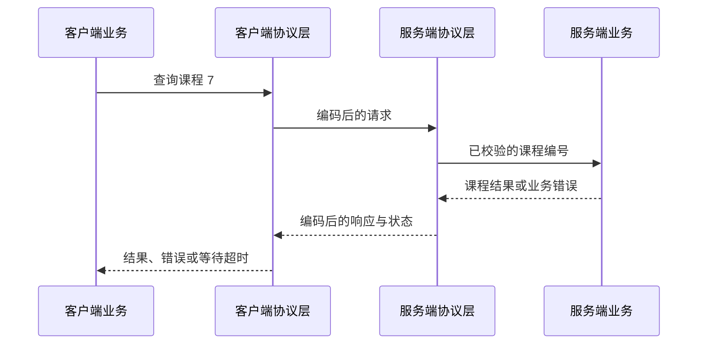

# Go 网络编程完整学习笔记：TCP/IP、gRPC、HTTP 与 Socket

> 本讲围绕网络通信基础、gRPC、HTTP 与 Socket 展开，并将协议层次、请求处理过程和工程边界串联起来。
> 整理日期：2026-10-21（UTC）。Go 代码以官方语言与标准库文档为依据；协议依据 IETF RFC，gRPC 与 Protocol Buffers 依据各自官方文档。代码基线统一为 Go 1.27.3；gRPC 示例固定 `google.golang.org/grpc v1.84.0`，其模块要求不高于当前统一基线 Go 1.27.3。实际验证记录见文末。

<a id="section-001"></a>

> **统一运行基线：** 建议使用 Go 1.27.3，示例模块声明采用 `go 1.27.0`。文中出现其他 Go 版本时，仅用于说明特性引入时间或历史实现差异；第三方依赖仍以对应模块的版本要求为准。


*图示：网络通信分层。*

## 正文导航

  - [本讲的一个贯穿场景](#section-004)
- [一、网络通信基础（按可见内容补充组织）](#section-005)
  - [1.1 从业务函数到网络消息](#section-006)
  - [1.2 地址、端口、主机名和连接](#section-007)
  - [1.3 协议分层和数据单位](#section-008)
  - [1.4 通信过程](#section-009)
    - [1.4.1 同一网段的两台计算机之间的通信情况](#section-010)
    - [1.4.2 不同网段的两台计算机之间的通信情况](#section-011)
  - [1.5 协议数据格式](#section-012)
  - [1.6 TCP 协议](#section-013)
    - [1.6.1 滑动窗口（TCP 流量控制）](#section-014)
  - [1.7 UDP 协议](#section-015)
  - [1.8 IP 协议](#section-016)
- [二、gRPC 网络编程实战](#section-017)
  - [2.1 项目实战：先确定参与者和契约](#section-018)
    - [2.1.1 Protobuf 的定义](#section-019)
    - [2.1.2 将 Protobuf 编译成 Go](#section-020)
  - [2.2 先独立理解序列化](#section-021)
  - [2.3 一个完整进程内 gRPC 实验](#section-022)
  - [2.4 截止时间、取消、元数据和错误](#section-023)
  - [2.5 四种 RPC 模式](#section-024)
    - [2.5.1 普通请求响应的 RPC](#section-025)
    - [2.5.2 服务端流](#section-026)
    - [2.5.3 客户端流](#section-027)
    - [2.5.4 双向流](#section-028)
    - [2.5.5 不同模式的对比](#section-029)
  - [2.6 工程化边界：连接、重试和协议演进（补充）](#section-030)
- [三、HTTP 编程实战](#section-031)
  - [3.1 什么是 HTTP](#section-032)
  - [3.2 HTTP 通信的基本流程](#section-033)
  - [3.3 HTTP 请求的组成形式](#section-034)
    - [3.3.1 请求行](#section-035)
    - [3.3.2 请求头](#section-036)
    - [3.3.3 空行](#section-037)
    - [3.3.4 请求体](#section-038)
  - [3.4 HTTP 响应的组成形式](#section-039)
    - [3.4.1 状态行](#section-040)
  - [3.5 从路由到业务函数（补充）](#section-041)
  - [3.6 HTTP 状态码](#section-042)
    - [3.6.4 5xx：服务器无法完成请求](#section-046)
  - [3.7 HTTP 里面的 GET 和 POST 的区别](#section-047)
  - [3.8 HTTP 是无状态协议](#section-048)
  - [3.9 Cookie、Session 和 Token 的关系](#section-049)
    - [3.9.1 Cookie](#section-050)
  - [3.10 请求解码、大小限制和字段校验（补充）](#section-053)
  - [3.11 Handler、中间件与并发状态（补充）](#section-057)
  - [3.12 HTTP 客户端：状态、正文、错误和连接复用（补充）](#section-058)
  - [3.13 条件请求与缓存（补充）](#section-059)
  - [3.14 超时、取消与资源释放（补充）](#section-060)
  - [3.15 HTTPS、证书与代理边界（补充）](#section-061)
  - [3.16 身份认证与请求完整性（补充父目录）](#section-062)
      - [3.16.4.3 JWT 的特点](#section-069)
    - [3.16.5 签名认证](#section-070)
      - [3.16.5.1 常见请求头](#section-071)
      - [3.16.5.2 签名内容通常包括](#section-072)
  - [3.17 HTTP 常见的安全问题](#section-073)
  - [3.18 附录：HTTP 面试题目](#section-078)
- [四、Socket 编程实战](#section-079)
  - [4.1 什么是 Socket](#section-080)
  - [4.2 Socket 通信的模型](#section-081)
  - [4.3 UDP Socket 模型](#section-086)
  - [4.4 TCP 和 UDP 区别](#section-087)
  - [4.5 把示例扩成长期运行服务（补充）](#section-088)
- [五、总结：用一次“创建课程”串起网络、协议与业务](#section-089)
  - [5.1 业务请求 ID 与幂等结果](#section-090)
  - [5.2 一轮完整流程与检查位置](#section-091)
  - [5.3 排查网络问题的顺序](#section-092)
- [六、作业【练习内容为补充】](#section-093)
  - [6.1 作业一：实现带严格输入校验的课程 HTTP 接口](#section-094)
  - [6.2 作业二：把课程查询与课时汇总改造成 gRPC](#section-095)
  - [6.3 作业三：设计并测试 TCP 消息边界](#section-096)
  - [6.4 作业四：让服务具备有界等待与正常退出](#section-097)
- [附录 A：进一步自测与参考答案](#section-098)
- [附录 B：官方资料导航与继续学习顺序](#section-099)
  - [B.1 Go 标准库](#section-100)
  - [B.2 协议与安全规范](#section-101)
  - [B.3 gRPC 与 Protobuf](#section-102)
  - [B.4 中文辅助资料](#section-103)
- [附录 C：示例验证与适用边界](#section-104)
  - [C.1 实际验证记录](#section-105)
  - [C.2 哪些内容属于示例模型](#section-106)

<a id="section-005"></a>

## 一、网络通信基础

<a id="section-006"></a>

### 1.1 从业务函数到网络消息

本地函数调用和远程调用可能写得相似，但故障条件完全不同。本地调用在同一个地址空间中传递参数；远程调用必须先形成双方理解的消息，并面对网络延迟、丢包、连接关闭、进程重启和“请求已执行而响应丢失”的不确定状态。远程调用成功通常包含三个层次：消息送到了某个服务端；服务端理解了协议；业务操作按契约完成。TCP 写入成功只涉及传输路径中的一部分，不能代替最终业务结果。[依据：TCP RFC 9293](https://www.rfc-editor.org/rfc/rfc9293.html)、[gRPC 生命周期](https://grpc.io/docs/what-is-grpc/core-concepts/)。

以查询课程为例，调用链可写成下图。图中的“编码”既可能是 JSON，也可能是 Protobuf；业务数据不会直接以 Go 内存布局跨机器复制。



这张图省略了代理、负载均衡器、DNS 和数据库，并不保证只有一次网络跳转。它强调的是边界：客户端编码失败时，请求可能尚未发送；网络超时时，服务端可能尚未开始，也可能已经完成；响应解码失败时，也不能把它解释成业务未发生。后面谈幂等和重试时，要依赖这些状态区别。

<a id="section-007"></a>

### 1.2 地址、端口、主机名和连接

IP 地址用于网络层寻址，端口用于传输层标识端点。`example.com:443` 还含有一个名称解析步骤：域名不是 IP 的另一种书写格式，它可能解析出多个地址，也可能随时间变化。服务端可以监听特定地址，也可以监听所有本地接口；开发测试优先绑定 loopback，避免无意把练习服务暴露给其他机器。[依据：net 包](https://pkg.go.dev/net)、[net.Dialer](https://pkg.go.dev/net#Dialer)、[net.Listen](https://pkg.go.dev/net#Listen)。

IPv6 地址内部有冒号，因此不能通过简单的 `host + ":" + port` 处理任意地址，也不能用 `strings.Split(addr, ":")` 拆所有端点。标准库 `net.JoinHostPort` 与 `net.SplitHostPort` 负责对应格式。

```go
// 运行示例：NET-01
package main

import (
	"fmt"
	"net"
)

func main() {
	address := net.JoinHostPort("2001:db8::7", "443")
	host, port, err := net.SplitHostPort(address)
	if err != nil {
		panic(err)
	}
	fmt.Println(address)
	fmt.Println(host)
	fmt.Println(port)
}
```

输出：

```text
[2001:db8::7]:443
2001:db8::7
443
```

`2001:db8::/32` 在这里仅作为文档示例地址，程序不与它通信。地址格式正确不等于目标存在、端口开放或应用健康。排查网络时，应分别检查名称解析、路由、连接建立、TLS 校验和应用响应，不要把所有错误都归为“网络不通”。

一个 TCP 连接通常通过本地与远端的地址、端口等信息区分；一个监听 socket 可以接受很多连接。`Accept` 返回的是与某个客户端通信的已建立连接，而不是把原监听器变成那条连接。监听器负责继续接新连接，连接负责这一对端点的数据流。

<a id="section-008"></a>

### 1.3 协议分层和数据单位

| 层次或工具 | 负责的问题 | 不自动解决的问题 |
| --- | --- | --- |
| 应用消息 | 查询哪门课程、返回哪些字段 | 消息怎样在字节流中分界 |
| JSON / Protobuf | 业务字段怎样编码为字节 | 请求路由、鉴权、可靠投递 |
| HTTP / gRPC | 方法、状态、元信息、请求与响应组织 | 业务事务与跨请求幂等 |
| TLS | 认证通信对端、保护传输机密性和完整性 | 当前登录者是否有业务权限 |
| TCP | 可靠、有序的字节流 | 应用消息边界、业务是否提交 |
| UDP | 有边界的数据报传输 | 默认的可靠性、顺序和重传 |
| IP | 寻址与跨网络转发 | 可靠交付、应用连接和登录状态 |
| Socket API | 程序访问网络通信能力 | 自动替程序定义应用协议 |

“分层”是职责分析，不意味着每层都必须有一个独立进程。很多层位于同一客户端或服务端进程里，TCP/IP 的主要工作则通常由操作系统网络栈处理；代理还可能终止 TLS 或 HTTP 连接，因此端到端业务链和单条传输连接不能机械画成同一条线。[依据：RFC 9110 架构](https://www.rfc-editor.org/rfc/rfc9110.html#section-3)、[RFC 9293](https://www.rfc-editor.org/rfc/rfc9293.html)。

一个易懂的类比是“表单内容、信封规则、运输服务、地址路线”，但类比不能推出网络一定像纸信一样一次一封到达。特别是 TCP 对应用提供字节流，应用要自己或借助 HTTP/gRPC 确定消息边界。

<a id="section-009"></a>

### 1.4 通信过程

<a id="section-010"></a>

#### 1.4.1 同一网段的两台计算机之间的通信情况

在一个简化的 IPv4 局域网中，主机 A 用自己的地址与前缀判断目的地址是否在直接连接的网络内。若是，通常会通过 ARP 获取目标的链路层地址，然后发送链路帧。交换机按链路层信息转发，目标网络栈再把数据交给对应协议与端口。这里“同一网段”不是单纯比较 IP 前三个数字；它取决于网络前缀和实际路由配置。[依据：RFC 826 ARP](https://www.rfc-editor.org/rfc/rfc826.html)、[RFC 1122 主机要求](https://www.rfc-editor.org/rfc/rfc1122.html)。

例如 A 为 `192.168.10.20/24`，目标 B 为 `192.168.10.30`，在这个讲解前缀下 B 属于同一网络。若 A 的前缀不同，结论也可能改变。下面只演示前缀包含关系，不模拟 ARP 或操作系统路由表。

```go
// 运行示例：NET-02
package main

import (
	"fmt"
	"net/netip"
)

func main() {
	network := netip.MustParsePrefix("192.168.10.20/24").Masked()
	fmt.Println("network:", network)
	for _, s := range []string{"192.168.10.30", "192.168.11.30"} {
		address := netip.MustParseAddr(s)
		fmt.Println(s, network.Contains(address))
	}
}
```

输出：

```text
network: 192.168.10.0/24
192.168.10.30 true
192.168.11.30 false
```

`Contains` 是地址运算，不会发包，也不会证明可达。真实网络还可能存在 VLAN、主机防火墙、策略路由、隧道和容器网络。不能用这个简单判断替代连通性测试，更不能直接把“私有地址”当成可信身份。

<a id="section-011"></a>

#### 1.4.2 不同网段的两台计算机之间的通信情况

目的地址不在直接连接网络中时，主机会依据路由表选择下一跳，常见情况是默认网关。A 在本地链路上先把帧交给网关，而 IP 包的目的地址仍是最终目标 B；路由器再决定下一个网络方向。每一跳的链路层封装可以改变，不能把“第一跳的 MAC 地址”当成最终服务器的身份。

在 IPv4 NAT 场景中，边界设备还可能改写源地址与端口并记录映射。NAT 是附加机制，不是所有跨网段通信必经步骤。IPv6 使用邻居发现等机制，不应把 IPv4 的 ARP 原样套用到 IPv6。应用开发者通常不自己处理这些报文，但理解下一跳、名称解析、端口与路由，有助于解释“域名能解析却连不上”和“连接到了代理却不是预期后端”。[依据：RFC 4861 IPv6 邻居发现](https://www.rfc-editor.org/rfc/rfc4861.html)、[RFC 8200 IPv6](https://www.rfc-editor.org/rfc/rfc8200.html)。

<a id="section-012"></a>

### 1.5 协议数据格式

两端要共同约定字段的类型、长度、顺序、编码和版本。例如长度为 300 的消息，长度字段到底是十进制字符串 `"300"`，还是两个字节的无符号整数？两个字节先传高位还是低位？长度是否包含头部自身？这些问题必须有一个确定答案。不能直接把一个 Go 结构体的内存字节当成可移植协议，因为对齐、字段布局、整数宽度和指针表示不是跨语言的数据交换约定。

下面定义一个讲解头部：1 字节版本，2 字节大端长度，随后是正文。大端表示高位字节在前；这里 `300 = 1×256+44`，因此长度字节为 `1,44`。[依据：encoding/binary](https://pkg.go.dev/encoding/binary)。

```go
// 运行示例：NET-03
package main

import (
	"encoding/binary"
	"fmt"
)

func main() {
	header := make([]byte, 3)
	header[0] = 1
	binary.BigEndian.PutUint16(header[1:], 300)
	fmt.Println("header:", header)
	fmt.Println("version:", header[0])
	fmt.Println("length:", binary.BigEndian.Uint16(header[1:]))
}
```

输出：

```text
header: [1 1 44]
version: 1
length: 300
```

解析器不能先相信长度再无限分配。合理顺序是：读取固定头部；检查版本；把长度与协议上限比较；分配或复用有界缓冲区；读取完整正文；再解析业务字段。若一端把长度解释为“含头部”，另一端解释为“不含头部”，之后每一条消息都可能错位。协议演进也要规定未知字段、未知版本和非法长度怎样处理。

下面读取两个“2 字节长度 + 正文”的帧。`io.ReadFull` 把“必须拿够 N 字节”的需求表达出来；普通 `Read` 不承诺一次返回满缓冲区。

```go
// 运行示例：NET-04
package main

import (
	"bytes"
	"encoding/binary"
	"fmt"
	"io"
)

func readFrame(r io.Reader) (string, error) {
	var size uint16
	if err := binary.Read(r, binary.BigEndian, &size); err != nil {
		return "", err
	}
	if size > 1024 {
		return "", fmt.Errorf("frame too large: %d", size)
	}
	data := make([]byte, int(size))
	if _, err := io.ReadFull(r, data); err != nil {
		return "", err
	}
	return string(data), nil
}

func main() {
	var wire bytes.Buffer
	for _, message := range []string{"Go", "network"} {
		if err := binary.Write(&wire, binary.BigEndian, uint16(len(message))); err != nil {
			panic(err)
		}
		wire.WriteString(message)
	}
	for i := 0; i < 2; i++ {
		message, err := readFrame(&wire)
		if err != nil {
			panic(err)
		}
		fmt.Println(message)
	}
}
```

输出：

```text
Go
network
```

本例用内存缓冲区把编码规则单独拿出来检查；换成 `net.Conn` 后仍要补上读写期限和连接关闭。消息长度使用 `uint16` 时，发送端也必须在转换之前检查长度，不要把一个很大的 `len(message)` 直接转成 `uint16`，否则会发生截断。本例两条固定短消息满足该条件。

<a id="section-013"></a>

### 1.6 TCP 协议

TCP 的关键承诺是**可靠、有序、面向连接的字节流**。可靠并非“网络不会出错”，而是协议使用序号、确认、重传等机制，在连接能够继续工作时处理丢失与乱序，并在无法继续时把失败暴露给应用。它不承诺固定时延，不承诺对端进程一定读取，也不承诺数据库事务已经提交。[依据：RFC 9293](https://www.rfc-editor.org/rfc/rfc9293.html)。

应用层调用 `Write([]byte("AB"))` 再调用 `Write([]byte("CD"))`，接收端可能一次读到 `ABCD`，也可能分多次读取。所谓“粘包、拆包”通常是在提醒应用：TCP 没有承诺保留应用的 Write 边界。解决办法是定义长度、分隔符或固定格式，而不是猜一次 `Read` 是否恰好对应一条业务消息。

```go
// 运行示例：NET-05
package main

import (
	"fmt"
	"io"
	"net"
)

func main() {
	left, right := net.Pipe()
	done := make(chan error, 1)
	go func() {
		defer left.Close()
		_, err := io.WriteString(left, "ABCD")
		done <- err
	}()
	first := make([]byte, 2)
	second := make([]byte, 2)
	if _, err := io.ReadFull(right, first); err != nil {
		panic(err)
	}
	if _, err := io.ReadFull(right, second); err != nil {
		panic(err)
	}
	right.Close()
	if err := <-done; err != nil {
		panic(err)
	}
	fmt.Println(string(first))
	fmt.Println(string(second))
}
```

输出：

```text
AB
CD
```

`net.Pipe` 提供内存中的全双工连接，适合演示流接口；它并不是完整 TCP 协议仿真，没有 IP 路由、拥塞控制和重传。本例只说明同一段写入数据可以由应用按不同读取长度消费，并通过通道等待发送 goroutine 退出。[依据：net.Pipe](https://pkg.go.dev/net#Pipe)、[io.ReadFull](https://pkg.go.dev/io#ReadFull)。

建立连接通常涉及握手，关闭则允许两个发送方向分别结束。`EOF` 通常表示对方的发送方向结束，不一定意味着应用已经获得完整业务消息；如果协议头说正文有 100 字节却只收到 60 字节就 EOF，应当报告不完整消息。TCP 的保活与应用心跳也不同：前者检测某些连接存活问题，后者还能表达业务层是否仍能处理请求。

<a id="section-014"></a>

#### 1.6.1 滑动窗口（TCP 流量控制）

接收方处理速度可能比发送方慢，因此它会通告可接收的数据量。发送方依据未确认数据和可用窗口决定还能发送多少，以免无限把数据压向接收方。这里的“窗口”可理解为一段允许在途的字节范围；随着确认到达，范围向前移动，而不是每发送一个字节都等待一次确认。

用一个简化数字模型：接收窗口 `rwnd=8` 字节，当前有 5 字节已发送但未确认，则单看接收窗口还有 `8-5=3` 字节空间。若又收到确认，使未确认数据降到 2 字节，空间变成 6 字节。真实 TCP 还受拥塞窗口 `cwnd`、实现状态与发送缓冲等影响；粗略讨论可用 `min(rwnd,cwnd)-在途字节` 表达双重限制，但这不是完整的发送算法。[依据：RFC 9293 窗口管理](https://www.rfc-editor.org/rfc/rfc9293.html#section-3.8.6)、[RFC 5681 拥塞控制](https://www.rfc-editor.org/rfc/rfc5681.html)。

```go
// 运行示例：NET-06
package main

import "fmt"

func allowance(receiveWindow, congestionWindow, inFlight int) int {
	limit := receiveWindow
	if congestionWindow < limit {
		limit = congestionWindow
	}
	if inFlight >= limit {
		return 0
	}
	return limit - inFlight
}

func main() {
	fmt.Println(allowance(8, 10, 5))
	fmt.Println(allowance(8, 10, 2))
	fmt.Println(allowance(8, 4, 2))
}
```

输出：

```text
3
6
2
```

这个函数是讲解算例，不是 Go 或操作系统的 TCP 实现。流量控制保护接收端，拥塞控制保护共享网络，两者观察的状态与调整目的不同。把接收缓冲区调得很大，也不会自动消除链路拥塞或应用处理瓶颈。应用还应限制队列、并发和请求大小，否则压力只会从内核缓冲转移到 Go 堆内存。

<a id="section-015"></a>

### 1.7 UDP 协议

UDP 传输数据报，保留每次发送的消息边界，但默认不提供 TCP 式可靠交付与有序字节流。应用可能遇到丢失、重复、乱序和大小限制。收到一个数据报，不代表之前发送的所有数据报都已收到；发送成功也不代表远端应用接受了内容。[依据：RFC 768](https://www.rfc-editor.org/rfc/rfc768.html)、[Go net.UDPConn](https://pkg.go.dev/net#UDPConn)。

UDP 常适用于能容忍部分丢失、对时延敏感，或在应用层自带可靠机制的协议。这里不能把“UDP 不可靠”误解为“所有运行在 UDP 上的协议都无法提供可靠流”：QUIC 在 UDP 之上建立了自己的传输机制，HTTP/3 则使用 QUIC。选择依据是完整协议的保证，而不是单看最底下一个缩写。[依据：RFC 9000 QUIC](https://www.rfc-editor.org/rfc/rfc9000.html)、[RFC 9114 HTTP/3](https://www.rfc-editor.org/rfc/rfc9114.html)。

数据报接收缓冲区过小可能导致截断，不能期待下次读取自动得到同一报文的剩余部分。若协议允许大消息，应设计分片重组或选择更合适的传输方式，并考虑丢失一个分片就影响整体完成的问题。第四章提供一个真实 loopback UDP 收发例子，并说明读写期限与回复地址的作用。

<a id="section-016"></a>

### 1.8 IP 协议

IP 负责把包向目的地址转发，包可能经过多跳路由。IP 地址并不等于调用方身份，一个地址后可能有多个设备、代理或租户；地址也可能在动态分配、容器重建或网络切换后改变。业务鉴权不应只依赖“请求来自哪个 IP”，而要结合可信代理边界、认证凭据与资源权限。

Go 的 `net/netip` 提供值类型的地址和前缀运算，适合精确处理 IPv4、IPv6 和 CIDR。下面分别识别 loopback、私有地址和全局单播属性；这些分类是网络属性，不是完整的访问安全策略。[依据：net/netip](https://pkg.go.dev/net/netip)。

```go
// 运行示例：NET-07
package main

import (
	"fmt"
	"net/netip"
)

func main() {
	for _, s := range []string{"127.0.0.1", "10.0.0.7", "::1"} {
		ip := netip.MustParseAddr(s)
		fmt.Printf("%s loopback=%t private=%t\n", ip, ip.IsLoopback(), ip.IsPrivate())
	}
}
```

输出：

```text
127.0.0.1 loopback=true private=false
10.0.0.7 loopback=false private=true
::1 loopback=true private=false
```

`IsPrivate` 与 `IsLoopback` 不同，不能只禁私有地址就宣称阻断所有内部访问。防止服务端请求伪造还涉及 DNS 重新解析、重定向、新连接目的地址、IPv4 映射形式以及网络出口策略；后面的 HTTP 安全部分会把这些条件放在同一条请求链中讨论。

<a id="section-017"></a>


*图示：HTTP 与 gRPC 的请求处理链。*

## 二、gRPC 网络编程实战

<a id="section-018"></a>

### 2.1 项目实战：先确定参与者和契约

RPC 是“远程过程调用”的组织方式：调用者以方法与参数表达需求，通信库负责把它转换成跨进程消息。gRPC 为此提供接口定义、生成的客户端与服务端代码、请求上下文、状态码、元数据和流。它让远程调用更容易组织，却没有把网络变成本地内存：截止时间、取消、重复执行、兼容性和服务端资源仍需明确设计。[官方入门：gRPC Go Basics](https://grpc.io/docs/languages/go/basics/)、[Core concepts](https://grpc.io/docs/what-is-grpc/core-concepts/)。

一个简单课程服务可以分成五个参与者：`.proto` 维护双方共同契约；生成器产生消息与调用代码；服务端实现业务接口；服务端启动程序注册实现并监听；客户端创建连接对象并通过生成的 stub 调用。**stub** 可理解为客户端的代理方法，它把普通 Go 参数交给通信库，并不是实际业务在客户端执行。

| 文件或组件 | 谁维护 | 主要职责 |
| --- | --- | --- |
| `course.proto` | API 设计者和业务团队 | 字段编号、消息类型、服务方法、流方向 |
| `course.pb.go` | `protoc-gen-go` 生成 | Protobuf 消息、反射描述、序列化相关支持 |
| `course_grpc.pb.go` | `protoc-gen-go-grpc` 生成 | 客户端接口、服务端接口、注册函数、调用封装 |
| 业务实现 | 开发者 | 参数校验、权限判断、数据访问、结果与错误 |
| 进程入口 | 开发者 | 配置、连接、TLS、注册、启动与退出 |

生成文件一般不手工修改：下次生成会覆盖修改，且修改生成器假设的结构可能破坏兼容性。需要变化时先修改 `.proto` 或业务实现，再重新生成。生成器和运行库是不同依赖，版本也应分别固定，而不是认为 `go get grpc` 自动等于安装了 `protoc`。[官方 Go 生成代码说明](https://grpc.io/docs/languages/go/generated-code/)、[Protobuf Go 教程](https://protobuf.dev/getting-started/gotutorial/)。

<a id="section-019"></a>

#### 2.1.1 Protobuf 的定义

Protobuf 是一种结构化数据定义与序列化体系。`.proto` 用字段编号而不是 Go 字段在结构体中的偏移建立线路身份。比如 `course_id = 1` 的 `1` 是协议字段号，不是默认值，也不是数组下标。字段改名和字段改号对兼容性的影响不同；删除字段后应保留其编号与必要的名字，避免以后把旧数据解释为完全不同的业务含义。[官方依据：proto3 Language Guide](https://protobuf.dev/programming-guides/proto3/)。

下面是一份可用于生成 Go 代码的契约。它覆盖普通请求响应、服务端流、客户端流和双向流。为减少旁支，示例使用 proto3；新项目还可以研究 Protobuf Editions，但不应把不同语法与 Go API 风格混写。

```proto
syntax = "proto3";
package learning.course.v1;
option go_package = "example.com/course/api/course/v1;coursev1";

message CourseRequest {
  int64 course_id = 1;
}
message Course {
  int64 id = 1;
  string title = 2;
}
message ListRequest {
  int32 limit = 1;
}
message UploadItem {
  string title = 1;
}
message UploadSummary {
  int32 count = 1;
}
message ChatMessage {
  string text = 1;
}
service CourseService {
  rpc GetCourse(CourseRequest) returns (Course);
  rpc ListCourses(ListRequest) returns (stream Course);
  rpc UploadCourses(stream UploadItem) returns (UploadSummary);
  rpc Chat(stream ChatMessage) returns (stream ChatMessage);
}
```

`package` 是 Protobuf 的命名空间；`go_package` 指定生成代码的 Go 导入路径与可选包名。两者解决不同问题。`stream` 出现在请求类型前表示客户端发送多个消息，出现在响应类型前表示服务端发送多个消息；两边都有则是双向流。

字段还需要业务校验。`int64 course_id` 允许表示负数，不表示业务应该接受负编号；`string title` 能保存空串，不表示课程标题可以为空。隐式字段存在性下，某些标量的“没有发送”和“发送零值”也可能不能区分。需要区分时，应按官方字段存在性规则选择 `optional`、消息字段等，而不是看到解码结果为 0 就断言客户端一定填写了 0。[官方依据：Field Presence](https://protobuf.dev/programming-guides/field_presence/)。

<a id="section-020"></a>

#### 2.1.2 将 Protobuf 编译成 Go

在模块 `example.com/course` 中，把上一份契约保存到 `api/course/v1/course.proto`。先按官方安装说明安装 `protoc`，再安装固定版本的两个 Go 插件，并确保插件可执行文件所在目录位于 `PATH`：

```sh
go mod init example.com/course
go mod edit -go=1.25.0
go get google.golang.org/grpc@v1.84.0
go get google.golang.org/protobuf@v1.36.11
go install google.golang.org/protobuf/cmd/protoc-gen-go@v1.36.11
go install google.golang.org/grpc/cmd/protoc-gen-go-grpc@v1.6.2
protoc --go_out=. --go_opt=paths=source_relative \
  --go-grpc_out=. --go-grpc_opt=paths=source_relative \
  api/course/v1/course.proto
```

`paths=source_relative` 使输出文件按源文件相对路径放置；`go_package` 仍决定 Go 导入身份。运行后应出现 `course.pb.go` 与 `course_grpc.pb.go`。这一步生成的是协议胶水代码，课程查询逻辑仍需开发者实现。若模块路径和 `go_package` 不一致，可能产生找不到本地包或错误下载自己模块的问题，应先核对路径，而不是随意移动生成文件。[官方生成说明](https://protobuf.dev/reference/go/go-generated/)、[gRPC Go Quick start](https://grpc.io/docs/languages/go/quickstart/)。

这里的生成命令与 `.proto` 是完整的生成输入；它不是一个已经包含业务实现的独立 `main`。后面的 NET-09 使用 gRPC 官方仓库现成的生成消息和服务接口，使读者可以先运行四种通信模式，再把相同结构迁移到自己的课程契约。这避免在讲解流时要求读者先手工复制大量生成代码。

<a id="section-021"></a>

### 2.2 先独立理解序列化

序列化把内存中的结构化值变成字节；反序列化按约定把字节恢复成消息。它不负责把字节送到服务器。下面使用 Protobuf 官方提供的 `StringValue` 消息，单独演示编码、解码和消息相等判断。需要依赖 `google.golang.org/protobuf v1.36.11`。

```go
// 运行示例：NET-08
// 运行基线：Go 1.27.3（模块声明 go 1.27.0）
package main

import (
	"fmt"
	"google.golang.org/protobuf/proto"
	"google.golang.org/protobuf/types/known/wrapperspb"
)

func main() {
	original := wrapperspb.String("Go")
	data, err := proto.Marshal(original)
	if err != nil {
		panic(err)
	}
	var decoded wrapperspb.StringValue
	if err := proto.Unmarshal(data, &decoded); err != nil {
		panic(err)
	}
	fmt.Printf("%x\n", data)
	fmt.Println(decoded.Value)
	fmt.Println(proto.Equal(original, &decoded))
}
```

输出：

```text
0a02476f
Go
true
```

本例固定消息的字节便于观察：正文并不是 Go 结构体内存的原样复制。不要由此推导“任意消息只有一种唯一字节编码”。官方明确说明 Protobuf 序列化并非普遍规范化编码；字段顺序、未知字段等情况会影响字节层面的等价关系。需要签名或内容寻址时，应先设计规范化规则，不能随意对任意 `proto.Marshal` 输出宣称跨实现唯一。[官方 API](https://pkg.go.dev/google.golang.org/protobuf@v1.36.11/proto)、[Proto Serialization Is Not Canonical](https://protobuf.dev/programming-guides/serialization-not-canonical/)。

<a id="section-022"></a>

### 2.3 一个完整进程内 gRPC 实验

下面的程序真正创建 gRPC 服务端和客户端，通过 `bufconn` 的内存连接执行四种 RPC。它使用官方 `interop/grpc_testing` 中已经生成的协议类型，业务实现为讲解编写：普通调用回显，服务端流输出指定长度的消息，客户端流累计字节数，双向流把每条消息转成大写。[官方测试协议源码](https://github.com/grpc/grpc-go/tree/v1.84.0/interop/grpc_testing)、[bufconn](https://pkg.go.dev/google.golang.org/grpc@v1.84.0/test/bufconn)。

这个测试协议用于学习调用机制，实际项目应采用上一节那样自己维护的业务契约。`insecure.NewCredentials()` 在此仅对应进程内测试链路；部署到网络上的服务应按身份与信任边界配置 TLS，不能把示例的无 TLS 设置当成默认生产方案。

```go
// 运行示例：NET-09
// 运行基线：Go 1.27.3（模块声明 go 1.27.0）
package main

import (
	"bytes"
	"context"
	"fmt"
	"io"
	"net"
	"strings"
	"time"

	"google.golang.org/grpc"
	"google.golang.org/grpc/credentials/insecure"
	pb "google.golang.org/grpc/interop/grpc_testing"
	"google.golang.org/grpc/test/bufconn"
)

type service struct {
	pb.UnimplementedTestServiceServer
}

func (service) UnaryCall(ctx context.Context, req *pb.SimpleRequest) (*pb.SimpleResponse, error) {
	return &pb.SimpleResponse{Payload: &pb.Payload{Body: append([]byte(nil), req.GetPayload().GetBody()...)}}, nil
}

func (service) StreamingOutputCall(req *pb.StreamingOutputCallRequest, stream grpc.ServerStreamingServer[pb.StreamingOutputCallResponse]) error {
	for _, parameter := range req.GetResponseParameters() {
		response := &pb.StreamingOutputCallResponse{Payload: &pb.Payload{Body: bytes.Repeat([]byte{'x'}, int(parameter.GetSize()))}}
		if err := stream.Send(response); err != nil {
			return err
		}
	}
	return nil
}

func (service) StreamingInputCall(stream grpc.ClientStreamingServer[pb.StreamingInputCallRequest, pb.StreamingInputCallResponse]) error {
	var total int32
	for {
		request, err := stream.Recv()
		if err == io.EOF {
			return stream.SendAndClose(&pb.StreamingInputCallResponse{AggregatedPayloadSize: total})
		}
		if err != nil {
			return err
		}
		total += int32(len(request.GetPayload().GetBody()))
	}
}

func (service) FullDuplexCall(stream grpc.BidiStreamingServer[pb.StreamingOutputCallRequest, pb.StreamingOutputCallResponse]) error {
	for {
		request, err := stream.Recv()
		if err == io.EOF {
			return nil
		}
		if err != nil {
			return err
		}
		response := &pb.StreamingOutputCallResponse{Payload: &pb.Payload{Body: []byte(strings.ToUpper(string(request.GetPayload().GetBody())))}}
		if err := stream.Send(response); err != nil {
			return err
		}
	}
}

func main() {
	listener := bufconn.Listen(1024 * 1024)
	server := grpc.NewServer()
	pb.RegisterTestServiceServer(server, service{})
	stopped := make(chan error, 1)
	go func() { stopped <- server.Serve(listener) }()
	defer func() { server.Stop(); listener.Close(); <-stopped }()

	conn, err := grpc.NewClient("passthrough:///learning",
		grpc.WithContextDialer(func(ctx context.Context, _ string) (net.Conn, error) { return listener.DialContext(ctx) }),
		grpc.WithTransportCredentials(insecure.NewCredentials()))
	if err != nil {
		panic(err)
	}
	defer conn.Close()
	client := pb.NewTestServiceClient(conn)
	ctx, cancel := context.WithTimeout(context.Background(), 5*time.Second)
	defer cancel()

	unary, err := client.UnaryCall(ctx, &pb.SimpleRequest{Payload: &pb.Payload{Body: []byte("Go")}})
	if err != nil {
		panic(err)
	}
	fmt.Println("unary:", string(unary.GetPayload().GetBody()))

	down, err := client.StreamingOutputCall(ctx, &pb.StreamingOutputCallRequest{ResponseParameters: []*pb.ResponseParameters{{Size: 2}, {Size: 3}}})
	if err != nil {
		panic(err)
	}
	sizes := []int{}
	for {
		response, err := down.Recv()
		if err == io.EOF {
			break
		}
		if err != nil {
			panic(err)
		}
		sizes = append(sizes, len(response.GetPayload().GetBody()))
	}
	fmt.Println("server stream:", sizes)

	up, err := client.StreamingInputCall(ctx)
	if err != nil {
		panic(err)
	}
	for _, text := range []string{"Go", "RPC"} {
		if err := up.Send(&pb.StreamingInputCallRequest{Payload: &pb.Payload{Body: []byte(text)}}); err != nil {
			panic(err)
		}
	}
	sum, err := up.CloseAndRecv()
	if err != nil {
		panic(err)
	}
	fmt.Println("client stream:", sum.GetAggregatedPayloadSize())

	both, err := client.FullDuplexCall(ctx)
	if err != nil {
		panic(err)
	}
	replies := []string{}
	for _, text := range []string{"go", "rpc"} {
		if err := both.Send(&pb.StreamingOutputCallRequest{Payload: &pb.Payload{Body: []byte(text)}}); err != nil {
			panic(err)
		}
		response, err := both.Recv()
		if err != nil {
			panic(err)
		}
		replies = append(replies, string(response.GetPayload().GetBody()))
	}
	if err := both.CloseSend(); err != nil {
		panic(err)
	}
	if _, err := both.Recv(); err != io.EOF {
		panic("expected end of stream")
	}
	fmt.Println("bidi:", replies)
}
```

输出：

```text
unary: Go
server stream: [2 3]
client stream: 5
bidi: [GO RPC]
```

完整调用关系是：`NewServer` 建立服务端运行对象；`RegisterTestServiceServer` 把服务名和方法绑定到 `service`；`Serve` 接受连接；`NewClient` 创建可复用的客户端连接对象；生成的 client 把方法名、消息和上下文交给 gRPC；服务器解码后调用相应 Go 方法；返回值或流消息再次被编码；客户端收到消息与最终状态。`NewClient` 创建成功不等于已经成功连接某个服务端，真正调用仍可能失败。[官方 API：NewClient](https://pkg.go.dev/google.golang.org/grpc@v1.84.0#NewClient)。

本例所有请求大小都固定且很小，因此服务端直接按请求参数构造消息。面向不可信调用者的实现必须先限制 `Size`、累计消息数和总字节数，避免负长度、整数溢出或不受控分配。流不是自动节省内存的保证：如果应用把收到的所有消息一直追加到切片里，仍然会积累内存。

<a id="section-023"></a>

### 2.4 截止时间、取消、元数据和错误

截止时间表示调用者最晚愿意等到什么时候；取消表示调用者不再需要这一轮结果。服务端通过 `ctx.Done()`、`ctx.Err()` 和下游的上下文 API 协作停止工作。取消不能撤销已经提交的数据库事务，也不能自动中止一个完全忽略上下文的循环。若客户端只拿到超时，仍可能需要通过业务请求 ID 查询最终状态，而不是立即重试有副作用的操作。[官方：Deadlines](https://grpc.io/docs/guides/deadlines/)、[Cancellation](https://grpc.io/docs/guides/cancellation/)。

元数据适合携带认证凭据、追踪标识等调用级信息，但它不会因为位于“头部”就自动可信。服务端应验证身份和授权；调用者也应避免把密码或大业务载荷塞进元数据。下面只用固定演示 token 展示读取过程，实际凭据需要可靠的签发、传输与验证机制。

```go
// 运行示例：NET-10
// 运行基线：Go 1.27.3（模块声明 go 1.27.0）
package main

import (
	"context"
	"fmt"
	"net"
	"time"

	"google.golang.org/grpc"
	"google.golang.org/grpc/codes"
	"google.golang.org/grpc/credentials/insecure"
	pb "google.golang.org/grpc/interop/grpc_testing"
	"google.golang.org/grpc/metadata"
	"google.golang.org/grpc/status"
	"google.golang.org/grpc/test/bufconn"
)

type protectedService struct {
	pb.UnimplementedTestServiceServer
}

func (protectedService) UnaryCall(ctx context.Context, req *pb.SimpleRequest) (*pb.SimpleResponse, error) {
	md, _ := metadata.FromIncomingContext(ctx)
	values := md.Get("authorization")
	if len(values) != 1 || values[0] != "Bearer learning-token" {
		return nil, status.Error(codes.Unauthenticated, "missing credentials")
	}
	if len(req.GetPayload().GetBody()) == 0 {
		return nil, status.Error(codes.InvalidArgument, "payload is required")
	}
	return &pb.SimpleResponse{Payload: &pb.Payload{Body: []byte("accepted")}}, nil
}

func main() {
	listener := bufconn.Listen(1024 * 1024)
	server := grpc.NewServer()
	pb.RegisterTestServiceServer(server, protectedService{})
	done := make(chan error, 1)
	go func() { done <- server.Serve(listener) }()
	defer func() { server.Stop(); listener.Close(); <-done }()
	conn, err := grpc.NewClient("passthrough:///learning",
		grpc.WithContextDialer(func(ctx context.Context, _ string) (net.Conn, error) { return listener.DialContext(ctx) }),
		grpc.WithTransportCredentials(insecure.NewCredentials()))
	if err != nil {
		panic(err)
	}
	defer conn.Close()
	client := pb.NewTestServiceClient(conn)
	ctx, cancel := context.WithTimeout(context.Background(), 5*time.Second)
	defer cancel()
	_, err = client.UnaryCall(ctx, &pb.SimpleRequest{})
	fmt.Println("no token:", status.Code(err))
	authorized := metadata.AppendToOutgoingContext(ctx, "authorization", "Bearer learning-token")
	_, err = client.UnaryCall(authorized, &pb.SimpleRequest{})
	fmt.Println("empty payload:", status.Code(err))
	result, err := client.UnaryCall(authorized, &pb.SimpleRequest{Payload: &pb.Payload{Body: []byte("Go")}})
	if err != nil {
		panic(err)
	}
	fmt.Println("valid:", string(result.GetPayload().GetBody()))
	expired, stop := context.WithDeadline(authorized, time.Unix(1, 0))
	defer stop()
	_, err = client.UnaryCall(expired, &pb.SimpleRequest{})
	fmt.Println("expired:", status.Code(err))
}
```

输出：

```text
no token: Unauthenticated
empty payload: InvalidArgument
valid: accepted
expired: DeadlineExceeded
```

不同状态应触发不同处理。`InvalidArgument` 通常要求修改输入；`Unauthenticated` 要求认证；`PermissionDenied` 表示已知身份也可能没有权限；`Unavailable` 可能与临时后端或连接问题有关，但能否重试仍取决于业务幂等性与重试预算。不要把所有错误都包装为 `Internal`，也不要在客户端通过匹配英文错误字符串判断业务类型。[官方状态码](https://grpc.io/docs/guides/status-codes/)、[metadata](https://pkg.go.dev/google.golang.org/grpc@v1.84.0/metadata)。

<a id="section-024"></a>

### 2.5 四种 RPC 模式

<a id="section-025"></a>

#### 2.5.1 普通请求响应的 RPC

一次请求对应一次响应，适合查询一项资源、提交一份小表单等。客户端等待的不只是响应正文，还包括调用最终状态。NET-09 中 `UnaryCall` 的输入是 `"Go"`，服务端生成一个独立响应值，客户端得到结果后才打印。

它的优点是控制流直观，通常更容易定义超时、幂等和错误语义；限制是大批数据若硬塞进一个请求或响应，会增加峰值内存和等待时间。不要只因为需要返回列表就立即选择流：一个有界、可分页的小列表用普通 RPC 往往更简单。

<a id="section-026"></a>

#### 2.5.2 服务端流

客户端发送一个请求，服务端按顺序发送多个响应。NET-09 的请求包含长度要求 `[2,3]`，服务端依次调用两次 `Send`，客户端循环 `Recv`，最后接收 `io.EOF`。EOF 表示这一接收方向正常结束；若过程中得到其他错误，前面已经收到的数据是否可以使用，由业务契约决定。

服务端流适合逐批查询、日志订阅或进度通知，但要区分有限结果集与持续订阅。有限结果集应有清楚的完成条件；持续订阅需要取消、重连和位置恢复语义。只给每条消息一个普通数组索引，未必足以在断线后恢复，因为底层数据可能继续变化。

<a id="section-027"></a>

#### 2.5.3 客户端流

客户端发送多个请求消息，服务端最后返回一个聚合响应。NET-09 分两条发送 `"Go"` 和 `"RPC"`，服务端统计总长度 5。客户端的 `CloseAndRecv` 关闭发送方向并等待最终响应，服务端的 `SendAndClose` 返回汇总结果。

“已成功 Send”不等于服务端已持久化该条记录。若上传 1000 条后连接失败，业务必须说明这批数据是整体提交、逐条提交还是允许部分成功；有些场景还需要批次号与去重键。否则客户端不知道应该全部重传、只补后半段，还是先查询接收进度。

<a id="section-028"></a>

#### 2.5.4 双向流

双方都可以发送多个消息。两条方向的消息流彼此独立，每条方向内部保持其发送顺序；不能因此假定“第 k 个响应一定对应第 k 个请求”，除非应用协议明确建立这种关联。NET-09 特意使用“一发一收”的简单回显约定，以便观察结果；真实聊天、任务分配或交互推理服务可能并行收发。

对于同一条 Go gRPC stream，可以由一个 goroutine 负责发送、另一个负责接收，但不能不加约束地让多个 goroutine 同时调用 `SendMsg`，或同时调用 `RecvMsg`。若多个业务生产者要发送，应先汇集到有界队列，由单一发送者维护发送顺序和关闭职责。[官方并发说明](https://github.com/grpc/grpc-go/blob/v1.84.0/Documentation/concurrency.md)。

双向流容易出现双方都只发送、不接收的停顿。发送可能因流量控制等待，若两端都等待对方腾出接收空间，就无法继续。正确设计需要明确读写协作、队列上限、取消传播和退出时怎样收尾，而不是无限加大缓冲。[官方 Flow Control](https://grpc.io/docs/guides/flow-control/)。

<a id="section-029"></a>

#### 2.5.5 不同模式的对比

| 模式 | 请求数量 | 响应数量 | 适合的例子 | 必须额外说明 |
| --- | ---: | ---: | --- | --- |
| 普通请求响应 | 1 | 1 | 查询一门课程 | 超时、业务状态、是否可重试 |
| 服务端流 | 1 | 多个 | 分批返回课程或订阅进度 | 完成标志、部分结果、断线恢复 |
| 客户端流 | 多个 | 1 | 上传条目后返回汇总 | 何时提交、重复上传、累计上限 |
| 双向流 | 多个 | 多个 | 交互会话、任务与反馈 | 消息关联、收发并发、背压、关闭顺序 |

选择流的主要理由是业务需要逐步传递消息，而不是“流一定更快”。消息规模、编码成本、网络往返、应用缓冲、连接复用和背压都会影响表现。只比较一段本地循环耗时不能推出某一种 RPC 在真实系统里永远更快。

<a id="section-030"></a>

### 2.6 工程化边界：连接、重试和协议演进

`ClientConn` 是可复用的通信对象，内部管理目标解析、连接状态等；不要机械地为每个请求创建和关闭一个新连接。它也不应被理解为永远只有一个固定 TCP socket。应用通常在启动时建立并注入客户端，在退出时关闭；具体负载均衡和解析行为取决于配置。[官方 ClientConn](https://pkg.go.dev/google.golang.org/grpc@v1.84.0#ClientConn)。

一次失败重试意味着再发起一次尝试。安全设计要问：原尝试是否可能已经提交？新尝试能否使用同一个业务请求 ID？服务端怎样原子地识别重复？总截止时间是否还剩预算？如果每一层都各重试 3 次，一条跨 3 层链路在坏情况下可能放大为很多后端尝试，因此重试策略需要在调用链上协调。gRPC 的透明重试和配置重试有特定条件，不能替代业务幂等协议。[官方 Retry](https://grpc.io/docs/guides/retry/)。

gRPC 重试机制还存在调用已进入 committed 状态的边界，例如收到响应头后，内建重试不会再继续。这是框架对“该调用还能否重新尝试”的判断，不等于数据库事务已经提交。流已经开始后需要的业务重连、检查点续传或去重，应作为应用协议设计，不能直接当成普通 RPC 重试。[官方 Retry](https://grpc.io/docs/guides/retry/)。

协议升级需要兼容新旧客户端短期共存。新增字段时考虑旧端忽略后的行为；删除字段后保留编号；不要随意改变字段类型；枚举增加值时要考虑旧端如何处理未知值；新增 RPC 方法不会自动给旧服务器增加实现。生成代码通过编译只是第一道检查，还要验证新旧版本在实际消息上的互操作。

退出时，`GracefulStop` 等待正在处理的 RPC 结束，可能被长流持续占用；实际服务一般还需要一个截止期限，超时后使用停止机制结束剩余连接。健康检查表示服务是否愿意接收新流量，优雅关闭表示已有工作如何结束，两者应配合，但不是同一个开关。[官方 Graceful Shutdown](https://grpc.io/docs/guides/server-graceful-stop/)。

<a id="section-031"></a>

## 三、HTTP 编程实战

<a id="section-032"></a>

### 3.1 什么是 HTTP

HTTP 是应用层请求与响应协议。请求通常表达一个方法、一个目标资源及相关元信息，响应表达状态、元信息与可能的表示内容。浏览网页只是它的一种应用：移动端 API、服务间通信、文件下载、代理缓存也使用 HTTP。JSON 是常见的消息体格式，HTTP 本身并不要求所有正文都是 JSON。[依据：RFC 9110](https://www.rfc-editor.org/rfc/rfc9110.html)。

先区分三个经常混用的概念：URL 标识如何定位资源；HTTP 定义围绕资源的请求响应语义；HTML、JSON、图片等是资源表示的内容格式。`Content-Type: application/json` 告诉接收方怎样理解正文，不是“这一条连接使用了 JSON 协议”。同一个 HTTP 连接可以承载不同内容类型的请求。

HTTP 的版本改变线路编码和连接机制，不应任意改变方法与状态码的基本含义。HTTP/1.1 使用文本起始行与头部；HTTP/2 使用帧、多路复用及头部压缩；HTTP/3 使用 QUIC。学习本章的“请求行、空行”时明确限定 HTTP/1.x，才不会在抓取 HTTP/2 数据时误以为请求行丢失了。[依据：RFC 9112](https://www.rfc-editor.org/rfc/rfc9112.html)、[RFC 9113](https://www.rfc-editor.org/rfc/rfc9113.html)、[RFC 9114](https://www.rfc-editor.org/rfc/rfc9114.html)。

<a id="section-033"></a>

### 3.2 HTTP 通信的基本流程

一次典型 HTTPS 请求可能经历：解析 URL；解析主机名；选择或建立连接；完成 TLS 校验；发送 HTTP 请求；服务器经过中间件与路由执行处理函数；编码响应；客户端读取状态、头部和正文。连接复用时，DNS、TCP 和 TLS 不一定每次重新执行；代理存在时，也可能出现客户端到代理、代理到后端的多段连接。

在 Go 服务端，`http.Server` 管理监听连接、请求解析和生命周期，`http.Handler` 表达应用如何响应一个请求。核心签名是 `ServeHTTP(http.ResponseWriter, *http.Request)`：请求对象是输入，ResponseWriter 用于形成输出。路由器是一个特殊 Handler，它选择其他 Handler；中间件也是包装 Handler 的方式，因此框架与标准库可以共享同一条基本调用链。[官方依据：net/http](https://pkg.go.dev/net/http#Handler)。

在客户端，`http.Client` 负责发起请求、重定向、超时和 CookieJar 等较高层行为，`http.Transport` 负责连接池及传输。它们通常可以并发复用，尤其不应每次请求都新建一个 Transport。连接的复用效果还依赖响应体是否按文档完成读取并关闭；忘记关闭会占用资源，而把未知大小正文无限读入内存也不是正确替代。[官方依据：Client](https://pkg.go.dev/net/http#Client)、[Transport](https://pkg.go.dev/net/http#Transport)。

<a id="section-034"></a>

### 3.3 HTTP 请求的组成形式

下面先看一条 HTTP/1.1 请求的逻辑组成。为了保证示例的长度正确，由程序计算 `Content-Length`，再交给标准库解析。`http.ReadRequest` 是解析器，程序并未真的向公网发送请求。

```go
// 运行示例：NET-11
package main

import (
	"bufio"
	"fmt"
	"io"
	"net/http"
	"strings"
)

func main() {
	body := `{"title":"Go"}`
	wire := fmt.Sprintf("POST /courses?lang=go HTTP/1.1\r\nHost: example.test\r\nContent-Type: application/json\r\nContent-Length: %d\r\n\r\n%s", len(body), body)
	request, err := http.ReadRequest(bufio.NewReader(strings.NewReader(wire)))
	if err != nil {
		panic(err)
	}
	defer request.Body.Close()
	data, err := io.ReadAll(request.Body)
	if err != nil {
		panic(err)
	}
	fmt.Println(request.Method, request.URL.Path, request.Proto)
	fmt.Println("host:", request.Host)
	fmt.Println("query:", request.URL.Query().Get("lang"))
	fmt.Println("type:", request.Header.Get("Content-Type"))
	fmt.Println("length:", request.ContentLength)
	fmt.Println("body:", string(data))
}
```

输出：

```text
POST /courses HTTP/1.1
host: example.test
query: go
type: application/json
length: 14
body: {"title":"Go"}
```

<a id="section-035"></a>

#### 3.3.1 请求行

HTTP/1.1 请求行包含方法、请求目标和协议版本，例如 `POST /courses?lang=go HTTP/1.1`。方法不是任意的“操作标签”：GET、POST、PUT、DELETE 等有各自的语义，代理、缓存和客户端可能依赖这些语义。请求目标也有不同形式，最常见的源站形式是路径与查询，不应据此推断代理请求永远不含完整 URL。[依据：RFC 9112 请求行](https://www.rfc-editor.org/rfc/rfc9112.html#section-3)。

在 Go 中，`Request.Method`、`Request.URL.Path`、`Request.URL.RawQuery` 和 `Request.RequestURI` 各有用途。不要把已解码路径再次无条件解码，或用字符串拼接查询参数。重复参数、编码斜线、加号与空格都可能使“看起来相同”的文本产生不同含义；规范化应在明确的层次完成。

<a id="section-036"></a>

#### 3.3.2 请求头

头部表达内容类型、可接受的表示、认证、缓存条件、追踪信息等元数据。HTTP 字段名不区分大小写，但字段值是否区分大小写取决于字段定义。某些字段可出现多个值，因此不能假定它们总是一对简单字符串。Go 的 `Header` 是 `map[string][]string`，`Get` 适合取常见单值，`Values` 可观察多值。[官方依据：http.Header](https://pkg.go.dev/net/http#Header)。

`Host` 在 Go 服务端请求中有专门字段 `Request.Host`，不应只从 `Header.Get("Host")` 取它。`Content-Length` 与消息分帧相关，不是普通业务长度参数；代理与服务器若对分帧规则理解不一致，可能造成请求走私。应用应让标准库和可信代理处理协议分帧，不要自行拼接未经验证的原始头部文本。[依据：RFC 9112 Message Body](https://www.rfc-editor.org/rfc/rfc9112.html#section-6)。

<a id="section-037"></a>

#### 3.3.3 空行

HTTP/1.1 中，头部区域与可选正文之间有一个空行。它属于协议语法，并不说明正文非空，也不代表 TCP 包在这里结束。前面的 NET-11 使用 `\r\n\r\n` 表示这一边界；实际应用一般通过 `http.NewRequest` 与 `ResponseWriter` 构造消息，不手工管理这些分隔字符。

<a id="section-038"></a>

#### 3.3.4 请求体

正文可能是 JSON、表单、文件、二进制消息，也可能为空。方法和正文不是同一个维度：POST 常带正文，但不能把“有正文”定义为 POST；GET 正文在规范中没有通用语义，许多组件也不支持把它用于查询。查询条件放在哪里，应遵循接口契约和方法语义，而不只看某段客户端代码能否发送字节。[依据：RFC 9110 GET](https://www.rfc-editor.org/rfc/rfc9110.html#section-9.3.1)。

服务器读正文时需要限制大小、明确编码、处理解析失败并检查业务字段。`Content-Type` 来自请求方，不能因为它写了 JSON 就信任正文一定合法；同样，成功解码成结构体也不等于字段满足业务约束。

<a id="section-039"></a>

### 3.4 HTTP 响应的组成形式

HTTP/1.1 响应通常包含状态行、响应头、空行与可选正文。状态码告诉通用组件如何理解这次请求的结果；正文再提供业务数据或可公开的错误信息。204、304、HEAD 等情形的正文规则与普通 200 不同，不能给每一种状态都无条件追加 JSON。[依据：RFC 9110](https://www.rfc-editor.org/rfc/rfc9110.html)。

<a id="section-040"></a>

#### 3.4.1 状态行

例如 `HTTP/1.1 201 Created` 中的 201 是主要机器可读状态，后面的描述短语不应成为业务判断依据。HTTP/2 不在线路上发送同样的文本状态行，但仍表达状态码，因此处理程序应依据 `StatusCode` 等结构化字段，而不是解析英文句子。

在 Go 中应先设置需要的头部，再写状态与正文。首次普通 `Write` 会在尚未显式写最终状态时隐式使用 200；状态和头部已经提交后，再修改它们通常不能改变客户端已收到的内容。

```go
// 运行示例：NET-12
package main

import (
	"fmt"
	"io"
	"net/http"
	"net/http/httptest"
)

func create(w http.ResponseWriter, r *http.Request) {
	w.Header().Set("Content-Type", "text/plain; charset=utf-8")
	w.Header().Set("Location", "/courses/7")
	w.WriteHeader(http.StatusCreated)
	io.WriteString(w, "created")
}

func main() {
	record := httptest.NewRecorder()
	create(record, httptest.NewRequest("POST", "/courses", nil))
	response := record.Result()
	defer response.Body.Close()
	body, err := io.ReadAll(response.Body)
	if err != nil {
		panic(err)
	}
	fmt.Println(response.StatusCode)
	fmt.Println(response.Header.Get("Location"))
	fmt.Println(string(body))
}
```

输出：

```text
201
/courses/7
created
```

`httptest.ResponseRecorder` 把 Handler 的输出记录在内存里，适合测试路由与响应，不需要监听端口。它与完整网络服务器的差别包括真实连接、TLS、协议分帧和内核行为；因此通过 Recorder 检查并不等于所有网络配置都已验证。[官方依据：httptest](https://pkg.go.dev/net/http/httptest)。

<a id="section-041"></a>

### 3.5 从路由到业务函数

Go 1.22 为 `ServeMux` 增加了方法匹配与路径通配模式，可直接写 `GET /courses/{id}`。这让标准库足以表达不少小型 API，使用第三方 Web 框架则是另一个选择。下面通过三个请求观察路由、路径参数和方法不匹配。

```go
// 运行示例：NET-13
package main

import (
	"fmt"
	"net/http"
	"net/http/httptest"
)

func main() {
	mux := http.NewServeMux()
	mux.HandleFunc("GET /courses/{id}", func(w http.ResponseWriter, r *http.Request) {
		fmt.Fprint(w, "course "+r.PathValue("id"))
	})
	for _, item := range []struct{ method, path string }{{"GET", "/courses/7"}, {"POST", "/courses/7"}, {"GET", "/missing"}} {
		record := httptest.NewRecorder()
		mux.ServeHTTP(record, httptest.NewRequest(item.method, item.path, nil))
		fmt.Printf("%s %s -> %d\n", item.method, item.path, record.Code)
		if record.Code == http.StatusOK {
			fmt.Println(record.Body.String())
		}
	}
}
```

输出：

```text
GET /courses/7 -> 200
course 7
POST /courses/7 -> 405
GET /missing -> 404
```

`PathValue("id")` 得到字符串，仍需要解析和校验。路由匹配成功只说明 URL 形状符合模式，不代表课程 7 存在，也不代表当前调用方有权读取它。真实业务通常继续调用服务层或数据层，然后把“参数非法”“未认证”“无权限”“不存在”“内部失败”映射为不同响应。[官方依据：ServeMux](https://pkg.go.dev/net/http#ServeMux)、[Go 1.22 routing enhancements](https://go.dev/blog/routing-enhancements)。

中间件可以在业务前后处理通用逻辑，但它也必须明确何时继续调用下一层。认证失败后写了 401，却继续执行修改数据的 Handler，仍可能发生副作用；“返回给调用方的是错误”并不能证明内部没有执行。

<a id="section-042"></a>

### 3.6 HTTP 状态码

状态码分组帮助通用客户端理解结果，但具体业务约定仍需说明。1xx 是信息性响应，不等于最终成功；2xx 表示成功处理；3xx 与重定向或缓存等语义相关；4xx 通常反映请求无法按当前条件处理；5xx 表示服务器侧无法完成处理。不要简单把所有 4xx 归为“调用方坏”，或把所有 5xx 都归为“代码 panic”。[依据：RFC 9110 Status Codes](https://www.rfc-editor.org/rfc/rfc9110.html#section-15)。

<a id="section-043"></a>

#### 3.6.1 2xx：成功

200 常用于返回结果；201 表示创建资源，通常配合 `Location`；202 表示接受处理但未承诺已经完成；204 表示成功且无响应正文。提交异步任务后返回 202，应同时说明如何查询任务状态，不能让客户端误以为业务结果已最终生效。

<a id="section-044"></a>

#### 3.6.2 3xx：重定向与条件响应

301、302、303、307、308 的方法保持与历史客户端处理存在差异。需要明确保持原方法与正文的重定向时，应理解 307/308 的语义，而不是随意返回 302。304 用于条件请求确认客户端缓存的表示仍可使用，它不是把正文“移动到另一个地址”。

<a id="section-045"></a>

#### 3.6.3 4xx：请求或访问条件不满足

400 用于某些非法请求；401 表示需要有效认证，通常涉及认证挑战；403 表示拒绝授权；404 表示目标不存在或不向当前请求暴露；405 表示方法不允许；409 表示与当前资源状态冲突；413 表示内容过大；415 表示媒体类型不支持；429 表示请求受到频率限制。状态选择应结合接口定义，不应靠客户端匹配一段错误文案。

<a id="section-046"></a>

#### 3.6.4 5xx：服务器无法完成请求

500 表示一般内部错误；502 常用于网关收到不合适的上游响应；503 表示当前服务不可用，例如临时过载或维护；504 表示网关等待上游超时。应用若直接作为源站处理请求，应区分“本层内部失败”和“本层作为网关等待下游失败”，不能见到任何超时都机械返回同一个状态。

错误响应最好有稳定的业务码、对使用者有帮助的信息和可关联诊断的请求标识；不要把 SQL、内部路径、密钥或完整堆栈直接返回。日志中的详细原因和客户端可见信息可以不同，但应能通过请求标识关联。[安全依据：OWASP REST Security](https://cheatsheetseries.owasp.org/cheatsheets/REST_Security_Cheat_Sheet.html)。

<a id="section-047"></a>

### 3.7 HTTP 里面的 GET 和 POST 的区别

GET 请求获取目标资源的表示，按照语义应是安全方法；这里“安全”指调用者不要求服务器改变资源状态，不等于传输内容保密。POST 请求目标资源按自身规则处理所提交的表示，经常用于创建、提交或触发操作，但不是“POST 天然更安全”。是否使用 TLS、是否鉴权、是否防止重放，和方法名字是不同问题。[依据：RFC 9110 Methods](https://www.rfc-editor.org/rfc/rfc9110.html#section-9)。

| 维度 | GET | POST |
| --- | --- | --- |
| 典型目的 | 获取资源表示 | 让目标处理提交内容 |
| 安全语义 | 是 | 通常不是 |
| 幂等语义 | 是 | 不默认保证 |
| 参数位置 | 常见为路径与查询 | 可同时使用 URL 查询和正文 |
| 保密性 | 依赖 TLS 等措施 | 同样依赖 TLS 等措施 |
| 缓存 | 有明确常见缓存语义 | 需符合相应条件，不能简单说永不缓存 |
| 重试 | 仍需考虑网络与应用实际实现 | 必须特别检查副作用与去重 |

幂等表示同一请求重复应用的预期效果与一次相同，不要求每次响应字节都相同。例如重复 DELETE 可能第一次返回成功、第二次返回不存在，但最终资源状态仍是删除。反过来，服务端若用 GET 扣减余额，代码虽然能运行，却违背了方法语义，缓存、预取或自动重试都可能放大风险。

查询字符串应通过 `url.Values` 编码，特别是值包含空格、`&`、`+`、中文或重复字段时。不要通过拼字符串构造含调用方输入的 URL。

```go
// 运行示例：NET-14
package main

import (
	"fmt"
	"net/url"
)

func main() {
	query := url.Values{}
	query.Set("q", "Go & HTTP")
	query.Add("tag", "go")
	query.Add("tag", "web")
	encoded := query.Encode()
	parsed, err := url.ParseQuery(encoded)
	if err != nil {
		panic(err)
	}
	fmt.Println(encoded)
	fmt.Println(parsed.Get("q"))
	fmt.Println(parsed["tag"])
}
```

输出：

```text
q=Go+%26+HTTP&tag=go&tag=web
Go & HTTP
[go web]
```

URL 查询可能出现在浏览器历史、代理日志、分析系统和 Referer 等位置，因此敏感凭据不应随意放进去。把同样内容移到 POST 正文只能减少部分暴露路径，仍需要日志脱敏、HTTPS 和访问控制，不能把正文当成只有服务端能看见的秘密容器。

<a id="section-048"></a>

### 3.8 HTTP 是无状态协议

无状态指 HTTP 请求语义不要求服务器依靠之前某条请求才能理解当前请求。它不表示服务器不能保存调用方、订单或会话数据，也不表示连接不能复用。连接状态、协议请求语义和业务状态是不同层次：同一连接上可以有多个调用方相关请求，同一个登录会话也可以跨多条连接存在。[依据：RFC 9110](https://www.rfc-editor.org/rfc/rfc9110.html)。

如果调用方先登录再查询账户，后一次请求通常要携带能关联身份或会话的凭据。服务器可以通过会话 ID 查找状态，也可以验证一个自包含令牌；两种方式都在应用层为请求补充上下文。不能因为使用 JWT 就宣称整个系统“完全无状态”：撤销、刷新、风险控制、权限变更和业务数据仍可能依赖服务端状态。

无状态也不等于没有成本。每个请求携带必要认证信息，会带来带宽和验证开销；服务端查会话会增加存储访问；自包含令牌会扩大泄露后的使用窗口。架构选择应围绕撤销要求、并发规模、信任边界和运维能力，而不是只比较哪个名字听起来更现代。

<a id="section-049"></a>

### 3.9 Cookie、Session 和 Token 的关系

Cookie 是浏览器保存并按域、路径等规则附带到请求中的数据机制；Session 是服务器组织一次调用方会话状态的方式；Token 是表达某种访问资格或关联标识的凭据。它们不是三个互斥方案：一个 Session ID 本身可以作为 token 放在 Cookie 中；JWT 也可以放在 Cookie 或 Authorization 头中，但储存位置会影响浏览器安全边界。[依据：RFC 6265](https://www.rfc-editor.org/rfc/rfc6265.html)、[OWASP Session Management](https://cheatsheetseries.owasp.org/cheatsheets/Session_Management_Cheat_Sheet.html)。

<a id="section-050"></a>

#### 3.9.1 Cookie

服务端通过 `Set-Cookie` 建议客户端保存值，后续请求的 `Cookie` 头携带适用的 cookie。属性的职责要分开：`Secure` 限制安全传输场景；`HttpOnly` 限制脚本直接读取；`SameSite` 影响跨站请求附带规则；`Path` 与 `Domain` 控制作用范围；过期和 MaxAge 控制客户端保留时间。它们不能代替服务器验证签名、会话有效期和业务权限。

```go
// 运行示例：NET-15
package main

import (
	"fmt"
	"net/http"
	"net/http/httptest"
)

func main() {
	record := httptest.NewRecorder()
	http.SetCookie(record, &http.Cookie{
		Name: "session", Value: "example-id", Path: "/",
		Secure: true, HttpOnly: true, SameSite: http.SameSiteLaxMode,
	})
	response := record.Result()
	defer response.Body.Close()
	cookie := response.Cookies()[0]
	request := httptest.NewRequest("GET", "https://example.test/account", nil)
	request.AddCookie(cookie)
	received, err := request.Cookie("session")
	if err != nil {
		panic(err)
	}
	fmt.Println(received.Name, received.Value)
	fmt.Println(cookie.Secure, cookie.HttpOnly, cookie.SameSite == http.SameSiteLaxMode)
}
```

输出：

```text
session example-id
true true true
```

`AddCookie` 在这个内存示例中主动构造请求，不是在模拟浏览器完整的域匹配与 SameSite 决策。浏览器是否自动附带 cookie，需要结合站点关系、导航方式、请求方法及浏览器策略；不能用这段程序证明所有跨站场景都安全。[官方 Cookie](https://pkg.go.dev/net/http#Cookie)。

<a id="section-051"></a>

#### 3.9.2 Session：凭据与服务端状态分开

典型会话流程是：登录验证成功；服务器生成高熵随机 ID；服务器保存 ID 对应的调用方、有效期等状态；客户端保存 ID；后续请求携带 ID；服务器查找状态、判断过期和权限；注销时使服务端状态失效。登录或权限提升时更换会话标识，有助于避免会话固定问题。

下面用一个固定讲解 ID 展示“同一个 Cookie 值在撤销前后结果不同”。固定 ID 仅用于稳定输出；真实系统必须使用密码学随机生成器创建不可预测标识，并处理过期、轮换、并发访问和持久化。

```go
// 运行示例：NET-16
package main

import (
	"fmt"
	"net/http"
	"net/http/httptest"
	"sync"
)

type sessions struct {
	mu    sync.RWMutex
	users map[string]string
}

func (s *sessions) account(w http.ResponseWriter, r *http.Request) {
	cookie, err := r.Cookie("session")
	if err != nil {
		http.Error(w, "unauthorized", http.StatusUnauthorized)
		return
	}
	s.mu.RLock()
	user, ok := s.users[cookie.Value]
	s.mu.RUnlock()
	if !ok {
		http.Error(w, "unauthorized", http.StatusUnauthorized)
		return
	}
	fmt.Fprint(w, user)
}
func main() {
	s := &sessions{users: map[string]string{"fixed-demo-id": "Ada"}}
	call := func() int {
		request := httptest.NewRequest("GET", "/account", nil)
		request.AddCookie(&http.Cookie{Name: "session", Value: "fixed-demo-id"})
		record := httptest.NewRecorder()
		s.account(record, request)
		return record.Code
	}
	fmt.Println("before:", call())
	s.mu.Lock()
	delete(s.users, "fixed-demo-id")
	s.mu.Unlock()
	fmt.Println("after:", call())
}
```

输出：

```text
before: 200
after: 401
```

这里的撤销是删除服务器内存中的映射。部署多个实例后，如果每台机器各保存一份独立 Map，请求换一个实例可能查不到会话；必须选择共享会话存储、适当路由或其他明确策略。单实例示例不提供跨进程同步，也没有实现完整登录系统。

<a id="section-052"></a>

#### 3.9.3 Token：携带凭据与证明身份

Bearer token 的含义是“持有者可按凭据授权使用”，因此泄露后的持有者可能直接调用接口。把 token 放在 Authorization 头里，并不会让它自动绑定到某个浏览器或设备。需要保护传输、控制有效期、限制作用域并避免记录完整凭据。不同 token 可面向不同 audience，不能把某个服务签发的任意令牌都当作本服务的通行证。

认证回答“开发者是谁或拥有什么凭据”，授权回答“开发者能否操作这个具体资源”。即使 token 合法，也要检查调用方是否拥有课程 7 的编辑权限。很多越权漏洞不是密码学验证失败，而是业务只验证了登录状态，没有验证资源归属。

<a id="section-053"></a>

### 3.10 请求解码、大小限制和字段校验

处理 JSON 可以分成三步：先限制可读取的字节量，再检查 JSON 结构，最后检查业务字段。三步分别防止过大输入、格式或契约不匹配，以及“格式正确但业务无效”。例如 `{"title":""}` 是合法 JSON，但可能不是合法课程；`{"title":"Go","admin":true}` 是否接受未知字段，则应由 API 契约决定。[官方依据：encoding/json](https://pkg.go.dev/encoding/json)、[http.MaxBytesReader](https://pkg.go.dev/net/http#MaxBytesReader)。

<a id="section-054"></a>

#### 严格解码和单个 JSON 值

`Decoder.Decode` 读取一个 JSON 值后成功，不代表输入后面没有第二个 JSON 值。若接口约定正文只能有一个对象，应再检查输入是否结束。`DisallowUnknownFields` 可以拒绝结构体中未声明的字段，但它不自动禁止 JSON 中重复键，也不自动校验字符串长度和整数范围；这些需要按需求进一步处理。

```go
// 运行示例：NET-17
package main

import (
	"encoding/json"
	"fmt"
	"io"
	"strings"
)

type Course struct {
	Title string `json:"title"`
}

func decode(text string) (Course, error) {
	decoder := json.NewDecoder(strings.NewReader(text))
	decoder.DisallowUnknownFields()
	var course Course
	if err := decoder.Decode(&course); err != nil {
		return Course{}, err
	}
	var extra any
	if err := decoder.Decode(&extra); err != io.EOF {
		return Course{}, fmt.Errorf("expected one JSON value")
	}
	if strings.TrimSpace(course.Title) == "" {
		return Course{}, fmt.Errorf("title is required")
	}
	return course, nil
}
func main() {
	for _, input := range []string{`{"title":"Go"}`, `{"title":"Go","extra":1}`, `{"title":"Go"} {"title":"HTTP"}`, `{"title":""}`} {
		course, err := decode(input)
		fmt.Printf("valid=%t title=%q\n", err == nil, course.Title)
	}
}
```

输出：

```text
valid=true title="Go"
valid=false title=""
valid=false title=""
valid=false title=""
```

本例把错误统一转换成布尔结果用于讲解，实际 API 应保留结构化错误类别，区分语法错误、未知字段和业务校验失败。服务器日志可以记录适当诊断，但应避免完整记录含敏感信息的请求正文。

<a id="section-055"></a>

#### 限制请求正文

`Content-Length` 不是充分的保护：请求可能采用不同传输方式，也不能假定对端诚实声明。应在实际读取路径上设置上限。下面 Handler 最多读取 4 字节，超出时返回 413；限制的对象是字节数，不是中文字符数。

```go
// 运行示例：NET-18
package main

import (
	"errors"
	"fmt"
	"io"
	"net/http"
	"net/http/httptest"
	"strings"
)

func bounded(w http.ResponseWriter, r *http.Request) {
	r.Body = http.MaxBytesReader(w, r.Body, 4)
	defer r.Body.Close()
	body, err := io.ReadAll(r.Body)
	if err != nil {
		var tooLarge *http.MaxBytesError
		if errors.As(err, &tooLarge) {
			http.Error(w, "too large", http.StatusRequestEntityTooLarge)
			return
		}
		http.Error(w, "bad body", http.StatusBadRequest)
		return
	}
	fmt.Fprint(w, string(body))
}
func main() {
	for _, body := range []string{"Go", "12345"} {
		record := httptest.NewRecorder()
		bounded(record, httptest.NewRequest("POST", "/", strings.NewReader(body)))
		fmt.Println(record.Code)
	}
}
```

输出：

```text
200
413
```

这个限制只约束当前请求正文，不限制同时存在多少个请求，也不限制解压后数据膨胀、JSON 嵌套深度或业务生成的结果大小。完整资源预算还应包括并发数、解压上限、解码时间、下游查询成本和响应规模。

<a id="section-056"></a>

#### 表单与 JSON 不同

`application/x-www-form-urlencoded` 使用名称与值编码，重复字段天然存在；`multipart/form-data` 用于带多个部分的提交，常用于文件上传；JSON 则按 JSON 结构表达对象。不要调用一个解析函数后，就假定它处理了所有内容类型。

```go
// 运行示例：NET-19
package main

import (
	"fmt"
	"net/http/httptest"
	"strings"
)

func main() {
	request := httptest.NewRequest("POST", "/courses?source=web", strings.NewReader("title=Go+HTTP&tag=go&tag=web"))
	request.Header.Set("Content-Type", "application/x-www-form-urlencoded")
	if err := request.ParseForm(); err != nil {
		panic(err)
	}
	fmt.Println(request.PostForm.Get("title"))
	fmt.Println(request.PostForm["tag"])
	fmt.Println(request.URL.Query().Get("source"))
}
```

输出：

```text
Go HTTP
[go web]
web
```

`Form`、`PostForm` 和 URL 查询的来源不同，混合读取时应清楚优先级。敏感字段最好明确来自哪一个位置，避免调用者在查询串和正文里放入同名值而产生歧义。文件上传还需要限制大小、关闭文件、清理临时文件，并为服务器保存的文件名独立生成安全名称，不能直接把相关的路径拼进文件系统。

<a id="section-057"></a>

### 3.11 Handler、中间件与并发状态

多个请求可能同时执行同一个 Handler；闭包捕获的 Map、计数器、缓存等因此可能被并发访问。框架不会因为把变量放进 Handler 就替开发者加锁。请求自身的数据应尽量保持请求内独立，共享状态则按读写方式选择锁、原子操作或单一所有者等组织方式。[官方依据：http.Server](https://pkg.go.dev/net/http#Server)、[Go Memory Model](https://go.dev/ref/mem)。

中间件按包装顺序进入、按返回顺序退出。下面通过数组记录顺序，以便不依赖日志时间戳理解调用链。

```go
// 运行示例：NET-20
package main

import (
	"fmt"
	"net/http"
	"net/http/httptest"
)

func wrap(name string, events *[]string, next http.Handler) http.Handler {
	return http.HandlerFunc(func(w http.ResponseWriter, r *http.Request) {
		*events = append(*events, name+" before")
		next.ServeHTTP(w, r)
		*events = append(*events, name+" after")
	})
}
func main() {
	events := []string{}
	business := http.HandlerFunc(func(w http.ResponseWriter, r *http.Request) {
		events = append(events, "business")
		w.WriteHeader(http.StatusNoContent)
	})
	handler := wrap("A", &events, wrap("B", &events, business))
	record := httptest.NewRecorder()
	handler.ServeHTTP(record, httptest.NewRequest("GET", "/", nil))
	fmt.Println(events)
	fmt.Println(record.Code)
}
```

输出：

```text
[A before B before business B after A after]
204
```

`events` 在本例只有一个同步请求访问，真实并发日志收集不能直接照搬这个共享切片。另一个生命周期边界是：Handler 返回后不应继续使用 ResponseWriter 写响应，也不应把请求对象随意交给长期后台 goroutine。需要异步工作时，复制必要的业务数据，建立独立任务生命周期，并明确任务提交是否成功；不要把“启动了 goroutine”当成可靠任务队列。

<a id="section-058"></a>

### 3.12 HTTP 客户端：状态、正文、错误和连接复用

`client.Do` 返回的 `err` 主要描述请求构造或通信层面的问题；HTTP 404、500 等通常仍是合法 HTTP 响应，不能只检查 `err == nil` 就认定业务成功。应先处理传输错误，再按 API 约定检查状态，最后解析预期的正文类型。出错响应可能是代理产生的 HTML，不能无条件按成功 JSON 解码。

```go
// 运行示例：NET-21
package main

import (
	"fmt"
	"io"
	"net/http"
	"net/http/httptest"
	"time"
)

func main() {
	server := httptest.NewServer(http.HandlerFunc(func(w http.ResponseWriter, r *http.Request) {
		if r.URL.Path != "/ok" {
			http.Error(w, "not found", http.StatusNotFound)
			return
		}
		fmt.Fprint(w, "Go")
	}))
	defer server.Close()
	client := &http.Client{Timeout: 2 * time.Second}
	defer client.CloseIdleConnections()
	for _, path := range []string{"/ok", "/missing"} {
		response, err := client.Get(server.URL + path)
		if err != nil {
			panic(err)
		}
		body, readErr := io.ReadAll(io.LimitReader(response.Body, 1024))
		closeErr := response.Body.Close()
		if readErr != nil {
			panic(readErr)
		}
		if closeErr != nil {
			panic(closeErr)
		}
		fmt.Printf("status=%d transport_error=false\n", response.StatusCode)
		if response.StatusCode == http.StatusOK {
			fmt.Println(string(body))
		}
	}
}
```

输出：

```text
status=200 transport_error=false
Go
status=404 transport_error=false
```

这里的响应正文均小于 1024 字节，因此读取到 EOF 后关闭，具备连接复用所需的正常条件。对可能超过上限的响应，`LimitReader` 达到上限并不表示原正文已经读完；可以拒绝过大响应并关闭连接，而不应为了复用无限读取未知数据。若需要区分“恰好上限”和“超过上限”，可最多读取 `limit+1` 字节后判断。

设置总 `Client.Timeout` 后，超时可能发生在连接、响应头等待、重定向或读取正文等阶段。更细粒度的 Transport 设置可针对具体阶段，不能把所有超时字段看成同一个计时器。某些流式下载本就持续很久，是否设置总时间上限应与流契约协调，但仍要有取消和空闲处理策略。[官方 Client.Timeout](https://pkg.go.dev/net/http#Client)。

<a id="section-059"></a>

### 3.13 条件请求与缓存

缓存的目的是在满足新鲜度与权限条件时复用已有表示，减少重复传输与计算。`Cache-Control` 决定缓存策略；ETag 是表示版本的校验标识；客户端可通过 `If-None-Match` 询问“我已有这个版本，是否仍可用”。304 响应不重复发送完整表示，客户端继续使用已有内容。[依据：RFC 9111 HTTP Caching](https://www.rfc-editor.org/rfc/rfc9111.html)、[RFC 9110 Conditional Requests](https://www.rfc-editor.org/rfc/rfc9110.html#section-13)。

```go
// 运行示例：NET-22
package main

import (
	"fmt"
	"net/http"
	"net/http/httptest"
)

func resource(w http.ResponseWriter, r *http.Request) {
	const etag = `"course-v1"`
	w.Header().Set("ETag", etag)
	w.Header().Set("Cache-Control", "private, max-age=30")
	if r.Header.Get("If-None-Match") == etag {
		w.WriteHeader(http.StatusNotModified)
		return
	}
	fmt.Fprint(w, "Go course")
}
func main() {
	for _, validator := range []string{"", `"course-v1"`} {
		request := httptest.NewRequest("GET", "/course", nil)
		if validator != "" {
			request.Header.Set("If-None-Match", validator)
		}
		record := httptest.NewRecorder()
		resource(record, request)
		fmt.Printf("status=%d body_bytes=%d\n", record.Code, record.Body.Len())
	}
}
```

输出：

```text
status=200 body_bytes=9
status=304 body_bytes=0
```

为集中演示流程，本例只处理固定单个 ETag，不实现完整的标签列表、弱比较、通配符和所有条件头优先级。实际实现应遵守规范或复用已有组件。包含调用方私有数据时，也必须设计缓存隔离，不能让共享代理把某个调用方的账户响应发给另一个调用方。`Vary`、认证状态、cookie 和缓存键都可能影响正确性。

<a id="section-060"></a>

### 3.14 超时、取消与资源释放

请求的等待预算应贯穿 HTTP 调用、数据库查询和下游 RPC。`NewRequestWithContext` 将上下文绑定到出站请求；服务器的 `r.Context()` 可用于感知请求取消并传递给下游。取消是通知，不是强制回滚：实际工作必须使用支持上下文的 API，或主动检查退出条件。

```go
// 运行示例：NET-23
package main

import (
	"context"
	"errors"
	"fmt"
	"net/http"
	"net/http/httptest"
)

func main() {
	server := httptest.NewServer(http.HandlerFunc(func(w http.ResponseWriter, r *http.Request) {
		fmt.Fprint(w, "ok")
	}))
	defer server.Close()
	ctx, cancel := context.WithCancel(context.Background())
	cancel()
	request, err := http.NewRequestWithContext(ctx, "GET", server.URL, nil)
	if err != nil {
		panic(err)
	}
	response, err := server.Client().Do(request)
	if response != nil {
		response.Body.Close()
	}
	fmt.Println("canceled:", errors.Is(err, context.Canceled))
}
```

输出：

```text
canceled: true
```

这个例子在发出请求前就取消，所以结果稳定；它不演示请求已经提交后的不确定性。对于真正的网络超时，客户端应结合业务操作的幂等性和请求状态判断，不能从同一个错误类型推出服务器“肯定没有执行”。

服务器还需分别考虑读取头部、读取正文、写响应和空闲连接的时间预算。`ReadHeaderTimeout` 可以约束慢头部输入；`MaxHeaderBytes` 限制头部大小；`ReadTimeout`、`WriteTimeout`、`IdleTimeout` 的具体作用见文档。过度短的统一超时会误伤上传和流式响应，完全没有限制又可能长期占用连接。超时是资源与服务契约的设计参数，不是越小越安全。

`WriteTimeout` 约束响应写入，不会自动强制终止任意 Handler 或其中启动的 goroutine。业务自身的长计算与下游调用仍需要独立的取消与完成协议。[官方 Server 字段说明](https://pkg.go.dev/net/http#Server)。

退出程序时，`Server.Shutdown(ctx)` 停止接受新连接并等待适用的活动请求结束；它不负责所有被劫持的连接，也不自动管理任意后台任务。传给 Shutdown 的 Context 到期会使 Shutdown 返回错误，**不会因此自动关闭所有活动连接**。若预算耗尽后需要强制终止适用连接，应另行决定调用 `Server.Close` 与应用取消的策略；被劫持的连接和独立后台工作仍由应用管理。应先停止接新业务、再等已有请求与工作退出，并设置最后的截止期限。[官方 Server.Shutdown](https://pkg.go.dev/net/http#Server.Shutdown)、[Server.Close](https://pkg.go.dev/net/http#Server.Close)。

<a id="section-061"></a>

### 3.15 HTTPS、证书与代理边界

HTTPS 在 HTTP 下使用 TLS。客户端验证证书链和服务器名称，以确认自己与预期服务通信；加密与完整性保护降低被动窃听和传输篡改风险。TLS 不会自动检查业务调用方有无编辑课程的权限，也不能阻止拥有合法凭据的客户端发送非法业务请求。[依据：RFC 8446 TLS 1.3](https://www.rfc-editor.org/rfc/rfc8446.html)。

测试时应使用正确的测试信任配置，不要为了让自签名证书通过就把所有客户端都设成跳过校验。下面 `NewTLSServer` 提供一个 TLS 测试服务器，其 `Client()` 已配置适合该测试证书的信任关系。

```go
// 运行示例：NET-24
package main

import (
	"fmt"
	"io"
	"net/http"
	"net/http/httptest"
)

func main() {
	server := httptest.NewTLSServer(http.HandlerFunc(func(w http.ResponseWriter, r *http.Request) {
		fmt.Fprint(w, "secure test")
	}))
	defer server.Close()
	response, err := server.Client().Get(server.URL)
	if err != nil {
		panic(err)
	}
	defer response.Body.Close()
	body, err := io.ReadAll(response.Body)
	if err != nil {
		panic(err)
	}
	fmt.Println("TLS present:", response.TLS != nil)
	fmt.Println(string(body))
}
```

输出：

```text
TLS present: true
secure test
```

反向代理可能终止 TLS，然后通过另一条连接访问 Go 服务。此时应用看到的直接对端是代理，而不是原浏览器。`X-Forwarded-For`、`Forwarded` 等信息只有在明确的可信代理链和清洗规则下才有意义；不能从任意客户端提供的头部直接认定真实来源。部署图应画清每段连接的加密边界和头部信任边界。

<a id="section-062"></a>

### 3.16 身份认证与请求完整性

相关目录只列出 `16.4.3 JWT 的特点` 和 `16.5 签名认证` 等子项，完整父标题不可见。本节以“身份认证与请求完整性”组织这些主题，并补充理解所需的前提。

<a id="section-063"></a>

#### 3.16.1 先区分认证、授权、保密和完整性

认证确认请求所声明的身份或凭据；授权判断该身份能否执行当前操作；保密限制谁能读取传输或存储内容；完整性检查内容是否在保护范围内被改变。四者相关，但不能互相替代。一个签名正确的请求仍可能越权，一个 HTTPS 请求仍可能来自攻击者，一个已经登录的调用方也不能读取所有其他调用方的订单。

完整的请求处理可以按顺序理解：验证传输与可信来源边界；解析并限制输入；验证凭据；取得可信身份；检查具体资源权限；执行必要的业务操作；返回不泄露内部信息的结果。某些系统会在昂贵解析前做廉价认证过滤，但最终不能跳过内容校验和资源授权。认证失败应在产生业务副作用之前停止。

<a id="section-064"></a>

#### 3.16.2 凭据放在哪里，风险就出现在哪里

Cookie 的自动附带使浏览器会话方便，但会引出跨站请求伪造的考虑；Authorization 头通常由客户端显式设置，但脚本可访问的令牌又需要考虑 XSS 窃取。URL 查询容易进入历史与日志；请求正文也可能被服务端诊断记录。不存在一个位置能在缺少其他控制时自动消除所有风险。

因此先画清谁能读取凭据、谁会自动发送凭据、凭据在哪些日志出现、多久失效、怎样撤销。短有效期可以缩小某些泄露窗口，但不能替代随机性、传输保护或权限最小化。长期刷新凭据通常需要比短期访问 token 更严格的保管和轮换策略。

<a id="section-065"></a>

#### 3.16.3 业务授权不能只靠路由分组

把路由放到 `/admin` 或增加认证中间件，只解决了部分访问入口问题。服务端仍要检查具体记录的归属、租户、状态和操作权限。例如 `PATCH /courses/7` 不能只验证“调用方已登录”，还要查询这个调用方是否能编辑课程 7；客户端提交的 `owner_id` 也不能覆盖服务器已经确定的所有者。

批量接口尤其容易漏检查。一次请求包含 100 个资源 ID 时，需要对每个资源执行相应授权，或使用一个能在查询条件中强制租户/权限范围的方案。不能只验证第一个 ID，也不能因为这些 ID 来自同一个数组就认为它们拥有相同权限。[依据：OWASP Authorization Cheat Sheet](https://cheatsheetseries.owasp.org/cheatsheets/Authorization_Cheat_Sheet.html)。

<a id="section-066"></a>

#### 3.16.4 JWT

JWT 是承载声明的一种格式，可配合 JWS 的签名/消息认证码或 JWE 的加密。常见三段式签名 JWT 由头部、载荷与签名部分组成，各段常用 Base64url 编码。编码便于传输，不等于加密；任何拿到常见未加密 token 的人通常都能解码读取其声明。[依据：RFC 7519](https://www.rfc-editor.org/rfc/rfc7519.html)。

常见声明包括签发者 `iss`、主体 `sub`、受众 `aud`、过期时间 `exp`、生效时间 `nbf` 和签发时间 `iat`。它们不是装饰字段：服务端必须按本服务的规则验证相关声明，不能只验证签名后就接受任何 audience。时钟误差的容忍范围也应有界，并且需要同步时钟和清楚的时间单位。

<a id="section-067"></a>

##### 3.16.4.1 解码不等于验证

下面只展示“载荷可读”，故意不构造可被接受的签名，也不提供登录判断。程序打印的字段仍是**未验证输入**。

```go
// 运行示例：NET-25
package main

import (
	"encoding/base64"
	"encoding/json"
	"fmt"
	"strings"
)

func main() {
	header := base64.RawURLEncoding.EncodeToString([]byte(`{"alg":"HS256","typ":"JWT"}`))
	payload := base64.RawURLEncoding.EncodeToString([]byte(`{"sub":"user-7","aud":"course-api"}`))
	token := header + "." + payload + ".not-a-valid-signature"
	parts := strings.Split(token, ".")
	data, err := base64.RawURLEncoding.DecodeString(parts[1])
	if err != nil {
		panic(err)
	}
	var claims struct {
		Subject  string `json:"sub"`
		Audience string `json:"aud"`
	}
	if err := json.Unmarshal(data, &claims); err != nil {
		panic(err)
	}
	fmt.Println("unverified subject:", claims.Subject)
	fmt.Println("unverified audience:", claims.Audience)
	fmt.Println("authenticated:", false)
}
```

输出：

```text
unverified subject: user-7
unverified audience: course-api
authenticated: false
```

生产验证应使用维护良好的实现，并由服务端固定允许的算法与密钥来源。不能让攻击者提供的 `alg` 任意选择验证规则，也不能把任意 `kid` 当作文件路径或远程 URL。算法、密钥类型、签发者、受众和用途必须共同匹配；不能把一个用于邮箱确认的 token 当成 API 管理员 token。[依据：RFC 8725 JWT Best Current Practices](https://www.rfc-editor.org/rfc/rfc8725.html)。

<a id="section-068"></a>

##### 3.16.4.2 签名、MAC 与加密的区别

使用 HMAC 的双方共享密钥，持有该密钥的一方既能验证也能生成 MAC；公钥签名则区分签名私钥与验证公钥。它们都主要用于验证来源与完整性，不会自动隐藏载荷。需要保密时使用适当的加密机制和传输保护，并另外考虑密钥分发、轮换与存储。

非对称签名便于多个服务持公钥验证而不授予签发能力，但它并不自动解决撤销，也不保证所有验证者都正确检查声明。共享密钥方案部署简单，却会把签发能力扩散给所有拿到密钥的验证服务。选择需要结合信任边界，而不只比较签名字符串的长度。

<a id="section-069"></a>

##### 3.16.4.3 JWT 的特点

| 特点 | 能带来的便利 | 需要保留的限制 |
| --- | --- | --- |
| 携带结构化声明 | 验证后可直接取得主体、受众等信息 | 未验证前这些字段都不可信 |
| 可使用签名或 MAC | 接收方能验证保护范围内的完整性 | 签名不自动加密内容 |
| 可跨服务验证 | 某些请求可少一次会话查询 | 密钥轮换、时钟、受众与算法管理更重要 |
| 可设置过期时间 | 限制凭据的有效窗口 | 到期之前的撤销仍需额外机制 |
| 与传输位置分离 | 可放在头部或按应用策略放在 Cookie | 储存位置决定不同的浏览器风险 |

JWT 并不是所有会话场景的默认最佳选择。强制即时注销、频繁权限变化、小型单体应用等情况下，服务端会话可能更直接；跨信任域的标准身份协议则可能需要明确的 token 格式。应先写清需求，再选择凭据形式，不应先选 JWT 再反过来制造“必须无状态”的需求。

<a id="section-070"></a>

#### 3.16.5 签名认证

请求签名通常让客户端对一份规范化的请求描述计算签名或 MAC，服务器用相同规则重建描述并验证。它可以绑定方法、路径、查询、正文摘要、时间和随机数，从而减少只拿到某个字段后随意改请求的空间。这里的“签名内容”必须精确定义：路径是否解码、查询是否排序、重复参数如何表示、哪些头部参与、正文按原始字节还是规范化 JSON 计算摘要。

签名验证成功只证明保护范围内的内容符合密钥持有者生成的认证值，不自动防止重放。同一个合法请求被再次提交，签名仍然正确。常见防重放机制会加入时间窗口和 nonce（每次请求的唯一随机值），并由服务器原子地登记已经使用的 nonce。跨多实例时，登记状态必须有一致的可见范围；每个实例各存一份 Map 会使重放在不同实例上通过。

<a id="section-071"></a>

##### 3.16.5.1 常见请求头

不同协议的名称不同，下面是讲解协议的组成，不是 HTTP 强制标准：`X-Key-Id` 标识使用哪一个服务端预先登记的密钥；`X-Time` 表达时间戳；`X-Nonce` 用于识别重复提交；`X-Signature` 保存编码后的认证值。实际可复用协议还可以研究 HTTP Message Signatures，而不自行发明一个没有完整规范的格式。[依据：RFC 9421 HTTP Message Signatures](https://www.rfc-editor.org/rfc/rfc9421.html)。

Header 只是载体。服务端应限制字段长度，拒绝不明确的重复认证头，严格解析时间戳，并把 key ID 限定在可信密钥目录中。不能直接把 key ID 拼成文件路径或允许其控制任意远程密钥下载地址。

<a id="section-072"></a>

##### 3.16.5.2 签名内容通常包括

本例的规范化内容依次包括：方法、大写形式的既定方法字符串；转义后的路径；按 `url.Values.Encode` 生成的查询；十进制时间戳；nonce；原始正文的 SHA-256 摘要。各项以换行分隔。真实规范还需限制分隔符可出现的位置、明确 URL 规范化与重复参数策略；签名方与验证方必须对同一资源使用同一表示。

```go
// 运行示例：NET-26
package main

import (
	"crypto/hmac"
	"crypto/sha256"
	"encoding/hex"
	"fmt"
	"net/url"
	"strconv"
	"strings"
)

type signedRequest struct {
	Method    string
	URL       string
	Body      string
	Timestamp int64
	Nonce     string
	Signature string
}

func canonical(r signedRequest) string {
	u, err := url.Parse(r.URL)
	if err != nil {
		panic(err)
	}
	digest := sha256.Sum256([]byte(r.Body))
	return strings.Join([]string{r.Method, u.EscapedPath(), u.Query().Encode(), strconv.FormatInt(r.Timestamp, 10), r.Nonce, hex.EncodeToString(digest[:])}, "\n")
}
func sign(r signedRequest, key []byte) string {
	mac := hmac.New(sha256.New, key)
	mac.Write([]byte(canonical(r)))
	return hex.EncodeToString(mac.Sum(nil))
}
func verify(r signedRequest, key []byte, now int64, used map[string]bool) bool {
	if r.Timestamp < now-60 || r.Timestamp > now+60 || r.Nonce == "" {
		return false
	}
	got, err := hex.DecodeString(r.Signature)
	if err != nil {
		return false
	}
	want, _ := hex.DecodeString(sign(r, key))
	if !hmac.Equal(got, want) || used[r.Nonce] {
		return false
	}
	used[r.Nonce] = true
	return true
}
func main() {
	key := []byte("example-key-for-this-local-demo-only")
	request := signedRequest{Method: "POST", URL: "/courses?lang=go", Body: `{"title":"Go"}`, Timestamp: 1000, Nonce: "nonce-1"}
	request.Signature = sign(request, key)
	used := map[string]bool{}
	fmt.Println("first:", verify(request, key, 1000, used))
	fmt.Println("replay:", verify(request, key, 1000, used))
	changed := request
	changed.Body = `{"title":"Changed"}`
	changed.Nonce = "nonce-2"
	fmt.Println("changed:", verify(changed, key, 1000, used))
}
```

输出：

```text
first: true
replay: false
changed: false
```

本例用固定密钥、固定时间和单线程 Map 让机制可观察，不是可直接部署的认证服务。生产实现至少需要真实随机密钥与 nonce、可靠时钟、nonce 原子占用及 TTL、并发安全、密钥轮换、绑定可信主体、严格 URL 解析以及避免对不可信输入 panic。`hmac.Equal` 用于认证值比较，避免直接把普通字符串比较当成密码学比较约定。[官方依据：crypto/hmac](https://pkg.go.dev/crypto/hmac)、[crypto/rand](https://pkg.go.dev/crypto/rand)。

业务幂等和防重放还不同：防重放可能拒绝同一认证请求再次出现；业务幂等可能允许同一个业务请求 ID 重试并返回原结果。若客户端因丢失响应而合法重试，需要协议规定是否重新签名、是否使用相同幂等键，以及如何查到原业务状态，不能把所有重复都简单丢弃而让调用方无从确认结果。

<a id="section-073"></a>

### 3.17 HTTP 常见的安全问题

安全问题应落到具体数据流中：哪一段是不可信输入，输入影响了哪个敏感操作，哪一个边界缺少校验。以下不是“加一个安全中间件就全部解决”的清单，而是对应前面代码中的处理位置。

| 风险 | 不可信数据流向哪里 | 主要控制点 |
| --- | --- | --- |
| SQL 注入 | 调用方文本进入 SQL 语句结构 | 参数化查询，动态标识符单独白名单 |
| XSS | 调用方文本进入浏览器可执行上下文 | 按输出上下文转义，审慎处理可信 HTML 类型 |
| CSRF | 浏览器自动附带会话凭据发起跨站操作 | 会话绑定的防伪 token、Origin/同站策略、方法语义 |
| SSRF | 调用方 URL 决定服务器向哪里连接 | 目标策略、解析与连接地址约束、重定向检查、出口限制 |
| 越权 | 调用方提供资源 ID 进入查询/修改 | 每次按主体和资源执行授权 |
| 路径遍历 | 调用方路径进入文件系统 | 根目录约束、规范化与符号链接边界 |
| 资源耗尽 | 巨大正文、慢连接、过量并发进入服务 | 大小、时间、并发、队列和下游预算 |
| 请求走私 | 代理与服务端对消息边界理解不同 | 统一可靠协议实现、拒绝歧义分帧、更新代理 |

依据分别可见 [OWASP SQL Injection](https://cheatsheetseries.owasp.org/cheatsheets/SQL_Injection_Prevention_Cheat_Sheet.html)、[XSS Prevention](https://cheatsheetseries.owasp.org/cheatsheets/Cross_Site_Scripting_Prevention_Cheat_Sheet.html)、[CSRF Prevention](https://cheatsheetseries.owasp.org/cheatsheets/Cross-Site_Request_Forgery_Prevention_Cheat_Sheet.html)、[SSRF Prevention](https://cheatsheetseries.owasp.org/cheatsheets/Server_Side_Request_Forgery_Prevention_Cheat_Sheet.html)。

<a id="section-074"></a>

#### 输出 HTML 时使用上下文相关转义

`html/template` 会按 HTML 上下文处理传入数据；`text/template` 不提供同样的 HTML 安全语义。下面把一段看起来像标签的输入作为文本显示，而不是当成页面代码。

```go
// 运行示例：NET-27
package main

import (
	"bytes"
	"fmt"
	"html/template"
)

func main() {
	page := template.Must(template.New("page").Parse(`<p>{{.}}</p>`))
	var out bytes.Buffer
	if err := page.Execute(&out, `<b>Go</b>`); err != nil {
		panic(err)
	}
	fmt.Println(out.String())
}
```

输出：

```text
<p>&lt;b&gt;Go&lt;/b&gt;</p>
```

把不可信文本强行转换为 `template.HTML` 会改变信任假设，不能仅为“页面正常显示”而绕过转义。不同上下文也有不同风险：HTML 文本、属性、JavaScript、CSS 和 URL 不能用一个任意的字符串替换规则统一处理。[官方 html/template](https://pkg.go.dev/html/template)。

<a id="section-075"></a>

#### CSRF 的机制是借用浏览器自动附带的身份

假设调用方已登录课程管理站点，浏览器会按规则带上该站点的会话 cookie。攻击页面若能诱使浏览器发送修改请求，而服务器只判断“cookie 合法”，就可能在调用方并不知情时执行操作。防护必须把请求与调用方真实发起的交互联系起来，而不仅是确认浏览器拥有 cookie。

下面演示服务器把防伪 token 与会话状态关联，再检查修改请求中的 token。固定值只用于观察流程；真实 token 需要随机生成、合适的生命周期与可靠的会话绑定，生产还应组合 Origin/Fetch Metadata/SameSite 等适合场景的策略。

```go
// 运行示例：NET-28
package main

import (
	"crypto/subtle"
	"fmt"
	"net/http"
	"net/http/httptest"
)

func update(w http.ResponseWriter, r *http.Request) {
	if r.Method != http.MethodPost {
		w.WriteHeader(http.StatusMethodNotAllowed)
		return
	}
	cookie, err := r.Cookie("session")
	if err != nil || cookie.Value != "demo-session" {
		w.WriteHeader(http.StatusUnauthorized)
		return
	}
	expected := "session-bound-token"
	provided := r.Header.Get("X-CSRF-Token")
	if subtle.ConstantTimeCompare([]byte(provided), []byte(expected)) != 1 {
		w.WriteHeader(http.StatusForbidden)
		return
	}
	w.WriteHeader(http.StatusNoContent)
}
func main() {
	for _, token := range []string{"", "session-bound-token"} {
		request := httptest.NewRequest("POST", "/update", nil)
		request.AddCookie(&http.Cookie{Name: "session", Value: "demo-session"})
		request.Header.Set("X-CSRF-Token", token)
		record := httptest.NewRecorder()
		update(record, request)
		fmt.Println(record.Code)
	}
}
```

输出：

```text
403
204
```

这个例子没有实现完整浏览器环境，也不意味着“只要出现自定义头就安全”。CORS 配置、token 泄露、XSS、会话固定和身份绑定错误都可能破坏前提。CORS 主要规定浏览器脚本能否读取跨源响应，不是服务器的认证系统；非浏览器客户端并不受同样的浏览器限制。

<a id="section-076"></a>

#### SSRF 不等于只检查 URL 字符串

服务器替调用方抓取 URL 时，调用方可能试图让服务访问内部地址或云元数据端点。只检查域名后再交给另一次 DNS 解析，可能出现检查地址与实际连接地址不同；允许自动重定向也可能从外部 URL 跳到内部地址。可靠策略应约束协议、主机、端口、解析结果、实际拨号地址和每次重定向，并尽可能在网络出口层建立限制。

这种控制不能仅用 `strings.Contains(url, "localhost")` 或 `IsPrivate` 完成。IPv6、loopback、链路本地地址、映射形式和代理配置都需要考虑。业务若只需从几个已知对象存储域获取文件，使用明确的目标允许列表通常比开放任意 URL 更容易定义与验证。

<a id="section-077"></a>

#### 重复请求和过量请求是两种不同问题

请求签名可以帮助验证完整性与防重放，幂等键可以帮助处理业务重复，限流则限制单位时间或同时进行的工作量。三者不能互相替代。一个合法调用方仍可能产生过多昂贵查询；一个限制了每秒次数的服务仍可能重复扣款；一个有幂等键的接口也可能在去重存储不可用时失去保证。

下面用一个大小为 1 的通道作为并发额度，演示第二个请求在额度被占用时立即得到 503。它是单进程并发上限，不是按时间窗口的每秒限流，也不是跨实例配额。

```go
// 运行示例：NET-29
package main

import (
	"fmt"
	"net/http"
	"net/http/httptest"
)

func limit(slots chan struct{}, next http.Handler) http.Handler {
	return http.HandlerFunc(func(w http.ResponseWriter, r *http.Request) {
		select {
		case slots <- struct{}{}:
			defer func() { <-slots }()
			next.ServeHTTP(w, r)
		default:
			http.Error(w, "busy", http.StatusServiceUnavailable)
		}
	})
}
func main() {
	slots := make(chan struct{}, 1)
	handler := limit(slots, http.HandlerFunc(func(w http.ResponseWriter, r *http.Request) { w.WriteHeader(http.StatusNoContent) }))
	call := func() int {
		record := httptest.NewRecorder()
		handler.ServeHTTP(record, httptest.NewRequest("GET", "/", nil))
		return record.Code
	}
	slots <- struct{}{}
	fmt.Println("occupied:", call())
	<-slots
	fmt.Println("available:", call())
}
```

输出：

```text
occupied: 503
available: 204
```

额度应该覆盖真正要保护的昂贵工作，并在所有返回路径释放。若把等待队列做成无限大，即使工作并发只有 1，排队请求仍可能占用大量内存和连接。是否立即拒绝、有限排队或等待调用者取消，要由服务的延迟与过载策略决定。

<a id="section-078"></a>

### 3.18 附录：HTTP 面试题目

**问题 1：HTTP 无状态为什么还能登录？** HTTP 请求语义不要求隐含前序会话；应用通过 cookie、会话 ID 或 token 在每次请求中提供关联信息，再在服务端查询或验证。无状态不等于服务器没有数据库和会话状态。

**问题 2：GET 比 POST 不安全吗？** 方法决定语义，TLS 决定传输保护。URL 更容易进入历史与日志，是另一个暴露面。POST 正文同样可能被日志、代理或恶意服务读取，不能仅凭方法保证秘密。

**问题 3：为什么拿到 HTTP 500 时 `err` 可能为 nil？** 客户端已成功得到一份合法 HTTP 响应，通信过程可以成功而应用处理失败；代码还需要检查状态码与响应契约。

**问题 4：为什么每次请求都 new 一个 Transport 可能不合适？** Transport 管理连接复用等状态，重复创建会削弱池化并增加建连成本，还会增加资源管理复杂度；常见做法是配置一次并复用。

**问题 5：只关闭 Body 是否总能复用连接？** 不保证。实际复用取决于协议、是否读取到合适终点及连接状态等；文档要求正确读取和关闭。对未知巨大响应，不应为了复用无限读取。

**问题 6：JWT 过期前能立即注销吗？** 可以通过撤销列表、会话版本、密钥/令牌策略等额外机制实现，但不是单靠已签发 token 的 `exp` 自动做到；这些机制可能引入服务端状态和运维代价。

**问题 7：HMAC 请求签名能防止重放吗？** 仅签名不能。合法消息与认证值被原样重发仍能通过密码学校验；还需要时间、nonce、服务器去重状态或其他明确防重放协议。

**问题 8：CORS 是鉴权吗？** 不是。它主要影响浏览器脚本的跨源访问行为，不能限制所有客户端，更不能替代具体资源授权。

**问题 9：HTTP/2 有多路复用，为什么请求仍可能互相影响？** 它们可能共享同一连接、流量控制、拥塞资源和服务器工作队列；HTTP/2 底层使用 TCP，还要考虑 TCP 字节流丢失带来的影响。不能从多路复用推导完全独立的时延。

**问题 10：服务端超时以后，数据库修改一定没发生吗？** 不一定。超时可能发生在提交之前，也可能在提交后返回响应之前；需要事务状态、幂等键或查询接口帮助确认最终结果。

<a id="section-079"></a>

## 四、Socket 编程实战

<a id="section-080"></a>

### 4.1 什么是 Socket

Socket 可以理解为进程使用网络通信能力的端点和操作接口。它不是一条业务消息，也不是 HTTP 的替代语法。使用 TCP socket 时，应用获得可读写的字节流；使用 UDP socket 时，应用发送和接收数据报。HTTP 服务本身也需要底层网络通信，只是库替开发者处理了连接和消息协议的大部分细节。[官方依据：net 包](https://pkg.go.dev/net)。

Go 的 `net.Conn` 抽象读写、地址、关闭和截止时间；`net.Listener` 抽象监听与接受连接；`net.PacketConn` 抽象数据报读写。接口设计让应用能针对能力写代码，但不同实现仍有不同语义。`net.Pipe` 是内存连接，TCPConn 是 TCP 连接，二者都可满足 Conn，却不能因此认为它们拥有相同内核行为或性能。

| 常见对象 | 谁创建 | 用来做什么 | 谁负责关闭 |
| --- | --- | --- | --- |
| Listener | 服务端启动代码 | 接受新的连接 | 服务生命周期管理者 |
| 服务端 Conn | 每次 Accept 成功得到 | 处理某个客户端会话 | 连接处理者或统一连接管理器 |
| 客户端 Conn | Dial / DialContext | 与目标端点交互 | 发起连接的一方或连接池 |
| UDPConn / PacketConn | ListenPacket / ListenUDP 等 | 以数据报方式收发 | 对应组件生命周期管理者 |

资源所有权应当写清。启动函数把 listener 交出去以后，谁能关闭它？同一连接有两个 goroutine 收发时，谁发起整体退出？一个读取错误是否意味着同时停止写入？这些问题在简单示例中可以用 `defer` 和完成通道解决，真实服务中则需要一致的生命周期协议。

<a id="section-081"></a>

### 4.2 Socket 通信的模型

TCP 服务端的基本流程是：Listen 创建监听端点；循环 Accept 得到连接；为每条连接安排处理；从连接读取协议消息；执行业务；写回响应；在正常结束、错误或超时后关闭连接。客户端则是 Dial、按协议写读、关闭。**并发处理连接**和**一条连接里并发处理消息**是两个设计决定，不能默认混为一体。

下面程序在 loopback 的随机可用端口上启动一次 TCP 回显。服务器和客户端处于同一进程只是为了让示例能独立结束；它们仍通过真实 TCP socket 交换数据。双方明确约定请求与响应均为 2 字节，因此使用 `io.ReadFull`。

```go
// 运行示例：NET-30
package main

import (
	"bytes"
	"fmt"
	"io"
	"net"
	"time"
)

func serveOne(listener net.Listener) error {
	conn, err := listener.Accept()
	if err != nil {
		return err
	}
	defer conn.Close()
	if err := conn.SetDeadline(time.Now().Add(3 * time.Second)); err != nil {
		return err
	}
	input := make([]byte, 2)
	if _, err := io.ReadFull(conn, input); err != nil {
		return err
	}
	n, err := conn.Write(bytes.ToUpper(input))
	if err != nil {
		return err
	}
	if n != len(input) {
		return io.ErrShortWrite
	}
	return nil
}
func main() {
	listener, err := net.Listen("tcp", "127.0.0.1:0")
	if err != nil {
		panic(err)
	}
	defer listener.Close()
	done := make(chan error, 1)
	go func() { done <- serveOne(listener) }()
	conn, err := net.DialTimeout("tcp", listener.Addr().String(), 3*time.Second)
	if err != nil {
		panic(err)
	}
	if err := conn.SetDeadline(time.Now().Add(3 * time.Second)); err != nil {
		panic(err)
	}
	if _, err := io.WriteString(conn, "go"); err != nil {
		panic(err)
	}
	result := make([]byte, 2)
	if _, err := io.ReadFull(conn, result); err != nil {
		panic(err)
	}
	conn.Close()
	if err := <-done; err != nil {
		panic(err)
	}
	fmt.Println(string(result))
}
```

输出：

```text
GO
```

`:0` 让操作系统选择可用端口，实际地址从 `listener.Addr()` 取得，避免多个例子抢占固定端口。完成通道保证主程序知道服务端处理已结束；没有用 Sleep 猜服务器何时执行完。因为 Listen 已同步完成，再启动客户端时监听端点已经建立，不需要额外等待一段“应该够用”的时间。

<a id="section-082"></a>

#### 消息分帧：长度前缀比猜 Read 次数可靠

前面解释过 TCP 不保留业务消息边界。下面在全双工内存连接上实现长度前缀，发送两条消息，接收端每次先读长度再读对应正文。它与真实 TCP 的应用分帧规则相同，但不模拟内核网络栈。

```go
// 运行示例：NET-31
package main

import (
	"encoding/binary"
	"fmt"
	"io"
	"net"
)

func writeMessage(w io.Writer, text string) error {
	if len(text) > 1024 {
		return fmt.Errorf("message too large")
	}
	if err := binary.Write(w, binary.BigEndian, uint16(len(text))); err != nil {
		return err
	}
	n, err := io.WriteString(w, text)
	if err != nil {
		return err
	}
	if n != len(text) {
		return io.ErrShortWrite
	}
	return nil
}
func readMessage(r io.Reader) (string, error) {
	var size uint16
	if err := binary.Read(r, binary.BigEndian, &size); err != nil {
		return "", err
	}
	if size > 1024 {
		return "", fmt.Errorf("message too large")
	}
	body := make([]byte, int(size))
	if _, err := io.ReadFull(r, body); err != nil {
		return "", err
	}
	return string(body), nil
}
func main() {
	sender, receiver := net.Pipe()
	done := make(chan error, 1)
	go func() {
		defer sender.Close()
		for _, message := range []string{"Go", "HTTP"} {
			if err := writeMessage(sender, message); err != nil {
				done <- err
				return
			}
		}
		done <- nil
	}()
	for i := 0; i < 2; i++ {
		message, err := readMessage(receiver)
		if err != nil {
			panic(err)
		}
		fmt.Println(message)
	}
	receiver.Close()
	if err := <-done; err != nil {
		panic(err)
	}
}
```

输出：

```text
Go
HTTP
```

如果业务允许多个 goroutine 向同一连接写完整消息，还必须防止“长度头来自消息 A、正文先写入消息 B”的交错。即使 Conn 的方法可以被多个 goroutine 调用，也不等于多次 Write 组成的业务帧具有原子性。可把完整帧组装后由单一发送 goroutine 顺序写出，或用锁覆盖整个分帧写入过程。业务原子性要在业务边界上建立。

<a id="section-083"></a>

#### 换行协议与 Scanner 的限制

文本协议可以用换行分隔，但必须说明消息内容能否含换行、如何转义、最大行长是多少。`bufio.Scanner` 便于逐行读取，默认有 token 大小限制；输入可能更长时应在扫描前配置缓冲与上限，或者选择能精细处理长记录的 Reader 逻辑。[官方 bufio.Scanner](https://pkg.go.dev/bufio#Scanner)。

```go
// 运行示例：NET-32
package main

import (
	"bufio"
	"fmt"
	"strings"
)

func scan(text string) ([]string, error) {
	scanner := bufio.NewScanner(strings.NewReader(text))
	scanner.Buffer(make([]byte, 4), 16)
	var lines []string
	for scanner.Scan() {
		lines = append(lines, scanner.Text())
	}
	return lines, scanner.Err()
}
func main() {
	lines, err := scan("one\ntwo\n")
	if err != nil {
		panic(err)
	}
	fmt.Println(lines)
	_, err = scan(strings.Repeat("x", 32))
	fmt.Println("oversized rejected:", err != nil)
}
```

输出：

```text
[one two]
oversized rejected: true
```

Scanner 结束循环可能是正常 EOF，也可能是错误，所以应检查 `Err()`。它的缓冲上限针对扫描 token，需要为分隔符和实现读取行为留出合理空间；不要把“恰好 N 个字节一定成功”写成未经核对的边界保证。若数据是二进制且任意字节都合法，长度前缀通常比寻找换行更直接。

<a id="section-084"></a>

#### 截止时间是绝对时间点

Conn 的 `SetDeadline` 设置的是后续及正在阻塞的读写所受的绝对时间期限，并不是“每次调用自动重新获得 N 秒”。若需要空闲超时，每次成功活动后可能要重新设置相应期限。`SetReadDeadline` 和 `SetWriteDeadline` 可以分别控制方向，零值时间可用于清除期限。[官方 Conn](https://pkg.go.dev/net#Conn)。

```go
// 运行示例：NET-33
package main

import (
	"errors"
	"fmt"
	"net"
	"os"
	"time"
)

func main() {
	left, right := net.Pipe()
	defer left.Close()
	defer right.Close()
	if err := left.SetReadDeadline(time.Unix(1, 0)); err != nil {
		panic(err)
	}
	_, err := left.Read(make([]byte, 1))
	var networkError net.Error
	fmt.Println("timeout:", errors.As(err, &networkError) && networkError.Timeout())
	fmt.Println("deadline:", errors.Is(err, os.ErrDeadlineExceeded))
}
```

输出：

```text
timeout: true
deadline: true
```

本例使用早已过去的时间点，立即得到可预测的超时，不依赖计时器恰好在某个毫秒被调度。真实服务设置未来期限时，返回时间还受调度和执行条件影响；超时是等待上限策略，不是精密实时调度承诺。

<a id="section-085"></a>

#### 半关闭：结束发送不等于立即结束接收

有些协议用发送方向的 EOF 表示“请求正文已经全部发送”，但客户端仍要等待服务器回应。这时不能直接关闭整条连接；TCPConn 的 `CloseWrite` 可结束本端发送方向，而保留读取方向。下面服务器先读取到 EOF，再返回总字节数。

```go
// 运行示例：NET-34
package main

import (
	"fmt"
	"io"
	"net"
	"strconv"
	"time"
)

func main() {
	listener, err := net.Listen("tcp", "127.0.0.1:0")
	if err != nil {
		panic(err)
	}
	defer listener.Close()
	done := make(chan error, 1)
	go func() {
		conn, err := listener.Accept()
		if err != nil {
			done <- err
			return
		}
		defer conn.Close()
		if err := conn.SetDeadline(time.Now().Add(3 * time.Second)); err != nil {
			done <- err
			return
		}
		data, err := io.ReadAll(io.LimitReader(conn, 1024))
		if err != nil {
			done <- err
			return
		}
		_, err = io.WriteString(conn, strconv.Itoa(len(data)))
		done <- err
	}()
	conn, err := net.DialTimeout("tcp", listener.Addr().String(), 3*time.Second)
	if err != nil {
		panic(err)
	}
	defer conn.Close()
	if err := conn.SetDeadline(time.Now().Add(3 * time.Second)); err != nil {
		panic(err)
	}
	if _, err := io.WriteString(conn, "hello"); err != nil {
		panic(err)
	}
	tcp := conn.(*net.TCPConn)
	if err := tcp.CloseWrite(); err != nil {
		panic(err)
	}
	reply, err := io.ReadAll(conn)
	if err != nil {
		panic(err)
	}
	if err := <-done; err != nil {
		panic(err)
	}
	fmt.Println("received bytes:", string(reply))
}
```

输出：

```text
received bytes: 5
```

这里固定请求只有 5 字节，读取上限不会成为消息结束条件。更通用的协议不能同时含糊地把“达到最大字节数”和“对端已半关闭”都当成正常结束；应规定达到上限后是完整消息、过大错误还是继续等待。半关闭也不是所有 Conn 实现都有的方法，不能在接受任意 Conn 的通用代码中无条件断言为 TCPConn。

<a id="section-086"></a>

### 4.3 UDP Socket 模型

UDP 接收通常同时取得数据和发送者地址，再用这个地址回复。它没有 TCP 那样的 Accept 过程：一个 UDP socket 可以收到多个不同端点的数据报。`DialUDP` 在客户端一侧设置默认远端，有利于按 Conn 风格读写，但不等于进行了 TCP 式握手或建立了可靠会话。

```go
// 运行示例：NET-35
package main

import (
	"bytes"
	"fmt"
	"net"
	"time"
)

func main() {
	server, err := net.ListenUDP("udp4", &net.UDPAddr{IP: net.ParseIP("127.0.0.1"), Port: 0})
	if err != nil {
		panic(err)
	}
	defer server.Close()
	if err := server.SetDeadline(time.Now().Add(3 * time.Second)); err != nil {
		panic(err)
	}
	done := make(chan error, 1)
	go func() {
		buffer := make([]byte, 1024)
		n, remote, err := server.ReadFromUDP(buffer)
		if err != nil {
			done <- err
			return
		}
		_, err = server.WriteToUDP(bytes.ToUpper(buffer[:n]), remote)
		done <- err
	}()
	client, err := net.DialUDP("udp4", nil, server.LocalAddr().(*net.UDPAddr))
	if err != nil {
		panic(err)
	}
	defer client.Close()
	if err := client.SetDeadline(time.Now().Add(3 * time.Second)); err != nil {
		panic(err)
	}
	if _, err := client.Write([]byte("go")); err != nil {
		panic(err)
	}
	buffer := make([]byte, 1024)
	n, err := client.Read(buffer)
	if err != nil {
		panic(err)
	}
	if err := <-done; err != nil {
		panic(err)
	}
	fmt.Println(string(buffer[:n]))
}
```

输出：

```text
GO
```

本地 loopback 中这一个小数据报通常会顺利往返，但示例成功不能推出公网 UDP 不会丢包。真实应用要决定是否需要请求 ID、去重、超时重试、拥塞控制和顺序恢复。若自行在 UDP 上重建可靠传输，复杂度可能很高，应先评估现成传输协议是否更符合需求。

还要注意放大风险：未经认证的请求如果能让服务器向一个伪造来源地址发送很大响应，可能被滥用。协议应限制未验证请求的资源与响应规模，必要时验证对方确实能够接收该地址上的消息。这里的两字节回显只是受控本地示例，不能作为开放互联网服务的完整设计。

<a id="section-087"></a>

### 4.4 TCP 和 UDP 区别

| 维度 | TCP | UDP |
| --- | --- | --- |
| 应用看到的数据 | 有序字节流 | 有边界的数据报 |
| 建立连接 | 有连接状态与握手 | 不提供 TCP 式连接建立 |
| 可靠与重传 | 协议提供相应机制 | 默认不提供同等保证 |
| 顺序 | 字节流顺序保证 | 数据报可能乱序 |
| 消息边界 | 应用必须定义 | 保留数据报边界，但仍受大小与截断条件限制 |
| 控制机制 | 流量与拥塞控制等 | 需要完整上层协议考虑相应策略 |
| 典型选择依据 | 希望可靠流并接受其机制 | 需要数据报语义或已有上层传输设计 |

不能简单总结成“TCP 慢、UDP 快”。实际时延取决于网络条件、握手、重传、拥塞控制、消息大小、应用缓冲和系统负载。UDP 若在应用层重新实现可靠重传与顺序恢复，同样需要时间、状态和复杂度；TCP 连接复用后也不需要每个请求重新握手。比较应明确工作负载与完整协议栈。

<a id="section-088"></a>

### 4.5 把示例扩成长期运行服务

示例只处理一次连接，是为了把生命周期完整展示出来。长期服务通常需要 Accept 循环，但不能直接“每来一条连接就无上限启动 goroutine”。应先计算连接、请求和下游资源的预算：一条连接可能有读缓冲、写缓冲、解码状态和多个在途请求；连接数量远超处理能力时，内存与延迟可能同时增长。

一种可理解的组织方式是：监听层只负责接入；额度控制层限制活动连接或请求；协议层负责有界解码；业务层执行工作；写出层保证同一连接上帧的顺序；关闭控制统一通知读取、写入和后台任务退出。这不是每个项目都要创建五个包，而是帮助检查职责是否完整。

退出时先停止接受新连接，随后通知已有会话不再接收新任务，等待正在处理的任务在期限内完成，最后关闭剩余连接。若读取 goroutine 永远阻塞在 Read，只关闭一个业务 channel 可能唤不醒它；需要关闭连接或设置期限等能影响实际阻塞点的措施。取消设计必须覆盖真实等待位置，不能只存在于最外层函数签名。

观察服务状态也要分层：活动连接数、当前请求数、解码错误、超时次数、读写字节、排队时间、业务耗时和下游错误分别说明不同问题。单看总 goroutine 数或平均耗时，很难区分慢客户端、应用锁竞争与数据库慢查询。记录足够的请求标识和阶段时间，才能把一次失败沿调用链定位。

<a id="section-089"></a>

## 五、总结：用一次“创建课程”串起网络、协议与业务

查询课程主要是读取，而创建课程会改变状态，更容易暴露网络不确定性。假设客户端提交标题 `Go`，服务端创建编号 1，但响应在网络中丢失。客户端只知道等待失败，并不知道编号 1 是否存在。如果它简单重新提交，服务端可能再创建编号 2；TCP 的可靠字节流并不能替业务消除这类跨请求重复。

<a id="section-090"></a>

### 5.1 业务请求 ID 与幂等结果

一种设计是让客户端为这次业务意图生成稳定的幂等键，重试时继续使用它；服务器把键、请求内容摘要和已提交结果建立关联。相同键、相同内容返回原结果；相同键、不同内容应拒绝，而不是把第二个不同请求误当成第一次。真正需要跨崩溃保证时，这些状态与业务变更必须采用可靠的原子提交设计。

下面用内存状态演示关系。它是单进程示例模型，互斥锁保证检查和创建在这一个进程里共同完成；进程退出后状态丢失，不能当成可靠分布式去重存储。

```go
// 运行示例：NET-36
package main

import (
	"crypto/sha256"
	"fmt"
	"sync"
)

type record struct {
	hash [32]byte
	id   int
}
type store struct {
	mu       sync.Mutex
	requests map[string]record
	next     int
}

func (s *store) create(key, title string) (int, bool, error) {
	if key == "" || title == "" {
		return 0, false, fmt.Errorf("key and title required")
	}
	hash := sha256.Sum256([]byte(title))
	s.mu.Lock()
	defer s.mu.Unlock()
	if old, ok := s.requests[key]; ok {
		if old.hash != hash {
			return 0, false, fmt.Errorf("key reused with different request")
		}
		return old.id, true, nil
	}
	s.next++
	s.requests[key] = record{hash: hash, id: s.next}
	return s.next, false, nil
}
func main() {
	s := &store{requests: map[string]record{}}
	id, reused, err := s.create("request-7", "Go")
	if err != nil {
		panic(err)
	}
	fmt.Println(id, reused)
	id, reused, err = s.create("request-7", "Go")
	if err != nil {
		panic(err)
	}
	fmt.Println(id, reused)
	_, _, err = s.create("request-7", "Different")
	fmt.Println("conflict:", err != nil)
	fmt.Println("created:", s.next)
}
```

输出：

```text
1 false
1 true
conflict: true
created: 1
```

把这个模型放回 HTTP 或 gRPC 时，需要决定幂等键来自哪个头部或字段、怎样绑定调用方/租户/方法、保留多久、失败结果是否缓存、进行中的同键请求怎样等待，以及存储故障时是否停止接受有副作用操作。只用一张 Map 按字符串去重，既没有跨实例一致性，也不能防止其他调用方猜到键后取得原结果。

“先查去重表，没有就写业务表，然后再写去重表”存在中间崩溃窗口。对于同一事务数据库，可以考虑唯一约束和事务把业务状态与去重结果共同提交；若还要调用外部支付或消息系统，需要进一步的协议和补偿，不能用本地数据库事务把远端操作变成自动原子。这里是从网络失败推导出的工程约束，而不是 HTTP 或 gRPC 自带的 exactly-once 保证。

<a id="section-091"></a>

### 5.2 一轮完整流程与检查位置

| 阶段 | 输入与状态变化 | 应检查什么 |
| --- | --- | --- |
| 客户端形成意图 | 调用方输入标题，生成业务请求 ID | 标题合法、重试沿用同一意图的 ID |
| 编码与发起请求 | JSON/Protobuf 变成字节，绑定 deadline | 编码错误、大小、目标身份、总预算 |
| 网络传输 | 建立或复用连接，必要时执行 TLS | 证书、目标、连接与读取错误 |
| 服务端接入 | 解析协议与受限正文 | 方法、路由、媒体类型、大小和时间 |
| 身份与授权 | 凭据变成可信主体 | 凭据有效、资源权限、租户绑定 |
| 幂等与业务提交 | 请求 ID 关联内容与结果 | 同键内容一致、提交原子性、持久性 |
| 形成响应 | 状态与正文返回客户端 | 不泄露内部信息、结果与状态一致 |
| 客户端确认 | 读取正文并关闭，解释最终状态 | 区分通信失败、业务失败和未知结果 |
| 失败恢复 | 查询或重试原意图 | 有限次数、退避、剩余预算、去重保证 |

这条链把本讲的四个大主题连在一起：TCP/IP 解决消息通过网络到达的问题；HTTP/gRPC 组织调用语义；Socket API 提供程序访问通信能力的接口；业务协议决定一次意图怎样与最终状态对应。学习任何框架时都可以沿着这张表找到它具体负责哪几步，以及哪些仍由项目代码承担。

<a id="section-092"></a>

### 5.3 排查网络问题的顺序

先确认错误发生在哪个阶段，而不是先改一个看起来相关的超时参数。域名解析失败时，检查名称与解析路径；连接被拒绝时，检查监听地址、端口与网络策略；TLS 失败时，检查证书链、服务器名称和时钟；HTTP 状态异常时，检查路由、中间件、代理与业务；正文读取到一半失败时，检查连接关闭、长度、期限和流式协议。

观察证据也要对应层次。一个 `ping` 结果不能证明 TCP 端口上的应用健康；TCP 能连上不能证明 TLS 身份正确；TLS 成功不能证明登录有效；HTTP 200 也不能证明响应满足业务契约。反过来，某个环境不响应 ICMP，不等于 HTTP 服务必然不可用。工具与指标的含义必须按所验证的层次解释。

对性能问题，拆分 DNS、连接、TLS、等待响应头、传输正文、应用排队与业务执行时间。平均值会掩盖慢尾部，单个快请求也不能证明连接池或并发策略合理。基准应记录工作负载、连接复用情况、请求与响应大小、并发数和错误率；不要把讲解环境里一次 loopback 往返的数字推广成真实系统吞吐结论。

<a id="section-093"></a>

## 六、作业

本章在“五.总结”之后，还能辨认出被浏览器地址栏部分遮挡的“六.作业”，但具体作业题目不可见。下面四项是依据本篇知识点设计的讲解练习与参考思路，**不是对不可见原题的还原**。练习以已有完整示例为起点，要求读者解释数据流和失败路径，而不只是改端口后再次启动服务。

<a id="section-094"></a>

### 6.1 作业一：实现带严格输入校验的课程 HTTP 接口

**任务。** 用标准库 `net/http` 提供创建课程和查询课程接口。创建请求包含标题与课时，查询按 ID 返回结果。为请求体设置大小上限，拒绝未知 JSON 字段，区分格式错误、业务校验失败、资源不存在和服务内部错误。课程数据可先保存在带锁的内存存储中，不把该版本描述成具备持久化能力的服务。

**参考实现思路。** 从本篇 HTTP 路由、JSON、状态码及取消示例组合：先匹配方法和路径，再做认证与输入解析，在业务层验证标题非空、课时为正数，最后调用存储接口。JSON 解码成功后还要确认不存在第二个 JSON 值或不允许的尾随数据，不能只调用一次 Decode 就宣布整个请求体合法。响应写入前统一确定状态码，避免输出了半段成功响应后才发现错误。[官方接口：net/http](https://pkg.go.dev/net/http)、[encoding/json.Decoder](https://pkg.go.dev/encoding/json#Decoder)。

**验收要点。** 用 `httptest.NewRecorder` 和直接 Handler 调用检查正常创建、缺失字段、未知字段、超限请求、重复 JSON 值、不存在的 ID 和不支持的方法。并发访问内存存储时，所有共享 map 访问必须遵守同一同步约束。测试失败应能指出是哪一层契约被破坏，不依赖终端日志的偶然顺序。本项属于供读者完成的扩展作业，不计入文末已运行主程序数量。

<a id="section-095"></a>

### 6.2 作业二：把课程查询与课时汇总改造成 gRPC

**任务。** 定义一个 `.proto` 服务，至少包含一次普通查询和一次客户端流式汇总；进阶实现服务端流与双向流。明确每个方法的请求、响应、结束条件和错误状态，不把所有错误都返回为普通字符串字段。

**参考实现思路。** 按 2.1.2 的流程生成消息与服务代码，参考 NET-09 的四种 RPC 生命周期实现自定义服务。客户端为调用设置 deadline；客户端流通过正确的发送结束操作通知服务端输入完毕，服务端收到 EOF 后返回汇总结果。双向流如果同时发送与接收，应把两个方向的结束与错误汇合到一个明确的等待协议里，而不是只启动 goroutine 后让 main 返回。[官方基础教程](https://grpc.io/docs/languages/go/basics/)、[gRPC Deadlines](https://grpc.io/docs/guides/deadlines/)。

**验收要点。** 正常输入能得到确定结果；空流有明确语义；客户端取消后服务端不再无限生产；服务端错误能通过 status code 被客户端识别；发送与接收的每个 goroutine 都有退出路径。可先用 bufconn 验证协议，再在本机 TCP 上联调。若加入重试，说明哪些方法是幂等的，以及请求已执行而响应丢失时怎样避免重复副作用。

<a id="section-096"></a>

### 6.3 作业三：设计并测试 TCP 消息边界

**任务。** 在本篇长度前缀示例基础上，定义“固定宽度长度字段 + 消息体”的协议，并设置允许的最大消息长度。接收方应能够处理一个消息被分成多次 Write，以及多个消息被同一次 Write 连续发送的情况。

**参考实现思路。** 先读取完整长度字段，校验数值与上限，再分配或复用有界缓冲读取完整消息体。`io.ReadFull` 可帮助实现读取确切字节数，但仍要区分没有任何下一帧数据的正常 EOF，与只读到一部分帧的截断错误。写侧也要确认完整帧已经交给传输接口，不以一次任意 Writer.Write 的返回就假定所有字节已完成。[io.ReadFull](https://pkg.go.dev/io#ReadFull)、[net.Conn](https://pkg.go.dev/net#Conn)。

**验收要点。** 使用 `bytes.Reader`、分块 Reader 或 net.Pipe 构造可控输入，覆盖零长度帧、正常帧、连续帧、超限长度、截断头部和截断消息体。不要靠抓包看起来“一包一个消息”就认为协议正确。若生产版本允许空帧，还要说明它代表心跳、空字符串还是无效请求；编码方与解码方必须共享同一契约。

<a id="section-097"></a>

### 6.4 作业四：让服务具备有界等待与正常退出

**任务。** 为 HTTP 或 TCP 服务增加请求超时、关闭入口和等待现有任务完成的流程。分别说明正常停机、客户端断开、下游超时和进程直接崩溃时能够保证的事情。

**参考实现思路。** HTTP 服务可用独立的停机 Context 调用 `Server.Shutdown`，并等待应用自己的后台任务结束；该停机 Context 应有自己的预算，不能直接复用已经取消的触发信号 Context。对于自己维护的长连接、升级连接或独立 worker，还要提供单独退出通知。TCP 服务先关闭监听器阻止新的 Accept，再处理现有连接的取消或关闭，最终等所有连接处理任务退出。[Server.Shutdown](https://pkg.go.dev/net/http#Server.Shutdown)、[context](https://pkg.go.dev/context)。

**验收要点。** 新请求在关闭入口后不会被当成正常新任务接受；已经接受的任务按声明策略排空或取消；所有等待都有可说明的完成条件；测试用握手 Channel 确认某任务确实进入处理中，再触发停机，不用 Sleep 猜测。应明确优雅关闭无法保证突发断电或强制终止时完成清理，要求恢复的业务状态必须依靠持久化记录与幂等协议。

<a id="section-098"></a>

## 附录 A：进一步自测与参考答案

本附录与 3.18 的 10 道 HTTP 问题一起组成 24 道复习题。这里重点检查网络层、gRPC 和连接生命周期，避免只背 API 名字。

**问题 11：把一个 Go 结构体直接按内存布局发送给另一台机器，会有什么问题？**

结构体内存布局可能包含对齐、填充、平台相关整数宽度和指针，另一端也未必使用 Go。即使两台机器当前布局一致，版本变更仍可能破坏它。应定义字段类型、编码、长度和版本，使用 JSON、Protobuf 或明确的二进制协议。序列化的目的正是把“某进程的内部表示”与“双方共同协议”分开。[依据：encoding/binary](https://pkg.go.dev/encoding/binary)、[Protobuf Go 教程](https://protobuf.dev/getting-started/gotutorial/)。

**问题 12：为什么 TCP 发送两次，接收方不一定读取两次？**

TCP 保证字节流顺序，不保留应用调用 Write 的边界。读取数量由缓冲区、已到达数据和实现状态等决定。应用若需要两条消息，就必须定义两条消息的边界，例如长度前缀、分隔符或已有的 HTTP/gRPC 分帧。不能用一次 Read 的返回长度推断业务消息恰好结束。[依据：RFC 9293](https://www.rfc-editor.org/rfc/rfc9293.html)。

**问题 13：`Read` 返回 `n > 0` 和错误时，应该先处理哪一个？**

按 `io.Reader` 契约先处理已读取的 `p[:n]`，再决定错误如何影响下一步。错误可能与最后一批有效数据同时出现。完整消息协议还要检查这些字节是否足以完成期望字段：读取到了部分正文并收到 EOF，不等于完整消息成功。[依据：io.Reader](https://pkg.go.dev/io#Reader)。

**问题 14：流量控制和拥塞控制是否都只看接收端缓冲？**

不是。流量控制主要防止发送方超出接收方处理与缓冲能力；拥塞控制应对共享网络中的拥塞。可发送量受到多种约束，增加接收缓冲不能直接提高瓶颈链路容量。应用自己的无限队列也不在 TCP 流量控制可以替开发者管理的范围内。[依据：RFC 9293](https://www.rfc-editor.org/rfc/rfc9293.html)、[RFC 5681](https://www.rfc-editor.org/rfc/rfc5681.html)。

**问题 15：UDP 有消息边界，是否就不需要定义应用协议？**

仍然需要。应用要知道报文种类、字段、版本、长度和错误语义，还可能需要请求 ID、去重和重传策略。数据报边界只解决一部分分帧问题；它不解释正文内容，也不保证报文完整到达。接收缓冲太小还可能截断报文，不能期待下一次 Read 恢复原报文剩余部分。[依据：RFC 768](https://www.rfc-editor.org/rfc/rfc768.html)、[net.UDPConn](https://pkg.go.dev/net#UDPConn)。

**问题 16：gRPC 里的 `.proto`、生成代码和业务实现分别有什么用？**

`.proto` 维护跨语言契约；生成消息代码负责类型与编码支持；生成 RPC 代码负责客户端调用和服务端注册接口；业务实现决定查什么数据、怎样校验和返回什么结果。安装运行库不会自动产生自定义业务代码，生成器也不会替开发者实现权限和数据库逻辑。[依据：gRPC Go Basics](https://grpc.io/docs/languages/go/basics/)。

**问题 17：客户端流的 `Send` 成功，是否说明这条记录已经持久化？**

不保证。Send 涉及通信库接收和发送消息的过程，真正的业务提交点由服务端定义。客户端应根据最终响应或明确的逐条确认协议判断结果。长流失败后是否可以重传整批，需要批次 ID、去重或进度查询等约定，否则可能重复插入或遗漏数据。[依据：gRPC Flow Control](https://grpc.io/docs/guides/flow-control/)。

**问题 18：双向流是否天然是一问一答？**

不是。两个方向可以独立发送消息，各方向内有其顺序。应用可以设计成一问一答，但这是业务约定。若允许多条请求同时在途，最好有明确的关联 ID 或其他顺序规则，不能仅凭接收位置猜某个响应属于哪一请求。[依据：gRPC Core Concepts](https://grpc.io/docs/what-is-grpc/core-concepts/)。

**问题 19：为什么 gRPC 需要 deadline？**

网络和后端都可能长期无法完成，deadline 限定调用者愿意等待的时间，并帮助服务端停止无意义的后续工作。它还需要传递给下游并被实际工作响应。设定 deadline 不保证工作被强制杀死，也不能把已经提交的状态回滚，因此超时后的业务结果仍可能需要确认。[依据：gRPC Deadlines](https://grpc.io/docs/guides/deadlines/)。

**问题 20：接口错误码为什么不宜全部变成 Internal 或 HTTP 500？**

因为调用者需要区分输入错误、认证失败、权限不足、资源不存在、临时不可用等不同条件。把它们全部抹平会导致错误重试、无效调用方提示和诊断困难。内部实现细节可以隐藏，但对外稳定错误类别应保留；需要同时避免错误信息泄露密钥和内部堆栈。[依据：gRPC Status Codes](https://grpc.io/docs/guides/status-codes/)、[RFC 9110](https://www.rfc-editor.org/rfc/rfc9110.html)。

**问题 21：为什么取消一个 context，阻塞在任意 Conn.Read 的 goroutine 不一定立即退出？**

Conn.Read 本身没有接收这个 context，取消通知不会自动影响所有阻塞系统调用。代码需要把取消连接到实际阻塞点，例如使用支持上下文的操作、关闭连接或调整 deadline。只在调用链最外层创建 context 而从不观察它，不构成完整取消机制。[依据：context](https://pkg.go.dev/context)、[net.Conn](https://pkg.go.dev/net#Conn)。

**问题 22：多个 goroutine 调用同一个 Conn.Write 安全，是否意味着多个 Write 组成的一帧不会交错？**

不意味着。接口允许方法并发使用，不自动把应用的“写头部、写正文”两步合成一个业务原子操作。应让一个发送者写完整帧，或用锁覆盖整个帧的发送过程。并发安全和业务顺序正确是不同层次。[依据：net.Conn](https://pkg.go.dev/net#Conn)。

**问题 23：网络失败后只重试一次，就能保证业务至多执行一次吗？**

不能。第一次可能已提交但响应丢失，第二次又被服务端执行。需要业务请求 ID 与去重结果的可靠关联，而且要与业务提交建立适当的原子性。即使客户端限制重试次数，也只是限制尝试数量，不自动提供 exactly-once 的业务保证。[依据：gRPC Retry](https://grpc.io/docs/guides/retry/)、[RFC 9110 幂等方法](https://www.rfc-editor.org/rfc/rfc9110.html#section-9.2.2)。

**问题 24：为什么一个本地例子运行成功，不能直接声称网络服务已达到生产要求？**

本地例子验证的是选定代码路径与语义，不覆盖真实证书部署、代理链、数据库提交、跨机故障、长时运行、恶意输入或峰值负载。应在示例已说明的机制上继续建立具体的资源预算、故障恢复和观测方案，而不是用额外几个成功输出替代系统设计。验证结论必须与实际覆盖的条件一致。

<a id="section-099"></a>

## 附录 B：官方资料导航与继续学习顺序

<a id="section-100"></a>

### B.1 Go 标准库

| 官方资料 | 对应本讲的问题 |
| --- | --- |
| [net](https://pkg.go.dev/net) | 连接、监听、TCP/UDP 与截止时间 |
| [net/netip](https://pkg.go.dev/net/netip) | 地址、前缀与精确分类 |
| [net/http](https://pkg.go.dev/net/http) | Handler、Server、Client、Transport |
| [net/http/httptest](https://pkg.go.dev/net/http/httptest) | 无监听的处理器测试与真实测试服务器 |
| [net/url](https://pkg.go.dev/net/url) | URL 与查询参数编码 |
| [encoding/json](https://pkg.go.dev/encoding/json) | JSON 解码、未知字段和输入结束 |
| [encoding/binary](https://pkg.go.dev/encoding/binary) | 明确字节序和定长字段 |
| [io](https://pkg.go.dev/io) | ReadFull、短读、EOF 与有界读取 |
| [bufio](https://pkg.go.dev/bufio) | 缓冲与扫描分隔协议 |
| [html/template](https://pkg.go.dev/html/template) | 按 HTML 上下文处理输出 |
| [crypto/hmac](https://pkg.go.dev/crypto/hmac) | 消息认证码及安全比较 |
| [context](https://pkg.go.dev/context) | 取消、期限和请求生命周期 |
| [Go 1.22 Routing Enhancements](https://go.dev/blog/routing-enhancements) | 方法路由与路径参数 |

<a id="section-101"></a>

### B.2 协议与安全规范

| 资料 | 阅读重点 |
| --- | --- |
| [RFC 9293](https://www.rfc-editor.org/rfc/rfc9293.html) | TCP 的流、状态、序号、确认和窗口 |
| [RFC 768](https://www.rfc-editor.org/rfc/rfc768.html) | UDP 数据报的基本机制 |
| [RFC 8200](https://www.rfc-editor.org/rfc/rfc8200.html) | IPv6 基本协议 |
| [RFC 826](https://www.rfc-editor.org/rfc/rfc826.html)、[RFC 4861](https://www.rfc-editor.org/rfc/rfc4861.html) | IPv4 ARP 与 IPv6 邻居发现的区别 |
| [RFC 9110](https://www.rfc-editor.org/rfc/rfc9110.html) | HTTP 语义、方法、状态码与条件请求 |
| [RFC 9111](https://www.rfc-editor.org/rfc/rfc9111.html) | HTTP 缓存 |
| [RFC 9112](https://www.rfc-editor.org/rfc/rfc9112.html) | HTTP/1.1 的消息格式与分帧 |
| [RFC 9113](https://www.rfc-editor.org/rfc/rfc9113.html)、[RFC 9114](https://www.rfc-editor.org/rfc/rfc9114.html) | HTTP/2 与 HTTP/3 |
| [RFC 8446](https://www.rfc-editor.org/rfc/rfc8446.html) | TLS 1.3 |
| [RFC 7519](https://www.rfc-editor.org/rfc/rfc7519.html)、[RFC 8725](https://www.rfc-editor.org/rfc/rfc8725.html) | JWT 格式与安全实践 |
| [RFC 9421](https://www.rfc-editor.org/rfc/rfc9421.html) | HTTP 消息签名的明确协议定义 |
| [OWASP Cheat Sheet Series](https://cheatsheetseries.owasp.org/) | 会话、授权、XSS、CSRF、SSRF 等威胁对应的防护条件 |

<a id="section-102"></a>

### B.3 gRPC 与 Protobuf

| 官方资料 | 阅读目的 |
| --- | --- |
| [Go Quick start](https://grpc.io/docs/languages/go/quickstart/) | 安装与第一轮调用 |
| [Go Basics](https://grpc.io/docs/languages/go/basics/) | 四种 RPC 的官方讲解场景 |
| [Generated code](https://grpc.io/docs/languages/go/generated-code/) | 生成接口与流方法的职责 |
| [gRPC v1.84.0 API](https://pkg.go.dev/google.golang.org/grpc@v1.84.0) | 与本笔记固定版本对照 |
| [Deadlines](https://grpc.io/docs/guides/deadlines/) | 等待预算和跨服务传播 |
| [Cancellation](https://grpc.io/docs/guides/cancellation/) | 协作退出与已发生副作用 |
| [Flow control](https://grpc.io/docs/guides/flow-control/) | 为什么 Send 可能等待、为何要同时接收 |
| [Retry](https://grpc.io/docs/guides/retry/) | 透明重试、配置重试与限制 |
| [Authentication](https://grpc.io/docs/guides/auth/) | TLS 与调用凭据 |
| [Protobuf Go Tutorial](https://protobuf.dev/getting-started/gotutorial/) | 从契约到编码和解码 |
| [proto3 Language Guide](https://protobuf.dev/programming-guides/proto3/) | 字段编号、存在性与演进 |
| [Serialization Is Not Canonical](https://protobuf.dev/programming-guides/serialization-not-canonical/) | 为什么不随意把编码字节当作唯一签名表示 |

<a id="section-103"></a>

### B.4 中文辅助资料

[C 语言中文网 Go 教程](https://m.biancheng.net/golang/)、[Golang 中文学习文档](https://golang.halfiisland.com/essential/base/1.grammer.html)、[李文周 Go 基础文章](https://liwenzhou.com/posts/go/var-and-const/) 可用于补充语言基础。本文的网络协议、标准库和版本结论以相应官方文档为准；基础语法页不作为 TCP、JWT 或 gRPC 内部行为的证据。

建议先运行 NET-11～NET-24 理解请求响应，再回到第一章区分消息、字节流与数据报，接着运行 NET-09 观察四种 RPC，最后阅读 Socket 部分理解库替开发者承担了什么。这个顺序是学习建议，不改变正文按本章目录主题组织的结构。

<a id="section-104"></a>

## 附录 C：示例验证与适用边界

<a id="section-105"></a>

### C.1 实际验证记录

本次对 **36 个完整 Go 主程序**逐个编译运行，全部成功，实际标准输出与相应示例给出的输出一致。实际工具链：`go version go1.27.3 linux/amd64`。

本篇所有完整示例统一采用 `go 1.27.0` 模块语言设置，并使用 Go 1.27.3 工具链核验。文中出现更早版本时，仅用于说明特性首次引入时间或历史实现差异。

| 模块语言设置 | 完整程序数 |
| --- | ---: |
| `go 1.27.0` | 36 |

第三方或官方扩展模块采用固定版本：

| 模块 | 版本 |
| --- | --- |
| `google.golang.org/grpc` | `v1.84.0` |
| `google.golang.org/protobuf` | `v1.36.11` |

表中为示例直接依赖；各示例按其 go.mod 解析相应间接依赖。框架 API 的核验以这些固定版本为准，升级后应重新核对官方文档。

网络核验包含文中的本机 HTTP、TLS、TCP、UDP 示例，以及使用 bufconn 的四种真实 gRPC 调用。自定义 .proto 的生成命令及跨机器部署步骤属于另行提供的操作流程，没有声称在本次执行。

最终文件的完整程序源码已与验证版本核对一致；内部导航、代码围栏及 Go 规范链接锚点均已检查。源码流程、配置片段、故意错误示例和未执行的外部环境实验，均不计入成功运行主程序数量。

<a id="section-106"></a>

### C.2 哪些内容属于示例模型

NET-06 是滑动窗口约束的数字模型，不能替代真实 TCP 实现；NET-25 只解码未验证 JWT 载荷，不执行认证；NET-26 是请求 MAC 与重放检查的单进程机制示例；NET-36 是内存幂等关系模型。它们的输出验证只能支持文中说明的关系，不构成生产部署或密码协议安全证明。

NET-09 和 NET-10 使用真实 gRPC 库与官方生成协议，但传输介质是 `bufconn`，不测试公网路由、TLS 部署或代理行为。自己的 `.proto` 与代码生成命令列在 2.1，生成步骤不计为一个已运行的主程序。NET-21、NET-23、NET-24、NET-30、NET-34、NET-35 需要环境允许本地监听；所有服务器均使用测试地址或随机可用端口，并有明确结束路径。

固定示例数据不会检验全部边界。例如生产帧解析要处理截断、非法长度、版本冲突和超大消息；会话系统要处理随机凭据、过期与多实例状态；请求签名要处理规范化、并发 nonce 登记和密钥轮换。正文已逐项说明这些前提，学习时应把“这个例子解释了什么”和“一个完整业务服务还需要什么”同时记下来。
