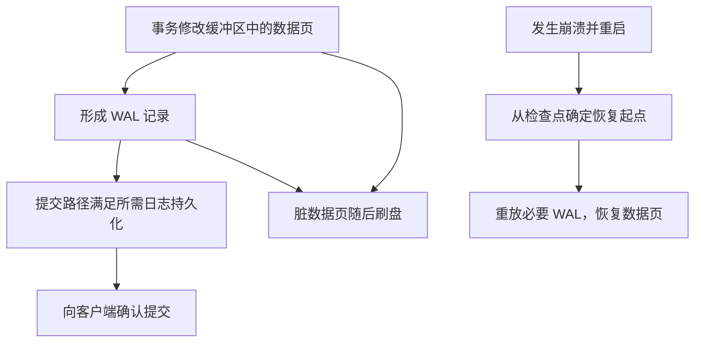

# GORM 与 PostgreSQL：从 Go 数据访问到数据库内部机制

> 本讲围绕 GORM 的数据访问实践与 PostgreSQL 的内部机制展开，并通过代码和 SQL 实验连接应用层与数据库层。  
> 整理日期：2026-10-21（UTC）。Go 示例采用 Go 1.27.3 工具链；GORM 固定为 v1.31.1，SQLite 驱动固定为 v1.6.0。PostgreSQL 机制依据版本 18 官方手册。本文使用原创示例数据，不复制第三方教程正文。

<a id="section-001"></a>

> **统一运行基线：** 建议使用 Go 1.27.3，示例模块声明采用 `go 1.27.0`。文中出现其他 Go 版本时，仅用于说明特性引入时间或历史实现差异；第三方依赖仍以对应模块的版本要求为准。


*图示：Go 数据访问链路。*

## 正文导航

  - [本讲的业务主线与运行条件](#section-004)
- [一、GORM 数据库编程](#section-005)
  - [1.1 什么是 GORM](#section-006)
  - [1.2 安装 GORM](#section-007)
  - [1.3 连接数据库](#section-008)
  - [1.4 定义 model](#section-009)
  - [1.5 使用 gorm.Model](#section-010)
  - [1.6 将 User 和 Address 生成为数据库表](#section-011)
  - [1.7 通过 SQL 文件生成数据库](#section-012)
  - [1.8 创建数据](#section-013)
  - [1.9 查询数据](#section-014)
    - [1.9.1 根据主键查询](#section-015)
    - [1.9.2 查询第一条](#section-016)
    - [1.9.3 查询最后一条](#section-017)
    - [1.9.4 查询全部](#section-018)
    - [1.9.5 按照条件查询](#section-019)
  - [1.10 更新数据](#section-020)
  - [1.11 删除数据](#section-021)
  - [1.12 查询：投影、聚合与结果映射](#section-022)
  - [1.13 用 tag 约束字段：映射、约束和输入校验要分开](#section-023)
  - [1.14 自定义表名](#section-024)
  - [1.15 事务：把一组操作作为业务单位](#section-025)
  - [1.16 分页查询](#section-026)
  - [1.17 排序](#section-027)
  - [1.18 关联查询关系](#section-028)
    - [1.18.1 一对多](#section-029)
    - [1.18.2 一对一](#section-030)
    - [1.18.3 多对多](#section-031)
  - [1.19 执行原生 SQL](#section-032)
  - [1.20 常见错误处理：未找到、约束、取消与不确定结果](#section-033)
  - [1.21 索引和性能优化](#section-034)
  - [1.22 GORM 部分总结](#section-037)
- [二、PostgreSQL 数据库基础与内部机制](#section-038)
  - [2.1 PostgreSQL 是什么](#section-039)
  - [2.2 关系型数据库基础](#section-040)
  - [2.3 PostgreSQL 常见数据类型](#section-041)
    - [2.3.1 数字类型](#section-042)
    - [2.3.2 字符串类型](#section-043)
    - [2.3.3 时间类型](#section-044)
    - [2.3.4 布尔类型](#section-045)
    - [2.3.5 JSON 与 JSONB](#section-046)
    - [2.3.6 数组类型](#section-047)
  - [2.4 PostgreSQL 表设计基础](#section-048)
    - [2.4.1 主键](#section-049)
    - [2.4.2 唯一约束](#section-050)
    - [2.4.3 非空约束](#section-051)
    - [2.4.4 默认值](#section-052)
    - [2.4.5 外键](#section-053)
  - [2.5 SQL 基础](#section-054)
    - [2.5.1 查询](#section-055)
    - [2.5.2 WHERE 条件](#section-056)
    - [2.5.3 排序](#section-057)
    - [2.5.4 分页](#section-058)
    - [2.5.5 使用聚合函数](#section-059)
    - [2.5.6 分组统计](#section-060)
    - [2.5.7 聚合函数及边界](#section-061)
    - [2.5.8 JOIN 关联查询](#section-062)
  - [2.6 数据库索引](#section-063)
    - [2.6.1 索引的基本介绍](#section-064)
    - [2.6.2 为什么索引能加快查询的效率](#section-065)
    - [2.6.3 PostgreSQL 常见索引类型](#section-066)
      - [2.6.3.1 B-tree 索引](#section-067)
      - [2.6.3.2 唯一索引](#section-068)
      - [2.6.3.3 联合索引](#section-069)
      - [2.6.3.4 部分索引](#section-070)
      - [2.6.3.5 表达式索引](#section-071)
      - [2.6.3.6 GIN 索引](#section-072)
      - [2.6.3.7 BRIN 索引](#section-073)
    - [2.6.4 索引不是越多越好](#section-074)
      - [2.6.4.1 占用磁盘空间](#section-075)
      - [2.6.4.2 降低写入性能](#section-076)
      - [2.6.4.3 索引设计原则](#section-077)
    - [2.6.5 如何判断 SQL 是否走索引](#section-078)
  - [2.7 数据库事务](#section-079)
    - [2.7.1 事务的 ACID](#section-080)
      - [2.7.1.1 原子性 Atomicity](#section-081)
      - [2.7.1.2 一致性 Consistency](#section-082)
      - [2.7.1.3 隔离性 Isolation](#section-083)
      - [2.7.1.4 持久性 Durability](#section-084)
    - [2.7.2 事务的基本语法](#section-085)
    - [2.7.3 事务并发会产生什么问题](#section-086)
      - [2.7.3.1 脏读](#section-087)
      - [2.7.3.2 幻读](#section-088)
      - [2.7.3.3 不可重复读](#section-089)
      - [2.7.3.4 丢失更新](#section-090)
    - [2.7.4 事务隔离级别](#section-091)
      - [2.7.4.1 Read Committed](#section-092)
      - [2.7.4.2 Repeatable Read](#section-093)
      - [2.7.4.3 Serializable](#section-094)
  - [2.8 PostgreSQL 的 MVCC](#section-095)
  - [2.9 行级锁：数据版本与写入冲突怎样协调](#section-096)
  - [2.10 PostgreSQL 的 UPDATE 底层发生了什么](#section-097)
    - [2.10.1 VACUUM 是什么](#section-098)
  - [2.11 PostgreSQL 的 WAL 日志](#section-099)
    - [2.11.1 为什么需要 WAL](#section-100)
    - [2.11.2 WAL 的作用](#section-101)
    - [2.11.3 WAL 的底层原理](#section-102)
  - [2.12 PostgreSQL 底层数据存储架构](#section-103)
  - [2.13 PostgreSQL 查询执行流程](#section-104)
  - [2.14 为什么有索引也不一定走索引](#section-105)
  - [2.15 Buffer Cache 缓存机制](#section-106)
  - [2.16 Checkpoint 检查点](#section-107)
  - [2.17 PostgreSQL 的锁](#section-108)
    - [2.17.1 SELECT FOR UPDATE](#section-109)
    - [2.17.2 NOWAIT](#section-110)
    - [2.17.3 SKIP LOCKED](#section-111)
    - [2.17.4 死锁是什么](#section-112)
  - [2.18 PostgreSQL 常见性能优化](#section-113)
    - [2.18.1 合理建索引](#section-114)
    - [2.18.2 避免 SELECT *](#section-115)
    - [2.18.3 避免大 OFFSET](#section-116)
    - [2.18.4 批量插入](#section-117)
  - [2.19 大表分区](#section-118)
    - [2.19.1 定期 VACUUM 与 ANALYZE](#section-119)
  - [2.20 PostgreSQL 核心机制总结](#section-120)
  - [3.1 PostgreSQL 和 MySQL 有什么区别](#section-122)
  - [3.2 为什么 PostgreSQL 的 UPDATE 会产生新的行版本](#section-123)
  - [3.3 为什么索引不是越多越好](#section-124)
  - [3.4 什么是 MVCC](#section-125)
  - [3.5 什么是 WAL](#section-126)
  - [3.6 为什么索引“失效”](#section-127)
- [四、作业与复习问答](#section-128)
  - [4.1 综合作业：调用方、地址与订单](#section-129)
  - [4.2 二十六道复习题及参考答案](#section-130)
- [五、实验复现与来源导航](#section-157)
  - [5.1 怎样运行 Go 示例](#section-158)
  - [5.2 怎样运行 PostgreSQL 示例](#section-159)
  - [5.3 按问题查官方资料](#section-160)

<a id="section-005"></a>

## 一、GORM 数据库编程

<a id="section-006"></a>

### 1.1 什么是 GORM

手写 SQL 时，程序需要决定查询字符串、传入参数、检查错误，再把每一列扫描进 Go 变量。GORM 可以从模型结构、查询条件和目标对象生成常见 SQL，并完成结果映射。它降低的是机械映射成本；业务上是否允许扣款、是否应该锁行、两个操作是否必须同时成功，仍由业务代码决定。

例如 `db.Where("age >= ?", 18).Find(&users)` 包含四层意思：`User` 模型决定表和字段映射；`age >= ?` 是查询结构；18 作为参数绑定；`&users` 是结果写入位置。数据库不会执行“Go 的 Where 方法”，它收到的仍是驱动提交的 SQL 与参数。理解这一点，才能在慢查询时追到真正的语句。

GORM v2 项目的 Go 模块路径是 `gorm.io/gorm`，模块版本号仍可能是 `v1.x`；不要把“GORM v2”直接翻译成导入路径必须带 `/v2`。官方从 v1.30.0 开始加入泛型 API，传统链式 API 仍存在。本书主要使用传统 API，最后补充泛型写法，方便阅读目前大量工程代码。[官方 v2 说明](https://gorm.io/docs/v2_release_note.html)、[泛型 API](https://gorm.io/docs/the_generics_way.html)。

<a id="section-007"></a>

### 1.2 安装 GORM

安装的实质是给 Go 模块添加 ORM 与数据库驱动两组依赖。前者提供 `Create`、`Where`、`Transaction` 等统一能力；后者负责所选数据库的 SQL 方言及连接适配。只安装 GORM 本体不会自动安装 PostgreSQL 服务，也不会自动创建业务数据库。

在已有模块里可执行：

```sh
go get gorm.io/gorm@v1.31.1
go get gorm.io/driver/sqlite@v1.6.0
go mod tidy
```

`go.mod` 表达直接依赖和最低 Go 语言要求，`go.sum` 用于校验下载的模块内容。提交工程时通常保留这两个文件。不要在代码例子中写“随意安装最新版本”后又承诺输出永久一致；依赖升级可能改变 SQL、默认值处理或错误映射。需要 PostgreSQL 时按官方连接文档选择并固定相应驱动版本。

首次遇到 `gorm.Open`，要把它看作初始化数据访问入口；`db.AutoMigrate` 是依据模型执行迁移检查；`db.Create` 才是插入数据。几个方法在生命周期里的作用不同，不能在每个 HTTP 请求里重复连接和迁移。[官方快速开始](https://gorm.io/docs/)、[Go 模块管理](https://go.dev/doc/modules/managing-dependencies)。

<a id="section-008"></a>

### 1.3 连接数据库

`*gorm.DB` 不是“一根专属于当前请求的 TCP 连接”。常见配置下，它建立在 `database/sql` 的连接池之上，查询时获取连接，用完归还。应用通常在启动时创建共享入口，在停机时关闭底层池；事务则在自己的生命周期内占用相应连接。频繁创建池会造成连接数膨胀，随意关闭共享池会影响其他请求。[GORM 通用数据库接口](https://gorm.io/docs/generic_interface.html)、[Go 连接管理](https://go.dev/doc/database/manage-connections)。

下面先把“建表—写入—读取”完整走一遍。每个示例只使用一个连接，避免 SQLite 的 `:memory:` 在不同连接上形成不同数据库；这是内存实验的设置，不能推成生产连接池都只能有一个连接。

```go
// 运行示例：DB-01
package main

import (
	"fmt"

	"gorm.io/driver/sqlite"
	"gorm.io/gorm"
	"gorm.io/gorm/logger"
)

type User struct {
	ID   uint
	Name string
}

func must(err error) {
	if err != nil {
		panic(err)
	}
}

func main() {
	db, err := gorm.Open(sqlite.Open(":memory:"), &gorm.Config{
		Logger: logger.Default.LogMode(logger.Silent),
	})
	must(err)
	pool, err := db.DB()
	must(err)
	pool.SetMaxOpenConns(1)
	defer pool.Close()

	must(db.AutoMigrate(&User{}))
	user := User{Name: "Ada"}
	result := db.Create(&user)
	must(result.Error)
	fmt.Println("inserted:", result.RowsAffected, "id:", user.ID)

	var found User
	must(db.First(&found, user.ID).Error)
	fmt.Println("loaded:", found.ID, found.Name)
}
```

输出：

```text
inserted: 1 id: 1
loaded: 1 Ada
```

`Create(&user)` 接收指针，不只是为了读取字段，还可能回填数据库生成的主键。`RowsAffected` 表示这次操作影响或读取的行数，不等于“整个数据库有多少条数据”。每次检查 `Error` 后再使用输出，能避免拿到零值却误以为查询成功。

生产连接配置应该从明确的配置来源取得。数据库口令不应硬编码在示例仓库里，也不要把完整 DSN 打进日志。连接池的 `SetMaxOpenConns` 是应用的并发资源上限之一：若一个实例设为 30，运行 20 个实例，仅这一业务就可能产生约 600 条连接预算，还未算管理连接。是否合适取决于数据库容量与查询时长。

<a id="section-009"></a>

### 1.4 定义 model

Model 是 Go 数据结构与数据库结构之间的映射描述。一个字段至少同时面对三个问题：Go 里用什么类型，数据库列是否允许 NULL，缺少输入时怎样与零值区分。例如名字为空字符串和数据库 NULL 是两种状态；余额 0 和未提供余额也可能是两种请求含义。只有定义清楚，更新接口才不会把“省略”误当“清零”。

普通导出字段可以被映射，未导出字段通常被忽略。字段名称默认转换为蛇形命名，表名默认由结构体名按命名策略生成；默认约定有助于快速开始，但已有数据库必须主动核对列名和类型。Go 的 `uint` 不意味着 PostgreSQL 原生提供同样范围的无符号整数，跨数据库类型不能只看 Go 字段名。[官方模型文档](https://gorm.io/docs/models.html)、[命名约定](https://gorm.io/docs/conventions.html)。

下面使用 `sql.NullString` 区分“没有邮箱”与“邮箱是空字符串”。`Valid` 为 false 表示数据库 NULL，不能只检查 `String == ""`。

```go
// 运行示例：DB-02
package main

import (
	"database/sql"
	"fmt"

	"gorm.io/driver/sqlite"
	"gorm.io/gorm"
	"gorm.io/gorm/logger"
)

type Contact struct {
	ID    uint
	Name  string
	Email sql.NullString
}

func must(err error) {
	if err != nil {
		panic(err)
	}
}

func main() {
	db, err := gorm.Open(sqlite.Open(":memory:"), &gorm.Config{
		Logger: logger.Default.LogMode(logger.Silent),
	})
	must(err)
	pool, err := db.DB()
	must(err)
	pool.SetMaxOpenConns(1)
	defer pool.Close()
	must(db.AutoMigrate(&Contact{}))

	must(db.Create(&[]Contact{
		{Name: "missing"},
		{Name: "empty", Email: sql.NullString{String: "", Valid: true}},
	}).Error)
	var contacts []Contact
	must(db.Order("id").Find(&contacts).Error)
	for _, c := range contacts {
		fmt.Printf("%s valid=%v value=%q\n", c.Name, c.Email.Valid, c.Email.String)
	}
}
```

输出：

```text
missing valid=false value=""
empty valid=true value=""
```

这也说明 API 请求模型与数据库模型不一定应该共用一个结构体。PATCH 请求可能用 `*string` 表示“字段是否出现”，数据库模型则可能使用 `sql.NullString` 表示存储的 NULL。先把请求解释为明确业务变更，再构造更新字段，通常比把请求体直接覆盖数据库 Model 更可靠。

<a id="section-010"></a>

### 1.5 使用 gorm.Model

`gorm.Model` 包含主键、创建时间、更新时间和软删除字段。嵌入它可以复用这组约定，但不是所有表都需要它：已有表的主键可能是 UUID，审计时间可能由数据库生成，某些日志表可能只追加而不软删除。选择字段来自业务语义，不来自“官方有这个结构就必须嵌入”。

软删除把行标记为删除状态，默认查询过滤这类行；数据仍在存储中。它与 PostgreSQL MVCC 产生旧行版本是两种不同机制：前者是应用可见的逻辑删除策略，后者是数据库并发与版本可见性机制。物理删除一行后，PostgreSQL 也不一定马上回收磁盘空间。[官方模型](https://gorm.io/docs/models.html)、[删除与软删除](https://gorm.io/docs/delete.html)。

```go
// 运行示例：DB-03
package main

import (
	"fmt"

	"gorm.io/driver/sqlite"
	"gorm.io/gorm"
	"gorm.io/gorm/logger"
)

type Note struct {
	gorm.Model
	Title string
}

func must(err error) {
	if err != nil {
		panic(err)
	}
}

func main() {
	db, err := gorm.Open(sqlite.Open(":memory:"), &gorm.Config{
		Logger: logger.Default.LogMode(logger.Silent),
	})
	must(err)
	pool, err := db.DB()
	must(err)
	pool.SetMaxOpenConns(1)
	defer pool.Close()
	must(db.AutoMigrate(&Note{}))
	note := Note{Title: "draft"}
	must(db.Create(&note).Error)
	fmt.Println("timestamps:", !note.CreatedAt.IsZero(), !note.UpdatedAt.IsZero())

	must(db.Delete(&note).Error)
	var visible, all int64
	must(db.Model(&Note{}).Count(&visible).Error)
	must(db.Unscoped().Model(&Note{}).Count(&all).Error)
	fmt.Println("visible:", visible, "physical rows:", all)
}
```

输出：

```text
timestamps: true true
visible: 0 physical rows: 1
```

默认过滤并不替代权限控制。能调用 `Unscoped` 的代码可以读到软删除数据；原生 SQL 也不会自动理解每个 ORM 模型的业务过滤条件。如果唯一邮箱要求删除后允许重新注册，要同时设计唯一约束和软删除策略，不能只依赖查询“不显示旧调用方”。

<a id="section-011"></a>

### 1.6 将 User 和 Address 生成为数据库表

`AutoMigrate` 会依据模型检查并创建缺少的表、列、索引及部分约束，必要时处理支持的结构调整。它不等于一个理解业务历史的迁移系统。重命名字段可能被理解为新列；删除字段也不应直接推断会安全删除旧列；新增非空列还可能需要历史数据回填。[官方迁移](https://gorm.io/docs/migration.html)。

设定 `User` 与 `Address` 时，`UserID` 是地址所属调用方的外键值，`Addresses` 表达关联。在数据库里，不是把一个 Go 切片原样塞进调用方行，而是调用方表和地址表分别存行，通过键关联。下面只展示建表和显式插入，避免第一次就混入关联自动保存的细节。

```go
// 运行示例：DB-04
package main

import (
	"fmt"

	"gorm.io/driver/sqlite"
	"gorm.io/gorm"
	"gorm.io/gorm/logger"
)

type User struct {
	ID        uint
	Name      string
	Addresses []Address
}
type Address struct {
	ID     uint
	UserID uint
	City   string
}

func must(err error) {
	if err != nil {
		panic(err)
	}
}

func main() {
	db, err := gorm.Open(sqlite.Open(":memory:"), &gorm.Config{
		Logger: logger.Default.LogMode(logger.Silent),
	})
	must(err)
	pool, err := db.DB()
	must(err)
	pool.SetMaxOpenConns(1)
	defer pool.Close()
	must(db.AutoMigrate(&User{}, &Address{}))
	user := User{Name: "Lin"}
	must(db.Create(&user).Error)
	must(db.Create(&[]Address{
		{UserID: user.ID, City: "Shanghai"},
		{UserID: user.ID, City: "Singapore"},
	}).Error)

	var loaded User
	must(db.Preload("Addresses", func(q *gorm.DB) *gorm.DB {
		return q.Order("id")
	}).First(&loaded, user.ID).Error)
	fmt.Println(loaded.Name, len(loaded.Addresses))
	for _, address := range loaded.Addresses {
		fmt.Println(address.City)
	}
}
```

输出：

```text
Lin 2
Shanghai
Singapore
```

`Preload` 通常以额外查询获取关联，不应误认为必然生成一条 JOIN。它让调用者表达“我需要这组关联”，但查询数量、传输量和排序仍需检查。若一次加载一万个调用方及每人上千个地址，少写代码不代表少用内存。

实际迁移流程宜包含：给迁移编号，先检查已有数据，再执行扩展结构，分批回填，验证业务读写，最后收紧约束或删除旧结构。某些 DDL 会取得较强锁，线上迁移需要了解数据库行为。开发环境的自动迁移与生产发布不是同一层决策。

<a id="section-012"></a>

### 1.7 通过 SQL 文件生成数据库

SQL 文件适合明确记录数据库结构及种子数据，尤其是约束、表达式索引、扩展或数据库特有能力较多时。它与 ORM 模型各有职责：SQL 迁移是数据库结构的发布记录，Go 模型是程序使用该结构的映射。需要规定谁是结构变化的权威来源，避免两套机制相互覆盖。

下面是独立 PostgreSQL 实验 **SQL-01**，应在专用学习数据库运行。使用独立 schema，事务失败时整组普通 DDL 和插入回滚；示例不会要求删除现有调用方数据。

```sql
-- SQL-01：建立账户与地址实验结构
BEGIN;
CREATE SCHEMA IF NOT EXISTS go_notes;
CREATE TABLE IF NOT EXISTS go_notes.users (
    id bigint GENERATED ALWAYS AS IDENTITY PRIMARY KEY,
    name text NOT NULL,
    email text UNIQUE,
    active boolean NOT NULL DEFAULT true
);
CREATE TABLE IF NOT EXISTS go_notes.addresses (
    id bigint GENERATED ALWAYS AS IDENTITY PRIMARY KEY,
    user_id bigint NOT NULL REFERENCES go_notes.users(id),
    city text NOT NULL,
    street text NOT NULL DEFAULT ''
);
COMMIT;
SELECT table_name
FROM information_schema.tables
WHERE table_schema = 'go_notes'
ORDER BY table_name;
```

预期最后查询返回 `addresses`、`users` 两个表名。可用 `psql -v ON_ERROR_STOP=1 -d learning -f 001_init.sql` 执行；连接账号、TLS 和权限按自己的环境配置。`IF NOT EXISTS` 只能避免同名对象已存在时报错，不会验证旧表结构恰好与新定义一致，也不能代替迁移版本管理。[CREATE TABLE](https://www.postgresql.org/docs/18/sql-createtable.html)、[psql](https://www.postgresql.org/docs/18/app-psql.html)。

把任意 SQL 文件按分号切割后循环 `Exec` 并不通用：函数体、字符串和注释中也可能出现分号。简单讲解文件可以由数据库客户端直接处理，工程迁移使用明确支持相应数据库语法的工具与发布流程。

<a id="section-013"></a>

### 1.8 创建数据

创建记录时要理解“哪些字段写入、哪些字段由数据库或 ORM 产生、结果写回哪里”。`Create` 可以批量插入；批大小影响单条 SQL 长度、网络往返、事务时长与内存。批量不是无条件越大越好。若一次导入一百万条记录，应考虑切批、失败位置、唯一冲突和可重试性。

下例插入三条记录，观察回填 ID。代码先检查错误再打印，因此不会把失败插入对象的零值 ID 当成数据库真实结果。[官方 Create](https://gorm.io/docs/create.html)。

```go
// 运行示例：DB-05
package main

import (
	"fmt"

	"gorm.io/driver/sqlite"
	"gorm.io/gorm"
	"gorm.io/gorm/logger"
)

type Item struct {
	ID   uint
	Name string
}

func must(err error) {
	if err != nil {
		panic(err)
	}
}

func main() {
	db, err := gorm.Open(sqlite.Open(":memory:"), &gorm.Config{
		Logger: logger.Default.LogMode(logger.Silent),
	})
	must(err)
	pool, err := db.DB()
	must(err)
	pool.SetMaxOpenConns(1)
	defer pool.Close()
	must(db.AutoMigrate(&Item{}))
	items := []Item{{Name: "A"}, {Name: "B"}, {Name: "C"}}
	result := db.CreateInBatches(&items, 2)
	must(result.Error)
	fmt.Println("rows:", result.RowsAffected)
	for _, item := range items {
		fmt.Println(item.ID, item.Name)
	}
}
```

输出：

```text
rows: 3
1 A
2 B
3 C
```

如果业务要求“相同请求只产生一张订单”，唯一主键自增并不能提供这个保证。每次重试都可以拿到一个新 ID，形成重复订单。应设计业务唯一键或幂等键，并明确冲突时返回原结果还是拒绝请求。`OnConflict` 能帮助表达数据库冲突处理，但不能替开发者定义什么才算同一业务操作。

<a id="section-014"></a>

### 1.9 查询数据

查询的结果至少有三个维度：是否发生数据库错误，匹配了多少行，以及这些行的顺序。不能把空结果都当异常，也不能把没有 `ORDER BY` 的第一条当成“最早创建的记录”。GORM 的单对象查询与集合查询对“未找到”的处理不同，应选择符合业务契约的形式。[官方 Query](https://gorm.io/docs/query.html)。

<a id="section-015"></a>

#### 1.9.1 根据主键查询

`db.First(&user, id)` 适用于已确认类型的数值主键。若 ID 来自 HTTP 文本，先解析成期望的整数类型；不要把任意输入字符串直接当内联条件传入。查询还可能受软删除、租户或其他条件影响，“这张表有这个 ID”不等于当前条件一定读得到它。

<a id="section-016"></a>

#### 1.9.2 查询第一条

`First` 默认按主键排序并限制一条。业务上的“最早”“金额最小”“最优先”需要写清排序字段；主键顺序只是框架的默认选择。若已有自定义排序，应核对是否又追加主键排序，避免把结果解释成别的规则。

<a id="section-017"></a>

#### 1.9.3 查询最后一条

`Last` 按主键倒序取一条。主键不一定与提交时间严格一致，自增值可能有空洞，并发事务也可能较晚分配的 ID 较早提交。因此“最后一个 ID”不是通用的最后提交事务位置。

<a id="section-018"></a>

#### 1.9.4 查询全部

`Find(&slice)` 适合读取集合，未找到时通常是空集合而不是 `ErrRecordNotFound`。大表不宜不加范围全部读进内存；可分页、游标或分批处理。若只需要一行，却 `Find` 到一个结构体而不设限制，可能读取不必要的数据并造成结果含义不清。

<a id="section-019"></a>

#### 1.9.5 按照条件查询

参数化条件将 SQL 结构与调用方数据分离。结构体条件默认常忽略零值，因此查询 `active=false`、`age=0` 等情况时，宜使用明确 SQL 条件或 Map。下面用一个程序观察这些差异。

```go
// 运行示例：DB-06
package main

import (
	"errors"
	"fmt"

	"gorm.io/driver/sqlite"
	"gorm.io/gorm"
	"gorm.io/gorm/logger"
)

type User struct {
	ID     uint
	Name   string
	Active bool
}

func must(err error) {
	if err != nil {
		panic(err)
	}
}

func main() {
	db, err := gorm.Open(sqlite.Open(":memory:"), &gorm.Config{
		Logger: logger.Default.LogMode(logger.Silent),
	})
	must(err)
	pool, err := db.DB()
	must(err)
	pool.SetMaxOpenConns(1)
	defer pool.Close()
	must(db.AutoMigrate(&User{}))
	must(db.Create(&[]User{
		{Name: "Ada", Active: true},
		{Name: "Bo", Active: false},
	}).Error)
	var first, last, byID User
	must(db.First(&first).Error)
	must(db.Last(&last).Error)
	must(db.First(&byID, uint(2)).Error)
	fmt.Println("first/last/id:", first.Name, last.Name, byID.Name)

	var inactive []User
	must(db.Where(map[string]any{"active": false}).Order("id").Find(&inactive).Error)
	fmt.Println("inactive:", len(inactive), inactive[0].Name)

	var missing User
	err = db.First(&missing, uint(99)).Error
	fmt.Println("single missing:", errors.Is(err, gorm.ErrRecordNotFound))
	var none []User
	result := db.Where("id > ?", 99).Find(&none)
	fmt.Println("collection:", len(none), result.Error == nil)
}
```

输出：

```text
first/last/id: Ada Bo Bo
inactive: 1 Bo
single missing: true
collection: 0 true
```

还有一个常见问题是复用带主键的查询目标。若 `user.ID` 已经有旧值，再把它作为 `First` 的目标，框架可能同时加入该主键条件。查询另一条记录前，使用新的零值目标更清楚。链式语句对象也不宜在多个不相关请求间携带上一次条件；共享初始连接入口，再为每次请求建立自己的查询会话。[Session](https://gorm.io/docs/session.html)、[Method Chaining](https://gorm.io/docs/method_chaining.html)。

<a id="section-020"></a>

### 1.10 更新数据

更新必须先回答“只改指定字段，还是把整个对象保存回去”。`Update` 更新一列；`Updates(struct)` 默认通常跳过零值字段；`Updates(map)` 会包含 Map 中明确出现的零值；`Select` 可以指定结构体中需要更新的列。传统 API 的 `Save` 还有“更新不到则创建”的行为，不应在只允许修改现有记录的接口里不加区分地使用。[官方 Update](https://gorm.io/docs/update.html)。

```go
// 运行示例：DB-07
package main

import (
	"fmt"

	"gorm.io/driver/sqlite"
	"gorm.io/gorm"
	"gorm.io/gorm/logger"
)

type User struct {
	ID     uint
	Name   string
	Age    int
	Active bool
}

func must(err error) {
	if err != nil {
		panic(err)
	}
}

func main() {
	db, err := gorm.Open(sqlite.Open(":memory:"), &gorm.Config{
		Logger: logger.Default.LogMode(logger.Silent),
	})
	must(err)
	pool, err := db.DB()
	must(err)
	pool.SetMaxOpenConns(1)
	defer pool.Close()
	must(db.AutoMigrate(&User{}))
	user := User{Name: "Ada", Age: 20, Active: true}
	must(db.Create(&user).Error)

	must(db.Model(&user).Updates(User{Age: 0, Active: false}).Error)
	var first User
	must(db.First(&first, user.ID).Error)
	fmt.Println("struct update:", first.Age, first.Active)

	must(db.Model(&user).Updates(map[string]any{"age": 0, "active": false}).Error)
	var second User
	must(db.First(&second, user.ID).Error)
	fmt.Println("map update:", second.Age, second.Active)
}
```

输出：

```text
struct update: 20 true
map update: 0 false
```

这个例子不能简单总结为“GORM 不支持零值更新”；它支持，关键是表达方式。更深一层的问题是并发更新：先读出库存 10，在 Go 中减 1，再写回 9，两个请求可能都写 9，丢掉一次扣减。可以用一条条件更新 `stock = stock - 1 WHERE stock > 0`，检查影响行数；复杂不变量则需要事务、锁或版本条件。第二章会从 PostgreSQL 的版本与隔离进一步解释。

<a id="section-021"></a>

### 1.11 删除数据

删除接口需要明确逻辑删除、物理删除、关联对象和审计要求。若模型有 `gorm.DeletedAt`，通常走软删除；没有该字段时通常执行物理删除。`Unscoped` 改变默认软删除作用域，用于永久删除时应有明确业务授权，不能作为“查询不到就加上试试”的随手修复。

GORM 默认阻止没有条件的批量删除，返回 `ErrMissingWhereClause`。这是重要的误用防护，但它不验证条件是否正确：`WHERE id > 0` 仍可能删除全表。需要删除租户数据时，同时约束租户和资源标识，防止只依据外部传来的 ID。

```go
// 运行示例：DB-08
package main

import (
	"errors"
	"fmt"

	"gorm.io/driver/sqlite"
	"gorm.io/gorm"
	"gorm.io/gorm/logger"
)

type Item struct {
	ID   uint
	Name string
}

func must(err error) {
	if err != nil {
		panic(err)
	}
}

func main() {
	db, err := gorm.Open(sqlite.Open(":memory:"), &gorm.Config{
		Logger: logger.Default.LogMode(logger.Silent),
	})
	must(err)
	pool, err := db.DB()
	must(err)
	pool.SetMaxOpenConns(1)
	defer pool.Close()
	must(db.AutoMigrate(&Item{}))
	must(db.Create(&[]Item{{Name: "keep"}, {Name: "remove"}}).Error)

	err = db.Delete(&Item{}).Error
	fmt.Println("unbounded blocked:", errors.Is(err, gorm.ErrMissingWhereClause))
	result := db.Where("name = ?", "remove").Delete(&Item{})
	must(result.Error)
	var count int64
	must(db.Model(&Item{}).Count(&count).Error)
	fmt.Println("deleted:", result.RowsAffected, "remaining:", count)
}
```

输出：

```text
unbounded blocked: true
deleted: 1 remaining: 1
```

删除调用方后地址怎样处理，是外键与业务生命周期问题。可以禁止删除仍被引用的调用方，可以级联删除，或者保留订单等历史记录并匿名化个人信息。不要把 ORM 中关联字段消失与数据库中的关联记录真正删除混为一谈。[官方 Delete](https://gorm.io/docs/delete.html)、[Associations](https://gorm.io/docs/associations.html)。

<a id="section-022"></a>

### 1.12 查询：投影、聚合与结果映射

本章前面已介绍“查询”，本节进一步讲“读出怎样的结果”。业务可能只需要调用方名字或每个状态的订单总额，而不需要完整 Model。投影是选择少量列；聚合是把多行变成统计结果；它们会改变结果的形状，因此可定义专门的结果结构体，而不是假装每次都返回完整数据库实体。

下面把同一状态的订单金额相加。`Group` 决定分组键，`SUM` 计算每组金额，`Scan` 把别名 `total` 对应到结果字段 `Total`。代码中的列名和分组是开发者固定字符串，金额仍以整数分表示，避免把浮点近似混入金额语义。

```go
// 运行示例：DB-09
package main

import (
	"fmt"

	"gorm.io/driver/sqlite"
	"gorm.io/gorm"
	"gorm.io/gorm/logger"
)

type Order struct {
	ID     uint
	Status string
	Cents  int64
}
type Summary struct {
	Status string
	Total  int64
}

func must(err error) {
	if err != nil {
		panic(err)
	}
}

func main() {
	db, err := gorm.Open(sqlite.Open(":memory:"), &gorm.Config{
		Logger: logger.Default.LogMode(logger.Silent),
	})
	must(err)
	pool, err := db.DB()
	must(err)
	pool.SetMaxOpenConns(1)
	defer pool.Close()
	must(db.AutoMigrate(&Order{}))
	must(db.Create(&[]Order{
		{Status: "paid", Cents: 1200},
		{Status: "paid", Cents: 800},
		{Status: "pending", Cents: 500},
	}).Error)
	var summaries []Summary
	must(db.Model(&Order{}).
		Select("status, SUM(cents) AS total").
		Group("status").Order("status").Scan(&summaries).Error)
	for _, summary := range summaries {
		fmt.Println(summary.Status, summary.Total)
	}
}
```

输出：

```text
paid 2000
pending 500
```

`Select`、`Order`、`Group` 等通常接收 SQL 结构片段；它们不是任意调用方输入都会被自动转义的万能安全接口。调用方可以提供“按金额排序”的业务选项，但程序应把选项映射到受信任列名，而不是直接把请求字符串拼进 SQL。参数占位符主要解决数据值绑定，不能把表名、列名和任意表达式都当作普通值参数。[SQL Builder](https://gorm.io/docs/sql_builder.html)、[GORM Security](https://gorm.io/docs/security.html)。


<a id="section-023"></a>

### 1.13 用 tag 约束字段：映射、约束和输入校验要分开

结构体 tag 是附加给字段的元数据。`gorm:"column:email;uniqueIndex"` 描述数据库映射与索引意图，`json:"email"` 控制 JSON 字段名，某些 Web 校验 tag 由另一个工具解释。这几种 tag 不会因为写在同一个反引号里就自动具有相同作用。GORM 不会把所有任意 tag 都翻译成数据库约束。[模型字段标签](https://gorm.io/docs/models.html)、[约束](https://gorm.io/docs/constraints.html)、[索引](https://gorm.io/docs/indexes.html)。

把“邮箱不能为空”只放在 HTTP 层校验，数据库脚本或另一个服务仍可能插入空值；只放 `NOT NULL` 又只拒绝 NULL，通常不拒绝空字符串。若业务禁止空白邮箱，应同时确定输入规范化和数据库可表达的约束。数据库唯一约束还涉及大小写、排序规则和 NULL 语义，不能仅用字段上一个 `uniqueIndex` 就完成所有业务设计。

```go
// 运行示例：DB-10
package main

import (
	"errors"
	"fmt"

	"gorm.io/driver/sqlite"
	"gorm.io/gorm"
	"gorm.io/gorm/logger"
)

type Member struct {
	ID    uint
	Email string `gorm:"not null;uniqueIndex"`
	Memo  string `gorm:"-"`
}

func must(err error) {
	if err != nil {
		panic(err)
	}
}

func main() {
	db, err := gorm.Open(sqlite.Open(":memory:"), &gorm.Config{
		TranslateError: true,
		Logger:         logger.Default.LogMode(logger.Silent),
	})
	must(err)
	pool, err := db.DB()
	must(err)
	pool.SetMaxOpenConns(1)
	defer pool.Close()
	must(db.AutoMigrate(&Member{}))
	must(db.Create(&Member{Email: "ada@example.test", Memo: "not stored"}).Error)
	err = db.Create(&Member{Email: "ada@example.test"}).Error
	fmt.Println("duplicate:", errors.Is(err, gorm.ErrDuplicatedKey))
	fmt.Println("memo column:", db.Migrator().HasColumn(&Member{}, "Memo"))
}
```

输出：

```text
duplicate: true
memo column: false
```

`TranslateError` 把驱动的某些错误转换为统一错误种类，不是说所有数据库的所有错误都变成同一个跨库接口。需要 SQLSTATE、约束名称等细节时，应检查具体驱动的公开错误类型，并决定是否向上层暴露。生产程序还应区分错误分类与对调用方展示的信息：内部 SQL、表名和连接信息并不必然适合原样返回。

<a id="section-024"></a>

### 1.14 自定义表名

自定义表名用于对接已有数据库或明确命名规则。`TableName() string` 适合稳定表名；GORM 会缓存其结果，不能把它当成每次请求动态计算租户表名的回调。动态选择表应使用受控的 `Table` 或 scope，并对允许的表做固定映射。[命名约定](https://gorm.io/docs/conventions.html)。

```go
// 运行示例：DB-11
package main

import (
	"fmt"

	"gorm.io/driver/sqlite"
	"gorm.io/gorm"
	"gorm.io/gorm/logger"
)

type Account struct {
	ID   uint
	Name string `gorm:"column:display_name"`
}

func (Account) TableName() string { return "app_accounts" }

func must(err error) {
	if err != nil {
		panic(err)
	}
}

func main() {
	db, err := gorm.Open(sqlite.Open(":memory:"), &gorm.Config{
		Logger: logger.Default.LogMode(logger.Silent),
	})
	must(err)
	pool, err := db.DB()
	must(err)
	pool.SetMaxOpenConns(1)
	defer pool.Close()
	must(db.AutoMigrate(&Account{}))
	fmt.Println("table:", db.Migrator().HasTable("app_accounts"))
	fmt.Println("column:", db.Migrator().HasColumn(&Account{}, "display_name"))
	must(db.Create(&Account{Name: "Ada"}).Error)
	var name string
	must(db.Table("app_accounts").Select("display_name").Where("id = ?", 1).Scan(&name).Error)
	fmt.Println(name)
}
```

输出：

```text
table: true
column: true
Ada
```

动态表名会影响迁移、索引、SQL 计划与权限管理；“每个调用方一个表”通常不是默认答案。若真正需要租户隔离，应先比较共享表加租户键、独立 schema、独立数据库等方案，再选择相应模型。不要先用字符串拼接表名实现功能，再把隔离需求留到以后补。

<a id="section-025"></a>

### 1.15 事务：把一组操作作为业务单位

事务的边界来自业务不变量。转账要求甲扣款与乙加款一起成功；创建订单可能要求订单行与库存变化一起成功。单条 `Create` 的默认事务只能覆盖它自己的写入过程，不能自动把前后两条独立业务调用合成一个事务。外层必须显式说明整个操作组。[GORM Transactions](https://gorm.io/docs/transactions.html)。

`db.Transaction(func(tx *gorm.DB) error { ... })` 中，返回 nil 表示尝试提交，返回非 nil 表示回滚。闭包内部必须继续使用 `tx`；偷偷用外层 `db` 会把某些语句送到事务外，破坏开发者以为的原子性。下面在第二步故意拒绝操作，验证第一次插入也不会留下。

```go
// 运行示例：DB-12
package main

import (
	"errors"
	"fmt"

	"gorm.io/driver/sqlite"
	"gorm.io/gorm"
	"gorm.io/gorm/logger"
)

type Ledger struct {
	ID    uint
	Cents int
}

func must(err error) {
	if err != nil {
		panic(err)
	}
}

func main() {
	db, err := gorm.Open(sqlite.Open(":memory:"), &gorm.Config{
		Logger: logger.Default.LogMode(logger.Silent),
	})
	must(err)
	pool, err := db.DB()
	must(err)
	pool.SetMaxOpenConns(1)
	defer pool.Close()
	must(db.AutoMigrate(&Ledger{}))
	rejected := errors.New("business rule rejected")

	err = db.Transaction(func(tx *gorm.DB) error {
		if err := tx.Create(&Ledger{Cents: -100}).Error; err != nil {
			return err
		}
		return rejected
	})
	var count int64
	must(db.Model(&Ledger{}).Count(&count).Error)
	fmt.Println("rejected:", errors.Is(err, rejected), "rows:", count)

	must(db.Transaction(func(tx *gorm.DB) error {
		return tx.Create(&[]Ledger{{Cents: -100}, {Cents: 100}}).Error
	}))
	must(db.Model(&Ledger{}).Count(&count).Error)
	var total int64
	must(db.Model(&Ledger{}).Select("SUM(cents)").Scan(&total).Error)
	fmt.Println("committed rows:", count, "sum:", total)
}
```

输出：

```text
rejected: true rows: 0
committed rows: 2 sum: 0
```

数据库事务通常不能回滚已经发出的邮件、已经提交到其他服务的 HTTP 请求或已经写到外部对象存储的文件。把这些调用放进数据库事务只会让连接和锁占用更久，并不会自动产生跨系统事务。可把待发送事件与业务状态一起写入数据库，再由后台发送，配合唯一键与重试处理；这是额外协议，不能由一行 `Transaction` 获得。

回滚也不一定恢复所有外部可观察的数值。例如 PostgreSQL 序列取号通常不因事务回滚而把号码退回去，所以主键出现空洞不是数据库丢失已提交数据的证据。[PostgreSQL 事务隔离与序列说明](https://www.postgresql.org/docs/18/transaction-iso.html)。

<a id="section-026"></a>

### 1.16 分页查询

分页要确定稳定排序和翻页语义。`LIMIT 20 OFFSET 40` 表示跳过当前结果前 40 条再取 20 条；它不是长期保存的“第三页身份证”。查询期间有插入或删除时，下一页可能重复或漏掉记录。排序字段不唯一时，还需要追加唯一键打破并列，才能清楚地描述边界。

基于游标的分页把上次最后一个排序键带回来，例如 `id > lastID`。它适合按单调键向前浏览，避免大 OFFSET；但不能直接跳到任意页，也不等于获得整个浏览过程的一致快照。若按时间排序，应使用 `(created_at,id)` 这样的复合游标。

```go
// 运行示例：DB-13
package main

import (
	"fmt"

	"gorm.io/driver/sqlite"
	"gorm.io/gorm"
	"gorm.io/gorm/logger"
)

type Item struct {
	ID   uint
	Name string
}

func must(err error) {
	if err != nil {
		panic(err)
	}
}

func main() {
	db, err := gorm.Open(sqlite.Open(":memory:"), &gorm.Config{
		Logger: logger.Default.LogMode(logger.Silent),
	})
	must(err)
	pool, err := db.DB()
	must(err)
	pool.SetMaxOpenConns(1)
	defer pool.Close()
	must(db.AutoMigrate(&Item{}))
	must(db.Create(&[]Item{{Name: "A"}, {Name: "B"}, {Name: "C"}, {Name: "D"}}).Error)
	var page []Item
	must(db.Where("id > ?", 2).Order("id").Limit(2).Find(&page).Error)
	for _, item := range page {
		fmt.Println(item.ID, item.Name)
	}
	fmt.Println("next cursor:", page[len(page)-1].ID)
}
```

输出：

```text
3 C
4 D
next cursor: 4
```

示例已知有结果，所以取最后一项；真实接口必须先检查空页，不能无条件索引 `len(page)-1`。页面大小还应设上限，避免外部输入要求一次读一千万行。总条数 `COUNT(*)` 可能比当前页查询更贵，是否每次都返回总数是产品与性能之间的选择。[GORM Query](https://gorm.io/docs/query.html)、[PostgreSQL LIMIT/OFFSET](https://www.postgresql.org/docs/18/queries-limit.html)。

<a id="section-027"></a>

### 1.17 排序

数据库返回行的顺序只在有相应 `ORDER BY` 时受到保证。索引偶尔让输出看起来已经排序，不构成业务契约；换一个执行计划、并行扫描或数据布局后可能改变。排序字段可以来自调用方选择，但最终 SQL 结构必须由服务端确定。

```go
// 运行示例：DB-14
package main

import (
	"fmt"

	"gorm.io/driver/sqlite"
	"gorm.io/gorm"
	"gorm.io/gorm/logger"
)

type Product struct {
	ID    uint
	Name  string
	Cents int
}

func must(err error) {
	if err != nil {
		panic(err)
	}
}

func orderFor(option string) (string, bool) {
	allowed := map[string]string{
		"price_asc":  "cents ASC, id ASC",
		"price_desc": "cents DESC, id ASC",
	}
	order, ok := allowed[option]
	return order, ok
}

func main() {
	db, err := gorm.Open(sqlite.Open(":memory:"), &gorm.Config{
		Logger: logger.Default.LogMode(logger.Silent),
	})
	must(err)
	pool, err := db.DB()
	must(err)
	pool.SetMaxOpenConns(1)
	defer pool.Close()
	must(db.AutoMigrate(&Product{}))
	must(db.Create(&[]Product{
		{Name: "B", Cents: 200},
		{Name: "A", Cents: 100},
		{Name: "C", Cents: 100},
	}).Error)
	order, ok := orderFor("price_asc")
	if !ok {
		panic("invalid sort option")
	}
	var products []Product
	must(db.Order(order).Find(&products).Error)
	for _, product := range products {
		fmt.Println(product.Name, product.Cents)
	}
	_, ok = orderFor("name; arbitrary SQL")
	fmt.Println("unrecognized accepted:", ok)
}
```

输出：

```text
A 100
C 100
B 200
unrecognized accepted: false
```

这里 Map 的值都是程序固定内容，因此选择之后可以安全交给 `Order`。不能把调用方传入的排序文本作为 Map 的值原样保存，再声称“使用了 Map 所以安全”。白名单的作用是把有限业务选项映射到已知结构。[GORM Security](https://gorm.io/docs/security.html)、[PostgreSQL ORDER BY](https://www.postgresql.org/docs/18/queries-order.html)。

<a id="section-028"></a>

### 1.18 关联查询关系

关系不是“结构体里有个字段就自动把所有数据加载回来”。建模需要确定哪张表保存外键、外键是否可以为 NULL、删除父行时怎样处理、是否允许重复，以及一个请求到底需要加载多少关联。数据库约束负责拒绝不合法状态，ORM 关联描述帮助生成查询和写入，二者相关但不是一回事。

<a id="section-029"></a>

#### 1.18.1 一对多

一个调用方有多个地址，通常地址表保存 `user_id`。调用方行不需要为每个地址增加一个列。查询一批调用方后，`Preload("Addresses")` 可以获取相应地址集合；应明确关联排序，不能依赖数据库默认输出。循环中对每个调用方单独查地址会产生常见的 N+1 查询：一条查调用方，N 条分别查地址。

<a id="section-030"></a>

#### 1.18.2 一对一

调用方与资料卡可以用 `profile.user_id` 外键关联，并在该列上设唯一约束以限制每个调用方最多一张资料卡。只有 Go 字段写成单个 `Profile`，并不会自动构成所有可能写入路径都无法违反的一对一业务规则；必须核对生成的约束。还要决定允许调用方暂时没有资料卡吗，这决定关系是不是必需。

<a id="section-031"></a>

#### 1.18.3 多对多

调用方可以有多个角色，一个角色也可以属于多个调用方，需要连接表保存键对。连接表通常有组合唯一约束避免重复关系。删除某个调用方与角色之间的关联，通常只删除连接记录，不等于删除整个角色实体。对共享实体做级联删除尤其需要明确所有权。

下例把三种关系放在一个可运行程序中，但读取只取得当前需要的字段；每组关联均来自官方模型能力，业务名称为讲解组织。[Has Many](https://gorm.io/docs/has_many.html)、[Has One](https://gorm.io/docs/has_one.html)、[Many To Many](https://gorm.io/docs/many_to_many.html)、[Preload](https://gorm.io/docs/preload.html)。

```go
// 运行示例：DB-15
package main

import (
	"fmt"

	"gorm.io/driver/sqlite"
	"gorm.io/gorm"
	"gorm.io/gorm/logger"
)

type User struct {
	ID        uint
	Name      string
	Addresses []Address
	Profile   Profile
	Roles     []Role `gorm:"many2many:user_roles;"`
}
type Address struct {
	ID     uint
	UserID uint
	City   string
}
type Profile struct {
	ID     uint
	UserID uint `gorm:"uniqueIndex"`
	Bio    string
}
type Role struct {
	ID   uint
	Name string `gorm:"uniqueIndex"`
}

func must(err error) {
	if err != nil {
		panic(err)
	}
}

func main() {
	db, err := gorm.Open(sqlite.Open(":memory:"), &gorm.Config{
		Logger: logger.Default.LogMode(logger.Silent),
	})
	must(err)
	pool, err := db.DB()
	must(err)
	pool.SetMaxOpenConns(1)
	defer pool.Close()
	must(db.AutoMigrate(&User{}, &Address{}, &Profile{}, &Role{}))
	user := User{
		Name:      "Ada",
		Addresses: []Address{{City: "Paris"}, {City: "Rome"}},
		Profile:   Profile{Bio: "Go learner"},
		Roles:     []Role{{Name: "reader"}, {Name: "writer"}},
	}
	must(db.Create(&user).Error)
	var loaded User
	must(db.Preload("Addresses").
		Preload("Profile").
		Preload("Roles", func(q *gorm.DB) *gorm.DB { return q.Order("name") }).
		First(&loaded, user.ID).Error)
	fmt.Println(loaded.Name, "addresses:", len(loaded.Addresses))
	fmt.Println("profile:", loaded.Profile.Bio)
	for _, role := range loaded.Roles {
		fmt.Println("role:", role.Name)
	}
}
```

输出：

```text
Ada addresses: 2
profile: Go learner
role: reader
role: writer
```

关联自动保存会触发多条 SQL。生产请求应估计 SQL 数量、批大小和事务范围，并检查现有角色的唯一键冲突。不能把整个调用方对象从前端接回来后无条件完整保存所有嵌套角色，否则可能把关联编辑权限、实体编辑权限和默认覆盖行为混在一起。

<a id="section-032"></a>

### 1.19 执行原生 SQL

当报表、复杂窗口计算或数据库特有能力用 SQL 表达更自然时，可以在 GORM 中使用原生 SQL。`Raw(...).Scan(...)` 用于读取，`Exec(...)` 用于不需要映射结果集的语句。写原生 SQL 不是“放弃 ORM”，它只是选择更直接表达某一条查询；连接管理、上下文和事务入口仍可以共用。[SQL Builder](https://gorm.io/docs/sql_builder.html)。

```go
// 运行示例：DB-16
package main

import (
	"fmt"

	"gorm.io/driver/sqlite"
	"gorm.io/gorm"
	"gorm.io/gorm/logger"
)

type Stock struct {
	ID       uint
	Quantity int
}

func must(err error) {
	if err != nil {
		panic(err)
	}
}

func main() {
	db, err := gorm.Open(sqlite.Open(":memory:"), &gorm.Config{
		Logger: logger.Default.LogMode(logger.Silent),
	})
	must(err)
	pool, err := db.DB()
	must(err)
	pool.SetMaxOpenConns(1)
	defer pool.Close()
	must(db.AutoMigrate(&Stock{}))
	must(db.Create(&Stock{Quantity: 1}).Error)
	first := db.Exec("UPDATE stocks SET quantity = quantity - ? WHERE id = ? AND quantity >= ?", 1, 1, 1)
	must(first.Error)
	second := db.Exec("UPDATE stocks SET quantity = quantity - ? WHERE id = ? AND quantity >= ?", 1, 1, 1)
	must(second.Error)
	var quantity int
	must(db.Raw("SELECT quantity FROM stocks WHERE id = ?", 1).Scan(&quantity).Error)
	fmt.Println("affected:", first.RowsAffected, second.RowsAffected)
	fmt.Println("quantity:", quantity)
}
```

输出：

```text
affected: 1 0
quantity: 0
```

条件与扣减在同一条语句里表达，避免在应用端先查后减形成明显竞态。第二次影响 0 行仍可能是正常业务失败：库存不足，也可能是 ID 不存在；如果调用者需要区分，必须另外定义查询与响应语义。不要看到 `Error == nil` 就认定扣减一定发生。

参数化也不是所有 SQL 结构都自动安全。`gorm.Expr` 中的表达式结构必须可信，参数位置放实际数据；日志打印出来的 SQL 可能是供人阅读的近似展示，不能当成已完整转义、可安全重新执行的脚本。[Security](https://gorm.io/docs/security.html)。

<a id="section-033"></a>

### 1.20 常见错误处理：未找到、约束、取消与不确定结果

把错误分成业务预期与基础设施异常，有助于选择正确控制流。未找到调用方可以转成资源不存在；唯一键冲突可以转成重复请求或重复字段；连接断开和超时则不一定说明事务绝对没有提交。尤其是提交后返回路径丢失时，客户端无法只凭超时判断数据库是否已生效，重试写操作需要幂等设计。

上下文 `context.Context` 把请求截止时间和取消信号传给数据库操作。它不是一个“数据库立刻停止且一定回滚”的魔法开关；驱动与数据库必须配合处理，取消之后仍应正确结束事务并释放连接。下面用已取消上下文展示错误识别，而不是靠不稳定的睡眠时间让一次查询碰巧超时。[GORM Context](https://gorm.io/docs/context.html)、[Go 取消数据库操作](https://go.dev/doc/database/cancel-operations)。

```go
// 运行示例：DB-17
package main

import (
	"context"
	"errors"
	"fmt"

	"gorm.io/driver/sqlite"
	"gorm.io/gorm"
	"gorm.io/gorm/logger"
)

type User struct {
	ID   uint
	Name string
}

func must(err error) {
	if err != nil {
		panic(err)
	}
}

func main() {
	db, err := gorm.Open(sqlite.Open(":memory:"), &gorm.Config{
		Logger: logger.Default.LogMode(logger.Silent),
	})
	must(err)
	pool, err := db.DB()
	must(err)
	pool.SetMaxOpenConns(1)
	defer pool.Close()
	must(db.AutoMigrate(&User{}))
	ctx, cancel := context.WithCancel(context.Background())
	cancel()
	var users []User
	err = db.WithContext(ctx).Find(&users).Error
	fmt.Println("canceled:", errors.Is(err, context.Canceled))
}
```

输出：

```text
canceled: true
```

传统 API 通过结果对象的 `Error` 返回错误；泛型 API 通常直接返回结果与 error。混读代码时要先确认使用的是哪套 API，不要在每个链式中间调用都假设已经执行了 SQL。错误应在实际执行的结束方法后检查，并向上增加有用业务上下文，避免只打印日志后继续使用无效结果。[Error Handling](https://gorm.io/docs/error_handling.html)。

<a id="section-034"></a>

### 1.21 索引和性能优化

优化从观察真实查询开始：请求耗时里有多少在等连接，有多少在网络，有多少在数据库执行，有多少在结果反序列化？一个很慢的页面可能来自 N+1 查询，也可能来自单条 JOIN 生成过多行、连接池过小、锁等待或应用一次读取太多列。只加一个索引不能解决所有这些路径。

索引设计要对应查询条件、排序和选择性。`WHERE tenant_id=? AND created_at<? ORDER BY created_at DESC,id DESC` 与仅按 `id` 查一条，需要不同的索引考量。GORM tag 可以声明索引，但优化器最终是否选择它，由 SQL、数据分布、统计信息和成本估算共同决定。第二章会系统讲索引结构与 `EXPLAIN`。

如果不能持有长事务，可以用版本字段表达乐观并发控制：读取版本 1 后，只允许 `WHERE version=1` 的更新成功，并原子增加版本。影响 0 行意味着读出的状态已经过时或目标不存在，不能自动当成数据库故障。

```go
// 运行示例：DB-18
package main

import (
	"fmt"

	"gorm.io/driver/sqlite"
	"gorm.io/gorm"
	"gorm.io/gorm/logger"
)

type Document struct {
	ID      uint
	Text    string
	Version int
}

func must(err error) {
	if err != nil {
		panic(err)
	}
}

func main() {
	db, err := gorm.Open(sqlite.Open(":memory:"), &gorm.Config{
		Logger: logger.Default.LogMode(logger.Silent),
	})
	must(err)
	pool, err := db.DB()
	must(err)
	pool.SetMaxOpenConns(1)
	defer pool.Close()
	must(db.AutoMigrate(&Document{}))
	doc := Document{Text: "original", Version: 1}
	must(db.Create(&doc).Error)

	update := func(text string, expected int) int64 {
		result := db.Model(&Document{}).
			Where("id = ? AND version = ?", doc.ID, expected).
			Updates(map[string]any{
				"text":    text,
				"version": gorm.Expr("version + 1"),
			})
		must(result.Error)
		return result.RowsAffected
	}
	fmt.Println("first:", update("changed", 1))
	fmt.Println("stale:", update("overwrite", 1))
	var final Document
	must(db.First(&final, doc.ID).Error)
	fmt.Println(final.Text, final.Version)
}
```

输出：

```text
first: 1
stale: 0
changed 2
```

这里的版本控制是讲解实现，不是 GORM 自动给所有模型添加的机制。重试时必须重新读取状态并重新判断业务规则，不能只把 expected 改成最新版本就盲目覆盖。高冲突场景可能不断重试，悲观锁或业务排队有时更适合；选择取决于冲突频率与操作时长。

缓存预处理语句、减少列、批量写入和避免 N+1 都可能有效，但每项有成本：缓存占内存，批量增加事务体积，少列需要维护结果模型。官方性能文档中的经验百分比不是开发者系统的保证；关闭默认写事务前，要确认关联写入和 hooks 是否仍满足原子性。[Performance](https://gorm.io/docs/performance.html)。

<a id="section-035"></a>

#### 补充：Hooks 的时机与失败

Hook 是在创建、更新、查询等生命周期节点调用的方法，适合做与模型紧密相关的校验或状态处理。它不是 HTTP 中间件，也不是每条 SQL 都一定经过的统一拦截器；原生 SQL、跳过 hooks 的 API 或其他数据库客户端可能绕过它。因此核心完整性约束通常仍应落实在数据库或明确业务事务中。

```go
// 运行示例：DB-19
package main

import (
	"errors"
	"fmt"
	"strings"

	"gorm.io/driver/sqlite"
	"gorm.io/gorm"
	"gorm.io/gorm/logger"
)

type User struct {
	ID   uint
	Name string
}

var errBlank = errors.New("blank name")

func (u *User) BeforeCreate(tx *gorm.DB) error {
	u.Name = strings.TrimSpace(u.Name)
	if u.Name == "" {
		return errBlank
	}
	return nil
}

func must(err error) {
	if err != nil {
		panic(err)
	}
}

func main() {
	db, err := gorm.Open(sqlite.Open(":memory:"), &gorm.Config{
		Logger: logger.Default.LogMode(logger.Silent),
	})
	must(err)
	pool, err := db.DB()
	must(err)
	pool.SetMaxOpenConns(1)
	defer pool.Close()
	must(db.AutoMigrate(&User{}))
	err = db.Create(&User{Name: "  "}).Error
	fmt.Println("blank rejected:", errors.Is(err, errBlank))
	user := User{Name: " Ada "}
	must(db.Create(&user).Error)
	fmt.Println("stored:", user.Name)
	var count int64
	must(db.Model(&User{}).Count(&count).Error)
	fmt.Println("rows:", count)
}
```

输出：

```text
blank rejected: true
stored: Ada
rows: 1
```

默认事务中的 hook 返回错误会使相应写操作回滚；如果开发者主动关闭默认事务，或者在 hook 中调用外部服务，仍需重新分析边界。不能因为 hook 名字叫 `AfterCreate` 就认为已经对所有观察者永久提交，也不能把所有昂贵工作塞进 hook 而不考虑锁和连接占用。[Hooks](https://gorm.io/docs/hooks.html)。

<a id="section-036"></a>

#### 补充：泛型 API 与传统 API 的阅读转换

泛型 API 把模型类型写成 `gorm.G[User](db)`，并直接接收 context。它能让结果类型更明确，也调整了一些容易误用的入口；例如官方有意不在泛型 API 中提供传统 `Save` 的模糊更新/插入行为。它不改变 SQL 事务的本质，不会因为泛型检查而证明业务并发正确。[The Generics Way](https://gorm.io/docs/the_generics_way.html)。

```go
// 运行示例：DB-20
package main

import (
	"context"
	"fmt"

	"gorm.io/driver/sqlite"
	"gorm.io/gorm"
	"gorm.io/gorm/logger"
)

type User struct {
	ID   uint
	Name string
}

func must(err error) {
	if err != nil {
		panic(err)
	}
}

func main() {
	db, err := gorm.Open(sqlite.Open(":memory:"), &gorm.Config{
		Logger: logger.Default.LogMode(logger.Silent),
	})
	must(err)
	pool, err := db.DB()
	must(err)
	pool.SetMaxOpenConns(1)
	defer pool.Close()
	must(db.AutoMigrate(&User{}))
	ctx := context.Background()
	user := User{Name: "Ada"}
	must(gorm.G[User](db).Create(ctx, &user))
	found, err := gorm.G[User](db).Where("id = ?", user.ID).First(ctx)
	must(err)
	fmt.Println(found.ID, found.Name)
}
```

输出：

```text
1 Ada
```

<a id="section-037"></a>

### 1.22 GORM 部分总结

读一个项目的数据访问代码时，可以按固定顺序定位：启动入口在哪里建立连接，模型在哪里定义映射，迁移由谁执行，业务服务在哪里决定事务，仓储函数生成什么 SQL，错误在哪里变成对外响应。GORM 只占这条链的一部分，理解整个调用顺序比背方法名更有用。

| 容易误解的说法 | 更准确的理解 |
| --- | --- |
| 有 ORM 就不用懂 SQL | SQL 仍决定查询语义，执行计划与锁仍由数据库决定 |
| 一个 gorm.DB 就是一条连接 | 常见情况下它是围绕连接池和查询状态的入口 |
| AutoMigrate 自动完成所有生产迁移 | 它不能替开发者决定回填、重命名、兼容发布和业务校验 |
| Updates 不会写零值 | 取决于 struct、map、Select 等表达方式 |
| nil error 就说明业务操作发生 | 条件更新可能影响 0 行，需要检查业务结果 |
| 开事务就保证并发正确 | 还取决于隔离级别、读写顺序和不变量 |
| Preload 就是一条 JOIN | 通常会有额外查询，应观察具体 SQL 与行数 |
| 软删除等于数据库物理清理 | 两者的语义、可见性和存储回收过程不同 |
| 传 context 就保证瞬间停止 | 取消依赖驱动与数据库配合，仍需释放事务和连接 |
| 泛型 API 能消除所有 ORM 误用 | 它提高类型表达，不能替代行为契约与数据库约束 |

第一章的完整程序展示 API 的确定行为，下一章解释为什么同样的调用落到 PostgreSQL 后，还需要理解类型、索引、快照、锁与日志。应用层抽象应该帮助定位这些机制，而不是把它们遮住。

<a id="section-038"></a>

## 二、PostgreSQL 数据库基础与内部机制

<a id="section-039"></a>

### 2.1 PostgreSQL 是什么

PostgreSQL 是一个具有事务、SQL、约束、索引及扩展能力的关系数据库系统。应用可以通过 Go 驱动与它通信，也可以使用 `psql` 等客户端；客户端语言不同，不改变数据库里同一张表的数据与并发规则。它不是嵌入在 GORM 中的 Go 包，而是通常作为独立进程运行的服务。[官方简介](https://www.postgresql.org/docs/18/intro-whatis.html)。

把一条“读取调用方订单”请求拆开：应用先从连接池取得连接；驱动将 SQL 与参数编码为协议消息；数据库解析 SQL 并检查对象和权限；优化器选择执行计划；执行器读取数据页、判断行版本可见性、完成连接和排序；最后把结果行传回。只看到 Go 函数返回慢，尚不能判断到底是哪个环节慢。

本章以 PostgreSQL 18 手册为依据，避免把其他数据库的实现直接套进来。例如 PostgreSQL 的普通表索引与数据堆通常是分离的，不应默认“主键就是整张表的聚簇存储”；它的 Repeatable Read 保证也不能简单套用其他产品同名隔离级别的细节。[官方架构概览](https://www.postgresql.org/docs/18/overview.html)、[索引](https://www.postgresql.org/docs/18/indexes.html)。

**实验前提。** 后续 SQL 可以在一个专用 PostgreSQL 学习数据库中执行。`CREATE TEMP TABLE` 创建当前会话临时表，便于重复实验，不影响其他会话的同名普通表。多会话锁实验需要普通测试表，因为两个会话看不到彼此的临时表。这里所有数据、账户、金额和请求都为讲解构造。

<a id="section-040"></a>

### 2.2 关系型数据库基础

关系型数据库把数据组织成有列定义的表，用行表达事实，用键表示身份，用约束限制合法状态。表不是电子表格的简单复制：查询结果默认没有固定行顺序；同名列必须遵守类型；多个客户端可以同时读写；事务决定一组操作的整体效果。

| 概念 | 在调用方订单场景中的含义 | 常见误解 |
| --- | --- | --- |
| 数据库 | 一组由数据库服务管理的对象与权限范围 | 一台服务器只能有一个数据库 |
| schema | 数据库内部的命名空间，如 `billing.orders` | schema 就是一张表 |
| 表与行 | 订单集合与某张订单 | 行的位置就是稳定业务身份 |
| 主键 | 稳定识别订单的列或列组合 | 必须是连续自增整数 |
| 外键 | 订单的调用方必须存在等参照约束 | 自动给所有关联查询提速 |
| 事务 | 订单和库存相关变化一起提交或回滚 | 自动跨网络服务回滚 |
| 索引 | 依据某种键组织的辅助访问结构 | 它是数据的唯一存放位置 |
| NULL | 缺失或未知的 SQL 标记 | 与 0、空字符串、false 完全相同 |

业务主键与物理位置要分开。PostgreSQL 的 `ctid` 可以定位某个行版本的物理位置，但更新后可能变化，不适合作为长期调用方 ID。外键只保证数据库参照关系，不能判断这个调用方是否有权查看某张订单；授权条件仍要进入业务查询或数据库权限策略。[系统列](https://www.postgresql.org/docs/18/ddl-system-columns.html)、[Schema](https://www.postgresql.org/docs/18/ddl-schemas.html)。

合理规范化是把不同事实分别存储，减少更新时互相矛盾。例如调用方名只存调用方表，订单保存 `user_id`，不在每张订单里复制当前调用方名；但若订单必须保留购买时的收件地址快照，就应该单独保存当时地址，因为它是另一种历史事实。不能把“减少冗余”理解成禁止所有业务快照。

<a id="section-041"></a>

### 2.3 PostgreSQL 常见数据类型

类型决定可表达的状态、比较规则、运算以及存储和索引能力。先根据业务含义选择，再考虑节省字节。把所有列都设为文本虽然容易写入，却把日期合法性、金额精度、排序和约束负担推给了每个调用者。

<a id="section-042"></a>

#### 2.3.1 数字类型

`smallint`、`integer`、`bigint` 表示不同范围的精确整数；`numeric(p,s)` 表示可指定精度与小数位的十进制数；`real`、`double precision` 是近似浮点数。金额可以用约定最小单位的整数，也可以用合适的 numeric；选哪种要规定币种、小数位和舍入，而不是只说“浮点数精度不够”就结束。[Numeric Types](https://www.postgresql.org/docs/18/datatype-numeric.html)。

**SQL-02：精确小数、整数除法与类型转换。**

```sql
SELECT
    5 / 2 AS integer_division,
    5::numeric / 2 AS decimal_division,
    (0.1::numeric + 0.2::numeric = 0.3::numeric) AS exact_decimal;

CREATE TEMP TABLE money_demo (
    id integer PRIMARY KEY,
    amount numeric(10,2) NOT NULL
);
INSERT INTO money_demo VALUES (1, 12.345);
SELECT id, amount FROM money_demo ORDER BY id;
```

第一条预期显示整数除法为 2，十进制除法为 2.5 的等价数值，精确小数比较为 true。最后金额按列的小数位约束舍入为 12.35。显示的小数尾零由格式化规则决定，不应把它当业务精度发生变化。若不允许自动舍入，应在输入阶段明确拒绝额外精度，而不是接受后再猜测原金额。

自增身份列解决“生成某个唯一候选标识”，并不表示无空洞、严格提交顺序或全球唯一。UUID 同样需要考虑生成规则、索引局部性与接口表示，不能只用长度决定是否适合。

<a id="section-043"></a>

#### 2.3.2 字符串类型

`text` 适合可变长度文本；`varchar(n)` 加入长度限制；`char(n)` 有定长补空格等语义，通常不应因为名字像“更紧凑”就默认采用。长度约束、大小写比较和排序还受编码及 collation 影响。邮箱、手机号、邮政编码这类标识常应是文本，即使看起来只有数字，也可能包含前导零或符号。[Character Types](https://www.postgresql.org/docs/18/datatype-character.html)。

```sql
-- SQL-03：字符长度与字节长度
SELECT
    length('Go语言') AS characters,
    octet_length('Go语言') AS bytes_utf8,
    '00123'::text AS postal_code;
```

在 UTF-8 数据库中，字符数是 4，字节数是 8，邮政编码保留前导零。这与 Go 的 `len(string)` 返回字节数不同。前端字符数限制、Go 输入限制和数据库字符长度限制需要核对，不能假定三层说的“长度”天然一致。

<a id="section-044"></a>

#### 2.3.3 时间类型

`date` 表示日期；`timestamp without time zone` 表示没有时区解释的本地日期时间；`timestamptz` 表示时间轴上的时刻，显示时按会话时区转换；`interval` 表示时间间隔。`timestamptz` 不保留调用方最初输入的地区时区名称，若业务需要“每个工作日纽约时间 9 点”这样的计划，应额外保存地区时区和日历规则。[Date/Time Types](https://www.postgresql.org/docs/18/datatype-datetime.html)。

**SQL-04：同一时刻的两种表示。**

```sql
SET TIME ZONE 'UTC';
SELECT
    timestamptz '2026-10-22 08:00:00+08'
      = timestamptz '2026-10-22 00:00:00+00' AS same_instant,
    timestamptz '2026-10-22 08:00:00+08'
      AT TIME ZONE 'Asia/Shanghai' AS local_clock;
```

第一列为 true；第二列表达本地钟表时间 `2026-10-22 08:00:00`。如果直接把无时区字符串当成时刻写入，不同会话时区可能解释成不同瞬间。跨服务传输建议使用带明确偏移的格式或统一时间协议，同时在展示层做本地化。日历中的“一天”也未必总等于某个固定秒数，特别是夏令时地区。

<a id="section-045"></a>

#### 2.3.4 布尔类型

布尔列可以是 true、false，也可以在允许 NULL 时为未知。`WHERE active` 只保留 true 行；false 和 NULL 都不会被保留，但它们并不是相同状态。若业务只有启用/禁用两种状态，`NOT NULL DEFAULT false` 更容易理解；若确实有“尚未判定”，应明确第三种状态的业务含义。

```sql
-- SQL-05：三值逻辑
SELECT
    true AND NULL::boolean AS unknown_and_true,
    false AND NULL::boolean AS false_and_unknown,
    NULL::boolean IS NULL AS is_missing,
    NULL::boolean IS NOT TRUE AS not_confirmed_true;
```

第一列是 NULL，第二列 false，第三和第四列 true。不要写 `active = NULL` 来找未知状态，应使用 `IS NULL`。Go 的普通 bool 只有两种值，若数据库列可空，映射时需要指针或可空类型，不能无声地把 NULL 变成 false。[Boolean Type](https://www.postgresql.org/docs/18/datatype-boolean.html)、[比较谓词](https://www.postgresql.org/docs/18/functions-comparison.html)。

<a id="section-046"></a>

#### 2.3.5 JSON 与 JSONB

`json` 保存输入文本的形式；`jsonb` 把内容解析成便于查询的二进制表示，可支持相关索引。jsonb 不保留无意义空格、对象键顺序和重复键；因此适合结构化查询，不适合把“原始请求字节必须完全保留”作为唯一存储要求。若需要验签原始 JSON，应另存原字节或定义明确的规范化方案。[JSON Types](https://www.postgresql.org/docs/18/datatype-json.html)。

```sql
-- SQL-06：提取、包含关系与 JSON null
WITH sample AS (
    SELECT '{"name":"Ada","roles":["reader"],"extra":null}'::jsonb AS doc
)
SELECT
    doc->>'name' AS name,
    doc @> '{"roles":["reader"]}'::jsonb AS has_role,
    doc ? 'extra' AS has_extra_key,
    (doc->'extra') = 'null'::jsonb AS json_null,
    (doc->'missing') IS NULL AS missing_key
FROM sample;
```

预期名字 Ada，后四项均为 true。JSON null 和 SQL NULL 是不同层次：键存在但值为 JSON null，与根本不存在该键不同。`->` 返回 JSON 值，`->>` 返回文本；后续数值比较要转换到合适类型，否则字符串排序可能让“100”排在“20”前面。

不要把所有关系数据都塞进一个巨大的 jsonb 列。这样虽然灵活，却可能让跨对象约束、局部更新、统计与索引维护更复杂。稳定、高频过滤的核心字段通常适合普通列，变化较多的扩展属性可以考虑 jsonb。选择根据访问模式，不根据“半结构化更先进”。

<a id="section-047"></a>

#### 2.3.6 数组类型

PostgreSQL 数组适合某些固定语义的同类型集合，比如一个小型标签集合或测量向量，但它不是任意多对多关系的替代品。若元素需要外键、单独属性、独立生命周期或频繁按元素更新，连接表往往更清楚。数组下标规则也不同于 Go 切片，默认常从 1 开始。[Array Types](https://www.postgresql.org/docs/18/arrays.html)。

```sql
-- SQL-07：数组成员与展开
SELECT
    'go' = ANY(ARRAY['go','sql']) AS contains_go,
    ARRAY['go','sql'] && ARRAY['rust','sql'] AS overlap;
SELECT tag
FROM unnest(ARRAY['go','sql']) AS tags(tag)
ORDER BY tag;
```

前两项为 true，最后返回 go、sql。数组与 JSON 数组的运算、索引及类型规则不同，不能因为都看起来像列表就交换使用。业务若要求集合不含重复项，也要另行实现或约束；数组本身允许重复和顺序。

<a id="section-048"></a>

### 2.4 PostgreSQL 表设计基础

表设计是把业务不变量尽量变成数据库可检查的规则。应用校验让调用方得到友好提示，数据库约束防止并发请求、脚本或其他应用绕过规则。两层有不同职责，通常需要相互补充。

<a id="section-049"></a>

#### 2.4.1 主键

主键唯一识别一行，同时要求唯一和非空。可以由一列组成，也可以由多列组成。给连接表选择 `(user_id,role_id)` 作为组合主键，就表达“同一调用方与角色之间最多一条关系”；额外增加一个自增 ID 而不约束键对，仍可能允许重复关联。

主键值一旦被外部引用，修改会影响外键和缓存，因此应尽量稳定。自然键如邮箱可能变化，代理键如数字 ID 本身不表达业务属性；两者并非谁绝对更好，应把身份稳定性与业务唯一性分别考虑。[Constraints](https://www.postgresql.org/docs/18/ddl-constraints.html)。

<a id="section-050"></a>

#### 2.4.2 唯一约束

唯一约束限制某个键值不能重复，通常由相应唯一索引支持。默认唯一约束允许多个 NULL，因为 NULL 表示未知；PostgreSQL 18 可以显式使用 `NULLS NOT DISTINCT` 改变这个处理。大小写不敏感的唯一邮箱还可能需要规范化规则和表达式索引，不应把默认文本比较当成业务邮箱相等定义。

<a id="section-051"></a>

#### 2.4.3 非空约束

`NOT NULL` 拒绝 SQL NULL，却允许空字符串、0 或 false。`CHECK (price > 0)` 对 NULL 的结果为未知，不会单独完成非空要求，因此要同时写 `NOT NULL`。这是入门阶段容易漏掉的条件：一个看起来“要求大于零”的检查，并不一定拒绝缺失值。

<a id="section-052"></a>

#### 2.4.4 默认值

默认值在插入时没有给该列赋值，或显式写 `DEFAULT` 时使用。显式插入 NULL 通常不等于省略，默认值不会替开发者自动覆盖它。默认表达式可以是常量，也可以是函数；它只解决初始值，不负责之后每次业务变化。

<a id="section-053"></a>

#### 2.4.5 外键

外键保证引用的键存在，或按可空规则允许没有引用。它不保证业务权限，也不自动定义删除时应该级联还是拒绝。PostgreSQL 创建外键不会自动在引用方列上建立所有适合的索引；删除父行或按外键查子行时，可能需要显式索引。[Foreign Keys](https://www.postgresql.org/docs/18/ddl-constraints.html#DDL-CONSTRAINTS-FK)。

**SQL-08：把一条完整业务规则落到表结构。**

```sql
BEGIN;
CREATE TEMP TABLE customers (
    id bigint GENERATED ALWAYS AS IDENTITY PRIMARY KEY,
    email text NOT NULL UNIQUE,
    display_name text NOT NULL CHECK (length(trim(display_name)) > 0)
) ON COMMIT DROP;
CREATE TEMP TABLE purchases (
    id bigint GENERATED ALWAYS AS IDENTITY PRIMARY KEY,
    customer_id bigint NOT NULL REFERENCES customers(id),
    cents bigint NOT NULL CHECK (cents >= 0),
    status text NOT NULL DEFAULT 'pending'
        CHECK (status IN ('pending','paid','canceled'))
) ON COMMIT DROP;
INSERT INTO customers(email,display_name)
VALUES ('ada@example.test','Ada');
INSERT INTO purchases(customer_id,cents) VALUES (1,1200);
SELECT p.id,c.display_name,p.cents,p.status
FROM purchases p JOIN customers c ON c.id=p.customer_id
ORDER BY p.id;
ROLLBACK;
```

预期返回一行 `1, Ada, 1200, pending`，事务回滚后临时实验结构不保留。可以尝试把金额改为 -1、客户改为不存在的 ID、名字改为空白，分别观察哪个约束拒绝；这些故意失败的变体不计作成功 SQL 实验。

**约束与并发的关系。** 两个请求都先查“这个邮箱不存在”，然后各自插入，应用预检查会同时通过。唯一约束把真正的竞争交给数据库处理，使最终最多一个相同值成功。预检查用于友好提示，最终约束用于保证不变量；不能为了避免收到数据库错误而删除约束。

<a id="section-054"></a>

### 2.5 SQL 基础

SQL 描述想要什么结果，数据库选择怎么执行。为了理解语义，可以先按 `FROM/JOIN → WHERE → GROUP BY → HAVING → SELECT → ORDER BY → LIMIT` 的概念顺序分析；这不是说执行器必须逐行严格按这一物理顺序运行，优化器可以在保持结果语义的前提下调整执行。

<a id="section-055"></a>

#### 2.5.1 查询

投影选择需要的列，别名决定输出名字。`SELECT *` 在探索数据时方便，在长期接口中可能增加传输量，也会让表新增字段意外改变读取范围。结果字段的名字和 NULL 可能性应与 Go 接收结构对应。

<a id="section-056"></a>

#### 2.5.2 WHERE 条件

`WHERE` 只保留条件为 true 的行，false 与 unknown 都被过滤。多个条件要正确使用括号：`tenant_id=1 AND status='paid' OR status='pending'` 可能把其他租户 pending 行也选进来。权限相关条件尤其不能依赖读者心中的优先级。

**SQL-09：NULL 与条件组合。**

```sql
WITH users(id,tenant_id,name,active) AS (
    VALUES
      (1,1,'Ada',true),
      (2,1,'Bo',false),
      (3,2,'Cy',NULL::boolean)
)
SELECT id,name
FROM users
WHERE tenant_id=1 AND (active=false OR active IS NULL)
ORDER BY id;
```

预期只返回 `2, Bo`。若需要把 NULL 看作 false，应显式写 `COALESCE(active,false)`，并说明这是一项业务选择；它不是 SQL 自动替开发者做的等价变换。

<a id="section-057"></a>

#### 2.5.3 排序

`ORDER BY amount DESC, id ASC` 先按金额降序，金额相同时按唯一 ID 升序。数据库可以利用合适索引避免单独排序，也可以先扫描再排序；语义相同，执行成本不同。NULL 的位置应在需要时显式写 `NULLS FIRST` 或 `NULLS LAST`，避免跨数据库迁移时依赖不同默认值。

<a id="section-058"></a>

#### 2.5.4 分页

大 OFFSET 的成本不仅来自返回多少行，也来自跳过多少候选行。分页要结合稳定排序；游标分页的比较方向必须与排序方向一致。若使用降序时间，则下一页一般是“小于上页最后时间”，不能照搬升序 ID 的 `>`。

```sql
-- SQL-10：复合游标分页
WITH events(id,created_at) AS (
    VALUES
      (1,timestamp '2026-10-20 10:00:00'),
      (2,timestamp '2026-10-20 10:00:00'),
      (3,timestamp '2026-10-21 10:00:00'),
      (4,timestamp '2026-10-22 10:00:00')
)
SELECT id,created_at
FROM events
WHERE (created_at,id) < (timestamp '2026-10-21 10:00:00',3)
ORDER BY created_at DESC,id DESC
LIMIT 2;
```

预期 ID 依次为 2、1。加入 ID 使相同时间也有确定顺序。游标必须保存两列，不能只保存时间后把并列记录漏掉。[Row Comparisons](https://www.postgresql.org/docs/18/functions-comparisons.html)、[LIMIT](https://www.postgresql.org/docs/18/queries-limit.html)。

<a id="section-059"></a>

#### 2.5.5 使用聚合函数

聚合把多行变成一个或多个统计值。`COUNT(*)` 统计行数，`COUNT(column)` 统计该列非 NULL 的行数。`SUM`、`AVG` 通常忽略 NULL；空输入的 SUM 返回 NULL 而不是 0，是否转成 0 要由业务定义。把“没有任何观测值”与“观测结果总和为零”区分开，在统计和监控中很重要。[Aggregate Functions](https://www.postgresql.org/docs/18/functions-aggregate.html)。

<a id="section-060"></a>

#### 2.5.6 分组统计

`GROUP BY status` 形成每种状态一组；`WHERE` 在分组前过滤行；`HAVING` 在分组后根据聚合结果过滤组。若希望“订单数超过 2 的客户”，应该对客户分组后判断数量，而不是在普通 WHERE 里直接写聚合函数。

<a id="section-061"></a>

#### 2.5.7 聚合函数及边界

**SQL-11：行数、非空数、总额与分组过滤。**

```sql
WITH orders(customer,cents) AS (
    VALUES ('Ada',1000),('Ada',2000),('Bo',NULL::integer)
)
SELECT customer,
       count(*) AS rows,
       count(cents) AS known_amounts,
       sum(cents) AS total,
       coalesce(sum(cents),0) AS total_if_empty_is_zero
FROM orders
GROUP BY customer
HAVING count(*) >= 1
ORDER BY customer;
```

Ada 行的四项统计为 2、2、3000、3000；Bo 行为 1、0、NULL、0。这个例子说明 `COALESCE` 改变的是结果解释，不会使数据库原本缺失的金额突然变得已知。精确金额的平均值需要进一步规定舍入位数。

窗口函数可以在保留每行的同时计算分组累计等结果，与 GROUP BY 把行压缩成组不同。目录没有单列这一项，但理解区别有助于报表设计；例如给每张订单附上该客户总额，可使用 `sum(cents) over(partition by customer_id)`，不要先聚合丢失明细后又试图找回原行。[Window Functions](https://www.postgresql.org/docs/18/tutorial-window.html)。

<a id="section-062"></a>

#### 2.5.8 JOIN 关联查询

JOIN 按连接条件组合行。INNER JOIN 只保留匹配，LEFT JOIN 还保留左侧未匹配行并为右侧补 NULL。一个调用方对应三个订单，JOIN 后会有三行调用方信息；这不是数据库重复存储了三份调用方，而是结果关系的基数扩大了。

**SQL-12：保留没有订单的调用方。**

```sql
WITH users(id,name) AS (
    VALUES (1,'Ada'),(2,'Bo')
), orders(id,user_id,cents) AS (
    VALUES (10,1,1000),(11,1,2000)
)
SELECT u.id,u.name,count(o.id) AS order_count,
       coalesce(sum(o.cents),0) AS total
FROM users u
LEFT JOIN orders o ON o.user_id=u.id
GROUP BY u.id,u.name
ORDER BY u.id;
```

预期 Ada 有 2 单、总额 3000，Bo 有 0 单、总额 0。这里用 `count(o.id)` 而非 `count(*)`，因为 LEFT JOIN 给 Bo 也形成了一行“右侧为空”的结果。

把右表过滤写在 WHERE 中可能改变 LEFT JOIN 的保留语义。例如 `WHERE o.status='paid'` 会过滤右侧为 NULL 的调用方；如果要保留所有调用方并只关联已付款订单，应把相应过滤加入 ON 条件，或采用明确的子查询。JOIN 的关键不仅是“连了哪两张表”，还包括条件放在哪里、行数会放大几倍。[Table Expressions](https://www.postgresql.org/docs/18/queries-table-expressions.html)。

<a id="section-063"></a>

### 2.6 数据库索引

<a id="section-064"></a>

#### 2.6.1 索引的基本介绍

索引是针对一个访问目标维护的辅助结构。若表中有一百万订单，而查询只要某个 ID 的一行，逐行检查所有订单通常浪费工作；索引把键和数据位置组织起来，让数据库先定位候选，再读取并检查对应行。索引不替代事务可见性判断，也不意味着所有查询都会变快。[Indexes](https://www.postgresql.org/docs/18/indexes.html)。

PostgreSQL 的常规索引与表的主要数据区域分开存储。一次普通索引扫描常需要先读索引，再访问表页；如果匹配了表的大部分行，这种往返可能比顺序扫描更昂贵。索引的收益取决于减少了多少不必要工作，而不是仅取决于有没有一棵树。

<a id="section-065"></a>

#### 2.6.2 为什么索引能加快查询的效率

以 B-tree 的示例模型解释：内部页保存键范围的分隔信息，叶页保存实际索引条目。若每层平均能分成约 200 个方向，三层可以定位约 `200³` 个范围单位；真实实现的页容量、键长度、填充率和条目数量会变化，因此这只是说明多路结构为什么能减少定位步骤，不能当作 PostgreSQL 固定高度。

对于等值查询，主要先定位到匹配范围；对于范围查询，还要扫描匹配范围内的条目。用粗略符号表示，定位可能近似 `O(log N)`，返回 `k` 条时还要处理 `k` 个候选及相应表页。声称“查索引永远 O(log N)，所以返回一百万行也一样快”就忽略了输出成本和 I/O。

假设查询只匹配 10 行，索引可能省掉接近整表的检查；若查询匹配 80% 的行，索引遍历、回表和可见性判断的总成本可能更高。冷热缓存、磁盘和相关性也会改变取舍，应该通过实际计划观察，而不是用单一复杂度代替数据库成本模型。[Index Types](https://www.postgresql.org/docs/18/indexes-types.html)、[Using EXPLAIN](https://www.postgresql.org/docs/18/using-explain.html)。

<a id="section-066"></a>

#### 2.6.3 PostgreSQL 常见索引类型

B-tree、唯一、联合、部分和表达式索引属于不同维度，其实它们属于不同维度：

| 维度 | 例子 | 可以怎样组合 |
| --- | --- | --- |
| 访问方法 | B-tree、GIN、BRIN、GiST、Hash | 决定内部如何组织和检索 |
| 是否唯一 | 普通、唯一 | 例如唯一 B-tree 索引 |
| 键的数量 | 单列、多列 | 例如 `(tenant_id,created_at)` |
| 覆盖的数据范围 | 全表、部分 | 例如只索引 `status='pending'` |
| 键的表达式 | 原列、表达式 | 例如 `lower(email)` |
| 返回数据的覆盖 | 键列加 INCLUDE 列 | 可能支持特定 index-only 查询 |

理解维度后，就不会认为“唯一索引”和“B-tree 索引”互相排斥。一个索引完全可以同时是唯一、多列、部分、B-tree。

<a id="section-067"></a>

##### 2.6.3.1 B-tree 索引

B-tree 适合许多等值、范围与排序访问，也是默认索引方法。它不保证任意运算符都能使用：操作符类别、比较语义和表达式必须与索引匹配。前缀 LIKE 的索引适用性还受 collation 与 operator class 等条件影响，不能简单背“LIKE 一律失效”。

<a id="section-068"></a>

##### 2.6.3.2 唯一索引

唯一索引让数据库在并发插入时仍能执行唯一性检查。它既有查找功能，也有完整性作用。创建唯一约束时 PostgreSQL 通常建立相应索引，不要再为完全相同的键无意义地加一个普通索引。NULL、表达式和部分谓词会影响约束到底覆盖哪种业务状态。

<a id="section-069"></a>

##### 2.6.3.3 联合索引

联合 B-tree 按多个键构成的顺序组织。例如 `(tenant_id,created_at,id)` 很适合先确定租户，再按时间与 ID 取范围。前导等值条件通常有利于缩小扫描范围，但不应把规则说成“没有最左列就绝对不能用”。PostgreSQL 18 的文档明确说明了 skip scan 等优化，某些没有前导等值的查询也可能使用多列索引，是否划算由数据分布和成本决定。[Multicolumn Indexes](https://www.postgresql.org/docs/18/indexes-multicolumn.html)。

<a id="section-070"></a>

##### 2.6.3.4 部分索引

部分索引只维护满足谓词的行，例如只有 1% 订单处于 pending，就可以考虑只索引这些待处理记录。代价是查询必须让优化器能够证明其条件符合索引谓词；动态参数、不同表达式写法或通用计划可能使这个证明无法完成。它不是给任意 WHERE 自动生成的缓存。[Partial Indexes](https://www.postgresql.org/docs/18/indexes-partial.html)。

<a id="section-071"></a>

##### 2.6.3.5 表达式索引

若经常以 `lower(email)` 查询，可在这个表达式上建索引。它同时改变维护成本：写入或更新相关列时需要计算表达式并更新索引。表达式的稳定性也有要求，不能把依赖不断变化外部状态的结果直接当成稳定索引键。[Indexes on Expressions](https://www.postgresql.org/docs/18/indexes-expressional.html)。

**SQL-13：组合、部分和表达式索引。**

```sql
CREATE TEMP TABLE index_demo (
    id bigint PRIMARY KEY,
    tenant_id integer NOT NULL,
    created_at timestamptz NOT NULL,
    email text NOT NULL,
    status text NOT NULL
);
INSERT INTO index_demo
SELECT i,
       i % 10,
       timestamptz '2026-01-01 00:00:00+00' + i * interval '1 second',
       'user' || i || '@example.test',
       CASE WHEN i % 100 = 0 THEN 'pending' ELSE 'paid' END
FROM generate_series(1,10000) AS s(i);
CREATE INDEX index_demo_tenant_time
    ON index_demo(tenant_id,created_at DESC,id DESC);
CREATE INDEX index_demo_pending
    ON index_demo(id) WHERE status='pending';
CREATE UNIQUE INDEX index_demo_email_lower
    ON index_demo(lower(email));
ANALYZE index_demo;

EXPLAIN (ANALYZE,BUFFERS)
SELECT id FROM index_demo
WHERE tenant_id=3
ORDER BY created_at DESC,id DESC
LIMIT 5;

SELECT id FROM index_demo
WHERE lower(email)=lower('USER42@EXAMPLE.TEST');
```

最后查询应返回 42。第一条计划需要在自己的数据库实际观察：重点看扫描节点、返回行数、排序是否额外发生、缓冲区命中和读取，而不是照抄某次机器上的毫秒值。本书不提供虚构的实测加速比例。

<a id="section-072"></a>

##### 2.6.3.6 GIN 索引

GIN 可以把一个复合值中的多个成分组织成索引项，例如 jsonb 的键值或数组元素。它适合相应包含、存在性或全文检索操作，具体支持什么由操作符类别决定。GIN 并不是“给任何 JSON 查询都加速”的统一开关，选择 `jsonb_ops` 或 `jsonb_path_ops` 要结合需要的操作符与数据分布。[GIN](https://www.postgresql.org/docs/18/gin.html)、[JSONB Indexing](https://www.postgresql.org/docs/18/datatype-json.html#JSON-INDEXING)。

```sql
-- SQL-14：JSONB 包含查询与 GIN
CREATE TEMP TABLE json_index_demo (
    id integer PRIMARY KEY,
    attrs jsonb NOT NULL
);
INSERT INTO json_index_demo VALUES
 (1,'{"lang":"go","level":"beginner"}'),
 (2,'{"lang":"go","level":"advanced"}'),
 (3,'{"lang":"sql","level":"beginner"}');
CREATE INDEX json_index_demo_gin ON json_index_demo USING gin(attrs);
SELECT id FROM json_index_demo
WHERE attrs @> '{"lang":"go"}'::jsonb
ORDER BY id;
```

预期 ID 1、2。表只有三行时，优化器即使存在 GIN 也可能选择顺序扫描，这完全合理。实验先验证查询语义；要分析性能，必须扩大到符合真实分布的数据，并比较索引维护和查询代价。

<a id="section-073"></a>

##### 2.6.3.7 BRIN 索引

BRIN 为一组连续数据块保存摘要，例如时间列在这一块范围内的最小和最大值。若事件通常按时间追加，时间与物理位置相关，查一个时间段可以排除大量不可能匹配的块。它通常比逐行索引更紧凑，但摘要匹配只得到候选块，仍需要读取并复查行；数据物理分布杂乱时，排除能力可能变差。[BRIN](https://www.postgresql.org/docs/18/brin.html)。

“BRIN 小，所以比 B-tree 好”缺少查询目标。查单个随机调用方 ID 可能更适合 B-tree；扫描巨大按时间追加表的某段时间，BRIN 可能更有吸引力。`pages_per_range` 调整摘要粒度，关联着索引大小、过滤精度与维护成本，不存在无需工作负载即可确定的最优数值。

<a id="section-074"></a>

#### 2.6.4 索引不是越多越好

<a id="section-075"></a>

##### 2.6.4.1 占用磁盘空间

索引保存键、条目指针及组织结构，还会进入缓存和备份。宽文本、多列键、INCLUDE 列以及多个类似索引会增加占用。空间不是唯一成本：索引挤占缓存后，其他热点页可能更频繁从存储读取。

<a id="section-076"></a>

##### 2.6.4.2 降低写入性能

插入、删除和更新相关列时，需要维护相应索引并产生日志。唯一检查还可能等待竞争事务。索引越多，并不意味着每次更新都做完全相同的工作，但总体维护负担与 HOT 可用性都会受到影响。删除从未被有效使用的重复索引可能同时降低磁盘、写入与维护成本，前提是它不承担唯一性等约束作用。

<a id="section-077"></a>

##### 2.6.4.3 索引设计原则

从实际 SQL 的过滤、连接、排序与返回列出发，估计匹配比例，检查已有索引是否重复，观察真实计划与写入开销，再做修改。索引是数据访问方案的一部分；若接口一次要求返回几百万行，即使索引定位很快，传输和解析仍可能占主要成本。

还要关注 index-only scan 的条件：查询需要的列在索引里只是必要条件之一；PostgreSQL 还要判断 MVCC 可见性。若 visibility map 表明相关表页对所有事务可见，才可能省去回表；频繁更新页未必能省掉这一步。不能把“覆盖了所有列”直接说成“从此绝不访问表页”。[Index-Only Scans](https://www.postgresql.org/docs/18/indexes-index-only-scans.html)。

<a id="section-078"></a>

#### 2.6.5 如何判断 SQL 是否走索引

`EXPLAIN` 展示计划；`EXPLAIN ANALYZE` 真正执行并给出实际统计；加 `BUFFERS` 可以观察缓冲区访问。对更新、删除等有副作用的语句，不能在生产环境随意执行 ANALYZE 形式。即使包在事务中回滚，也仍可能发生锁、I/O、序列变化或外部副作用，应在可控环境核验。

阅读计划时先找数据量大的偏差：估计 10 行，实际却 100 万行，会影响连接顺序与算法选择。再看节点执行次数、过滤掉的行、排序是否落盘、缓冲区读取和总执行时间。上层节点时间包含子节点的情况要按文档理解，不能把树上所有时间简单相加。

<a id="section-079"></a>

### 2.7 数据库事务

本节沿本章目录进一步展开 ACID 与隔离。事务不只是 SQL 前后加 `BEGIN/COMMIT`；它定义了哪些读写属于同一个业务尝试，以及并发发生时允许什么结果。先写出不变量，再选择控制方式，比先把隔离级别调到最高更容易判断是否正确。[Transaction Isolation](https://www.postgresql.org/docs/18/transaction-iso.html)。

<a id="section-080"></a>

#### 2.7.1 事务的 ACID

<a id="section-081"></a>

##### 2.7.1.1 原子性 Atomicity

原子性要求一组事务内的数据库变化整体提交或整体回滚。例如从甲扣 100、给乙加 100，不能只留下其中一步。这里的范围是事务覆盖的数据库操作；外部邮件、HTTP 请求或另一个独立数据库不自动纳入。回滚机制也不等于把所有系统计数器退回过去，序列就是常见边界。

<a id="section-082"></a>

##### 2.7.1.2 一致性 Consistency

ACID 中的一致性关注事务让数据库从满足约束的合法状态转到另一合法状态。数据库可以执行主键、外键、CHECK 等约束，但不知道开发者没有表达出来的业务不变量。例如“两个账户总余额守恒”若只存在开发者心里，数据库不会凭空识别错误转账。

它与分布式系统中“多个副本读取看到怎样的顺序”的一致性不是同一个定义。两者都叫 consistency，但讨论对象和保证不同，不能用一个 ACID 字母代替整个跨服务一致性协议。

<a id="section-083"></a>

##### 2.7.1.3 隔离性 Isolation

隔离性描述并发事务怎样相互观察。不同隔离级别允许不同现象；它不是要求系统真的把所有事务串成一条队列执行。数据库可以并行处理，同时通过快照、锁或冲突检测保证某种结果集合。

<a id="section-084"></a>

##### 2.7.1.4 持久性 Durability

持久性通常表示成功提交的变化在相应故障模型下能够保留，PostgreSQL 通过 WAL、同步写入等机制实现。具体保证还依赖配置、操作系统与存储设备是否正确执行持久化要求。关闭同步提交、使用不可靠存储，或把“本机已持久化”当成“所有备库已收到”，都会改变开发者实际获得的承诺。[WAL Introduction](https://www.postgresql.org/docs/18/wal-intro.html)、[Asynchronous Commit](https://www.postgresql.org/docs/18/wal-async-commit.html)。

<a id="section-085"></a>

#### 2.7.2 事务的基本语法

**SQL-15：提交、回滚与保存点。**

```sql
CREATE TEMP TABLE tx_demo(id integer PRIMARY KEY, balance integer NOT NULL);
INSERT INTO tx_demo VALUES (1,100),(2,100);

BEGIN;
UPDATE tx_demo SET balance=balance-30 WHERE id=1;
UPDATE tx_demo SET balance=balance+30 WHERE id=2;
SAVEPOINT before_extra;
UPDATE tx_demo SET balance=999 WHERE id=1;
ROLLBACK TO SAVEPOINT before_extra;
COMMIT;

SELECT id,balance FROM tx_demo ORDER BY id;
```

预期最终余额为 70、130。保存点撤销事务内部后面的一部分操作，不等于启动一个独立提交的子事务；外层最终回滚时，之前保留的变化也不会独立留下。GORM 的嵌套事务通常通过保存点组织，应阅读对应 API，而不是假定每次嵌套都得到另一条独立连接。

事务发生错误后，PostgreSQL 常将当前事务置于失败状态，必须回滚或回到合适保存点，不能继续把后续语句成功当作理所当然。应用中应集中处理错误路径，保证连接回到可用状态；Go 标准库建议使用 `sql.Tx` 管理一条事务链，避免在事务中混用普通 `DB` 操作。[Go 执行事务](https://go.dev/doc/database/execute-transactions)。

<a id="section-086"></a>

#### 2.7.3 事务并发会产生什么问题

<a id="section-087"></a>

##### 2.7.3.1 脏读

脏读是读到了其他事务尚未提交的数据。若对方最终回滚，读取者使用的是从未成为已提交状态的值。PostgreSQL 的 Read Committed 不允许这种现象；请求 Read Uncommitted 也按 Read Committed 的行为实现。因此不能为了演示脏读，声称把 PostgreSQL 隔离级别调低就一定会读到未提交值。

<a id="section-088"></a>

##### 2.7.3.2 幻读

幻读关注同一个条件查询的行集合变化，例如第一次“金额大于 100 的订单”得到 3 行，后来另一个事务插入一行，第二次得到 4 行。标准隔离现象与具体数据库实现要分开：PostgreSQL 的 Repeatable Read 基于稳定事务快照，不允许这种同一快照下的幻读，但仍可能存在序列化异常。

<a id="section-089"></a>

##### 2.7.3.3 不可重复读

同一事务两次读取同一行，可能看到另一个事务在两次之间提交的变化。在 Read Committed 下，每条语句取得自己的快照，因而可能发生。若业务想“在本次长报告里看到同一份一致状态”，需要明确快照范围，而不是假定同一连接就总看到相同数据。

<a id="section-090"></a>

##### 2.7.3.4 丢失更新

两个调用方都读到余额 100，各自在应用内算出 90，再分别写回 90，最终少扣了一次。更新本身对行的加锁不自动弥补应用端使用过时值计算的问题。在 Read Committed 下，简单的 `SET balance=balance-10` 与 `SET balance=90` 语义不同：前者表达数据库内相对修改，后者是把先前算好的绝对值覆盖回去。

如果业务需要先读多个字段再做决定，可使用行锁、版本条件或 Serializable 等策略；如果只是一条计数器累加，单条表达式更新通常更直接。不能把所有并发问题都归为“开个事务即可”，因为两个独立事务仍可能允许不符合业务预期的交错。

<a id="section-091"></a>

#### 2.7.4 事务隔离级别

<a id="section-092"></a>

##### 2.7.4.1 Read Committed

这是 PostgreSQL 常用默认级别。普通 SELECT 在语句开始时看到已提交数据快照，两条语句之间可能看到新提交。UPDATE 等在等待并发修改后，还需要按规则重新检查目标新版本是否符合条件，因此不要把整个事务想成始终只有一份冻结快照。

<a id="section-093"></a>

##### 2.7.4.2 Repeatable Read

PostgreSQL 的 Repeatable Read 在事务取得相应快照后，后续查询持续使用这个视图；它排除脏读、不可重复读和该实现中的幻读。若试图更新自快照以来被其他事务改变的行，可能收到序列化失败，需要重试整个事务。

稳定快照仍不等于所有业务不变量都安全。例如两个值班医生都看到“还有另一人在值班”，分别把自己改为下班，修改的是不同的行，最后可能无人值班。这类写偏斜说明，单纯“每个人读到一致快照”不足以保证结果等价于某个串行顺序。

<a id="section-094"></a>

##### 2.7.4.3 Serializable

Serializable 要求成功提交的并发事务整体效果等价于某种串行执行顺序。PostgreSQL 采用 Serializable Snapshot Isolation 等机制检测危险依赖，必要时中止事务，并非一律用大锁顺序运行全部事务。应用必须正确处理 `serialization_failure`，重新运行完整事务逻辑，而不是只重试最后一条 SQL。[Serialization Failure Handling](https://www.postgresql.org/docs/18/mvcc-serialization-failure-handling.html)。

| PostgreSQL 级别 | 普通查询快照范围 | 可能出现的重点现象 | 应用责任 |
| --- | --- | --- | --- |
| Read Committed | 一条语句 | 同一事务前后看到新提交；应用读改写可能丢更新 | 正确表达原子更新或加锁 |
| Repeatable Read | 事务快照 | 可有序列化异常；并发写可能报冲突 | 处理整事务重试和跨行不变量 |
| Serializable | 快照加依赖约束 | 成功事务满足串行等价，可能被中止 | 完整重试、限制重试、保证外部副作用安全 |

**SQL-16：两个会话观察快照范围。** 以下先在会话外初始化专用实验表：

```sql
CREATE SCHEMA IF NOT EXISTS go_notes;
CREATE TABLE go_notes.isolation_lab(id integer PRIMARY KEY, amount integer NOT NULL);
INSERT INTO go_notes.isolation_lab VALUES (1,100);
```

按表中顺序在两个客户端执行，不要一次性把两列当成一个脚本粘贴：

| 步骤 | 会话 A | 会话 B | 应观察的结果 |
| --- | --- | --- | --- |
| 1 | `BEGIN ISOLATION LEVEL READ COMMITTED;` | | A 开始事务 |
| 2 | `SELECT amount FROM go_notes.isolation_lab WHERE id=1;` | | A 读到 100 |
| 3 | | `UPDATE go_notes.isolation_lab SET amount=120 WHERE id=1;` | B 自动提交 |
| 4 | `SELECT amount FROM go_notes.isolation_lab WHERE id=1;` | | A 读到 120 |
| 5 | `COMMIT;` | | 结束 |
| 6 | `BEGIN ISOLATION LEVEL REPEATABLE READ;` | | 另一轮 |
| 7 | `SELECT amount FROM go_notes.isolation_lab WHERE id=1;` | | A 快照读到 120 |
| 8 | | `UPDATE go_notes.isolation_lab SET amount=150 WHERE id=1;` | B 提交新值 |
| 9 | `SELECT amount FROM go_notes.isolation_lab WHERE id=1;` | | A 仍读到 120 |
| 10 | `COMMIT;` | | 新事务可读到 150 |

这个实验验证可见性，不验证硬盘持久化性能，也不代表所有 UPDATE 在同样条件下都无等待。结束后确认两个会话都提交或回滚，不要把空闲但未结束的事务留在数据库里。

<a id="section-095"></a>

### 2.8 PostgreSQL 的 MVCC

MVCC 是多版本并发控制：更新时保留不同的行版本，查询依据快照规则选择自己能看到的版本。这样普通读者不必为了读取当前可见版本而等待每个写者完成；它提高并发度的具体方式是把“哪个版本可见”与“最新物理修改是什么”分开判断。MVCC 不是复制整张数据库，也不是每次 SELECT 都创建一份完整物理备份。[MVCC Introduction](https://www.postgresql.org/docs/18/mvcc-intro.html)。

用一行余额说明：最初版本 v1 是 100。事务 B 更新为 120，形成新版本 v2。B 尚未提交时，另一个普通读者不能把 v2 当作已提交余额；B 提交后，新快照可以看到 v2，而此前仍有效的老快照可能继续看到 v1。旧版本只有在不再可能被相关快照需要时，才具备回收条件。

| 时刻 | 物理上可能存在的版本 | 老快照看到什么 | 新快照看到什么 |
| --- | --- | --- | --- |
| 初始 | v1=100 | 100 | 100 |
| B 已修改但未提交 | v1=100、v2=120 | 100 | 普通读者仍不能读 B 的未提交值 |
| B 提交后 | v1=100、v2=120 | 可能仍是 100 | 120 |
| 不再需要 v1 | v1 可清理、v2 有效 | 老快照已结束 | 120 |

行头中的事务相关信息配合事务状态与快照参与可见性判断。不能仅凭“`xmin` 小于某个数”写出完整 MVCC 算法：事务可能仍在进行，也可能回滚，事务 ID 还涉及回绕及冻结等机制。系统列适合辅助观察，不适合在应用里自行重造数据库可见性规则。

**SQL-17：观察行版本位置，避免把物理位置当业务主键。**

```sql
CREATE TEMP TABLE version_demo(id integer PRIMARY KEY, amount integer NOT NULL);
INSERT INTO version_demo VALUES (1,100);
SELECT id,amount,ctid,xmin FROM version_demo;
UPDATE version_demo SET amount=120 WHERE id=1;
SELECT id,amount,ctid,xmin FROM version_demo;
```

应观察到业务 ID 仍为 1、金额变为 120；`ctid` 与事务标识是环境相关内部信息，不给出固定数值答案。更新产生新版本，不代表应用读出了两条相同主键的当前行，快照与索引访问会共同完成可见性筛选。[System Columns](https://www.postgresql.org/docs/18/ddl-system-columns.html)。

MVCC 仍有锁。写同一行需要协调，DDL 可能取得与读者冲突的表锁，显式 `FOR UPDATE` 也改变普通读行为。准确说法是它减少了常规读写之间对行数据锁的冲突，不是 PostgreSQL 从此“无锁”。长事务持续保留老快照，会让旧版本无法及时清理，造成表膨胀、索引膨胀与维护压力。

<a id="section-096"></a>

### 2.9 行级锁：数据版本与写入冲突怎样协调

行级锁限制多个事务对同一行进行不兼容操作。一个事务修改某行，另一个事务想修改同一行时可能等待；只做普通快照读取的事务往往仍能读取旧的可见版本。锁不是用来把某个字段“锁进 CPU”，而是数据库维护的事务协调关系。

`FOR UPDATE`、`FOR NO KEY UPDATE`、`FOR SHARE`、`FOR KEY SHARE` 强度与冲突关系不同。应选择表达需求的锁，而不是默认最强锁。比如保护引用键与禁止所有内容修改不是完全相同的需求。锁通常持续到事务结束，提交或回滚时释放；因此一个忘记结束的事务可能长时间阻塞其他工作。[Explicit Locking](https://www.postgresql.org/docs/18/explicit-locking.html)。

**读后决定再写**的典型顺序是：开始事务，按稳定顺序锁定目标行，在锁保护下读取业务状态，检查规则，更新，再提交。若先读后锁，前面的业务判断可能已经基于过时状态，需要重新检查。对于单条条件更新可以表达的规则，直接使用原子 SQL 往往更简单。

连接池会放大锁等待：若池里所有连接都在等同一把锁，新请求连执行查询的机会也拿不到。排查时应同时看数据库阻塞链与应用的等待连接时间，不能把请求总耗时全归因于“数据库执行这条 SQL 很慢”。

<a id="section-097"></a>

### 2.10 PostgreSQL 的 UPDATE 底层发生了什么

普通 UPDATE 的概念流程包括：找到可见候选行，取得相应修改权并处理并发冲突，形成新行版本，更新必要索引，产生 WAL，最后在提交时记录事务结果。这里是理解用的流程，具体内部函数与执行顺序会受版本和优化影响，不把它当逐条机器指令。

旧版本存在是为了让已持有快照的读者继续看到正确历史状态。若数据库直接覆盖原来的字节，老快照就无法继续读取原余额。代价是更新会形成额外版本与清理工作，写密集表需要关注空间复用、索引维护和 VACUUM。

不是每次更新都必须为所有索引增加新条目。HOT（Heap-Only Tuple）优化在满足条件时，让新版本留在同一数据页，并沿版本链找到它，减少普通索引的更新工作。PostgreSQL 18 的条件包括：不修改被相关非摘要索引引用的列，并且旧行所在页有足够空间；摘要索引如 BRIN 有单独边界。不能简化成“非主键字段更新都会 HOT”。[HOT](https://www.postgresql.org/docs/18/storage-hot.html)。

**SQL-18：检查更新与统计，不伪造内部成本。**

```sql
CREATE TEMP TABLE update_demo(
    id integer PRIMARY KEY,
    status text NOT NULL,
    memo text NOT NULL
) WITH (fillfactor=70);
INSERT INTO update_demo
SELECT i,'pending','initial' FROM generate_series(1,1000) AS s(i);
CREATE INDEX update_demo_status ON update_demo(status);
UPDATE update_demo SET memo='changed' WHERE id<=100;
ANALYZE update_demo;
SELECT count(*) AS changed_rows FROM update_demo WHERE memo='changed';
```

最后预期为 100。降低 fillfactor 是为页面更新留余量，可能提高某些 HOT 机会，但不能仅凭这段 SQL 就宣布全部 100 次都是 HOT。统计计数的更新时机、会话临时表、事务提交与版本条件需要按真实环境检查。讲解程序只承诺这段查询的逻辑结果。

<a id="section-098"></a>

#### 2.10.1 VACUUM 是什么

VACUUM 负责处理已无可见性需求的旧行版本、维护可复用空间、可见性图以及事务 ID 冻结等任务。UPDATE/DELETE 不立即擦掉所有旧版本，是 MVCC 的必要代价；VACUUM 让这种代价可持续，而不是让数据库永久积累历史垃圾。[Routine Vacuuming](https://www.postgresql.org/docs/18/routine-vacuuming.html)。

普通 VACUUM 通常把空间标为本表后续可复用，而不是把整个文件缩小并归还操作系统。表尾完全空闲页在合适条件下可能被截断；`VACUUM FULL` 则重写并压缩表，需要更强锁和额外资源。不能把二者都简写成“清理一下，不影响线上”。

`ANALYZE` 收集优化器统计，解决“估计数据分布”的问题；VACUUM 解决版本清理等问题；`VACUUM ANALYZE` 是组合执行。“定期 VACUUM / ANALYZE”不意味着每晚手工对所有表无差别执行即可：自动维护机制、更新比例、长事务和表规模都应纳入观察。

<a id="section-099"></a>

### 2.11 PostgreSQL 的 WAL 日志

WAL 是预写式日志。核心顺序要求是：相应数据页的修改写到持久存储之前，描述修改的日志先被持久化。这样崩溃后即使有些数据页还没落盘，系统也可以从日志重放已承诺的修改。它解决的是恢复与持久化顺序，不是记录给开发者看的普通应用日志。[WAL Introduction](https://www.postgresql.org/docs/18/wal-intro.html)。

<a id="section-100"></a>

#### 2.11.1 为什么需要 WAL

一次事务可能修改许多随机分布的数据页。如果提交时必须同步写完所有这些页，代价可能很高。先顺序写入必要日志，再允许数据页在之后适当时机刷盘，可以降低提交路径上必须完成的随机数据写入，同时保留恢复依据。日志仍然需要可靠持久化，不能把“先写日志”理解成“只放内存就算提交”。

<a id="section-101"></a>

#### 2.11.2 WAL 的作用

WAL 支持崩溃恢复，也参与物理复制、归档和时间点恢复等机制。但“有 WAL”不等于“自动有完整可用备份”：恢复到某个时间通常还需要相匹配的基础备份及连续的所需日志。备库收到日志、写入日志、刷盘日志和重放日志是不同阶段，对应的延迟与保证也不同。

WAL 不是 MySQL binlog 的简单换名，也不只是每条原始 SQL 文本。它面向数据库恢复所需的记录；逻辑解码又在其上提供另一种变化表达。比较数据库时要按用途区分恢复日志、逻辑复制事件与审计日志，不要仅按“都叫日志”互相替代。

<a id="section-102"></a>

#### 2.11.3 WAL 的底层原理

可以把日志位置理解为一条有序记录流中的位置，PostgreSQL 使用 LSN 表示相关位置。数据页记录与它相关的日志进度，恢复程序从检查点确定的起点重做后续变化。日志和页之间的先后约束使恢复不会只看“硬盘上最后一份页内容”来猜事务状态。



图示是默认持久化思路的概念组织，不代表所有配置都在确认前等待同样的复制阶段。`synchronous_commit` 等配置影响等待条件，存储设备也必须兑现写入持久性；不经分析关闭这些要求，可能换来更低延迟但改变故障后的数据保证。

**SQL-19：观察当前配置，而不把 LSN 当时间戳。**

```sql
SHOW synchronous_commit;
SHOW fsync;
SHOW wal_level;
SELECT pg_current_wal_lsn();
```

这些值依环境与权限而定。LSN 是日志位置，不能直接当成墙上时钟时间；两个位置的差值也不直接等于“复制延迟多少毫秒”。需要结合生成速度、接收和重放位置、时间指标一起分析。[WAL Configuration](https://www.postgresql.org/docs/18/wal-configuration.html)、[系统管理函数](https://www.postgresql.org/docs/18/functions-admin.html)。

<a id="section-103"></a>

### 2.12 PostgreSQL 底层数据存储架构

从应用看是一张表，从存储看则有关系文件、页、行版本、索引及辅助结构。普通表主要数据区常称 heap；这里的“堆”是数据库页组织方式，不是 Go 垃圾回收堆。数据库页通常为 8 KiB，构建参数可以改变；不应说所有 PostgreSQL 实现永远固定这个数值。[Database Physical Storage](https://www.postgresql.org/docs/18/storage.html)、[Page Layout](https://www.postgresql.org/docs/18/storage-page-layout.html)。

| 层次或结构 | 负责什么 | 与应用的关系 |
| --- | --- | --- |
| 数据库/schema/表 | 逻辑命名与权限 | SQL 指向这些对象 |
| 关系文件与页 | 存放表或索引内容 | 决定 I/O 与缓存单位 |
| 行版本与行头 | 数据及事务相关元信息 | 支持 MVCC 可见性 |
| 索引 | 依据键找到候选位置 | 影响访问路径与写入维护 |
| Free Space Map | 跟踪可用空间信息 | 帮助寻找可放入新行的页 |
| Visibility Map | 标记页的可见性等状态 | 影响 index-only scan 与维护 |
| TOAST | 处理较大的变长值 | 宽字段可能有额外存储与读取代价 |

大文本或大 jsonb 值不一定全部直接放在当前行所在的数据页中，TOAST 可能压缩或移出存储。于是“只读取几个字段”能减少的不只是网络字节，有时还减少额外取值工作。反过来，给宽列加 INCLUDE 也可能让索引显著膨胀，不能机械地把所有返回列都装进索引。[TOAST](https://www.postgresql.org/docs/18/storage-toast.html)。

应用不应依赖文件路径或 `ctid` 来持久引用业务对象。数据库可能重写、移动或维护内部数据，业务身份应由主键、唯一键等逻辑约束承担。理解存储结构是为了分析性能和维护边界，不是鼓励绕过 SQL 直接修改数据库文件。

<a id="section-104"></a>

### 2.13 PostgreSQL 查询执行流程

一条查询通常经历解析、语义分析与重写、计划/优化、执行、结果返回。解析确认语法结构；语义分析解析表、列、函数和类型；优化器依据统计与成本比较候选计划；执行器按选定计划从节点取行并形成结果。准备语句与计划缓存可能复用其中一部分工作，但参数分布变化仍可能影响最佳计划。[Overview of PostgreSQL Internals](https://www.postgresql.org/docs/18/overview.html)。

例子 `SELECT u.name,SUM(o.cents) ... GROUP BY u.id` 的逻辑需求不规定必须先扫描哪张表。数据库可以使用 nested loop、hash join 或 merge join 等连接策略。少量外层行加选择性良好的索引查找适合某些嵌套循环；大量数据等值连接可能适合哈希；已排序输入可能适合归并。不能只根据某算法名字判断“高级”或“慢”。

计划中的估计行数来自统计而非预先执行完整查询。条件之间相关、数据高度倾斜、统计过旧等情况会造成误差。扩展统计可以帮助某些多列相关性估计，但也不是所有跨表关系的万能证明。排查慢查询时应把数据量、过滤选择性和估计误差与 SQL 结构一起看。[Planner Statistics](https://www.postgresql.org/docs/18/planner-stats.html)。

**SQL-20：先预测结果，再阅读实际计划。**

```sql
CREATE TEMP TABLE plan_demo(id integer PRIMARY KEY, category integer NOT NULL);
INSERT INTO plan_demo SELECT i,i%10 FROM generate_series(1,10000) AS s(i);
CREATE INDEX plan_demo_category ON plan_demo(category);
ANALYZE plan_demo;

EXPLAIN (ANALYZE,BUFFERS)
SELECT count(*) FROM plan_demo WHERE category=3;
SELECT count(*) FROM plan_demo WHERE category=3;
```

逻辑结果应为 1000。计划可能选择位图、索引或顺序等访问方式，取决于实际环境。记录计划中的估计与实际行数、节点类型和缓冲区数据，再解释原因；本书不预填一个未运行的计划当作真实测量。

<a id="section-105"></a>

### 2.14 为什么有索引也不一定走索引

“索引失效”常混合了两类不同情况：一类是语句无法利用该索引提供正确或有价值的访问路径；另一类是可以用，但优化器估计其他路径更便宜。前者需要改索引或表达式，后者可能根本无需修复。先区分这两类，才能避免盲目强制索引。

常见原因包括匹配比例很高、表很小、数据已在缓存、回表分散、查询表达式与索引键不匹配、操作符或类型转换不适用、部分索引谓词无法证明、统计失真、排序方向与查询不合，以及通用计划不能利用某个具体参数的选择性。不能把“字段上有函数”一律判为不能用索引，因为表达式索引正是为对应表达式服务的。

比如 `WHERE lower(email)=?` 与普通 email 索引可能不匹配，但可使用适合的 lower(email) 索引；`WHERE tenant_id=?` 选择全表 90% 行时，顺序扫描可能反而正确。还有 PostgreSQL 18 多列 B-tree 的 skip scan 边界，说明“没写最左列就绝不走索引”不是可靠的全版本规则。

实际排查顺序是：确认 SQL 与绑定参数，取得计划和实际统计，核对索引定义，比较估计和实际行数，检查统计与数据倾斜，再提出最小改动并测量读写成本。不要看到一个 Seq Scan 就直接宣布系统存在性能问题。[Using EXPLAIN](https://www.postgresql.org/docs/18/using-explain.html)、[Examining Index Usage](https://www.postgresql.org/docs/18/indexes-examine.html)。

<a id="section-106"></a>

### 2.15 Buffer Cache 缓存机制

数据库并不每读一行就直接访问磁盘。shared buffers 保存近期使用的数据页，操作系统还可能缓存文件页。查询先找到所需块，命中缓存就使用内存页；未命中则需要读取。页被修改后成为脏页，之后按照日志顺序要求和后台策略刷到持久存储。

缓存命中意味着本次少了一次相应物理读取，但不能推出查询必然快：仍可能有 CPU 计算、大量行过滤、排序、锁等待或结果传输。`BUFFERS` 中的 hit/read 也要按 PostgreSQL 的缓冲区统计语义解释，不能把一个计数直接转换成调用方感知毫秒数。

缓存容量有取舍。shared_buffers 太小可能增加重复读取；把所有内存都分给它也可能挤压操作系统缓存、连接工作内存和其他进程。`work_mem` 又常与每个排序/哈希操作相关，并非整个实例只分配一份；并发查询和多个执行节点可能放大内存使用。调参前需要估计总并发资源预算。[Resource Consumption](https://www.postgresql.org/docs/18/runtime-config-resource.html)。

应用端结果缓存与数据库页缓存也不同。结果缓存可能直接跳过 SQL，但需要处理失效、一致性和权限；shared buffers 缓存的是数据页，并不会把同一 SELECT 的业务结果永久保存下来。不要把“数据库已经有缓存”当成应用缓存永远没有价值，也不要忽视缓存层数增加后的失效复杂度。

<a id="section-107"></a>

### 2.16 Checkpoint 检查点

检查点为恢复提供一个已推进的数据持久化基准。数据库按要求把相关脏页写出并记录检查点信息，崩溃恢复便可以从相应 redo 起点继续，而无需从数据库建立之初重放全部 WAL。检查点不是每个事务提交都发生一次，也不是把数据库服务暂停直到所有未来写入都结束。[WAL Configuration](https://www.postgresql.org/docs/18/wal-configuration.html)。

频繁检查点可能增加刷盘压力，并影响后续 full-page image 等日志开销；间隔很长则可能增加需要恢复的日志量和存储需求。数据库会尝试分散检查点 I/O，但负载与参数不当仍可能出现写入波动。理解这个取舍比记一个“最佳五分钟”参数更有用。

检查点完成也不意味着所有旧 WAL 立刻都能删除。归档、复制槽、备库需求或备份恢复策略可能继续需要它们。某个复制槽长期不推进，就可能让 WAL 累积，与“最近已经检查点”并不矛盾。运维应同时看生成速度、保留原因和可用空间，而不是手动删除仍被系统需要的日志文件。

<a id="section-108"></a>

### 2.17 PostgreSQL 的锁

前面的 MVCC、行级锁与事务隔离解决不同侧面的并发问题。本节把本章的四种实践放到一轮任务认领中：多个工作者想从 jobs 表领取待处理任务，必须避免同时领取同一项，但也不希望所有工作者都排在第一项之后。

<a id="section-109"></a>

#### 2.17.1 SELECT FOR UPDATE

`SELECT ... FOR UPDATE` 对选中的行取得相应锁，通常在事务结束前阻止其他不兼容修改。先锁定再检查状态可以让读后写的决策有明确保护范围。但长时间持锁会阻塞别人，不宜在锁定行后去执行不受控的远程请求。

**SQL-21：完整的任务认领语句。**

```sql
CREATE SCHEMA IF NOT EXISTS go_notes;
CREATE TABLE go_notes.job_lab (
    id bigint PRIMARY KEY,
    status text NOT NULL,
    worker text
);
INSERT INTO go_notes.job_lab VALUES (1,'pending',NULL),(2,'pending',NULL);

BEGIN;
WITH selected AS (
    SELECT id
    FROM go_notes.job_lab
    WHERE status='pending'
    ORDER BY id
    FOR UPDATE SKIP LOCKED
    LIMIT 1
)
UPDATE go_notes.job_lab AS job
SET status='running',worker='worker-A'
FROM selected
WHERE job.id=selected.id
RETURNING job.id,job.status,job.worker;
COMMIT;
```

无其他并发者时，预期认领 ID 1。选择和状态修改在同一事务内完成；单独先 SELECT，再在事务外 UPDATE，不具有相同保证。真正任务系统还需要超时租约、失败重试、完成状态和幂等业务处理，本例只展示数据库认领的局部机制。

<a id="section-110"></a>

#### 2.17.2 NOWAIT

NOWAIT 表示遇到不能立即取得的行锁就报错，不在该行锁上持续等待。它适合业务希望快速告诉调用方“资源正在被修改”的场景。它不是整个 SQL 从此绝不会遇到任何其他等待，例如表级锁、I/O、连接池和网络仍可能存在。应用需要根据错误种类决定稍后重试还是返回冲突。[SELECT 锁子句](https://www.postgresql.org/docs/18/sql-select.html)。

<a id="section-111"></a>

#### 2.17.3 SKIP LOCKED

SKIP LOCKED 跳过当前被冲突锁占用的行，适合多消费者认领队列。代价是结果不是一个完整一致的业务快照：被跳过的行可能只是暂时忙，不是不存在。不能用它生成“所有待付款订单”的财务报表，再把漏掉的行当成真实已处理。

**SQL-21 的双会话对照：先恢复能观察锁跳过的初始状态。** 前一条认领语句已经把 job 1 提交为 running；如果直接继续用 `WHERE status='pending'` 查询，它本来就会被条件排除，得到 job 2 不能证明发生了跳锁。因此先确保两个会话都已提交或回滚、处于事务外，再在任一会话执行：

```sql
UPDATE go_notes.job_lab
SET status='pending', worker=NULL
WHERE id IN (1,2);
SELECT id,status,worker FROM go_notes.job_lab ORDER BY id;
```

预期两个任务都为 pending、worker 为 NULL。沿用 SQL-21 已创建的专用实验表，接着严格按下表操作；每行只在指定会话执行，不把两列连成一份脚本。

| 步骤 | 会话 A | 会话 B | 预期观察 |
| --- | --- | --- | --- |
| 1 | `BEGIN;` | | A 开始事务 |
| 2 | `SELECT id FROM go_notes.job_lab WHERE id=1 FOR UPDATE;` | | A 读到 1，并继续持有行锁；此时不提交 |
| 3 | | `BEGIN;` | B 开始事务 |
| 4 | | `SELECT id FROM go_notes.job_lab WHERE id=1 FOR UPDATE NOWAIT;` | 遇到 A 的冲突锁，报 `55P03`（lock_not_available） |
| 5 | | `ROLLBACK;` | 清除 B 的失败事务状态 |
| 6 | | `BEGIN;` | B 开始新的事务 |
| 7 | | `SELECT id FROM go_notes.job_lab WHERE status='pending' ORDER BY id LIMIT 1 FOR UPDATE SKIP LOCKED;` | 跳过仍被 A 锁住的 1，返回并锁住 2 |
| 8 | | `ROLLBACK;` | B 释放对 2 的锁 |
| 9 | `ROLLBACK;` | | A 释放对 1 的锁，结束实验 |

两个任务在步骤 7 都满足 pending 条件，A 又仍持有 job 1 的冲突锁，因此这次得到 job 2 才能体现 SKIP LOCKED 的作用。NOWAIT 失败后的 ROLLBACK 也不可省略，否则后续语句可能只得到“当前事务已中止”的错误。这里只给出按官方机制推导的预期现象，未声称已连接 PostgreSQL 实跑；实验应靠会话操作顺序控制，不用睡眠猜测另一会话是否持锁。[锁子句](https://www.postgresql.org/docs/18/sql-select.html)、[SQLSTATE 错误码](https://www.postgresql.org/docs/18/errcodes-appendix.html)。

<a id="section-112"></a>

#### 2.17.4 死锁是什么

死锁是一个循环等待关系：事务 A 持有行 1 等行 2，事务 B 持有行 2 等行 1。仅有等待不一定是死锁；等待链没有环，持有者最终释放后可能继续。PostgreSQL 能检测死锁并中止某个事务，但应用仍需要正确回滚和重试，不能把它当成不会发生的异常。[Deadlocks](https://www.postgresql.org/docs/18/explicit-locking.html#LOCKING-DEADLOCKS)。

避免死锁的一项实用办法是统一锁顺序，例如所有转账事务都按账户 ID 升序锁定两行，而不是按“转出方先锁”。仍要检查触发器、外键、额外查询和其他资源是否引入新的锁顺序。缩短事务时间、减少不必要锁、设置合理超时有助于限制影响，但超时只是停止等待，不是证明业务没有副作用。

<a id="section-113"></a>

### 2.18 PostgreSQL 常见性能优化

性能优化先确认指标：响应时间、吞吐、尾延迟、连接等待、CPU、I/O、锁等待或存储空间，哪一项是实际问题？同一个改动可能让读取更快、写入更慢。必须使用代表性数据和并发度测量，不能拿三行临时表的计划决定生产索引。

<a id="section-114"></a>

#### 2.18.1 合理建索引

从高频且昂贵的查询出发，优先解决扫描大量无关行、重复排序与连接查找。把索引当成一个可验证假设：它预计减少什么工作，增加多少维护，是否已经有近似索引，是否会影响 HOT？改完再看实际计划与写入指标。

<a id="section-115"></a>

#### 2.18.2 避免 SELECT *

只取业务需要的列能减少传输、扫描目标分配及宽值读取，也能让某些覆盖查询成为可能。但它不是“SELECT * 必然走全表扫描”的意思：WHERE 与索引仍可使其定位很少行。性能原因与风格建议要分别解释。

<a id="section-116"></a>

#### 2.18.3 避免大 OFFSET

大 OFFSET 常需要先处理大量跳过的候选。按唯一稳定顺序的键集分页可减少这部分工作，但要接受不能随意跳页、游标保存和并发变化语义。报表导出可能更适合流式读取或按主键分段，不必硬套网页页码接口。

<a id="section-117"></a>

#### 2.18.4 批量插入

批量减少每行一次的网络和语句开销；大量导入可考虑 PostgreSQL COPY。批大小仍受内存、锁、WAL、失败恢复和延迟目标约束。大事务失败时重试成本也大，应设计可识别的批次与幂等键。[Populating a Database](https://www.postgresql.org/docs/18/populate.html)、[COPY](https://www.postgresql.org/docs/18/sql-copy.html)。

**SQL-22：在单条 SQL 中构造一批示例数据。**

```sql
CREATE TEMP TABLE batch_demo(
    id integer PRIMARY KEY,
    cents integer NOT NULL
);
INSERT INTO batch_demo(id,cents)
SELECT i,i*100 FROM generate_series(1,1000) AS s(i);
SELECT count(*) AS rows,sum(cents) AS total FROM batch_demo;
```

预期 1000 行，总额 50050000。这里使用数据库生成数据，是为了让实验不依赖外部 CSV；真实批量导入应检查数据格式、唯一冲突和坏行处理，不把这个生成器当成实际业务导入协议。

<a id="section-118"></a>

### 2.19 大表分区

分区把逻辑大表拆成多个物理部分，常见方法有范围、列表和哈希。按月分区的日志表可以在查询条件明确月份时排除无关分区，也能按保留期移除整个旧分区。分区的价值来自访问与维护模式，不是“行数超过某个神奇阈值就必须分区”。[Table Partitioning](https://www.postgresql.org/docs/18/ddl-partitioning.html)。

**SQL-23：按日期范围路由数据。**

```sql
CREATE TEMP TABLE event_partition_demo (
    id bigint NOT NULL,
    day date NOT NULL,
    note text NOT NULL,
    PRIMARY KEY(day,id)
) PARTITION BY RANGE(day);
CREATE TEMP TABLE event_partition_oct
    PARTITION OF event_partition_demo
    FOR VALUES FROM ('2026-10-01') TO ('2026-11-01');
CREATE TEMP TABLE event_partition_nov
    PARTITION OF event_partition_demo
    FOR VALUES FROM ('2026-11-01') TO ('2026-12-01');
INSERT INTO event_partition_demo VALUES
    (1,'2026-10-22','October'),
    (2,'2026-11-02','November');
SELECT id,day,note FROM event_partition_demo
WHERE day >= DATE '2026-10-01' AND day < DATE '2026-11-01'
ORDER BY day,id;
```

预期只返回 October 那一行。分区边界通常下界包含、上界排除，因此 11 月 1 日进入十一月分区。没有适合分区时，插入可能报错；生产需要预创建未来分区或明确默认分区策略。

分区不等于分布式分片：同一个 PostgreSQL 实例上的多个分区仍共享实例资源。过多分区可能增加规划和管理开销。分区表的唯一/主键约束还受到分区键要求限制，不能假定每个分区局部唯一就自动形成任意列的全局唯一性；本例把 day 纳入主键，是明确这条约束的范围。

<a id="section-119"></a>

#### 2.19.1 定期 VACUUM 与 ANALYZE

更新密集或删除密集表需要关注自动清理进度、死元组趋势、长事务与统计新鲜度。分区降低了某些维护的粒度，但不会取消 MVCC 和统计维护需求。父分区表与各分区统计的维护也有区别，应按官方版本文档核对，不把“开了 autovacuum”理解成永远无需观察。

可监控 `pg_stat_user_tables`、`pg_stat_activity`、`pg_locks` 等视图，注意统计刷新、权限和采样时刻。单次快照不能证明长期趋势，指标增长也要结合业务写入量。维护操作应在明确的资源预算下执行，不为追求“碎片率归零”反复做高成本全表重写。[Monitoring Database Activity](https://www.postgresql.org/docs/18/monitoring-stats.html)。

<a id="section-120"></a>

### 2.20 PostgreSQL 核心机制总结

把一笔订单写入走完整轮：应用通过连接池发起事务；SQL 经过解析和计划；执行器按快照读取并锁定必要目标；插入或更新形成新版本并维护索引；WAL 记录相关变化并满足提交条件；客户端收到提交结果；数据页随后由相应机制写出；过期版本通过维护逐步回收。每一步都承担不同职责，不能用一个“数据库会处理”掩盖具体保证。

| 机制 | 主要解决的问题 | 不自动解决什么 |
| --- | --- | --- |
| 约束 | 拒绝数据库可表达的非法状态 | 未表达的业务规则和跨服务权限 |
| 索引 | 减少特定访问中的无关工作 | 大结果集的传输成本与所有慢查询 |
| 事务 | 明确一组数据库变化的提交边界 | 外部系统副作用的自动回滚 |
| MVCC | 用版本与快照组织读写可见性 | 所有写冲突、死锁和跨行不变量 |
| 行锁 | 协调冲突写入或读后写决策 | 自动保证公平或永久避免死锁 |
| WAL | 恢复与持久化顺序 | 单独替代完整备份和恢复演练 |
| Buffer Cache | 复用数据页，减少重复读取 | 自动缓存所有业务查询结果 |
| Checkpoint | 推进恢复基准与页持久化 | 无条件允许删除所有旧 WAL |
| VACUUM | 回收不再需要的版本、维护可见性等 | 每次都立即缩小文件归还 OS |
| 分区 | 改变访问与维护粒度 | 自动获得跨机器扩展和全局唯一键 |

真正掌握数据库，意味着能从一个业务异常沿这条链定位：是输入状态表达不清、SQL 条件不对、并发不变量缺失、锁等待、计划估计错误，还是存储与恢复配置不符合承诺。框架用法与内部机制应相互解释，而不是分别背两套术语。


<a id="section-121"></a>

## 三、常见面试题

这些题的答案应该能落到一条 SQL、一种可观察现象和一项工程后果。只背“有 MVCC，所以性能高”不能说明读到哪个版本；只背“索引是 B-tree”也不能解释优化器为何选择顺序扫描。

<a id="section-122"></a>

### 3.1 PostgreSQL 和 MySQL 有什么区别

先给比较边界：这里对照 **PostgreSQL 18** 与 **MySQL 8.4 的 InnoDB**，不能把某个存储引擎或旧版本的行为泛化为整个产品家族。两者都可以支撑事务型应用，实际选择应结合现有数据、团队运维经验、具体查询与扩展需求，用代表性负载验证。

事务默认值是容易验证的区别：PostgreSQL 默认 Read Committed；MySQL 8.4 InnoDB 默认 Repeatable Read。名称相同也不能推断内部锁策略和所有异常表现相同。比如 PostgreSQL 的 Repeatable Read 使用快照隔离，仍应讨论跨行写偏差；InnoDB 的一致性读和锁定读还要结合其间隙锁、next-key lock 等语义阅读。把两套教程的锁结论直接拼接到一条 SQL 上，往往会得出错误答案。[PostgreSQL 隔离级别](https://www.postgresql.org/docs/18/transaction-iso.html)；[MySQL 8.4 InnoDB 隔离级别](https://dev.mysql.com/doc/refman/8.4/en/innodb-transaction-isolation-levels.html)。

索引、类型、扩展、复制生态也值得比较，但回答不应变成未经限定的排行榜。PostgreSQL 的 JSONB、数组、GIN、BRIN、部分索引与表达式索引，在本讲已经有具体用法；选择它们时必须同时评估写入与维护成本。若项目主要是成熟的简单 OLTP，迁移数据库本身未必解决慢查询。若需求依赖某个空间扩展或高级类型，先核对该扩展的稳定版本、部署条件及维护责任。

一个较好的面试回答顺序是：说明版本与引擎；列出与当前项目最有关的两三个语义差异；举一个会改变设计的例子；最后说明压测与迁移验证。不要用“一个永远快、另一个只适合大数据”这种没有输入规模、查询模式和硬件条件的结论。

<a id="section-123"></a>

### 3.2 为什么 PostgreSQL 的 UPDATE 会产生新的行版本

因为其他事务可能仍需要读取更新之前的合法快照。如果直接覆盖并丢掉旧值，正在进行的快照读取就没有稳定的历史依据。PostgreSQL 的普通堆表更新会形成新行版本，并用事务相关信息决定哪个版本对哪个快照可见；新旧版本可能共存一段时间。

这不表示每次更新都完整复制整张表，也不表示永远创建所有索引的新条目。在满足条件时，HOT 可以减少索引维护；是否满足还涉及更新字段及页面空间。被删除或替换的版本也不能在任意时刻立即物理擦除，因为活跃事务或其他保留需求可能仍引用它。

工程后果有三类。第一，更新量大的表需要关注死元组、autovacuum 与长事务。第二，连接泄漏和长时间 idle in transaction 可能拖累版本清理，即使该事务当前不消耗很多 CPU。第三，无意义地把字段更新成原值也可能增加工作量，应按业务语义避免不必要写入。[MVCC](https://www.postgresql.org/docs/18/mvcc-intro.html)；[HOT](https://www.postgresql.org/docs/18/storage-hot.html)。

可以用 SQL-17 观察 `ctid` 等值变化，但它们只是实验中的物理线索。业务主键应保持逻辑身份，不以物理元组地址作为长期引用。

<a id="section-124"></a>

### 3.3 为什么索引不是越多越好

一个索引为某类访问提供额外路径，同时增加存储、写入、清理、缓存及维护成本。每次插入需要维护有关索引；更新索引涉及的字段时也可能增加额外写入。索引还占用可用于其他热点数据的缓存。五个几乎相同的索引并不会自动比一个合适的复合索引更好。

应先把工作负载列出来：哪些条件常出现、结果比例多大、排序和分页怎样进行、查询频率与写入频率怎样、能接受多少维护成本。然后对候选索引比较计划、实际执行、缓冲区读取和写入变化。确认没有承担唯一性或其他约束职责后，才讨论删除低收益索引；不能只因某段统计窗口“使用次数为零”就立即删除。

例子是订单表：`(tenant_id, created_at DESC, id DESC)` 可能服务租户时间线及其游标分页；待处理订单很少时，部分索引可能帮助特定队列查询；全库财务汇总却可能仍采用顺序扫描。不同查询的合理路径不必统一。[索引介绍](https://www.postgresql.org/docs/18/indexes-intro.html)；[索引使用情况](https://www.postgresql.org/docs/18/indexes-examine.html)。

<a id="section-125"></a>

### 3.4 什么是 MVCC

MVCC 是用多个数据版本与可见性规则协调并发访问的方法。关键不是“存了很多副本”，而是事务按自己的快照判定可见版本。Read Committed 中不同语句可以取得不同快照；Repeatable Read 的事务读视图更稳定。一个事务自己的写入还具有相应的可见性规则，不能只按墙上时钟推断结果。

MVCC 降低了许多普通读写之间的阻塞，但写写冲突、显式锁、DDL 锁、唯一性检查与其他协调仍存在。它也不自动保证跨行规则，例如“两个值班医生至少留一个”这种不变量。需要按规则选择条件更新、行锁、约束或 Serializable 等方案。

最后要提清理：版本长期保留会占用空间；VACUUM 在安全时回收不再需要的元组。理解 MVCC 应同时说明读取、写入、冲突和清理四个阶段，而不能只画出两个版本就结束。[并发控制章节](https://www.postgresql.org/docs/18/mvcc.html)。

<a id="section-126"></a>

### 3.5 什么是 WAL

WAL 的核心约束是，在相关数据页允许落盘前，描述这些变更的日志记录先满足相应的持久化顺序。这使数据库能够在崩溃恢复时，从有效基准结合日志重建必要状态。数据库不必为每次事务提交立即随机刷出所有修改的数据页，写入过程因此获得更灵活的组织方式。

提交是否等待本机日志落盘、是否等待同步备库、备库等待到什么阶段，要看具体配置。不能一句“用了 WAL”就承诺任何故障下都零数据丢失。应用收到网络错误时也不能直接认定事务一定未提交：数据库可能已经提交，只是回复未到达客户端。

WAL 可以参与流复制与基于归档的恢复，但 WAL 本身不是完整备份。恢复链通常需要合适的基础备份、连续日志、正确配置及恢复演练。也不能把 PostgreSQL WAL 直接等同于 MySQL binlog：它们在各自系统中的角色和记录层次需要分别阅读。[WAL](https://www.postgresql.org/docs/18/wal.html)；[连续归档与 PITR](https://www.postgresql.org/docs/18/continuous-archiving.html)。

<a id="section-127"></a>

### 3.6 为什么索引“失效”

首先改写提问：是索引不适用于该表达式，还是优化器评估后认为另一条路径成本更低？两者的排查方向不同。用词上把所有顺序扫描都称为“失效”，会掩盖合理计划。

可能情况包括：查询返回比例很高；表很小；统计信息过旧；表达式或操作符不能使用现有索引；隐式转换改变了实际表达式；部分索引的谓词无法由查询条件推出；排序需求与索引结构不匹配；相关性或参数分布使估计偏离。联合索引也要结合版本能力讨论，PostgreSQL 18 的 B-tree skip scan 使“没有第一列条件就绝不使用联合索引”不成立。

排查时先看实际 SQL 和绑定参数，再看表规模、分布与统计，再读计划。`EXPLAIN (ANALYZE, BUFFERS)` 会真正执行语句；对写语句或高成本查询，必须选择合适环境与事务安排。不要把强制禁用顺序扫描当成永久优化方案，它更适合辅助比较候选路径。[EXPLAIN](https://www.postgresql.org/docs/18/using-explain.html)；[多列索引](https://www.postgresql.org/docs/18/indexes-multicolumn.html)。

<a id="section-128"></a>

## 四、作业与复习问答

<a id="section-129"></a>

### 4.1 综合作业：调用方、地址与订单

建立独立学习数据库，设计 users、addresses、orders、order_items 四组结构。明确调用方到地址、调用方到订单、订单到明细的关系；写出外键、唯一性、金额和数量约束；不要只在 Go 表单校验中保存规则。为每个表说明“哪些字段是身份，哪些字段是状态，哪些字段只是展示属性”。

第一阶段完成 GORM CRUD。创建调用方及两条地址；给调用方创建两笔订单；查询时只加载需要的字段；按创建时间和 id 做确定性分页；允许更新 false 和零金额状态；删除时明确软删除与物理删除的区别。记录每次调用预期影响几行，区分查不到、违反约束和真实连接失败。

第二阶段完成事务规则。订单与明细共同提交；某条明细非法时整笔回滚。库存扣减使用带条件的原子更新，不能先在事务外读数量，再无条件写回。对可重试的失败，写清重试单位、最大次数与幂等标识；对提交结果不确定，提供业务查询或对账路径。事务内避免调用耗时外部服务后才提交。

第三阶段完成查询与维护实验。建立一份有代表性的数据，至少包含“没有订单的调用方”“订单数量极不均匀的调用方”“大量已完成但少量待处理订单”。为两条真实查询设计索引，保留优化前后的计划和实际行数。不要只用十行样本证明百万行场景的索引收益。

第四阶段完成两个会话的并发实验。观察 Read Committed 与 Repeatable Read 的读差异；制造一次行锁等待；分别体验 NOWAIT 和 SKIP LOCKED；通过相反的加锁顺序理解死锁。每次写下会话 A 与 B 的先后顺序、阻塞点、提交点及最终数据，不能只保存最终截图。

验收应交付建表 SQL、必要的 Go 程序、可重复的数据准备脚本、真实运行版本、执行输出与一页设计说明。本笔记中的 SQL 示例提供实验起点，具体执行结果仍要在当前的 PostgreSQL 环境记录。若改变隔离级别或索引，重新解释保证，不凭一次成功运行推断并发正确性。

<a id="section-130"></a>

### 4.2 二十六道复习题及参考答案

<a id="section-131"></a>

#### 题 1：`*gorm.DB` 是一条数据库连接吗

不是。它是 GORM 的数据库操作对象，底层通常使用 `database/sql` 管理的连接池。一次操作不保证永远使用同一物理连接；事务应通过事务对象固定其数据库事务边界。把池大小设为一只用于本讲内存 SQLite 示例的确定性安排，不能直接当生产默认值。参见 [GORM 连接](https://gorm.io/docs/connecting_to_the_database.html)。

<a id="section-132"></a>

#### 题 2：Go 字段默认值与 SQL NULL 是同一件事吗

不是。`0`、`false` 和空字符串都是具体值；NULL 表示 SQL 层缺失或未知。需要表达三种状态时，可以使用指针或 `sql.Null*` 等类型，并在 API 输入层另行区分“未提供字段”和“明确清空字段”。DB-02 演示了 NULL 与空字符串的差别。

<a id="section-133"></a>

#### 题 3：能否把所有输入结构体直接传入 Updates

不能仅凭方便就这样设计。输入对象可能包含调用方不应修改的字段；零值省略也可能与业务含义冲突。应明确允许更新的列，并选择 map、Select 或显式字段赋值等方式。对于租户隔离，还必须把租户条件加入操作，不只依赖对象里看似正确的 id。参见 [Update](https://gorm.io/docs/update.html)。

<a id="section-134"></a>

#### 题 4：First 查不到与 Find 返回空切片有什么区别

常用单对象查询在没有记录时会返回 `ErrRecordNotFound`；集合查询常以空集合表示零条结果。需要按 API 约定检查错误与结果，不能把空切片误报为数据库异常，也不能因为没有错误就认为一定找到某行。DB-06 给出了两种分支。

<a id="section-135"></a>

#### 题 5：按主键查到第一条记录是否等于最早创建记录

不一定。主键顺序与创建时间没有必然等价关系。业务要求最早创建时，应明确按创建时间和稳定的次级键排序；否则手工主键、导入数据或并发写入都可能打破想象中的对应关系。参见 [Query](https://gorm.io/docs/query.html)。

<a id="section-136"></a>

#### 题 6：软删除后唯一字段能自动复用吗

不能这样假定。原记录通常仍存在，其唯一性约束也仍可能生效。是否允许复用需要设计与数据库方言一致的索引或状态模型；恢复数据时还要考虑冲突。软删除解决可见性与恢复需求，不自动解决所有唯一键生命周期。参见 [Delete](https://gorm.io/docs/delete.html)。

<a id="section-137"></a>

#### 题 7：Preload 必然只发送一条 SQL 吗

不是。常见 Preload 为主记录与关联分别查询，能缓解逐条 N+1，但不等同于一条 JOIN。结果规模仍需控制；一页一百调用方，每人上万订单，预加载仍可能非常昂贵。应基于需要的关系、筛选和字段设计读取路径。参见 [Preloading](https://gorm.io/docs/preload.html)。

<a id="section-138"></a>

#### 题 8：数据库外键是否保证“一对一”

单有外键通常只保证被引用记录存在。若每个调用方最多一份资料，引用调用方的列还需要相应唯一约束，并明确 NULL 是否允许及其含义。Go 中单个 Profile 字段也不能替代数据库的一对一约束。参见 [Belongs To](https://gorm.io/docs/belongs_to.html) 与 [Constraints](https://www.postgresql.org/docs/18/ddl-constraints.html)。

<a id="section-139"></a>

#### 题 9：事务回调返回错误后，回调外发送的消息会撤销吗

不会。数据库事务只覆盖该数据库事务中的工作；外部消息、HTTP 调用和文件变化不随数据库自动回滚。可以设计事务发件箱等机制，让业务记录与待发送事件先在同一数据库事务提交，再由独立流程可靠投递，但仍需消费幂等与故障恢复。

<a id="section-140"></a>

#### 题 10：事务内误用外层 db 有什么风险

该操作可能绕过当前事务，使用另一连接并独立提交，破坏预期原子性，也可能引发额外阻塞。事务回调内部的数据库工作应使用传入的 tx，并保证相关代码不会偷偷调用全局 db。参见 [Go 事务指南](https://go.dev/doc/database/execute-transactions)。

<a id="section-141"></a>

#### 题 11：context 超时是否等于数据库肯定没有提交

不等于。超时表明调用方没有在时限内得到成功结果，具体事务状态要结合执行阶段与驱动行为判断。业务应使用唯一操作键或可查询状态来处理不确定结果，不能无条件重复收费。DB-17 只演示调用前已取消的确定性情形。

<a id="section-142"></a>

#### 题 12：乐观锁为什么需要检查 RowsAffected

因为条件包含旧版本号后，零行更新可能意味着版本已变化或记录不存在。SQL 没有语法错误并不等于竞争成功。成功更新后版本应按原子规则推进；失败时决定重新加载、提示冲突或重算，而非覆盖新值。DB-18 演示了旧版本提交被拒绝。

<a id="section-143"></a>

#### 题 13：CHECK(quantity >= 0) 能否禁止 NULL

单独这样写通常不能。SQL CHECK 只在表达式为 false 时拒绝；NULL 导致 unknown，不等于 false。若数量必须存在，应同时 NOT NULL。业务的“不允许负数”与“不允许缺失”是两条不同规则。参见 [约束](https://www.postgresql.org/docs/18/ddl-constraints.html)。

<a id="section-144"></a>

#### 题 14：COUNT(*) 与 COUNT(column) 为什么不同

前者统计行数，后者统计该列非 NULL 的值数。LEFT JOIN 产生的补空行容易放大这一差别：要统计匹配订单，常用不为空的订单主键计数，而不是把补空结果也算成一单。SQL-11 和 SQL-12 可以直接对照。

<a id="section-145"></a>

#### 题 15：金额为什么不能随意使用浮点数

二进制浮点适合很多近似计算，但一些十进制金额不能精确表示。金额可以根据业务范围选择整数最小单位或适当的 numeric 精度，并明确舍入规则。仅换数据库类型还不够，Go 输入解析和跨服务传输也应保持同一约定。

<a id="section-146"></a>

#### 题 16：timestamptz 是否保存了调用方原来的时区名字

不能依靠它恢复原输入的时区标识。它表达时间点并按会话规则显示；若业务需要“调用方选择的 Asia/Shanghai”或未来当地时间排程，应保存相应时区信息。时间点、当地日历时间和时区规则是不同概念。参见 [日期时间类型](https://www.postgresql.org/docs/18/datatype-datetime.html)。

<a id="section-147"></a>

#### 题 17：JSON null 与 SQL NULL 有什么差别

JSON null 是 JSON 数据模型中的一个值；SQL NULL 则属于列或表达式的缺失语义。取键、取文本和键不存在会产生不同结果，不能只看客户端显示的空白。SQL-06 用提取与判定演示了边界。参见 [JSON 类型](https://www.postgresql.org/docs/18/datatype-json.html)。

<a id="section-148"></a>

#### 题 18：游标分页能否替代所有 OFFSET 分页

不能无条件替代。游标分页适合沿稳定排序连续翻页，但随机跳到第几百页、总页数展示和任意排序组合有额外要求。排序列变化还可能造成跨页移动，应明确业务对一致视图的要求。优势是减少大 OFFSET 的丢弃工作，不是赋予查询永恒快照。

<a id="section-149"></a>

#### 题 19：有覆盖列就一定是 index-only scan 吗

不是。执行器还要判断行对快照是否可见；可见性映射等条件影响是否需要访问堆。频繁更新与清理状态可能改变实际堆访问量。应看实际计划中的 Heap Fetches 等信息，而不只看索引定义。参见 [Index-Only Scans](https://www.postgresql.org/docs/18/indexes-index-only-scans.html)。

<a id="section-150"></a>

#### 题 20：PostgreSQL 的 Repeatable Read 能防止所有业务并发错误吗

不能。它比 Read Committed 提供更稳定的快照，但跨行写偏差等异常仍需考虑。业务若依赖多个记录共同满足一个不变量，可采用适当锁、可表达的约束或 Serializable，并处理失败重试。不是“没有幻读”等于“所有事务可以当串行看待”。

<a id="section-151"></a>

#### 题 21：Serializable 为什么会让本来合法的事务报错

多个事务单独看都合法，合在一起却可能无法对应合法的串行顺序。数据库可能中止其中一个来维护承诺。应用需要识别可重试的序列化失败，重跑整个事务的读取与决策，避免只重试最后一条写语句。参见 [Serializable](https://www.postgresql.org/docs/18/transaction-iso.html)。

<a id="section-152"></a>

#### 题 22：MVCC 可以让写操作完全不拿锁吗

不能。相同记录的冲突写入需要协调，显式锁与其他内部锁也仍存在。普通读取减少阻塞与所有操作无锁是不同命题。定位慢请求时既要看执行计划，也要看锁等待及长事务，不能因“数据库有 MVCC”就排除锁问题。

<a id="section-153"></a>

#### 题 23：VACUUM 运行后数据文件一定缩小吗

不一定。普通 VACUUM 主要让空间能被后续工作复用，并承担其他维护职责；某些尾部页面可能被截断，但不应承诺每次归还操作系统。VACUUM FULL 的重写与锁成本不同，不能作为高频默认维护。参见 [Routine Vacuuming](https://www.postgresql.org/docs/18/routine-vacuuming.html)。

<a id="section-154"></a>

#### 题 24：WAL 增长很快是否一定是数据库出错

不一定，写入量、索引维护、配置、复制槽、归档进度和检查点相关行为都可能影响日志生成或保留。应区分“生成得多”与“无法回收”。只删除日志文件可能破坏恢复或复制，正确操作应通过数据库支持的维护与配置路径进行。

<a id="section-155"></a>

#### 题 25：SKIP LOCKED 能否用于财务报表

通常不适合作为完整报表的读取语义。它会跳过当前无法获取锁的记录，结果可能有意缺失，适合某些队列认领场景。报表要求完整一致时，应按所需快照与隔离规则设计，不把“没有等待”误当成“结果完整”。参见 [SELECT locking clause](https://www.postgresql.org/docs/18/sql-select.html)。

<a id="section-156"></a>

#### 题 26：为什么 SQL 返回正确还不足以说明程序正确

单次正确只验证一个状态与一个时序。还需考虑空集合、NULL、重复请求、并发冲突、取消、连接失败和提交结果不确定；性能方面需考虑数据量、分布及计划变化。应让约束、事务、幂等与观测共同覆盖这些情况，而不是用一条成功路径代替业务保证。

<a id="section-157"></a>

## 五、实验复现与来源导航

<a id="section-158"></a>

### 5.1 怎样运行 Go 示例

每个标有 DB 编号的 Go 块都是独立 `package main`。把单个示例保存成空目录中的 `main.go`，使用本讲给出的固定依赖版本后运行 `go run .`。不要把二十个 main 函数合到同一个包。SQLite 驱动要求可用的 C 编译器与 CGO；Windows、交叉编译或限制环境需要按驱动文档配置。

本讲对 GORM API 使用内存 SQLite 是为了让模型、查询、事务对象和错误分支容易独立复现。它不能验证 PostgreSQL 的具体索引选择、隔离异常、锁行为或 WAL。将项目切换到 PostgreSQL 驱动时，应重新核对方言、参数占位符、数据类型、迁移、约束、返回值与并发实验。

本次最小依赖烟测已成功：GORM v1.31.1、SQLite driver v1.6.0 打开内存库、迁移模型、插入一条记录并计数，得到 1。完整示例的逐项运行状态以紧随其后的验证报告为准；不把依赖烟测扩张为所有数据库场景已实测。

本次对 **20 个完整 Go 主程序**逐个编译运行，全部成功，实际标准输出与相应示例给出的输出一致。实际工具链：`go version go1.27.3 linux/amd64`。

本篇所有完整示例统一采用 `go 1.27.0` 模块语言设置，并使用 Go 1.27.3 工具链核验。文中出现更早版本时，仅用于说明特性首次引入时间或历史实现差异。

| 模块语言设置 | 完整程序数 |
| --- | ---: |
| `go 1.27.0` | 20 |

第三方或官方扩展模块采用固定版本：

| 模块 | 版本 |
| --- | --- |
| `gorm.io/driver/sqlite` | `v1.6.0` |
| `gorm.io/gorm` | `v1.31.1` |

表中为示例直接依赖；各示例按其 go.mod 解析相应间接依赖。框架 API 的核验以这些固定版本为准，升级后应重新核对官方文档。

**数据库核验边界：**20 个 Go 示例使用本地 SQLite 与已固定版本的 GORM 实际运行；文中 23 个 PostgreSQL SQL 实验未连接真实 PostgreSQL 实例执行。SQL 部分依据 PostgreSQL 18 官方手册给出实验步骤、会话顺序与预期语义，不把它们列为已实测结果。SQLite 的通过结果不用于证明 PostgreSQL 的锁、隔离级别、执行计划或存储行为。

最终文件的完整程序源码已与验证版本核对一致；内部导航、代码围栏及 Go 规范链接锚点均已检查。源码流程、配置片段、故意错误示例和未执行的外部环境实验，均不计入成功运行主程序数量。

<a id="section-159"></a>

### 5.2 怎样运行 PostgreSQL 示例

SQL-01 至 SQL-23 是 PostgreSQL 18 学习实验，其中 SQL-16 要求两个独立会话按正文顺序交错执行。环境中没有现成 PostgreSQL 服务与 psql，**本文 PostgreSQL SQL 未实际执行**。固定查询结果是依据文档语义推导的预期；计划节点、LSN、ctid、事务号、耗时、统计计数等变量已明确不提供伪造的固定输出。

建议在专用学习数据库使用 psql，先执行 `SELECT version();` 记录服务器版本，打开遇错停止并逐例操作。TEMP 表只在相应会话存在；部分实验使用 `go_notes` schema 中的持久表以便两个会话共享，重跑前阅读初始化逻辑，避免把旧实验状态当成新实验起点。

当预期与实测不同，先检查版本、会话、事务是否尚未结束、时区、排序、初始数据和并发顺序，再讨论实现变化。发生锁等待时先识别谁持锁，不要随意终止未知生产会话。实验中若使用 EXPLAIN ANALYZE，它会执行语句；演示更新或删除应在已知的测试数据与事务内进行。

<a id="section-160"></a>

### 5.3 按问题查官方资料

| 开发者要核对的问题 | 官方入口 |
| --- | --- |
| Go 连接池、事务、取消与数据访问 | [Go database/sql 指南](https://go.dev/doc/database/)；[sql 包](https://pkg.go.dev/database/sql)；[context 包](https://pkg.go.dev/context) |
| GORM 模型、字段约定与迁移 | [Models](https://gorm.io/docs/models.html)；[Conventions](https://gorm.io/docs/conventions.html)；[Migration](https://gorm.io/docs/migration.html) |
| 创建、查询、更新、删除 | [Create](https://gorm.io/docs/create.html)；[Query](https://gorm.io/docs/query.html)；[Update](https://gorm.io/docs/update.html)；[Delete](https://gorm.io/docs/delete.html) |
| 参数绑定、原生 SQL 与安全边界 | [SQL Builder](https://gorm.io/docs/sql_builder.html)；[Security](https://gorm.io/docs/security.html) |
| 事务、上下文、Hooks 与错误 | [Transactions](https://gorm.io/docs/transactions.html)；[Context](https://gorm.io/docs/context.html)；[Hooks](https://gorm.io/docs/hooks.html)；[Error Handling](https://gorm.io/docs/error_handling.html) |
| 一对一、一对多、多对多与预加载 | [Has One](https://gorm.io/docs/has_one.html)；[Has Many](https://gorm.io/docs/has_many.html)；[Many To Many](https://gorm.io/docs/many_to_many.html)；[Preload](https://gorm.io/docs/preload.html) |
| GORM 版本与泛型接口 | [Releases](https://github.com/go-gorm/gorm/releases)；[Generics](https://gorm.io/docs/the_generics_way.html) |
| PostgreSQL 18 类型 | [Data Types](https://www.postgresql.org/docs/18/datatype.html) |
| 表结构、schema、约束 | [Data Definition](https://www.postgresql.org/docs/18/ddl.html)；[Schemas](https://www.postgresql.org/docs/18/ddl-schemas.html) |
| 查询、分组、JOIN、排序与分页 | [Queries](https://www.postgresql.org/docs/18/queries.html) |
| 索引方法、部分索引与表达式索引 | [Indexes](https://www.postgresql.org/docs/18/indexes.html) |
| 事务快照、隔离与锁 | [Concurrency Control](https://www.postgresql.org/docs/18/mvcc.html)；[Explicit Locking](https://www.postgresql.org/docs/18/explicit-locking.html) |
| 行版本、HOT 与页面 | [Storage](https://www.postgresql.org/docs/18/storage.html)；[HOT](https://www.postgresql.org/docs/18/storage-hot.html) |
| WAL、检查点与恢复 | [WAL](https://www.postgresql.org/docs/18/wal.html)；[WAL Configuration](https://www.postgresql.org/docs/18/wal-configuration.html)；[PITR](https://www.postgresql.org/docs/18/continuous-archiving.html) |
| VACUUM 与统计维护 | [Routine Vacuuming](https://www.postgresql.org/docs/18/routine-vacuuming.html) |
| 计划、估计和性能 | [Performance Tips](https://www.postgresql.org/docs/18/performance-tips.html)；[EXPLAIN](https://www.postgresql.org/docs/18/using-explain.html) |
| 复制与高可用的条件 | [High Availability](https://www.postgresql.org/docs/18/high-availability.html) |
| 本章的 MySQL 对照问题 | [MySQL 8.4 InnoDB](https://dev.mysql.com/doc/refman/8.4/en/innodb-storage-engine.html) |

本讲以官方资料为主进行中文解释和原创讲解例子编排，没有把第三方文章整段拼接为正文。调用方给出的中文站点可用作补充阅读入口，但对于数据库隔离、版本、锁与 API 的精确行为，应以所使用版本的官方文档和可重复实验为准。
