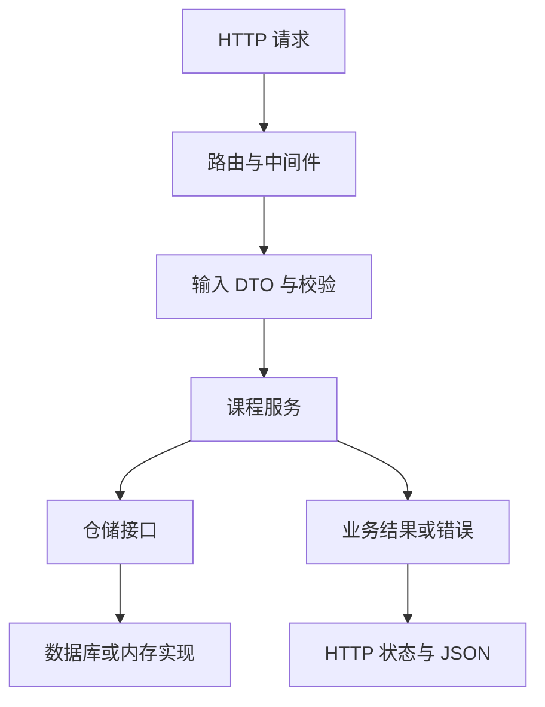

# 第十五讲：Go 语言主流 Web 框架实战

> 本讲围绕同一类课程服务比较 Beego、Gin、Echo 和 GoFrame，先梳理请求进入应用后的共同流程，再分别观察路由、中间件、参数校验、业务层和响应处理。框架差异放在相同的业务需求下比较，避免只按 API 名称罗列优缺点。


<a id="section-001"></a>

> **统一运行基线：** 建议使用 Go 1.27.3，示例模块声明采用 `go 1.27.0`。文中出现其他 Go 版本时，仅用于说明特性引入时间或历史实现差异；第三方依赖仍以对应模块的版本要求为准。


*图示：Web 请求处理链。*

## 正文导航

  - [版本、运行方法与来源](#section-003)
- [一、课程内容](#section-004)
  - [1.1 本讲要解决的三个问题](#section-005)
  - [1.2 一次请求经过哪些对象](#section-006)
  - [1.3 标准库基线：框架最后仍要写 HTTP 响应](#section-007)
  - [1.4 DTO 是输入契约，不是数据库实体](#section-008)
  - [1.5 服务层为什么只接受普通 Go 类型](#section-009)
- [二、Go 主流 Web 框架](#section-010)
  - [2.1 比较对象要在同一层次](#section-011)
  - [2.2 选型首先看变化会发生在哪里](#section-012)
  - [2.3 四个不同的“工程结构”](#section-013)
  - [2.4 本讲采用的统一实验条件](#section-014)
- [三、Beego 框架](#section-015)
  - [3.1 Beego 是什么](#section-016)
  - [3.2 Beego 的使用](#section-017)
  - [3.3 Beego 启动创建一个项目](#section-023)
  - [3.4 使用 Beego 开发一个 Web 小 Demo](#section-027)
- [四、Gin 框架](#section-028)
  - [4.1 Gin 适合做什么项目](#section-029)
  - [4.2 Gin 的使用](#section-030)
  - [4.3 Gin 工程化项目的组织与运行状态](#section-039)
- [五、Echo 框架](#section-043)
  - [5.1 Echo 适合做什么](#section-044)
  - [5.2 使用 Echo](#section-045)
  - [5.3 Echo 工程化项目的组织与运行状态](#section-052)
- [六、GoFrame](#section-056)
  - [6.1 GoFrame 适合什么](#section-057)
  - [6.2 和 Gin、Beego 的比较](#section-058)
  - [6.3 简单使用](#section-059)
  - [6.4 GoFrame 工程化项目的组织与运行状态](#section-067)
- [七、总结](#section-073)
  - [7.1 四个框架的核心差异落在什么地方](#section-074)
  - [7.2 用同一个需求检查自己是否真的理解](#section-075)
  - [7.3 选择与演进的顺序](#section-076)
  - [7.4 本讲提供的能力与没有声称覆盖的范围](#section-077)
- [附录 A：工程补充——从演示程序到可维护服务](#section-078)
  - [A.1 启动阶段先建立依赖，再开放流量](#section-079)
  - [A.2 优雅关闭：用同步信号观察正在进行的请求](#section-080)
  - [A.3 测试应验证外部结果和必要副作用](#section-081)
  - [A.4 数据库与事务边界不由目录名决定](#section-082)
  - [A.5 安全措施放在能实际执行规则的位置](#section-083)
  - [A.6 并发安全放在共享状态的拥有者处](#section-084)
  - [A.7 依赖、构建与发布需要能复现](#section-085)
  - [A.8 观测指标要能区分“请求到达”和“业务完成”](#section-086)
- [附录 B：自测题与参考答案](#section-087)
  - [1. 不使用框架能否写 Web 服务？使用框架后 net/http 还重要吗？](#section-088)
  - [2. 安装了 bee 或 gf，是否就给应用安装好了对应框架依赖？](#section-089)
  - [3. 使用 Gin 是否必须有 controller、service、dao 三个目录？](#section-090)
  - [4. PATCH 请求里的 false、0、空字符串和缺失字段如何区分？](#section-091)
  - [5. Beego Controller 的 Prepare、Get、Finish 有什么关系？资源释放都放 Finish 可以吗？](#section-092)
  - [6. Beego Web 一定要同时用 Beego ORM、模板和 bee 吗？](#section-093)
  - [7. Beego 没有 conf/app.conf 的初始化提示，是否说明本讲 Controller 示例失败？](#section-094)
  - [8. gin.New 与 gin.Default 的主要区别是什么？](#section-095)
  - [9. Gin 中调用 AbortWithStatusJSON 后为什么还常常写 return？](#section-096)
  - [10. 想统一处理绑定错误，应怎样选择 BindJSON 和 ShouldBindJSON？](#section-097)
  - [11. 为什么不能无条件相信 X-Forwarded-For？](#section-098)
  - [12. Handler 返回后，能否把 Gin 或 Echo 的 Context 指针保存在 goroutine 中继续用？](#section-099)
  - [13. Echo Handler 返回 error 之后由谁写响应？](#section-100)
  - [14. Echo 的 Bind 是否会自动执行已经注册的 Validator？](#section-101)
  - [15. 把 Echo v4 代码迁到 v5，只替换 import 路径够吗？](#section-102)
  - [16. 自定义 Echo HTTPErrorHandler 时，为什么不能把所有未知业务错误之外的错误都直接设成 500？](#section-103)
  - [17. GoFrame Server 有 ServeHTTP，为什么本讲仍然先 Start？](#section-104)
  - [18. GoFrame 返回 HTTP 200，是不是业务就成功了？](#section-105)
  - [19. g.Meta 和 OpenAPI 自动生成能否替代所有接口文档？](#section-106)
  - [20. GoFrame 的 DAO、Entity、DO、service、logic 各表示什么？](#section-107)
  - [21. 认证中间件已经放到整个 /admin 组里，为什么服务层还要检查资源权限？](#section-108)
  - [22. 为 Store 加 Mutex，是否解决了多实例部署的数据一致性？](#section-109)
  - [23. 乐观锁为什么要把版本检查和更新放在同一原子操作中？](#section-110)
  - [24. Shutdown 完成、请求取消、事务提交分别说明什么？](#section-111)
- [附录 C：官方资料导航与阅读建议](#section-112)
  - [C.1 Go 官方基础](#section-113)
  - [C.2 框架官方资料](#section-114)
  - [C.3 协议、安全与中文补充资料](#section-115)
- [附录 D：验证记录与示例适用范围](#section-116)
  - [D.1 实际执行记录](#section-117)
  - [D.2 如何理解本讲的验证证据](#section-118)

<a id="section-004"></a>

## 一、课程内容

<a id="section-005"></a>

### 1.1 本讲要解决的三个问题

先区分三个层次。第一层是 HTTP：客户端发送方法、路径、头和正文，服务端返回状态、头和正文。第二层是框架适配：框架把请求分配给函数，提供参数读取、序列化、校验和中间件。第三层是业务：课程能否发布、谁能修改、库存是否足够、写入是否原子。框架减少第二层的重复工作；第三层仍要根据业务约束设计。

贯穿场景是一个课程服务：调用方可以创建课程、查询单个课程、按标题搜索；只有管理员可以发布。我们将为这个服务拆出路由、输入 DTO、服务、仓储、错误转换和应用启动。不同框架的语法变化主要发生在 HTTP 边界；“标题不能为空”“普通调用方不能发布”这样的规则不应随着路由框架改变。

对每个处理函数都问三个问题：它接收的输入来自哪里？哪些条件在写入前检查？写入失败或客户端取消后发生什么？这三个问题比先记住框架所有方法更有助于判断程序是否正确。例如 `POST /courses` 成功返回一个 JSON，并不说明已经持久化；若例子只写入内存 map，进程退出数据就消失。

<a id="section-006"></a>

### 1.2 一次请求经过哪些对象

客户端发来 `POST /courses`，外层 HTTP Server 接收并构造请求，框架匹配路由，中间件检查身份和请求大小，处理函数解码输入，服务检查规则，仓储保存，最后处理函数把结果编码成 HTTP 响应。如果数据库报错，错误沿调用栈返回，再由 HTTP 边界决定状态码和对外信息。一次请求的 `context.Context` 顺着调用传下去，用于取消、截止时间及请求相关值。



这张图表示一次调用的职责，不要求每个方框都对应一个目录。小程序可以先在一个包内定义这些类型；复杂到需要独立变化时再拆包。把只有一行转发代码的函数机械拆成五层，也会增加阅读成本。

<a id="section-007"></a>

### 1.3 标准库基线：框架最后仍要写 HTTP 响应

先用标准库完成查询课程。`http.Handler` 的核心契约是 `ServeHTTP(http.ResponseWriter, *http.Request)`，Gin、Echo、Beego 的路由注册器和 GoFrame Server 都能接入这一契约。`httptest` 记录响应而不需要浏览器，因而非常适合学习 HTTP 行为。[官方依据：net/http](https://pkg.go.dev/net/http)、[net/http/httptest](https://pkg.go.dev/net/http/httptest)。

```go
// 运行示例：WEB-01
// 最低 Go 版本：go1.22
package main

import (
	"encoding/json"
	"fmt"
	"net/http"
	"net/http/httptest"
	"strings"
)

func main() {
	mux := http.NewServeMux()
	mux.HandleFunc("GET /courses/{id}", func(w http.ResponseWriter, r *http.Request) {
		if r.PathValue("id") != "1" {
			http.Error(w, "course not found", http.StatusNotFound)
			return
		}
		w.Header().Set("Content-Type", "application/json")
		if err := json.NewEncoder(w).Encode(struct {
			ID    int    `json:"id"`
			Title string `json:"title"`
		}{1, "Go"}); err != nil {
			panic(err)
		}
	})
	for _, path := range []string{"/courses/1", "/courses/9"} {
		rec := httptest.NewRecorder()
		mux.ServeHTTP(rec, httptest.NewRequest("GET", path, nil))
		fmt.Println(rec.Code, strings.TrimSpace(rec.Body.String()))
	}
}
```

输出：

```text
200 {"id":1,"title":"Go"}
404 course not found
```

成功路径和失败路径都从同一个路由进入，区别在业务条件。`return` 很重要：写出 404 之后仍继续编码课程，会把两份不相干的正文拼到一起。实际网络写入可能失败，返回状态一旦提交也不能随意改成 500；例子中的 `panic` 仅把测试写入异常显式暴露，正式服务应按日志与连接状态处理。

<a id="section-008"></a>

### 1.4 DTO 是输入契约，不是数据库实体

DTO 是为一次边界交互定义的数据结构。创建课程只允许客户端提交标题，就只定义标题字段；不要直接把含 `OwnerID`、`IsAdmin`、`DeletedAt` 的数据库模型交给绑定器。否则攻击者可能构造额外字段，触发“批量赋值”问题。框架成功解码只说明输入能放进结构体，不等于调用者有权限赋这些值。[官方安全资料：OWASP Mass Assignment](https://cheatsheetseries.owasp.org/cheatsheets/Mass_Assignment_Cheat_Sheet.html)。

更新接口还要区别“没有提交字段”和“明确提交零值”。`bool` 的零值是 `false`，仅使用一个 bool 无法区分缺失和调用方要求关闭。指针可以表达这种区别；指向 false 和 nil 是两种状态。下面以可选发布状态说明输入契约，而不连接数据库。[官方依据：encoding/json](https://pkg.go.dev/encoding/json)。

```go
// 运行示例：WEB-02
package main

import (
	"encoding/json"
	"fmt"
)

type PatchCourse struct {
	Published *bool `json:"published"`
}

func main() {
	for _, body := range []string{`{}`, `{"published":false}`, `{"published":true}`} {
		var in PatchCourse
		if err := json.Unmarshal([]byte(body), &in); err != nil {
			panic(err)
		}
		if in.Published == nil {
			fmt.Println("unchanged")
			continue
		}
		fmt.Println("set:", *in.Published)
	}
}
```

输出：

```text
unchanged
set: false
set: true
```

`null` 在这个模型里也会得到 nil；如果业务需要把“缺失”“显式 null”“具体值”分成三种状态，就需要带存在标记的类型或自定义解码。框架不会替开发者决定 null 的业务意义。对创建和更新分别定义类型，通常比给同一结构体堆满条件标签更清晰。

<a id="section-009"></a>

### 1.5 服务层为什么只接受普通 Go 类型

下面的业务服务只依赖一个仓储接口。构造服务时传入仓储，调用时传入 context 和标题，既不接收 `*gin.Context`，也不返回 Beego Controller。这样同一个规则可以被 HTTP、后台任务或命令行调用。接口由使用方按需要定义，不必为某个巨大 ORM 提前复制全部方法。[官方依据：Go 接口](https://go.dev/tour/methods/9)、[context](https://pkg.go.dev/context)。

```go
// 运行示例：WEB-03
package main

import (
	"context"
	"errors"
	"fmt"
	"strings"
)

type Course struct {
	ID    int
	Title string
}
type Repository interface {
	Insert(context.Context, string) (Course, error)
}
type Service struct{ Repo Repository }

func (s Service) Create(ctx context.Context, title string) (Course, error) {
	if err := ctx.Err(); err != nil {
		return Course{}, err
	}
	title = strings.TrimSpace(title)
	if title == "" {
		return Course{}, errors.New("title is required")
	}
	return s.Repo.Insert(ctx, title)
}

type MemoryRepo struct{ next int }

func (m *MemoryRepo) Insert(ctx context.Context, title string) (Course, error) {
	if err := ctx.Err(); err != nil {
		return Course{}, err
	}
	m.next++
	return Course{ID: m.next, Title: title}, nil
}

func main() {
	service := Service{Repo: &MemoryRepo{}}
	course, err := service.Create(context.Background(), " Go ")
	fmt.Println(course.ID, course.Title, err == nil)
	_, err = service.Create(context.Background(), "  ")
	fmt.Println(err)
}
```

输出：

```text
1 Go true
title is required
```

这里的 MemoryRepo 只用于顺序调用。真实 HTTP 服务会并发调用，共享计数器必须同步；后面的 Demo 会使用互斥锁。提前检查 `ctx.Err()` 只能发现检查时已取消，不能保证接下来取消就一定中断操作：实际数据库驱动也必须收到这个 context，并配合取消。不要把 context 当作传入一次后就自动生效的开关。

<a id="section-010"></a>

## 二、Go 主流 Web 框架

<a id="section-011"></a>

### 2.1 比较对象要在同一层次

“哪个框架更快”只有在场景、路由、数据访问、硬件和测量方法相同时才有意义。本讲不把官网宣传倍率或仓库星数当作选型结论，而是比较框架提供的边界和团队要承担的工作。一个包含 ORM、配置、CLI 和规范目录的框架，不能只用“Hello World 需要几行”与一个主要提供路由的库直接比较。

| 维度 | Beego | Gin | Echo v5 | GoFrame |
| --- | --- | --- | --- | --- |
| 常见入口 | Controller 或函数路由 | `func(*gin.Context)` | `func(*echo.Context) error` | Request Handler 或规范路由方法 |
| 主要组织风格 | MVC 约定、模块与工具链 | HTTP 边界轻量组合 | HTTP 边界与集中错误处理 | 模块化基础设施与工程规范 |
| 路由中间件 | Filter、FilterChain 等 | Handler 链、Next、Abort | 包裹 Handler 并返回 error | Middleware.Next 与后置处理 |
| ORM | 项目提供独立 ORM 模块 | 核心不内置 ORM | 核心不内置 ORM | 项目提供数据库与 ORM 组件 |
| 脚手架 | `bee` 是单独工具 | 不要求某个官方固定树 | 不要求某个官方固定树 | `gf` CLI 与工程模板 |
| 输入校验 | 可用 validation 模块等 | 绑定集成 validator 标签 | Validator 接口由应用注册 | 规范路由整合 `gvalid` |
| 业务代码放哪里 | 可按 MVC 扩展 service | 由团队定义包边界 | 由团队定义包边界 | 可采用官方约定并了解生成边界 |

表格依据：[Beego 官方仓库](https://github.com/beego/beego)、[Gin 官方文档](https://gin-gonic.com/en/docs/)、[Echo 官方文档](https://echo.labstack.com/guide/quickstart/)、[GoFrame WebServer](https://goframe.org/en/docs/web/start)。它描述本讲版本和典型用法，不能推出某个项目必须启用所有模块。

<a id="section-012"></a>

### 2.2 选型首先看变化会发生在哪里

如果服务只是十来个 JSON 接口，团队已经有配置、日志和数据库基础设施，Gin 或 Echo 可以作为薄的 HTTP 适配层。如果团队希望使用熟悉的 Controller 结构及配套工具，Beego 可以减少自行拼接。如果希望把规范路由、输入校验、OpenAPI、数据库操作和代码生成放进统一约定，GoFrame 值得按自己的工程需求试用。

这些是基于职责的判断，不是性能排名。团队已有系统迁移还要考虑中间件接口、错误结构、历史 URL、Cookie 策略、日志关联字段和运维流程。改掉 import 可能很容易，保持外部契约与异常行为不变往往更费力。因此选型实验至少应包括一条写入接口、一条权限拒绝、一条数据库故障、一条取消请求以及一个测试夹具，不能只跑 `/ping`。

<a id="section-013"></a>

### 2.3 四个不同的“工程结构”

第一种是框架源码包，它由框架项目维护，升级依赖时改变。第二种是脚手架生成的应用模板，生成之后属于当前的应用，往往需要改动。第三种是根据数据库或接口定义反复生成的文件，应遵守工具的覆盖规则。第四种是手写业务代码，应有稳定的领域职责。把这四者混成“框架固定目录”，容易导致在依赖缓存中改源码、修改生成文件后被覆盖，或把所有业务放进无法测试的 Controller。

一个模块里可以有多个包，一个目录通常构成一个包；`internal` 有 Go 工具链规定的导入限制，而 `service`、`repository`、`controller` 大多只是团队命名。`cmd` 是常见布局惯例，并不是编译入口必须叫这个名字。入口的关键是 `package main` 和 `func main`。[官方依据：Organizing a Go module](https://go.dev/doc/modules/layout)、[Go 命令内部包规则](https://pkg.go.dev/cmd/go#hdr-Internal_Directories)。

<a id="section-014"></a>

### 2.4 本讲采用的统一实验条件

输入保持固定，响应使用可比较的 JSON 或字符串；不打印时间、随机端口或不稳定的 map 迭代顺序。每个程序都自己构造路由与状态，避免前一个例子注册的路由影响后一个。状态管理例子如果会被并发请求访问，就在资源拥有者处同步，而不是指望框架自动保护 map。

讲解中的固定 token、固定调用方和内存仓储仅用于观察控制流程。正式认证应核验凭据来源、有效期与签名或会话状态；正式持久化应处理事务、唯一约束和故障恢复。正文会在相应位置说明这些边界，但不会让学习路由 API 的第一步依赖一个公网数据库。

<a id="section-015"></a>

## 三、Beego 框架

<a id="section-016"></a>

### 3.1 Beego 是什么

Beego 是提供 Web、ORM、配置、日志、验证等模块的 Go 项目。Web 层支持 Controller 风格和函数风格；MVC 是常见组织方式，Model 表示数据与业务相关概念，View 负责展示，Controller 接收请求并协调执行。开发 JSON API 时，响应 JSON 可以承担展示边界，不必为了满足 MVC 字面含义强行创建 HTML 模板。[官方依据：Beego 项目](https://github.com/beego/beego)、[Controller 风格路由](https://beegodoc.com/en-US/developing/web/router/ctrl_style/)。

Beego 的配套命令 `bee` 是开发工具，运行编译后的应用不需要机器上也安装 bee。ORM 也是可选择的模块；采用 Beego Web 不意味着每一个持久化操作都必须使用其 ORM。反过来，独立使用 Beego 的 validation 模块也不需要启动 Web 服务器。理解组件之间的依赖，比背“全栈框架”这个标签更有用。

在 Controller 风格下，自定义类型通常嵌入 `web.Controller`，从而获得上下文、输出、模板等能力，再实现 `Get`、`Post` 或显式映射的方法。嵌入带来方法提升，不能简单等同于其他语言的类继承。框架通过反射及接口管理每次请求对应的 Controller，应用不应把当前请求信息保存在共享全局 Controller 指针里。

<a id="section-017"></a>

### 3.2 Beego 的使用

<a id="section-018"></a>

#### 3.2.1 第一个 Controller：创建路由与生成响应

`NewControllerRegisterWithCfg` 创建独立的路由注册器。例子复制默认配置，关闭自动模板渲染，注册 Controller 后直接用 `ServeHTTP` 驱动。关闭自动模板渲染让本例专注 JSON 输出；它不是生产项目必须遵守的固定配置。[官方 API：Beego web](https://pkg.go.dev/github.com/beego/beego/v2@v2.3.10/server/web)、[输出 API](https://pkg.go.dev/github.com/beego/beego/v2@v2.3.10/server/web/context)。

```go
// 运行示例：WEB-04
// 最低 Go 版本：go1.25.0
// 依赖：github.com/beego/beego/v2 v2.3.10
package main

import (
	"fmt"
	"github.com/beego/beego/v2/server/web"
	"net/http/httptest"
	"strings"
)

type HelloController struct{ web.Controller }

func (c *HelloController) Get() {
	if err := c.Ctx.Output.JSON(struct {
		Message string `json:"message"`
	}{"hello Beego"}, false, false); err != nil {
		panic(err)
	}
}

func main() {
	cfg := *web.BConfig
	cfg.WebConfig.AutoRender = false
	router := web.NewControllerRegisterWithCfg(&cfg)
	router.Add("/hello", &HelloController{})
	rec := httptest.NewRecorder()
	router.ServeHTTP(rec, httptest.NewRequest("GET", "/hello", nil))
	fmt.Println(rec.Code, strings.TrimSpace(rec.Body.String()))
}
```

输出：

```text
200 {"message":"hello Beego"}
```

程序从请求到响应的链条是：匹配 `/hello` → 确定 GET → 创建并初始化 Controller → 执行 `Get` → 将对象编码到响应。`Output.JSON` 的后两个参数分别控制缩进与编码选项，本例显式关闭，让输出紧凑且可比较。常见的 `c.Data["json"] = value; c.ServeJSON()` 也是官方支持的写法；`ServeJSON` 对缩进的决定涉及全局运行模式，测试时应了解这点，不能只修改一个局部配置便假设所有辅助函数都脱离全局状态。

如果当前目录没有 `conf/app.conf`，本版本的配置包初始化可能在**标准错误流**输出一次“init global config instance failed…”提示。上述程序使用显式构造的路由配置，不依赖该文件，因此业务输出仍如上；正式工程应提供有效配置并处理启动失败。这个提示是已核对的初始化行为，不是程序返回了一个 HTTP 500。[相应官方源码](https://github.com/beego/beego/blob/v2.3.10/core/config/ini.go)。

<a id="section-019"></a>

#### 3.2.2 路径参数与查询参数承担不同职责

`/courses/7?format=brief` 中，7 标识资源，format 选择表示方式。参数读取后仍然是文本，必须转换并校验。不能因为路径匹配成功就假设 ID 一定合法，更不能直接拼进 SQL。下面明确区分非法 ID 与成功查询。[官方依据：路由规则](https://beegodoc.com/en-US/developing/web/router/ctrl_style/)、[strconv](https://pkg.go.dev/strconv)。

```go
// 运行示例：WEB-05
// 最低 Go 版本：go1.25.0
// 依赖：github.com/beego/beego/v2 v2.3.10
package main

import (
	"fmt"
	"github.com/beego/beego/v2/server/web"
	"net/http/httptest"
	"strconv"
	"strings"
)

type CourseController struct{ web.Controller }

func (c *CourseController) Get() {
	id, err := strconv.Atoi(c.Ctx.Input.Param(":id"))
	if err != nil || id <= 0 {
		c.Ctx.Output.SetStatus(400)
		if err := c.Ctx.Output.Body([]byte("invalid id")); err != nil {
			panic(err)
		}
		return
	}
	format := c.GetString("format", "full")
	if err := c.Ctx.Output.Body([]byte(fmt.Sprintf("id=%d format=%s", id, format))); err != nil {
		panic(err)
	}
}

func main() {
	cfg := *web.BConfig
	cfg.WebConfig.AutoRender = false
	router := web.NewControllerRegisterWithCfg(&cfg)
	router.Add("/courses/:id", &CourseController{})
	for _, path := range []string{"/courses/7?format=brief", "/courses/nope"} {
		rec := httptest.NewRecorder()
		router.ServeHTTP(rec, httptest.NewRequest("GET", path, nil))
		fmt.Println(rec.Code, strings.TrimSpace(rec.Body.String()))
	}
}
```

输出：

```text
200 id=7 format=brief
400 invalid id
```

这里没有真正查询仓储，所以不能把所有正整数都解释为课程存在。正式实现应在 ID 合法后查询数据，再将不存在映射为 404。格式参数也只是回显示例数据；若用它选择模板或导出类型，应建立允许值集合，不能让它直接构造文件路径。

<a id="section-020"></a>

#### 3.2.3 Controller 生命周期与共享资源

`Prepare` 可在动作前做公共准备，`Finish` 在正常动作执行后承担相应后处理。生命周期方法适合与 Controller 局部职责紧密相关的工作；横跨很多 Controller 的认证或请求日志通常更适合过滤器。不要把 `Finish` 当作任何异常路径都必然执行的资源释放保证；局部打开的文件、事务等应在拥有它们的函数中使用 `defer` 和明确错误处理。[官方依据：Controller API](https://beegodoc.com/en-US/developing/web/router/ctrl_style/controller.html)。

```go
// 运行示例：WEB-06
// 最低 Go 版本：go1.25.0
// 依赖：github.com/beego/beego/v2 v2.3.10
package main

import (
	"fmt"
	"github.com/beego/beego/v2/server/web"
	"net/http/httptest"
)

var events []string

type LifecycleController struct{ web.Controller }

func (c *LifecycleController) Prepare() { events = append(events, "prepare") }
func (c *LifecycleController) Get() {
	events = append(events, "get")
	if err := c.Ctx.Output.Body([]byte("ok")); err != nil {
		panic(err)
	}
}
func (c *LifecycleController) Finish() { events = append(events, "finish") }

func main() {
	cfg := *web.BConfig
	cfg.WebConfig.AutoRender = false
	router := web.NewControllerRegisterWithCfg(&cfg)
	router.Add("/", &LifecycleController{})
	rec := httptest.NewRecorder()
	router.ServeHTTP(rec, httptest.NewRequest("GET", "/", nil))
	fmt.Println(events)
	fmt.Println(rec.Code, rec.Body.String())
}
```

输出：

```text
[prepare get finish]
200 ok
```

全局 events 仅记录本程序的一个同步请求，不是并发日志实现。请求并发后，同一个 slice 的追加需要同步；更自然的办法是将请求追踪放进请求上下文，把统计汇总交给并发安全的组件。Controller 看起来每个请求一份，也不会自动保护它调用的共享 map、缓存或外部对象。

<a id="section-021"></a>

#### 3.2.4 Filter：在业务执行前拒绝访问

Beego 将过滤器放在不同处理位置。`BeforeRouter` 适合路由前的公共检查；`BeforeExec` 已经完成路由定位；更晚的位置适合观察已执行结果。选择位置时要明确过滤器需要哪些信息。例如依赖最终匹配 Controller 的授权逻辑，不应假设最早阶段已经有这些信息。[官方依据：Web Filter](https://beegodoc.com/en-US/developing/web/filter/)。

```go
// 运行示例：WEB-07
// 最低 Go 版本：go1.25.0
// 依赖：github.com/beego/beego/v2 v2.3.10
package main

import (
	"fmt"
	"github.com/beego/beego/v2/server/web"
	beecontext "github.com/beego/beego/v2/server/web/context"
	"net/http/httptest"
)

func main() {
	cfg := *web.BConfig
	cfg.WebConfig.AutoRender = false
	router := web.NewControllerRegisterWithCfg(&cfg)
	err := router.InsertFilter("/admin/*", web.BeforeRouter, func(c *beecontext.Context) {
		if c.Input.Header("Authorization") != "Bearer demo-admin" {
			c.Output.SetStatus(401)
			if err := c.Output.Body([]byte("unauthorized")); err != nil {
				panic(err)
			}
		}
	})
	if err != nil {
		panic(err)
	}
	calls := 0
	router.Get("/admin/courses", func(c *beecontext.Context) {
		calls++
		if err := c.Output.Body([]byte("allowed")); err != nil {
			panic(err)
		}
	})
	for _, token := range []string{"", "Bearer demo-admin"} {
		req := httptest.NewRequest("GET", "/admin/courses", nil)
		req.Header.Set("Authorization", token)
		rec := httptest.NewRecorder()
		router.ServeHTTP(rec, req)
		fmt.Println(rec.Code, rec.Body.String())
	}
	fmt.Println("business calls:", calls)
}
```

输出：

```text
401 unauthorized
200 allowed
business calls: 1
```

这个例子检查的不只是响应正文，还检查了拒绝分支没有执行业务。真实认证不是字符串常量比较；应把验证后的主体放入请求上下文，并在服务层进行资源权限判断。即使通过 `/admin` 过滤器，也不能由客户端自由提供 `owner_id` 修改别人的课程。

<a id="section-022"></a>

#### 3.2.5 validation 模块：规则通过与规则执行失败分开

`Valid` 返回的布尔值表示数据是否满足规则，error 则表示校验执行是否遇到规则等问题。这两者不应混淆。字段 `Required` 对字符串检查的是零值等语义，空格是否允许仍取决于当前的业务规范；需要先 `TrimSpace` 时，应明确规范化发生在校验之前。[官方依据：Beego Validation](https://beegodoc.com/en-US/developing/validation/)、[包 API](https://pkg.go.dev/github.com/beego/beego/v2@v2.3.10/core/validation)。

```go
// 运行示例：WEB-08
// 最低 Go 版本：go1.25.0
// 依赖：github.com/beego/beego/v2 v2.3.10
package main

import (
	"fmt"
	"github.com/beego/beego/v2/core/validation"
	"strings"
)

type CreateCourse struct {
	Title string `valid:"Required;MaxSize(20)"`
}

func main() {
	for _, raw := range []string{" Go ", "   "} {
		input := CreateCourse{Title: strings.TrimSpace(raw)}
		validator := validation.Validation{}
		ok, err := validator.Valid(&input)
		if err != nil {
			panic(err)
		}
		fmt.Printf("title=%q valid=%v errors=%d\n", input.Title, ok, len(validator.Errors))
	}
}
```

输出：

```text
title="Go" valid=true errors=0
title="" valid=false errors=1
```

不要把某次调用累积的校验错误直接复用到下一次请求，因此例子每轮创建新的 validator。长度规则对 Unicode 的计数语义必须按具体库版本核对；业务若要求“最多 20 个调用方可见字符”，要先定义究竟是字节、码点还是字形簇，不能只看规则名字就当作完全一致。数据库唯一性、当前调用方权限、发布状态转换等，也不是字段标签可以独立保证的。

<a id="section-023"></a>

### 3.3 Beego 启动创建一个项目

<a id="section-024"></a>

#### 3.3.1 分清安装工具、创建应用和启动服务

本讲核对的 bee 版本为 `v2.3.0`。它与 Beego 运行时库有各自版本号，不要求两者数字相同。以下是官方 CLI 支持的基本工作流；命令展示创建过程，不计入已验证的主程序例子。[官方依据：bee](https://github.com/beego/bee)、[Beego Quick Start](https://beegodoc.com/en-US/developing/)。

```bash
go install github.com/beego/bee/v2@v2.3.0
bee version
bee new courseapp
cd courseapp
go get github.com/beego/beego/v2@v2.3.10
go mod tidy
bee run
```

`go install ...@版本` 把工具编译到工具安装位置；找不到 `bee` 时，应检查 `go env GOBIN GOPATH` 和 PATH，不要以为安装工具会自动把应用模块建好。`bee new` 生成工程文件；`go get` 调整应用依赖；`bee run` 面向开发，通常监视变更并重新构建。发布时可使用 `go build` 构建应用二进制，由正式进程管理器启动，不能把开发热重载工具当作部署必需组件。

工具生成的 `go.mod`、配置和路由模板会随工具版本改变。创建后先阅读实际文件，再应用本讲所锁定的依赖，并检查变更。不要把旧教程的一整套树当作所有新版本都会逐文件生成的承诺。

<a id="section-025"></a>

#### 3.3.2 一个可理解的工程目录及其所有者

| 路径示例 | 职责 | 谁维护 | 修改时关心的问题 |
| --- | --- | --- | --- |
| `main.go` | 组装组件并启动应用 | 应用开发者 | 启动失败是否显式终止，资源如何关闭 |
| `routers/router.go` | 注册 URL 与处理函数 | 应用开发者或指定生成流程 | URL 是否稳定，鉴权是否覆盖 |
| `controllers/course.go` | HTTP 参数与输出 | 应用开发者 | 输入契约、错误码、响应是否重复写 |
| `internal/course/service.go` | 课程业务规则 | 应用开发者 | 权限、状态转换、事务边界 |
| `internal/course/repository.go` | 数据访问接口与实现 | 应用开发者 | 唯一约束、查询错误、并发写入 |
| `conf/app.conf` | 非敏感运行配置 | 应用部署流程 | 环境差异、配置合法性 |
| `views/`、`static/` | 页面模板与静态资源 | 需要页面功能时维护 | 路径、缓存、转义、资源发布 |
| `go.mod`、`go.sum` | 模块依赖与校验 | Go 命令与审阅流程 | 版本是否固定，升级是否影响 API |

这是根据本讲职责设计的布局，并非要求 bee 必须生成 `internal/course`。如果应用只提供 JSON，未必需要 `views`。若脚手架用 `init` 自动注册路由，入口必须导入相应包才会执行注册；排查“编译成功但都是 404”时，应先检查注册是否发生，而不是猜网络端口问题。

<a id="section-026"></a>

#### 3.3.3 配置与启动状态

把运行模式、监听地址、日志级别和数据库连接参数都硬编码在 Controller 中，会让测试与部署相互牵连。更合理的做法是在启动阶段读配置、检查必需项、创建依赖，再注册处理函数。若数据库是服务启动所必需的依赖，连接配置非法应在启动阶段失败；若只是可降级能力，则要有明确的降级响应，不能吞掉错误后继续假装正常。

敏感凭据不要提交到示例仓库；配置文件可以只保存非敏感选项，凭据由部署环境注入。这是工程建议，不意味着把密码放到环境变量就自动解决全部泄露风险：日志、进程转储、错误响应也要避免输出。对于本讲的内存 Demo，显式构造依赖即可，没有理由为了演示控制器先要求读者安装数据库。

<a id="section-027"></a>

### 3.4 使用 Beego 开发一个 Web 小 Demo

需求是新增课程并能查询刚新增的课程。一次创建先限制请求大小，解码到输入 DTO，拒绝未知字段与多个 JSON 值，规范化标题，最后才加锁写入。读取也在同一仓储锁的保护下完成。这里采用函数路由，展示 Beego 也可以用闭包注入仓储，而不必把业务依赖隐藏到包级全局变量中。[官方依据：函数风格路由](https://pkg.go.dev/github.com/beego/beego/v2@v2.3.10/server/web#ControllerRegister.Post)、[encoding/json](https://pkg.go.dev/encoding/json)、[sync](https://pkg.go.dev/sync)。

```go
// 运行示例：WEB-09
// 最低 Go 版本：go1.25.0
// 依赖：github.com/beego/beego/v2 v2.3.10
package main

import (
	"encoding/json"
	"fmt"
	"github.com/beego/beego/v2/server/web"
	beecontext "github.com/beego/beego/v2/server/web/context"
	"io"
	"net/http"
	"net/http/httptest"
	"strconv"
	"strings"
	"sync"
)

type Course struct {
	ID    int    `json:"id"`
	Title string `json:"title"`
}
type Store struct {
	mu    sync.Mutex
	next  int
	items map[int]Course
}

func (s *Store) Create(title string) Course {
	s.mu.Lock()
	defer s.mu.Unlock()
	s.next++
	c := Course{ID: s.next, Title: title}
	s.items[c.ID] = c
	return c
}
func (s *Store) Get(id int) (Course, bool) {
	s.mu.Lock()
	defer s.mu.Unlock()
	c, ok := s.items[id]
	return c, ok
}
func reply(c *beecontext.Context, status int, value any) {
	c.Output.SetStatus(status)
	if err := c.Output.JSON(value, false, false); err != nil {
		panic(err)
	}
}
func main() {
	store := &Store{items: make(map[int]Course)}
	cfg := *web.BConfig
	cfg.WebConfig.AutoRender = false
	router := web.NewControllerRegisterWithCfg(&cfg)
	router.Post("/courses", func(c *beecontext.Context) {
		var input struct {
			Title string `json:"title"`
		}
		body := http.MaxBytesReader(c.ResponseWriter, c.Request.Body, 1024)
		defer body.Close()
		decoder := json.NewDecoder(body)
		decoder.DisallowUnknownFields()
		if err := decoder.Decode(&input); err != nil {
			reply(c, 400, map[string]string{"error": "invalid input"})
			return
		}
		var extra any
		if err := decoder.Decode(&extra); err != io.EOF {
			reply(c, 400, map[string]string{"error": "one JSON value required"})
			return
		}
		input.Title = strings.TrimSpace(input.Title)
		if input.Title == "" {
			reply(c, 400, map[string]string{"error": "title required"})
			return
		}
		course := store.Create(input.Title)
		c.Output.Header("Location", fmt.Sprintf("/courses/%d", course.ID))
		reply(c, 201, course)
	})
	router.Get("/courses/:id", func(c *beecontext.Context) {
		id, err := strconv.Atoi(c.Input.Param(":id"))
		if err != nil || id <= 0 {
			reply(c, 400, map[string]string{"error": "invalid id"})
			return
		}
		course, ok := store.Get(id)
		if !ok {
			reply(c, 404, map[string]string{"error": "not found"})
			return
		}
		reply(c, 200, course)
	})
	requests := []struct{ method, path, body string }{
		{"POST", "/courses", `{"title":" Go "}`},
		{"GET", "/courses/1", ""},
		{"POST", "/courses", `{"title":" "}`},
		{"GET", "/courses/99", ""},
	}
	for _, item := range requests {
		req := httptest.NewRequest(item.method, item.path, strings.NewReader(item.body))
		req.Header.Set("Content-Type", "application/json")
		rec := httptest.NewRecorder()
		router.ServeHTTP(rec, req)
		fmt.Println(rec.Code, strings.TrimSpace(rec.Body.String()))
	}
}
```

输出：

```text
201 {"id":1,"title":"Go"}
200 {"id":1,"title":"Go"}
400 {"error":"title required"}
404 {"error":"not found"}
```

这个 Demo 的状态是进程内有效，不是持久化完成。互斥锁解决本进程对 map 和 next 的并发访问，不能解决多个实例生成同一个 ID、机器掉电或重试导致重复创建。生产数据应由仓储实现接入数据库，并根据业务需要加入唯一约束、事务和幂等键。

接口将超大正文和 JSON 语法错误统一映射为 400，便于聚焦一个错误入口；如果对外契约要求严格区分 413，应用应识别 `*http.MaxBytesError` 后另行映射。实际 JSON 接口还应检查允许的媒体类型，这些是 HTTP 边界的决定，不应隐藏在数据层。编码错误时直接 panic 也只用于暴露测试问题，正式服务要按是否已写出响应记录错误。

从单文件拆到工程时，Store 移到仓储包，创建规则移到 service，路由保留 DTO 解码与结果转换。拆分不应改变外部的四个响应；这四个固定用例可以作为重构时的行为基线。能在不启动端口的情况下重跑行为，是清晰依赖设计带来的直接收益。

<a id="section-028"></a>

## 四、Gin 框架

<a id="section-029"></a>

### 4.1 Gin 适合做什么项目

Gin 以 HTTP 路由、上下文、中间件和参数绑定为中心，适合把业务服务暴露为 API，也可以渲染页面。它不会替应用决定数据库、迁移工具、配置来源或完整包布局。对已经有基础设施的团队，这种组合方式便于沿用现有组件；对刚起步的团队，则需要主动建立一致的错误结构、日志字段和服务边界。[官方依据：Gin Introduction](https://gin-gonic.com/en/docs/)、[Go 官方 Gin 教程](https://go.dev/doc/tutorial/web-service-gin)。

`gin.New()` 创建没有默认 Logger、Recovery 的 Engine，`gin.Default()` 在创建时加入这两个中间件。这里选择 `gin.New()` 以让每个示例的行为和输出明确。真实服务可以自行加入合适的日志与恢复逻辑；Recovery 能捕获相关请求调用链中的 panic 并尝试返回错误，不等于自动回滚事务，也不保证已经部分发送的响应能恢复成完整 JSON。

不要根据“轻量”推断所有接口都应直接在闭包里写 SQL。轻量表示框架负责的范围较集中，业务复杂度不会因此消失。当课程发布需要多个数据检查时，将规则放在普通 Go 服务中，通常比在五个 Gin 路由里复制同一逻辑更容易维护。

<a id="section-030"></a>

### 4.2 Gin 的使用

<a id="section-031"></a>

#### 4.2.1 方法、路径和查询值

Gin 路径参数写作 `:id`。方法匹配失败时返回什么，由路由配置和处理规则决定；下面显式打开 `HandleMethodNotAllowed`，才能把对已存在路径使用错误方法的请求观察为 405。不要把自己配置的行为误记成所有框架的默认行为。[官方 API：Gin Engine](https://pkg.go.dev/github.com/gin-gonic/gin@v1.12.0)、[路由文档](https://gin-gonic.com/en/docs/routing/)。

```go
// 运行示例：WEB-10
// 最低 Go 版本：go1.25.0
// 依赖：github.com/gin-gonic/gin v1.12.0
package main

import (
	"fmt"
	"github.com/gin-gonic/gin"
	"net/http/httptest"
	"strings"
)

func main() {
	gin.SetMode(gin.ReleaseMode)
	router := gin.New()
	router.HandleMethodNotAllowed = true
	router.GET("/courses/:id", func(c *gin.Context) {
		c.String(200, "id=%s format=%s", c.Param("id"), c.DefaultQuery("format", "full"))
	})
	for _, method := range []string{"GET", "POST"} {
		rec := httptest.NewRecorder()
		router.ServeHTTP(rec, httptest.NewRequest(method, "/courses/7?format=brief", nil))
		fmt.Println(rec.Code, strings.TrimSpace(rec.Body.String()))
	}
}
```

输出：

```text
200 id=7 format=brief
405 405 method not allowed
```

`c.Param` 和 `c.Query` 都给文本值，并不隐含整数转换。业务需要数字 ID 时，仍应明确转换失败、非正数、越界和不存在这几种结果。`DefaultQuery` 的默认值与空字符串的处理也要按 API 契约理解；“调用方没有传”和“调用方传了空值”在业务上有时不能视为同一情况。

<a id="section-032"></a>

#### 4.2.2 ShouldBindJSON 与绑定错误的控制权

Gin 的绑定可以同时使用 JSON 字段名和 `binding` 规则。`ShouldBindJSON` 把错误返回给调用者，让应用决定状态与响应结构；`BindJSON` 所在的 MustBind 系列会在绑定出错时先中断并写入相应状态。需要统一错误 JSON 时，优先明确自己采用哪一类 API，避免在状态已经提交后再次试图改成另一个状态。[官方依据：Model binding and validation](https://gin-gonic.com/en/docs/binding/binding-and-validation/)。

```go
// 运行示例：WEB-11
// 最低 Go 版本：go1.25.0
// 依赖：github.com/gin-gonic/gin v1.12.0
package main

import (
	"fmt"
	"github.com/gin-gonic/gin"
	"net/http/httptest"
	"strings"
)

type CreateInput struct {
	Title string `json:"title" binding:"required,min=2,max=40"`
}

func main() {
	gin.SetMode(gin.ReleaseMode)
	router := gin.New()
	router.POST("/courses", func(c *gin.Context) {
		var in CreateInput
		if err := c.ShouldBindJSON(&in); err != nil {
			c.JSON(400, gin.H{"error": "invalid input"})
			return
		}
		c.JSON(201, gin.H{"title": in.Title})
	})
	for _, body := range []string{`{"title":"Go"}`, `{}`, `{"title":9}`} {
		req := httptest.NewRequest("POST", "/courses", strings.NewReader(body))
		req.Header.Set("Content-Type", "application/json")
		rec := httptest.NewRecorder()
		router.ServeHTTP(rec, req)
		fmt.Println(rec.Code, rec.Body.String())
	}
}
```

输出：

```text
201 {"title":"Go"}
400 {"error":"invalid input"}
400 {"error":"invalid input"}
```

JSON 语法、类型转换和字段规则都可能导致绑定失败，但不应把底层内部错误完整暴露给客户端。应用可以稳定返回错误代号，在日志里记录经过脱敏的细节。示例的 `required` 不会去掉标题前后空白；若要拒绝全空白，需要先规范化再应用领域检查。默认 JSON 绑定也不是“拒绝所有未知字段并严格限定单个 JSON 值”的承诺，若 API 要求更严格的解码契约，应明确配置绑定器或使用标准库 Decoder 完成检查。

`binding:"required"` 与“该 JSON 属性必须出现”也不完全相同。普通 bool 的 false、整数 0 等零值会涉及 required 的规则语义；如果 false 是合法输入且必须区分字段缺失，应使用指针或存在标记。不要为绕过一次校验而随意删除约束，应先把输入状态建模清楚。

<a id="section-033"></a>

#### 4.2.3 明确只从查询串绑定

如果分页参数约定来自 URL，就使用只读查询串的绑定方法。这样请求体中的同名字段不会悄悄改变分页。多来源绑定很方便，但字段优先级应该成为接口设计的一部分，而不是依赖开发者模糊的印象。[官方依据：Only bind query string](https://gin-gonic.com/en/docs/binding/only-bind-query-string/)。

```go
// 运行示例：WEB-12
// 最低 Go 版本：go1.25.0
// 依赖：github.com/gin-gonic/gin v1.12.0
package main

import (
	"fmt"
	"github.com/gin-gonic/gin"
	"net/http/httptest"
	"strings"
)

type Search struct {
	Page int `form:"page" binding:"min=1,max=100"`
}

func main() {
	gin.SetMode(gin.ReleaseMode)
	router := gin.New()
	router.POST("/search", func(c *gin.Context) {
		var query Search
		if err := c.ShouldBindQuery(&query); err != nil {
			c.String(400, "invalid page")
			return
		}
		c.String(200, "page=%d", query.Page)
	})
	for _, path := range []string{"/search?page=2", "/search?page=0"} {
		req := httptest.NewRequest("POST", path, strings.NewReader(`{"page":99}`))
		req.Header.Set("Content-Type", "application/json")
		rec := httptest.NewRecorder()
		router.ServeHTTP(rec, req)
		fmt.Println(rec.Code, rec.Body.String())
	}
}
```

输出：

```text
200 page=2
400 invalid page
```

分页上限是资源约束。即使框架成功把 `page=999999999` 转成 int，业务也不应允许无上限扫描。页码之外还要限制每页数量，稳定排序，并考虑深分页时采用游标。框架解决参数读取，数据库查询成本需要应用单独管理。

<a id="section-034"></a>

#### 4.2.4 中间件的前置与后置逻辑

`c.Next()` 执行链上后续处理，再返回当前中间件继续执行。按 A、B 注册时，前置逻辑依次是 A、B，后置逻辑反向返回。这适合耗时统计、资源清理以及在处理后观察状态。不过，读取最终响应状态不代表能再自由重写已经发送的数据。[官方依据：Custom Middleware](https://gin-gonic.com/en/docs/middleware/custom-middleware/)。

```go
// 运行示例：WEB-13
// 最低 Go 版本：go1.25.0
// 依赖：github.com/gin-gonic/gin v1.12.0
package main

import (
	"fmt"
	"github.com/gin-gonic/gin"
	"net/http/httptest"
)

func main() {
	gin.SetMode(gin.ReleaseMode)
	events := []string{}
	trace := func(name string) gin.HandlerFunc {
		return func(c *gin.Context) {
			events = append(events, name+" before")
			c.Next()
			events = append(events, name+" after")
		}
	}
	router := gin.New()
	router.Use(trace("A"), trace("B"))
	router.GET("/", func(c *gin.Context) {
		events = append(events, "business")
		c.Status(204)
	})
	rec := httptest.NewRecorder()
	router.ServeHTTP(rec, httptest.NewRequest("GET", "/", nil))
	fmt.Println(events)
	fmt.Println(rec.Code)
}
```

输出：

```text
[A before B before business B after A after]
204
```

events 只服务于一个同步实验。真实日志不应依赖无锁共享 slice；耗时计算应使用每次请求自己的开始时间，关联 ID 放入请求范围内，汇总指标由并发安全组件处理。中间件中的全局可变对象，是许多“单请求测试通过、压测却出错”的来源。

<a id="section-035"></a>

#### 4.2.5 Abort 与 return 分别控制什么

`Abort` 标记链条不再继续执行后续 Handler，但不会从当前 Go 函数返回。拒绝访问时通常既要终止链条，也要立刻 return，避免当前函数后面的写入或副作用继续发生。下面同时验证未授权请求没有运行业务。[官方 API：Context.Abort](https://pkg.go.dev/github.com/gin-gonic/gin@v1.12.0#Context.Abort)。

```go
// 运行示例：WEB-14
// 最低 Go 版本：go1.25.0
// 依赖：github.com/gin-gonic/gin v1.12.0
package main

import (
	"fmt"
	"github.com/gin-gonic/gin"
	"net/http/httptest"
)

func main() {
	gin.SetMode(gin.ReleaseMode)
	router := gin.New()
	calls := 0
	api := router.Group("/admin")
	api.Use(func(c *gin.Context) {
		if c.GetHeader("Authorization") != "Bearer demo-admin" {
			c.AbortWithStatusJSON(401, gin.H{"error": "unauthorized"})
			return
		}
		c.Next()
	})
	api.GET("/courses", func(c *gin.Context) { calls++; c.String(200, "allowed") })
	for _, token := range []string{"", "Bearer demo-admin"} {
		req := httptest.NewRequest("GET", "/admin/courses", nil)
		req.Header.Set("Authorization", token)
		rec := httptest.NewRecorder()
		router.ServeHTTP(rec, req)
		fmt.Println(rec.Code, rec.Body.String())
	}
	fmt.Println("business calls:", calls)
}
```

输出：

```text
401 {"error":"unauthorized"}
200 allowed
business calls: 1
```

分组让路由共享前缀与中间件，不等于提供了完整授权模型。使用 Bearer token 时，认证组件先验证 token，再取得服务端认可的主体；课程能否修改仍由主体、资源所有者和业务状态共同决定。此处固定 token 只是让两条控制路径可以稳定重现。

<a id="section-036"></a>

#### 4.2.6 错误集中转换：只在响应尚未写出时处理

Gin Handler 不返回 error，可以用 `c.Error` 记录错误，再由中间件检查。这个方案要约定“错误路径只记录错误并退出，成功路径写响应”，避免错误处理器再补写第二个 JSON。对内日志与对外信息分开设计：数据库连接字符串、SQL 参数和内部堆栈通常不该原样出现在响应里。[官方依据：Error handling middleware](https://gin-gonic.com/en/docs/middleware/error-handling-middleware/)。

```go
// 运行示例：WEB-15
// 最低 Go 版本：go1.25.0
// 依赖：github.com/gin-gonic/gin v1.12.0
package main

import (
	"errors"
	"fmt"
	"github.com/gin-gonic/gin"
	"net/http/httptest"
)

var ErrMissing = errors.New("course missing")

func main() {
	gin.SetMode(gin.ReleaseMode)
	router := gin.New()
	router.Use(func(c *gin.Context) {
		c.Next()
		if len(c.Errors) == 0 || c.Writer.Written() {
			return
		}
		err := c.Errors.Last().Err
		if errors.Is(err, ErrMissing) {
			c.JSON(404, gin.H{"error": "course_not_found"})
			return
		}
		c.JSON(500, gin.H{"error": "internal_error"})
	})
	router.GET("/courses/:id", func(c *gin.Context) {
		if c.Param("id") != "1" {
			c.Error(fmt.Errorf("lookup: %w", ErrMissing))
			c.Abort()
			return
		}
		c.JSON(200, gin.H{"title": "Go"})
	})
	for _, path := range []string{"/courses/1", "/courses/9"} {
		rec := httptest.NewRecorder()
		router.ServeHTTP(rec, httptest.NewRequest("GET", path, nil))
		fmt.Println(rec.Code, rec.Body.String())
	}
}
```

输出：

```text
200 {"title":"Go"}
404 {"error":"course_not_found"}
```

用 `errors.Is` 而非错误字符串比较，使服务层可以增加上下文而不破坏分类。错误类目也应由需求决定，例如不存在、冲突、权限不足、暂时不可用；不能把所有失败都归为 400，否则客户端和运维会误以为服务器故障是调用方输错。已经写出的流式响应发生错误时，应记录并终止流或按流协议发送错误事件，不能指望中间件把先前字节收回。

<a id="section-037"></a>

#### 4.2.7 请求取消需要传到真正执行工作的函数

`*gin.Context` 包含 Web 适配能力；传给数据库、HTTP 客户端或业务服务的通常应是 `c.Request.Context()`。下面创建一个已取消的请求，让业务函数观察这个信号。为了只验证传播，Handler 返回 204，而另外记录 `canceled`；这不是“取消后仍返回成功”的生产策略，响应状态本身不用于测试取消语义。[官方依据：Gin Context and Cancellation](https://gin-gonic.com/en/docs/server-config/context/)、[context](https://pkg.go.dev/context)。

```go
// 运行示例：WEB-16
// 最低 Go 版本：go1.25.0
// 依赖：github.com/gin-gonic/gin v1.12.0
package main

import (
	"context"
	"errors"
	"fmt"
	"github.com/gin-gonic/gin"
	"net/http/httptest"
)

func load(ctx context.Context) error { return ctx.Err() }

func main() {
	gin.SetMode(gin.ReleaseMode)
	router := gin.New()
	observed := false
	router.GET("/courses", func(c *gin.Context) {
		observed = errors.Is(load(c.Request.Context()), context.Canceled)
		c.Status(204)
	})
	ctx, cancel := context.WithCancel(context.Background())
	cancel()
	req := httptest.NewRequest("GET", "/courses", nil).WithContext(ctx)
	rec := httptest.NewRecorder()
	router.ServeHTTP(rec, req)
	fmt.Println("canceled in service:", observed)
}
```

输出：

```text
canceled in service: true
```

真实服务通常停止后续工作并记录取消原因；若客户端已经断开，额外写错误响应也未必有接收者。不能把 `context.Canceled` 机械转换成某个固定 HTTP 状态：主动取消、服务器停机、客户端断线和截止时间到期，含义不相同。取消也不代表数据库事务一定未提交；如果提交完成而响应丢失，客户端重试会遇到结果未知的问题，需要幂等设计。

后台任务脱离请求存活时，也不能直接保存 `*gin.Context`。Gin 会复用上下文对象；官方说明需要相关值时应复制必要信息，异步写当前响应仍然不受支持。更稳妥的长期任务设计是先持久化任务、返回任务 ID，由独立工作者处理。复制上下文不提供持久性、重试或进程退出保护。[官方依据：Goroutines inside middleware](https://gin-gonic.com/en/docs/middleware/goroutines-inside-a-middleware/)。

<a id="section-038"></a>

#### 4.2.8 可信代理：客户端 IP 是部署契约

`X-Forwarded-For` 是 HTTP 头，直接访问应用的客户端也可以伪造它。只有来自明确可信代理的转发头才能参与客户端地址推断。若没有反向代理，可以禁用信任；若存在代理，应配置实际受控的地址范围，并保证应用不能被绕过代理直接访问需要该信任的入口。[官方依据：Trusted proxies](https://gin-gonic.com/en/docs/server-config/trusted-proxies/)。

```go
// 运行示例：WEB-17
// 最低 Go 版本：go1.25.0
// 依赖：github.com/gin-gonic/gin v1.12.0
package main

import (
	"fmt"
	"github.com/gin-gonic/gin"
	"net/http/httptest"
)

func run(trusted []string) string {
	router := gin.New()
	if err := router.SetTrustedProxies(trusted); err != nil {
		panic(err)
	}
	router.GET("/ip", func(c *gin.Context) { c.String(200, c.ClientIP()) })
	req := httptest.NewRequest("GET", "/ip", nil)
	req.RemoteAddr = "127.0.0.1:12345"
	req.Header.Set("X-Forwarded-For", "198.51.100.7")
	rec := httptest.NewRecorder()
	router.ServeHTTP(rec, req)
	return rec.Body.String()
}
func main() {
	gin.SetMode(gin.ReleaseMode)
	fmt.Println("no proxy:", run(nil))
	fmt.Println("trusted loopback:", run([]string{"127.0.0.1"}))
}
```

输出：

```text
no proxy: 127.0.0.1
trusted loopback: 198.51.100.7
```

198.51.100.7 是文档示例地址，程序没有连接它。上例只是固定请求的解析结果，不证明真实部署链安全。如果使用多个代理，要理解右侧代理链及头部追加、清理规则。IP 还可能被 NAT 共享，不能直接把“同一个 IP”当作“同一个调用方”；限流维度和身份维度需要分别设计。

<a id="section-039"></a>

### 4.3 Gin 工程化项目的组织与运行状态

<a id="section-040"></a>

#### 4.3.1 业务规则、原子状态转换和 HTTP 映射

课程发布需要三条规则：课程存在；当前调用方是所有者；课程还未发布。先无锁查询、再另一个函数写入，可能在并发下破坏“只能从草稿变为已发布”的约束。内存实现把检查和更新放在同一锁内；数据库实现则应利用条件更新、事务或适当的锁。Gin 负责接收 actor、id 并将错误映射为 HTTP，不负责这些数据一致性规则。[官方依据：Gin 依赖注入](https://gin-gonic.com/en/docs/middleware/dependency-injection/)、[sync.Mutex](https://pkg.go.dev/sync#Mutex)。

```go
// 运行示例：WEB-18
// 最低 Go 版本：go1.25.0
// 依赖：github.com/gin-gonic/gin v1.12.0
package main

import (
	"context"
	"errors"
	"fmt"
	"github.com/gin-gonic/gin"
	"net/http/httptest"
	"strconv"
	"sync"
)

var (
	ErrNotFound  = errors.New("not found")
	ErrForbidden = errors.New("forbidden")
	ErrPublished = errors.New("already published")
)

type Course struct {
	ID, Owner int
	Published bool
}
type Store struct {
	mu    sync.Mutex
	items map[int]Course
}

func (s *Store) Publish(ctx context.Context, actor, id int) error {
	if err := ctx.Err(); err != nil {
		return err
	}
	s.mu.Lock()
	defer s.mu.Unlock()
	item, ok := s.items[id]
	if !ok {
		return ErrNotFound
	}
	if item.Owner != actor {
		return ErrForbidden
	}
	if item.Published {
		return ErrPublished
	}
	item.Published = true
	s.items[id] = item
	return nil
}

type Publisher interface {
	Publish(context.Context, int, int) error
}

func newRouter(service Publisher) *gin.Engine {
	router := gin.New()
	router.POST("/courses/:id/publish", func(c *gin.Context) {
		actor := 0
		switch c.GetHeader("Authorization") {
		case "Bearer owner-demo":
			actor = 42
		case "Bearer other-demo":
			actor = 99
		default:
			c.JSON(401, gin.H{"error": "unauthorized"})
			return
		}
		id, err := strconv.Atoi(c.Param("id"))
		if err != nil || id <= 0 {
			c.JSON(400, gin.H{"error": "invalid_id"})
			return
		}
		err = service.Publish(c.Request.Context(), actor, id)
		switch {
		case err == nil:
			c.JSON(200, gin.H{"status": "published"})
		case errors.Is(err, ErrNotFound):
			c.JSON(404, gin.H{"error": "not_found"})
		case errors.Is(err, ErrForbidden):
			c.JSON(403, gin.H{"error": "forbidden"})
		case errors.Is(err, ErrPublished):
			c.JSON(409, gin.H{"error": "already_published"})
		default:
			c.JSON(500, gin.H{"error": "internal_error"})
		}
	})
	return router
}
func main() {
	gin.SetMode(gin.ReleaseMode)
	store := &Store{items: map[int]Course{7: {ID: 7, Owner: 42}}}
	router := newRouter(store)
	for _, token := range []string{"", "Bearer other-demo", "Bearer owner-demo", "Bearer owner-demo"} {
		req := httptest.NewRequest("POST", "/courses/7/publish", nil)
		req.Header.Set("Authorization", token)
		rec := httptest.NewRecorder()
		router.ServeHTTP(rec, req)
		fmt.Println(rec.Code, rec.Body.String())
	}
}
```

输出：

```text
401 {"error":"unauthorized"}
403 {"error":"forbidden"}
200 {"status":"published"}
409 {"error":"already_published"}
```

固定两个 token 用来创建已知主体，并不实现真实认证。这里把重复发布定义为 409；另一种合理业务契约是重复发布返回当前已发布结果。幂等不必意味着每次响应逐字相同，关键在于重复执行是否导致额外业务效果。接口团队应先约定行为，再写测试；框架不会替开发者决定。

`Publisher` 接口由 HTTP 调用方需要的一个方法组成。若改用数据库，newRouter 的代码不必知道 SQL，只需注入另一实现。为了同时满足可读性与示例完整性，所有定义放在单文件中；项目增大时可以按下面的职责拆开。

<a id="section-041"></a>

#### 4.3.2 目录与依赖方向

| 路径示例 | 负责的内容 | 不应承担的内容 |
| --- | --- | --- |
| `cmd/api/main.go` | 配置、依赖构造、启动与关闭 | 每个课程状态转换细节 |
| `internal/httpapi/router.go` | Gin 路由、中间件注册 | 数据库表结构迁移 |
| `internal/httpapi/course.go` | DTO、参数、错误转 HTTP | 依赖 Gin 的领域对象 |
| `internal/course/service.go` | 发布、撤回、权限与业务结果 | 从 HTTP Header 直接读取 token |
| `internal/storage/postgres/` | SQL 与事务实现 | 决定 API 错误 JSON 格式 |
| `internal/config/` | 配置结构及加载校验 | 把全局可变配置塞进每个 Handler |

这是应用建议布局，Gin 不要求这些目录全部存在。处理函数可以依赖课程服务，服务依赖抽象仓储，数据库实现适配仓储接口，入口完成组装。若服务反过来 import HTTP 包，就会把领域逻辑绑在 Gin 上，甚至形成导入循环。遇到循环应重新检查职责，不应先把所有包合回一个巨大 common 包来绕开问题。

<a id="section-042"></a>

#### 4.3.3 工程“能启动”之后还要观察什么

启动成功只说明初始化没有立即失败。还要区分存活检查和就绪检查：进程可以活着，但数据库尚不可用，未必适合接收业务流量；下游短暂故障也不应该轻易把所有实例一起判定为必须重启。就绪规则应围绕业务关键依赖设计，并限制探测自身的成本。

请求日志应包含路由模式、方法、状态、耗时、关联 ID 和必要的错误类别。把原始 URL 路径中的每个课程 ID 都作为指标标签，会制造无界基数；记录 `/courses/:id` 比逐个记录 `/courses/1`、`/courses/2` 更适合聚合指标。敏感正文、Cookie 与 Authorization 不应被通用日志中间件原样收集。日志观察和数据保护都是工程边界，选用了 Gin 并不会自动确定这些策略。

部署时可以将 Engine 作为 `http.Server.Handler`，显式设置读头超时、空闲超时等选项，并设计优雅关闭。库的 `Run` 适合快速演示，生产入口是否使用它取决于需要的服务器控制权。后文提供不绑定具体框架的关闭实验，帮助理解“停止接收新连接”和“等待已有请求结束”的区别。

<a id="section-043"></a>

## 五、Echo 框架

<a id="section-044"></a>

### 5.1 Echo 适合做什么

Echo 同样围绕 HTTP 路由、中间件、绑定和响应组织应用，一个鲜明特点是 Handler 返回 `error`。业务或边界检查失败时可以返回错误，再由统一错误处理器决定响应。对于希望在调用栈中自然传播错误、集中组织响应和日志的 API 项目，这种风格很直观。Echo 核心不要求使用某个 ORM，也不强制所有应用采用同一目录结构。[官方依据：Echo Quickstart](https://echo.labstack.com/guide/quickstart/)、[Error Handling](https://echo.labstack.com/guide/error-handling/)。

**本讲使用 Echo v5。** 处理函数是 `func(c *echo.Context) error`，导入路径包含 `/v5`；旧版文章里的 `func(c echo.Context) error` 不能机械粘贴过来。v5 的 `c.Response()` 返回 `http.ResponseWriter`，需要 Echo 响应状态时可使用 `echo.UnwrapResponse`。某些中间件参数也发生变化，例如本版本 BodyLimit 接受字节数。迁移时应把模块路径、函数签名和中间件配置一起检查。[官方依据：Echo v5 API Changes](https://github.com/labstack/echo/blob/v5.4.0/API_CHANGES_V5.md)。

一个函数返回 error，并不自动决定日志归属。若 Handler、业务层和错误处理器分别对同一个错误都打一次完整堆栈，就会出现重复日志。可以约定底层返回带上下文的错误，HTTP 入口按请求关联信息记录一次，再返回稳定的错误码。这是团队约定，不是框架替开发者保证的默认业务行为。

<a id="section-045"></a>

### 5.2 使用 Echo

<a id="section-046"></a>

#### 5.2.1 路由与返回响应错误

`return c.JSON(...)` 或 `return c.String(...)` 同时结束当前函数并把写入错误交给调用链。下面通过路径参数和查询值生成响应；Engine 本身实现 `http.Handler`，测试仍用标准库。[官方依据：Echo Routing](https://echo.labstack.com/guide/routing/)、[Testing](https://echo.labstack.com/guide/testing/)。

```go
// 运行示例：WEB-19
// 最低 Go 版本：go1.25.0
// 依赖：github.com/labstack/echo/v5 v5.4.0
package main

import (
	"fmt"
	"github.com/labstack/echo/v5"
	"net/http/httptest"
	"strings"
)

func main() {
	e := echo.New()
	e.GET("/courses/:id", func(c *echo.Context) error {
		return c.JSON(200, struct {
			ID     string `json:"id"`
			Format string `json:"format"`
		}{c.Param("id"), c.QueryParamOr("format", "full")})
	})
	for _, path := range []string{"/courses/7?format=brief", "/courses/8"} {
		rec := httptest.NewRecorder()
		e.ServeHTTP(rec, httptest.NewRequest("GET", path, nil))
		fmt.Println(rec.Code, strings.TrimSpace(rec.Body.String()))
	}
}
```

输出：

```text
200 {"id":"7","format":"brief"}
200 {"id":"8","format":"full"}
```

响应 JSON 末尾的换行来自编码器，这里用 TrimSpace 让终端比较集中于内容。测试 API 时是否严格比较空白取决于协议契约；JSON 对象的字段顺序通常不是语义，因此更完整的业务测试可以解码后比较字段。例子顺序稳定，便于最初核对。

<a id="section-047"></a>

#### 5.2.2 Bind 的来源优先级与输入白名单

Echo 默认 Binder 会按规定顺序处理路径、特定方法的查询参数和请求体，后绑定的同名字段可能覆盖前面的值。本版本查询绑定用于 GET、DELETE、HEAD 及框架支持的 QUERY 方法，不能把“默认会绑定查询”理解为对所有方法都一样。针对敏感资源 ID，直接读取并校验路径，将正文 DTO 限定为可编辑字段，行为更明确。[官方依据：Binding](https://echo.labstack.com/guide/binding/)、[本版本 Binder 源码](https://github.com/labstack/echo/blob/v5.4.0/bind.go)。

```go
// 运行示例：WEB-20
// 最低 Go 版本：go1.25.0
// 依赖：github.com/labstack/echo/v5 v5.4.0
package main

import (
	"fmt"
	"github.com/labstack/echo/v5"
	"net/http/httptest"
	"strconv"
	"strings"
)

type EditInput struct {
	Title string `json:"title"`
}

func main() {
	e := echo.New()
	e.PATCH("/courses/:id", func(c *echo.Context) error {
		id, err := strconv.Atoi(c.Param("id"))
		if err != nil || id <= 0 {
			return echo.NewHTTPError(400, "invalid id")
		}
		var in EditInput
		if err := echo.BindBody(c, &in); err != nil {
			return err
		}
		title := strings.TrimSpace(in.Title)
		if title == "" {
			return echo.NewHTTPError(400, "title required")
		}
		return c.JSON(200, struct {
			ID    int    `json:"id"`
			Title string `json:"title"`
			Owner int    `json:"owner_id"`
		}{id, title, 42})
	})
	req := httptest.NewRequest("PATCH", "/courses/7?id=999", strings.NewReader(`{"id":999,"title":" Go ","owner_id":999}`))
	req.Header.Set("Content-Type", "application/json")
	rec := httptest.NewRecorder()
	e.ServeHTTP(rec, req)
	fmt.Println(rec.Code, strings.TrimSpace(rec.Body.String()))
}
```

输出：

```text
200 {"id":7,"title":"Go","owner_id":42}
```

这里的 42 代表由服务端确定的演示调用方，而不是从未验证的正文取值。JSON 默认解码会忽略 DTO 未声明的字段，因此输入中的 id 和 owner_id 没有进入编辑 DTO；这阻断了本例的越权赋值路径，但也意味着未知字段没有报错。若契约要求严格拒绝未知字段，需要自定义反序列化策略。授权还必须检查 42 是否有权修改课程 7，本例仅展示字段来源隔离，尚未写入数据。

表单的 `BindBody` 还涉及标准库表单解析规则；普通表单解析可能结合 URL 和正文来源，因此不要把函数名字中的 Body 当作对所有媒体类型都绝对隔离来源的保证。针对特定 API，固定媒体类型、采用独立 DTO、显式测试同名字段覆盖，是更可靠的方法。

<a id="section-048"></a>

#### 5.2.3 注册 Validator 后再调用 Validate

Echo 提供 Validator 接口，应用需要注册实现；`Bind` 本身不能代替领域校验。下面手写最小实现，只处理本例 DTO，避免额外引入校验库，让“绑定成功”和“规则通过”两件事清楚可见。大型项目可以换成经过审阅的校验库适配器。[官方依据：Request Validation](https://echo.labstack.com/guide/request/)、[Context.Validate API](https://pkg.go.dev/github.com/labstack/echo/v5@v5.4.0#Context.Validate)。

```go
// 运行示例：WEB-21
// 最低 Go 版本：go1.25.0
// 依赖：github.com/labstack/echo/v5 v5.4.0
package main

import (
	"errors"
	"fmt"
	"github.com/labstack/echo/v5"
	"net/http/httptest"
	"strings"
	"unicode/utf8"
)

type CreateInput struct {
	Title string `json:"title"`
}
type CourseValidator struct{}

func (CourseValidator) Validate(value any) error {
	in, ok := value.(*CreateInput)
	if !ok {
		return errors.New("unsupported validation type")
	}
	n := utf8.RuneCountInString(in.Title)
	if n < 2 || n > 40 {
		return errors.New("title length must be 2..40 code points")
	}
	return nil
}

func main() {
	e := echo.New()
	e.Validator = CourseValidator{}
	e.POST("/courses", func(c *echo.Context) error {
		var in CreateInput
		if err := c.Bind(&in); err != nil {
			return echo.NewHTTPError(400, "invalid JSON")
		}
		in.Title = strings.TrimSpace(in.Title)
		if err := c.Validate(&in); err != nil {
			return echo.NewHTTPError(400, "invalid title")
		}
		return c.JSON(201, in)
	})
	for _, body := range []string{`{"title":" Go "}`, `{"title":" "}`} {
		req := httptest.NewRequest("POST", "/courses", strings.NewReader(body))
		req.Header.Set("Content-Type", "application/json")
		rec := httptest.NewRecorder()
		e.ServeHTTP(rec, req)
		fmt.Println(rec.Code, strings.TrimSpace(rec.Body.String()))
	}
}
```

输出：

```text
201 {"title":"Go"}
400 {"message":"invalid title"}
```

这个校验明确计数 Unicode 码点，而不是字节，也不声称等于调用方看到的字符个数。组合字符和某些 emoji 可由多个码点组成；如果业务要求字形簇计数，需要另外选择算法。把规则写成明确的数据约束，可以避免中文标题在字节长度校验下遭遇意外限制。

Validator 没有注册属于配置错误，不应在正式应用中悄悄把它当作调用方输错。可以在应用构造时保证注册完成，并在启动测试中验证重要 DTO 的行为。规则错误消息也应映射为稳定的外部字段错误结构，而不是让不同第三方库的原始英文消息直接成为长期 API 契约。

<a id="section-049"></a>

#### 5.2.4 中间件通过 next 和 error 组成调用栈

Echo 中间件接收下一个 Handler 并返回新 Handler。继续处理是 `return next(c)` 或保存其 error 后进行后置逻辑；拒绝访问则直接返回错误，不调用 next。这个模型让控制流清晰，但仍需注意已经写出的响应和后置逻辑错误之间的关系。[官方依据：Echo Middleware](https://echo.labstack.com/middleware/)、[HandlerFunc API](https://pkg.go.dev/github.com/labstack/echo/v5@v5.4.0#MiddlewareFunc)。

```go
// 运行示例：WEB-22
// 最低 Go 版本：go1.25.0
// 依赖：github.com/labstack/echo/v5 v5.4.0
package main

import (
	"fmt"
	"github.com/labstack/echo/v5"
	"net/http/httptest"
	"strings"
)

func main() {
	e := echo.New()
	calls := 0
	auth := func(next echo.HandlerFunc) echo.HandlerFunc {
		return func(c *echo.Context) error {
			if c.Request().Header.Get("Authorization") != "Bearer demo" {
				return echo.NewHTTPError(401, "unauthorized")
			}
			c.Set("subject", "teacher")
			return next(c)
		}
	}
	group := e.Group("/admin", auth)
	group.GET("/courses", func(c *echo.Context) error {
		calls++
		return c.String(200, c.Get("subject").(string))
	})
	for _, token := range []string{"", "Bearer demo"} {
		req := httptest.NewRequest("GET", "/admin/courses", nil)
		req.Header.Set("Authorization", token)
		rec := httptest.NewRecorder()
		e.ServeHTTP(rec, req)
		fmt.Println(rec.Code, strings.TrimSpace(rec.Body.String()))
	}
	fmt.Println("business calls:", calls)
}
```

输出：

```text
401 {"message":"unauthorized"}
200 teacher
business calls: 1
```

`c.Set` 是当前请求关联的数据存储，不是跨请求 Session。这里的类型断言依赖同一组路由必经 auth 的约定；大型工程可以封装带类型检查的主体读取函数，缺失时返回明确错误，避免到处出现断言 panic。真正认证组件还需处理 token 的真实性、时效与吊销，本例固定值只用于说明 next 的执行条件。

<a id="section-050"></a>

#### 5.2.5 全局错误处理器：业务错误保留类别，内部细节留在服务端

HTTPError 可以携带对外可读的消息；普通 error 通常应转为内部错误。业务错误若通过 `%w` 包装，应使用 `errors.Is` 或 `errors.As` 分类。下面覆盖全局错误处理器，明确区分业务不存在和未知内部失败，同时先检查响应是否已经提交。[官方依据：Error Handling](https://echo.labstack.com/guide/error-handling/)、[Echo HTTPError](https://pkg.go.dev/github.com/labstack/echo/v5@v5.4.0#HTTPError)。

```go
// 运行示例：WEB-23
// 最低 Go 版本：go1.25.0
// 依赖：github.com/labstack/echo/v5 v5.4.0
package main

import (
	"errors"
	"fmt"
	"github.com/labstack/echo/v5"
	"net/http/httptest"
	"strings"
)

var ErrMissing = errors.New("course missing")

func main() {
	e := echo.New()
	e.HTTPErrorHandler = func(c *echo.Context, err error) {
		if res, _ := echo.UnwrapResponse(c.Response()); res != nil && res.Committed {
			return
		}
		status, message := 500, "internal_error"
		if errors.Is(err, ErrMissing) {
			status, message = 404, "course_not_found"
		}
		if err := c.JSON(status, map[string]string{"error": message}); err != nil {
			panic(err)
		}
	}
	e.GET("/missing", func(c *echo.Context) error { return fmt.Errorf("lookup: %w", ErrMissing) })
	e.GET("/failed", func(c *echo.Context) error { return errors.New("internal storage details") })
	for _, path := range []string{"/missing", "/failed"} {
		rec := httptest.NewRecorder()
		e.ServeHTTP(rec, httptest.NewRequest("GET", path, nil))
		fmt.Println(rec.Code, strings.TrimSpace(rec.Body.String()))
	}
}
```

输出：

```text
404 {"error":"course_not_found"}
500 {"error":"internal_error"}
```

这个处理器只展示两类错误。如果要应用到整个站点，还要保留框架路由错误的 404、405、绑定错误的 400、限流的 429 等；否则自定义处理器会把本来明确的 HTTPError 也变成 500。可以在自定义业务类型匹配之后使用 `echo.StatusCode(err)` 再分类，且只允许经过审阅的消息对外展示。错误消息里的实现细节不能因为 error 自带一个 400 状态就被无条件信任。

错误处理器负责写响应，也应有明确的写入失败策略。本例对 recorder 的意外写入失败 panic，以便验证时发现问题；正式服务应记录脱敏错误，并停止重复写响应。对流式结果的失败，应依据流协议处理，而不是补一个普通 JSON。

<a id="section-051"></a>

#### 5.2.6 复用标准库中间件与限制正文

`echo.WrapMiddleware` 把标准库风格的中间件接入 Echo。已有基于 `http.Handler` 的安全头、请求 ID 或观测组件往往可以通过这个边界复用。请求大小限制应该在大块读取前完成；只限制 Content-Length 的声明还不足以处理实际读入的超量数据，官方 BodyLimit 中间件同时参与读取限制。[官方依据：Echo 包 API](https://pkg.go.dev/github.com/labstack/echo/v5@v5.4.0#WrapMiddleware)、[Body Limit](https://echo.labstack.com/middleware/body-limit/)。

```go
// 运行示例：WEB-24
// 最低 Go 版本：go1.25.0
// 依赖：github.com/labstack/echo/v5 v5.4.0
package main

import (
	"fmt"
	"github.com/labstack/echo/v5"
	"github.com/labstack/echo/v5/middleware"
	"io"
	"net/http"
	"net/http/httptest"
	"strings"
)

func stamp(next http.Handler) http.Handler {
	return http.HandlerFunc(func(w http.ResponseWriter, r *http.Request) {
		w.Header().Set("X-Demo", "standard")
		next.ServeHTTP(w, r)
	})
}
func main() {
	e := echo.New()
	e.Use(echo.WrapMiddleware(stamp), middleware.BodyLimit(8))
	e.POST("/echo", func(c *echo.Context) error {
		body, err := io.ReadAll(c.Request().Body)
		if err != nil {
			return err
		}
		return c.String(200, strings.ToUpper(string(body)))
	})
	for _, body := range []string{"Go", "123456789"} {
		req := httptest.NewRequest("POST", "/echo", strings.NewReader(body))
		rec := httptest.NewRecorder()
		e.ServeHTTP(rec, req)
		fmt.Println(rec.Code, rec.Header().Get("X-Demo"), strings.TrimSpace(rec.Body.String()))
	}
}
```

输出：

```text
200 standard GO
413 standard {"message":"Request Entity Too Large"}
```

8 字节只是方便观察阈值，实际值根据业务内容与资源预算设置。上传还涉及文件数量、单文件限制、临时目录容量、文件名处理及内容检查；一个 BodyLimit 不能代替全部上传策略。压缩请求需要考虑解压后大小与中间件顺序，避免以为压缩包只有几 KB 就安全。

包装 ResponseWriter 的中间件还要保持必要的接口能力，例如流式写入可能需要 Flusher，WebSocket 升级可能依赖 Hijacker。库提供的包装适配解决框架与标准接口的接线问题，并不证明开发者写的任意 wrapper 都正确保留这些能力。实际流式或升级场景应单独测试。

<a id="section-052"></a>

### 5.3 Echo 工程化项目的组织与运行状态

<a id="section-053"></a>

#### 5.3.1 用版本号演示并发编辑冲突

两名管理员都读到版本 1，先后修改标题。如果后写直接覆盖，先写的修改会丢失。下面把预期版本带到服务层，在同一个锁内检查并更新版本，版本过旧返回冲突。这个模型展示乐观并发控制，不涉及数据库；换成数据库时，应在更新条件里同时约束 ID 与版本并检查受影响行数。[官方依据：Go 同步原语](https://pkg.go.dev/sync)、[Echo Binding](https://echo.labstack.com/guide/binding/)。

```go
// 运行示例：WEB-25
// 最低 Go 版本：go1.25.0
// 依赖：github.com/labstack/echo/v5 v5.4.0
package main

import (
	"context"
	"errors"
	"fmt"
	"github.com/labstack/echo/v5"
	"net/http/httptest"
	"strconv"
	"strings"
	"sync"
)

var ErrConflict = errors.New("version conflict")
var ErrNotFound = errors.New("not found")

type Course struct {
	ID      int    `json:"id"`
	Title   string `json:"title"`
	Version int    `json:"version"`
}
type Store struct {
	mu    sync.Mutex
	items map[int]Course
}

func (s *Store) Update(ctx context.Context, id, expected int, title string) (Course, error) {
	if err := ctx.Err(); err != nil {
		return Course{}, err
	}
	s.mu.Lock()
	defer s.mu.Unlock()
	item, ok := s.items[id]
	if !ok {
		return Course{}, ErrNotFound
	}
	if item.Version != expected {
		return Course{}, ErrConflict
	}
	item.Title, item.Version = title, item.Version+1
	s.items[id] = item
	return item, nil
}

type Updater interface {
	Update(context.Context, int, int, string) (Course, error)
}

func newApp(service Updater) *echo.Echo {
	e := echo.New()
	e.PATCH("/courses/:id", func(c *echo.Context) error {
		id, err := strconv.Atoi(c.Param("id"))
		if err != nil || id <= 0 {
			return echo.NewHTTPError(400, "invalid id")
		}
		var in struct {
			Title    string `json:"title"`
			Expected int    `json:"expected_version"`
		}
		if err := echo.BindBody(c, &in); err != nil {
			return err
		}
		in.Title = strings.TrimSpace(in.Title)
		if in.Title == "" || in.Expected < 1 {
			return echo.NewHTTPError(400, "invalid edit")
		}
		item, err := service.Update(c.Request().Context(), id, in.Expected, in.Title)
		switch {
		case errors.Is(err, ErrConflict):
			return echo.NewHTTPError(409, "version conflict")
		case errors.Is(err, ErrNotFound):
			return echo.NewHTTPError(404, "course not found")
		case err != nil:
			return err
		}
		return c.JSON(200, item)
	})
	return e
}
func main() {
	store := &Store{items: map[int]Course{1: {ID: 1, Title: "Go", Version: 1}}}
	app := newApp(store)
	for _, body := range []string{
		`{"title":"Go Web","expected_version":1}`,
		`{"title":"Old edit","expected_version":1}`,
		`{"title":"Go HTTP","expected_version":2}`,
	} {
		req := httptest.NewRequest("PATCH", "/courses/1", strings.NewReader(body))
		req.Header.Set("Content-Type", "application/json")
		rec := httptest.NewRecorder()
		app.ServeHTTP(rec, req)
		fmt.Println(rec.Code, strings.TrimSpace(rec.Body.String()))
	}
}
```

输出：

```text
200 {"id":1,"title":"Go Web","version":2}
409 {"message":"version conflict"}
200 {"id":1,"title":"Go HTTP","version":3}
```

这里用 JSON 的 `expected_version` 表达业务协议，不声称实现完整的 HTTP 条件请求。若改用 `ETag` 与 `If-Match`，需要按 HTTP 规范处理强比较、标签列表、条件缺失和 412 等语义，不能把任意字符串比较直接命名为完整 ETag 实现。无论采用哪种边界表示，数据库中的“检查版本和写入”必须是原子关系，不能在两个互不保护的查询之间留下竞争窗口。[协议依据：RFC 9110 条件请求](https://www.rfc-editor.org/rfc/rfc9110.html#name-conditional-requests)。

本例没有身份系统，因此不能直接部署成公开修改 API。工程扩展时应在适配层拿到已验证的主体，并在服务方法中增加资源授权检查。通过输入版本也不意味着有修改权限；版本回答“开发者基于哪次数据修改”，授权回答“开发者是否可以修改”，这两个条件都要满足。

<a id="section-054"></a>

#### 5.3.2 构造函数比全局单例更容易测试

`newApp(service Updater)` 显式说明 HTTP 边界需要什么。生产入口传入数据库实现，测试传入内存或故障实现，不必先启动完整数据库才能确认 409 映射。构造函数也可以接收配置、日志和认证器，但不应变成把整个应用对象塞进去的万能参数；边界越小，测试越容易表达。

一个可选布局是 `cmd/api` 放启动代码，`internal/transport/echoapi` 放 Echo Handler，`internal/course` 放领域规则，`internal/storage` 放数据实现。Echo 不要求这些名字。对于一个很小的服务，先把它们作为同包中的不同文件也可；拆包的收益应来自职责独立和依赖控制，而不是目录看起来复杂。

错误转换也可以单独成包，但不要让通用错误包反向 import 每个业务包，逐渐制造依赖环。简单做法是业务定义错误类型或码，HTTP 适配层负责识别；多个 HTTP 入口共享映射时再提取小组件。随着项目增长，重复的协议结构可以统一，业务含义仍应靠近所属领域。

<a id="section-055"></a>

#### 5.3.3 Context 生命周期、异步任务和关闭

Echo 会管理并复用请求上下文，不能在 Handler 返回后继续把该 `*echo.Context` 当作当前请求使用。需要异步处理时，复制必要的不可变输入，明确使用何种取消与超时策略；长期任务还应有任务存储、重试和进程退出恢复。将 `c` 传进 goroutine 并不等于框架会等待它完成。[官方依据：Echo Context](https://echo.labstack.com/guide/context/)、[Echo v5 源码中的上下文池](https://github.com/labstack/echo/blob/v5.4.0/echo.go)。

HTTP Server 的关闭与后台任务的关闭是两件事。关闭 HTTP 入口后，工作者是否停止接单、已领任务是否完成、数据库连接何时关闭，都应由应用生命周期协调。数据库不能在仍有请求执行 SQL 时提前关闭。把资源关闭顺序集中在入口，通常比由某个业务 Handler 偷偷调用全局关闭方法更易追踪。

模板渲染、静态文件和 JSON API 也可以并存，但需要明确响应类型与路径边界。渲染调用方内容应使用适合 HTML 上下文的转义机制，不能把 `template.HTML` 当作消除转义的常规办法。框架支持 Render 并不意味着调用方输入已经被判定安全。[官方依据：Echo Templates](https://echo.labstack.com/guide/templates/)、[html/template](https://pkg.go.dev/html/template)。

<a id="section-056"></a>

## 六、GoFrame

<a id="section-057"></a>

### 6.1 GoFrame 适合什么

GoFrame 提供模块化的 Go 开发组件与工程约定，`ghttp` 是其中的 WebServer 组件。规范路由可以把请求类型、响应类型、校验规则和 OpenAPI 信息联系起来；配置、日志、数据校验、数据库等组件也能按需要采用。对于希望减少团队之间重复约定、围绕一套工具组织中大型业务系统的项目，这些能力具有实际价值。[官方依据：GoFrame WebServer](https://goframe.org/en/docs/web/start)、[模块化设计](https://goframe.org/en/docs/design/modular)。

采用统一组件的代价，是团队需要理解这些组件的约定、初始化行为、生成代码边界和升级策略。代码行数变少不代表规则消失；例如某个校验标签自动产生错误响应，仍然需要知道谁读取标签、何时校验、失败后业务是否执行、返回 HTTP 状态是什么。如果只会把官方 Demo 复制进目录，遇到自定义响应格式或跨模块事务时仍会卡住。

GoFrame 也支持简单函数路由，单文件示例并不违规。官方工程目录说明明确允许按项目复杂度增加或删减目录。学习时可以从 `ghttp` 的请求处理开始，再引入规范路由和生成工具，而不是第一天就创建几十个暂时不知道用途的空目录。[官方依据：Project Structure](https://goframe.org/en/docs/design/project-structure)。

<a id="section-058"></a>

### 6.2 和 Gin、Beego 的比较

Gin 主要把 HTTP 边界交给轻量 API 与中间件组合；Beego 有熟悉的 Controller 风格及配套模块；GoFrame 则较强调统一组件、输入输出契约和工程工具。三者都能做课程服务，选择哪个不会改变数据库事务、权限和输入边界的基本要求。Echo 返回 error 的 Handler 风格也同样可以承载相同业务。

以“新增标题字段”为例，在 Gin 中通常修改 DTO、Handler 或 Service、存储结构及手写文档；在 Beego 中可以在 Controller 与 Model/Service 中完成相应修改；采用 GoFrame 规范路由时，请求 DTO 的元信息还可参与生成接口文档，数据库变更又可能驱动 DAO/Entity 生成。后者减少部分手写同步，但仍需审查生成结果、处理数据库迁移和兼容旧客户端。自动生成的是可推导结构，不是业务意图。

| 同一个需求 | 框架能提供的能力 | 应用仍要确定的规则 |
| --- | --- | --- |
| 接收创建课程 JSON | 绑定 DTO、字段转换与校验入口 | 可写字段、空白规范化、正文限制 |
| 返回结构化错误 | 响应工具、错误对象或中间件 | 对外错误代号、状态映射、日志脱敏 |
| 使用数据库 | ORM 或与外部库组合 | 事务边界、唯一性、并发修改与迁移 |
| 生成工程文件 | CLI、模板或自选工具 | 文件所有者、覆盖策略、代码审阅 |
| 生成 OpenAPI | 结构体元信息及文档服务 | 权限、幂等、字段业务含义与版本兼容 |
| 服务上线 | 启动 API、配置和日志组件 | 就绪规则、关闭顺序、密钥与发布策略 |

这里没有“某框架天然适合一切规模”的结论。可维护性取决于团队能否让框架约定与实际业务变化相匹配。规模扩大后，先拆清职责和资源边界，再考虑目录或服务数量；把原来的一个混乱包切成多个进程，网络错误和分布式一致性反而会放大问题。

<a id="section-059"></a>

### 6.3 简单使用

<a id="section-060"></a>

#### 6.3.1 普通 Handler：Server、Request 与 Response

`g.Server(name)` 按名称取得 Server，同名调用会得到同一实例；不同独立测试应避免意外复用同名实例。`Start` 初始化并开始监听，`Run` 是更适合长期阻塞运行的便捷入口。这里使用 Start，以便继续执行测试，最后明确 Shutdown。[官方依据：Getting Started](https://goframe.org/en/docs/web/start)、[ghttp Server API](https://pkg.go.dev/github.com/gogf/gf/v2@v2.10.3/net/ghttp#Server)。

```go
// 运行示例：WEB-26
// 最低 Go 版本：go1.25.0
// 依赖：github.com/gogf/gf/v2 v2.10.3
package main

import (
	"fmt"
	"github.com/gogf/gf/v2/frame/g"
	"github.com/gogf/gf/v2/net/ghttp"
	"github.com/gogf/gf/v2/os/glog"
	"net/http/httptest"
)

func main() {
	glog.SetStdoutPrint(false)
	server := g.Server("WEB-26")
	server.Logger().SetStdoutPrint(false)
	server.SetAddr("127.0.0.1:0")
	server.SetDumpRouterMap(false)
	server.SetAccessLogEnabled(false)
	server.SetErrorLogEnabled(false)
	server.BindHandler("GET:/hello", func(r *ghttp.Request) {
		r.Response.Write("hello GoFrame")
	})
	if err := server.Start(); err != nil {
		panic(err)
	}
	defer func() {
		if err := server.Shutdown(); err != nil {
			panic(err)
		}
	}()
	rec := httptest.NewRecorder()
	server.ServeHTTP(rec, httptest.NewRequest("GET", "/hello", nil))
	fmt.Println(rec.Code, rec.Body.String())
}
```

输出：

```text
200 hello GoFrame
```

测试关闭日志是为了比较确定输出，不是正式服务的日志策略。这里虽然通过 Recorder 直接调用 ServeHTTP，仍先执行 Start：本版本服务器启动会初始化会话管理等内部组件，并真正落实延迟注册的分组路由。不能仅因为 Server 有 ServeHTTP 方法，就假设跳过初始化与经过正式启动的行为完全一致。[对应官方源码](https://github.com/gogf/gf/blob/v2.10.3/net/ghttp/ghttp_server.go)。

`127.0.0.1:0` 只在本机随机端口监听，程序不请求公网，也不依赖固定端口。如果环境禁止监听，本例需要具备本地网络权限的运行环境。测试完成一定关闭 Server，避免一个例子留下后台监听影响下一次运行；正式应用则把关闭纳入整体生命周期管理。

<a id="section-061"></a>

#### 6.3.2 规范路由：请求结构、校验与结果对象

规范路由方法通常采用 `func(context.Context, *Request) (*Response, error)`。请求结构嵌入 `g.Meta` 保存路由元信息，字段标签说明参数名与校验；框架解码并校验后调用业务方法。返回对象由后置响应中间件读取和编码。这个链条解释了为什么“方法返回了结构体”并不等于结构体会在任何配置下自动成为开发者想要的 HTTP 响应。[官方依据：Standard Router Usage](https://goframe.org/en/docs/web/router-registering-strict-router-usage)。

```go
// 运行示例：WEB-27
// 最低 Go 版本：go1.25.0
// 依赖：github.com/gogf/gf/v2 v2.10.3
package main

import (
	"context"
	"encoding/json"
	"fmt"
	"github.com/gogf/gf/v2/frame/g"
	"github.com/gogf/gf/v2/net/ghttp"
	"github.com/gogf/gf/v2/os/glog"
	"net/http/httptest"
)

type HelloReq struct {
	g.Meta `path:"/hello" method:"get" summary:"say hello"`
	Name   string `p:"name" v:"required#name required"`
}
type HelloRes struct {
	Greeting string `json:"greeting"`
}

func main() {
	glog.SetStdoutPrint(false)
	server := g.Server("WEB-27")
	server.Logger().SetStdoutPrint(false)
	server.SetAddr("127.0.0.1:0")
	server.SetDumpRouterMap(false)
	server.SetAccessLogEnabled(false)
	server.SetErrorLogEnabled(false)
	calls := 0
	server.Use(ghttp.MiddlewareHandlerResponse)
	server.Group("/").Bind(func(ctx context.Context, req *HelloReq) (*HelloRes, error) {
		calls++
		return &HelloRes{Greeting: "hello " + req.Name}, nil
	})
	if err := server.Start(); err != nil {
		panic(err)
	}
	defer func() {
		if err := server.Shutdown(); err != nil {
			panic(err)
		}
	}()
	for _, path := range []string{"/hello?name=Go", "/hello"} {
		rec := httptest.NewRecorder()
		server.ServeHTTP(rec, httptest.NewRequest("GET", path, nil))
		var result struct {
			Code int       `json:"code"`
			Data *HelloRes `json:"data"`
		}
		if err := json.Unmarshal(rec.Body.Bytes(), &result); err != nil {
			panic(err)
		}
		fmt.Println("HTTP:", rec.Code, "business OK:", result.Code == 0)
		if result.Data != nil {
			fmt.Println(result.Data.Greeting)
		}
	}
	fmt.Println("business calls:", calls)
}
```

输出：

```text
HTTP: 200 business OK: true
hello Go
HTTP: 200 business OK: false
business calls: 1
```

这段输出揭示两个独立通道：HTTP 状态与响应对象中的业务 code。使用本例默认响应中间件时，校验错误可表现为 HTTP 200 加非零业务码。不能只在监控中统计非 2xx 就断言业务没有错误，也不能说所有 GoFrame 应用都必须采用这样的状态映射。若团队希望校验错误为 400、资源不存在为 404，需要定制响应中间件，并让 API 文档、客户端和指标一起遵循同一约定。[默认响应中间件源码](https://github.com/gogf/gf/blob/v2.10.3/net/ghttp/ghttp_middleware_handler_response.go)。

默认中间件的错误消息可能取自 error 文本，因此生产项目要审查内部错误如何映射和脱敏。校验规则作用于字段；“课程已发布不能再编辑”“当前主体是否拥有此课程”等业务状态仍需由服务处理。例子通过 calls 证实缺少 name 时没有进入业务，不能据此推断所有业务约束都已自动完成。

<a id="section-062"></a>

#### 6.3.3 中间件决定是否进入后续链条

GoFrame 中间件通过 `r.Middleware.Next()` 继续。拒绝访问时写出响应并返回，不调用 Next；正常路径调用 Next 后可以进行后置处理。下面仍以固定凭据观察控制流，但这次使用规范路由与统一响应中间件，便于看清两者如何组合。[官方依据：Middleware Intro](https://goframe.org/en/docs/web/router-middleware-intro)。

```go
// 运行示例：WEB-28
// 最低 Go 版本：go1.25.0
// 依赖：github.com/gogf/gf/v2 v2.10.3
package main

import (
	"context"
	"fmt"
	"github.com/gogf/gf/v2/frame/g"
	"github.com/gogf/gf/v2/net/ghttp"
	"github.com/gogf/gf/v2/os/glog"
	"net/http/httptest"
	"strings"
)

type ListReq struct {
	g.Meta `path:"/courses" method:"get"`
}
type ListRes struct {
	Count int `json:"count"`
}

func main() {
	glog.SetStdoutPrint(false)
	server := g.Server("WEB-28")
	server.Logger().SetStdoutPrint(false)
	server.SetAddr("127.0.0.1:0")
	server.SetDumpRouterMap(false)
	server.SetAccessLogEnabled(false)
	server.SetErrorLogEnabled(false)
	calls := 0
	server.Group("/admin", func(group *ghttp.RouterGroup) {
		group.Middleware(func(r *ghttp.Request) {
			if r.Header.Get("Authorization") != "Bearer demo" {
				r.Response.WriteStatus(401, "unauthorized")
				return
			}
			r.Middleware.Next()
		}, ghttp.MiddlewareHandlerResponse)
		group.Bind(func(ctx context.Context, req *ListReq) (*ListRes, error) {
			calls++
			return &ListRes{Count: 2}, nil
		})
	})
	if err := server.Start(); err != nil {
		panic(err)
	}
	defer func() {
		if err := server.Shutdown(); err != nil {
			panic(err)
		}
	}()
	for _, token := range []string{"", "Bearer demo"} {
		req := httptest.NewRequest("GET", "/admin/courses", nil)
		req.Header.Set("Authorization", token)
		rec := httptest.NewRecorder()
		server.ServeHTTP(rec, req)
		fmt.Println(rec.Code, strings.TrimSpace(rec.Body.String()))
	}
	fmt.Println("business calls:", calls)
}
```

输出：

```text
401 unauthorized
200 {"code":0,"message":"OK","data":{"count":2}}
business calls: 1
```

这里的拒绝路径明确写了 HTTP 401，没有进入后面的统一响应包装，因此正文是简单字符串。正式 API 如果要求所有错误形状一致，可以把认证错误交给统一转换器，或让认证中间件按统一结构返回。不要在同一条响应链中既手工写正文，又不加判断地再次包装，这会制造重复内容。

不同中间件的放置顺序会影响日志覆盖范围：请求在认证前就被拒绝时，注册在更内层的访问统计可能根本不执行。应明确哪些观测需要覆盖所有请求、哪些只需要观察已认证业务；把这一关系写成固定用例，远比凭注册顺序的直觉可靠。

<a id="section-063"></a>

#### 6.3.4 独立使用 gvalid：Web 之外也需要校验

课程可能从 HTTP、导入脚本或消息队列进入系统。若所有规则只写在 HTTP Handler，其他入口就可能绕过。`gvalid` 可以独立使用；将通用输入规则放在可复用的位置，再由不同入口决定错误如何展示。规范路由的自动校验为入口减少重复代码，不取消领域层对业务不变量的责任。[官方依据：Data Validation](https://goframe.org/en/docs/core/gvalid)、[gvalid API](https://pkg.go.dev/github.com/gogf/gf/v2@v2.10.3/util/gvalid)。

```go
// 运行示例：WEB-29
// 最低 Go 版本：go1.25.0
// 依赖：github.com/gogf/gf/v2 v2.10.3
package main

import (
	"context"
	"fmt"
	"github.com/gogf/gf/v2/util/gvalid"
	"strings"
)

type Input struct {
	Title string `v:"required|length:2,40"`
	Email string `v:"required|email"`
}

func main() {
	inputs := []Input{
		{Title: " Go ", Email: "teacher@example.com"},
		{Title: " ", Email: "teacher@example.com"},
		{Title: "Go", Email: "not-an-email"},
	}
	for _, input := range inputs {
		input.Title = strings.TrimSpace(input.Title)
		err := gvalid.New().Data(input).Run(context.Background())
		fmt.Println("valid:", err == nil)
	}
}
```

输出：

```text
valid: true
valid: false
valid: false
```

email 规则验证的是文本格式，不证明地址真实存在，也不证明提交者拥有邮箱。需要验证所有权时，必须采用带过期时间与一次性验证凭据的业务流程。类似地，字段的“唯一性”不能只靠校验前查询实现，因为校验通过到写入之间可能有另一请求插入相同值；数据库唯一约束仍是最终的并发保护。

校验标签中的多条规则有执行顺序和错误聚合策略；规范路由启用的停止方式也可能与独立校验场景不同。特别是 `required` 及条件必填规则，应遵循官方说明的组合顺序，并为关键输入写固定测试。不能随意交换规则顺序后假设错误消息与执行次数完全不变。

<a id="section-064"></a>

#### 6.3.5 配置从数据变成已验证的运行参数

配置对象负责读取和转换，业务仍要校验配置约束。例如最大正文大小必须大于零、监听地址必须符合部署预期、重试次数必须有上限。下面使用内存内容适配器，不依赖外部文件，让默认值和转换路径可以独立观察。[官方依据：Configuration](https://goframe.org/en/docs/core/gcfg)、[gcfg AdapterContent](https://pkg.go.dev/github.com/gogf/gf/v2@v2.10.3/os/gcfg#AdapterContent)。

```go
// 运行示例：WEB-30
// 最低 Go 版本：go1.25.0
// 依赖：github.com/gogf/gf/v2 v2.10.3
package main

import (
	"context"
	"fmt"
	"github.com/gogf/gf/v2/os/gcfg"
)

func main() {
	adapter, err := gcfg.NewAdapterContent(`{"application":{"name":"course-api"},"limits":{"maxBodyBytes":1024}}`)
	if err != nil {
		panic(err)
	}
	config := gcfg.NewWithAdapter(adapter)
	ctx := context.Background()
	name, err := config.Get(ctx, "application.name")
	if err != nil {
		panic(err)
	}
	limit, err := config.Get(ctx, "limits.maxBodyBytes")
	if err != nil {
		panic(err)
	}
	pageSize, err := config.Get(ctx, "limits.pageSize", 20)
	if err != nil {
		panic(err)
	}
	if name.String() == "" || limit.Int64() <= 0 {
		panic("invalid application configuration")
	}
	fmt.Println("name:", name.String())
	fmt.Println("max body:", limit.Int64())
	fmt.Println("page size:", pageSize.Int())
}
```

输出：

```text
name: course-api
max body: 1024
page size: 20
```

给可选参数一个默认值是显式产品决定，不能把数据库地址、签名密钥等必需项缺失也默默填成演示值。转换方法简化了读取，但如果希望拒绝字符串、浮点数或溢出等不符合配置模式的输入，应增加更严格的结构或类型校验，而不只调用 `Int` 后就继续运行。

配置热更新还涉及资源重建。把数据库连接字符串改进配置对象，不意味着现有连接池自动切换；改变服务器端口，也不意味着正在监听的 socket 会自动搬到新地址。应明确哪些配置可以按请求读取、哪些需要构建新资源并完成切换、哪些只能重启后生效。读取配置与管理运行资源，是两个不同生命周期。

<a id="section-065"></a>

#### 6.3.6 业务错误码不是 HTTP 状态码

GoFrame 的 `gcode` 表达结构化错误码，`gerror` 包装错误并保留上下文。应用可以定义自己的业务码，但不要直接把业务码当作 HTTP 状态写出去。HTTP 的 404 和业务的 10001 可以建立映射关系，前者给协议和基础设施使用，后者给领域客户端使用。[官方依据：Error Handling](https://goframe.org/en/docs/core/gerror)、[gerror API](https://pkg.go.dev/github.com/gogf/gf/v2@v2.10.3/errors/gerror)、[gcode API](https://pkg.go.dev/github.com/gogf/gf/v2@v2.10.3/errors/gcode)。

```go
// 运行示例：WEB-31
// 最低 Go 版本：go1.25.0
// 依赖：github.com/gogf/gf/v2 v2.10.3
package main

import (
	"errors"
	"fmt"
	"github.com/gogf/gf/v2/errors/gcode"
	"github.com/gogf/gf/v2/errors/gerror"
)

func main() {
	missing := gcode.New(10001, "course not found", nil)
	root := gerror.NewCode(missing)
	err := gerror.Wrap(root, "lookup course")
	fmt.Println("business code:", gerror.Code(err).Code())
	fmt.Println("message:", gerror.Code(err).Message())
	fmt.Println("original preserved:", errors.Is(err, root))
}
```

输出：

```text
business code: 10001
message: course not found
original preserved: true
```

错误码应有稳定的命名和归属，避免两个业务模块无意复用同一个数值表达不同含义。外部客户端应该依赖稳定的码，而不是解析带上下文的字符串。保留内部调用信息有利于诊断，但默认把完整 error.Error() 返回到公网会扩大信息泄露范围；需要区分适合调用方的消息和仅供服务端日志的细节。

与标准库 `errors.Is`、`errors.As` 的兼容关系也要通过实际错误链理解。不能先把错误格式化为字符串丢掉原始 error，再期待类型判断还能生效。底层错误包装、服务错误分类和 HTTP 输出转换各自都有职责，统一错误库只提供机制。

<a id="section-066"></a>

#### 6.3.7 完整课程查询：定制响应中间件并注入服务

下面把几部分接起来：请求类型声明路径与 ID 规则；服务接口只接受 context 和整数；内存仓储提供两条只读数据；业务错误用 10001；响应中间件映射成 HTTP 404，并将校验失败映射为 400。成功时直接输出响应 DTO，未采用默认 code/message/data 包装。这说明规范路由和默认响应格式可以分别选择。[官方依据：Standard Router](https://goframe.org/en/docs/web/router-registering-strict-router)、[Response](https://goframe.org/en/docs/web/response)。

```go
// 运行示例：WEB-32
// 最低 Go 版本：go1.25.0
// 依赖：github.com/gogf/gf/v2 v2.10.3
package main

import (
	"context"
	"fmt"
	"github.com/gogf/gf/v2/errors/gcode"
	"github.com/gogf/gf/v2/errors/gerror"
	"github.com/gogf/gf/v2/frame/g"
	"github.com/gogf/gf/v2/net/ghttp"
	"github.com/gogf/gf/v2/os/glog"
	"net/http/httptest"
	"strings"
)

var missingCode = gcode.New(10001, "course not found", nil)

type Course struct {
	ID    int    `json:"id"`
	Title string `json:"title"`
}
type Reader interface {
	Get(context.Context, int) (Course, error)
}
type Memory struct{ items map[int]Course }

func (m *Memory) Get(ctx context.Context, id int) (Course, error) {
	if err := ctx.Err(); err != nil {
		return Course{}, err
	}
	value, ok := m.items[id]
	if !ok {
		return Course{}, gerror.NewCode(missingCode)
	}
	return value, nil
}

type GetReq struct {
	g.Meta `path:"/courses/{id}" method:"get" summary:"get course"`
	ID     int `p:"id" v:"required|min:1"`
}
type GetRes struct {
	ID    int    `json:"id"`
	Title string `json:"title"`
}
type API struct{ Service Reader }

func (a *API) Get(ctx context.Context, req *GetReq) (*GetRes, error) {
	course, err := a.Service.Get(ctx, req.ID)
	if err != nil {
		return nil, err
	}
	return &GetRes{ID: course.ID, Title: course.Title}, nil
}
func pathID(r *ghttp.Request) {
	r.SetParam("id", r.GetRouter("id").String())
	r.Middleware.Next()
}
func response(r *ghttp.Request) {
	r.Middleware.Next()
	if r.Response.BufferLength() > 0 || r.Response.BytesWritten() > 0 {
		return
	}
	if err := r.GetError(); err != nil {
		status, message := 500, "internal_error"
		switch gerror.Code(err).Code() {
		case missingCode.Code():
			status, message = 404, "course_not_found"
		case gcode.CodeValidationFailed.Code():
			status, message = 400, "invalid_input"
		}
		r.Response.WriteHeader(status)
		r.Response.WriteJson(map[string]string{"error": message})
		return
	}
	r.Response.WriteJson(r.GetHandlerResponse())
}
func main() {
	glog.SetStdoutPrint(false)
	server := g.Server("WEB-32")
	server.Logger().SetStdoutPrint(false)
	server.SetAddr("127.0.0.1:0")
	server.SetDumpRouterMap(false)
	server.SetAccessLogEnabled(false)
	server.SetErrorLogEnabled(false)
	store := &Memory{items: map[int]Course{1: {ID: 1, Title: "Go"}, 2: {ID: 2, Title: "HTTP"}}}
	server.Group("/").Middleware(response, pathID).Bind(&API{Service: store})
	if err := server.Start(); err != nil {
		panic(err)
	}
	defer func() {
		if err := server.Shutdown(); err != nil {
			panic(err)
		}
	}()
	for _, path := range []string{"/courses/1", "/courses/9", "/courses/0", "/courses/1?id=2", "/courses/0?id=1", "/courses/2?id=0"} {
		rec := httptest.NewRecorder()
		server.ServeHTTP(rec, httptest.NewRequest("GET", path, nil))
		fmt.Println(rec.Code, strings.TrimSpace(rec.Body.String()))
	}
}
```

输出：

```text
200 {"id":1,"title":"Go"}
404 {"error":"course_not_found"}
400 {"error":"invalid_input"}
200 {"id":1,"title":"Go"}
400 {"error":"invalid_input"}
200 {"id":2,"title":"HTTP"}
```

**参数来源必须符合接口契约。** `p:"id"` 指定绑定名称，不自动限定为路径。GoFrame v2.10.3 的规范路由会合并多种参数来源，查询串同名字段可以覆盖原始路由参数。本例在路由组专用的 `pathID` 中间件中，先用 `GetRouter("id")` 读取路径值，再通过 `SetParam` 固定供自动绑定与校验使用的字段，随后才调用 `Next`。因此 `/courses/1?id=2` 仍返回课程 1，`/courses/0?id=1` 仍因路径 0 返回 400，`/courses/2?id=0` 仍返回课程 2。这里没有把文档位置标签 `in:"path"` 当成运行时来源隔离的替代。扩展到文件上传或其他绑定器时，还要按所用 API 重新确认来源与覆盖规则。[固定版本参数解析源码](https://github.com/gogf/gf/blob/v2.10.3/net/ghttp/ghttp_request_param_request.go)、[SetParam 实现](https://github.com/gogf/gf/blob/v2.10.3/net/ghttp/ghttp_request_param_param.go)。

内存 map 初始化后只读，因此此例不需要互斥锁；以后增加写入就要重新评估同步，而不能沿用“前一个查询 Demo 没加锁也没事”的判断。接口返回 Course 值，HTTP DTO 再选择对外字段，避免数据库新增敏感字段时被无意序列化出去。

自定义 response 仅覆盖本例路径产生的业务不存在与校验错误。扩展为整个服务的统一转换器时，还应明确请求解码失败、未知路由、方法错误、权限错误和流式响应的处理。不能把本例两个 case 当作已经穷尽所有框架错误。将这些映射写在一处，并列出固定输入测试，是定制中间件的主要价值。

<a id="section-067"></a>

### 6.4 GoFrame 工程化项目的组织与运行状态

> 本章目录本项写成“echo 工作程化项目的状态”，根据其所在 GoFrame 章节，正文校正为 GoFrame 的工程化内容。这里的目录说明来自官方工程设计及本讲讲解场景。

<a id="section-068"></a>

#### 6.4.1 gf CLI、运行时库与生成文件分别升级

本讲核对的工具模块为 `github.com/gogf/gf/cmd/gf/v2 v2.10.3`。CLI 和运行时库是不同模块；应用引入 `gf/v2` 不会自动让终端出现 `gf` 命令。安装工具后用 version 查看，再创建工程，审阅生成的 go.mod 和配置。[官方依据：CLI Installation](https://goframe.org/en/docs/cli/install)、[Project Scaffold](https://goframe.org/en/docs/cli/init)。

```bash
go install github.com/gogf/gf/cmd/gf/v2@v2.10.3
gf version
gf init courseapp
cd courseapp
go get github.com/gogf/gf/v2@v2.10.3
go mod tidy
go run .
```

这里展示可执行的创建步骤，没有声称本讲已经安装并执行全部脚手架命令。完整主程序示例都独立于 CLI，可以直接学习；需要工程模板时再按步骤创建。模板会根据工具版本变化，实际生成结果应作为当前工程的事实来源。

升级 CLI 主要影响今后生成的文件，升级 go.mod 主要影响应用编译依赖，重新运行生成命令还会改变仓库内源文件。这三个动作应分别审阅。不要以为只升级了工具，已有应用代码就自动获得新版本行为；也不要在不检查覆盖范围的情况下，对有手工修改的生成目录执行覆盖选项。

<a id="section-069"></a>

#### 6.4.2 一条查询如何穿过官方常见目录

官方目录是一组可调整的工程约定。下面用 WEB-32 的查询说明各部分如何对应，不要求项目为一个简单查询创建所有层。[官方依据：Project Structure](https://goframe.org/en/docs/design/project-structure)、[Code Layering](https://goframe.org/en/docs/design/project-layer)。

| 常见位置 | 可以放入的代码 | 查询请求经过这里时发生什么 |
| --- | --- | --- |
| `api/course/v1/` | GetReq、GetRes 与 g.Meta | 定义外部路径、参数和返回字段 |
| `internal/controller/course/` | 规范路由方法 | 接收已绑定输入，调用课程能力 |
| `internal/service/` | 服务接口及项目采用的注册访问方式 | 把调用方与具体实现解耦 |
| `internal/logic/course/` | 具体课程业务 | 校验资源规则、协调仓储与事务 |
| `internal/dao/` | 数据访问封装及扩展 | 选择表和列，执行具体数据库操作 |
| `internal/model/entity/` | 数据表记录结构 | 承载查询出的数据库字段 |
| `internal/model/do/` | 数据操作对象 | 描述查询或更新等数据操作输入 |
| `internal/cmd/` | 命令入口与服务组装 | 启动前创建依赖、绑定路由 |
| `manifest/` | 配置与部署相关材料 | 为运行环境提供参数和部署定义 |
| `hack/` | 工具配置和开发脚本 | 支持生成、检查、构建等开发过程 |

从 HTTP 看，调用方只看到 `/courses/1` 返回一个结果；从维护看，新增数据库字段首先影响 entity/dao，而是否公开这个字段由 API DTO 决定。不要直接用数据库 entity 充当所有响应，否则一次内部表结构变化可能悄悄扩大外部 API。DO 用于数据操作表达，与持久化实体、外部请求并非同一种语义，即使字段名字相似也不应无条件互换。

`internal` 的导入限制由 Go 工具链执行，内部各目录的分工则主要依靠项目约定与审阅。不是目录名叫 logic，就自动保证不会绕过权限；也不是放进 service 就自动有事务。要顺着一次请求看实际调用、数据来源和错误传播，才知道分层是否发挥作用。

<a id="section-070"></a>

#### 6.4.3 DAO 生成从数据库结构推导，不生成业务规则

`gf gen dao` 可以按配置连接数据库，读取表结构并生成相应 DAO、DO、Entity 文件。它减少的是重复的字段、表名和访问模板，不能从一个 varchar 字段推断课程标题是否允许空白，也不能从 owner_id 推断管理员的权限层级。[官方依据：Dao/Do/Entity Generating](https://goframe.org/en/docs/cli/gen-dao)。

使用生成工具前要确定连接的是哪个数据库和 schema、哪些表纳入生成、输出路径在哪里、哪些文件会被覆盖。官方工具有覆盖、清理和模板选项；其效果应以本版本帮助和文件头标记为准。对仓库里的改动先做 diff 审阅，再提交；不要把“是机器生成的”当作不需要检查的理由。

生成器依赖数据库结构，不等于数据库迁移也已完成。新增列的上线顺序可能需要先让数据库兼容旧版本，再部署新代码，最后清理旧字段。回滚代码时数据库结构未必能够原样回滚，尤其删除字段或转换数据类型具有数据风险。应把迁移作为独立发布工件，而不是寄希望于 Web 框架启动时自动修复一切。

对纯内存示例没有可读取的数据库表，因此本讲不伪造 `gf gen dao` 执行结果，也不把不存在的生成文件标注为已生成。读者若接入 PostgreSQL，需要安装对应的 GoFrame 驱动模块并锁定版本，提供自己的开发数据库配置，然后再执行生成。本讲聚焦 Web 框架，完整 SQL 事务行为仍应单独通过数据库实验验证。

<a id="section-071"></a>

#### 6.4.4 service 与 logic 的生成方向要看所采用的工作流

`gf gen service` 支持根据 logic 目录的方法生成 service 接口。这个工作流与“手写接口，再实现接口”的顺序不同，两者都可以成立，但工程应统一采用哪一种。生成工具通过约定和文件头信息判断处理对象；将带生成标记的文件复制后改成手写接口，可能在下一次生成时被覆盖。[官方依据：Service Generating](https://goframe.org/en/docs/cli/gen-service)。

若采用自动生成流程，logic 的导出方法就是接口生成的输入，变更方法名、参数或返回值都会影响调用方。开发者仍需判断接口是否过大、是否暴露底层实现细节；工具能够生成一个 80 方法接口，并不意味着它适合成为所有模块依赖的公共入口。按业务能力建立清晰边界，通常比让每个模块调用一个万能 service 更易演进。

采用注册式 service 访问时，还要保证实现的初始化注册真的执行了。例如实现包靠 init 注册，但入口未导入该包，就可能在调用时发现实现缺失。这里的错误与路由匹配无关，应检查依赖组装链。对于需要显式可见依赖的场景，可以像 WEB-32 那样通过结构体字段和构造函数注入接口；无需为了使用 ghttp 就强制引入全局注册模式。

<a id="section-072"></a>

#### 6.4.5 OpenAPI 描述、真实行为与兼容性

规范路由能从结构体和元信息推导接口文档，减少参数名与类型的重复维护。不过自动文档只能表达已经提供的信息。比如 `title` 是 string，并不能自动说明是否去掉空白、是否允许重复、最大长度如何计数；`POST /publish` 也不能自动说明重试是否幂等、什么状态下返回冲突。

因此文档仍要补充业务语义、认证方式、错误码、分页边界和示例响应。若新增一个必填字段，旧客户端可能立刻失败；若改变错误 code 的含义，客户端分支也可能失效。这些变化要按外部契约评估，不只是看 Go 类型是否还能编译。把接口文档导出后做差异审阅，并使用固定请求回归关键响应，可以发现许多生成工具无法判断的兼容问题。

Swagger UI 是调试与展示入口，是否对公网暴露应根据服务用途决定。它不是认证系统，也不保证文档里列出的接口只允许测试调用方调用。即使页面隐藏了按钮，后端权限校验仍然必须存在。安全边界应建立在服务端处理链，而不是页面呈现方式上。

<a id="section-073"></a>

## 七、总结

<a id="section-074"></a>

### 7.1 四个框架的核心差异落在什么地方

Beego 可以从 Controller 生命周期理解请求调度，也能使用函数路由和独立模块。Gin 可以从 Engine、Context 和 Handler 链理解路由、绑定与控制流。Echo 可以从返回 error 的 Handler、包裹 next 的中间件和集中错误转换理解一次请求。GoFrame 可以从规范路由的请求/响应结构、校验、业务结果和后置响应中间件理解自动化过程。

它们处理同一业务时，外部契约可以保持一致：相同路径接收相同数据，成功和失败返回相同状态与字段。不同的是内部接线方式和框架承担的重复工作。判断是否学会一个框架，不是能否默写启动函数，而是能否指出某条失败请求在哪里停止、哪个对象拥有数据、哪个函数有权写响应、重试是否会重复产生业务效果。

| 观察点 | Beego | Gin | Echo v5 | GoFrame |
| --- | --- | --- | --- | --- |
| 最容易先理解的入口 | Controller.Get 或函数路由 | 注册到 Engine 的 Handler | 返回 error 的 Handler | 普通 Handler 与规范路由 |
| 继续执行的机制 | 按过滤器位置和配置进入后续过程 | Next；Abort 终止后续链 | 调用 next；返回 error | Middleware.Next |
| 错误集中处理的常见路径 | Controller/Filter 中统一封装或扩展 | c.Error 配合后置中间件 | HTTPErrorHandler | GetError 与响应中间件 |
| 本讲特别核对的边界 | 配置初始化、生命周期、函数与 Controller | Abort 不会 return、绑定写状态、代理信任 | v5 Context 指针和响应接口、Validator 注册 | Start 初始化、业务码与 HTTP 状态、生成边界 |

<a id="section-075"></a>

### 7.2 用同一个需求检查自己是否真的理解

现在给课程增加“只能由所有者修改标题，修改时必须携带版本”的要求。首先定义 API：ID 在路径里，标题和预期版本在正文里，主体由认证组件提供。然后确定领域规则：标题规范化后有效，课程存在，主体有权修改，版本一致。接着决定存储策略：单进程内存用锁覆盖检查与写入；数据库用满足同等原子关系的条件更新或事务。最后定义响应：非法输入 400，未认证 401，无权 403，找不到 404，版本冲突 409，未知内部失败 500。

在 Beego 中，Controller 或函数路由负责取得这些输入；在 Gin 中，是 Context 绑定与认证中间件；在 Echo 中，是显式绑定、服务错误返回和集中转换；在 GoFrame 中，是规范请求类型、服务调用和自定义响应中间件。无论框架怎样变化，主体不能来自未经验证的 owner_id，版本不能在数据库外检查完就直接覆盖，错误不能在响应发出后重新改写。

这个练习把框架差异放回具体职责。如果更换框架时开发者必须重写课程发布规则和数据库事务，说明业务逻辑可能过度依赖 HTTP 上下文；如果只需调整适配层和启动组装，就说明主要变化被约束在了边界。完全隔离所有库不是目标，清楚知道依赖为什么存在才是目标。

<a id="section-076"></a>

### 7.3 选择与演进的顺序

先看已有代码和团队知识，再看需求是否需要统一工程工具，随后选择一个真实业务切片做实验。实验要包含成功、非法输入、权限拒绝、存储失败和取消请求，观察配置、日志和测试成本。对于只需要少量 API 的服务，不必为了“以后会很大”先引入所有生成模块；对于已有统一 GoFrame 或 Beego 体系的团队，也不必只因某个最小 Demo 更短就重写整个基础设施。

升级框架时先检查模块要求、变更说明和本项目使用的 API，再更新依赖与用例。大版本路径变化尤其需要关注，例如 Echo `/v4` 到 `/v5` 不是仅替换 go.mod 的数字。即使代码能编译，绑定优先级、默认错误格式、代理解析、日志和中间件行为也可能影响外部契约。版本锁定、行为测试和变更审阅共同提供可复现性。

<a id="section-077"></a>

### 7.4 本讲提供的能力与没有声称覆盖的范围

本讲的完整程序覆盖路由、请求绑定、校验、中间件、错误转换、权限条件、编辑冲突、配置读取和可替换服务。内存仓储使例子能够独立运行，但不能证明数据库事务、跨进程幂等或部署环境中的 TLS 与代理已经正确配置。生成工具步骤明确列出版本和执行顺序，正文没有把未执行的脚手架、真实数据库迁移或公网部署写成已经验证。

继续做项目时，应将本讲的固定实验改写成自己的行为测试，再逐步替换仓储与认证实现。每次替换关注外部结果和关键副作用，避免只检查“HTTP 返回了 200”。同一请求可能返回 200 但业务 code 非零，也可能连接断开但数据库已经提交；准确描述结果比追求所有路径都显示一个成功字符串更重要。

<a id="section-078"></a>

## 附录 A：工程补充——从演示程序到可维护服务

<a id="section-079"></a>

### A.1 启动阶段先建立依赖，再开放流量

启动可以按四个阶段理解：读取并验证配置，构造外部资源，组装应用，开放监听或就绪状态。配置阶段发现缺少数据库地址应返回明确错误；构造阶段创建连接池、日志和客户端；组装阶段注册路由、错误映射、认证组件；最后才开始接收业务。这样启动失败的原因更容易定位，也能避免收到请求时才发现关键依赖为 nil。

构造函数最好返回错误，例如 NewRepository 可能因配置错误失败，NewApplication 可能因冲突路由失败。`panic` 可以揭示编程错误，但不宜成为所有可预期外部配置失败的唯一表达。入口可以统一记录一次启动原因后退出，让部署系统识别失败；不能打印错误后继续让一个半初始化服务对外返回模糊的 500。

关闭则大体反向：先停止接收新的业务流量，处理正在进行的请求，停止后台工作者，最后关闭它们依赖的连接池与输出资源。具体顺序要按资源依赖图确定。若工作者仍在写数据库，先关数据库就会把正常关闭变成大量失败；若日志先关闭，后面的资源关闭错误也可能丢失。

框架创建对象和外部资源的时机不同。Gin、Echo 的路由本身容易直接作为 Handler 测试；Beego 有默认全局配置和应用入口；GoFrame 有按名称取得的实例以及启动初始化。测试时要么构造真正独立的对象，要么明确隔离全局状态；不要在并行测试里不停修改全局运行模式、默认配置或同名 Server。[官方依据：net/http Server](https://pkg.go.dev/net/http#Server)、[GoFrame Server 源码](https://github.com/gogf/gf/blob/v2.10.3/net/ghttp/ghttp_server.go)。

<a id="section-080"></a>

### A.2 优雅关闭：用同步信号观察正在进行的请求

`http.Server.Shutdown` 会关闭监听、处理空闲连接，并等待活跃连接完成，直到传入 context 结束；它不会自动等待应用任意 goroutine，也不负责已被 Hijack 的连接。Gin 与 Echo 等实现 Handler 的路由可以交给这个 Server；使用 GoFrame 自己的生命周期时，应调用它提供的相应关闭 API 并理解其实现。[官方依据：Server.Shutdown](https://pkg.go.dev/net/http#Server.Shutdown)。

下面不靠 Sleep 猜时序。Handler 发出“已开始”信号后等待释放；主程序启动 Shutdown，观察关闭通知，再让 Handler 完成；客户端收到完整正文，Shutdown 返回，Serve 以 `http.ErrServerClosed` 结束。所有网络都在本机随机端口，客户端和关闭过程有时间界限。

```go
// 运行示例：WEB-33
package main

import (
	"context"
	"errors"
	"fmt"
	"io"
	"net"
	"net/http"
	"strings"
	"time"
)

type result struct {
	status int
	body   string
	err    error
}

func main() {
	listener, err := net.Listen("tcp", "127.0.0.1:0")
	if err != nil {
		panic(err)
	}
	started, release, stopping := make(chan struct{}), make(chan struct{}), make(chan struct{})
	server := &http.Server{Handler: http.HandlerFunc(func(w http.ResponseWriter, r *http.Request) {
		close(started)
		select {
		case <-release:
			fmt.Fprintln(w, "finished")
		case <-r.Context().Done():
			return
		}
	})}
	defer server.Close()
	server.RegisterOnShutdown(func() { close(stopping) })
	serveDone := make(chan error, 1)
	go func() { serveDone <- server.Serve(listener) }()
	clientDone := make(chan result, 1)
	client := &http.Client{Timeout: 3 * time.Second}
	defer client.CloseIdleConnections()
	go func() {
		res, err := client.Get("http://" + listener.Addr().String())
		if err != nil {
			clientDone <- result{err: err}
			return
		}
		defer res.Body.Close()
		body, err := io.ReadAll(res.Body)
		clientDone <- result{status: res.StatusCode, body: string(body), err: err}
	}()
	deadline, cancel := context.WithTimeout(context.Background(), 5*time.Second)
	defer cancel()
	select {
	case <-started:
	case early := <-clientDone:
		panic(fmt.Sprintf("request did not start: %v", early.err))
	case <-deadline.Done():
		panic(deadline.Err())
	}
	shutdownDone := make(chan error, 1)
	go func() { shutdownDone <- server.Shutdown(deadline) }()
	select {
	case <-stopping:
	case <-deadline.Done():
		panic(deadline.Err())
	}
	close(release)
	response := <-clientDone
	if response.err != nil {
		panic(response.err)
	}
	shutdownErr := <-shutdownDone
	serveErr := <-serveDone
	fmt.Println("response:", response.status, strings.TrimSpace(response.body))
	fmt.Println("shutdown:", shutdownErr == nil)
	fmt.Println("serve stopped:", errors.Is(serveErr, http.ErrServerClosed))
}
```

输出：

```text
response: 200 finished
shutdown: true
serve stopped: true
```

`RegisterOnShutdown` 的回调不是“所有请求已经完成”的通知；回调是关闭流程的一部分，本例用它协调演示，最终仍要等待 Shutdown 返回。关闭超时后可以按部署策略强制 Close，但此时未完成请求会被中断，应记录原因。应用通常用系统信号触发同样的流程，而不是直接在接到信号时 `os.Exit`，因为后者不会执行普通 defer。

WebSocket、Server-Sent Events 和后台任务会延长资源寿命，需要单独跟踪。使用 HTTP Server 的 WriteTimeout 时还要考虑流式响应的需求，不宜对所有接口一刀切。超时也分层：读请求头、防止慢速连接、业务处理截止时间、下游调用超时、全站关闭期限，各自限制不同阶段。只写一个 `Timeout=30s` 很难准确表达全部资源预算。

<a id="section-081"></a>

### A.3 测试应验证外部结果和必要副作用

路由测试不一定需要开端口。直接调用 Engine.ServeHTTP 可以验证方法、路径、绑定、中间件和响应；真正网络测试则验证监听、客户端、TLS 或关闭等传输行为。服务单元测试负责业务规则，数据库集成测试负责实际 SQL 与事务。不同测试层的证据不能相互替代：内存替身通过不证明 PostgreSQL 的约束正确，网络连通也不证明权限规则正确。[官方依据：Go Testing](https://pkg.go.dev/testing)、[Gin Testing](https://gin-gonic.com/en/docs/testing/)。

下面构造一个最小的 Gin 查询接口，使用可控制返回错误的 Reader。非法 ID 应在访问仓储前结束，因此除了 HTTP 400，还检查仓储调用次数为 0；存储失败应为 500 且不泄露内部错误。这个可运行程序展示表驱动测试的组织方式，正式仓库可以把相同断言放入 `_test.go`。

```go
// 运行示例：WEB-34
// 最低 Go 版本：go1.25.0
// 依赖：github.com/gin-gonic/gin v1.12.0
package main

import (
	"context"
	"errors"
	"fmt"
	"github.com/gin-gonic/gin"
	"net/http/httptest"
	"strconv"
)

var ErrMissing = errors.New("missing")

type Reader interface {
	Title(context.Context, int) (string, error)
}
type FakeReader struct {
	Err   error
	Calls int
}

func (f *FakeReader) Title(ctx context.Context, id int) (string, error) {
	f.Calls++
	return "Go", f.Err
}
func app(repo Reader) *gin.Engine {
	router := gin.New()
	router.GET("/courses/:id", func(c *gin.Context) {
		id, err := strconv.Atoi(c.Param("id"))
		if err != nil || id <= 0 {
			c.String(400, "invalid id")
			return
		}
		title, err := repo.Title(c.Request.Context(), id)
		if errors.Is(err, ErrMissing) {
			c.String(404, "not found")
			return
		}
		if err != nil {
			c.String(500, "internal error")
			return
		}
		c.String(200, title)
	})
	return router
}
func main() {
	gin.SetMode(gin.ReleaseMode)
	cases := []struct {
		name, path  string
		err         error
		code, calls int
		body        string
	}{
		{"success", "/courses/1", nil, 200, 1, "Go"},
		{"invalid", "/courses/no", nil, 400, 0, "invalid id"},
		{"missing", "/courses/9", ErrMissing, 404, 1, "not found"},
		{"storage failure", "/courses/1", errors.New("secret backend detail"), 500, 1, "internal error"},
	}
	for _, tc := range cases {
		repo := &FakeReader{Err: tc.err}
		router := app(repo)
		rec := httptest.NewRecorder()
		router.ServeHTTP(rec, httptest.NewRequest("GET", tc.path, nil))
		ok := rec.Code == tc.code && repo.Calls == tc.calls && rec.Body.String() == tc.body
		fmt.Println(tc.name+":", ok)
	}
}
```

输出：

```text
success: true
invalid: true
missing: true
storage failure: true
```

替身不要模仿数据库所有细节，否则测试本身会变成另一个有缺陷的数据库实现。本例只控制接口需要的返回值与调用次数。测试服务规则时还可以检查更新参数是否正确、事务是否按预期完成，但应围绕业务结果建立断言，不要把每个内部辅助函数的调用顺序都固定死，让安全重构变得困难。

涉及并发共享状态时，可在适合的环境运行 `go test -race ./...` 检查实际测试路径中的数据竞争；race 工具发现的是已执行路径的问题，不是对所有调度的形式证明。竞态测试还要考虑测试替身自身是否并发安全，否则可能把替身的 race 当作业务实现的问题。[官方依据：Data Race Detector](https://go.dev/doc/articles/race_detector)。

<a id="section-082"></a>

### A.4 数据库与事务边界不由目录名决定

课程发布如果要更新课程状态并写入审计记录，这两个操作是否必须同成同败，应由业务需求决定。需要原子性时，在服务使用的工作单元里开启事务，将相关仓储操作绑定到同一个事务对象，检查每一步错误，再提交。HTTP Handler 不应在不知道后续业务规则的情况下提前提交，也不宜把整个网络响应写入阶段都包在长事务里。[官方依据：Executing transactions](https://go.dev/doc/database/execute-transactions)。

事务里调用外部 HTTP 服务可能拖延锁持有时间；外部服务也不会自动跟本地数据库共同回滚。例如已经发送通知，但数据库提交失败，就会出现通知与数据不一致。可以根据要求使用事务内记录待发送事件、提交后由工作者投递的 outbox 方案，再定义重试和幂等。这是业务一致性设计，不是换一个 ORM 就自然获得的保证。

无论采用 Beego ORM、GoFrame ORM 还是给 Gin/Echo 配接其他库，都要核对更新零值的行为。`published=false` 是明确关闭，DTO 的 nil 是不修改，两者传到 ORM 后如果被“忽略零值”的规则混成一类，就会出现成功响应却没有更新。使用 map、显式字段列表或合适的更新 API 时，还应只开放被允许的字段，不能把原始请求 map 整包交给数据库。

一个仓储接口也不能隐藏所有语义。例如返回 `(Course, error)` 需要清楚区分不存在和数据库不可用；返回受影响行数时，需要解释 0 行代表不存在、版本冲突还是条件不满足。HTTP 层要准确映射错误，首先依赖下层保留这些区别。把每个数据库错误都包装成“保存失败”，再在上层猜测状态，会丢失诊断与重试依据。

连接池应按应用生命周期创建并复用，不能每个请求都建立新连接池，也不能在 Handler 结束时把全局池关闭。查询必须传入请求 context，读取 Rows 后正确关闭并检查迭代错误；事务提交的 error 也必须检查。调用已返回并不总意味着结果明确，尤其连接在提交附近丢失时，客户端应按业务协议处理结果不确定，而不是盲目重复写入。[官方依据：Managing connections](https://go.dev/doc/database/manage-connections)、[Querying data](https://go.dev/doc/database/querying)。

<a id="section-083"></a>

### A.5 安全措施放在能实际执行规则的位置

认证决定“请求是谁发出的”，授权决定“这个主体能否对这个资源执行这个动作”。路由分组可以统一认证入口，却不能替代资源级授权。查询课程时若只按照课程 ID 查询，再由前端隐藏其他调用方的编辑按钮，后端仍然存在越权入口。应从已验证身份取得主体，按业务规则检查资源关系，再执行读取或写入。[原始安全资料：OWASP Authorization](https://cheatsheetseries.owasp.org/cheatsheets/Authorization_Cheat_Sheet.html)。

Cookie 会被浏览器按规则自动附带，因此采用 Cookie 会话认证的写入接口要评估 CSRF 防护；Bearer token 的存储与发送方式则带来不同风险。CORS 控制浏览器脚本能否读取跨源响应，不能当作调用方认证，也不会阻止所有非浏览器客户端发送请求。允许来源、允许凭据、允许头和方法都应按实际前端部署配置，不宜复制一个允许所有来源的模板后便认定安全完成。[原始资料：OWASP CSRF](https://cheatsheetseries.owasp.org/cheatsheets/Cross-Site_Request_Forgery_Prevention_Cheat_Sheet.html)、[WHATWG Fetch：CORS protocol](https://fetch.spec.whatwg.org/#http-cors-protocol)。

输出到 HTML 还涉及上下文转义。JSON 中包含 `<b>Go</b>` 不意味着它会自动成为安全 HTML；后续前端如何插入 DOM 同样重要。服务端页面可使用 `html/template`，下面将它接到 Echo v5 官方提供的 TemplateRenderer，观察不可信标题作为文本展示。[官方依据：Echo Templates](https://echo.labstack.com/guide/templates/)、[html/template](https://pkg.go.dev/html/template)。

```go
// 运行示例：WEB-35
// 最低 Go 版本：go1.25.0
// 依赖：github.com/labstack/echo/v5 v5.4.0
package main

import (
	"fmt"
	"github.com/labstack/echo/v5"
	"html/template"
	"net/http/httptest"
)

func main() {
	page := template.Must(template.New("course").Parse(`<h1>{{.Title}}</h1>`))
	e := echo.New()
	e.Renderer = &echo.TemplateRenderer{Template: page}
	e.GET("/course", func(c *echo.Context) error {
		return c.Render(200, "course", struct{ Title string }{Title: "<b>Go</b>"})
	})
	rec := httptest.NewRecorder()
	e.ServeHTTP(rec, httptest.NewRequest("GET", "/course", nil))
	fmt.Println(rec.Code, rec.Body.String())
}
```

输出：

```text
200 <h1>&lt;b&gt;Go&lt;/b&gt;</h1>
```

转义应和输出上下文匹配，不能先把所有字符串统一替换一遍就认为涵盖 HTML、JavaScript、URL、CSS 等场景。把调用方输入强制转换成 `template.HTML` 会绕过相应安全机制，只有内容来源和清洗过程已经被明确控制时才应考虑这样的类型。框架的 Render 负责把渲染器接入响应，不负责证明开发者传入的数据已经可信。

上传与下载也要守住路径边界。客户端提供的文件名是数据，不应直接决定服务器写入路径；可由服务端生成存储名，保留原名仅作为展示元数据。限制请求大小之外，还要限制解压、解析和后处理成本。即使框架提供了便捷的保存文件方法，也不能让上传者覆盖应用源码、配置或其他调用方文件。

<a id="section-084"></a>

### A.6 并发安全放在共享状态的拥有者处

HTTP 服务会同时处理多个请求；路由对象本身可用，不意味着它闭包捕获的业务对象也安全。共享计数器、map、slice、缓存和配置都需要明确同步策略。请求局部 DTO 通常各自独立，共享 Store 则必须保护不变量。只在 Handler 外面加一把全局锁虽可能消除 race，也会把不相关请求串行化，影响延迟与吞吐。

下面 Store 负责保护自己的 map 和 next，查询快照在读锁内复制值，再在锁外排序。由于 Course 只有整数和字符串，值拷贝足以隔离本例的修改；若包含 slice、map 或指针，还要决定是否进行更深层复制。锁保护的是共享资源，不是某个框架的方法名。[官方依据：sync](https://pkg.go.dev/sync)、[Go Memory Model](https://go.dev/ref/mem)。

```go
// 运行示例：WEB-36
package main

import (
	"fmt"
	"sort"
	"sync"
)

type Course struct {
	ID    int
	Title string
}
type Store struct {
	mu    sync.RWMutex
	next  int
	items map[int]Course
}

func (s *Store) Add(title string) {
	s.mu.Lock()
	defer s.mu.Unlock()
	s.next++
	s.items[s.next] = Course{ID: s.next, Title: title}
}
func (s *Store) Snapshot() []Course {
	s.mu.RLock()
	result := make([]Course, 0, len(s.items))
	for _, item := range s.items {
		result = append(result, item)
	}
	s.mu.RUnlock()
	sort.Slice(result, func(i, j int) bool { return result[i].ID < result[j].ID })
	return result
}
func main() {
	store := &Store{items: make(map[int]Course)}
	var workers sync.WaitGroup
	for i := 0; i < 10; i++ {
		workers.Add(1)
		go func() {
			defer workers.Done()
			for j := 0; j < 10; j++ {
				store.Add("Go")
			}
		}()
	}
	workers.Wait()
	snapshot := store.Snapshot()
	fmt.Println("count:", len(snapshot))
	fmt.Println("ID range:", snapshot[0].ID, snapshot[len(snapshot)-1].ID)
	snapshot[0].Title = "changed outside"
	fmt.Println("stored title:", store.Snapshot()[0].Title)
}
```

输出：

```text
count: 100
ID range: 1 100
stored title: Go
```

这个结果说明固定实验中的每次插入得到一个唯一递增 ID，且外部修改查询快照没有改变原记录。它不是压测结果，也不代表这个 Store 能跨进程扩展。多实例需要数据库、分布式状态或其他共享方案；为内存 map 增加锁不会让两个进程共享内存。

不要在持锁期间执行不可控的慢网络请求，否则整个资源访问都可能被一个慢下游阻塞。可以复制必要状态后释放锁，再执行外部操作，但如果外部操作结果要决定最终状态，就必须处理期间状态变化，例如版本检查或重新验证。性能优化不能牺牲原子业务条件；“缩短锁时间”与“保持检查和写入的一致性”需要一起设计。

<a id="section-085"></a>

### A.7 依赖、构建与发布需要能复现

把框架精确版本写进 go.mod，同时保留 go.sum。go.sum 提供模块内容校验记录，不是包名到唯一版本的锁文件；实际选用版本仍由模块图及 Go 的选择规则决定。更新直接依赖可能改变间接依赖，审阅时应检查整个 go.mod/go.sum 差异，而不是只看某一个 require 行。[官方依据：Go Modules Reference](https://go.dev/ref/mod)。

`go` 指令声明模块所要求的 Go 版本及相关语言语义；工具链版本则是实际用来编译的程序版本。安装了新 Go，并不意味着旧模块的语言语义自动全部提升；反过来，依赖提高最低 Go 要求时，旧工具链可能无法编译。本文同时列出框架模块要求和验证工具链，就是为了把这两件事区分开。

上线前除了编译，还要验证运行资源：配置是否找到、模板与静态文件是否随发布工件带上、数据库迁移是否兼容、监听地址是否正确。一个纯 Go 二进制仍可能依赖外部模板文件、时区数据库、CA 证书、系统库或运行目录；是否可以只拷贝单一二进制，要看具体程序和构建方式，不能只根据语言名称下结论。

发布流程应有版本标识、回滚方式和观测窗口。修改路由、响应结构或授权规则时，可以先用固定请求验证新旧版本的外部差异，再结合真实流量指标判断。回滚应用不必然回滚数据库数据，因此涉及结构和数据变更时，需要设计前后兼容的发布顺序，而不是只保留旧二进制。

<a id="section-086"></a>

### A.8 观测指标要能区分“请求到达”和“业务完成”

访问日志描述 HTTP 边界，业务事件描述领域结果，链路追踪连接跨组件调用。三者相互补充。例如创建课程的 HTTP 请求可能因网络断开没有送达成功响应，但数据库已经提交；单看客户端错误就会以为创建没有发生。记录稳定请求 ID、幂等键的非敏感标识和业务结果，可以帮助核对这一类问题。

指标标签应有受控范围：方法、路由模板、状态类别和有限错误类型通常便于聚合；调用方 ID、任意 URL、请求正文和完整错误字符串可能使标签数量无限增长。按路由模板统计还避免把每个资源 ID 当作独立接口。日志有较高细节需求时，也应做好采样、访问控制和保留策略，而不是把所有数据都塞进指标。

GoFrame 默认响应包装提醒我们，HTTP 200 与业务成功可能不是同一判断。采用这种契约时，服务需要额外统计非零业务码；若团队选择将业务错误映射为恰当 HTTP 状态，也要保证代理与客户端不会对所有 5xx 无差别重试。重试策略应考虑方法语义、幂等键、剩余截止时间和失败发生阶段。[原始资料：RFC 9110 方法与重试语义](https://www.rfc-editor.org/rfc/rfc9110.html)。

观测系统本身也会消耗资源。同步写慢日志可能拖累请求，输出过大的错误堆栈可能挤占存储；异步日志又要考虑关闭时刷盘和队列溢出。框架中间件是接入点，应用需要决定允许的开销与丢失策略。对关键失败留下可追踪证据，比每个请求无差别输出大量调试文本更实用。

<a id="section-087"></a>

## 附录 B：自测题与参考答案

<a id="section-088"></a>

### 1. 不使用框架能否写 Web 服务？使用框架后 net/http 还重要吗？

可以，WEB-01 已用标准库完成路由与 JSON。框架增加更集中的路由、中间件、绑定和工程能力，但 HTTP 请求、响应写入、context 取消和 Server 生命周期仍与标准库有关。理解 `http.Handler` 能帮助开发者复用中间件、直接测试处理链、接入自定义服务器。若完全跳过标准库，容易把“写出响应后不能再改状态”误当作某个框架的奇怪限制，而不是协议与响应写入阶段的共同约束。

<a id="section-089"></a>

### 2. 安装了 bee 或 gf，是否就给应用安装好了对应框架依赖？

不是同一个动作。`go install 工具@版本` 构建开发工具，应用依赖由该应用的 go.mod 管理。创建脚手架可能生成依赖文件，但仍要审阅实际版本并执行必要的下载或 tidy。工具版本、应用库版本和生成源文件的版本要分别记录。运行已编译的服务通常不要求服务器也安装脚手架工具；是否需要模板、配置等外部资源则取决于应用本身。

<a id="section-090"></a>

### 3. 使用 Gin 是否必须有 controller、service、dao 三个目录？

不必须。这些多为应用组织约定，不是 Gin 编译要求。应先理解 HTTP 适配、业务规则和数据操作的职责，再按独立变化需求拆文件或包。Go 的 `internal` 具有工具链导入限制，而名为 `service` 的目录没有自动的业务边界保护。仅复制一个复杂目录树，却让每层都访问全局数据库，不会得到清晰的依赖结构。

<a id="section-091"></a>

### 4. PATCH 请求里的 false、0、空字符串和缺失字段如何区分？

普通值类型在未赋值时得到零值，无法单靠结果判断属性是否出现。可以用指针表示是否提交，或用带 Present/Null/Value 的类型表达三态。然后把这种语义明确传给服务与仓储，防止 ORM 的零值更新规则丢掉调用方的明确修改。WEB-02 演示了 nil 与指向 false 的区别；如果 null 还有独立含义，指针本身不够。

<a id="section-092"></a>

### 5. Beego Controller 的 Prepare、Get、Finish 有什么关系？资源释放都放 Finish 可以吗？

它们参与正常 Controller 请求生命周期，WEB-06 观察了 prepare、get、finish 的顺序。Prepare 适合该 Controller 的准备，动作方法执行业务，Finish 可承担相应后处理。但异常终止等路径需要另外理解，不能把 Finish 当作所有情况下必然执行的清理保证。局部资源由拥有它的函数用 defer 或事务控制释放，跨 Controller 的公共逻辑可以放到合适位置的 Filter。

<a id="section-093"></a>

### 6. Beego Web 一定要同时用 Beego ORM、模板和 bee 吗？

不一定。项目提供多种组件，应用按需求选择。JSON API 可以没有模板，数据访问可以用其他库，编译后的应用可以不依赖 bee。WEB-08 甚至只使用 validation 模块。选用模块时要知道它的初始化副作用和依赖，而不是把“项目提供某组件”理解成“所有应用必须使用某组件”。组合能力不免除开发者维护组件间契约的责任。

<a id="section-094"></a>

### 7. Beego 没有 conf/app.conf 的初始化提示，是否说明本讲 Controller 示例失败？

本讲锁定版本中，配置包的默认初始化可能将缺文件提示写到 stderr；独立例子显式构造路由配置，不依赖该默认文件，因此要分别看退出码、业务 stdout 和实际 HTTP 结果。正式工程若需要该文件，则不能照搬“忽略提示”，应在启动阶段确保配置存在且有效。判断错误是否影响服务，必须看应用是否依赖该初始化结果。

<a id="section-095"></a>

### 8. gin.New 与 gin.Default 的主要区别是什么？

本讲版本中，Default 在 New 创建的 Engine 上加入默认 Logger 与 Recovery。使用 New 可以明确控制中间件与测试输出，正式服务需要自行选择适当能力。Recovery 处理相关调用链的 panic，但不会自动撤销已经发生的数据库写入或外部通知，也不能收回已经发送的响应字节。不要把恢复中间件当作业务事务或错误处理的替代品。

<a id="section-096"></a>

### 9. Gin 中调用 AbortWithStatusJSON 后为什么还常常写 return？

Abort 控制 Handler 链的后续执行，return 控制当前 Go 函数。若只 Abort，当前函数后面的数据库写入、计数增加或第二次响应仍可能执行。WEB-14 同时验证拒绝请求只产生 401，业务调用次数没有增加。判断认证中间件是否正确，不能只看客户端收到的状态，还要确认拒绝之后没有执行敏感副作用。

<a id="section-097"></a>

### 10. 想统一处理绑定错误，应怎样选择 BindJSON 和 ShouldBindJSON？

需要自己决定状态和 JSON 结构时，可以使用 ShouldBindJSON，检查返回错误并明确 return。MustBind 系列在错误路径会先按框架行为中断并写状态，之后再试图修改状态可能已经太晚。无论选哪种，都要补齐正文大小、媒体类型、未知字段、单值 JSON 和业务规则等适用要求，不能把“绑定成功”当作输入完全可信。

<a id="section-098"></a>

### 11. 为什么不能无条件相信 X-Forwarded-For？

它是请求头，直连应用的客户端可能任意填写。应只在请求确实来自受控代理时按配置解析转发链，并确保网络入口与该信任假设一致。WEB-17 用固定 RemoteAddr 展示禁用代理信任和只信任回环代理时的不同结果。即使解析正确，IP 也可能由多人共享，不能直接替代调用方身份或资源授权。

<a id="section-099"></a>

### 12. Handler 返回后，能否把 Gin 或 Echo 的 Context 指针保存在 goroutine 中继续用？

不能把它当作稳定持久的请求对象。框架会管理并复用上下文，响应生命周期也已经结束。复制需要的输入和主体标识，再为后台工作明确独立的生命周期、超时与停止方式。长期任务还需要持久化与重试设计，不能靠一个进程内 goroutine 保证完成。Gin 的 Copy 等机制用于特定只读场景，也不意味着可以异步写原来的响应。

<a id="section-100"></a>

### 13. Echo Handler 返回 error 之后由谁写响应？

错误沿中间件调用栈返回，最终由配置的 HTTPErrorHandler 转换。应用通常约定成功路径写响应，失败路径返回错误，这能减少散落的错误 JSON。但如果成功正文已经写出，后置中间件又返回错误，错误处理器不能将先前状态和字节收回。需要检查响应提交状态，并为流式或部分写入的失败定义专门处理方式。

<a id="section-101"></a>

### 14. Echo 的 Bind 是否会自动执行已经注册的 Validator？

绑定和验证是独立操作，应明确调用 Validate 或在自己的封装中组织这两步。未注册 Validator 调用 Validate 是配置问题，不是调用方输入自然变成合法。WEB-21 先绑定、规范化标题，再调用注册实现。校验库标签无法证明邮箱所有权、数据库唯一性或资源权限，这些需要相应业务流程和数据约束。

<a id="section-102"></a>

### 15. 把 Echo v4 代码迁到 v5，只替换 import 路径够吗？

不够。至少要核对 Handler 的 Context 指针形式、返回 error 的处理、Response 接口、中间件配置以及自定义 Binder/Renderer 等扩展点。本文的 v5 TemplateRenderer 和 BodyLimit 都按锁定版本写，旧教程的函数签名可能编译失败。迁移还要跑外部行为测试，因为能编译不意味着绑定优先级、错误消息和响应状态与旧版本完全一致。

<a id="section-103"></a>

### 16. 自定义 Echo HTTPErrorHandler 时，为什么不能把所有未知业务错误之外的错误都直接设成 500？

框架也会产生有明确 HTTP 含义的错误，例如 404、405、400、413。若处理器只认识自己的业务错误，其他一律 500，就会破坏路由和输入错误的语义。可以按应用错误优先、框架状态随后、未知内部失败最后的策略分类，并审查可公开消息。WEB-23 特意限制为两个讲解分支，正文说明扩展全站时必须补齐映射。

<a id="section-104"></a>

### 17. GoFrame Server 有 ServeHTTP，为什么本讲仍然先 Start？

本讲版本的 Start 还处理延迟注册分组路由、初始化会话管理等组件。直接跳过它，不等同于完整启动后的服务器状态。WEB-26、27、28、32 在回环随机端口 Start，测试后 Shutdown，避免固定端口冲突。理解初始化阶段有助于排查“代码注册了方法但测试全是 404”一类问题；不能只根据类型实现某接口就忽略对象的生命周期。

<a id="section-105"></a>

### 18. GoFrame 返回 HTTP 200，是不是业务就成功了？

取决于应用选定的响应契约。WEB-27 使用默认响应中间件，缺少必填字段时 HTTP 仍可为 200，而业务 code 非零，业务方法未执行。WEB-32 则自定义校验失败为 400、不存在为 404。客户端和监控必须与选定策略一致；不能一边采用业务码包装，一边只统计 HTTP 非 2xx 错误。

<a id="section-106"></a>

### 19. g.Meta 和 OpenAPI 自动生成能否替代所有接口文档？

不能。它们能减少路由、字段类型和部分约束的重复描述，但不会凭空推导业务权限、幂等、状态转换、默认值语义及兼容策略。一个 string 标题仍需解释空白处理与长度计数，一个发布接口仍需解释重复调用的结果。自动生成的结构应与人工补充的业务语义一起审阅，并用固定请求检查实际行为和文档是否一致。

<a id="section-107"></a>

### 20. GoFrame 的 DAO、Entity、DO、service、logic 各表示什么？

DAO 组织数据访问，Entity 常表示数据库记录，DO 面向数据操作表达，service 表达项目采用的能力接口，logic 承担具体业务实现。生成方向和覆盖规则取决于所采用工具流程，不能把这几个名字当作自动具有业务约束的特殊语法。特别是 `gf gen service` 可以从 logic 生成接口，与手写接口优先的方式不同；二者都需清楚维护所有者。

<a id="section-108"></a>

### 21. 认证中间件已经放到整个 /admin 组里，为什么服务层还要检查资源权限？

路由组可以确认请求具有某种身份或粗粒度角色，具体课程是否归这个主体、当前状态是否允许修改，还需要资源规则。攻击者可能改变路径 ID 访问另一个对象，因此不能只凭“已经登录”就执行写入。WEB-18 把所有者检查和发布状态检查与修改放在同一个受保护操作中，展示认证之后仍有独立授权与业务不变量。

<a id="section-109"></a>

### 22. 为 Store 加 Mutex，是否解决了多实例部署的数据一致性？

它只保护同一进程内共享内存的访问。两个进程有两份锁、两份 map 和两份计数器，互不协调。跨实例需要数据库约束、共享存储或合适的一致性协议。WEB-36 还说明返回快照时要复制共享数据；若把内部 map 或指针直接返回给外部，外部可能绕开锁修改，导致原本的同步假设失效。

<a id="section-110"></a>

### 23. 乐观锁为什么要把版本检查和更新放在同一原子操作中？

先查询版本等于 1，释放保护后再更新，期间另一个请求也可能更新，原来的检查就过期。内存可在同一锁内检查并写入；数据库可在 UPDATE 条件中带上版本并检查受影响行数，或采用其他满足原子关系的事务策略。WEB-25 的冲突响应依赖这个原子关系，单独携带一个 version 字段并不会自动避免丢失更新。

<a id="section-111"></a>

### 24. Shutdown 完成、请求取消、事务提交分别说明什么？

Shutdown 等待的是服务器生命周期规定范围内的请求与连接，不自动等待所有后台任务；请求取消表达停止工作的信号，不证明之前操作没有成功；事务提交成功表达数据库完成了相应持久化过程，但客户端可能未收到响应。要据此设计关闭顺序、幂等与结果查询。WEB-33 用同步信号验证一个已有请求在关闭中完成，不能把它扩展成所有外部系统都已同步完成的证明。

<a id="section-112"></a>

## 附录 C：官方资料导航与阅读建议

<a id="section-113"></a>

### C.1 Go 官方基础

| 资料 | 适合核对的问题 |
| --- | --- |
| [net/http](https://pkg.go.dev/net/http) | Handler、请求、响应、Server 与 Shutdown |
| [httptest](https://pkg.go.dev/net/http/httptest) | Recorder、测试 Server 与本地 HTTP 验证 |
| [context](https://pkg.go.dev/context) | 取消、截止时间与跨调用传播 |
| [encoding/json](https://pkg.go.dev/encoding/json) | JSON 类型、未知字段、Decoder 与 null |
| [html/template](https://pkg.go.dev/html/template) | HTML 上下文转义与可信类型边界 |
| [Organizing a Go module](https://go.dev/doc/modules/layout) | 包、入口、internal 与应用布局 |
| [Go Modules Reference](https://go.dev/ref/mod) | 精确版本、模块图、go.mod 与 go.sum |
| [Database transactions](https://go.dev/doc/database/execute-transactions) | Begin、Commit、Rollback 与错误处理 |
| [Go Memory Model](https://go.dev/ref/mem) | 并发访问、同步关系与数据竞争 |
| [Go 官方 Gin 教程](https://go.dev/doc/tutorial/web-service-gin) | 从路由到 JSON API 的官方学习路径 |

<a id="section-114"></a>

### C.2 框架官方资料

| 框架与资料 | 重点 |
| --- | --- |
| [Beego 官方仓库](https://github.com/beego/beego) | 版本、模块与源码 |
| [Beego Web API v2.3.10](https://pkg.go.dev/github.com/beego/beego/v2@v2.3.10/server/web) | 本讲 Controller、路由和配置方法 |
| [Beego Filter](https://beegodoc.com/en-US/developing/web/filter/) | 过滤器位置与输出后的控制规则 |
| [bee 工具](https://github.com/beego/bee) | 脚手架、开发运行与生成命令 |
| [Gin 官方文档](https://gin-gonic.com/en/docs/) | 路由、绑定、中间件和服务配置 |
| [Gin Binding](https://gin-gonic.com/en/docs/binding/binding-and-validation/) | Bind 与 ShouldBind 的差异 |
| [Gin Trusted Proxies](https://gin-gonic.com/en/docs/server-config/trusted-proxies/) | 转发头和代理信任 |
| [Echo 官方文档](https://echo.labstack.com/guide/quickstart/) | v5 当前入口 |
| [Echo API Changes v5](https://github.com/labstack/echo/blob/v5.4.0/API_CHANGES_V5.md) | Context、Response、扩展接口迁移 |
| [Echo Binding](https://echo.labstack.com/guide/binding/) | 数据来源与覆盖顺序 |
| [Echo Error Handling](https://echo.labstack.com/guide/error-handling/) | 错误传播、状态和统一响应 |
| [GoFrame 规范路由](https://goframe.org/en/docs/web/router-registering-strict-router-usage) | 请求类型、返回类型、校验和响应中间件 |
| [GoFrame 工程目录](https://goframe.org/en/docs/design/project-structure) | 各目录职责与按需裁剪 |
| [GoFrame DAO 生成](https://goframe.org/en/docs/cli/gen-dao) | 数据库元信息、生成文件和覆盖选项 |
| [GoFrame Service 生成](https://goframe.org/en/docs/cli/gen-service) | logic 到 service 的生成关系 |

<a id="section-115"></a>

### C.3 协议、安全与中文补充资料

协议语义查阅 [RFC 9110](https://www.rfc-editor.org/rfc/rfc9110.html)，浏览器跨源规则查阅 [WHATWG Fetch](https://fetch.spec.whatwg.org/#http-cors-protocol)，资源授权、CSRF 与批量赋值分别查阅 [OWASP Authorization](https://cheatsheetseries.owasp.org/cheatsheets/Authorization_Cheat_Sheet.html)、[CSRF Prevention](https://cheatsheetseries.owasp.org/cheatsheets/Cross-Site_Request_Forgery_Prevention_Cheat_Sheet.html)、[Mass Assignment](https://cheatsheetseries.owasp.org/cheatsheets/Mass_Assignment_Cheat_Sheet.html)。本讲结合这些机制设计讲解边界，不把固定 token 或内存调用方表称为可直接部署的身份系统。

相关的 [C 语言中文网 Go 教程](https://m.biancheng.net/golang/)、[Golang 中文学习文档](https://golang.halfiisland.com/essential/base/1.grammer.html)、[李文周变量与常量](https://liwenzhou.com/posts/go/var-and-const/) 可以补充语言基础。框架版本和 API 结论以相应官方标签、官方文档与实际代码验证为准，不能用变量语法文章推断当前 Echo 或 GoFrame 的接口签名。

建议先运行 WEB-01～03 建立边界概念，再任选一个框架完成其整章；之后比较 WEB-07、14、22、28 的认证控制流，以及 WEB-15、23、32 的错误转换。最后阅读 WEB-18、25、33、34、36，检查业务原子性、生命周期和测试证据。这个路径帮助开发者把框架 API 连接到可维护工程，而不是并列记住四套函数名。

<a id="section-116"></a>

## 附录 D：验证记录与示例适用范围

<a id="section-117"></a>

### D.1 实际执行记录

本次对 **36 个完整 Go 主程序**逐个编译运行，全部成功，实际标准输出与相应示例给出的输出一致。实际工具链：`go version go1.27.3 linux/amd64`。

本篇所有完整示例统一采用 `go 1.27.0` 模块语言设置，并使用 Go 1.27.3 工具链核验。文中出现更早版本时，仅用于说明特性首次引入时间或历史实现差异。

| 模块语言设置 | 完整程序数 |
| --- | ---: |
| `go 1.27.0` | 36 |

第三方或官方扩展模块采用固定版本：

| 模块 | 版本 |
| --- | --- |
| `github.com/beego/beego/v2` | `v2.3.10` |
| `github.com/gin-gonic/gin` | `v1.12.0` |
| `github.com/gogf/gf/v2` | `v2.10.3` |
| `github.com/labstack/echo/v5` | `v5.4.0` |

表中为示例直接依赖；各示例按其 go.mod 解析相应间接依赖。框架 API 的核验以这些固定版本为准，升级后应重新核对官方文档。

框架示例按上述固定依赖编译运行。正文另外给出的 CLI 创建工程、数据库部署或生产运维步骤，不与这些最小可运行程序混计为已执行的集成环境。

最终文件的完整程序源码已与验证版本核对一致；内部导航、代码围栏及 Go 规范链接锚点均已检查。源码流程、配置片段、故意错误示例和未执行的外部环境实验，均不计入成功运行主程序数量。

<a id="section-118"></a>

### D.2 如何理解本讲的验证证据

固定输出验证能够确认对应版本下程序可以编译，特定输入经过所写路由、中间件和业务分支后产生预期结果。它不覆盖所有请求排列、并发调度、浏览器策略和部署网络。内存仓储的正确性也不能替代真实数据库的约束、隔离级别和故障实验。

WEB-26、27、28、32、33 需要环境允许本机随机端口监听；其余主程序主要通过内存 Recorder 或纯 Go 对象验证。Beego 例子的配置初始化提示属于 stderr，不是业务 stdout。正文在涉及默认状态码、框架全局配置、Context 复用及生成代码的位置都明确说明了边界，避免把“这个固定例子运行过”写成“所有生产情形均已验证”。

脚手架命令、数据库生成流程和部署策略是明确标注的操作说明，不计入完整主程序运行数量。若读者要建立自己的长期服务，下一步应把本讲场景替换成自己的业务数据、真实认证与数据库，并增加对应的集成验证；最终保留能够解释每条成功与失败路径的证据。
