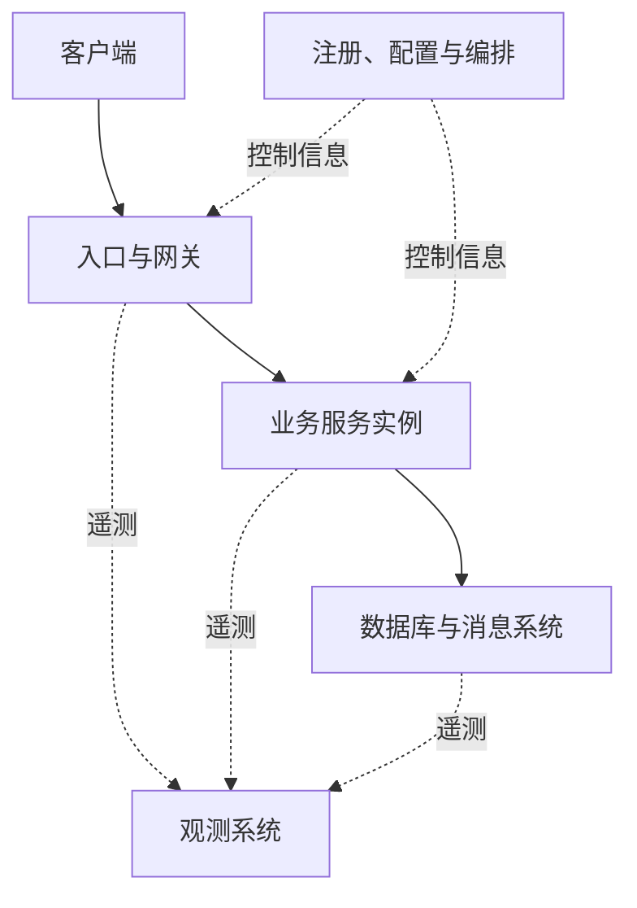

# 第十六讲：分布式系统与基础设施

> 本讲围绕分布式系统的核心机制、服务协作与基础设施展开。正文把网络调用、数据状态、故障处理与 Go 实验放在同一条学习主线上，全部例子均为根据官方 API 和协议语义编写的原创讲解例子。  
> 整理日期：2026-10-21（UTC）。独立 Go 程序统一采用 `go 1.27.0` 模块语言设置，并用 Go 1.27.3 工具链校验；程序仅使用标准库。框架部分按文中注明的官方版本与文档说明，不把旧版目录或代码直接当作新版 API。

<a id="section-001"></a>

> **统一运行基线：** 建议使用 Go 1.27.3，示例模块声明采用 `go 1.27.0`。文中出现其他 Go 版本时，仅用于说明特性引入时间或历史实现差异；第三方依赖仍以对应模块的版本要求为准。


*图示：分布式服务协作。*

## 正文导航

- [零、主要内容与实验约定](#section-002)
- [一、什么是分布式系统](#section-003)
  - [1.1 原始的程序：先理解单进程的保证](#section-004)
  - [1.2 分布式：独立组件通过消息协作](#section-005)
- [二、为什么需要分布式系统](#section-007)
  - [2.1 扩展能力：吞吐、并发与容量余量](#section-008)
  - [2.2 可用性：增加节点与增加依赖并不是同一件事](#section-009)
  - [2.3 组织与交付：按可独立变化的能力划边界](#section-010)
- [三、分布式系统的核心要素](#section-011)
  - [3.1 服务拆分：首先确定业务与数据的主人](#section-012)
  - [3.2 服务之间的通信](#section-016)
  - [3.3 负载均衡](#section-022)
    - [3.3.1 硬件负载均衡](#section-023)
    - [3.3.2 软件负载均衡](#section-024)
  - [3.4 服务注册和发现](#section-028)
  - [3.5 数据一致性](#section-032)
  - [3.6 高可用](#section-039)
  - [3.7 服务监控观测](#section-047)
- [四、基础设施层级关系](#section-052)
  - [4.1 从硬件到业务的职责地图](#section-053)
  - [4.2 数据面与控制面](#section-054)
  - [4.3 配置发布：先验证，再整体替换](#section-055)
  - [4.4 Kubernetes 的位置：管理实例与访问抽象](#section-056)
  - [4.5 网关、代理、服务网格与框架的区别](#section-057)
  - [4.6 一次下单请求如何穿过这些责任边界](#section-058)
- [五、微服务介绍](#section-059)
  - [5.1 什么是微服务](#section-060)
    - [5.1.1 微服务的服务与服务之间的通信协议](#section-061)
    - [5.1.2 微服务的注册中心和寻址](#section-062)
  - [5.2 Go 的微服务框架](#section-063)
    - [5.2.1 常见 Go 微服务框架与选择维度](#section-064)
    - [5.2.2 go-zero](#section-066)
    - [5.2.3 Kratos](#section-069)
    - [5.2.4 CloudWeGo：Kitex + Hertz](#section-073)
- [六、总结与综合运行实验](#section-078)
  - [6.1 把机制放到同一条请求里](#section-079)
  - [6.2 用七个问题检查一个服务设计](#section-080)
- [七、复习问答与综合练习【讲解补充】](#section-081)
  - [7.1 26 道复习题与参考答案](#section-082)
  - [7.2 综合练习一：设计可查询结果的订单创建接口](#section-083)
  - [7.3 综合练习二：发现变化与停机排空](#section-084)
  - [7.4 综合练习三：用观测证据解释重试放大](#section-085)
- [八、官方资料导航、版本与核验边界](#section-086)
  - [8.1 按问题查资料](#section-087)
  - [8.2 版本与环境记录](#section-088)
  - [8.3 程序与核验记录](#section-089)

<a id="section-002"></a>

## 主要内容与实验约定

本讲回答一个连续的问题：把一个 Go 程序拆成几个通过网络协作的服务后，调用怎样找到对方、失败怎样被识别、重复请求怎样处理、数据保证怎样表达、流量怎样分摊，以及出了故障怎样知道发生了什么。框架是在这些机制上组织代码的工具；理解机制之后，才能判断框架配置是否符合业务承诺。

贯穿例子是一套简化商城：报价服务读取商品价格，库存服务管理可售数量，订单服务记录订单，入口把客户端请求路由到合适实例。最初它们可以在一个程序内。随着规模或组织边界变化，可以把其中一些能力拆开；每次拆开都会新增通信与故障边界。

| 学习阶段 | 要能解释的问题 | 可观察结果 |
| --- | --- | --- |
| 单程序到多服务 | 本地调用与远程调用差在哪里 | 结果、错误和未知结果 |
| 服务治理 | 超时、取消、重试、发现、负载均衡怎样配合 | 请求次数、选中节点和截止时间 |
| 数据一致性 | 副本、消息、事务与幂等各保证什么 | 版本、重复处理次数和状态迁移 |
| 高可用 | 限流、熔断、隔离、健康检查怎样发挥作用 | 接受、拒绝、恢复与排空 |
| 观测与基础设施 | 谁负责业务，谁负责控制，谁负责转发 | 关联请求、资源饱和与控制面变化 |
| 框架落地 | go-zero、Kratos、Kitex、Hertz 怎样组织代码 | 契约、生成物、适配层与业务层 |

所有标为 DS 编号的程序都是独立 `package main`，每次把一个程序保存为单独目录里的 `main.go`，运行 `go run .`。模块文件可以使用：

```mod
module example.com/distributed-notes

go 1.27.0
```

部分程序用 `httptest.NewServer` 在本机随机端口启动真实 HTTP 服务，运行结束自动关闭。这是可重复的本地网络实验，不是跨机房性能测试。另一些程序明确标为状态机或逻辑时钟模型，用固定输入展示顺序，避免靠短暂 sleep 猜测并发时机。模型能解释一个机制，不能据此声称实现了完整的共识数据库、注册中心或消息系统。

例子中的固定库存、固定时间、固定追踪标识都是示例数据。生产环境的持久化、安全身份、证书、随机标识、超时阈值与部署拓扑必须按实际系统设计。程序中返回的确定性输出用于验证语义，不提供未经测量的 QPS 或时延排名。[Go net/http](https://pkg.go.dev/net/http)、[httptest](https://pkg.go.dev/net/http/httptest)、[context](https://pkg.go.dev/context)。

<a id="section-003"></a>

## 一、什么是分布式系统

<a id="section-004"></a>

### 1.1 原始的程序：先理解单进程的保证

一个程序可以包含很多包、函数和 goroutine。它们运行在同一个进程中，并不因为“并发很多”就自动成为分布式系统。本地函数调用的参数可以是内存对象，返回值与错误沿调用栈返回；共享内存的访问需要同步，但不需要把每次调用都序列化为网络消息。

把功能写在同一个进程，也不等于代码只能杂乱堆在一个文件。商品、订单、支付可以各有模块、接口和测试，仍一起编译部署。结构清晰的模块化单体能保留本地调用与单库事务的便利，是理解后续拆分成本的起点。

**DS-01：在同一进程中完成报价。** 输入是商品单价与购买数量，输出是最小货币单位表示的总价。该程序没有数据库或网络，错误来自明确的业务输入，调用者能够直接取得结果。

```go
// 运行示例：DS-01
package main

import (
	"errors"
	"fmt"
)

type Product struct {
	SKU        string
	PriceCents int64
}

func quote(p Product, quantity int64) (int64, error) {
	if quantity <= 0 || quantity > 100 {
		return 0, errors.New("quantity out of range")
	}
	if p.PriceCents < 0 || p.PriceCents > 1_000_000 {
		return 0, errors.New("price out of range")
	}
	return p.PriceCents * quantity, nil
}

func main() {
	p := Product{SKU: "book", PriceCents: 1250}
	total, err := quote(p, 2)
	if err != nil {
		panic(err)
	}
	fmt.Println("total cents:", total)
	_, err = quote(p, 0)
	fmt.Println("invalid quantity:", err != nil)
}
```

输出：

```text
total cents: 2500
invalid quantity: true
```

代码先检查乘数范围，再乘法，避免例子把整数金额误写成无边界计算。现实中的金额计算还需要币种、税费与舍入约定。这里没有先网络写入再丢回复的情况，因此结果判断相对直接；这正是下一步拆分后发生变化的地方。

还要区分进程与数据边界。一个 Web 进程访问独立 PostgreSQL 实例时，系统整体已经包含网络协作；“应用仍是单体”只描述应用部署结构，不表示整个系统完全不分布。很多生产系统是在模块化应用与外部数据库之间逐步演化，而非从一个函数瞬间跳到几十个微服务。

<a id="section-005"></a>

### 1.2 分布式：独立组件通过消息协作

分布式系统由多个能独立运行、失败和通信的组件协作完成工作。核心困难是各组件没有一个随时可读的共享全局状态，消息可能延迟、重复、丢失或在有限观察时间内没有返回。调用者看到超时，不能仅凭这一事实区分对方没收到、正在处理、处理完但回复丢失。

“部署在不同机器”是常见形态，不是理解机制的唯一入口。同一机器上两个进程也存在序列化、连接和独立生命周期。反过来，一个程序开十个 goroutine 主要面对共享内存并发，不能把互斥锁等同于跨节点分布式锁。

**DS-02：报价入口调用独立 HTTP 商品服务。** 程序在本机启动商品服务和报价服务，外层客户端请求报价。各服务通过 JSON 和 HTTP 交互，入口不直接读取商品服务内的变量。

```go
// 运行示例：DS-02
package main

import (
	"encoding/json"
	"fmt"
	"net/http"
	"net/http/httptest"
	"time"
)

type Product struct {
	SKU        string `json:"sku"`
	PriceCents int64  `json:"price_cents"`
}
type Quote struct {
	SKU        string `json:"sku"`
	TotalCents int64  `json:"total_cents"`
}

func main() {
	catalog := httptest.NewServer(http.HandlerFunc(func(w http.ResponseWriter, r *http.Request) {
		if r.Method != http.MethodGet || r.URL.Path != "/products/book" {
			http.NotFound(w, r)
			return
		}
		w.Header().Set("Content-Type", "application/json")
		if err := json.NewEncoder(w).Encode(Product{"book", 1250}); err != nil {
			return
		}
	}))
	defer catalog.Close()
	client := &http.Client{Timeout: time.Second}
	entry := httptest.NewServer(http.HandlerFunc(func(w http.ResponseWriter, r *http.Request) {
		if r.Method != http.MethodGet || r.URL.Path != "/quote" {
			http.NotFound(w, r)
			return
		}
		req, err := http.NewRequestWithContext(r.Context(), http.MethodGet, catalog.URL+"/products/book", nil)
		if err != nil {
			http.Error(w, "request", 500)
			return
		}
		resp, err := client.Do(req)
		if err != nil {
			http.Error(w, "catalog unavailable", 503)
			return
		}
		defer resp.Body.Close()
		if resp.StatusCode != http.StatusOK {
			http.Error(w, "catalog response", 502)
			return
		}
		var p Product
		if err := json.NewDecoder(resp.Body).Decode(&p); err != nil {
			http.Error(w, "catalog payload", 502)
			return
		}
		w.Header().Set("Content-Type", "application/json")
		if err := json.NewEncoder(w).Encode(Quote{p.SKU, p.PriceCents * 2}); err != nil {
			return
		}
	}))
	defer entry.Close()

	resp, err := client.Get(entry.URL + "/quote")
	if err != nil {
		panic(err)
	}
	defer resp.Body.Close()
	var q Quote
	if err := json.NewDecoder(resp.Body).Decode(&q); err != nil {
		panic(err)
	}
	fmt.Println("status:", resp.StatusCode)
	fmt.Println("quote:", q.SKU, q.TotalCents)
}
```

输出：

```text
status: 200
quote: book 2500
```

一次业务请求经过三段角色：客户端发起，报价服务编排，商品服务提供价格。报价服务用 `r.Context()` 创建下游请求，让入口请求的取消能沿调用链传播；它检查 HTTP 状态码，因为 `Client.Do` 成功返回不代表业务一定成功。读取完响应后关闭 Body，才能正确管理连接和资源。[Client.Do](https://pkg.go.dev/net/http#Client.Do)、[NewRequestWithContext](https://pkg.go.dev/net/http#NewRequestWithContext)。

这个例子仍把两个服务放在一个测试进程，便于启动和回收。网络边界是真实的；进程隔离、跨机器路由、TLS 和故障域隔离尚未模拟。若真的拆成两个可执行程序，主要变化是地址配置与生命周期，业务的超时、状态码和契约问题已经存在。

<a id="section-006"></a>

#### 1.2.1 最重要的新状态：结果未知

远程操作通常不只有“成功”和“失败”两种观察。若扣款已提交但响应丢失，客户端知道的是“没有得到成功确认”，并不知道业务一定没有发生。机械地再次发送扣款，可能产生重复副作用。这是幂等键、状态查询和对账存在的原因。

**DS-03：业务已提交，确认没有到达。** 用明确的函数模型隔开“服务器状态变化”和“客户端观察”，不靠真实断网来制造偶发现象。

```go
// 运行示例：DS-03
package main

import (
	"errors"
	"fmt"
)

var errReplyLost = errors.New("reply lost after commit")

type Ledger struct {
	Charges int
}

func (l *Ledger) chargeAndLoseReply() error {
	l.Charges++
	return errReplyLost
}

func main() {
	ledger := &Ledger{}
	err := ledger.chargeAndLoseReply()
	fmt.Println("client has success:", err == nil)
	fmt.Println("server charges:", ledger.Charges)
	_ = ledger.chargeAndLoseReply()
	fmt.Println("charges after blind retry:", ledger.Charges)
}
```

输出：

```text
client has success: false
server charges: 1
charges after blind retry: 2
```

例子故意没有去重，所以第二次调用再次扣款。真正的修复不是捕获错误后忽略它，而是在请求协议与持久化状态中建立可判定的业务身份，例如“这次订单提交”的幂等键，并保证同一个键的竞争请求只能产生一个结果。后文会给出完整的处理模型。

还要避免另一种误解：TCP 提供可靠字节流，不等于应用知道业务事务是否提交。连接断开时，传输层并不替开发者回答数据库状态；HTTP 状态码也只有在响应确实到达时才可使用。分布式设计需要分别记录“发送了什么”“确认了什么”“业务最终是什么”。

<a id="section-007"></a>

## 二、为什么需要分布式系统

分布式通常用于解决单一部署边界已经难以承担的问题：容量增长、不同能力需要独立扩缩容、团队需要独立发布、故障需要隔离、调用方跨地域访问、数据或合规边界要求分开管理。它带来的是新的选择空间，同时增加网络通信、运维、版本兼容与一致性成本。

一个商品浏览接口被大量访问，并不意味着支付、库存、报表都必须立即拆成独立服务。先识别瓶颈：CPU、数据库锁、网络带宽、单个热点键、外部依赖配额，还是发布协调成本。给数据库争用前面再增加二十个 Web 副本，可能只是让争用更严重。

<a id="section-008"></a>

### 2.1 扩展能力：吞吐、并发与容量余量

设目标到达率为 `λ`，单实例在目标时延下可持续处理的吞吐为 `c`，计划利用率为 `u`。若流量可以比较均匀地分摊、共享依赖尚未成为瓶颈，则正常所需实例数可粗估为 `ceil(λ/(c×u))`。要在损失 `f` 个等容量实例后仍承受负载，可以把容量条件写成 `(n-f)c u ≥ λ`。

这个公式的输入必须来自代表性测量。c 不是一条最轻请求的峰值；u 不是越接近 100% 越好；λ 需要考虑突发和重试流量。若存在租户热点、分片偏斜或长连接粘连，平均分摊假设可能不成立。

**DS-04：把容量条件写成可检查的计算。**

```go
// 运行示例：DS-04
package main

import (
	"fmt"
	"math"
)

func requiredInstances(arrivals, perInstance, utilization float64, failures int) (int, error) {
	if arrivals < 0 || perInstance <= 0 || utilization <= 0 || utilization > 1 || failures < 0 {
		return 0, fmt.Errorf("invalid capacity input")
	}
	return int(math.Ceil(arrivals/(perInstance*utilization))) + failures, nil
}

func main() {
	n, err := requiredInstances(1200, 300, 0.70, 1)
	if err != nil {
		panic(err)
	}
	fmt.Println("instances:", n)
	fmt.Printf("capacity after one failure: %.0f req/s\n", float64(n-1)*300*0.70)
	fmt.Printf("mean in flight: %.0f requests\n", 1200*0.080)
}
```

输出：

```text
instances: 7
capacity after one failure: 1260 req/s
mean in flight: 96 requests
```

最后一行使用稳定系统中的平均关系 `L=λW`：平均每秒 1200 个请求、平均停留 0.08 秒，平均在途请求为 96。这里的 W 包含开发者所选系统边界内的等待时间；它不是 P99，也不能据此设置“最多 96 并发”就保证不排队。若到达率超过服务能力，队列持续增长，稳定平均条件已经失效。

容量规划还需要恢复能力。副本重启有冷启动，缓存未热时单实例能力可能低于稳态；滚动发布期间可用实例数也会变化。应把部署、故障和流量突增期间的实际能力放进同一张容量表，而不只写正常状态 n 个实例。

<a id="section-009"></a>

### 2.2 可用性：增加节点与增加依赖并不是同一件事

复制同一个无状态服务，可以让一台故障时由另一台继续处理。把一个请求改为必须串行成功调用多个服务，则增加了必须成功的环节。二者对可用性的影响不能都归为“机器更多，所以更可靠”。

在各依赖失败相互独立、每个依赖都必需、没有降级和重试影响的简化模型中，请求成功概率约为各依赖成功概率之积。这个公式不适用于共享机房故障或共享数据库导致的相关失败，也不是生产 SLO 的直接测量方法。

**DS-05：观察依赖链与扇出的代价。**

```go
// 运行示例：DS-05
package main

import (
	"fmt"
	"math"
)

func main() {
	success := math.Pow(0.999, 5)
	atLeastOneSlow := 1 - math.Pow(0.99, 50)
	fmt.Printf("five required dependencies: %.3f%%\n", success*100)
	fmt.Printf("one or more slow branches: %.1f%%\n", atLeastOneSlow*100)
}
```

输出：

```text
five required dependencies: 99.501%
one or more slow branches: 39.5%
```

第二行假设 50 个分支独立，每个有 1% 概率越过某个“慢”阈值，则至少一个慢的概率约为 39.5%。若聚合请求必须等所有分支，尾延迟容易被放大。并行调用减少串行相加，不表示等待所有分支的最长耗时消失。

工程上可以减少不必要扇出、缓存稳定数据、设置总体预算、明确可选依赖、按业务允许部分结果。不能随意给支付结果返回“降级成功”；降级必须有调用方可以理解且业务可以承受的语义。

<a id="section-010"></a>

### 2.3 组织与交付：按可独立变化的能力划边界

团队同时修改同一个大模块，可能出现协调瓶颈。独立服务可以使某些功能独立发布与回滚，但前提是契约向后兼容、数据所有权清楚、监控和部署能力跟得上。若每次修改仍要求五个服务同时发布，部署成五份并没有获得真正的独立演进。

拆分还改变故障排查方式。单机栈回溯能直接看调用路径；跨服务调用要关联多个进程的日志与追踪。一次业务提交也可能跨越多个持久化系统，原本一个本地事务能够表达的规则变成跨服务协调。是否值得拆分，应同时比较收益和这组长期成本。

<a id="section-011"></a>

## 三、分布式系统的核心要素

<a id="section-012"></a>

### 3.1 服务拆分：首先确定业务与数据的主人

好的边界围绕能相对独立理解的业务能力。订单负责订单状态与规则，库存负责可用数量与预留，支付负责支付尝试与确认。不要仅按“所有查询放一服务、所有写入放另一服务”机械拆分，也不要把每张表都自动变成一个服务。

服务拥有的数据，原则上通过它的契约访问。若订单服务直接修改库存服务的数据库表，库存规则可能被绕过，数据库结构变化也会同时影响调用者。共享数据库并非绝对不允许，但必须明确这是过渡或有意耦合，不能声称已经获得完全独立的演进边界。

<a id="section-013"></a>

#### 3.1.1 从接口开始隔离业务规则

**DS-06：业务用例依赖存储接口。** 这还不是远程系统，而是拆分前建立边界。将来内存实现换成 SQL 或 RPC，业务规则仍有清晰归属。

```go
// 运行示例：DS-06
package main

import (
	"context"
	"fmt"
)

type StockRepository interface {
	Reserve(context.Context, string, int) (bool, error)
}
type OrderService struct{ Stock StockRepository }

func (s OrderService) Place(ctx context.Context, sku string, quantity int) (string, error) {
	if quantity <= 0 {
		return "", fmt.Errorf("invalid quantity")
	}
	ok, err := s.Stock.Reserve(ctx, sku, quantity)
	if err != nil {
		return "", err
	}
	if !ok {
		return "rejected", nil
	}
	return "reserved", nil
}

type MemoryStock struct{ Quantity int }

func (m *MemoryStock) Reserve(ctx context.Context, sku string, quantity int) (bool, error) {
	if err := ctx.Err(); err != nil {
		return false, err
	}
	if sku != "book" || quantity > m.Quantity {
		return false, nil
	}
	m.Quantity -= quantity
	return true, nil
}

func main() {
	stock := &MemoryStock{Quantity: 3}
	service := OrderService{Stock: stock}
	status, err := service.Place(context.Background(), "book", 2)
	if err != nil {
		panic(err)
	}
	fmt.Println(status, stock.Quantity)
	status, err = service.Place(context.Background(), "book", 2)
	if err != nil {
		panic(err)
	}
	fmt.Println(status, stock.Quantity)
}
```

输出：

```text
reserved 1
rejected 1
```

第一次预留成功使库存从 3 变 1，第二次不足时不改变状态。接口不仅是“方便 mock”，它表达调用方需要什么保证：返回 true 意味着预留已经成立，而不是只读取到还有库存。内存实现只用于串行讲解；并发实现需要原子条件更新或相应同步，远程实现还必须处理结果未知。

接口也不能隐藏所有差异。把本地 Reserve 替换成 RPC 后，超时、重试、错误分类与幂等仍要体现在使用约定中。一个看起来像普通函数的远程客户端，不会让网络不确定性消失。

<a id="section-014"></a>

#### 3.1.2 跨服务流程：补偿与数据库回滚不同

订单预留库存后，支付可能失败。若两个状态属于不同服务的独立事务，一个服务的 ROLLBACK 不能自动撤销另一个服务已提交的工作。可以设计补偿流程：支付失败后释放预留，让业务朝可接受的最终状态推进。

**DS-07：用状态机表达一个简单补偿过程。**

```go
// 运行示例：DS-07
package main

import (
	"errors"
	"fmt"
)

type Flow struct {
	Stock    int
	Reserved int
	Status   string
}

func (f *Flow) run(quantity int, pay func() error) error {
	if quantity <= 0 || f.Stock < quantity {
		return errors.New("no stock")
	}
	f.Stock -= quantity
	f.Reserved = quantity
	f.Status = "reserved"
	if err := pay(); err != nil {
		f.Stock += f.Reserved
		f.Reserved = 0
		f.Status = "compensated"
		return err
	}
	f.Status = "confirmed"
	return nil
}

func main() {
	f := &Flow{Stock: 5, Status: "new"}
	err := f.run(2, func() error { return errors.New("payment declined") })
	fmt.Println("payment failed:", err != nil)
	fmt.Println("state:", f.Status)
	fmt.Println("stock:", f.Stock)
}
```

输出：

```text
payment failed: true
state: compensated
stock: 5
```

这只是补偿语义的同步模型。真实系统还要持久化流程状态，让进程在“库存已预留、补偿尚未发送”时崩溃也能恢复；补偿可能失败、重复或延迟，必须可重试且幂等。退款不是让世界回到从未扣款的历史，它可能产生单独的退款记录与调用方通知。

流程设计应列出状态、允许的迁移、每步执行者、超时时的下一步与人工处理入口。不要在一个函数里写几次 HTTP 调用，就把它叫作可靠的分布式事务。是否需要两阶段提交、Saga、预留确认或异步协调，取决于业务允许的中间状态与底层系统能力。

<a id="section-015"></a>

#### 3.1.3 事务发件箱：把“要发送事件”变成持久化事实

常见问题是订单已提交，但发送“订单创建”消息前进程退出。把发送放到提交前又可能让消费者收到最终没有提交的订单。事务发件箱的思路是在同一个本地事务中保存业务变化和待投递事件，再由后台投递器发送；投递器可能重复，因此消费者仍需去重。

**DS-08：发件箱和消费去重的状态模型。**

```go
// 运行示例：DS-08
package main

import "fmt"

type Event struct{ ID, OrderID string }
type Store struct {
	Orders map[string]bool
	Outbox []Event
}

func (s *Store) commitOrder(id string) {
	if s.Orders[id] {
		return
	}
	s.Orders[id] = true
	s.Outbox = append(s.Outbox, Event{ID: "created:" + id, OrderID: id})
}

type Consumer struct {
	Seen          map[string]bool
	Notifications int
}

func (c *Consumer) handle(e Event) bool {
	if c.Seen[e.ID] {
		return false
	}
	c.Seen[e.ID] = true
	c.Notifications++
	return true
}

func main() {
	store := &Store{Orders: map[string]bool{}}
	consumer := &Consumer{Seen: map[string]bool{}}
	store.commitOrder("O-1")
	store.commitOrder("O-1")
	event := store.Outbox[0]
	fmt.Println("orders and events:", len(store.Orders), len(store.Outbox))
	fmt.Println("first delivery:", consumer.handle(event))
	fmt.Println("duplicate delivery:", consumer.handle(event))
	fmt.Println("notifications:", consumer.Notifications)
}
```

输出：

```text
orders and events: 1 1
first delivery: true
duplicate delivery: false
notifications: 1
```

这里的 map 和切片只展示状态关系，进程退出后并不持久。生产实现需要让订单与 outbox 在数据库事务里一起提交，让消费去重记录与消费者的业务变化也在合适事务里提交。若先标记 seen 再执行外部通知，而通知失败，就可能吞掉重试；跨外部副作用还要继续设计幂等接口或状态查询。

消息“至少投递一次”与业务效果“只产生一次”是两个层次。去重表的保留期、事件唯一性范围、消息顺序和重放策略也属于协议。不能只写一个 Redis SETNX 就宣称端到端 exactly-once，尤其当它与业务数据库不在同一个原子边界内。


<a id="section-016"></a>

### 3.2 服务之间的通信

通信需要同时说明传输协议、数据编码与业务契约。HTTP 是应用层协议，JSON 是一种编码形式，gRPC 是 RPC 框架与协议体系，Protocol Buffers 常用来描述和编码消息；它们不是同一维度的四个互斥选项。客户端还需要知道方法、路径或服务名、字段含义、错误语义、认证方式及兼容策略。

同步调用适合调用者当前必须得到结果的操作。异步消息适合把某些工作解耦，但不意味着不需要结果：系统可能通过事件或状态查询获得最终结果。异步链路也有队列积压、重复、乱序、消费失败和死信处理问题，不能把“发给消息队列”当成可靠性问题的终点。

<a id="section-017"></a>

#### 3.2.1 契约先于传输细节

以创建订单为例，输入至少要规定商品标识、数量、操作身份；输出要规定订单号、当前状态与错误代码。金额单位、时间格式、字段是否可省略、空字符串与缺失的区别都属于契约。传输成功但字段含义不一致，仍会产生错误业务状态。

HTTP 状态码用于表达协议层面的结果类别，业务错误码用于表达更具体的业务原因。不要把所有错误都返回 200，再让调用者搜索正文里是否有“error”。也不要对所有 5xx 一律重试：有些失败已经产生副作用，有些说明请求一直无法成功。[RFC 9110](https://www.rfc-editor.org/rfc/rfc9110.html)。

**DS-09：请求解码、语义校验和响应状态分开。**

```go
// 运行示例：DS-09
package main

import (
	"encoding/json"
	"fmt"
	"io"
	"net/http"
	"net/http/httptest"
	"strings"
)

type Input struct {
	Quantity int `json:"quantity"`
}

func handler(w http.ResponseWriter, r *http.Request) {
	r.Body = http.MaxBytesReader(w, r.Body, 256)
	decoder := json.NewDecoder(r.Body)
	decoder.DisallowUnknownFields()
	var input Input
	if err := decoder.Decode(&input); err != nil {
		http.Error(w, "invalid JSON", http.StatusBadRequest)
		return
	}
	var extra any
	if err := decoder.Decode(&extra); err != io.EOF {
		http.Error(w, "one JSON value required", http.StatusBadRequest)
		return
	}
	if input.Quantity <= 0 || input.Quantity > 100 {
		http.Error(w, "quantity out of range", http.StatusUnprocessableEntity)
		return
	}
	w.Header().Set("Content-Type", "application/json")
	if err := json.NewEncoder(w).Encode(map[string]int{"accepted": input.Quantity}); err != nil {
		return
	}
}

func main() {
	for _, body := range []string{
		`{"quantity":2}`,
		`{"quantity":0}`,
		`{"quantity":2,"unexpected":true}`,
		`{"quantity":2} {"quantity":3}`,
	} {
		req := httptest.NewRequest(http.MethodPost, "/orders", strings.NewReader(body))
		response := httptest.NewRecorder()
		handler(response, req)
		fmt.Println(response.Code)
	}
}
```

输出：

```text
200
422
400
400
```

第一条是可接受输入；第二条 JSON 合法但数量违反业务规则；第三条因本例选择严格请求契约而拒绝未知字段；第四条包含两个顶层值，不能因为第一次 Decode 成功就放过后面的内容。`MaxBytesReader` 限制读取量，这里把解码错误统一映射为 400；生产若区分大小错误，可识别 `*http.MaxBytesError` 返回 413。[encoding/json](https://pkg.go.dev/encoding/json)、[MaxBytesReader](https://pkg.go.dev/net/http#MaxBytesReader)。

严格拒绝未知请求字段是本例的接口选择，不是所有 API 的通用要求。对外部响应做兼容读取时，允许服务端新增未知字段往往更合适。关键是把规则写进契约并测试旧客户端，而不是在不同服务间任意切换。

<a id="section-018"></a>

#### 3.2.2 超时预算：每一跳都消耗同一个总预算

假设客户端给一次下单 300ms，总入口处理已消耗 70ms，还要预留 30ms 组装和返回，那么接下来的所有必要工作只剩 200ms。不能在每一跳都重新获得完整的 300ms；否则入口早已超时，下游仍在做没有使用者等待的工作。

可把下游预算表示为 `min(单次上限, 剩余总预算−返回预留)`。串行步骤共同消耗余额；并行步骤可以同时进行，但最终等待、失败处理和结果汇总仍受总 deadline 约束。重试退避时间、排队等待与连接建立也会消耗预算。

**DS-10：用固定时刻计算预算。**

```go
// 运行示例：DS-10
package main

import (
	"fmt"
	"time"
)

func childBudget(deadline, now time.Time, reserve, cap time.Duration) (time.Duration, bool) {
	left := deadline.Sub(now) - reserve
	if left <= 0 || cap <= 0 {
		return 0, false
	}
	if left > cap {
		left = cap
	}
	return left, true
}

func main() {
	start := time.Unix(1_700_000_000, 0)
	deadline := start.Add(300 * time.Millisecond)
	first, ok := childBudget(deadline, start.Add(70*time.Millisecond), 30*time.Millisecond, 150*time.Millisecond)
	fmt.Println("first budget:", first, ok)
	second, ok := childBudget(deadline, start.Add(240*time.Millisecond), 30*time.Millisecond, 150*time.Millisecond)
	fmt.Println("later budget:", second, ok)
	last, ok := childBudget(deadline, start.Add(280*time.Millisecond), 30*time.Millisecond, 150*time.Millisecond)
	fmt.Println("too late:", last, ok)
}
```

输出：

```text
first budget: 150ms true
later budget: 30ms true
too late: 0s false
```

这是预算计算模型，不会等待这些毫秒数。真实程序用 `context.WithTimeout(parent, limit)` 或 `WithDeadline` 派生，并调用返回的 cancel 释放资源；子 context 不会把父 deadline 延后。应优先沿用上游 context，而不是在服务内部重置成 Background。[context](https://pkg.go.dev/context)。

超时有不同阶段。`http.Client.Timeout` 覆盖整个请求生命周期的时间范围，包括读取响应体；Transport 还可控制连接、TLS 握手和等待响应头等阶段。服务器的 ReadHeaderTimeout、ReadTimeout、WriteTimeout 和 IdleTimeout 各有对象，不能互相替代。流式响应更不能机械使用适合短请求的总时限。[Client](https://pkg.go.dev/net/http#Client)、[Transport](https://pkg.go.dev/net/http#Transport)、[Server](https://pkg.go.dev/net/http#Server)。

gRPC 也需要设置合理 deadline。Go 的调用通常通过 context 传入，跨下游调用时应沿用请求 context。gRPC 的 deadline 传播会考虑已消耗时间，不应手工把不同机器上的墙钟绝对值当成无误差的共同时间。框架可以传递取消信号，业务启动的工作仍需要主动响应。[gRPC Deadlines](https://grpc.io/docs/guides/deadlines/)。

<a id="section-019"></a>

#### 3.2.3 取消是合作信号，不是强制终止

Go 不提供安全地任意杀死一个 goroutine 的机制。context 取消关闭 Done，调用方与被调用方需要在等待或循环中检查它。一个无限计算循环如果完全不观察 context，不会因为客户端取消就自动结束；数据库或 HTTP API 是否响应取消，也要看具体接口与驱动。

**DS-11：真实 HTTP 调用中取消客户端，并观察服务端 context。** 使用 channel 明确等待服务端已进入处理，避免靠 sleep 猜测时机。

```go
// 运行示例：DS-11
package main

import (
	"context"
	"errors"
	"fmt"
	"net/http"
	"net/http/httptest"
	"time"
)

func main() {
	entered := make(chan struct{})
	observed := make(chan bool, 1)
	server := httptest.NewServer(http.HandlerFunc(func(w http.ResponseWriter, r *http.Request) {
		close(entered)
		<-r.Context().Done()
		observed <- errors.Is(r.Context().Err(), context.Canceled)
	}))
	defer server.Close()

	parent, stop := context.WithTimeout(context.Background(), 3*time.Second)
	defer stop()
	ctx, cancel := context.WithCancel(parent)
	defer cancel()
	req, err := http.NewRequestWithContext(ctx, http.MethodGet, server.URL, nil)
	if err != nil {
		panic(err)
	}
	result := make(chan error, 1)
	go func() {
		resp, err := server.Client().Do(req)
		if resp != nil {
			resp.Body.Close()
		}
		result <- err
	}()
	select {
	case <-entered:
	case <-parent.Done():
		panic("server did not start")
	}
	cancel()
	err = <-result
	fmt.Println("client canceled:", errors.Is(err, context.Canceled))
	select {
	case ok := <-observed:
		fmt.Println("server observed cancellation:", ok)
	case <-parent.Done():
		panic("server did not observe cancellation")
	}
}
```

输出：

```text
client canceled: true
server observed cancellation: true
```

输出说明这个 HTTP 处理链感知到了取消，不说明任何已执行的业务写入自动回滚。假设服务端在观察 Done 前已经提交订单，它仍可能保留订单。取消用于停止尚不需要继续的工作；幂等和状态查询用于处理业务结果不确定，两者不能混为一谈。

长期任务需要自己的生命周期。如果调用方发起的是“启动后台导出”，请求返回后导出仍应继续，那么应该持久化任务并由独立工作者处理，而不是偷偷把所有请求都改成 Background。这样才明确谁拥有任务、何时取消、如何恢复与怎样查询结果。

<a id="section-020"></a>

#### 3.2.4 重试：可重试错误、幂等、次数与预算缺一不可

重试适合某些短暂故障，但会增加负载。系统过载时，所有客户端立即重试会放大压力；多层重试叠加尤其危险。若入口最多尝试 3 次，服务 A 对 B 也尝试 3 次，最坏情况下一个业务请求可能触发 9 次下游尝试，更多层会继续相乘。

一个重试策略至少说明：哪些操作允许重放；哪些失败可以重试；最多尝试几次；每次超时是多少；退避与随机抖动怎样安排；总体预算怎样终止；重试被拒绝时怎样返回。认证失败、参数错误和确定的业务拒绝通常不应靠相同请求反复尝试解决。

**DS-12：有限重试与退避计划。** 本例注入 wait 函数记录退避，不实际休眠，重点验证尝试次数与错误分类。

```go
// 运行示例：DS-12
package main

import (
	"context"
	"errors"
	"fmt"
	"time"
)

var temporary = errors.New("temporary unavailable")

func retry(ctx context.Context, maxAttempts int, call func() (string, error), wait func(context.Context, time.Duration) error) (string, error) {
	if maxAttempts < 1 {
		return "", errors.New("invalid attempts")
	}
	var last error
	delay := 10 * time.Millisecond
	for attempt := 0; attempt < maxAttempts; attempt++ {
		if err := ctx.Err(); err != nil {
			return "", err
		}
		value, err := call()
		if err == nil {
			return value, nil
		}
		last = err
		if !errors.Is(err, temporary) || attempt+1 == maxAttempts {
			break
		}
		if err := wait(ctx, delay); err != nil {
			return "", err
		}
		if delay < 80*time.Millisecond {
			delay *= 2
		}
	}
	return "", last
}

func main() {
	attempts := 0
	var delays []time.Duration
	value, err := retry(context.Background(), 3, func() (string, error) {
		attempts++
		if attempts < 3 {
			return "", temporary
		}
		return "ok", nil
	}, func(ctx context.Context, delay time.Duration) error {
		delays = append(delays, delay)
		return ctx.Err()
	})
	if err != nil {
		panic(err)
	}
	fmt.Println("result:", value)
	fmt.Println("attempts:", attempts)
	fmt.Println("planned backoff:", delays)
	ctx, cancel := context.WithCancel(context.Background())
	cancel()
	_, err = retry(ctx, 3, func() (string, error) { panic("must not run") },
		func(context.Context, time.Duration) error { return nil })
	fmt.Println("canceled before attempt:", errors.Is(err, context.Canceled))
}
```

输出：

```text
result: ok
attempts: 3
planned backoff: [10ms 20ms]
canceled before attempt: true
```

实际 wait 应使用 timer 并 select ctx.Done，而不是无法取消的长 sleep；真实退避应加入适当随机抖动，避免大量实例同时醒来。本例只重试显式 temporary 哨兵错误，且调用不产生不可重复副作用；这不是建议只要网络报错就重试创建订单。

gRPC 的透明重试与应用配置的 retry policy 要区分。没有显式策略也可能存在框架能判定应用逻辑尚未处理的透明重试；配置按状态码重试后，范围会扩大，业务幂等责任仍在。收到响应头后 RPC 在重试机制中的 committed 含义，也不能直接等同于当前的数据库事务提交。[gRPC Retry](https://grpc.io/docs/guides/retry/)。

<a id="section-021"></a>

#### 3.2.5 幂等键：同一个业务意图只能形成一个结果

HTTP 中幂等描述相同请求重复执行的预期效果，并不要求每次响应文本都完全相同。例如第一次 DELETE 删除资源，第二次可能报告不存在，但目标状态仍是资源不存在。POST 的默认语义不保证幂等；可以通过明确的业务协议建立幂等创建。[RFC 9110 `9.2.2](https://www.rfc-editor.org/rfc/rfc9110.html#name-idempotent-methods)。

**DS-13：同键同参数重放结果，同键不同参数拒绝。** 这是单进程、内存版幂等状态模型；代码用 mutex 让检查与创建构成一个临界区。

```go
// 运行示例：DS-13
package main

import (
	"encoding/json"
	"fmt"
	"net/http"
	"net/http/httptest"
	"strings"
	"sync"
)

type Input struct {
	SKU      string `json:"sku"`
	Quantity int    `json:"quantity"`
}
type Record struct {
	Input   Input
	OrderID string
}
type API struct {
	mu      sync.Mutex
	records map[string]Record
	created int
}

func (a *API) ServeHTTP(w http.ResponseWriter, r *http.Request) {
	key := r.Header.Get("Idempotency-Key")
	var input Input
	if key == "" || json.NewDecoder(r.Body).Decode(&input) != nil || input.SKU == "" || input.Quantity <= 0 {
		http.Error(w, "bad input", 400)
		return
	}
	a.mu.Lock()
	defer a.mu.Unlock()
	if old, ok := a.records[key]; ok {
		if old.Input != input {
			http.Error(w, "key conflict", 409)
			return
		}
		w.Header().Set("Replay", "true")
		w.WriteHeader(http.StatusCreated)
		fmt.Fprint(w, old.OrderID)
		return
	}
	a.created++
	id := fmt.Sprintf("O-%d", a.created)
	a.records[key] = Record{Input: input, OrderID: id}
	w.Header().Set("Replay", "false")
	w.WriteHeader(http.StatusCreated)
	fmt.Fprint(w, id)
}

func main() {
	api := &API{records: map[string]Record{}}
	for _, body := range []string{
		`{"sku":"book","quantity":2}`,
		`{"sku":"book","quantity":2}`,
		`{"sku":"book","quantity":3}`,
	} {
		req := httptest.NewRequest(http.MethodPost, "/orders", strings.NewReader(body))
		req.Header.Set("Idempotency-Key", "operation-1")
		response := httptest.NewRecorder()
		api.ServeHTTP(response, req)
		fmt.Println(response.Code, response.Header().Get("Replay"), strings.TrimSpace(response.Body.String()))
	}
	fmt.Println("created:", api.created)
}
```

输出：

```text
201 false O-1
201 true O-1
409  key conflict
created: 1
```

第一条创建，第二条读取相同结果，第三条因同键绑定了不同参数而冲突。Header 名称及 Replay 是本例约定，不声称这是所有平台统一实现的规范。生产应限制键长度、明确租户和操作范围，并把规范化参数摘要与结果持久化；不能让其他调用方通过猜测键读到别人的结果。

多实例时，每个实例各有一张 map 不够。需要共享的原子存储、唯一约束或等效协调，使竞争请求只能有一个创建者，并把业务提交与幂等状态结合起来。处理中、成功、可重试失败、未知状态和过期键的策略也要写清。TTL 到期后再次请求是否允许创建新业务，必须与客户端重试窗口一致。


<a id="section-022"></a>

### 3.3 负载均衡

负载均衡解决“某次请求交给哪个可用实例”的问题。它需要候选实例、健康状态、分配算法与转发或直连机制。它不自动复制业务数据，也不自动解决幂等、事务与数据库容量；两个无状态实例如果都依赖同一个过载数据库，入口分流仍可能一起失败。

按决策位置，可以分为客户端负载均衡与代理式负载均衡。客户端先发现多个地址，再选一个直接调用；代理接收请求后选择后端。两者都可能存在多层结构，例如边缘代理分流到服务入口，内部 RPC 客户端再对后端实例做选择。

按协议处理层次，可以讨论四层与七层。四层主要依据连接和传输层信息转发；七层可以理解 HTTP 路径、Header 等应用语义。这个维度与“硬件还是软件”不同：专用设备也可处理七层，普通服务器上的软件也可做四层转发。

<a id="section-023"></a>

#### 3.3.1 硬件负载均衡

硬件负载均衡通常指以专用设备交付的流量处理能力，可能包含专用加速、接口、管理与高可用机制。它可以位于数据中心入口，负责大规模连接转发、TLS 处理或应用流量策略。实际功能取决于产品和配置，不能把“硬件”直接等同于所有场景性能最高或不会故障。

选择时需要比较连接数、吞吐、每秒新建连接、TLS 握手、规则复杂度、故障切换、升级流程与成本。只看标称带宽不能推断复杂 L7 规则下的业务吞吐。两台设备若共享电源、机房或错误配置，也不构成所有故障域上的独立冗余。

设备本身同样需要健康检查和控制配置。后端端口能建立 TCP 连接，只能说明网络服务可达，不一定表示实例已准备好处理订单。硬件设备也要理解或接入合适的应用健康信号，否则可能把请求稳定地送给“进程活着但无法服务”的实例。

<a id="section-024"></a>

#### 3.3.2 软件负载均衡

软件方案可作为独立代理、服务端入口或客户端库部署。NGINX、HAProxy、Envoy 等属于常见流量代理类别；Kubernetes Service 提供服务访问抽象，具体数据转发由集群网络实现；gRPC 客户端也有解析与负载均衡机制。它们的职责和部署位置不同，不应都称为同一个“微服务框架”。

软件更容易随着服务扩缩容和自动化配置演进，但也需要考虑 CPU、内存、连接与配置传播。代理增加一跳，客户端方案把更多策略放入每种语言的客户端，两者没有脱离环境的统一赢家。[NGINX HTTP Load Balancing](https://nginx.org/en/docs/http/load_balancing.html)、[gRPC Load Balancing](https://grpc.io/docs/guides/custom-load-balancing/)。

<a id="section-025"></a>

##### 轮询与健康候选集合

**DS-14：只在可用实例中轮询，并处理空集合。**

```go
// 运行示例：DS-14
package main

import (
	"errors"
	"fmt"
)

type RoundRobin struct {
	endpoints []string
	next      int
}

func (r *RoundRobin) Replace(endpoints []string) {
	r.endpoints = append([]string(nil), endpoints...)
	r.next = 0
}
func (r *RoundRobin) Pick() (string, error) {
	if len(r.endpoints) == 0 {
		return "", errors.New("no ready endpoints")
	}
	chosen := r.endpoints[r.next%len(r.endpoints)]
	r.next = (r.next + 1) % len(r.endpoints)
	return chosen, nil
}

func main() {
	rr := &RoundRobin{}
	rr.Replace([]string{"A", "B"})
	for i := 0; i < 4; i++ {
		name, err := rr.Pick()
		if err != nil {
			panic(err)
		}
		fmt.Println(name)
	}
	rr.Replace([]string{"B"})
	name, err := rr.Pick()
	if err != nil {
		panic(err)
	}
	fmt.Println("after removal:", name)
	rr.Replace(nil)
	_, err = rr.Pick()
	fmt.Println("empty rejected:", err != nil)
}
```

输出：

```text
A
B
A
B
after removal: B
empty rejected: true
```

例子把“更新候选集合”和“选择一个候选”分开。真实系统需要同步更新与并发读取，并且剔除需要时间；一次探测成功也不保证下一次业务请求必成功。空集合应返回明确的不可用错误，不能对长度为零的切片取模。

轮询适合请求成本与实例能力大致相近的情况。若 A 的请求每次 1ms，B 的请求每次 1s，平均分配请求数不等于平均负载。若长连接内承载大量 RPC，按连接轮询也不等于按 RPC 均衡。

<a id="section-026"></a>

##### 权重与最少在途请求

**DS-15：按整数权重构造一个讲解分配周期。** 这里不是复刻 NGINX 的具体调度实现，而是用可观察顺序解释权重比例。

```go
// 运行示例：DS-15
package main

import "fmt"

type Node struct {
	Name   string
	Weight int
}

func weightedSchedule(nodes []Node) ([]string, error) {
	var result []string
	for _, node := range nodes {
		if node.Weight <= 0 || node.Weight > 100 {
			return nil, fmt.Errorf("invalid weight")
		}
		for i := 0; i < node.Weight; i++ {
			result = append(result, node.Name)
		}
	}
	if len(result) == 0 {
		return nil, fmt.Errorf("no nodes")
	}
	return result, nil
}

func main() {
	schedule, err := weightedSchedule([]Node{{"A", 2}, {"B", 1}})
	if err != nil {
		panic(err)
	}
	counts := map[string]int{}
	for i := 0; i < 6; i++ {
		name := schedule[i%len(schedule)]
		counts[name]++
		fmt.Print(name)
		if i < 5 {
			fmt.Print(" ")
		}
	}
	fmt.Println()
	fmt.Println("counts:", counts["A"], counts["B"])
}
```

输出：

```text
A A B A A B
counts: 4 2
```

权重可以表示不同容量或渐进放量，但权重 2:1 不保证任意短时间窗都恰好 2:1。动态摘除、请求失败和连接复用都会改变观察分布。生产还要避免大权重通过复制列表耗费大量内存，可采用更合适的算法结构。

**DS-16：根据当前在途数量分配，完成后释放。**

```go
// 运行示例：DS-16
package main

import "fmt"

type Node struct {
	Name     string
	InFlight int
}
type Pool struct{ Nodes []Node }

func (p *Pool) Acquire() int {
	best := 0
	for i := 1; i < len(p.Nodes); i++ {
		if p.Nodes[i].InFlight < p.Nodes[best].InFlight {
			best = i
		}
	}
	p.Nodes[best].InFlight++
	return best
}
func (p *Pool) Release(index int) {
	if p.Nodes[index].InFlight <= 0 {
		panic("unbalanced release")
	}
	p.Nodes[index].InFlight--
}

func main() {
	pool := &Pool{Nodes: []Node{{"A", 2}, {"B", 0}}}
	first := pool.Acquire()
	second := pool.Acquire()
	third := pool.Acquire()
	fmt.Println("chosen:", pool.Nodes[first].Name, pool.Nodes[second].Name, pool.Nodes[third].Name)
	pool.Release(first)
	fourth := pool.Acquire()
	fmt.Println("after completion:", pool.Nodes[fourth].Name)
	fmt.Println("in flight:", pool.Nodes[0].InFlight, pool.Nodes[1].InFlight)
}
```

输出：

```text
chosen: B B A
after completion: B
in flight: 3 2
```

本例用在途请求数，和某些代理的“最少连接”不是完全同一个指标。在 HTTP/2 上，一条连接可以复用多个流，连接少不一定工作少。真实选择还可结合延迟、错误率与权重，但反馈指标有噪声，过度追逐短期最快节点可能造成流量抖动。例子假定候选非空、串行执行；并发实现必须保护选中与计数增加的原子性。

<a id="section-027"></a>

##### 一个可运行的 Go 反向代理组合

**DS-17：两个后端、一个代理、一次故障与一次配置更新。** 把选择、转发和失败结果放到同一轮真实 HTTP 实验里。

```go
// 运行示例：DS-17
package main

import (
	"fmt"
	"io"
	"net/http"
	"net/http/httptest"
	"net/http/httputil"
	"net/url"
	"strings"
	"sync"
	"time"
)

type Router struct {
	mu      sync.Mutex
	targets []*url.URL
	next    int
}

func (r *Router) Pick() *url.URL {
	r.mu.Lock()
	defer r.mu.Unlock()
	target := r.targets[r.next%len(r.targets)]
	r.next = (r.next + 1) % len(r.targets)
	return target
}
func (r *Router) Replace(targets []*url.URL) {
	r.mu.Lock()
	defer r.mu.Unlock()
	r.targets = append([]*url.URL(nil), targets...)
	r.next = 0
}
func backend(name string) *httptest.Server {
	return httptest.NewServer(http.HandlerFunc(func(w http.ResponseWriter, r *http.Request) {
		fmt.Fprint(w, name)
	}))
}
func parse(value string) *url.URL {
	u, err := url.Parse(value)
	if err != nil {
		panic(err)
	}
	return u
}
func fetch(client *http.Client, address string) {
	response, err := client.Get(address)
	if err != nil {
		panic(err)
	}
	defer response.Body.Close()
	data, err := io.ReadAll(response.Body)
	if err != nil {
		panic(err)
	}
	fmt.Println(response.StatusCode, strings.TrimSpace(string(data)))
}

func main() {
	a, b := backend("A"), backend("B")
	defer a.Close()
	defer b.Close()
	router := &Router{}
	router.Replace([]*url.URL{parse(a.URL), parse(b.URL)})
	transport := http.DefaultTransport.(*http.Transport).Clone()
	defer transport.CloseIdleConnections()
	proxy := &httputil.ReverseProxy{
		Rewrite: func(r *httputil.ProxyRequest) {
			r.SetURL(router.Pick())
			r.SetXForwarded()
		},
		Transport: transport,
		ErrorHandler: func(w http.ResponseWriter, r *http.Request, err error) {
			http.Error(w, "upstream unavailable", http.StatusBadGateway)
		},
	}
	entry := httptest.NewServer(proxy)
	defer entry.Close()
	client := &http.Client{Timeout: 2 * time.Second}
	for i := 0; i < 4; i++ {
		fetch(client, entry.URL)
	}
	a.Close()
	fetch(client, entry.URL)
	router.Replace([]*url.URL{parse(b.URL)})
	fetch(client, entry.URL)
}
```

输出：

```text
200 A
200 B
200 A
200 B
502 upstream unavailable
200 B
```

前四次按请求轮询。关闭 A 后，路由表还包含 A，所以第五次失败；只有收到新的候选配置后才固定选择 B。这个时间窗口解释了“后端已坏，但发现与健康状态尚未传播”的现实。程序有意不自动重放失败请求，因为代理不能凭一个连接错误推断任意写请求都可安全重试。

程序使用 `ReverseProxy.Rewrite`、`SetURL` 与 `SetXForwarded`。Forwarded 类 Header 的信任边界必须清楚，不能接受任意客户端自报 IP 就作为内部认证或审计依据。该路由器只在已知非空配置上运行；通用实现还应像 DS-14 一样处理空候选，而不是在 Rewrite 中 panic。[ReverseProxy](https://pkg.go.dev/net/http/httputil#ReverseProxy)。

NGINX 可以用类似概念声明 upstream，例如下面是配置片段，不属于独立 Go 程序，也未在本环境启动 NGINX：

```nginx
upstream quote_pool {
    server 127.0.0.1:9001 weight=2 max_fails=2 fail_timeout=10s;
    server 127.0.0.1:9002 weight=1 max_fails=2 fail_timeout=10s;
}
server {
    listen 8080;
    location / {
        proxy_connect_timeout 300ms;
        proxy_read_timeout 2s;
        proxy_pass http://quote_pool;
    }
}
```

这里的 `proxy_read_timeout` 是两次读取之间的超时约束，不应当作整个业务请求总耗时上限。被动失败判断和主动健康探测也不同；具体功能在开源版、商业版及版本间有差异，应查目标版本，不凭一份示例宣称默认具备所有治理功能。[NGINX proxy module](https://nginx.org/en/docs/http/ngx_http_proxy_module.html)、[NGINX upstream](https://nginx.org/en/docs/http/ngx_http_upstream_module.html)。


<a id="section-028"></a>

### 3.4 服务注册和发现

服务名是稳定的逻辑身份，实例地址是会变化的运行位置。注册让实例把地址及元数据公布出来；发现让调用者得到可连接的候选集合。注册中心不负责代替所有业务调用，也不等于负载均衡器：发现给出候选，负载均衡选择候选，传输层实际连接。

典型流程是：实例启动并完成必要初始化；注册服务名、实例 ID、地址与版本等信息；持续续约或由平台观察健康；客户端获取初始快照并订阅变化；实例退出时摘除并排空。每一步都可能延迟或失败，客户端仍必须处理连接失败。

<a id="section-029"></a>

#### 3.4.1 租约、心跳与陈旧实例

租约让注册记录在没有持续续约时最终失效。心跳是一种故障检测输入，不是“节点一定活着”的证明：节点与注册中心可通信，但与某个客户端不通；网络暂停可能使活节点丢租约；旧进程恢复后也可能试图继续工作。

**DS-18：逻辑时钟中的租约到期与实例代次。** 用整数 tick 代替真实时间，便于准确观察过期边界。

```go
// 运行示例：DS-18
package main

import (
	"fmt"
	"sort"
)

type Entry struct {
	Address    string
	Generation int
	Expires    int
}
type Registry map[string]Entry

func (r Registry) Register(id, address string, generation, now, ttl int) bool {
	if ttl <= 0 {
		return false
	}
	if old, ok := r[id]; ok && generation <= old.Generation {
		return false
	}
	r[id] = Entry{address, generation, now + ttl}
	return true
}
func (r Registry) Renew(id string, generation, now, ttl int) bool {
	old, ok := r[id]
	if !ok || old.Generation != generation || old.Expires <= now || ttl <= 0 {
		return false
	}
	old.Expires = now + ttl
	r[id] = old
	return true
}
func (r Registry) Ready(now int) []string {
	result := []string{}
	for _, entry := range r {
		if entry.Expires > now {
			result = append(result, entry.Address)
		}
	}
	sort.Strings(result)
	return result
}

func main() {
	registry := Registry{}
	registry.Register("a", "A-v1", 1, 0, 5)
	registry.Register("b", "B-v1", 1, 0, 3)
	fmt.Println("tick 0:", registry.Ready(0))
	fmt.Println("renew a:", registry.Renew("a", 1, 2, 5))
	fmt.Println("tick 4:", registry.Ready(4))
	fmt.Println("restart a:", registry.Register("a", "A-v2", 2, 4, 5))
	fmt.Println("old heartbeat accepted:", registry.Renew("a", 1, 4, 5))
	fmt.Println("current:", registry.Ready(4))
}
```

输出：

```text
tick 0: [A-v1 B-v1]
renew a: true
tick 4: [A-v1]
restart a: true
old heartbeat accepted: false
current: [A-v2]
```

B 到期后不再出现在候选中；A 重启为新代次，旧进程的续约不能覆盖新记录。这个模型没有网络与持久化，不能直接代替 etcd lease。真实租约使用注册系统自己的时间与一致性规则，客户端不能只看本机时钟宣称锁仍有效。[etcd Lease/API guarantees](https://etcd.io/docs/v3.6/learning/api_guarantees/)。

TTL 短会更快清理无续约实例，也可能增加抖动与误判；TTL 长减少短暂网络问题造成的摘除，却扩大陈旧地址窗口。合理值来自故障检测、重连、冷启动与业务容忍时间的共同权衡，不存在适用于所有服务的“最佳三秒”。

<a id="section-030"></a>

#### 3.4.2 快照、watch 与版本顺序

客户端通常先取一份全量实例列表，再 watch 后续变化。必须处理两者之间的竞态、连接中断、历史被压缩、事件重放与版本倒退。正确做法是利用服务提供的 revision 或游标，按官方协议连接快照和增量；历史不可恢复时重新取快照。

etcd 的 watch 事件有修订顺序与历史窗口保证，但 watch 本身不等同于每次读取的线性一致性接口。某个前缀没有收到 revision 11，却收到 12，不代表一定丢了 11，因为 11 可能修改了其他键；不要把“所有 revision 必须连续”写成通用故障检测逻辑。[etcd Watch guarantees](https://etcd.io/docs/v3.6/learning/api_guarantees/)。

**DS-19：不可变快照与单调版本更新。** 本例更新的是完整快照，只拒绝倒退，不要求数字连续。

```go
// 运行示例：DS-19
package main

import (
	"fmt"
	"sync"
	"sync/atomic"
)

type Snapshot struct {
	Revision  int64
	Endpoints []string
}
type Cache struct {
	mu      sync.Mutex
	current atomic.Pointer[Snapshot]
}

func (c *Cache) Replace(revision int64, endpoints []string) bool {
	c.mu.Lock()
	defer c.mu.Unlock()
	old := c.current.Load()
	if old != nil && revision <= old.Revision {
		return false
	}
	c.current.Store(&Snapshot{revision, append([]string(nil), endpoints...)})
	return true
}
func (c *Cache) Read() (int64, []string) {
	snapshot := c.current.Load()
	if snapshot == nil {
		return 0, nil
	}
	return snapshot.Revision, append([]string(nil), snapshot.Endpoints...)
}

func main() {
	cache := &Cache{}
	cache.Replace(10, []string{"A"})
	fmt.Println("new snapshot:", cache.Replace(12, []string{"A", "B"}))
	fmt.Println("late snapshot:", cache.Replace(11, []string{"A"}))
	revision, endpoints := cache.Read()
	fmt.Println(revision, endpoints)
	cache.Replace(20, []string{"B", "C"})
	revision, endpoints = cache.Read()
	fmt.Println("after full resync:", revision, endpoints)
}
```

输出：

```text
new snapshot: true
late snapshot: false
12 [A B]
after full resync: 20 [B C]
```

更新锁确保竞争更新不会发生“先检查版本、后被另一个更新超越、再覆盖回旧值”；atomic.Pointer 让读者取得一个完整不可变快照。发布后不能再原地修改其切片，返回时也复制，避免调用者改变缓存。

注册中心暂时不可用时，客户端可以按策略继续使用最后一份快照，但必须知道它可能陈旧。完全清空缓存可能导致所有请求立刻失败，永久使用旧缓存则可能不断调用已下线实例。应明确最大陈旧时间、失败触发刷新和服务降级规则，并观察缓存版本与年龄。

<a id="section-031"></a>

#### 3.4.3 一轮陈旧发现与恢复

**DS-20：发现列表含失效地址，安全读取换一个实例。** 只演示 GET 读取，对创建、扣款等写操作不能直接照搬。

```go
// 运行示例：DS-20
package main

import (
	"context"
	"fmt"
	"io"
	"net/http"
	"net/http/httptest"
	"time"
)

func readAny(ctx context.Context, client *http.Client, endpoints []string) (string, int, error) {
	var last error
	for index, endpoint := range endpoints {
		if err := ctx.Err(); err != nil {
			return "", index, err
		}
		req, err := http.NewRequestWithContext(ctx, http.MethodGet, endpoint, nil)
		if err != nil {
			return "", index, err
		}
		resp, err := client.Do(req)
		if err != nil {
			last = err
			continue
		}
		data, readErr := io.ReadAll(resp.Body)
		resp.Body.Close()
		if readErr != nil {
			last = readErr
			continue
		}
		if resp.StatusCode != http.StatusOK {
			last = fmt.Errorf("backend status %d", resp.StatusCode)
			continue
		}
		return string(data), index + 1, nil
	}
	if last == nil {
		last = fmt.Errorf("no endpoints")
	}
	return "", len(endpoints), last
}

func main() {
	old := httptest.NewServer(http.HandlerFunc(func(w http.ResponseWriter, r *http.Request) {
		fmt.Fprint(w, "old")
	}))
	oldAddress := old.URL
	healthy := httptest.NewServer(http.HandlerFunc(func(w http.ResponseWriter, r *http.Request) {
		fmt.Fprint(w, "B")
	}))
	defer healthy.Close()
	old.Close()
	ctx, cancel := context.WithTimeout(context.Background(), 3*time.Second)
	defer cancel()
	client := &http.Client{Timeout: time.Second}
	value, attempts, err := readAny(ctx, client, []string{oldAddress, healthy.URL})
	if err != nil {
		panic(err)
	}
	fmt.Println("stale view:", value, attempts)
	value, attempts, err = readAny(ctx, client, []string{healthy.URL})
	if err != nil {
		panic(err)
	}
	fmt.Println("refreshed view:", value, attempts)
}
```

输出：

```text
stale view: B 2
refreshed view: B 1
```

第一次在陈旧端点上失败后读到 B，第二次更新发现列表后直接读 B。真实策略不应对所有非 200 盲目切换：404 可能是正确业务结果，401 是认证问题，429 可能要求遵守 Retry-After。这里的候选只代表同一份固定读取能力，失败分类有意简化。

还要控制每个端点的尝试预算：若第一个端点消耗全部三秒，第二个即使健康也没有机会完成。注册与发现改善寻址，不替代超时、重试限制和错误分类。客户端负载均衡应将这些机制统一考虑，而非各层分别无限重试。


<a id="section-032"></a>

### 3.5 数据一致性

“一致”必须说明对象与观察规则。是同一订单在所有副本立即可见，还是一笔事务中账户总额不变，还是消费者最终处理完全部事件？这些保证不同，不能用一个“强一致”代替所有定义。

数据库 ACID 中的一致性关心事务把状态从满足约束的状态带到另一个满足约束的状态；分布式副本的一致性模型关心多个客户端如何观察读写顺序；消息消费的一致性还涉及投递与处理边界。系统可以在一个数据库内使用事务，同时允许搜索索引异步更新，这两种承诺并不矛盾。

<a id="section-033"></a>

#### 3.5.1 把一致性要求写成具体业务语句

可以先写“成功提交订单后，这个调用方立即查询应该看到该订单”，这是读己之写要求。再写“所有后续客户端读取都不能返回早于已完成写入的状态”，这涉及更强的实时顺序约束。再写“无新更新且通信恢复后，所有副本最终收敛”，这是不同的最终收敛目标。

线性一致性要求操作看起来在调用与返回之间的某一点生效，并尊重已经完成操作的实时先后。它不是“所有节点物理时钟完全一样”，也不要求每个副本每时每刻字节完全相同。可以通过适当读取路径和协调协议对外提供该保证，而内部仍存在日志复制过程。

最终一致性必须带上条件：更新停止或足够稳定，消息最终送达，系统采用能收敛的冲突处理方式。单纯“晚一点再同步”不自动保证收敛；两个副本反复覆盖对方、事件永久丢失或冲突规则不确定，都可能破坏这个目标。业务还需规定调用方看到旧值时的体验。

| 业务需求 | 可能需要的机制 | 必须额外澄清 |
| --- | --- | --- |
| 下单后立即看到自己的订单 | 主库读取、会话版本令牌或等待副本追上 | 等待超时如何返回 |
| 全局唯一业务编号 | 唯一约束、协调分配或可证明的编码方案 | 范围、重试与故障恢复 |
| 商品推荐稍后刷新 | 异步事件、缓存、可收敛视图 | 可接受陈旧时间 |
| 库存不能超卖 | 单权威原子扣减、预留或受控分配 | 预留过期、补偿与地域策略 |
| 多副本写入顺序一致 | 共识或等效协议 | 成员、故障模型和读取路径 |
| 重复事件不重复产生效果 | 事件身份与事务性消费去重 | 去重保留、重放与外部副作用 |

选择保证前先确定边界：是一个键、一张表、一笔订单，还是跨多个服务的规则。某个 KV 系统对单键读写提供强保证，并不表示开发者先读两个键再分别写回的整个业务操作自动原子。

<a id="section-034"></a>

#### 3.5.2 副本落后与读己之写

**DS-21：主副本版本不同，读者携带最低可接受版本。** 这个模型说明为什么“写成功后随机读一个副本”可能读到旧值。

```go
// 运行示例：DS-21
package main

import "fmt"

type Value struct {
	Version int
	Balance int
}

func readAtLeast(v Value, minimum int) (int, bool) {
	if v.Version < minimum {
		return 0, false
	}
	return v.Balance, true
}

func main() {
	primary := Value{Version: 1, Balance: 100}
	replica := primary
	primary = Value{Version: 2, Balance: 80}
	fmt.Println("primary:", primary.Version, primary.Balance)
	fmt.Println("replica before delivery:", replica.Version, replica.Balance)
	_, ready := readAtLeast(replica, 2)
	fmt.Println("replica satisfies session:", ready)
	replica = primary
	balance, ready := readAtLeast(replica, 2)
	fmt.Println("after delivery:", balance, ready)
}
```

输出：

```text
primary: 2 80
replica before delivery: 1 100
replica satisfies session: false
after delivery: 80 true
```

版本令牌告诉读取路径不能接受低于版本 2 的值。实现可以等待副本追上、改读权威节点或返回“尚未可见”；不能在不满足要求时悄悄返回旧值，同时声称读己之写成立。数据库实际复制位点与版本表达可能不同，示例整数只是简化模型。

复制不等于备份。误删除可能很快复制到全部副本；高可用副本帮助接管与分担读取，历史备份帮助恢复到更早状态。数据持久化也不等于客户端读取最新值：一个副本保存了旧数据且完全持久，仍可能不满足此次读取的新鲜度要求。

缓存也是副本的一种形式。主库更新后，缓存失效事件可能延迟，读请求也可能在更新前读旧值、更新后才回填，把旧结果重新放入缓存。解决方法需要具体时序与版本策略，不能用“先更新数据库，再删缓存”一句话推导所有并发下都严格一致。

<a id="section-035"></a>

#### 3.5.3 CAP：网络分区期间必须明确取舍

CAP 的关键语境是网络分区使一些节点彼此无法通信。若仍要求这些节点上的请求都能获得符合操作语义的响应，就难以同时维持线性一致的单一历史。为了保持强一致，某些请求可能必须等待或拒绝；为了在隔离的部分继续接受操作，就可能允许彼此暂时冲突的结果。

这不是无条件的“三个功能任选两个”。在没有分区的正常时期，系统仍可同时追求较强一致与较好可用；在分区可能发生的现实网络里，也不能通过宣布“不选 P”让网络故障消失。正式定义中的可用性与日常“99.9% 可用率”、固定毫秒 SLA 也不是同一概念。[Gilbert 与 Lynch 对 CAP 的讨论](https://groups.csail.mit.edu/tds/papers/Gilbert/Brewer2.pdf)。

对库存服务可以具体推演：区域 A 与 B 失联，两边都认为最后一件库存存在。如果两边都必须立即接受购买，就可能卖出两件；若坚持全球总数不超卖，就要让至少一边缺少授权时不能成功扣减，或事先把可售额度分配到各区域。后者改变了业务权限与状态空间，不能理解为简单绕过定理。

对社交点赞则可能允许两边继续记录，恢复后按可收敛规则合并。两种业务选择不同，不是某个数据库永远属于一种抽象标签就解决一切。应针对读写接口写出分区时的成功、拒绝、陈旧读取和恢复行为。

<a id="section-036"></a>

#### 3.5.4 多数派与共识：交集只是开始

多数派法定人数是许多复制协议的重要组件。N 个投票节点的多数通常是 `floor(N/2)+1`；两个多数集合一定相交。这个交集为传递已确认历史提供基础，但仅有“请求发给三个节点，拿到两个回复”还不构成完整 Raft。

Raft 还包含任期、领导者选举、日志匹配、提交规则、持久化与成员变更约束。客户端从哪里读、领导者是否仍有权威、故障恢复后旧日志如何处理，都影响对外语义。不能把一段 map 同步循环称为共识实现。[Raft 论文](https://raft.github.io/raft.pdf)。

**DS-22：多数集合交集与剩余节点条件。**

```go
// 运行示例：DS-22
package main

import "fmt"

func quorum(n int) int { return n/2 + 1 }
func intersection(a, b []int) []int {
	seen := map[int]bool{}
	for _, n := range a {
		seen[n] = true
	}
	result := []int{}
	for _, n := range b {
		if seen[n] {
			result = append(result, n)
		}
	}
	return result
}

func main() {
	n := 5
	fmt.Println("quorum:", quorum(n))
	fmt.Println("intersection:", intersection([]int{1, 2, 3}, []int{3, 4, 5}))
	fmt.Println("three reachable:", 3 >= quorum(n))
	fmt.Println("two reachable:", 2 >= quorum(n))
	fmt.Println("R=1,W=3 guarantees overlap:", 1+3 > n)
}
```

输出：

```text
quorum: 3
intersection: [3]
three reachable: true
two reachable: false
R=1,W=3 guarantees overlap: false
```

固定成员、普通崩溃故障模型下，五个投票节点保留三个能相互通信的多数，才具备继续按多数协议推进的基本条件；它并不保证此刻已经完成选举或磁盘正常。三节点与五节点的容错能力不同，但节点越多也会增加通信、运维与跨区域延迟。

常见的 `R+W>N` 表示读集合与写集合有交集的数量条件。它本身不能证明线性一致性，还需要版本顺序、并发写处理、失败写入、读取修复与具体协议。若使用临时替代节点的 sloppy quorum，集合范围又不同，更不能直接套公式。

共识常服务于关键元数据，如成员配置、领导权和协调状态；不意味着所有业务大对象都应直接写注册中心。关键状态应选择与吞吐、容量和故障模型匹配的存储，并保留恢复路径。

<a id="section-037"></a>

#### 3.5.5 租约到期后的旧持有者：fencing token

获得分布式锁的进程可能暂停很久。租约已经过期、新进程取得锁后，旧进程恢复仍可能向存储发出写入。只在客户端检查“我之前拿到锁了”不足以防止旧写覆盖新写。

一种思路是为每个领导权或锁代次分配单调递增的 fencing token，受保护的资源记录已经接受的最大 token，并拒绝更旧 token 的写入。资源端必须参与校验；把 token 放在日志里而不强制检查没有保护作用。

**DS-23：资源拒绝过时代次的写入。**

```go
// 运行示例：DS-23
package main

import "fmt"

type Resource struct {
	HighestToken uint64
	Value        string
}

func (r *Resource) Write(token uint64, value string) bool {
	if token == 0 || token < r.HighestToken {
		return false
	}
	r.HighestToken = token
	r.Value = value
	return true
}

func main() {
	resource := &Resource{}
	fmt.Println("holder 1:", resource.Write(1, "first"))
	fmt.Println("holder 2:", resource.Write(2, "new"))
	fmt.Println("late holder 1:", resource.Write(1, "stale"))
	fmt.Println("stored:", resource.HighestToken, resource.Value)
}
```

输出：

```text
holder 1: true
holder 2: true
late holder 1: false
stored: 2 new
```

这个程序只演示资源端比较规则，不是完整锁系统。token 的分配必须可靠且不能在恢复后倒退，资源的最高 token 与实际写入也必须在同一个原子边界持久化。若资源尚未见过新 token，单靠这条比较不能知道旧租约刚刚到期；具体安全目标与协议仍需明确。

分布式锁还需要范围、超时、续租、持有者身份和释放条件。不能让旧持有者无条件删除一个已经属于新持有者的锁记录。对库存扣减这类单数据库规则，原子条件更新或约束常比引入额外分布式锁更容易表达和验证。

<a id="section-038"></a>

#### 3.5.6 版本比较：避免覆盖别人的新状态

**DS-24：两个编辑者读到相同版本，只有一个能提交。**

```go
// 运行示例：DS-24
package main

import (
	"fmt"
	"sync"
)

type Document struct {
	Version int
	Text    string
}
type Store struct {
	mu  sync.Mutex
	doc Document
}

func (s *Store) Read() Document {
	s.mu.Lock()
	defer s.mu.Unlock()
	return s.doc
}
func (s *Store) CompareAndSet(expected int, text string) bool {
	s.mu.Lock()
	defer s.mu.Unlock()
	if s.doc.Version != expected {
		return false
	}
	s.doc = Document{Version: expected + 1, Text: text}
	return true
}

func main() {
	store := &Store{doc: Document{Version: 1, Text: "draft"}}
	a, b := store.Read(), store.Read()
	fmt.Println("editor a:", store.CompareAndSet(a.Version, "approved"))
	fmt.Println("editor b:", store.CompareAndSet(b.Version, "old edit"))
	result := store.Read()
	fmt.Println(result.Version, result.Text)
}
```

输出：

```text
editor a: true
editor b: false
2 approved
```

这个同步模型把两个读取安排在写入之前，精确复现冲突时序。失败者应重新读取并决定合并、重试或提示调用方，不能去掉 expected 条件再强制覆盖。数据库实现通常把版本比较放进 UPDATE 的 WHERE 并检查影响行数；HTTP 条件请求也可以通过 ETag 与 If-Match 表达类似前提。[RFC 9110 Conditional Requests](https://www.rfc-editor.org/rfc/rfc9110.html#name-conditional-requests)。

mutex 只保护本进程的 Store。若两台机器各有一个 Store，它们各自的锁不能互相排斥；必须把比较操作放到共同权威存储或适当分布式协议中。这再次说明“使用了并发安全 Go 类型”和“实现跨节点一致性”是不同层次。


<a id="section-039"></a>

### 3.6 高可用

高可用不是“永远不报错”，而是在明确故障模型和时间范围内，持续提供符合业务要求的服务。复制实例、故障检测、容量余量、流量切换、数据恢复与操作流程共同决定结果。两台服务共享唯一数据库、唯一网络出口或相同错误配置，仍有共同失效点。

先定义调用方可以观察的成功：请求是否在预算内返回正确结果，订单是否真正可用，查询是否符合约定的新鲜度。只统计进程存活或 HTTP 200，可能把错误业务结果也算成成功。可用性目标还需要窗口、分母、排除规则和错误预算。

<a id="section-040"></a>

#### 3.6.1 故障域、冗余与恢复目标

副本放在同一台机器，能够帮助某些进程级故障，但不能抵御主机失效。放在不同机器但同一机架，又可能共享供电或网络。跨可用区提高某些故障的隔离程度，也可能增加延迟和成本。设计应从“哪个组件失效会同时影响哪些副本”出发，而不是只数 Pod 数量。

恢复时间目标 RTO 关注多久恢复可用，恢复点目标 RPO 关注可接受丢失多新的数据。异步复制可能有较低正常写延迟，但故障切换时存在尚未复制的数据风险；同步确认能改变丢失窗口，也增加对网络与备库状态的依赖。配置承诺必须与具体数据库语义对应，不能只写“主从架构，零丢失”。

备份、恢复演练与故障切换是不同工作。备份成功日志不证明一定能在目标时间恢复；有副本也不证明错误删除能回滚。应在隔离环境验证恢复流程、记录耗时与所需依赖，明确谁有权执行切换和怎样确认新主权威。

<a id="section-041"></a>

#### 3.6.2 隔离：不要让慢依赖耗尽整个服务

慢请求不仅占 CPU，还可能占连接、goroutine、内存、文件描述符和下游并发配额。若所有业务共享一个无限队列，低优先级报表可能挤占支付所需资源。隔离可以按依赖、租户或业务类别设置不同并发池与队列。

**DS-25：报表池满了，支付池仍可接受工作。**

```go
// 运行示例：DS-25
package main

import "fmt"

type Bulkhead struct{ slots chan struct{} }

func NewBulkhead(limit int) *Bulkhead {
	if limit <= 0 {
		panic("invalid limit")
	}
	return &Bulkhead{slots: make(chan struct{}, limit)}
}
func (b *Bulkhead) TryAcquire() bool {
	select {
	case b.slots <- struct{}{}:
		return true
	default:
		return false
	}
}
func (b *Bulkhead) Release() {
	select {
	case <-b.slots:
	default:
		panic("release without acquire")
	}
}

func main() {
	report := NewBulkhead(2)
	payment := NewBulkhead(1)
	fmt.Println("report:", report.TryAcquire(), report.TryAcquire(), report.TryAcquire())
	fmt.Println("payment:", payment.TryAcquire())
	report.Release()
	fmt.Println("report after completion:", report.TryAcquire())
	fmt.Println("active:", len(report.slots), len(payment.slots))
	report.Release()
	report.Release()
	payment.Release()
}
```

输出：

```text
report: true true false
payment: true
report after completion: true
active: 2 1
```

容量为 2 的 channel 表示最多两个在途工作，并不产生工作线程或自动执行任务。成功获取后应立即安排 defer Release，覆盖错误和取消路径；未获得令牌不能释放。失败时可以快速拒绝、放入有界队列或走明确降级，不能再创建无限 goroutine 等待。

这只能隔离所计量的资源。两个池最终仍可能共享 CPU 或数据库；需要让并发预算与真实瓶颈相匹配。若一个请求需要同时获取多个池，还要统一获取顺序或避免持有一个令牌等待另一个，防止资源级死锁。

<a id="section-042"></a>

#### 3.6.3 限流：控制进入系统的速率

并发限制控制同时在途的数量，速率限制控制单位时间内接受多少请求，二者互补。若请求耗时翻倍，相同 QPS 会产生更多在途；若请求极快，只限制并发可能仍允许很高 QPS 冲击后端。

令牌桶以一定速度补充令牌，桶容量决定允许的突发。无令牌时可以拒绝或等待，但等待队列也应有上限和取消。限流按调用方、租户、API 或全局区分时，要避免一个大租户消耗所有容量。

**DS-26：用逻辑时间演示一个令牌桶。**

```go
// 运行示例：DS-26
package main

import (
	"fmt"
	"time"
)

type Bucket struct {
	Capacity  float64
	Tokens    float64
	PerSecond float64
	Last      time.Duration
}

func (b *Bucket) Allow(now time.Duration) bool {
	if now < b.Last {
		return false
	}
	b.Tokens += (now - b.Last).Seconds() * b.PerSecond
	if b.Tokens > b.Capacity {
		b.Tokens = b.Capacity
	}
	b.Last = now
	if b.Tokens < 1 {
		return false
	}
	b.Tokens--
	return true
}

func main() {
	bucket := &Bucket{Capacity: 2, Tokens: 2, PerSecond: 1}
	for _, now := range []time.Duration{0, 0, 0, 500 * time.Millisecond, time.Second} {
		fmt.Println("at", now, bucket.Allow(now))
	}
}
```

输出：

```text
at 0s true
at 0s true
at 0s false
at 500ms false
at 1s true
```

开始有两个令牌，所以允许两次突发；半秒只补到半个令牌，仍拒绝；一秒时补足一个。模型没有真实等待，也没有并发保护；生产应使用成熟实现或验证同步、时钟与数值边界。

每实例限流与全局限流不同。十个实例各允许 100QPS，不等于服务全局只允许 100QPS。扩缩容会改变总额度；集中额度协调又有可用性与延迟成本。可以用全局配额加本地保护，但要明确精度、突发与断网时的策略。[Google SRE：Handling Overload](https://sre.google/sre-book/handling-overload/)。

<a id="section-043"></a>

#### 3.6.4 熔断：暂时停止向明显故障的依赖施压

熔断器根据近期失败等信号，从允许调用的 Closed 状态进入快速拒绝的 Open 状态，经过冷却后放少量探测进入 Half-Open，再根据结果恢复或继续拒绝。它与限流不同：限流根据容量或配额控制流量，熔断根据依赖健康信息改变调用许可。

错误分类非常重要。库存不足是正常业务拒绝，不必说明库存服务故障；认证失败也可能是客户端问题。把所有非 200 都计为熔断失败，可能在调用方输入错误时把健康服务切断。

**DS-27：可重复的熔断状态机。** 用逻辑 tick 表示冷却时间，连续两次依赖失败后打开，五个 tick 后只放一个探测。

```go
// 运行示例：DS-27
package main

import "fmt"

type Breaker struct {
	State    string
	Failures int
	RetryAt  int
}

func (b *Breaker) Allow(now int) bool {
	switch b.State {
	case "closed":
		return true
	case "open":
		if now < b.RetryAt {
			return false
		}
		b.State = "half-open"
		return true
	default:
		return false
	}
}
func (b *Breaker) Record(success bool, now int) {
	if success {
		b.State = "closed"
		b.Failures = 0
		return
	}
	b.Failures++
	if b.State == "half-open" || b.Failures >= 2 {
		b.State = "open"
		b.RetryAt = now + 5
	}
}

func main() {
	b := &Breaker{State: "closed"}
	accepted := b.Allow(0)
	b.Record(false, 0)
	fmt.Println("first:", accepted, b.State)
	accepted = b.Allow(1)
	b.Record(false, 1)
	fmt.Println("second:", accepted, b.State)
	fmt.Println("during cooldown:", b.Allow(2), b.State)
	fmt.Println("probe:", b.Allow(6), b.State)
	fmt.Println("second probe:", b.Allow(6), b.State)
	b.Record(true, 6)
	fmt.Println("recovered:", b.Allow(7), b.State)
}
```

输出：

```text
first: true closed
second: true open
during cooldown: false open
probe: true half-open
second probe: false half-open
recovered: true closed
```

程序只接受顺序调用，一次探测未完成时拒绝第二次探测。生产熔断器还需要并发安全、统计窗口、最少请求样本、慢请求策略与每个端点或方法的隔离范围。过低阈值会抖动，过长冷却会延缓恢复，完全没有探测又可能永远不能知道依赖已恢复。

熔断后的行为是返回明确失败或执行业务允许的降级。例如推荐列表可以暂时用缓存；支付确认不能无依据地降级成成功。应把“功能可用性降低”和“业务状态仍正确”分开说明，避免用好看的成功率掩盖错误结果。

<a id="section-044"></a>

#### 3.6.5 存活、就绪与启动检查

存活检查关注进程是否需要重启；就绪检查关注是否适合接收新流量；启动检查为慢启动提供独立窗口。它们的动作不同，不能把一个依赖数据库的探测同时机械用于所有目的。

如果数据库短暂故障导致所有实例存活检查失败并一起重启，重启可能加剧连接冲击。就绪状态也需要谨慎：某个可选依赖不可用时，是否整个实例都要摘除，取决于其还能提供哪些功能。[Kubernetes Probes](https://kubernetes.io/docs/concepts/workloads/pods/probes/)。

**DS-28：退出流量时保持进程存活。**

```go
// 运行示例：DS-28
package main

import (
	"fmt"
	"net/http"
	"net/http/httptest"
	"sync/atomic"
)

type Health struct{ ready atomic.Bool }

func (h *Health) ServeHTTP(w http.ResponseWriter, r *http.Request) {
	switch r.URL.Path {
	case "/live":
		w.WriteHeader(http.StatusOK)
	case "/ready":
		if !h.ready.Load() {
			http.Error(w, "not ready", 503)
			return
		}
		w.WriteHeader(http.StatusOK)
	default:
		http.NotFound(w, r)
	}
}
func check(h http.Handler, path string) int {
	response := httptest.NewRecorder()
	h.ServeHTTP(response, httptest.NewRequest(http.MethodGet, path, nil))
	return response.Code
}

func main() {
	health := &Health{}
	fmt.Println("starting:", check(health, "/live"), check(health, "/ready"))
	health.ready.Store(true)
	fmt.Println("serving:", check(health, "/live"), check(health, "/ready"))
	health.ready.Store(false)
	fmt.Println("draining:", check(health, "/live"), check(health, "/ready"))
}
```

输出：

```text
starting: 200 503
serving: 200 200
draining: 200 503
```

启动和排空时 ready 返回 503，但 live 仍为 200。这让平台知道“暂不送新流量”而不是“必须立即杀掉进程”。真正排空需要等待发现、代理或 EndpointSlice 变化传播，已经建立的连接也可能继续送来请求，应结合服务端的停止接收与协议行为设计。

健康接口应轻量、有明确边界。每次健康检查都执行昂贵全库查询，可能在故障时制造额外负载。深入检查适合独立探测或诊断，不应无条件放在高频存活检查里。

<a id="section-045"></a>

#### 3.6.6 优雅关闭：停止接收、等待在途、限制等待

**DS-29：HTTP 服务关闭时让已进入的请求完成。** 程序通过 channel 保证请求已开始，再触发 Shutdown，最后释放业务处理。

```go
// 运行示例：DS-29
package main

import (
	"context"
	"errors"
	"fmt"
	"io"
	"net"
	"net/http"
	"time"
)

type Result struct {
	Status int
	Err    error
}

func main() {
	entered := make(chan struct{})
	release := make(chan struct{})
	shutdownStarted := make(chan struct{})
	listener, err := net.Listen("tcp", "127.0.0.1:0")
	if err != nil {
		panic(err)
	}
	server := &http.Server{
		ReadHeaderTimeout: time.Second,
		Handler: http.HandlerFunc(func(w http.ResponseWriter, r *http.Request) {
			close(entered)
			<-release
			fmt.Fprint(w, "done")
		}),
	}
	defer server.Close()
	server.RegisterOnShutdown(func() { close(shutdownStarted) })
	serveDone := make(chan error, 1)
	go func() { serveDone <- server.Serve(listener) }()
	responseDone := make(chan Result, 1)
	go func() {
		client := &http.Client{Timeout: 3 * time.Second}
		response, err := client.Get("http://" + listener.Addr().String())
		if err != nil {
			responseDone <- Result{Err: err}
			return
		}
		_, err = io.Copy(io.Discard, response.Body)
		response.Body.Close()
		responseDone <- Result{Status: response.StatusCode, Err: err}
	}()
	select {
	case <-entered:
	case early := <-responseDone:
		panic(fmt.Sprintf("request failed before handler entered: %v", early.Err))
	}
	ctx, cancel := context.WithTimeout(context.Background(), 3*time.Second)
	defer cancel()
	stopped := make(chan error, 1)
	go func() { stopped <- server.Shutdown(ctx) }()
	<-shutdownStarted
	close(release)
	result := <-responseDone
	fmt.Println("in-flight completed:", result.Err == nil && result.Status == 200)
	fmt.Println("shutdown completed:", <-stopped == nil)
	fmt.Println("serve returned closed:", errors.Is(<-serveDone, http.ErrServerClosed))
}
```

输出：

```text
in-flight completed: true
shutdown completed: true
serve returned closed: true
```

示例等待 Handler 开始时，同时观察客户端是否提前失败；否则即使客户端已经超时退出，主 goroutine 仍可能永远等不到 `entered`。客户端错误通过有缓冲的 `responseDone` 返回，使失败路径也能结束等待。

Shutdown 关闭监听器、处理空闲连接并等待活跃请求进入可关闭状态；它有 context 限制。Serve 返回 ErrServerClosed 是正常停机信号。主函数必须等 Shutdown 完成，不能看到 Serve 返回就立即退出，导致在途处理被进程结束打断。[Server.Shutdown](https://pkg.go.dev/net/http#Server.Shutdown)。

Shutdown 不负责自动关闭或等待被 hijack 的连接，例如某些 WebSocket；后台 goroutine 和消费者也有自己的停止协议。RegisterOnShutdown 的回调可触发其他协议的排空，但不能误以为它会同步等待所有回调完成。若超时，应按业务策略决定强制关闭、持久化待处理任务与记录未完成结果。

真实部署顺序还需与平台终止宽限期配合：先降低就绪、等待必要传播、启动服务排空、停止消费者接新任务、等待已接任务或持久化进度、刷新观测数据、最后退出。总耗时不能超过平台允许时间，否则最后仍会被强制结束。

<a id="section-046"></a>

#### 3.6.7 扩缩容与故障演练

自动扩容不是即时保护。指标采样、控制器决策、调度、镜像拉取、启动与预热都消耗时间；短时突发可能在新实例就绪前已经压垮旧实例。因此需要现有容量余量、有界队列、限流与快速失败配合，不能把扩容当成无限缓冲。

缩容同样需要保护：减少副本会改变流量分配、连接数量和本地缓存命中；如果幂等状态只在被删除实例内，重复请求可能失去去重能力。无状态服务意味着关键业务状态不依赖某个实例存活，并不意味着它内部完全没有缓存或连接池。

演练应从明确假设出发：停止一个实例、使一个依赖变慢、让发现缓存陈旧、让一次消息重复、让一个消费者在提交后确认前退出。观察请求结果、状态、恢复时间和重复效果，验证承诺是否成立。不要只在所有节点健康时压测成功，就宣称系统已经具备高可用。


<a id="section-047"></a>

### 3.7 服务监控观测

监控回答“是否出现了已知异常”，观测还帮助解释“一个新的异常为什么发生”。分布式请求跨越多个进程，只看某台机器 CPU 或单条错误日志很难还原全链路。通常需要结合指标、日志、追踪，以及必要的剖析和业务状态。

指标适合聚合趋势与告警，日志适合离散事件与上下文，追踪适合请求跨服务的关系。它们不是三个互相替代的工具，也不是收集越多越好；每项数据都要能回答一个问题，并控制成本与敏感信息范围。[OpenTelemetry Signals](https://opentelemetry.io/docs/concepts/signals/)。

<a id="section-048"></a>

#### 3.7.1 指标：流量、错误、延迟与饱和

一个服务至少应知道请求量、成功与失败类别、延迟分布和关键资源饱和度。CPU 很低不代表健康：所有请求可能在等待数据库连接，或被一个锁串行阻塞。队列深度、在途数、连接池等待、goroutine 数和拒绝计数可以解释这些现象。

延迟要看分布，不能只看平均值。百分之九十九的请求很快，百分之一非常慢，平均值仍可能“很好看”，但部分调用方体验已经差。成功请求和失败请求也应分开看，快速返回 503 会降低平均耗时，却不代表服务改善。[Google SRE Monitoring](https://sre.google/sre-book/monitoring-distributed-systems/)。

**DS-30：用固定观测值构造累计直方图。**

```go
// 运行示例：DS-30
package main

import "fmt"

func main() {
	durations := []float64{0.010, 0.030, 0.120}
	buckets := []float64{0.020, 0.050, 0.100}
	sum := 0.0
	for _, value := range durations {
		sum += value
	}
	for _, bound := range buckets {
		count := 0
		for _, value := range durations {
			if value <= bound {
				count++
			}
		}
		fmt.Printf("le=%.2f count=%d\n", bound, count)
	}
	fmt.Println("le=+Inf count=", len(durations))
	fmt.Printf("count=%d sum=%.3f seconds\n", len(durations), sum)
}
```

输出：

```text
le=0.02 count=1
le=0.05 count=2
le=0.10 count=2
le=+Inf count= 3
count=3 sum=0.160 seconds
```

累计桶中的一次观测可能计入多个上界桶，不能把这些桶相加当作请求总数。+Inf 桶包含全部样本。示例仅解释聚合结构，不启动 Prometheus；生产应使用标准客户端库和合适桶边界，避免每次请求遍历所有历史样本。

跨实例 P99 不能把每台实例的 P99 简单求平均。应选择可聚合的直方图等数据，再按查询规则估计总体分位数；估计精度取决于桶布局与数据类型。若关心 300ms SLO，桶边界应能合理表达该阈值附近的分布。[Prometheus Histograms](https://prometheus.io/docs/practices/histograms/)。

标签基数直接影响时序数量。路由模板 `/orders/{id}` 是有限集合，原始路径 `/orders/某个订单号` 可能无限增长；调用方 ID、请求 ID 通常更适合日志或追踪，不能任意塞进指标标签。指标名称还应带清楚的单位与累计计数语义。[Prometheus Naming](https://prometheus.io/docs/practices/naming/)。

<a id="section-049"></a>

#### 3.7.2 日志：记录可以关联的事件

日志要能回答某个请求进入了哪个服务、采用什么关键决策、调用哪个依赖、返回什么错误。结构化字段比拼接长字符串更容易查询和聚合。需要统一 request_id、trace_id、service、route、status、error_code 等字段的含义，而不是各团队随意命名相同概念。

**DS-31：用标准库 slog 输出结构化日志。** 为了固定输出移除时间字段，生产日志通常应保留合适的时间信息。

```go
// 运行示例：DS-31
package main

import (
	"log/slog"
	"os"
)

func main() {
	handler := slog.NewJSONHandler(os.Stdout, &slog.HandlerOptions{
		ReplaceAttr: func(groups []string, attr slog.Attr) slog.Attr {
			if attr.Key == slog.TimeKey {
				return slog.Attr{}
			}
			return attr
		},
	})
	logger := slog.New(handler).With("service", "orders", "request_id", "R-1")
	logger.Info("request completed", "method", "POST", "route", "/orders", "status", 201)
	logger.Warn("dependency unavailable", "dependency", "inventory", "retry", false)
}
```

输出：

```text
{"level":"INFO","msg":"request completed","service":"orders","request_id":"R-1","method":"POST","route":"/orders","status":201}
{"level":"WARN","msg":"dependency unavailable","service":"orders","request_id":"R-1","dependency":"inventory","retry":false}
```

两条日志通过 request_id 关联。第二条明确 retry=false，比单独打印“调用失败”更有诊断价值。实际请求中若调用方输入可控制某些字段，应限制长度并避免把密码、令牌或完整个人资料直接记录。日志既要支持排查，也要满足访问与保留策略。[log/slog](https://pkg.go.dev/log/slog)。

日志采样可能减少高流量成本，但会丢失某些事件；追踪采样也有相同问题。关键业务审计不能未经设计就依赖一套可能采样、可能丢弃的调试日志。订单状态、支付流水与业务审计应有明确的持久化职责。

<a id="section-050"></a>

#### 3.7.3 追踪：同一 trace，不同 span

一个 trace 表示关联操作集合，span 表示其中一次有开始和结束的工作。服务 A 调用 B 时通常创建客户端 span，B 创建服务端 span，二者保留父子或相应关联。不能把同一个 span ID 在所有服务里原样当作“自己的 span”，否则关系会混乱。

W3C Trace Context 定义了 `traceparent` 等头部格式。trace ID 用于关联，不是认证凭据；来自外部的上下文需要按标准校验，不能根据可伪造的 trace ID 授权。跨语言系统通常用 OpenTelemetry 等实现注入和提取，不应各自发明不兼容的编码。[W3C Trace Context](https://www.w3.org/TR/trace-context/)、[OpenTelemetry Context Propagation](https://opentelemetry.io/docs/concepts/context-propagation/)。

**DS-32：保留 trace ID，更新当前调用的父 span 标识。** 本例只识别版本 00，使用固定讲解标识，演示 Header 的传输关系。

```go
// 运行示例：DS-32
package main

import (
	"fmt"
	"io"
	"net/http"
	"net/http/httptest"
	"regexp"
	"strings"
	"time"
)

var pattern = regexp.MustCompile("^00-([0-9a-f]{32})-([0-9a-f]{16})-([0-9a-f]{2})$")

func parseTrace(value string) (string, string, string, bool) {
	parts := pattern.FindStringSubmatch(value)
	if parts == nil || parts[1] == strings.Repeat("0", 32) || parts[2] == strings.Repeat("0", 16) {
		return "", "", "", false
	}
	return parts[1], parts[2], parts[3], true
}

func main() {
	incoming := "00-" + strings.Repeat("1", 32) + "-" + strings.Repeat("2", 16) + "-01"
	traceID, parentSpan, flags, ok := parseTrace(incoming)
	if !ok {
		panic("invalid input trace")
	}
	outgoingSpan := strings.Repeat("3", 16)
	outgoing := "00-" + traceID + "-" + outgoingSpan + "-" + flags
	backend := httptest.NewServer(http.HandlerFunc(func(w http.ResponseWriter, r *http.Request) {
		fmt.Fprint(w, r.Header.Get("traceparent"))
	}))
	defer backend.Close()
	req, err := http.NewRequest(http.MethodGet, backend.URL, nil)
	if err != nil {
		panic(err)
	}
	req.Header.Set("traceparent", outgoing)
	client := &http.Client{Timeout: time.Second}
	response, err := client.Do(req)
	if err != nil {
		panic(err)
	}
	defer response.Body.Close()
	body, err := io.ReadAll(response.Body)
	if err != nil {
		panic(err)
	}
	receivedTrace, receivedSpan, _, valid := parseTrace(string(body))
	fmt.Println("same trace:", valid && receivedTrace == traceID)
	fmt.Println("new parent span:", receivedSpan == outgoingSpan && receivedSpan != parentSpan)
	_, _, _, valid = parseTrace("00-" + strings.Repeat("0", 32) + "-" + outgoingSpan + "-01")
	fmt.Println("invalid zero rejected:", !valid)
}
```

输出：

```text
same trace: true
new parent span: true
invalid zero rejected: true
```

这里没有创建、导出真实 span，也没有实现完整 W3C 版本兼容；它只是可运行的线协议讲解片段。生产使用 SDK 生成符合要求的标识，记录开始结束、状态与属性，再经 exporter/collector 发到后端。固定 ID 只能用于课堂，不能复用到真实请求。

追踪显示时间关系也有局限。不同节点墙钟偏移、采样、异步消息和缺失埋点都会影响可见链路。若一个请求等待数据库 800ms，trace 可能帮助定位等待所在 span，但锁原因仍需数据库监控；若 CPU 热点在本地循环，则应结合 profiling。观测工具需要互相印证。

<a id="section-051"></a>

#### 3.7.4 从指标到告警和定位

SLO 应与调用方体验相关，例如“指定窗口内 99.9% 的合格订单查询在 300ms 内成功”。分母中的请求资格、客户端错误和维护行为要事先定义。若窗口内有一百万次合格请求，0.1% 的失败预算是 1000 次；这是请求型预算，不等于固定分钟数。

告警要帮助采取动作。持续错误率、明显尾延迟和资源饱和通常比“任何一条错误日志”更适合触发值班响应。单纯 CPU 到 80% 可能只是健康地充分使用资源，真正问题要看调用方结果与剩余容量。短窗口与长窗口结合有助于区分突发与持续退化，但阈值应由业务目标和流量规模决定。

一个实用排查顺序是：先确认受影响接口、调用方范围和开始时间；看流量、错误、延迟、饱和是否同时变化；沿 trace 找到慢的依赖或阶段；用结构化日志查看该阶段的错误类型、选中节点与重试次数；再进入数据库计划、连接池或主机资源。不要从某个熟悉工具出发随机翻所有图表。

例如发现“外部请求量没变，下游 QPS 翻三倍，超时增多”，应检查重试放大；发现“只有新部署实例错误，旧实例正常”，应检查配置、依赖兼容和就绪；发现“服务端耗时正常，客户端超时”，应检查代理、网络、排队和客户端预算。每个假设都应有可验证的观测，而不是只凭经验定罪。

观测系统也有故障模式：日志磁盘满、collector 不可用、指标标签爆炸、导出队列拥堵。默认不应让可选遥测同步阻塞所有业务请求；关键审计的可靠性需求则要另行设计。需要监控遥测丢弃、队列和采样状态，知道自己看到的视图是否完整。


<a id="section-052"></a>

## 四、基础设施层级关系

基础设施可以按责任分层理解，但真实系统并不是所有请求都必须依次穿过一张严格的“七层架构图”。配置中心与观测系统通常位于业务调用路径之外；数据库和消息系统是业务状态依赖；框架是应用进程内的代码组织与运行能力。把这些都画成一条直线，会误导故障分析。

<a id="section-053"></a>

### 4.1 从硬件到业务的职责地图

| 层次或能力 | 负责什么 | 常见边界问题 |
| --- | --- | --- |
| 计算、网络与存储资源 | CPU、内存、磁盘、链路、故障域 | 资源耗尽、网络分区、磁盘延迟 |
| 操作系统与容器运行时 | 进程、隔离、资源限制、文件与网络命名空间 | OOM、文件描述符、容器不是虚拟机的所有保证 |
| 编排与调度平台 | 实例放置、期望副本、生命周期、配置挂载 | 调度延迟、滚动更新、就绪传播 |
| 服务网络与入口 | DNS、连接路由、代理、网关与负载均衡 | 地址陈旧、连接粘连、TLS 终止位置 |
| 应用框架与运行组件 | 路由、RPC、序列化、中间件、生命周期 | 默认超时、错误映射、代码生成版本 |
| 业务服务 | 业务规则、身份权限、状态迁移、幂等 | 不变量、补偿、跨服务结果未知 |
| 数据与消息基础设施 | 持久化、查询、复制、事件传输 | 事务隔离、消息重复、恢复与积压 |
| 观测和交付支撑 | 指标、日志、追踪、构建、发布、回滚 | 可见性缺失、配置错误、观测成本 |

这个表按责任组织，不表示“数据库一定比业务低一层，所以业务无需理解它”。订单事务、索引与消费幂等直接影响业务保证，应用开发者必须理解所依赖能力的边界。平台替应用管理部署，也不会替应用定义订单是否允许重复。

<a id="section-054"></a>

### 4.2 数据面与控制面

数据面处理实际业务请求和数据流；控制面配置、管理和协调数据面。网关接收并转发一次请求属于数据面；向网关下发后端列表和路由规则属于控制面。一个产品可能同时提供两类组件，仍应区分其作用。



当控制面暂时不可用，已缓存配置的数据面可能仍能处理现有流量；但新实例注册、配置变更或发现刷新可能停止。是否继续处理、继续多久、配置是否过期，都取决于系统设计。不能简单说“注册中心挂了，所有 RPC 立即失败”，也不能反过来说“注册中心挂了完全不影响业务”。

控制配置是关键状态。错误路由规则可能同时影响所有实例，造成比单机故障更大的故障域。需要验证、版本、灰度、回滚与审计，而不是把所有配置变化当作无风险文本更新。控制面高可用也要避免传播一个错误配置的速度远快于发现问题的速度。

<a id="section-055"></a>

### 4.3 配置发布：先验证，再整体替换

一个配置可能包含超时、并发上限、端点与功能开关。若边读边修改，读者可能看到“新端点配旧凭据”或“新上限配旧预算”的混合状态。通常更容易理解的方式是构建候选配置、完整验证、再原子发布一份快照。

**DS-33：拒绝非法配置并保留上一份有效配置。**

```go
// 运行示例：DS-33
package main

import (
	"encoding/json"
	"fmt"
	"io"
	"strings"
	"sync"
)

type Config struct {
	Revision    int `json:"revision"`
	TimeoutMS   int `json:"timeout_ms"`
	MaxInFlight int `json:"max_in_flight"`
}
type Manager struct {
	mu      sync.RWMutex
	current Config
}

func (m *Manager) Apply(text string) error {
	decoder := json.NewDecoder(strings.NewReader(text))
	decoder.DisallowUnknownFields()
	var candidate Config
	if err := decoder.Decode(&candidate); err != nil {
		return err
	}
	var extra any
	if err := decoder.Decode(&extra); err != io.EOF {
		return fmt.Errorf("trailing input")
	}
	if candidate.TimeoutMS < 1 || candidate.TimeoutMS > 10_000 || candidate.MaxInFlight < 1 {
		return fmt.Errorf("invalid limits")
	}
	m.mu.Lock()
	defer m.mu.Unlock()
	if candidate.Revision <= m.current.Revision {
		return fmt.Errorf("stale revision")
	}
	m.current = candidate
	return nil
}
func (m *Manager) Read() Config {
	m.mu.RLock()
	defer m.mu.RUnlock()
	return m.current
}

func main() {
	manager := &Manager{}
	if err := manager.Apply(`{"revision":1,"timeout_ms":100,"max_in_flight":2}`); err != nil {
		panic(err)
	}
	fmt.Println("initial:", manager.Read())
	err := manager.Apply(`{"revision":2,"timeout_ms":200,"max_in_flight":0}`)
	fmt.Println("invalid rejected:", err != nil)
	fmt.Println("still active:", manager.Read())
	if err := manager.Apply(`{"revision":3,"timeout_ms":200,"max_in_flight":4}`); err != nil {
		panic(err)
	}
	fmt.Println("new active:", manager.Read())
}
```

输出：

```text
initial: {1 100 2}
invalid rejected: true
still active: {1 100 2}
new active: {3 200 4}
```

非法版本 2 没有部分生效，版本 1 继续提供服务；有效版本 3 才整体替换。真实系统还要处理配置引用的资源：例如创建新连接池成功后再发布，旧请求完成后关闭旧池；不能替换指针后立刻销毁仍被请求使用的资源。

回滚不一定意味着版本号倒退。可以把旧内容作为一个新的更高版本发布，让客户端仍按单调版本规则工作。密钥和凭据需要独立的读取权限与轮换机制，不应为了方便把所有敏感内容放入公开的配置示例。

<a id="section-056"></a>

### 4.4 Kubernetes 的位置：管理实例与访问抽象

Kubernetes 提供控制面与节点组件来管理工作负载生命周期，Service 为一组端点提供访问抽象。它不是 Go 微服务框架，也不自动替代 PostgreSQL、消息代理或业务事务。应用可以不运行在 Kubernetes 上；采用 Kubernetes 也不自动使应用具备正确的幂等、取消和数据恢复。[Kubernetes Architecture](https://kubernetes.io/docs/concepts/architecture/)。

普通 Service 可以提供稳定的虚拟访问入口，后端端点通过 EndpointSlice 等资源反映。Headless Service 不分配同样的 ClusterIP 代理入口，而通过 DNS 等方式暴露实例地址供客户端选择。它们适用于不同寻址策略，不能把“DNS 返回一个服务地址”和“客户端拿到所有实例地址”混为一谈。[Kubernetes Service](https://kubernetes.io/docs/concepts/services-networking/service/)。

以下是服务声明的讲解片段，假设已有标签为 `app: quote`、监听 8080 的 Pod；它不是一份能独立部署整个商城的清单：

```yaml
apiVersion: v1
kind: Service
metadata:
  name: quote
spec:
  selector:
    app: quote
  ports:
    - name: http
      port: 80
      targetPort: 8080
```

应用访问的是 Service 端口 80，目标容器监听 8080。示例名称在默认命名空间、默认集群域配置下可以形成类似 `quote.default.svc.cluster.local` 的 DNS 名称，实际命名空间与集群域可不同。Service 的存在不保证有就绪端点；选择器错误或所有实例未就绪时，仍可能无法完成业务请求。

资源 requests 与 limits 影响调度和运行约束，不能直接视为性能承诺。CPU 限制可能使延迟上升，内存超限可能导致进程被终止。Go 的并发数量、缓存大小和连接池配置应考虑容器资源，而不是假设能无限使用宿主机全部能力。

<a id="section-057"></a>

### 4.5 网关、代理、服务网格与框架的区别

API 网关通常是独立运行的入口组件，可承担路由、认证接入、限流和协议适配。业务服务仍应验证自己负责的权限与状态规则，不能把所有授权逻辑都依赖一个可能被内部路径绕过的入口。

反向代理关注请求转发与相关流量能力；网关可能建立在代理之上，再增加 API 管理或业务入口策略。服务网格则把部分服务间流量治理能力放到代理或节点数据面与控制面中，应用仍需要定义可重试语义、传播上下文和处理错误。网格不能从任意 POST 自动推断重复执行是否安全。

应用框架编译进服务进程，帮助组织 Handler、RPC、配置、生命周期与中间件。数据库是持久化与查询系统，注册中心是寻址与协调元数据的基础设施。把 GORM、etcd、NGINX 和 Kratos 放在同一列问“选哪个替代另一个”，会忽略它们承担的不同职责。

| 名称或类别 | 主要运行位置 | 与业务请求的关系 |
| --- | --- | --- |
| Go 标准库、go-zero、Kratos、Kitex、Hertz | 应用进程内 | 构建或执行服务处理逻辑 |
| NGINX、HAProxy、Envoy 等代理 | 独立进程或相邻数据面 | 转发和治理流量 |
| API 网关 | 面向客户端的入口服务 | 路由、入口策略与协议适配 |
| etcd 等协调存储 | 独立集群 | 保存关键元数据，供控制与发现使用 |
| PostgreSQL 等业务数据库 | 独立服务或集群 | 保存与查询业务状态 |
| Kubernetes | 控制面与节点组件 | 管理运行实例及相关网络资源 |
| OpenTelemetry Collector、指标/日志后端 | 观测管道 | 接收和处理遥测数据 |

<a id="section-058"></a>

### 4.6 一次下单请求如何穿过这些责任边界

客户端首先通过名称与网络路由到入口。入口处理 TLS 和允许的入口策略，再把请求送到某个就绪订单实例。订单服务解析契约、校验身份与业务输入，用幂等键识别这次业务意图，并在预算内访问库存或本地存储。

若订单服务调用库存，客户端侧解析或代理给出目标实例；调用带有 deadline 和追踪上下文。库存服务根据自己的权威状态原子预留，返回明确业务结果。订单服务持久化订单与待发事件，返回订单号；异步消费者随后更新通知或搜索视图。

控制面在后台提供实例列表、配置和发布状态，观测系统记录各阶段的指标与 span。数据库约束保护其能表达的不变量；消息系统负责传输约定；幂等和补偿协调跨边界效果。没有任何一个组件能独自替代这整条责任链。

排错时沿边界提问：名称是否解析正确？连接是否建立？TLS 身份是否符合预期？路由是否选中就绪实例？Handler 是否收到请求？数据库事务是否提交？回复是否到达？事件是否被消费？这些问题的答案来自不同证据，不能用“接口超时”一个现象直接判定数据库没有写入。


<a id="section-059"></a>

## 五、微服务介绍

<a id="section-060"></a>

### 5.1 什么是微服务

微服务是一种把应用组织为相对独立的业务服务、通过明确契约协作并尽量独立交付的架构方式。服务的“微”不是固定代码行数，也不是一个接口对应一个进程；关键在于边界能被团队理解、演进与运维，依赖关系不需要每次全系统同步修改。

分布式系统范围更广：分布式存储、批处理、协调系统和多副本单体都可以是分布式系统，不一定采用微服务。微服务通常带来分布式协作问题，所以前面的超时、一致性和观测仍适用，但不能反过来把所有分布式系统称为微服务。

一个订单服务包含创建、查询、取消多个操作仍可能边界合理；把每个操作拆成不同服务反而可能把同一个不变量切碎。边界设计要看数据所有权、规则变化频率、吞吐特征、团队责任和故障影响。若只是为了“用了某框架才算高级”，通常缺少足够的设计依据。

<a id="section-061"></a>

#### 5.1.1 微服务的服务与服务之间的通信协议

可以从调用模式、契约和运行要求比较，而不是只背“内部用 RPC、外部用 HTTP”。

| 方案 | 契约与编码 | 适合讨论的能力 | 需要关注的边界 |
| --- | --- | --- | --- |
| HTTP + JSON | 路径、方法、JSON Schema 或 OpenAPI 等 | 浏览器与外部集成、易于人工检查 | 状态码、字段兼容、数值与时间语义 |
| gRPC + Protobuf | proto 服务与消息、生成客户端 | 类型化 RPC、流式通信、跨语言 | deadline、错误码、生成器、代理支持 |
| Thrift 相关 RPC | Thrift IDL 与选定传输协议 | 类型化 RPC、生态与服务治理 | IDL 与传输协议组合必须匹配 |
| 消息/事件协议 | 主题、事件模型、编码与消费约定 | 异步解耦、缓冲、重放 | 重复、顺序、积压、幂等与版本 |
| 其他专用协议 | 依具体系统定义 | 特定性能或领域需求 | 客户端生态、调试、运维与安全 |

gRPC 通常基于 HTTP/2，但“使用 HTTP/2”不等于“提供 gRPC”。Protobuf 是消息定义与序列化技术，也可以用于别的传输。Kitex 的某些场景支持 Protobuf 或 gRPC 相关能力，不意味着任意默认 Kitex 服务都能被任意 gRPC 客户端直接调用。[gRPC Core Concepts](https://grpc.io/docs/what-is-grpc/core-concepts/)、[Kitex Protocol](https://www.cloudwego.io/docs/kitex/tutorials/basic-feature/protocol/)。

接口演进需要兼容旧调用者。增加可选字段通常比改变现有字段含义容易；删除或复用 Protobuf 字段号可能破坏兼容；把金额从“分”改成“元”即使类型不变也属于语义破坏。应把字段单位、默认值、未知字段和错误码写进契约，并用旧客户端验证新服务。[Protobuf Language Guide](https://protobuf.dev/programming-guides/proto3/)。

下面是原创的 Protobuf 契约片段，用于说明报价服务的数据形状，不是完整生成项目：

```proto
syntax = "proto3";

package quote.v1;
option go_package = "example.com/quote/api/quote/v1;v1";

message QuoteRequest {
  string sku = 1;
  int64 quantity = 2;
}
message QuoteReply {
  int64 total_cents = 1;
  string currency = 2;
}
service QuoteService {
  rpc Quote(QuoteRequest) returns (QuoteReply);
}
```

这里 total_cents 表明金额单位，currency 表明币种。即使 quantity 是 int64，也仍需业务范围校验；生成器只负责类型和编码，不会自动知道“最多买一百件”。幂等操作若涉及写入，还应在契约中加入明确的业务操作身份及重放规则。

同步与异步也可以同时使用。创建订单同步返回“已接受”和订单号，支付状态通过异步事件变化，客户端轮询或订阅最终结果。此时必须诚实地区分 accepted、confirmed、failed 等状态，不能把“消息已进入队列”直接响应成“支付成功”。

<a id="section-062"></a>

#### 5.1.2 微服务的注册中心和寻址

寻址可以从简单到复杂选择：固定地址适合本地实验或非常稳定的环境；DNS 提供名称到地址的映射；注册中心可提供实例元数据和 watch；平台 Service 或代理可提供稳定入口。不是每个微服务项目都必须单独部署一套 etcd。

gRPC 的 target 还可以包含 resolver scheme，例如 DNS 寻址常见 `dns:///service.example:443`。resolver 负责提供地址与相关配置，负载均衡策略选择可用连接，调用才被发出。普通业务代码不应在每次请求中重新创建整个客户端连接，连接与客户端生命周期通常应被复用并在服务退出时关闭。[gRPC Name Resolution](https://grpc.io/docs/guides/custom-name-resolution/)。

注册中心的服务名、命名空间与环境必须清楚。开发和生产若误用同一 key，客户端可能发现不应该访问的实例；地址列表还要包含正确协议、端口和可达位置。服务监听 `0.0.0.0` 表示绑定本机各接口，不代表可以把字面地址 0.0.0.0 作为跨机器可达的注册地址。

Kubernetes 环境可以利用平台的服务发现。若应用又使用另一套注册中心，要明确二者谁是权威、怎样保持一致、故障时采用哪份视图。重复的发现层和代理层不是天然更可靠，可能只是增加配置传播与排错路径。

<a id="section-063"></a>

### 5.2 Go 的微服务框架

框架帮助统一工程结构与横切能力，但业务保证仍需要应用设计。安装框架不会自动知道某个 POST 是否幂等、一个库存扣减是否需要全局一致、某个依赖失败能否降级，也不会替开发者写正确的数据库约束。

<a id="section-064"></a>

#### 5.2.1 常见 Go 微服务框架与选择维度

| 方案 | 核心定位 | 典型组织方式 | 选型时重点核对 |
| --- | --- | --- | --- |
| 标准库 net/http + 自选组件 | HTTP 基础能力 | 自己定义路由、模块与中间件 | 团队约定与治理能力如何补齐 |
| go-zero | 微服务工程与治理框架 | .api/.proto、goctl、API/RPC 服务 | 生成器、配置、内置策略与业务代码边界 |
| Kratos | 可组合的服务框架 | Protobuf 契约、HTTP/gRPC、分层模板 | v2/v3 差异、可选模块与生命周期 |
| Kitex | Go RPC 框架 | IDL、代码生成、客户端和服务端选项 | 协议、超时、发现、重试与扩展 |
| Hertz | Go HTTP 框架 | 路由、中间件、请求上下文、可选 hz | HTTP 入口、绑定、性能与上下文生命周期 |

HTTP 路由框架、RPC 框架与完整工程模板不在完全相同维度上。选型不应只比较星标或某个 Hello World 压测；应拿一条真实业务链验证契约、取消、错误、观测、依赖版本、扩展点和部署要求。框架自带策略也要看默认值是否合适，不能把“内置”理解成“无需配置就符合所有 SLO”。

中间件是这些框架的共同组织方式之一：在业务处理前后做认证、日志、指标、追踪或恢复。顺序决定语义。追踪如果包在外层，可以看到认证拒绝；日志若只放在认证之后，可能看不到非法请求；超时、重试和熔断的嵌套还会改变计数和预算。

**DS-34：用标准库观察中间件的进入与退出顺序。**

```go
// 运行示例：DS-34
package main

import (
	"fmt"
	"net/http"
	"net/http/httptest"
	"strings"
)

func layer(name string, events *[]string, next http.Handler) http.Handler {
	return http.HandlerFunc(func(w http.ResponseWriter, r *http.Request) {
		*events = append(*events, name+".begin")
		defer func() { *events = append(*events, name+".end") }()
		next.ServeHTTP(w, r)
	})
}
func auth(events *[]string, next http.Handler) http.Handler {
	return http.HandlerFunc(func(w http.ResponseWriter, r *http.Request) {
		*events = append(*events, "auth")
		if r.Header.Get("Authorization") != "Bearer demo" {
			*events = append(*events, "deny")
			http.Error(w, "unauthorized", 401)
			return
		}
		next.ServeHTTP(w, r)
	})
}

func main() {
	for _, token := range []string{"Bearer demo", "wrong"} {
		events := []string{}
		business := http.HandlerFunc(func(w http.ResponseWriter, r *http.Request) {
			events = append(events, "business")
			w.WriteHeader(http.StatusOK)
		})
		handler := layer("trace", &events, layer("access", &events, auth(&events, business)))
		request := httptest.NewRequest(http.MethodGet, "/quote", nil)
		request.Header.Set("Authorization", token)
		response := httptest.NewRecorder()
		handler.ServeHTTP(response, request)
		fmt.Println(response.Code, strings.Join(events, " > "))
	}
}
```

输出：

```text
200 trace.begin > access.begin > auth > business > access.end > trace.end
401 trace.begin > access.begin > auth > deny > access.end > trace.end
```

程序里的 trace 只是一个命名层，不是 OpenTelemetry 实现；Bearer demo 也是固定讲解凭据。它清楚展示了成功与拒绝都经过外层退出逻辑。真实中间件应使用并发安全的观测器，并避免多个层重复写入响应或重复记录同一失败。

恢复 panic 的中间件可以阻止某些 Handler panic 导致请求异常扩大，但不能把恢复后的业务状态自动修好。若 panic 发生在外部扣款之后，仍需要业务幂等和状态恢复。框架拦截到错误只是提供了处理入口，不等于消除分布式副作用。

<a id="section-065"></a>

##### 版本核对与实验边界

本讲核对了以下固定版本的官方模块声明。表中 Go 版本是该 tag 的 `go.mod` 指令，不是对所有可选插件、生成器、操作系统和传递依赖的统一兼容承诺。

| 项目 | 固定参考版本 | 核心模块声明 |
| --- | --- | --- |
| go-zero | v1.10.3 | `go 1.24.0` |
| Kratos | v3.0.0 | `go 1.25.0` |
| Kitex | v0.16.2 | `go 1.20` |
| Hertz | v0.10.5 | `go 1.20` |

声明来自各版本的官方 Go 模块元数据：[go-zero v1.10.3](https://proxy.golang.org/github.com/zeromicro/go-zero/@v/v1.10.3.mod)、[Kratos v3.0.0](https://proxy.golang.org/github.com/go-kratos/kratos/v3/@v/v3.0.0.mod)、[Kitex v0.16.2](https://proxy.golang.org/github.com/cloudwego/kitex/@v/v0.16.2.mod)、[Hertz v0.10.5](https://proxy.golang.org/github.com/cloudwego/hertz/@v/v0.10.5.mod)。

后面的框架代码属于**契约、生成流程与集成片段**，未在本环境搭建各框架项目和外部基础设施运行；不计入已运行的 DS 独立程序。它们说明文件应放在哪里、哪些由生成器产生、哪些由业务实现，避免把依赖生成代码的几行片段冒充一个可独立 go run 的程序。


<a id="section-066"></a>

#### 5.2.2 go-zero

go-zero 提供面向服务开发的工程工具与运行组件。常见流程是用 .api 描述 HTTP 接口，用 .proto 描述 RPC 接口，由 goctl 生成项目骨架，再在业务逻辑位置实现规则。它把很多重复工作组织起来，但生成的“能启动服务”与业务的“能正确处理并发和失败”之间仍有距离。[go-zero 官方入口](https://go-zero.dev/)、[API Service Guide](https://go-zero.dev/guides/quickstart/api-service/)。

学习时先区分两条版本线：运行库是 `github.com/zeromicro/go-zero`，goctl 是独立模块 `github.com/zeromicro/go-zero/tools/goctl`。本次核对运行库 v1.10.3，生成器使用已存在的 **v1.10.2**；不能因为运行库有 v1.10.3，就假设 goctl 同号标签必然存在。[goctl 模块元数据](https://proxy.golang.org/github.com/zeromicro/go-zero/tools/goctl/@v/v1.10.2.mod)、[go-zero v1.10.3 发布说明](https://go-zero.dev/reference/releases/v1.10.3/)。

<a id="section-067"></a>

##### 从契约生成报价 API

先准备一个空项目目录，使用 Go 1.24 或更高且满足依赖要求的工具链。以下为生成流程，尚未在本环境完整运行：

```bash
mkdir quote-api
cd quote-api
go mod init example.com/quote-api
go mod edit -go=1.24.0
go install github.com/zeromicro/go-zero/tools/goctl@v1.10.2
```

确保安装目录位于 PATH，执行 `goctl --version` 核对实际调用到的工具。随后保存 `quote.api`：

```text
syntax = "v1"

type QuoteReq {
    Sku string `json:"sku"`
    Quantity int64 `json:"quantity"`
}

type QuoteResp {
    TotalCents int64 `json:"total_cents"`
    Currency string `json:"currency"`
}

service quote-api {
    @handler Quote
    post /quote (QuoteReq) returns (QuoteResp)
}
```

这个契约规定 POST /quote 接收两个字段，输出以分为单位的金额和币种。它没有承诺扣库存或创建订单，因此后续业务可以把它当作无副作用报价读取来设计重试。

生成与固定运行库：

```bash
goctl api go -api quote.api -dir .
go get github.com/zeromicro/go-zero@v1.10.3
go mod tidy
```

生成结果中的路由、请求类型与 Handler 负责把 HTTP 适配到业务方法。业务通常填写在对应 logic 文件，而依赖对象由 service context 组织。修改契约后重新生成，检查差异，避免手工修改会被生成器覆盖的类型或路由代码。

对应 Quote 逻辑的方法体可以按如下方式实现；这是生成项目中的方法片段，需要保留生成的类型导入并加入 fmt：

```go
func (l *QuoteLogic) Quote(req *types.QuoteReq) (*types.QuoteResp, error) {
    if err := l.ctx.Err(); err != nil {
        return nil, err
    }
    if req.Sku != "book" || req.Quantity <= 0 || req.Quantity > 100 {
        return nil, fmt.Errorf("invalid quote input")
    }
    return &types.QuoteResp{
        TotalCents: 1250 * req.Quantity,
        Currency: "CNY",
    }, nil
}
```

配置文件中为本地学习绑定回环地址，例如：

```yaml
Name: quote-api
Host: 127.0.0.1
Port: 8888
Timeout: 3000
```

启动生成项目，再从另一终端调用：

```bash
go run . -f etc/quote-api.yaml
```

```bash
curl -sS http://127.0.0.1:8888/quote \
  -H 'Content-Type: application/json' \
  -d '{"sku":"book","quantity":2}'
```

预期业务字段为 `total_cents=2500`、`currency=CNY`。这个预期来自所写逻辑，不是本环境运行截图；生成器可能调整文件格式与布局，因此应以固定版本生成的代码为准。错误返回还应配置稳定的 HTTP/业务错误映射，不能只把 fmt.Errorf 的文本当长期客户端契约。

<a id="section-068"></a>

##### API 服务怎样调用 RPC 服务

HTTP 入口和 RPC 服务可以分开部署。入口负责外部协议适配与组合，RPC 服务负责某个业务能力。在本地实验可以先用明确的静态端点，避免把注册中心安装问题与业务契约问题混在一起：

```yaml
QuoteRpc:
  Endpoints:
    - 127.0.0.1:9001
  Timeout: 300
```

需要动态发现时，再用与服务端一致的注册键：

```yaml
QuoteRpc:
  Etcd:
    Hosts:
      - 127.0.0.1:2379
    Key: learning/quote.rpc
  Timeout: 300
```

这些字段需要与应用配置结构中的 RPC 客户端配置对应，不能随意加进任何 YAML 就自动生效。服务端注册信息也必须使用相同 key，注册地址要对客户端可达。客户端连接通常在 service context 初始化时创建并复用，业务方法沿用 l.ctx 调用下游。[go-zero Service Discovery](https://go-zero.dev/guides/microservice/service-discovery/)。

go-zero 提供限流、熔断、负载保护等组件，但阈值和作用范围要结合业务核对。例如入口限流与每个 RPC 实例的保护不是同一配额；内置错误统计是否把某种业务拒绝计入故障，需要阅读接口与配置。不能因为官网介绍“内置治理”就跳过熔断分类和重试预算设计。

在故障实验中，应验证一条具体请求：API 收到 300ms 预算，已用 80ms 后调用 RPC；RPC 暂时不可用，最多尝试多少次；哪个层记录错误；是否返回正确状态；重复请求是否继续使用相同业务键。能把这条链解释清楚，比列出框架有多少组件更有价值。

<a id="section-069"></a>

#### 5.2.3 Kratos

Kratos 提供服务生命周期、传输、中间件、配置、错误、日志和发现接口等能力，常以 Protobuf 契约驱动 HTTP/gRPC 绑定。官方布局把传输适配、业务规则与存储实现分层，但该布局是项目模板约定，不是所有应用必须遵守的运行时限制。[Kratos v3](https://go-kratos.dev/docs/)、[Project Layout](https://go-kratos.dev/docs/intro/layout/)。

**版本必须明确：截至本讲核对时，官方文档已经以 v3 为主。** 很多中文旧教程使用 `github.com/go-kratos/kratos/v2`，不能直接把 import 改成 v3 就认为迁移完成。v3.0.0 核心模块要求 Go 1.25，采用标准 slog，部分可选能力移到独立 contrib 模块，HTTP 绑定与 JSON 编解码的组织也有变化。[v2 到 v3 迁移](https://go-kratos.dev/docs/migration/v2-to-v3/)。

| 方面 | 旧 v2 教程常见写法 | 本讲采用的 v3 阅读方式 |
| --- | --- | --- |
| 核心路径 | `github.com/go-kratos/kratos/v2` | `github.com/go-kratos/kratos/v3` |
| 日志 | Kratos 自有 Logger/Helper 等 | `*slog.Logger` 与相应 Handler |
| 可选集成 | 一些能力与核心路径紧密结合 | 核对独立 contrib 模块与版本 |
| 代码生成 | v2 插件与旧模板 | 读取当前 buf/生成配置并重新生成 |
| 迁移工作 | 修改依赖后编译 | 核对协议、错误、JSON、生命周期及集成 |

<a id="section-070"></a>

##### 理解模板中的一条请求

按照当前官方布局，一次请求进入 server 构造的 HTTP 或 gRPC 传输，生成绑定完成协议到请求对象的转换，service 层把外部 DTO 转为业务输入，biz 层执行规则，data 层通过仓储接口实现持久化。返回时沿相反方向转换成外部结果。

| 目录 | 该放什么 | 不宜承担什么 |
| --- | --- | --- |
| `api/<domain>/<version>` | proto 与生成绑定、公开契约 | 具体数据库实现 |
| `internal/server` | 传输构造、服务注册与中间件装配 | 散落的订单规则 |
| `internal/service` | 请求与业务对象转换 | 直接拼接大量 SQL |
| `internal/biz` | 用例、领域规则、仓储接口 | 依赖特定 HTTP Header 的细节 |
| `internal/data` | 数据源、仓储实现与持久对象 | 对外 API 字段的全部展示逻辑 |
| `cmd` | 入口和依赖装配 | 重复实现所有业务规则 |

这个分层让 SQL 实现或传输方式变化时，不必把业务规则复制到多处。它不是为了增加文件数量：若每一层都只有机械地转发一行、没有责任边界，也应重新检查抽象是否必要。

本次核对的官方模板提交为 `59ad406328acba9a70c9e7f426720a75a89a6b9f`，其 go.mod 声明 `go 1.25.7` 并使用 Kratos v3.0.0。需要复现这一模板状态，可以从官方仓库检出该提交：

```bash
git clone https://github.com/go-kratos/kratos-layout.git kratos-lab
cd kratos-lab
git checkout 59ad406328acba9a70c9e7f426720a75a89a6b9f
```

来源：[固定模板提交](https://github.com/go-kratos/kratos-layout/tree/59ad406328acba9a70c9e7f426720a75a89a6b9f)。模板与核心模块的最低要求不能只看其中一个；当前模板还涉及 Buf、Wire、Ent 与默认数据源，运行前应阅读同一提交中的 Makefile、buf.gen.yaml、go.mod 与配置。

官方快速入门中的 make init 包含会随时间变化的工具安装。可重复构建应固定工具版本，记录生成配置，并把生成结果与 proto 变更一同提交。框架 CLI 也是独立模块，当前核对到的具体版本为 `v3.0.0-20261021071621-3f6b3b6c412f`；它不应被误写成一个未发布的同号稳定标签。[Kratos CLI 模块](https://proxy.golang.org/github.com/go-kratos/kratos/cmd/kratos/v3/@v/v3.0.0-20261021071621-3f6b3b6c412f.mod)。

<a id="section-071"></a>

##### 一份契约提供两种传输

在报价 proto 中导入 HTTP 注解后，可以把同一个 RPC 方法映射到 POST /v1/quote。以下是契约片段，项目还需具备相应依赖和生成配置：

```proto
import "google/api/annotations.proto";

service QuoteService {
  rpc Quote(QuoteRequest) returns (QuoteReply) {
    option (google.api.http) = {
      post: "/v1/quote"
      body: "*"
    };
  }
}
```

生成绑定后，在传输装配位置注册同一个业务适配对象：

```go
v1.RegisterQuoteServiceServer(grpcServer, quoteService)
v1.RegisterQuoteServiceHTTPServer(httpServer, quoteService)
```

这不表示 HTTP 客户端直接使用 gRPC 字节格式，而是两个传输适配到同一服务契约。生成器负责路径、查询或正文到 protobuf 请求的绑定；应用仍要设置超时、TLS、错误编码和中间件。Protobuf JSON 对 int64 等类型有自己的映射，不能假定与任意 Go encoding/json 结构体完全相同。[Kratos API Generation](https://go-kratos.dev/docs/component/api/)、[Kratos HTTP](https://go-kratos.dev/docs/component/transport/http/)、[ProtoJSON](https://protobuf.dev/programming-guides/json/)。

业务层可以保留标准 context 与自己的接口，例如报价仓储返回整数分价格，Quote 用例验证数量并计算总额，service 层再构造 v1.QuoteReply。这与 DS-06 的边界相同。模板默认使用的 Ent 或 MySQL 是模板选择，不是 Kratos 强制业务只能使用某种数据库。

<a id="section-072"></a>

##### 生命周期、发现与可选模块

Kratos 的应用生命周期可以组织传输启动、注册与停止。发现接口与具体注册中心实现分离；选用某个 contrib 实现时还要固定独立模块版本，处理注册地址、命名与认证。不能仅创建一个 Registrar 对象就忽略租约、就绪和排空传播。[Kratos Registry](https://go-kratos.dev/docs/component/registry/)。

观测模块需要管理 provider、exporter 和关闭刷新；日志与 trace 仍要把业务请求关联起来。v3 把可选依赖拆分后，旧教程的 import 位置可能失效，应跟随 v3 对应文档而非混用两套代码。升级时尤其要验证 HTTP JSON 形状、错误 reason 和客户端依赖。

为模板做验证应分层：biz 使用可控仓储测试业务决策；service 检查字段转换与错误映射；data 使用真实目标存储验证约束和事务；完整链路再验证取消、发现和停机。不能用一套全部 mock 的测试证明数据库隔离或网络故障行为。


<a id="section-073"></a>

#### 5.2.4 CloudWeGo：Kitex + Hertz

CloudWeGo 是一组面向服务开发的项目。Kitex 主要是 Go RPC 框架，Hertz 主要是 Go HTTP 框架；二者可以组合，也可以分别使用。一个常见结构是 Hertz 承接 HTTP 入口，Kitex 客户端调用内部 RPC 服务，但这是一种架构选择，不是安装 Hertz 后自动出现完整微服务集群。[Kitex](https://www.cloudwego.io/docs/kitex/)、[Hertz](https://www.cloudwego.io/docs/hertz/)。

不要把“高性能框架”读成“当前的业务一定更快”。网络库、编解码与路由开销只占某些工作负载的一部分；如果主要时间在数据库锁或外部 API，替换 HTTP 框架可能没有显著收益。性能比较必须说明消息大小、连接模式、并发、TLS、业务逻辑、硬件与延迟分布。

<a id="section-074"></a>

##### Kitex：从 IDL 到客户端与服务端

本讲固定参考 Kitex v0.16.2。以下为生成项目流程，尚未执行，不包含在 DS 独立程序的实跑报告中。先定义 `quote.thrift`：

```thrift
namespace go quote

struct QuoteRequest {
    1: required string sku
    2: required i64 quantity
}

struct QuoteResponse {
    1: required i64 total_cents
}

service QuoteService {
    QuoteResponse Quote(1: QuoteRequest request)
}
```

IDL 中的数字是字段标识，升级接口时不能随意复用。required 表达编码契约中的要求，也不能替代“quantity 必须为 1 到 100”的业务规则。生成器提供类型与 RPC 绑定，业务应在处理方法中校验数量与商品身份。

使用固定工具与模块：

```bash
mkdir quote-rpc
cd quote-rpc
go mod init example.com/quote-rpc
go install github.com/cloudwego/kitex/tool/cmd/kitex@v0.16.2
kitex -module example.com/quote-rpc -service quote.rpc quote.thrift
go get github.com/cloudwego/kitex@v0.16.2
go mod tidy
```

运行生成命令前，把上面的 IDL 保存到当前目录。生成结果会包含 kitex_gen 下的类型和服务代码，以及服务端入口和实现位置。业务修改应放在实现文件；重新生成后审查 diff，不手工长期维护生成的编解码代码。[Kitex Basic Example](https://www.cloudwego.io/docs/kitex/getting-started/quick_start/)、[Environment](https://www.cloudwego.io/docs/kitex/getting-started/prerequisite/)。

在生成项目中，方法实现可以写成以下片段；需要 context、fmt 和生成 quote 包的导入：

```go
func (s *QuoteServiceImpl) Quote(ctx context.Context, req *quote.QuoteRequest) (*quote.QuoteResponse, error) {
    if err := ctx.Err(); err != nil {
        return nil, err
    }
    if req == nil || req.Sku != "book" || req.Quantity <= 0 || req.Quantity > 100 {
        return nil, fmt.Errorf("invalid quote input")
    }
    return &quote.QuoteResponse{TotalCents: 1250 * req.Quantity}, nil
}
```

客户端构造可以先使用静态地址，再替换成发现扩展。下面只展示依赖装配片段：

```go
cli, err := quoteservice.NewClient(
    "quote.rpc",
    client.WithHostPorts("127.0.0.1:8888"),
    client.WithConnectTimeout(100*time.Millisecond),
    client.WithRPCTimeout(300*time.Millisecond),
)
if err != nil {
    return err
}
ctx, cancel := context.WithTimeout(parent, 300*time.Millisecond)
defer cancel()
reply, err := cli.Quote(ctx, &quote.QuoteRequest{Sku: "book", Quantity: 2})
```

调用成功时应得到 TotalCents=2500；若没有服务监听、协议不匹配或超时，则走错误分支。代码里的 parent、返回位置与 import 由实际应用提供，不能把这个集成片段单独保存成 main.go 就宣称可以运行。

服务名 quote.rpc 是逻辑目标，静态 HostPorts 是当前寻址方式。引入注册发现后，要核对 resolver 返回的实例、元数据与负载均衡配置。Kitex 的服务治理扩展不等于注册中心本身；部署与维护注册基础设施仍是单独职责。

<a id="section-075"></a>

##### Kitex 超时与重试的具体边界

连接超时、RPC 超时和服务端读写超时分别约束不同阶段。官方文档特别区分服务端 ReadWriteTimeout 与 Handler 执行时间：把读写超时设为一秒，并不意味着任意业务方法会在一秒后被安全终止。

对非流式 RPC，把客户端 RPC timeout 传播成服务端 context 的超时还涉及选定的传输协议与元数据处理配置。官方文档给出 TTHeader 以及对应 client/server meta handler、服务端 context timeout 选项的配合；不能把 gRPC 的默认传播习惯无条件套到所有 Kitex 协议上。[Kitex Timeouts](https://www.cloudwego.io/docs/kitex/tutorials/service-governance/timeout/)。

同理，Kitex 区分失败重试、备份请求、混合策略以及特定连接失败重试。备份请求会在前一次尚未结束时再发一个请求，它可能减少部分尾延迟，也会增加并行负载与重复执行风险。开启这些策略前必须确认方法语义与幂等，不能只看一次成功率提升。[Kitex Retry](https://www.cloudwego.io/docs/kitex/tutorials/service-governance/retry/)。

框架策略的“最大重试次数”有时不含首次尝试，而另一些配置使用总尝试次数；读配置时应明确计数含义。总体预算、逐次预算、重试链停止与失败率保护也不是同一个开关。最可靠的理解方式仍是像 DS-12 那样记录每次尝试和预算，再在真实框架中验证对应行为。

<a id="section-076"></a>

##### Hertz：处理 HTTP 边界

Hertz 提供路由、中间件、请求绑定、响应与客户端等 HTTP 能力，也提供 hz 代码生成工具。一个报价入口的处理片段可以是：

```go
h := server.Default(server.WithHostPorts("127.0.0.1:8080"))
h.POST("/quote", func(ctx context.Context, c *app.RequestContext) {
    var request struct {
        SKU string `json:"sku"`
        Quantity int64 `json:"quantity"`
    }
    if err := c.BindJSON(&request); err != nil {
        c.JSON(400, utils.H{"error": "invalid JSON"})
        return
    }
    if request.SKU != "book" || request.Quantity <= 0 || request.Quantity > 100 {
        c.JSON(422, utils.H{"error": "invalid quote input"})
        return
    }
    c.JSON(200, utils.H{"total_cents": 1250 * request.Quantity})
})
h.Spin()
```

这是应用入口中的片段，相关导入为标准 context 以及 `github.com/cloudwego/hertz/pkg/app`、`pkg/app/server`、`pkg/common/utils`。若建立项目，应在 go.mod 固定 `github.com/cloudwego/hertz v0.10.5`，设置请求体上限与服务超时，再按实际需求添加认证、追踪和错误映射。片段本身未配置全部生产边界。[Hertz Getting Started](https://www.cloudwego.io/docs/hertz/getting-started/)。

Hertz Handler 的两个参数需要分清：标准 context.Context 用于跨调用传递上下文；*app.RequestContext 保存请求与响应等框架状态。RequestContext 会在请求结束后回收复用，不能把原对象随意交给后台 goroutine 长期使用。需要跨生命周期的数据应复制必要字段或按官方 Copy 等机制处理，并仍遵守并发访问约束。[Hertz RequestContext](https://www.cloudwego.io/docs/hertz/tutorials/basic-feature/context/)。

如果 Handler 调用 Kitex 客户端，应在入口预算内派生下游 context，把解析后的业务对象转换成 RPC 请求，再把 RPC 结果映射为 HTTP 响应。Hertz 不应把原始 RequestContext 作为领域对象传入业务层；Kitex 也不应直接决定外部调用方应看到什么 HTTP 错误页面。

<a id="section-077"></a>

##### 把 Hertz 与 Kitex 组合成一条可解释的链

可以把角色明确为“HTTP 适配层—报价用例—RPC 客户端—报价 RPC 服务—数据来源”。每一步的输入输出都写清：HTTP JSON 转换成 sku 和 quantity；用例确认权限与范围；客户端携带 context；RPC 服务返回整数分价格或稳定错误；入口构造 HTTP 状态与正文。

若内部 RPC 超时，HTTP 入口不能直接把任意错误文本暴露成成功结果。若重试只针对报价读取，可以按受控策略选择另一个实例；若改成库存预留，就必须引入预留操作 ID 和结果查询，不能沿用读取的重试假设。

注册中心、网关、数据库和观测系统仍是独立组件。Kitex/Hertz 为接入这些能力提供接口或扩展，不代表同一个 Go 包完成所有部署工作。判断一个组合是否适合团队，应看真实链路的可维护性、兼容性与故障行为，并把运行库、生成器、插件及 IDL 变更共同纳入版本管理。


<a id="section-078"></a>

## 六、总结与综合运行实验

<a id="section-079"></a>

### 6.1 把机制放到同一条请求里

前面的独立实验分别隔离了超时、重试、幂等、负载均衡和发现问题。综合时要检查它们是否相互配合：重试是否共享总预算，幂等判断是否先于重复副作用，发现陈旧时是否受控失败，观测记录的是业务请求数还是实际尝试数。

**DS-35：三个本地 HTTP 服务的一轮完整交互。** 两个报价实例提供相同只读价格，一个订单入口负责幂等创建。先创建并重放一笔订单，再创建第二笔，随后关闭一个报价实例，保持陈旧地址列表，创建第三笔时通过有限的只读重试完成。

```go
// 运行示例：DS-35
package main

import (
	"context"
	"encoding/json"
	"fmt"
	"io"
	"net/http"
	"net/http/httptest"
	"strings"
	"sync"
	"sync/atomic"
	"time"
)

type Price struct {
	Cents int64 `json:"cents"`
}
type Order struct {
	ID         string `json:"id"`
	TotalCents int64  `json:"total_cents"`
}
type Record struct {
	Quantity int64
	Result   Order
}

type Quotes struct {
	mu        sync.Mutex
	endpoints []string
	next      int
	client    *http.Client
	attempts  atomic.Int64
}

func (q *Quotes) pick() (string, error) {
	q.mu.Lock()
	defer q.mu.Unlock()
	if len(q.endpoints) == 0 {
		return "", fmt.Errorf("no endpoints")
	}
	endpoint := q.endpoints[q.next%len(q.endpoints)]
	q.next = (q.next + 1) % len(q.endpoints)
	return endpoint, nil
}
func (q *Quotes) Price(ctx context.Context) (int64, error) {
	var last error
	for attempt := 0; attempt < 2; attempt++ {
		if err := ctx.Err(); err != nil {
			return 0, err
		}
		endpoint, err := q.pick()
		if err != nil {
			return 0, err
		}
		req, err := http.NewRequestWithContext(ctx, http.MethodGet, endpoint+"/price", nil)
		if err != nil {
			return 0, err
		}
		q.attempts.Add(1)
		response, err := q.client.Do(req)
		if err != nil {
			last = err
			continue
		}
		if response.StatusCode != http.StatusOK {
			response.Body.Close()
			return 0, fmt.Errorf("quote status %d", response.StatusCode)
		}
		var price Price
		err = json.NewDecoder(io.LimitReader(response.Body, 1024)).Decode(&price)
		response.Body.Close()
		if err != nil {
			return 0, err
		}
		if price.Cents < 0 || price.Cents > 1_000_000 {
			return 0, fmt.Errorf("invalid price")
		}
		return price.Cents, nil
	}
	return 0, last
}

type Orders struct {
	mu      sync.Mutex
	records map[string]Record
	quotes  *Quotes
}

func (o *Orders) ServeHTTP(w http.ResponseWriter, r *http.Request) {
	if r.Method != http.MethodPost || r.URL.Path != "/orders" {
		http.NotFound(w, r)
		return
	}
	key := r.Header.Get("Idempotency-Key")
	var input struct {
		Quantity int64 `json:"quantity"`
	}
	r.Body = http.MaxBytesReader(w, r.Body, 256)
	decoder := json.NewDecoder(r.Body)
	decoder.DisallowUnknownFields()
	if key == "" || len(key) > 64 || decoder.Decode(&input) != nil || input.Quantity < 1 || input.Quantity > 100 {
		http.Error(w, "bad input", 400)
		return
	}
	var extra any
	if err := decoder.Decode(&extra); err != io.EOF {
		http.Error(w, "trailing input", 400)
		return
	}
	ctx, cancel := context.WithTimeout(r.Context(), 500*time.Millisecond)
	defer cancel()
	o.mu.Lock()
	defer o.mu.Unlock()
	if old, ok := o.records[key]; ok {
		if old.Quantity != input.Quantity {
			http.Error(w, "key conflict", 409)
			return
		}
		w.Header().Set("Content-Type", "application/json")
		w.WriteHeader(http.StatusCreated)
		_ = json.NewEncoder(w).Encode(old.Result)
		return
	}
	price, err := o.quotes.Price(ctx)
	if err != nil {
		http.Error(w, "quote unavailable", 503)
		return
	}
	if err := ctx.Err(); err != nil {
		http.Error(w, "budget expired", 504)
		return
	}
	result := Order{ID: fmt.Sprintf("O-%d", len(o.records)+1), TotalCents: price * input.Quantity}
	o.records[key] = Record{Quantity: input.Quantity, Result: result}
	w.Header().Set("Content-Type", "application/json")
	w.WriteHeader(http.StatusCreated)
	_ = json.NewEncoder(w).Encode(result)
}
func priceServer() *httptest.Server {
	return httptest.NewServer(http.HandlerFunc(func(w http.ResponseWriter, r *http.Request) {
		if r.Method != http.MethodGet || r.URL.Path != "/price" {
			http.NotFound(w, r)
			return
		}
		w.Header().Set("Content-Type", "application/json")
		_ = json.NewEncoder(w).Encode(Price{Cents: 1250})
	}))
}
func create(client *http.Client, endpoint, key string, quantity int64) {
	body := strings.NewReader(fmt.Sprintf(`{"quantity":%d}`, quantity))
	request, err := http.NewRequest(http.MethodPost, endpoint+"/orders", body)
	if err != nil {
		panic(err)
	}
	request.Header.Set("Content-Type", "application/json")
	request.Header.Set("Idempotency-Key", key)
	response, err := client.Do(request)
	if err != nil {
		panic(err)
	}
	defer response.Body.Close()
	if response.StatusCode != http.StatusCreated {
		panic("unexpected status")
	}
	var order Order
	if err := json.NewDecoder(response.Body).Decode(&order); err != nil {
		panic(err)
	}
	fmt.Println(response.StatusCode, order.ID, order.TotalCents)
}

func main() {
	a, b := priceServer(), priceServer()
	defer a.Close()
	defer b.Close()
	quotes := &Quotes{
		endpoints: []string{a.URL, b.URL},
		client:    &http.Client{Timeout: 300 * time.Millisecond},
	}
	orders := &Orders{records: map[string]Record{}, quotes: quotes}
	entry := httptest.NewServer(orders)
	defer entry.Close()
	client := &http.Client{Timeout: 2 * time.Second}
	create(client, entry.URL, "K-1", 2)
	create(client, entry.URL, "K-1", 2)
	create(client, entry.URL, "K-2", 3)
	a.Close()
	create(client, entry.URL, "K-3", 1)
	orders.mu.Lock()
	count := len(orders.records)
	orders.mu.Unlock()
	fmt.Println("orders:", count)
	fmt.Println("quote attempts:", quotes.attempts.Load())
}
```

输出：

```text
201 O-1 2500
201 O-1 2500
201 O-2 3750
201 O-3 1250
orders: 3
quote attempts: 4
```

按状态分析：K-1 首次查询 A 的价格并保存 O-1；第二次 K-1 直接重放 O-1，没有再次查询价格，也没有创建新订单。K-2 使用 B，生成 O-2。关闭 A 后，K-3 的第一次报价尝试仍选择陈旧的 A，连接失败；第二次在同一 context 预算内选择 B，得到价格后保存 O-3。

四次外部 POST 对应三次新的业务创建、四次应用层报价尝试。这个区别应在指标中表达，不能把尝试数当作订单数。即使传输层对连接进行了内部恢复，业务指标仍应区分自己的尝试边界与更底层事件。

综合例子有明确限制。订单与幂等记录保存在内存，进程退出后不保留；一个 mutex 覆盖了检查、报价和保存，因此所有创建被串行化，适合展示原子顺序，不适合作为高吞吐设计。生产通常需要持久化的唯一键、处理中状态和更细的并发协调，而不是在全局锁里等待网络。

报价是只读操作，所以可以在有限条件下重试；若改成“扣减库存”，必须重新设计幂等预留和未知结果查询，不能只替换 URL。两个报价实例也没有演示数据复制协议，它们只是提供相同固定价格，不能据此声称已经实现跨副本强一致。

编码响应失败不回滚已保存的订单，这正好对应本讲开头的“业务成功但客户端未确认”状态。重放 K-1 的协议帮助客户端再次取得结果；若状态持久化，进程恢复后仍应保持这条语义。接口、存储与恢复必须一起设计，才能把课堂机制变成完整系统保证。

<a id="section-080"></a>

### 6.2 用七个问题检查一个服务设计

面对一个新服务，先问它拥有哪部分业务状态，哪些规则必须原子成立；再问客户端如何找到它，地址多久可能陈旧；随后问一次调用的总预算、每次尝试与取消路径如何安排。

接着检查失败：超时后结果是否可能未知，重复请求如何识别，同一个键并发到两个实例时谁保证只创建一次。然后检查容量与恢复：哪个资源先饱和，哪些请求能降级，实例退出时在途工作怎样完成，失去某个故障域后是否仍有足够容量。

最后检查证据：能否用一个 trace 定位一轮请求，能否区分业务拒绝和依赖故障，能否知道重试放大与发现陈旧，版本与生成物能否复现。框架选型应帮助回答这些问题，而不只是让启动代码更短。

本讲的本章目录目录从“原始的程序”走到微服务框架，核心线索一直是责任边界。Go 的 context、接口、同步原语与 HTTP API 提供实现基础；协议与基础设施定义跨进程保证；业务把这些保证组合成调用方可以依赖的行为。学习完成的标志，是能够解释一轮正常请求，也能够解释一轮失败请求留下什么状态、为何安全重试或为何不能重试。

<a id="section-081"></a>

## 七、复习问答与综合练习

这一章把前面的独立机制放到请求链路中复习。题目与综合练习由讲解补充，答案说明成立条件；它们不代表已经完成了多节点集群部署或生产故障演练。

<a id="section-082"></a>

### 7.1 26 道复习题与参考答案

**题 1：给每次下游调用都设置一秒超时，是否能保证入口请求一秒内完成？**

不能据此保证。串行调用、排队、连接建立、退避和结果编码都消耗时间。应先确定整个请求的截止时间，向下游传递剩余预算，并为返回响应预留时间。例如总预算 1000 毫秒，已经使用 600 毫秒，还要预留 100 毫秒，则下游即使单次上限为 500 毫秒，也最多只应拿到 300 毫秒。还需确保各阻塞调用实际支持取消。[context](https://pkg.go.dev/context)。

**题 2：客户端超时，为什么不能直接告诉调用方“操作一定没有发生”？**

超时只表明调用方在预算内没有拿到可确认的结果。请求可能未送达，也可能已提交但响应丢失。对于创建订单等操作，应保留业务请求标识，提供状态查询或以同一幂等键重试，避免再次创建。若实现只能确认结果未知，就应保留这个状态，而不是把未知自动解释成失败并执行相反的业务动作。

**题 3：幂等键只存到当前进程 map，为什么不足以支持多实例服务？**

两个实例拥有不同的 map，可能同时认为请求从未出现；实例重启也会丢失历史。需要把唯一创建者的竞争放到共享的原子存储、唯一约束或等效协议中，并定义处理中、已完成、失败及过期状态。幂等键通常还要绑定租户与请求内容，防止同一个键被不同业务载荷误用。键的保留时间应覆盖实际允许的重试窗口。

**题 4：三层调用各允许最多尝试三次，最坏会出现多少次底层尝试？**

在三层都完整用完尝试次数、各次都继续触发下一层的简化条件下，可能达到 3×3×3＝27 次。这个数字不是所有系统的固定流量，而是说明嵌套重试有乘法效应。应确定主要重试责任层、总预算、最大尝试次数和可重放语义，观察实际 attempts 指标；退避与抖动能分散时间，却不会把额外工作量变成零。[gRPC Retry](https://grpc.io/docs/guides/retry/)。

**题 5：负载均衡器把流量分散了，服务是否一定不会过载？**

分散不等于增加真实容量。所有实例共享一个已经饱和的数据库时，继续分流仍会压垮同一依赖；请求耗时不同、长连接粘连和热点键也会使数量均衡不等于负载均衡。需要同时观察活跃请求、排队、连接、资源使用和尾延迟，并用准入与背压控制进入系统的工作量。

**题 6：轮询、加权轮询与一致性哈希各适合表达什么？**

轮询表达按顺序分配候选实例，加权轮询表达实例能力或份额的差异，一致性哈希常用于让同一键尽量落到相近的固定目标、减少成员变化时的映射迁移。它们都不能自动判断节点健康，也不能消除热点键。选算法前应先确定按请求、连接还是业务键分流，以及节点变化时允许什么状态迁移。

**题 7：注册中心已经删除一个实例，为什么仍可能有请求发往它？**

客户端可能还使用本地缓存，watch 事件尚未处理，负载均衡快照尚未替换，或者已有连接仍然存活。发现变化需要传播时间。服务应协调摘流、停止接受新任务、处理在途任务和最终退出；客户端也要有受预算约束的连接失败处理。不能把注册中心的一次写入当作所有调用方同时完成切换的证据。

**题 8：租约没到期，是否能证明服务实例健康？**

租约只表明注册系统按自己的规则仍认为记录有效，不直接证明每条业务依赖都能完成请求。进程可能还能续约，但工作队列或数据库已经不可用；反过来，短暂网络故障也可能让健康进程无法续约。租约、主动健康探测、被动错误观测和业务就绪检查各提供不同证据，应说明误判和传播窗口。[etcd API 保证](https://etcd.io/docs/v3.6/learning/api_guarantees/)。

**题 9：CAP 为什么不能简单背成三个功能任取两个？**

关键条件是网络分区阻断部分节点间通信。在此条件下，若仍要求所有非故障参与者的请求都能完成，就无法同时对任意读写维持线性一致的单一历史。保持一致可能要求部分请求等待或失败。正常无分区时的性能、延迟和可用率仍有独立权衡；声明“不选择分区容忍”不会阻止网络分区实际发生。见 3.5 中的正式定义与论文来源。

**题 10：CAP 里的可用性，是否就是监控面板上的 99.9% 成功率？**

不是同一个定义。定理中的可用性有特定系统模型与操作完成要求，日常 SLO 通常按一个时间窗口内的有效请求、成功条件和延迟门槛计算。回答架构问题时应先声明使用哪个定义。一个提供多数派一致性的系统可以有很好的日常成功率，同时在少数派分区拒绝某些操作，两者并不矛盾。

**题 11：满足 R+W>N，能否直接宣布线性一致？**

这个不等式说明特定读集合与写集合的数量交集条件。完整保证还依赖成员集合、版本规则、并发写排序、部分失败写、读取选择和具体协议。读到某个交点并不自动知道它是否拥有正确的已提交版本。使用临时替代节点或不同集合时，还可能连原来的交集前提都不成立，不能脱离协议只背公式。

**题 12：五副本多数派为何通常需要三个，两个可达副本够不够？**

多数派大小为向下取整的一半再加一，所以五个成员的多数派为三个。两个可达成员通常不足以完成该配置要求的多数派提交。是否能进行某类读取，要看系统提供的是线性一致读还是允许陈旧读，以及协议具体规则。复制因子、投票成员与数据副本也不总是同一个集合，真实部署应查系统配置。

**题 13：最终一致性是否意味着“无论怎么同步，迟早都会相同”？**

它需要能够收敛的条件：消息能最终传播，冲突处理有确定规则，更新停止或满足所用模型的稳定条件。永久丢失事件、彼此反复覆盖或不一致的合并规则都可能阻碍收敛。业务还应说明旧值可见多久、调用方是否需要读到自己的写入，以及冲突无法自动解决时怎样处理，而不是只说“稍后同步”。

**题 14：本地 Mutex 为什么不能让两台机器上的扣库存互斥？**

每台机器的 Mutex 只协调自己进程内的 goroutine，另一台机器不会参与这把锁。跨实例库存检查与更新应放在共同权威存储的原子条件更新、事务或适当协调协议中，并检查影响行数或版本。先读取库存、释放事务后再无条件写入，即使各步骤本身线程安全，仍可能造成逻辑丢更新。

**题 15：拿到分布式锁后，旧持有者为什么仍可能造成破坏？**

旧持有者可能在暂停或网络隔离后失去租约，却不知道自己已经过期，恢复后继续向资源发送写入。仅依赖“我曾拿到锁”无法阻止这些迟到操作。某些方案需要递增 fencing token，并由被保护资源实际拒绝旧 token；若资源不检查，客户端自己记录一个数字并没有建立防护。具体保证要回到锁与资源的共同协议。

**题 16：限流、限并发、熔断和隔离分别处理什么？**

限流控制单位时间接受的工作，限并发控制同时在途的工作，熔断根据依赖故障状态暂时减少尝试，隔离则防止一类任务耗尽其他任务所需的资源。它们可以组合，但阈值单位、作用范围和拒绝行为都需明确。只增加一个“治理中间件”无法替代容量账本，也不能保证任意下游故障都不传播。

**题 17：每实例每秒允许 100 个请求，十个实例是否就是严格全局 100？**

如果各实例独立计数，整体允许量可能随实例数增加，无法直接得到全局 100 的约束。严格共享配额需要共同计数或配额分配协议，同时要考虑存储故障、传播延迟和可用性。实际系统也可能有意使用每实例保护，把全局租户配额放在另一层；应分别命名和观测，避免混用单位。

**题 18：熔断进入半开后，为什么要限制探测数量？**

半开用于获取依赖是否恢复的证据。如果放所有请求一起探测，刚恢复的依赖可能立刻再次过载。应限制探测并发或速率，定义哪些错误计入故障、恢复需要哪些条件，以及其他请求如何拒绝或降级。业务参数错误与依赖不可用的含义不同，错误分类会直接影响熔断是否误触发。

**题 19：健康检查、就绪检查和停机排空为何要分开？**

进程活着不代表已经可以接收业务流量；就绪检查关注是否适合进入服务候选；停机排空则关注停止新任务后如何完成或取消已有任务。探测设计过于激进还可能导致健康实例被反复重启。应把应用状态、依赖策略和平台终止流程协调起来，不能仅返回一个固定 200 就认为具备完整生命周期管理。[Kubernetes Pod 生命周期](https://kubernetes.io/docs/concepts/workloads/pods/pod-lifecycle/)。

**题 20：优雅关闭返回前，除了 HTTP 请求还要考虑什么？**

还要考虑应用自己的 worker、队列、长连接、升级连接、异步日志和尚未完成的资源清理。`http.Server.Shutdown` 的边界由标准库规定，不能代表任意后台 goroutine 都已停止。每类工作都应有明确退出通知与等待方式，并受整体停机预算约束；如果超过预算，还需明确未完成业务怎样恢复。[Server.Shutdown](https://pkg.go.dev/net/http#Server.Shutdown)。

**题 21：为什么不要把 request_id、user_id 都做成指标标签？**

每种标签组合可能形成不同时间序列，取值不断增长的 ID 会放大存储、内存和查询成本。指标适合接口模板、状态类别等有控制的维度；具体请求 ID 更适合进入日志和追踪，用于定位个案。不能为了方便检索某一次请求，就把聚合指标变成逐请求事件数据库。[Prometheus 命名与标签实践](https://prometheus.io/docs/practices/naming/)。

**题 22：平均延迟正常，为什么调用方仍可能大量感到卡顿？**

少量很慢的请求可能被平均值掩盖，且不同接口、租户或区域的混合统计会隐藏局部问题。应观察延迟分布、合适的分位数、错误率与饱和情况，并确认采样和聚合方式。跨实例分位数不能随意取平均代替全局分位数；应选择能支持目标聚合的指标类型与计算方法。

**题 23：日志、指标和 trace 如何互相补充？**

指标帮助发现范围、趋势和告警条件；trace 帮助定位一次请求经过哪些阶段、哪里耗时；结构化日志补充阶段中的具体错误与业务状态。可以用请求或追踪标识关联，但不要记录不必要的敏感载荷。三类数据都应服务于可验证的排查假设，不能因为数量多就自动获得可观测性。

**题 24：控制面故障为什么可能暂时不影响已有请求？**

如果数据面已经拥有可用配置和连接，它可能继续按最近一次有效配置转发，而暂时无法获得新拓扑、策略或证书更新。这种继续服务能力取决于缓存有效期、失效策略和具体架构，并非所有系统都保证。应同时说明配置陈旧的代价，以及哪些控制信息到期后必须停止使用。

**题 25：微服务拆得越细，是否越容易扩展和恢复？**

细分可能改善独立发布与扩缩容，也会增加跨服务调用、数据边界、版本兼容和运维成本。若每次业务都要同步调用大量互相依赖的小服务，故障与延迟可能更难隔离。拆分应围绕稳定业务能力和团队责任，结合实际容量与变更需求；模块边界清晰的单体也可以先解决很多组织问题。

**题 26：为什么框架示例必须同时记录框架、生成器与 Go 版本？**

框架 API、生成代码模板、模块路径与最低 Go 版本可能独立演进。只写“安装最新版”会让后来的读者得到另一套项目结构或不兼容接口。本文对 go-zero、Kratos、Kitex、Hertz 明确版本边界；从旧版教程迁移时应同时检查生成器产物、依赖图、协议契约与中间件行为，并重新验证项目，不能只替换 import 中的版本号。

<a id="section-083"></a>

### 7.2 综合练习一：设计可查询结果的订单创建接口

**任务。** 客户端可能重复提交，也可能在服务端提交成功后遇到响应丢失。请设计请求标识、幂等状态和结果查询接口，并给出两实例同时收到相同请求时的状态变化。

**参考方案。** 将幂等键与租户、请求摘要关联，在共同存储中原子地确定创建者。业务提交与成功结果记录尽量纳入同一事务边界；不能做到时，应明确中间状态与恢复流程。重复请求若内容一致，返回已有结果或处理中状态；内容不同则拒绝误用。对于未知结果，优先查询原请求，而不是换一个新键直接创建。

**验收要点。** 分别说明请求尚未落库时崩溃、业务提交后响应前崩溃、重复请求同时到达、过期键再次出现四种情形。若采用内存 map 模型，应明确它只验证状态关系，不具备持久化或跨进程互斥保证。本练习的目标是画清提交与恢复边界，不要求读者把所有中间件都堆进同一个接口。

<a id="section-084"></a>

### 7.3 综合练习二：发现变化与停机排空

**任务。** 两个后端 A、B 提供相同查询接口，客户端维护发现快照。让 A 停机，演示注册状态改变前后、新连接与已有连接可能出现的不同结果，并设计有界切换策略。

**参考方案。** 先把 A 标记为不再接受新业务，更新发现或就绪信息，同时记录仍在途的任务；客户端逐步接收新快照并选择 B。A 等已接受任务结束或按预算取消，再关闭连接与退出。客户端若遇到失败，只有在操作允许重放且还剩预算时才尝试其他候选，不能对所有写操作无条件重试。

**验收要点。** 用明确握手事件控制“任务已经进入”“发现快照已经更新”和“排空结束”，不要靠任意 Sleep 猜时序。记录选中端点、尝试次数与最终结果，说明缓存陈旧时的一次失败属于哪个窗口。对本地讲解程序和真实注册中心分别说明保证，避免把模拟 map 的即时更新当成跨机器同步广播。

<a id="section-085"></a>

### 7.4 综合练习三：用观测证据解释重试放大

**任务。** 假定入口流量稳定，而下游尝试量、超时率与队列长度同步上升。提出排查顺序，并设计一组有界标签的指标来区分原始请求、重试尝试、准入拒绝、依赖错误和最终成功。

**参考方案。** 先按接口和部署版本确认影响范围，再比较 requests 与 attempts 的比例，沿 trace 查看重试发生在哪一层、耗费多少预算；结合日志核对错误类型与目标节点。检查是否在多个层次重复配置重试、是否把确定性业务拒绝当成暂时错误，以及退避是否挤占了全部剩余时间。修复时控制主要重试层、次数和入口负载，同时保留原始错误的诊断信息。

**验收要点。** 指标标签使用有限的接口模板、状态类别和策略名，避免 request_id、完整 URL 或任意错误文本。给出能支持或推翻“重试是主因”的证据，而不是看到超时就直接加大超时。最后说明减少重试后，最终成功率、依赖负载与尾延迟应怎样一起评估；只让某个单一数字变好，可能掩盖调用方体验下降。


<a id="section-086"></a>

## 八、官方资料导航、版本与核验边界

<a id="section-087"></a>

### 8.1 按问题查资料

下面按本讲的实际问题组织来源。正文中的程序采用官方 API 编写，并增加商城输入、状态输出和失败条件；它们不是把官方示例原样复制后更换标题。协议保证要以协议或实现文档为准，容量公式则以文中声明的假设为前提。

| 学习问题 | 优先阅读的原始资料 | 回到本讲 |
| --- | --- | --- |
| Go 请求、响应、客户端、服务器与关闭 | [net/http](https://pkg.go.dev/net/http)、[httptest](https://pkg.go.dev/net/http/httptest) | 1.2、3.2、3.6、6.1 |
| 取消、截止时间与跨调用传递 | [context](https://pkg.go.dev/context)、[Go Concurrency Patterns: Context](https://go.dev/blog/context) | 3.2.2—3.2.4 |
| HTTP 方法语义与重试边界 | [RFC 9110：HTTP Semantics](https://www.rfc-editor.org/rfc/rfc9110.html) | 3.2.4、3.2.5 |
| 反向代理如何改写请求 | [httputil.ReverseProxy](https://pkg.go.dev/net/http/httputil#ReverseProxy)、[ProxyRequest.SetURL](https://pkg.go.dev/net/http/httputil#ProxyRequest.SetURL) | 3.3.2 |
| NGINX 上游负载与代理超时 | [HTTP load balancing](https://nginx.org/en/docs/http/load_balancing.html)、[proxy module](https://nginx.org/en/docs/http/ngx_http_proxy_module.html) | 3.3 |
| gRPC 的契约与调用生命周期 | [Core concepts](https://grpc.io/docs/what-is-grpc/core-concepts/)、[Deadlines](https://grpc.io/docs/guides/deadlines/)、[Retry](https://grpc.io/docs/guides/retry/) | 3.2、5.1.1 |
| RPC 客户端如何获取并选择端点 | [gRPC Custom Name Resolution](https://grpc.io/docs/guides/custom-name-resolution/)、[Custom Load Balancing](https://grpc.io/docs/guides/custom-load-balancing/) | 3.3、3.4、5.1.2 |
| 注册、租约、watch 与一致性保证 | [etcd v3.6 API guarantees](https://etcd.io/docs/v3.6/learning/api_guarantees/)、[Interacting with etcd](https://etcd.io/docs/v3.6/dev-guide/interacting_v3/) | 3.4 |
| CAP 定义与分区条件 | [Gilbert、Lynch：Perspectives on the CAP Theorem](https://groups.csail.mit.edu/tds/papers/Gilbert/Brewer2.pdf) | 3.5.3 |
| 共识为何需要选主、日志与提交规则 | [Ongaro、Ousterhout：In Search of an Understandable Consensus Algorithm，扩展版](https://raft.github.io/raft.pdf) | 3.5.4 |
| 如何应对过载与选择观测信号 | [Google SRE：Handling Overload](https://sre.google/sre-book/handling-overload/)、[Monitoring Distributed Systems](https://sre.google/sre-book/monitoring-distributed-systems/) | 3.6、3.7 |
| 平台存活、就绪与启动检查 | [Kubernetes Pod probes](https://kubernetes.io/docs/concepts/workloads/pods/probes/)、[Pod lifecycle](https://kubernetes.io/docs/concepts/workloads/pods/pod-lifecycle/) | 3.6.5、3.6.6 |
| 基础设施层级与 Service 抽象 | [Kubernetes architecture](https://kubernetes.io/docs/concepts/architecture/)、[Service](https://kubernetes.io/docs/concepts/services-networking/service/) | 4.1—4.4 |
| 指标标签、直方图与聚合 | [Prometheus Naming](https://prometheus.io/docs/practices/naming/)、[Histograms and summaries](https://prometheus.io/docs/practices/histograms/) | 3.7.1 |
| 结构化日志 | [Go log/slog](https://pkg.go.dev/log/slog) | 3.7.2 |
| trace 上下文与观测信号 | [W3C Trace Context](https://www.w3.org/TR/trace-context/)、[OpenTelemetry Signals](https://opentelemetry.io/docs/concepts/signals/)、[Context propagation](https://opentelemetry.io/docs/concepts/context-propagation/) | 3.7.3 |
| Protobuf 字段演进与 JSON 映射 | [Proto3 Language Guide](https://protobuf.dev/programming-guides/proto3/)、[ProtoJSON Format](https://protobuf.dev/programming-guides/json/) | 5.1.1 |
| go-zero 的工程入口与服务发现 | [API service quickstart](https://go-zero.dev/guides/quickstart/api-service/)、[Service Discovery](https://go-zero.dev/guides/microservice/service-discovery/)、[v1.10.3 Release](https://go-zero.dev/reference/releases/v1.10.3/) | 5.2.2 |
| Kratos v3 的项目、契约与迁移 | [Get started](https://go-kratos.dev/docs/getting-started/start/)、[Service development](https://go-kratos.dev/docs/guide/service-development/)、[v2 to v3 migration](https://go-kratos.dev/docs/migration/v2-to-v3/) | 5.2.3 |
| Kratos 的注册接口与 HTTP 传输 | [Registry](https://go-kratos.dev/docs/component/registry/)、[HTTP transport](https://go-kratos.dev/docs/component/transport/http/)、[API and Protobuf](https://go-kratos.dev/docs/guide/api-protobuf/) | 5.2.3 |
| Kitex 生成物、协议与治理 | [Quick start](https://www.cloudwego.io/docs/kitex/getting-started/quick_start/)、[Protocol](https://www.cloudwego.io/docs/kitex/tutorials/basic-feature/protocol/)、[Timeouts](https://www.cloudwego.io/docs/kitex/tutorials/service-governance/timeout/)、[Retry](https://www.cloudwego.io/docs/kitex/tutorials/service-governance/retry/) | 5.2.4 |
| Hertz 的 HTTP 服务与请求上下文 | [Get started](https://www.cloudwego.io/docs/hertz/getting-started/)、[Context](https://www.cloudwego.io/docs/hertz/tutorials/basic-feature/context/) | 5.2.4 |

建议按“业务现象 → 本讲机制 → 对应官方 API → 自己的实验”顺序使用资料。例如重复订单先看未知结果与幂等键，再查请求生命周期；发现失败先核对客户端快照与连接，再查注册中心 watch。这样能避免只修改某个超时参数，却没有确认真正的失败边界。

<a id="section-088"></a>

### 8.2 版本与环境记录

本讲独立实验统一使用 `go 1.27.0` 模块语言设置；验证工具链使用 Go 1.27.3，具体通过数量与结果见下一小节。程序只依赖标准库，不要求读者为轮询、取消或状态机实验安装 etcd、Kubernetes 或微服务框架。

框架的最低版本与脚手架是另一组约束。本文核对的 go-zero 运行时为 `v1.10.3`，`goctl` 为单独模块版本 `v1.10.2`；Kratos 核心为 `github.com/go-kratos/kratos/v3 v3.0.0`，正文同时记录具体模板提交与 CLI 的独立版本；Kitex 为 `v0.16.2`，Hertz 为 `v0.10.5`。运行这些框架的工程时，应按 5.2 的模块要求选 Go 工具链，不能把独立示例的 `go 1.22` 当作所有框架的最低版本。

语言版本、工具链版本和传递依赖要求需要分别检查。主模块的 `go` 行不能降低依赖自己的最低要求；代码生成器也可能有独立的 Go 版本约束。`go get` 和 `go mod tidy` 之后要检查最终 `go.mod`、`go.sum` 与生成代码，而不是假定目录中的最初两个文件就完整固定了整个构建。

本讲没有运行多节点 etcd、Raft、Kubernetes、NGINX 或跨机房故障测试；框架工程片段、协议定义和命令序列按对应官方文档与固定版本说明，未在本次环境完成生成、部署和端到端集成。它们与 DS 编号的独立程序有清楚区别。文中的逻辑时钟、内存 map、原子指针和状态机均只证明所展示的局部机制，不能替代持久化、一致性协议或真实负载测量。

<a id="section-089"></a>

### 8.3 程序与核验记录

完整运行例为 **DS-01—DS-35，共 35 个独立 Go 程序**。每个程序都有输入场景、完整代码、确定性输出和机制解释；涉及本地 HTTP 的例子使用随机监听端口，不依赖预先占用的固定端口。正文还包含 NGINX、Kubernetes、Protobuf、Thrift、go-zero、Kratos、Kitex 与 Hertz 的集成配置或片段，均在对应位置说明边界，不计入独立程序数量。

本次对 **35 个完整 Go 主程序**逐个编译运行，全部成功，实际标准输出与相应示例给出的输出一致。实际工具链：`go version go1.27.3 linux/amd64`。

本篇所有完整示例统一采用 `go 1.27.0` 模块语言设置，并使用 Go 1.27.3 工具链核验。文中出现更早版本时，仅用于说明特性首次引入时间或历史实现差异。

| 模块语言设置 | 完整程序数 |
| --- | ---: |
| `go 1.27.0` | 35 |

分布式机制示例用于验证文中明确的单进程模型和本地服务行为，不等同于完成了多节点生产部署、故障注入或框架全链路集成测试。文中的框架生成、服务注册和部署流程按各自官方文档说明其适用边界。

最终文件的完整程序源码已与验证版本核对一致；内部导航、代码围栏及 Go 规范链接锚点均已检查。源码流程、配置片段、故意错误示例和未执行的外部环境实验，均不计入成功运行主程序数量。

复习时可以先预测输出再运行，并解释为什么重复请求没有新建业务、为什么陈旧端点增加尝试、为什么取消不等于回滚、为什么一个新配置被拒绝后旧配置仍然生效。能把输出与状态变化逐项对应，才算掌握了程序所表达的保证。
