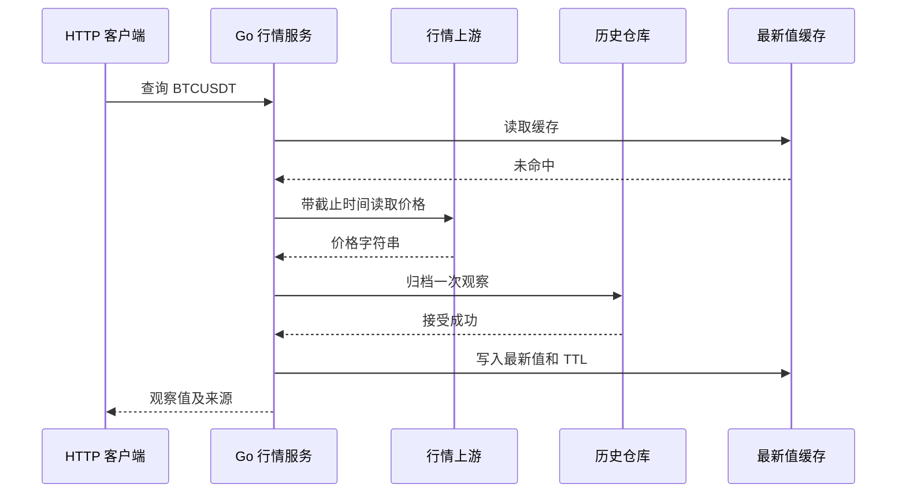

# Go 综合项目实战：从 0 开发一个行情采集与查询服务

> 本篇使用独立的 `quote-notes` 示例项目串联行情查询服务的完整调用链：请求校验、上游 API、缓存、历史存储、响应与优雅关闭。默认运行模式使用本机模拟行情接口、内存缓存和内存历史仓库；模拟价格是固定的示例数据，不能当作当前行情。真实 Redis / Doris 接入条件在对应小节说明。

<a id="section-001"></a>

## 阅读目标与完成标准

完成本篇后，应当能从 `main` 解释一个 Go 服务如何装配，能跟着一次请求说明参数从哪里进入、由谁校验、怎样访问上游、在哪里保存结果，以及响应从哪里返回。还应能解释为什么每个外部操作要有截止时间，为什么缓存命中不等于价格绝对新鲜，为什么数据库超时不一定意味着数据没有写入，以及进程关闭时哪些任务必须等待。

这篇笔记把项目学习分成三次完成。第一次只运行默认离线模式，确认健康检查、最新行情、历史查询都能工作。第二次阅读调用链并修改一个可观察的业务规则，例如允许的交易对或缓存时间。第三次才接真实依赖，把内存缓存替换为 Redis，把内存历史替换为 Doris。每次都能得到一个完整可用的学习结果，不需要一开始同时处理网络、账户、集群和部署问题。

为了让代码容易复现，核心项目仅依赖 Go 标准库，使用 `net/http` 的方法与路径路由；该该路由写法自 Go 1.22 起可用；项目统一按 Go 1.27.3 运行基线编写。Go 的模块目录指南提供组织命令、内部包和可复用包的基本规则，官方 Web 教程则展示了“先明确接口，再实现处理与测试”的学习顺序。本篇沿用这些思路，并自行设计行情业务与全部示例代码。[Go 模块布局](https://go.dev/doc/modules/layout)；[Go 官方 Web 服务教程](https://go.dev/doc/tutorial/web-service-gin)。

<a id="section-002"></a>

> **统一运行基线：** 建议使用 Go 1.27.3，示例模块声明采用 `go 1.27.0`。文中出现其他 Go 版本时，仅用于说明特性引入时间或历史实现差异；第三方依赖仍以对应模块的版本要求为准。


*图示：行情查询项目主流程。*

## 正文导航

- [阅读目标与完成标准【补充】](#section-001)
- [正文导航](#section-003)
- [一、项目架构](#section-004)
  - [1. 做这个系统需要具备哪些知识](#section-005)
  - [1.1 交易所的 API](#section-010)
  - [1.2 Redis 重点](#section-022)
  - [1.3 Doris 简单介绍](#section-033)
- [二、目前已有的项目结构](#section-045)
  - [2.1 本篇示例项目的目录与职责【补充】](#section-046)
  - [2.2 从 main 开始读，而不是先背所有函数【补充】](#section-047)
  - [2.3 领域对象里每个字段为什么存在【补充】](#section-048)
  - [2.4 一次缓存命中如何走完调用链【补充】](#section-049)
  - [2.5 一次缓存未命中为什么要再次查询【补充】](#section-050)
  - [2.6 归档成功后缓存失败，为什么仍能返回结果【补充】](#section-051)
  - [2.7 错误包装为何要保留原始原因【补充】](#section-052)
  - [2.8 并发数据结构与复制边界【补充】](#section-053)
  - [2.9 统计值的含义比字段名称更重要【补充】](#section-054)
  - [2.10 完整源码【补充】](#section-055)
  - [2.11 测试究竟验证了什么【补充】](#section-071)
- [三、项目启动运行](#section-072)
  - [3.1 运行前先确认“当前在哪个模块”【补充】](#section-073)
  - [3.2 默认离线模式的运行过程【补充】](#section-074)
  - [3.3 参数怎样改变程序行为【补充】](#section-075)
  - [3.4 怎样验证缓存真正减少了上游调用【补充】](#section-076)
  - [3.5 如何运行公开行情模式【补充】](#section-077)
  - [3.6 编译产物、测试与部署入口【补充】](#section-078)
  - [3.7 日志应记录业务结果，而不是打印所有变量【补充】](#section-079)
  - [3.8 优雅关闭要完成哪几件事【补充】](#section-080)
  - [3.9 常见启动与运行问题的定位顺序【补充】](#section-081)
  - [3.10 从学习项目走向实际服务，需要补哪些合同【补充】](#section-082)
- [四、作业](#section-083)
  - [4.1 作业一：增加第三个交易对并保持边界一致【补充】](#section-084)
  - [4.2 作业二：实现 Redis 缓存适配器并测试降级【补充】](#section-085)
  - [4.3 作业三：把历史写入 Doris，并证明重试没有制造新观察【补充】](#section-086)
  - [4.4 作业四：让多个交易对并行，同时约束等待与关闭【补充】](#section-087)
  - [4.5 二十五道复习题与参考答案【补充】](#section-088)
- [官方资料索引【补充】](#section-114)
- [实际验证记录与适用范围【补充】](#section-115)

<a id="section-004"></a>

## 一、项目架构

<a id="section-005"></a>

### 1. 做这个系统需要具备哪些知识

<a id="section-006"></a>

#### 1.0.1 先把需求写成可以检查的行为

假设我们要做一个“行情记录本”：定期读取两个交易对的最新成交价，向前端提供最近一次观察值，并保存一小段历史以供查看。它不负责交易下单、账户资产、撮合或投资决策。这里的业务对象是一次行情观察：某个采集器在某个时间从某个数据接口获得了一个价格。把这个对象说清楚后，才能决定缓存存什么、历史表怎样建、重复数据怎样判断。

最小功能可以写成四个验收点。调用方请求 `GET /v1/quotes/BTCUSDT` 时得到价格字符串、观察时间和观察编号；第二次紧接着查询时能够复用尚未过期的缓存；调用方请求历史接口时只能拿到限定数量的记录；进程收到停止信号后停止接收新业务，并等待已经开始的处理或按明确的超时策略结束。每个点都能通过一次请求或一个测试检查，比“高性能、高可用、易扩展”这类没有测量条件的目标更适合第一版。

先规定失败结果同样重要。未知交易对返回明确的客户端错误；上游返回非法 JSON、错误交易对或非正价格时拒绝发布；历史写入失败时不把这次观察放进缓存；缓存失败时允许从上游得到有效结果，但记录缓存错误。不同失败拥有不同后果，不能统一写成“失败就重试”。例如把错误交易对的数据重试三次，仍然不能使它变成正确交易对。

<a id="section-007"></a>

#### 1.0.2 参与者、部署位置和职责

| 参与者 | 默认学习环境中的位置 | 主要输入 | 主要输出 | 为什么单独分开 |
|---|---|---|---|---|
| HTTP 查询入口 | Go 进程内 | 路径参数、查询参数、请求上下文 | JSON 与 HTTP 状态码 | 处理协议与业务结果的转换 |
| 行情服务 `service` | 同一个 Go 进程内 | 交易对与上下文 | 合法的观察值或明确错误 | 决定缓存、采集、归档的先后关系 |
| 交易所适配器 | 同一个 Go 进程内 | 交易对、请求预算 | 已校验的观察值 | 隔离外部 API 格式和网络错误 |
| 缓存 | 默认是内存对象，扩展为 Redis 进程 | 最新观察值、TTL | 命中、未命中或错误 | 降低重复读取上游的频率 |
| 历史仓库 | 默认是有界内存对象，扩展为 Doris 集群 | 一次观察或一批观察 | 写入结果、历史查询结果 | 保存供分析使用的数据 |
| 周期采集任务 | Go 进程内的一条受控 goroutine | 交易对列表、周期、取消信号 | 刷新结果或错误日志 | 主动更新，不依赖调用方查询才能采集 |

同一个进程里分包不等于拆成微服务。第一版的 `service`、`exchange`、`memory` 都是普通 Go 包，函数调用发生在同一地址空间。真正跨网络的边界只有 HTTP 上游，以及后续接入的 Redis / Doris。先保持进程数量少，可以把精力放在业务语义与错误路径上；等出现独立扩容、隔离权限或团队交付的实际需求，再讨论拆进程。

下面的图只展示一次“缓存未命中”的主线。控制信号和数据都通过明确的调用传递；缓存写入发生在归档成功之后。



这里的“接受成功”按仓库适配器的契约解释。默认内存仓库只保证当前进程中记录已保存，不保证进程崩溃后还能恢复。真实 Doris 适配器还必须区分提交结果与可见性。换一个实现时，接口名字可以不变，但不能把更强的持久性承诺凭空加到原来的内存实现上。

<a id="section-008"></a>

#### 1.0.3 为什么需要接口，接口放在哪里

`service` 需要的是“取得一条行情”“读取或写入缓存”“保存或列出历史”这些能力，而不是某个第三方客户端的全部方法。因此本项目在使用能力的一方定义小接口，例如 `Fetch(ctx, symbol)`。HTTP 适配器实现它，测试中的假上游也实现它。这样测试可以控制上游返回值、错误和阻塞位置，而不需要真的访问交易所。

接口的价值不在于多写一个文件。若只有一个很简单的纯函数，直接调用更清楚；当一个依赖有网络、时间、故障或多个实现时，小接口才有明显收益。接口也不应照着 Redis 客户端机械复制几十个方法，否则业务层仍然被具体技术绑住，只是多绕了一次调用。

Go 的隐式接口实现意味着一个类型的方法集合满足接口即可，不必在类型声明处写“实现某接口”。本篇将业务契约放在 `service`，具体数据定义放在 `domain`，避免业务包去 import 适配器包造成循环依赖。可以把依赖方向理解为：高层描述“需要什么”，低层提供“如何完成”。这只是项目组织方法，Go 编译器真正强制的是包导入规则和接口类型检查。[Go 规范：接口类型](https://go.dev/ref/spec#Interface_types)。

<a id="section-009"></a>

#### 1.0.4 需要掌握的 Go 知识如何落在代码上

结构体用于表达观察值，JSON 标签规定对外字段；接口用于替换网络和存储依赖；`error` 用于沿调用链保留失败原因；`context.Context` 传递取消与期限；`http.Client` 负责请求及连接复用；`Mutex` 保护内存映射；通道用于刷新许可和任务完成通知；原子计数器记录并发访问下的统计值；`defer` 负责释放请求体、停止计时器和关闭资源。

这些知识不是各自独立背诵的清单。比如一次 HTTP 失败会同时涉及四项：请求的上下文是否到期，客户端是否设置了超时，错误是否用 `%w` 保留了原始原因，以及调用者是否按照错误类型决定响应。当开发者能够沿着这个过程解释代码时，才算把基础语法接到了工程行为上。

还有几项看起来不属于语法却直接决定正确性：价格是十进制量，不能随意经过 `float64` 后再声称精确；观察时间与交易发生时间不同；缓存过期只是我们本地的保留策略；采集结果重复发送不代表产生了新的观察。把数据意义写进文档和测试，通常比添加更多目录更有价值。

<a id="section-010"></a>

### 1.1 交易所的 API

<a id="section-011"></a>

#### 1.1.1 API 是远程契约，不是一个普通本地函数

API 可以看成双方约定的输入输出格式，但网络会增加本地函数通常没有的状态：请求没发出去、已经发出但未到达、上游已处理但响应丢失、只收到部分响应、超时后对方仍继续执行。读行情的重复请求通常没有下单那样的业务副作用，却仍会消耗限额、引入观测偏差和放大故障。理解这些状态，才知道为什么要限定响应大小、限定等待时间并减少无谓重试。

以官方现货接口 `GET /api/v3/ticker/price?symbol=BTCUSDT` 为例，指定单个交易对时，响应包含 `symbol` 和字符串形式的 `price`。不传交易对或传多个交易对时，响应形状与请求权重可能不同。第一版固定使用单交易对模式，避免一个函数同时处理对象与数组的多种契约；具体请求限额必须查当前官方文档和响应头，不能把某个历史数字永久写死在业务逻辑里。[Binance 官方行情接口](https://developers.binance.com/en/docs/catalog/core-trading-spot-trading/api/rest-api/market)。

公开行情、签名交易、账户接口应当分开理解。公开行情往往不需要账户密钥；账户与下单通常有鉴权、权限、时间戳和签名规则。本项目只涉及公开读取，因此不需要为了启动示例先创建交易权限。以后学习签名接口时，应单独建立参数规范化、签名验证、时钟同步和幂等语义，而不是把密钥塞到当前 URL 字符串里。

<a id="section-012"></a>

#### 1.1.2 用一次最小解析认识“传输字段”

**PRJ-01：保持官方行情响应中的价格字符串。** 这里沿用接口字段形状，价格与交易对是示例数据。

```go
// 运行示例：PRJ-01
package main

import (
	"encoding/json"
	"fmt"
)

func main() {
	var q struct {
		Symbol string `json:"symbol"`
		Price  string `json:"price"`
	}
	err := json.Unmarshal([]byte(`{"symbol":"BTCUSDT","price":"60000.1000"}`), &q)
	if err != nil {
		panic(err)
	}
	fmt.Println(q.Symbol)
	fmt.Println(q.Price)
}
```

输出：

```text
BTCUSDT
60000.1000
```

`Price` 使用字符串，因此保留了四位小数。`json.Unmarshal` 只负责类型与语法层面的解码，不会替业务判断“价格必须为正”“交易对必须与请求相同”。解码成功之后还要校验业务约束。外部接口新增字段时，默认解码可以忽略未知字段；对我们自己控制的管理接口，则可以考虑更严格的字段策略。两种边界的兼容性需求不同，不宜统一套用“任何未知字段都报错”。[encoding/json](https://pkg.go.dev/encoding/json)。

<a id="section-013"></a>

#### 1.1.3 为什么金额与价格不宜先转浮点

二进制浮点擅长快速近似计算，但某些十进制小数不能在二进制中有限表示。读取一个十进制字符串后先转 `float64`，再写入精确小数数据库，可能已经把原始信息丢掉。后面的高精度字段无法恢复前面丢失的位数。因此数据管道应在入口就决定数值表示，而不是到数据库建表时才考虑精度。

本项目价格在接口、领域对象与缓存中都保留字符串。需要加减比较的示例使用 `math/big.Rat`，它把输入解释为有理数，能够精确表达有限小数；实际项目也可以选择明确了舍入规则的十进制库。无论选哪种表示，都要定义最大整数位、最大小数位、是否允许科学计数法，以及输出保留几位。精度正确不意味着业务规则完整，例如手续费的舍入方向仍要独立规定。

**PRJ-02：用精确有理数进行十进制加法。**

```go
// 运行示例：PRJ-02
package main

import (
	"fmt"
	"math/big"
)

func main() {
	a, ok := new(big.Rat).SetString("60000.10")
	if !ok {
		panic("bad a")
	}
	b, ok := new(big.Rat).SetString("0.20")
	if !ok {
		panic("bad b")
	}
	total := new(big.Rat).Add(a, b)
	fmt.Println(total.FloatString(2))
	fmt.Println(total.Cmp(a) > 0)
}
```

输出：

```text
60000.30
true
```

`FloatString(2)` 是最后展示时保留两位小数的决定，不代表整个系统天然只支持两位。主项目的输入约束按后续 Doris 示例中的 `DECIMAL(38,18)` 规划：最多二十位有效整数、十八位小数，价格必须大于零。这样的约束应在入口测试，而不应等历史写入失败后才让调用方知道数据不符合表结构。[math/big.Rat](https://pkg.go.dev/math/big#Rat)；[Doris 数据类型](https://doris.apache.org/docs/3.x/table-design/data-type/)。

<a id="section-014"></a>

#### 1.1.4 观察时间、事件时间与数据新鲜度

上游的“最近价格”不一定携带交易事件时间。对于只给出 `symbol` 与 `price` 的接口，本项目把 `ObservedAt` 定义为“本服务完成有效响应读取与校验时的本地观察时间”。它不能改名成 `TradeTime`，因为我们没有证据证明那一刻就是交易发生时刻。若以后改用成交记录或行情流，应增加独立的 `event_time`、事件编号和采集时间，而不是让一个字段承担几种意义。

用一个小例子区分三种时间：交易在 10:00:00 发生，网络延迟后本服务在 10:00:02 读到价格，调用方在 10:00:04 命中缓存。观察年龄为两秒，但原始交易已经过去四秒；如果上游本身停更，观察年龄甚至可能很小而源数据很旧。因此 TTL 只能限制我们多久不主动更新本地缓存，不能单独证明上游市场状态实时。

跨机器保存时间时应选定统一时区或统一时间戳。本项目对外使用 UTC 的 RFC3339 时间，对接分析表的讲解行转换为 Unix 毫秒。Go 的 `time.Time` 在进程内可能带单调时钟信息，适合计算经过时间；序列化之后这些内部信息不再跟着走，不能把两个不同进程的时间戳当作精确同步的计时器。[time 包](https://pkg.go.dev/time)。

<a id="section-015"></a>

#### 1.1.5 构造请求：让库处理转义

**PRJ-03：用 `url.Values` 构造查询参数。**

```go
// 运行示例：PRJ-03
package main

import (
	"fmt"
	"net/url"
)

func main() {
	u, err := url.Parse("https://example.test/api/v3/ticker/price")
	if err != nil {
		panic(err)
	}
	q := u.Query()
	q.Set("symbol", "BTCUSDT")
	q.Set("note", "a+b c")
	u.RawQuery = q.Encode()
	fmt.Println(u.Query().Get("symbol"))
	fmt.Println(u.RawQuery)
}
```

输出：

```text
BTCUSDT
note=a%2Bb+c&symbol=BTCUSDT
```

如果直接拼接 `"?symbol=" + input`，输入中的 `&`、`+`、空格就可能改变参数含义。编码库解决的是 URL 表示问题；允许哪些交易对仍由业务白名单决定。主项目没有接收调用方指定的任意上游地址，避免一个简单行情接口变成任意网络请求入口。以后确实需要可配置地址时，应在启动阶段校验协议、主机和允许的目标，而不是把公网参数直接传给客户端。[net/url](https://pkg.go.dev/net/url)。

<a id="section-016"></a>

#### 1.1.6 HTTP 响应的检查顺序

正常路径应当依次完成：创建带上下文的请求，执行请求，取得响应后立即安排关闭响应体，限制读取字节数，检查 HTTP 状态，解析 JSON，校验业务字段，构造领域对象。这个顺序把资源释放、协议检查和业务检查分开，便于出错时定位是哪一层失败。

HTTP `200` 只能说明服务器用成功状态传回了一段内容，不能证明内容就是本次请求需要的数据。我们还要核对 `symbol`、价格格式和数值边界。反过来，收到 `429` 或 `503` 时，不能仍按成功结构解析出空字符串后继续处理。若错误响应包含上游内部信息，日志可以记录经过限制的诊断信息，对外接口则返回本服务定义的稳定错误码。

**PRJ-04：一段响应只能包含一个完整 JSON 值。**

```go
// 运行示例：PRJ-04
package main

import (
	"encoding/json"
	"fmt"
)

func valid(data string) bool {
	var v struct {
		Symbol string `json:"symbol"`
	}
	return json.Unmarshal([]byte(data), &v) == nil
}

func main() {
	fmt.Println(valid(`{"symbol":"BTCUSDT"}`))
	fmt.Println(valid(`{"symbol":"BTCUSDT"}{}`))
}
```

输出：

```text
true
false
```

使用 `Decoder.Decode` 时，一次调用只读取一个值，后面可能还有内容；若协议要求单个 JSON，就应继续确认文件结束。主项目先有界读取，再 `Unmarshal`，因而会拒绝第二个 JSON 值。限制读取大小时使用“上限加一”技巧：最多读到 `limit+1` 字节，如果实际超过 `limit`，可以确定超限，而不会把截断后的内容误当完整响应。[io.LimitReader](https://pkg.go.dev/io#LimitReader)。

<a id="section-017"></a>

#### 1.1.7 本机模拟上游与真实上游的界限

`httptest.NewServer` 启动一个真实的本机 HTTP 监听器，客户端确实经过 HTTP 请求与响应处理，但响应内容由测试代码控制。它能验证路径、参数、状态码、取消和响应大小处理；它不能验证交易所真实网络、账户权限、地域可用性、限流规则或生产服务质量。把两者分开记录，才能知道某个测试通过究竟证明了什么。

**PRJ-05：通过本机 HTTP 服务验证一次行情读取。**

```go
// 运行示例：PRJ-05
package main

import (
	"encoding/json"
	"fmt"
	"net/http"
	"net/http/httptest"
)

func main() {
	server := httptest.NewServer(http.HandlerFunc(func(w http.ResponseWriter, r *http.Request) {
		if r.URL.Query().Get("symbol") != "BTCUSDT" {
			http.Error(w, "bad symbol", http.StatusBadRequest)
			return
		}
		w.Header().Set("Content-Type", "application/json")
		fmt.Fprint(w, `{"symbol":"BTCUSDT","price":"60000.10"}`)
	}))
	defer server.Close()
	res, err := server.Client().Get(server.URL + "?symbol=BTCUSDT")
	if err != nil {
		panic(err)
	}
	defer res.Body.Close()
	if res.StatusCode != http.StatusOK {
		panic(res.Status)
	}
	var q struct {
		Price string `json:"price"`
	}
	if err := json.NewDecoder(res.Body).Decode(&q); err != nil {
		panic(err)
	}
	fmt.Println(res.StatusCode, q.Price)
}
```

输出：

```text
200 60000.10
```

该小例子把响应大小检查省去，以突出测试服务器如何使用；完整项目已经加入读取上限和业务校验。阅读代码时应区分“围绕一个知识点的最小示例”和“业务入口的完整检查链”，不能因为一个短示例省略了某项机制，就认为生产接口也可以省略。[net/http/httptest](https://pkg.go.dev/net/http/httptest)。

<a id="section-018"></a>

#### 1.1.8 连接复用与响应体关闭

`http.Client` 和 `http.Transport` 应按服务生命周期复用，不能每个请求新建一套连接池。连接建立可能包含 DNS、TCP、TLS 等开销；复用允许后续请求使用已有连接。但复用不是无条件发生：协议、响应体是否读完并关闭、连接是否健康等都会影响结果。关闭响应体是必须履行的资源责任，完整读取小型正常响应通常也有助于 HTTP/1.x 连接复用。

遇到超大或无限响应时，不能为了“复用连接”而无限读取。主项目读到上限就报错并关闭响应体，这时接受放弃该连接，比占住内存和 goroutine 更合理。连接池参数也需要和业务并发一起规划：`MaxConnsPerHost` 可以限制连接数量，但等待连接的请求仍可能增加；它不能替代入口并发限制。

**PRJ-06：验证成功和失败路径都会关闭已经取得的响应体。**

```go
// 运行示例：PRJ-06
package main

import (
	"fmt"
	"io"
	"strings"
)

type trackedBody struct {
	io.Reader
	closed bool
}

func (b *trackedBody) Close() error { b.closed = true; return nil }

func read(body io.ReadCloser, limit int64) error {
	defer body.Close()
	data, err := io.ReadAll(io.LimitReader(body, limit+1))
	if err != nil {
		return err
	}
	if int64(len(data)) > limit {
		return fmt.Errorf("response too large")
	}
	return nil
}

func main() {
	small := &trackedBody{Reader: strings.NewReader("ok")}
	large := &trackedBody{Reader: strings.NewReader("toolong")}
	fmt.Println(read(small, 3) == nil, small.closed)
	fmt.Println(read(large, 3) != nil, large.closed)
}
```

输出：

```text
true true
true true
```

这里用可观察的 `Close` 实现验证资源责任，不依赖操作系统连接数的偶然变化。真实客户端请求返回错误且没有可用响应时，应按客户端文档处理；不要在 `err != nil` 后盲目访问 `res.Body`。本项目先检查请求错误，再对有效响应安排关闭。[http.Client](https://pkg.go.dev/net/http#Client)。

<a id="section-019"></a>

#### 1.1.9 取消与超时必须贯穿调用链

一个 HTTP 请求只有一份总预算更容易推理。假设入口给出两秒期限，读取缓存消耗了五十毫秒，等待刷新许可消耗了三百毫秒，上游请求只能使用剩余时间。若每层都从新的 `Background` 重新开始两秒，整条链就可能远超调用方以为的两秒。正确的派生方式是从上层上下文创建更短期限，不能在下层把上层期限抹掉。

取消信号也不是强制杀死 goroutine。代码必须在等待许可、网络请求和耗时操作中观察取消；对于不能取消的库调用，需要选择合适的接口或设计隔离措施。主项目的等待许可使用 `select`，HTTP 请求使用 `NewRequestWithContext`，周期采集器在每轮和每个交易对之前检查上下文。

**PRJ-07：先取消的请求不再开始新的工作。**

```go
// 运行示例：PRJ-07
package main

import (
	"context"
	"errors"
	"fmt"
)

func fetch(ctx context.Context) error {
	if err := ctx.Err(); err != nil {
		return err
	}
	return nil
}

func main() {
	ctx, cancel := context.WithCancel(context.Background())
	cancel()
	fmt.Println(errors.Is(fetch(ctx), context.Canceled))
}
```

输出：

```text
true
```

真实系统还需要在工作进行中观察取消。入口检查只能避免已经取消的调用继续开始，不能把随后的全部代码变成可中断操作。完整项目的 HTTP 适配器通过请求上下文把这一责任交给标准库网络操作，并通过测试验证处理中的取消能结束客户端等待。[context 包](https://pkg.go.dev/context)。

<a id="section-020"></a>

#### 1.1.10 重试规则必须同时看操作语义与失败类型

“读请求可以重试”仍然太宽。重试应受总截止时间、最大尝试次数、延迟策略、全局请求权重和当前故障状态限制。对于明确的参数错误、JSON 结构错误或业务校验错误，重复发送同一请求通常没有帮助。对于限流响应，应尊重服务方约定，而不是立即重试；对于超时，应先判断预算是否还足够完成下一次尝试。

**PRJ-08：建立一个有限的只读重试分类函数。**

```go
// 运行示例：PRJ-08
package main

import (
	"fmt"
	"net/http"
)

func retryable(method string, status int) bool {
	if method != http.MethodGet {
		return false
	}
	return status == http.StatusTooManyRequests ||
		status == http.StatusBadGateway ||
		status == http.StatusServiceUnavailable ||
		status == http.StatusGatewayTimeout
}

func main() {
	fmt.Println(retryable("GET", 503))
	fmt.Println(retryable("GET", 400))
	fmt.Println(retryable("POST", 503))
}
```

输出：

```text
true
false
false
```

该函数只回答“是否属于候选”，不保证必须重试，也没有实现完整调度。主项目为了让第一次运行的行为容易理解，默认不在适配器内部自动重试：一次采集失败记录错误，下一轮周期再尝试；缓存未命中的调用方请求在自身预算内失败。后面的作业要求在保留总预算的前提下加入有限重试，而不是随意嵌套循环。

**PRJ-09：解析整数秒和 HTTP 日期形式的等待时间。**

```go
// 运行示例：PRJ-09
package main

import (
	"fmt"
	"net/http"
	"strconv"
	"time"
)

func retryAfter(raw string, now time.Time) (time.Duration, bool) {
	if n, err := strconv.Atoi(raw); err == nil {
		if n < 0 || n > 60 {
			return 0, false
		}
		return time.Duration(n) * time.Second, true
	}
	at, err := http.ParseTime(raw)
	if err != nil {
		return 0, false
	}
	d := at.Sub(now)
	if d < 0 {
		d = 0
	}
	if d > time.Minute {
		return 0, false
	}
	return d, true
}

func main() {
	now := time.Date(2026, 10, 22, 0, 0, 0, 0, time.UTC)
	d, ok := retryAfter("10", now)
	fmt.Println(d, ok)
	d, ok = retryAfter(now.Add(20*time.Second).Format(http.TimeFormat), now)
	fmt.Println(d, ok)
	_, ok = retryAfter("-1", now)
	fmt.Println(ok)
}
```

输出：

```text
10s true
20s true
false
```

示例的一分钟上限是讲解策略，不是 HTTP 协议规定。服务方要求等待更久时，应停止当前短请求并把限制信息交给调用者或后台调度器，不应把等待时间偷偷缩短后继续猛发请求。生产中的等待还要能被 `ctx.Done()` 打断，且不能把所有实例的重试都排在同一个时刻。随机抖动的目的在于分散同步重试，不能用来绕开服务方明确要求的最早重试时间。

<a id="section-021"></a>

#### 1.1.11 REST 轮询与 WebSocket 推送如何选择

轮询适合学习和低频快照：每次请求独立，失败范围容易定位，也容易通过标准 HTTP 测试。代价是重复获取、额外请求数，以及两次采样之间的信息丢失。如果每两秒查询一次，看到的只是离散观察，不能据此恢复这两秒中的所有成交。历史表因此应称为“采样观察历史”，不应宣传为“完整交易流水”。

WebSocket 可以持续接收推送，但工程复杂度包括连接建立、心跳、断线重连、订阅恢复、序号缺口、积压与背压。推送速度高于处理速度时，增加无界 channel 会把问题转成内存增长；随意丢弃又可能破坏订单簿增量的状态。具体数据流的快照与增量对齐规则必须遵循交易所官方文档，不能把普通最新价格更新算法套在所有流上。[Binance 官方 WebSocket 文档](https://developers.binance.com/docs/binance-spot-api-docs/web-socket-streams)。

本项目先实现 REST 最新价，后续作业再增加推送。学习顺序的理由是让开发者先掌握数据合同和生命周期，再加入长期连接的状态机。即使换成 WebSocket，领域对象、缓存接口、历史接口和对外 HTTP 查询仍可保留，变化主要集中在采集适配器与任务调度部分。

<a id="section-022"></a>

### 1.2 Redis 重点

<a id="section-023"></a>

#### 1.2.1 Redis 在本项目中负责什么

Redis 是独立运行的数据库进程，Go 通过客户端和网络协议访问它。在当前业务里，我们先让它承担“保存某交易对最近观察值并自动过期”的缓存职责。调用方多次读取相同交易对时，服务可以先查缓存，减少上游请求。Redis 也有其他数据类型与能力，但第一版不需要把它们全部用上。先把一个用途的错误与恢复语义说明白，比同时堆入排行榜、发布订阅和分布式锁更有学习价值。[Redis 官方 Go 客户端指南](https://redis.io/docs/latest/develop/clients/go/)。

缓存与历史仓库回答不同的问题。缓存回答“现在可以返回哪条最近观察”，历史回答“过去保存过哪些观察”。缓存可以过期或被淘汰；历史通常有独立的保存周期与恢复要求。不要因为 Redis 很快，就自动把它当作所有历史数据的唯一长期归宿；也不要因为 Doris 可以存历史，就让每个高频最新值查询都扫描分析表。

默认项目中的 `memory.Cache` 只是接口替身，用来验证命中、未命中和过期逻辑。它没有网络、认证、集群槽位、持久化、主从切换等行为。测试替身通过，说明业务对该接口的调用契约成立，不能由此宣称真实 Redis 的所有故障都已经被测试。真实接入应补充连接失败、认证失败、超时、主从切换与数据格式兼容的集成验证。

<a id="section-024"></a>

#### 1.2.2 键和值如何设计

一个简单键可以是 `quotes:v1:binance-spot:BTCUSDT`。前缀表示业务，`v1` 表示序列化结构版本，后面区分来源和交易对。键不是越短越好，也不是越长越完整越好；它需要便于归属、避免不同环境覆盖，并保持长度可控。环境可以通过独立实例、数据库或明确前缀隔离，不能只靠开发者记住“这是测试数据”。

值可以是完整观察对象的 JSON，包括价格、观察时间、观察编号和来源。这样一条缓存命中携带足够的信息判断数据意义。若只存一个 `60000.10`，调用者不知道它来自哪里、什么时候获取、是否是模拟数据，也无法把最新值与历史观察关联起来。数据结构版本变化时，新旧客户端同时运行的兼容规则也需要预先说明。

**PRJ-10：在键中表达数据来源与格式版本。**

```go
// 运行示例：PRJ-10
package main

import (
	"fmt"
	"strings"
)

func key(exchange, symbol string) (string, error) {
	for _, part := range []string{exchange, symbol} {
		if part == "" || strings.ContainsAny(part, ":\r\n ") {
			return "", fmt.Errorf("invalid key component")
		}
	}
	return "quotes:v1:" + exchange + ":" + symbol, nil
}

func main() {
	k, err := key("binance-spot", "BTCUSDT")
	if err != nil {
		panic(err)
	}
	fmt.Println(k)
	_, err = key("binance:spot", "BTCUSDT")
	fmt.Println(err != nil)
}
```

输出：

```text
quotes:v1:binance-spot:BTCUSDT
true
```

键格式校验是本项目的命名契约，不是说 Redis 不允许其他字符。Redis 键本身可以包含更广泛的字节内容；限制分隔符是为了让我们自己的监控、迁移和人工排障更明确。业务决定与数据库协议能力应分开描述，避免把项目约定误写成 Redis 的硬性语法。

<a id="section-025"></a>

#### 1.2.3 TTL 的精确定义

TTL 是一个值还可以保留多久的策略。对最新行情缓存而言，可以把写入时刻记为 `t_set`、期限记为 `T`，则在本地模型中只有 `now < t_set + T` 才视为有效。恰好到达截止时刻应算过期，而不是额外多保留一轮。真实 Redis 的过期判定由 Redis 服务器完成，Go 客户端不应拿自己的时间猜测服务端一定还剩几秒。[Redis SET](https://redis.io/docs/latest/commands/set/)；[Redis TTL](https://redis.io/docs/latest/commands/ttl/)。

**PRJ-11：用可注入的时刻验证过期边界。**

```go
// 运行示例：PRJ-11
package main

import (
	"fmt"
	"time"
)

type Entry struct {
	Value   string
	Expires time.Time
}

func (e Entry) Get(now time.Time) (string, bool) {
	if !now.Before(e.Expires) {
		return "", false
	}
	return e.Value, true
}

func main() {
	start := time.Unix(100, 0)
	e := Entry{Value: "60000.10", Expires: start.Add(5 * time.Second)}
	v, ok := e.Get(start.Add(4 * time.Second))
	fmt.Println(v, ok)
	_, ok = e.Get(start.Add(5 * time.Second))
	fmt.Println(ok)
}
```

输出：

```text
60000.10 true
false
```

这个测试没有调用 `Sleep`。时间由调用者传入，因而能精确覆盖“刚好过期”而不受机器负载影响。完整项目的内存缓存同样接收 `now func() time.Time`，测试中推进虚拟时刻，运行时传 `time.Now`。注入时间并不是一种神秘框架，而是把原本藏在函数内部的外部条件变成明确依赖。

使用真实 Redis 时，推荐把值和过期条件放在同一条 `SET` 命令里，例如 `SET key value EX 5`。若先 `SET` 再 `EXPIRE`，两步之间进程崩溃，可能留下没有期限的值。`TTL` 返回负值时要区分键不存在与键存在但没有期限，不能简单把所有负数当成“还没过期”。这些命令的具体返回约定应按当前官方文档核对。

<a id="section-026"></a>

#### 1.2.4 未命中、故障与损坏不能合并成一种状态

一次读取缓存至少有三种结果：命中有效对象、键不存在、读操作失败。还有一种业务上重要的情况：字节读到了，但 JSON 无法解析或内容违反当前合同。若把这些都返回成空字符串，服务既无法决定是否回源，也无法知道缓存是不是持续损坏。

Go 接口使用 `(Quote, bool, error)` 表达这一区分：`bool` 表示是否存在可用对象，`error` 表示读取或校验失败。对 go-redis，键不存在通常通过 `redis.Nil` 表示，应该在适配器里转换成 `found=false, err=nil`，而连接失败仍然是错误。业务层才能选择“缓存故障时尝试上游”而不是把 Redis 故障当成正常命中率下降。[go-redis 错误处理](https://redis.io/docs/latest/develop/clients/go/error-handling/)。

缓存值应再次做必要校验。写入方可能是旧版本服务、错误脚本或共享实例上的其他程序；从 Redis 读出 JSON 成功，不等于它符合当前交易对和价格约束。后续适配器至少检查 `ID`、来源、交易对、正价格以及时间字段。若加入“允许返回过期数据”的降级机制，还需要显式字段表示过期状态，并记录允许的最大过期年龄。

<a id="section-027"></a>

#### 1.2.5 并发缓存未命中为什么会冲击上游

假设缓存刚好过期，同时有一百个调用方查询。若每个请求都独立发现未命中并访问上游，一次过期就变成一百次外部请求。这通常称为缓存击穿或同键请求合并问题，核心是同一份可复用结果的并发获取没有协调。应对方式包括提前刷新、同键合并、有界等待、合理的过期策略与入口限流，具体取舍取决于是否允许短时旧值。

完整项目用一个容量为一的通道作为刷新许可，获得许可后再次查询缓存。第一个请求已经填好缓存时，后面的请求就不再访问上游。这是容易理解的讲解实现；它会把不同交易对的刷新也串行化，因此不适合直接声称能处理任意大规模市场数据。下一步可以改成按交易对合并，同时给全局上游并发设置上限。

特别注意，容量为一的许可通道只限制“正在执行刷新”的数量，**不限制等待许可的 HTTP goroutine 总数**。大量请求仍可能在通道发送位置等待。生产入口还要有最大在途请求数、排队时长或快速拒绝策略。一个有界信号量不自动等于整个系统所有队列都有界。

**PRJ-12：区分有限缓冲与满队列后的拒绝策略。**

```go
// 运行示例：PRJ-12
package main

import "fmt"

func enqueue(queue chan<- string, value string) bool {
	select {
	case queue <- value:
		return true
	default:
		return false
	}
}

func main() {
	queue := make(chan string, 1)
	fmt.Println(enqueue(queue, "BTCUSDT"))
	fmt.Println(enqueue(queue, "ETHUSDT"))
	fmt.Println(<-queue)
}
```

输出：

```text
true
false
BTCUSDT
```

这个例子明确选择“满了就拒绝”，所以调用者不会无限等待。拒绝结果必须被上层使用，例如返回 `503`、延后安排任务或记录丢弃计数。写一个 `default` 分支却什么也不做，会把过载问题变成安静的数据丢失。对于必须保存的历史记录，拒绝之后还需要持久化重试或明确失败给生产者。

<a id="section-028"></a>

#### 1.2.6 旧结果覆盖新结果与条件写入

两个采集任务可能乱序完成。任务 A 先开始却慢，任务 B 后开始先返回，如果 A 最后无条件覆盖缓存，缓存会从较新的观察倒退到旧观察。在单进程示例项目中，刷新许可使同一时刻只有一个刷新链，减少了这种并发写入顺序问题；多实例部署后，这个保证不再覆盖所有写入者。

若上游提供单调事件序号，缓存更新可以要求新序号大于已保存序号。若只有本地时间，则必须考虑机器时钟偏差和重启，不能把任意时间戳当成全局可靠顺序。Redis 中“读当前值、在 Go 比较、再写回”是多个操作，中间可能被其他客户端插入，真正的条件更新需要服务器端原子执行或合适的事务机制。

**PRJ-13：演示带序号的条件替换；它是本地语义模型。**

```go
// 运行示例：PRJ-13
package main

import "fmt"

type Value struct {
	Seq   int64
	Price string
}

func apply(current *Value, next Value) bool {
	if next.Seq <= current.Seq {
		return false
	}
	*current = next
	return true
}

func main() {
	current := Value{Seq: 10, Price: "100.00"}
	fmt.Println(apply(&current, Value{Seq: 12, Price: "102.00"}))
	fmt.Println(apply(&current, Value{Seq: 11, Price: "101.00"}))
	fmt.Println(current.Seq, current.Price)
}
```

输出：

```text
true
false
12 102.00
```

示例在一个 goroutine 内顺序调用，所以没有宣称它本身是并发安全的 Redis 实现。真实条件写入还要定义相同序号但不同内容的冲突如何处理，以及序号回绕、不同交易对序号空间和切换数据源的规则。只检查“数字更大”仍然需要明确这个数字由谁产生、在哪个范围内可比较。

<a id="section-029"></a>

#### 1.2.7 Pipeline、事务与脚本各解决什么问题

Pipeline 将多条命令批量发给服务器，减少逐条等待网络往返的开销。它主要改变通信方式，不自动把多条命令变成不可分割的业务步骤。假设一条命令更新价格，另一条更新来源，其他客户端是否可能看到中间状态，需要看使用的是普通流水线还是事务等机制，不能仅凭“批量发送”判断。[Redis Pipelining](https://redis.io/docs/latest/develop/using-commands/pipelining/)。

`MULTI` / `EXEC` 事务把队列中的命令作为一组执行，`WATCH` 可用于在提交前检查观察的键是否变化。它与关系数据库事务的使用体验不完全相同；例如执行阶段某条命令出错，并不意味着自动回滚已经执行的其他命令。业务必须逐项检查返回结果，不能看到 `EXEC` 有响应就把整批工作都视作成功。[Redis Transactions](https://redis.io/docs/latest/develop/using-commands/transactions/)；[Go 客户端流水线与事务](https://redis.io/docs/latest/develop/clients/go/transpipe/)。

Lua 脚本可以在 Redis 侧执行短小的“读、判断、写”逻辑，使条件更新处在同一个原子执行单元内。但脚本不能长时间阻塞服务器，也不能绕开集群跨槽限制。将所有任务塞进一个巨大的脚本，可能用更严重的阻塞换来了表面上的原子性。选择机制时，应先列出真正需要原子变化的字段，再选择最小范围。

<a id="section-030"></a>

#### 1.2.8 持久化、淘汰与复制的边界

缓存可能因为 TTL 到期消失，也可能因为内存淘汰策略而消失。两者都意味着业务必须能处理未命中。Redis 的 RDB、AOF 和复制机制又是另一层问题：它们影响重启恢复和故障时可能丢失的窗口，不能仅根据“开启持久化”就承诺任何故障下零丢失。[Redis 持久化文档](https://redis.io/docs/latest/operate/oss_and_stack/management/persistence/)。

对最新值缓存而言，短时数据丢失往往可以通过重新采集恢复；对“已经承诺必须写入历史”的任务而言，丢失可能违反业务要求。因此不要把缓存键顺手当成唯一的可靠队列。设计时应问：客户端收到成功之后，哪些故障仍可能让这条记录消失？恢复数据依靠哪里？恢复过程中重复执行是否安全？这些问题比选一个持久化开关更接近系统的真实保证。

内存容量也要可以估计。如果有十万个交易对，每个缓存对象连同键和开销平均占几百字节，容量将与交易对数量成正比；如果把每次采样都放成一个永不过期的新键，则会与运行时间一起增长。键数量、对象大小、过期策略和淘汰行为必须一起规划，不能只看单条请求的延迟。

<a id="section-031"></a>

#### 1.2.9 发布订阅与 Streams 不要混为一谈

Redis Pub/Sub 适合把通知发给当前在线的订阅者，例如提示 WebSocket 节点“某交易对更新了”。订阅者断开期间错过的消息不会自动补发，因此它不适合单独承担“每条历史观察都必须处理”的职责。可以把它作为通知渠道，让真正的数据保存在可查询的状态里。[Redis Pub/Sub 官方说明](https://redis.io/docs/latest/develop/use-cases/pub-sub/)。

Streams 支持保存条目、消费组和确认等机制，可以用于进一步学习异步归档。但存在消费组并不自动意味着业务只执行一次。消费者把数据写入 Doris 后、发送确认之前崩溃，恢复时可能重新处理同一条消息。必须用稳定的观察编号或批次编号让重复执行可以识别；确认只是消息处理协议中的一步，不是跨两个数据库的原子事务。[XREADGROUP](https://redis.io/docs/latest/commands/xreadgroup/)；[XACK](https://redis.io/docs/latest/commands/xack/)。

对于第一版，直接同步归档更容易解释错误。等需要提高吞吐或隔离分析库延迟时，再引入持久队列、批量消费者、重试与死信处理。此时应同步修改 API 的承诺：返回成功代表“历史已可查询”，还是只代表“归档任务已可靠接收”？接口名称相同也不能掩盖这两种承诺的差异。

<a id="section-032"></a>

#### 1.2.10 真实 go-redis 接入的最小迁移清单

真实接入使用 Redis 官方文档推荐的 `github.com/redis/go-redis/v9`。截至本篇整理时，官方发布页包含 `v9.23.0`；下面以这个明确版本作为扩展阅读的固定依赖，不把 `@latest` 作为可复现实验的版本。这个依赖与纯标准库主项目的 Go 最低版本要求可能不同，应让 `go get` 按依赖要求更新 `go.mod`，并使用本篇已核验的 Go 1.27.3 或满足依赖要求的工具链。[go-redis 官方发布记录](https://github.com/redis/go-redis/releases)。

在主项目副本中先取得固定版本，再创建缓存适配器并完成 `main` 的依赖装配。以下属于外部服务接入步骤，本篇没有启动真实 Redis 实例执行它。

```bash
go get github.com/redis/go-redis/v9@v9.23.0
```

此时先不要执行 `go mod tidy`：如果源码尚未导入 go-redis，整理命令会将尚未使用的依赖移除。应先完成下面的适配器文件、导入和调用关系，再整理模块。

适配器的 `Get` 应完成四步：生成受控键，调用 `Get(ctx, key).Bytes()`，把 `redis.Nil` 转换成未命中，解析并验证领域对象。`Set` 应先编码完整观察，再调用带 TTL 的 `Set`，并把错误返回给业务层。客户端在 `main` 中创建一次并复用，关闭时再统一 `Close`。连接地址、认证和 TLS 来自部署配置，不应写死到仓库或日志。

下面是**接入结构片段**，用于说明官方客户端 API 与本项目接口如何对应；它不是已经嵌入默认项目的源码文件，也不计入独立程序验证数量。

```go
// 结构片段：需要导入 context、encoding/json、errors、time、redis 和 domain。
type RedisCache struct {
    Client *redis.Client
    Prefix string
}

func (c *RedisCache) Get(ctx context.Context, symbol string) (domain.Quote, bool, error) {
    data, err := c.Client.Get(ctx, c.Prefix+symbol).Bytes()
    if errors.Is(err, redis.Nil) { return domain.Quote{}, false, nil }
    if err != nil { return domain.Quote{}, false, err }
    var q domain.Quote
    if err := json.Unmarshal(data, &q); err != nil { return domain.Quote{}, false, err }
    if q.Symbol != symbol || q.ID == "" || q.Exchange == "" || q.ObservedAt.IsZero() {
        return domain.Quote{}, false, errors.New("invalid cached observation")
    }
    if err := domain.ValidatePrice(q.Price); err != nil { return domain.Quote{}, false, err }
    return q, true, nil
}

func (c *RedisCache) Set(ctx context.Context, q domain.Quote, ttl time.Duration) error {
    if ttl <= 0 { return errors.New("positive TTL required") }
    data, err := json.Marshal(q)
    if err != nil { return err }
    return c.Client.Set(ctx, c.Prefix+q.Symbol, data, ttl).Err()
}
```

在客户端初始化中还要明确连接池上限、建立连接超时、读写超时与重试策略。使用带 `context` 的方法，不代表可以忽略客户端的所有超时设置；具体哪些阶段观察上下文、哪些阶段使用连接 deadline，应按所固定的版本配置核对。多层重试会相乘：业务重试三次、客户端再重试三次，最坏请求量可能远超直觉。因此先保持一层明确的有限重试，再根据证据增加复杂度。[go-redis 生产使用](https://redis.io/docs/latest/develop/clients/go/produsage/)。

创建完整适配器文件、补齐导入，并在 `main` 中用真实客户端替换内存缓存的装配之后，再执行：

```bash
go mod tidy
go test ./...
```

这里的测试还应补充真实 Redis 的连接、认证、过期和故障场景；默认内存实现的测试不能替代这些集成验证。

<a id="section-033"></a>

### 1.3 Doris 简单介绍

<a id="section-034"></a>

#### 1.3.1 为什么历史分析与最新值查询分开

Apache Doris 面向分析型查询，适合对大量记录执行筛选、聚合和统计。例如过去一小时某交易对采样价格的最大值、最小值，或者各数据源的采集延迟分布。它与 Redis 的角色不同：Redis 在当前设计中提供一条最新对象，Doris 则保存可按时间和维度分析的历史事实。[Apache Doris 官方介绍](https://doris.apache.org/docs/3.x/gettingStarted/what-is-apache-doris/)。

“适合分析”不等于任何请求都必须经过 Doris。一个查询最新值的接口，通常没有必要每次都对历史表做聚合。反过来，Redis 中一条最新值也无法回答过去一小时的完整分布。把读取需求分开，才能分别设计缓存 TTL、历史分区、保留周期和查询资源限制。

本项目把历史写入抽象成 `Append`，默认实现是每个交易对最多保留一千条记录的内存仓库。它帮助开发者理解归档先于缓存发布、稳定 ID 的作用和查询边界。真实 Doris 并不是这个内存切片的“放大版”：它涉及独立服务、导入事务、批量写入、数据可见性、分布式查询和后台整理，因此接入时需要重新核对接口的语义强度。

<a id="section-035"></a>

#### 1.3.2 FE、BE 与一次写入的大致流程

在常见的 Doris 存算一体部署中，FE 负责元数据、查询规划和协调等工作，BE 负责数据存储与查询执行等工作。一个客户端接入点并不意味着数据只由一台机器处理；请求可能由协调节点分发到多个执行节点。具体部署方式还包括存算分离等选择，本篇的导入示例以 Doris 3.x 文档中的常规 Stream Load 为参照，不混用不同部署模式的内部细节。

从应用视角看，一批 JSON 数据被序列化，客户端向指定导入接口发送 HTTP 请求，Doris 校验并执行导入，再返回状态与行数。需要检查的内容不仅是 HTTP 状态，还包括业务响应中的 `Status`、加载行数、过滤行数和批次标识。一个代理返回 `200`，并不能证明所有记录都已经按预期进入分析表。

客户端还要处理 FE 引导到 BE 的重定向。默认 HTTP 客户端对不同状态码的请求方法、请求体重放以及跨主机敏感头有各自规则，不能随便开启“把凭据转发给任意地址”。可选择受控的导入入口，或实现只允许明确集群目标的重定向策略。后面的实验使用由部署者明确提供的受控导入 URL，不把任意响应中的地址直接视为可信目标。[Doris Stream Load](https://doris.apache.org/docs/3.x/data-operate/import/import-way/stream-load-manual/)；[Go HTTP 重定向规则](https://pkg.go.dev/net/http#Client)。

<a id="section-036"></a>

#### 1.3.3 Duplicate、Unique、Aggregate 三种模型的业务含义

Duplicate Key 表保留明细记录，键主要参与排序等组织，不能仅因名字带 Key 就认为同键数据会自动唯一。Unique Key 表用于同键覆盖或去重，适合维护某个业务键对应的最终状态；键的选择直接决定哪些记录会被认为是“同一条”。Aggregate Key 表按聚合函数合并数据，适合特定预聚合需求，但聚合后不一定还能还原每条明细。[Duplicate Key](https://doris.apache.org/docs/3.x/table-design/data-model/duplicate/)；[Unique Key](https://doris.apache.org/docs/3.x/table-design/data-model/unique/)；[Aggregate Key](https://doris.apache.org/docs/3.x/table-design/data-model/aggregate/)。

对“观察历史”而言，不能把唯一键仅设成交易对，否则新观察可能覆盖旧观察，最后只剩最新状态。可以采用来源、交易对、观察编号组成的业务键，让同一条观察的重放覆盖自身，而不同观察继续保留。这个设计仍要求同一个观察编号始终对应相同内容；如果两个生产者错误地共用编号，数据库的覆盖能力会把冲突隐藏成一条看似正常的记录。

对“每分钟最高价”而言，则可以在明细保存之后通过查询或另一个聚合表计算，而不应一开始就丢弃明细，再期待将来能够重新解释采样质量。学习时可同时维护明细与汇总的概念，但真实系统是否保留两份数据，取决于查询需求、存储成本和重新计算要求。

<a id="section-037"></a>

#### 1.3.4 本项目建议的数据合同

| 字段 | 业务意义 | 示例 | 不应混淆的含义 |
|---|---|---|---|
| `exchange` | 采集来源标识 | `demo-binance-spot` | 模拟来源不能标成真实成交证据 |
| `symbol` | 交易对 | `BTCUSDT` | 不等于账户持仓或订单编号 |
| `observation_id` | 本服务生成的一次观察标识 | 32 位十六进制串 | 不等于交易所成交 ID |
| `observed_unix_ms` | 本服务完成有效读取的时间 | Unix 毫秒整数 | 不等于原始交易发生时间 |
| `price` | 正的十进制价格 | `60000.10` | 不应先经过不必要的浮点转换 |

下面是供独立实验使用的 DDL。它没有在本次环境中连接真实 Doris 执行。`replication_num=1` 仅为单节点讲解实例准备，不构成生产高可用配置；实际副本数必须匹配部署能力与故障目标。显式开启 merge-on-write 避免依赖某个版本的默认值。

```sql
CREATE DATABASE IF NOT EXISTS quote_notes_lab;

CREATE TABLE IF NOT EXISTS quote_notes_lab.observations (
    exchange VARCHAR(32) NOT NULL,
    symbol VARCHAR(20) NOT NULL,
    observation_id VARCHAR(32) NOT NULL,
    observed_unix_ms BIGINT NOT NULL,
    price DECIMAL(38,18) NOT NULL
)
UNIQUE KEY(exchange, symbol, observation_id)
DISTRIBUTED BY HASH(symbol) BUCKETS 4
PROPERTIES (
    "replication_num" = "1",
    "enable_unique_key_merge_on_write" = "true"
);
```

这里没有设置按天分区，是为了让初次导入实验更小。记录量增长后，通常需要依据时间范围查询与保留策略考虑分区；Unique Key 表的分区键与唯一键存在约束，设计时必须核对官方要求。不能随手把分区列加到表中，却不检查去重范围是否因此改变。

<a id="section-038"></a>

#### 1.3.5 把领域对象转换成分析行

领域对象和数据库行可以不同。对外接口使用易读时间，对分析表使用便于范围过滤的毫秒整数；领域对象叫 `ID`，表字段叫 `observation_id`。这些差异应放在适配器转换函数中，而不是让 HTTP Handler 到处知道 Doris 字段名称。

**PRJ-14：显式生成一行分析数据。**

```go
// 运行示例：PRJ-14
package main

import (
	"encoding/json"
	"fmt"
	"time"
)

type Row struct {
	Exchange       string `json:"exchange"`
	Symbol         string `json:"symbol"`
	ObservationID  string `json:"observation_id"`
	ObservedMillis int64  `json:"observed_unix_ms"`
	Price          string `json:"price"`
}

func main() {
	r := Row{"demo-binance-spot", "BTCUSDT", "obs-a", time.Unix(1, 0).UnixMilli(), "60000.10"}
	data, err := json.Marshal(r)
	if err != nil {
		panic(err)
	}
	fmt.Println(string(data))
}
```

输出：

```text
{"exchange":"demo-binance-spot","symbol":"BTCUSDT","observation_id":"obs-a","observed_unix_ms":1000,"price":"60000.10"}
```

价格在 JSON 中仍是字符串，Doris 导入时按目标十进制列进行转换。必须配置严格的数据质量规则并检查过滤行数，不能把格式转换失败的记录悄悄丢掉后仍报告“全部成功”。示例 ID 为便于阅读的短字符串；完整项目生成的随机观察编号是 32 位十六进制字符串。

<a id="section-039"></a>

#### 1.3.6 为什么要批量导入，批量大小如何限制

每条观察都发一个导入请求，容易把固定的连接、事务和协调开销放大。批量可以摊薄这些开销，但也引入等待：第一条记录需要等后续记录凑齐才发送。较大的批次还意味着更大的请求体、更长的重试时间和更多失败时待处理的数据。因此批量规则至少需要三个上限：最大行数、最大字节数和最大等待时间。

例如每批最多五百条、最多一兆字节、最晚一秒发送，只是一个讲解起点，不是通用性能结论。应根据实际吞吐、网络、Doris 集群资源与可接受延迟测量。若生产速度长期高于消费速度，任何有限缓冲最终都会满；系统必须选择暂停生产、拒绝、持久化积压或按明确业务规则丢弃，不能仅调大 channel 容量期待问题消失。

**PRJ-15：生成按行分隔的 JSON 批次。**

```go
// 运行示例：PRJ-15
package main

import (
	"bytes"
	"encoding/json"
	"fmt"
)

func main() {
	rows := []struct {
		ID    string `json:"id"`
		Price string `json:"price"`
	}{
		{"a", "10.00"}, {"b", "11.00"},
	}
	var buf bytes.Buffer
	enc := json.NewEncoder(&buf)
	for _, row := range rows {
		if err := enc.Encode(row); err != nil {
			panic(err)
		}
	}
	fmt.Print(buf.String())
	fmt.Println("rows:", bytes.Count(buf.Bytes(), []byte("\n")))
}
```

输出：

```text
{"id":"a","price":"10.00"}
{"id":"b","price":"11.00"}
rows: 2
```

按行分隔 JSON 与外层数组是两种不同输入格式。Doris 的 `read_json_by_line`、`strip_outer_array` 等参数要与实际文件对应，不能把数组文件配成每行一个对象，也不能因为文件后缀是 `.json` 就猜测解析方式。[Doris JSON 导入](https://doris.apache.org/docs/3.x/data-operate/import/file-format/json/)。

<a id="section-040"></a>

#### 1.3.7 Label、观察 ID 与幂等分别在哪一层

一次观察 ID 用于标识业务数据；一次批次 Label 用于标识导入尝试对应的批次。它们处在不同层。将同一批数据重试时，应该保留稳定的批次身份并查询已有结果，不能每次超时都生成新 Label，否则服务端可能把重复发送当成新的批次。与此同时，批次身份不能替代行级业务键：同一条观察可能被错误地放进两个不同批次，仍需要明确的行级语义。

**PRJ-16：以固定字节内容生成可重复的批次标识。**

```go
// 运行示例：PRJ-16
package main

import (
	"crypto/sha256"
	"encoding/hex"
	"fmt"
)

func label(payload []byte) string {
	sum := sha256.Sum256(payload)
	return "quotes_" + hex.EncodeToString(sum[:])
}

func main() {
	a := []byte("row-a\nrow-b\n")
	b := []byte("row-a\nrow-c\n")
	fmt.Println(label(a) == label(a))
	fmt.Println(label(a) != label(b))
	fmt.Println(len(label(a)))
}
```

输出：

```text
true
true
71
```

这个方法要求重试使用完全相同的字节。如果重试时重新排序行、改变时间格式或重新生成观察 ID，摘要也会改变。更完整的批次身份通常还应包含目标数据库、表、格式版本和业务命名空间，避免相同字节被发送到不同目标时误用同一标识。摘要也不提供数据真实性：它能帮助关联内容，不能证明内容来自真实交易所。

<a id="section-041"></a>

#### 1.3.8 HTTP 成功、导入成功与可见性不是同一件事

Stream Load 响应中的业务状态需要单独处理。`Success` 表示成功；`Publish Timeout` 表示导入已完成但数据可见性可能存在延迟；`Label Already Exists` 需要结合已有任务状态和原批次身份判断；`Fail` 表示失败。特别是遇到可见性延迟或响应丢失时，不应立即使用新 Label 再写一遍原数据。[Doris Stream Load 状态说明](https://doris.apache.org/docs/3.x/data-operate/import/import-way/stream-load-manual/)。

**PRJ-17：将导入响应映射为需要的后续动作。**

```go
// 运行示例：PRJ-17
package main

import "fmt"

func action(status, existing string) string {
	switch status {
	case "Success":
		return "accepted"
	case "Publish Timeout":
		return "wait_visibility"
	case "Label Already Exists":
		if existing == "FINISHED" {
			return "verify_original_batch"
		}
		return "query_existing_job"
	default:
		return "inspect_failure"
	}
}

func main() {
	fmt.Println(action("Success", ""))
	fmt.Println(action("Publish Timeout", ""))
	fmt.Println(action("Label Already Exists", "FINISHED"))
	fmt.Println(action("Fail", ""))
}
```

输出：

```text
accepted
wait_visibility
verify_original_batch
inspect_failure
```

这只是状态决策模型，并没有替开发者实现查询导入任务的完整客户端。真实适配器还要检查目标、批次标识、总行数、成功行数和过滤行数。遇到已有 Label 时，仅凭 `FINISHED` 不能证明它就是当前预期内容：客户端必须保证 Label 与目标和字节内容稳定绑定，或者有外部记录可以核对。

<a id="section-042"></a>

#### 1.3.9 一次真实 Doris 实验应如何执行

先在开发者有权限的测试实例中创建前述数据库和表。准备两条讲解观察，保存为 `observations.jsonl`，每行一个 JSON 对象。使用不同观察 ID 表示两次观察；重试同一批时保持文件内容完全一致。下面的时间戳和价格只是实验输入，不代表实际市场数据。

```json
{"exchange":"demo-binance-spot","symbol":"BTCUSDT","observation_id":"obs-a","observed_unix_ms":1000,"price":"60000.10"}
{"exchange":"demo-binance-spot","symbol":"BTCUSDT","observation_id":"obs-b","observed_unix_ms":2000,"price":"60001.20"}
```

由部署者提供受控的 Stream Load URL、调用方名和密码。以下命令采用环境变量表达配置，避免把真实密码写入笔记。URL 应明确指向当前测试集群允许的导入入口；若入口返回重定向，应按照集群约定处理目标白名单，不要为方便而把认证信息无条件转发给任意主机。

```bash
curl --request PUT \
  --user "$DORIS_USER:$DORIS_PASSWORD" \
  --header 'Expect: 100-continue' \
  --header 'label: quote_notes_lab_batch_001' \
  --header 'format: json' \
  --header 'read_json_by_line: true' \
  --header 'strict_mode: true' \
  --header 'max_filter_ratio: 0' \
  --data-binary @observations.jsonl \
  "$DORIS_LOAD_URL"
```

预期判据是业务状态成功、总行数为二、加载行数为二、过滤行数为零；这些是实验要求，不是本篇已经取得的实测结果。随后执行下面的查询，确认观察编号与价格都正确。再次用相同 Label 发送同一文件时，记录返回状态并查询原任务；不要把“Label 已存在”简单解释成导入了一份新的副本。

```sql
SELECT exchange, symbol, observation_id, observed_unix_ms, price
FROM quote_notes_lab.observations
WHERE exchange = 'demo-binance-spot'
  AND symbol = 'BTCUSDT'
ORDER BY observed_unix_ms, observation_id;
```

再做一个失败实验：把一条价格改成非法字符串，并使用新的实验 Label。检查严格模式下的失败与过滤信息，确认系统不会悄悄少写一行。最后做一个重放实验：使用新的批次 Label，但保持同一观察 ID 和相同内容，观察 Unique Key 模型下的结果。三次实验分别验证数据质量、批次身份和行级身份，不能只测试最顺利的第一次导入。

<a id="section-043"></a>

#### 1.3.10 查询参数、排序与历史接口的成本

历史查询应限制时间范围、交易对集合和最大返回行数。没有限制的“查询所有历史”可能让应用内存、网络和分析集群同时承受压力。分页还要定义稳定顺序：只按时间排序而同一毫秒有多条观察时，页边界可能不稳定；可以增加观察 ID 作为次级排序键，并根据需求选择游标分页。

外部输入不能直接拼进 SQL。表名和列名通常不能通过普通值占位符绑定，应该由受控配置或枚举选择；交易对、时间和数量等值则使用驱动支持的参数形式。Doris 兼容的协议与具体 Go 驱动仍需按部署文档确认，不能把某个数据库的占位符语法机械复制到另一个驱动中。[Go 官方 SQL 注入说明](https://go.dev/doc/database/sql-injection)。

**PRJ-18：把 SQL 模板与参数分开保存。**

```go
// 运行示例：PRJ-18
package main

import "fmt"

func main() {
	query := "SELECT price FROM observations WHERE symbol = ? LIMIT ?"
	args := []any{"BTCUSDT", 20}
	fmt.Println(query)
	fmt.Printf("%s %d\n", args[0], args[1])
}
```

输出：

```text
SELECT price FROM observations WHERE symbol = ? LIMIT ?
BTCUSDT 20
```

这个示例不连接数据库，它展示的是代码组织方式。真正调用时应使用所选驱动的 `QueryContext` 等参数接口，而不是先用 `fmt.Sprintf` 把 `args` 拼回 SQL 字符串。参数化解决的是值与语法的分离，还不能替代权限控制、查询范围限制或合理的索引与数据布局。

<a id="section-044"></a>

#### 1.3.11 Redis 与 Doris 之间没有天然的跨系统事务

如果先写缓存再归档，历史失败时调用方可能看到一个没有对应历史记录的最新值；如果先归档再写缓存，缓存失败时历史已有记录但最新值暂时没有更新。无论先后顺序如何，两次独立网络操作之间都存在故障窗口。当前项目选择后者，并允许缓存失败时仍返回已经通过归档步骤的观察，随后靠后续采样或查询恢复缓存。

这个选择没有让两套存储变成原子事务。若业务要求“每次返回成功都必须能追溯到可靠保存的观察”，历史适配器需要提供与该承诺匹配的持久性，且返回成功之前不能只把数据放进一个可能随进程消失的 channel。若选择异步归档，可以引入持久化的待处理记录，让“已接收”与“已归档”成为两个可观察状态。

较成熟的演进方式是先将业务事件与待发送任务写入同一个可靠事务，再由消费者投递到分析库；这类设计常称为事务发件箱。它减少“业务成功但事件丢失”的窗口，但仍然需要重放识别、积压监控和恢复流程。当前项目没有实现发件箱，因此不应把这一段设计讨论误读为已经具有跨数据库一致性保证。

还有一个长期运行边界：Doris 的 Label 去重记录受保留与清理配置影响，不能当作永久存在的业务去重账本。根据本篇参照的 3.x 手册，默认保留时间有配置值，同时还应查看部署中的数量或其他清理条件；实际可重试窗口必须以集群配置为准。观察 ID、数据库业务键和外部批次记录用于承担更长期的关联责任，不能全部寄托在一个暂时保留的导入 Label 上。

<a id="section-045"></a>

## 二、目前已有的项目结构

<a id="section-046"></a>

### 2.1 本篇示例项目的目录与职责

以下是现在能够运行的 `quote-notes` 项目。由于未提供原课程仓库，这些文件是本笔记的完整补充实现。将后面的每个文件按照相对路径保存到同一个目录，即可得到一个独立 Go 模块，不需要从其他章节寻找缺失的类型或函数。

| 路径 | 负责什么 | 入口或主要类型 | 不负责什么 |
|---|---|---|---|
| `go.mod` | 模块名与语言版本 | `example.com/quote-notes` | 不存数据库密码 |
| `cmd/quotes/main.go` | 组装依赖、预热、监听、停止 | `main`、`run` | 不展开行情校验细节 |
| `internal/config/config.go` | 解析和验证启动参数 | `Parse` | 不在业务函数里反复读配置 |
| `internal/domain/quote.go` | 观察对象与输入约束 | `Quote`、`NewQuote` | 不访问 HTTP 或数据库 |
| `internal/exchange/http.go` | 上游 HTTP 协议适配 | `HTTP.Fetch` | 不决定缓存策略 |
| `internal/memory/cache.go` | 有期限的内存缓存 | `Cache.Get/Set` | 不提供崩溃恢复 |
| `internal/memory/history.go` | 有界历史与窗口内重放检查 | `History.Append/List` | 不冒充真实 Doris |
| `internal/service/service.go` | 业务顺序、刷新许可、采集循环 | `Latest`、`Refresh` | 不解析 HTTP 路径 |
| `internal/httpapi/api.go` | 路由、状态码、JSON 响应 | `API.Handler` | 不直接拼上游 URL |
| 各包的 `_test.go` | 检查业务合同与关键失败路径 | `Test...` | 不以模拟测试替代真实依赖验证 |

`cmd` 目录是常见约定，便于同一个模块容纳多个命令；它不是 Go 编译器强制规定的唯一入口位置。`internal` 则具有工具链层面的导入限制：外部不在允许的父目录树内的代码不能随意导入这些包。目录名字背后的强制性不同，学习时要区分“项目习惯”与“语言工具实际检查”。[Go 模块布局](https://go.dev/doc/modules/layout)。

很多入门阶段看到大型项目的 `controller`、`repository`、`manager`、`common` 会误以为这些都是框架规定。事实上，当前项目的目录由我们自己根据责任选择；Go 关心的是模块路径、包声明、导入与编译规则。换成 Gin、Echo 或 go-zero 后，框架提供的入口与生成代码可能不同，但仍要找清楚谁真正调用业务函数，不能只背目录名称。

<a id="section-047"></a>

### 2.2 从 main 开始读，而不是先背所有函数

`main` 只调用 `run(os.Args[1:])`，再决定是否打印错误并返回非零退出码。把实际启动逻辑放进 `run` 的理由是让资源释放发生在正常的函数返回路径上：`run` 内的 `defer` 会执行，然后 `main` 才调用 `os.Exit`。如果在深层业务函数中随处 `os.Exit`，调用链上的延迟清理就可能被跳过。

`run` 的顺序是：解析配置；创建日志器；根据模式选择本机模拟上游或固定的公开行情地址；创建可复用的 HTTP Transport 和 Client；创建交易所适配器、缓存、历史仓库和 Service；预热两个交易对；创建 API 与监听器；启动周期采集和 HTTP 服务；等待信号或服务异常；执行关闭。顺序中每一项都应能回答“为什么在这里做”和“失败后谁清理”。

预热放在对外就绪之前，意味着默认程序只有读到两条有效初始观察后才开始正常提供业务。代价是启动依赖上游可用；如果部署需要即使上游暂时不可用也先启动进程，可以改变就绪策略，让健康检查成功、就绪检查失败，并由后台任务重试预热。这是可选择的运行策略，不能在代码没有实现时声称已经支持。

本篇默认模式启动的是 `httptest.Server`，它在本机提供与公开接口相近的字段形状。模拟数据来源标记为 `demo-binance-spot`，避免把示例价格与真实行情混淆。公开模式则只改变上游地址与来源名称；缓存和历史在两个模式中仍然都是内存实现，不会因为 `-mode=public` 就自动变成 Redis 或 Doris。

<a id="section-048"></a>

### 2.3 领域对象里每个字段为什么存在

`Quote` 的五个字段分别承担不同作用。`ID` 让同一观察重放时有稳定身份；`Exchange` 记录来源；`Symbol` 决定它属于哪个交易对；`Price` 保留十进制表达；`ObservedAt` 说明服务何时完成有效读取。将这些含义写在同一个对象里，可以减少在各层随意拼 map 导致的字段丢失。

`NewQuote` 使用安全随机字节生成 128 位观察编号。这种方式使跨实例碰撞概率很低，但数学上并不是“绝不碰撞”的唯一性证明；更严格的业务可采用数据库约束和冲突检测一起处理。观察编号不是交易所事件 ID，也不是整个市场的全局序列。周期采样两次即使价格一样，仍然是两次不同观察，因此会生成不同编号。

价格验证先限制字符串长度与字符形式，再检查整数位和小数位，再用 `big.Rat` 判断为正。这样既限制了任意长输入的成本，也避免把 `NaN`、科学计数法、分数表达或空字符串当成当前接口合同允许的价格。允许前导零是本项目的选择；是否要把 `0001.20` 规范化为 `1.20`，应在后续数据合同中明确，不能悄悄修改原始表示后还声称完全保留原文。

<a id="section-049"></a>

### 2.4 一次缓存命中如何走完调用链

客户端请求 `GET /v1/quotes/BTCUSDT`，`ServeMux` 将它匹配到对应 Handler，并把路径中的交易对提供给 `PathValue("symbol")`。Handler 先检查服务是否就绪，再从请求上下文派生最多两秒的子上下文，然后调用 `Service.Latest`。查询参数里即使另有 `symbol=ETHUSDT`，也不会覆盖路径变量，因为代码明确选择路径作为交易对来源。

`Latest` 校验交易对白名单，然后读取缓存。有效缓存返回后，函数增加命中计数并直接返回观察值和 `source="cache"`。Handler 将领域对象包进响应结构并编码为 JSON。这个路径不需要交易所请求，也不需要再写一次历史；历史已经在该观察首次发布到缓存之前写入过。

**PRJ-19：路径参数与同名查询参数可以同时存在，必须明确使用哪一个。**

```go
// 运行示例：PRJ-19
package main

import (
	"fmt"
	"net/http"
	"net/http/httptest"
)

func main() {
	mux := http.NewServeMux()
	mux.HandleFunc("GET /quotes/{symbol}", func(w http.ResponseWriter, r *http.Request) {
		fmt.Fprintln(w, r.PathValue("symbol"))
		fmt.Fprintln(w, r.URL.Query().Get("symbol"))
	})
	rec := httptest.NewRecorder()
	req := httptest.NewRequest("GET", "/quotes/BTCUSDT?symbol=ETHUSDT", nil)
	mux.ServeHTTP(rec, req)
	fmt.Println(rec.Code)
	fmt.Print(rec.Body.String())
}
```

输出：

```text
200
BTCUSDT
ETHUSDT
```

许多框架有自动绑定功能，会根据路径、查询、表单或 JSON 合并字段。自动绑定能减少代码，但不应让字段来源变得不可见。对于资源身份、租户 ID、签名字段等关键参数，应明确约定来源与覆盖规则，并为冲突输入编写测试。本项目故意直接读取路径，便于把这个边界看清楚。[http.Request.PathValue](https://pkg.go.dev/net/http#Request.PathValue)。

<a id="section-050"></a>

### 2.5 一次缓存未命中为什么要再次查询

如果第一次缓存查询失败或未命中，`Latest` 先记录一次初始未命中，然后等待刷新许可。拿到许可之后，再查询一次缓存。第二次查询的目的不是浪费操作，而是确认等待期间是否已经有别的请求完成了填充。没有这一步，等待队列中的每个请求即使已经有新结果可用，仍会依次访问上游。

许可通过 `chan struct{}` 表达，通道内容只表示名额，没有业务数据。`acquire` 在尝试前检查上下文，等待时同时观察取消，获得名额后再次检查取消，避免一个已经失去意义的请求在竞争中取得许可后继续执行。退出时从通道取回名额，让下一位继续。任何分支漏掉释放都会让后续刷新永久等待，因此 `defer` 是这段代码的重要部分。

这个机制合并的是通过缓存可复用的结果。若第一个刷新失败，没有有效结果可共享，后续等待者仍可能继续尝试上游；缓存故障时也可能每位都回源。真正生产系统还需要整体请求预算、故障退避与入口限制。单个小机制解决一个问题，不意味着其他过载路径自动被解决。

<a id="section-051"></a>

### 2.6 归档成功后缓存失败，为什么仍能返回结果

`refreshLocked` 先调用上游，再调用历史仓库，最后尝试更新缓存。历史失败时函数返回错误，缓存不会发布这条观察。缓存失败时，函数增加错误计数，但仍返回已通过归档步骤的有效观察。这个规则把缓存定义为性能优化，而不是查询正确性的必要前提。

默认内存历史没有磁盘持久性，所以这里的“归档成功”仅是当前进程内的成功。在接入 Doris 后，适配器必须明确 `Append` 返回 `nil` 所代表的状态：如果要求后续历史查询立即可见，就不能把“已提交但可见性待确认”直接等同于最终完成。若业务允许最终可见，也应在接口合同中写明并在响应或监控中表达相关状态。

操作超时发生在写入之后但响应之前时，客户端可能拿到错误而服务器已经保存了观察。重试这次写入必须沿用原 ID；重新采集并生成新 ID 是一条新的观察，语义不同。当前同步项目不会自动重试归档，因此没有隐藏的重复写循环；后续扩展时要保留这一清晰边界。

<a id="section-052"></a>

### 2.7 错误包装为何要保留原始原因

业务层会增加上下文，例如“刷新行情失败”“归档观察失败”。如果只是用字符串拼接，底层 `context.DeadlineExceeded` 等类型关系可能丢失，HTTP 层就难以区分超时与一般上游失败。使用 `fmt.Errorf("...: %w", err)` 可以在增加说明的同时保留错误链，随后用 `errors.Is` 或 `errors.As` 判断。

**PRJ-20：给错误加上业务位置，同时保留取消类型。**

```go
// 运行示例：PRJ-20
package main

import (
	"context"
	"errors"
	"fmt"
)

func main() {
	err := fmt.Errorf("fetch BTCUSDT: %w", context.DeadlineExceeded)
	fmt.Println(errors.Is(err, context.DeadlineExceeded))
	fmt.Println(errors.Is(err, context.Canceled))
}
```

输出：

```text
true
false
```

对外错误应稳定、简洁，内部日志可以保留受控的详细原因。把上游完整 URL、请求头或密钥写进返回体，会让协议边界和敏感数据边界混在一起。当前接口使用 `unsupported_symbol`、`request_timeout`、`quote_unavailable` 等固定代码；如果将来要给客户端重试建议，应单独设计响应字段，不能让客户端依赖一段任意变化的错误文字。[errors 包](https://pkg.go.dev/errors)。

<a id="section-053"></a>

### 2.8 并发数据结构与复制边界

内存缓存和历史仓库使用互斥锁保护 map 和 slice。锁的作用是让同一份共享状态的读取与修改按可理解的顺序发生，不能因为一个字段看起来很小就省略同步。服务统计使用原子计数器，因为这些计数各自只需要并发递增与读取；这不意味着所有业务数据也应改成原子变量。

历史查询会复制结果切片。若直接把内部 slice 返回给调用者，调用者修改元素就可能绕开仓库锁改变内部数据。当前 `Quote` 的字段都是值或不可变字符串，复制每个结构体足以隔离这组字段；如果以后增加 `[]byte`、map 或指针字段，浅拷贝可能不够，必须重新评估所有权。

**PRJ-21：复制字节内容，避免调用者修改缓存内部缓冲。**

```go
// 运行示例：PRJ-21
package main

import (
	"bytes"
	"fmt"
)

func main() {
	stored := []byte("60000.10")
	returned := bytes.Clone(stored)
	returned[0] = '9'
	fmt.Println(string(stored))
	fmt.Println(string(returned))
}
```

输出：

```text
60000.10
90000.10
```

不要把这个例子误读为任何地方都应该复制。复制有成本，所有权明确的只读共享可能更合适。关键是接口要说明返回值由谁拥有、调用者能否修改，以及共享内容在何时失效。缓存、对象池和网络缓冲中出现的很多难查错误，实际上来自所有权约定不清楚，而不仅是缺少一把锁。

<a id="section-054"></a>

### 2.9 统计值的含义比字段名称更重要

`cache_hits` 与 `cache_misses` 按一次 `Latest` 的首次缓存查询计数。等待刷新许可后，第二次查询命中的请求仍属于“初始未命中”，不会再被加成首次命中。因此用 `hits/(hits+misses)` 计算的是入口初次访问的命中率，不是“最终有多少请求从缓存拿到结果”的比例。指标定义不清，即使数据准确也容易被错误解释。

`upstream_calls` 在真正调用适配器之前增加，表示尝试次数，不保证所有尝试成功。`cache_errors` 包括一次请求中的多次缓存读写错误，因此可能大于请求数。一个请求先读缓存失败、拿到许可后再读失败、最后写缓存又失败，就可能贡献三次缓存错误。监控应根据这些定义设计告警，而不是假设所有计数都是一请求一增加。

`Snapshot` 逐个读取四个原子变量，单个读是同步安全的，但四个数不是一个数据库事务式的同一时刻快照。并发更新可能发生在两次读取之间。对于诊断计数通常可以接受；若必须比较严格一致的多字段状态，应使用同一把锁、快照协议或其他明确同步方式，不能把“用了 atomic”当作整个结构体的原子读取。

<a id="section-055"></a>

### 2.10 完整源码

下面的源码与本篇实际测试的项目文件逐字对应。`go.mod` 和所有 `_test.go` 都包含在内。先按路径保存全部文件，再运行后面的命令；不要把不同包的代码拼进同一个 `main.go`。项目没有外部依赖，因此默认模式不需要下载 Redis 或 Doris 驱动。

<a id="section-056"></a>

#### 文件：go.mod

```go.mod
module example.com/quote-notes

go 1.27.0
```

<a id="section-057"></a>

#### 文件：cmd/quotes/main.go

```go
package main

import (
	"context"
	"encoding/json"
	"errors"
	"fmt"
	"log/slog"
	"net"
	"net/http"
	"net/http/httptest"
	"os"
	"os/signal"
	"syscall"
	"time"

	"example.com/quote-notes/internal/config"
	"example.com/quote-notes/internal/exchange"
	"example.com/quote-notes/internal/httpapi"
	"example.com/quote-notes/internal/memory"
	"example.com/quote-notes/internal/service"
)

func demoUpstream() *httptest.Server {
	return httptest.NewServer(http.HandlerFunc(func(w http.ResponseWriter, r *http.Request) {
		if r.Method != http.MethodGet || r.URL.Path != "/api/v3/ticker/price" {
			http.NotFound(w, r)
			return
		}
		symbol := r.URL.Query().Get("symbol")
		price, ok := map[string]string{"BTCUSDT": "60000.10", "ETHUSDT": "3000.20"}[symbol]
		if !ok {
			http.Error(w, "unknown symbol", http.StatusBadRequest)
			return
		}
		w.Header().Set("Content-Type", "application/json")
		_ = json.NewEncoder(w).Encode(struct {
			Symbol string `json:"symbol"`
			Price  string `json:"price"`
		}{symbol, price})
	}))
}

func run(args []string) error {
	cfg, err := config.Parse(args)
	if err != nil {
		return err
	}
	logger := slog.New(slog.NewJSONHandler(os.Stderr, nil))
	baseURL := "https://data-api.binance.vision"
	source := "binance-spot"
	if cfg.Mode == "demo" {
		mock := demoUpstream()
		defer mock.Close()
		baseURL = mock.URL
		source = "demo-binance-spot"
	}
	transport := http.DefaultTransport.(*http.Transport).Clone()
	transport.MaxConnsPerHost = 4
	transport.MaxIdleConnsPerHost = 4
	defer transport.CloseIdleConnections()
	client := &http.Client{Transport: transport, Timeout: cfg.Timeout,
		CheckRedirect: func(req *http.Request, via []*http.Request) error { return http.ErrUseLastResponse }}
	e := &exchange.HTTP{Source: source, BaseURL: baseURL, Client: client, Now: time.Now}
	svc := service.New(e, memory.NewCache(time.Now), memory.NewHistory(1000), cfg.TTL)
	symbols := []string{"BTCUSDT", "ETHUSDT"}
	for _, symbol := range symbols {
		ctx, cancel := context.WithTimeout(context.Background(), cfg.Timeout)
		_, err = svc.Refresh(ctx, symbol)
		cancel()
		if err != nil {
			return fmt.Errorf("startup warmup: %w", err)
		}
	}
	api := httpapi.New(svc, cfg.Timeout)
	listener, err := net.Listen("tcp", cfg.Addr)
	if err != nil {
		return err
	}
	server := &http.Server{Handler: api.Handler(), ReadHeaderTimeout: 2 * time.Second,
		WriteTimeout: cfg.Timeout + time.Second, IdleTimeout: 30 * time.Second}
	defer server.Close()
	api.SetReady(true)
	collectorCtx, stopCollector := context.WithCancel(context.Background())
	collectorDone := make(chan struct{})
	go func() {
		defer close(collectorDone)
		service.RunCollector(collectorCtx, svc, symbols, cfg.Interval, cfg.Timeout,
			func(err error) { logger.Error("sample failed", "error", err) })
	}()
	serveDone := make(chan error, 1)
	go func() { serveDone <- server.Serve(listener) }()
	signalCtx, stopSignals := signal.NotifyContext(context.Background(), os.Interrupt, syscall.SIGTERM)
	defer stopSignals()
	logger.Info("ready", "addr", listener.Addr().String(), "mode", cfg.Mode)
	var serveErr error
	serveReceived := false
	select {
	case <-signalCtx.Done():
	case serveErr = <-serveDone:
		serveReceived = true
	}
	api.SetReady(false)
	stopCollector()
	shutdownCtx, cancel := context.WithTimeout(context.Background(), 5*time.Second)
	shutdownErr := server.Shutdown(shutdownCtx)
	cancel()
	if shutdownErr != nil {
		_ = server.Close()
	}
	<-collectorDone
	if !serveReceived {
		serveErr = <-serveDone
	}
	logger.Info("stopped", "stats", svc.Snapshot())
	if serveErr != nil && !errors.Is(serveErr, http.ErrServerClosed) {
		return serveErr
	}
	return shutdownErr
}

func main() {
	if err := run(os.Args[1:]); err != nil {
		fmt.Fprintln(os.Stderr, "quotes:", err)
		os.Exit(1)
	}
}
```

<a id="section-058"></a>

#### 文件：internal/config/config.go

```go
package config

import (
	"errors"
	"flag"
	"io"
	"time"
)

type Config struct {
	Addr     string
	Mode     string
	Interval time.Duration
	TTL      time.Duration
	Timeout  time.Duration
}

func Parse(args []string) (Config, error) {
	var c Config
	f := flag.NewFlagSet("quotes", flag.ContinueOnError)
	f.SetOutput(io.Discard)
	f.StringVar(&c.Addr, "addr", "127.0.0.1:8080", "HTTP listen address")
	f.StringVar(&c.Mode, "mode", "demo", "demo or public")
	f.DurationVar(&c.Interval, "interval", 2*time.Second, "sampling interval")
	f.DurationVar(&c.TTL, "ttl", 5*time.Second, "cache TTL")
	f.DurationVar(&c.Timeout, "timeout", 2*time.Second, "request timeout")
	if err := f.Parse(args); err != nil {
		return c, err
	}
	if f.NArg() != 0 {
		return c, errors.New("unexpected positional arguments")
	}
	if c.Mode != "demo" && c.Mode != "public" {
		return c, errors.New("mode must be demo or public")
	}
	if c.Interval <= 0 || c.TTL <= 0 || c.Timeout <= 0 {
		return c, errors.New("durations must be positive")
	}
	return c, nil
}
```

<a id="section-059"></a>

#### 文件：internal/config/config_test.go

```go
package config

import "testing"

func TestConfigValidation(t *testing.T) {
	if c, err := Parse(nil); err != nil || c.Mode != "demo" {
		t.Fatal("bad defaults")
	}
	for _, args := range [][]string{{"-ttl=0s"}, {"-interval=-1s"}, {"-timeout=no"}, {"-mode=trade"}, {"unexpected"}, {"-unknown=x"}} {
		if _, err := Parse(args); err == nil {
			t.Errorf("accepted %v", args)
		}
	}
}
```

<a id="section-060"></a>

#### 文件：internal/domain/quote.go

```go
package domain

import (
	"crypto/rand"
	"encoding/hex"
	"errors"
	"math/big"
	"regexp"
	"strings"
	"time"
)

var ErrSymbol = errors.New("unsupported symbol")
var decimal = regexp.MustCompile(`^[0-9]+(?:\.[0-9]+)?$`)

type Quote struct {
	ID         string    `json:"id"`
	Exchange   string    `json:"exchange"`
	Symbol     string    `json:"symbol"`
	Price      string    `json:"price"`
	ObservedAt time.Time `json:"observed_at"`
}

func ValidateSymbol(symbol string) error {
	if symbol != "BTCUSDT" && symbol != "ETHUSDT" {
		return ErrSymbol
	}
	return nil
}

func ValidatePrice(price string) error {
	if len(price) == 0 || len(price) > 64 || !decimal.MatchString(price) {
		return errors.New("price must be a positive decimal string")
	}
	parts := strings.SplitN(price, ".", 2)
	if len(strings.TrimLeft(parts[0], "0")) > 20 || (len(parts) == 2 && len(parts[1]) > 18) {
		return errors.New("price exceeds DECIMAL(38,18) precision")
	}
	n, ok := new(big.Rat).SetString(price)
	if !ok || n.Sign() <= 0 {
		return errors.New("price must be positive")
	}
	return nil
}

func NewQuote(exchange, symbol, price string, observedAt time.Time) (Quote, error) {
	if exchange == "" {
		return Quote{}, errors.New("exchange name is required")
	}
	if err := ValidateSymbol(symbol); err != nil {
		return Quote{}, err
	}
	if err := ValidatePrice(price); err != nil {
		return Quote{}, err
	}
	var id [16]byte
	if _, err := rand.Read(id[:]); err != nil {
		return Quote{}, err
	}
	return Quote{ID: hex.EncodeToString(id[:]), Exchange: exchange,
		Symbol: symbol, Price: price, ObservedAt: observedAt.UTC()}, nil
}
```

<a id="section-061"></a>

#### 文件：internal/domain/quote_test.go

```go
package domain

import (
	"testing"
	"time"
)

func TestPriceContract(t *testing.T) {
	for _, price := range []string{"0.01", "60000.1000", "0001.25", "99999999999999999999.123456789012345678"} {
		if err := ValidatePrice(price); err != nil {
			t.Fatalf("%q: %v", price, err)
		}
	}
	for _, price := range []string{"", "0", "-1", "NaN", "1e3", "1.", ".1", "1/2", "1 2", "100000000000000000000", "0.1234567890123456789"} {
		if ValidatePrice(price) == nil {
			t.Errorf("accepted invalid price %q", price)
		}
	}
}

func TestObservationIsNotAnExchangeEvent(t *testing.T) {
	when := time.Date(2026, 10, 22, 10, 0, 0, 0, time.FixedZone("UTC+8", 8*3600))
	a, err := NewQuote("demo-binance-spot", "BTCUSDT", "60000.10", when)
	if err != nil {
		t.Fatal(err)
	}
	b, err := NewQuote("demo-binance-spot", "BTCUSDT", "60000.10", when)
	if err != nil {
		t.Fatal(err)
	}
	if len(a.ID) != 32 || a.ID == b.ID {
		t.Fatal("observation IDs were not distinct")
	}
	if a.ObservedAt.Location() != time.UTC || !a.ObservedAt.Equal(when) {
		t.Fatal("timestamp changed meaning")
	}
	if _, err := NewQuote("demo", "btcUSDT", "1", when); err != ErrSymbol {
		t.Fatal("symbol contract lost")
	}
}
```

<a id="section-062"></a>

#### 文件：internal/exchange/http.go

```go
package exchange

import (
	"context"
	"encoding/json"
	"fmt"
	"io"
	"net/http"
	"net/url"
	"strings"
	"time"

	"example.com/quote-notes/internal/domain"
)

type HTTP struct {
	Source  string
	BaseURL string
	Client  *http.Client
	Now     func() time.Time
}

func (e *HTTP) Fetch(ctx context.Context, symbol string) (domain.Quote, error) {
	if err := domain.ValidateSymbol(symbol); err != nil {
		return domain.Quote{}, err
	}
	u, err := url.Parse(e.BaseURL)
	if err != nil {
		return domain.Quote{}, fmt.Errorf("parse upstream URL: %w", err)
	}
	u.Path = strings.TrimRight(u.Path, "/") + "/api/v3/ticker/price"
	query := u.Query()
	query.Set("symbol", symbol)
	u.RawQuery = query.Encode()
	req, err := http.NewRequestWithContext(ctx, http.MethodGet, u.String(), nil)
	if err != nil {
		return domain.Quote{}, err
	}
	res, err := e.Client.Do(req)
	if err != nil {
		return domain.Quote{}, fmt.Errorf("fetch quote: %w", err)
	}
	defer res.Body.Close()
	const maxBody = 64 << 10
	body, err := io.ReadAll(io.LimitReader(res.Body, maxBody+1))
	if err != nil {
		return domain.Quote{}, fmt.Errorf("read quote: %w", err)
	}
	if len(body) > maxBody {
		return domain.Quote{}, fmt.Errorf("upstream body exceeds %d bytes", maxBody)
	}
	if res.StatusCode != http.StatusOK {
		return domain.Quote{}, fmt.Errorf("upstream HTTP status: %d", res.StatusCode)
	}
	var wire struct {
		Symbol string `json:"symbol"`
		Price  string `json:"price"`
	}
	if err := json.Unmarshal(body, &wire); err != nil {
		return domain.Quote{}, fmt.Errorf("decode quote: %w", err)
	}
	if wire.Symbol != symbol {
		return domain.Quote{}, fmt.Errorf("upstream returned wrong symbol")
	}
	return domain.NewQuote(e.Source, wire.Symbol, wire.Price, e.Now())
}
```

<a id="section-063"></a>

#### 文件：internal/exchange/http_test.go

```go
package exchange

import (
	"context"
	"errors"
	"net/http"
	"net/http/httptest"
	"strings"
	"testing"
	"time"
)

func TestHTTPResponseContract(t *testing.T) {
	cases := []struct {
		name   string
		status int
		body   string
		good   bool
	}{
		{"good", 200, `{"symbol":"BTCUSDT","price":"123.4500","extra":"allowed"}`, true},
		{"status", 503, `{}`, false},
		{"malformed", 200, `{`, false},
		{"wrong_symbol", 200, `{"symbol":"ETHUSDT","price":"1"}`, false},
		{"negative", 200, `{"symbol":"BTCUSDT","price":"-1"}`, false},
		{"two_values", 200, `{"symbol":"BTCUSDT","price":"1"}{}`, false},
		{"huge", 200, strings.Repeat("x", (64<<10)+1), false},
	}
	for _, tt := range cases {
		t.Run(tt.name, func(t *testing.T) {
			server := httptest.NewServer(http.HandlerFunc(func(w http.ResponseWriter, r *http.Request) {
				if r.URL.Path != "/api/v3/ticker/price" || r.URL.Query().Get("symbol") != "BTCUSDT" {
					t.Error("incorrect request")
				}
				w.WriteHeader(tt.status)
				_, _ = w.Write([]byte(tt.body))
			}))
			defer server.Close()
			e := &HTTP{Source: "demo", BaseURL: server.URL, Client: server.Client(), Now: func() time.Time { return time.Unix(100, 0) }}
			q, err := e.Fetch(context.Background(), "BTCUSDT")
			if (err == nil) != tt.good {
				t.Fatalf("good=%v err=%v", tt.good, err)
			}
			if tt.good && (q.Price != "123.4500" || q.Exchange != "demo") {
				t.Fatal("lost price or source")
			}
		})
	}
}

func TestHTTPCancellation(t *testing.T) {
	entered := make(chan struct{})
	server := httptest.NewServer(http.HandlerFunc(func(w http.ResponseWriter, r *http.Request) {
		close(entered)
		<-r.Context().Done()
	}))
	defer server.Close()
	e := &HTTP{Source: "demo", BaseURL: server.URL, Client: server.Client(), Now: time.Now}
	ctx, cancel := context.WithCancel(context.Background())
	defer cancel()
	done := make(chan error, 1)
	go func() { _, err := e.Fetch(ctx, "BTCUSDT"); done <- err }()
	select {
	case <-entered:
	case err := <-done:
		t.Fatalf("request failed early: %v", err)
	case <-time.After(3 * time.Second):
		t.Fatal("handler not reached")
	}
	cancel()
	select {
	case err := <-done:
		if !errors.Is(err, context.Canceled) {
			t.Fatalf("got %v", err)
		}
	case <-time.After(3 * time.Second):
		t.Fatal("request did not stop")
	}
}
```

<a id="section-064"></a>

#### 文件：internal/memory/cache.go

```go
package memory

import (
	"context"
	"errors"
	"sync"
	"time"

	"example.com/quote-notes/internal/domain"
)

type entry struct {
	quote domain.Quote
	until time.Time
}

type Cache struct {
	mu    sync.Mutex
	items map[string]entry
	now   func() time.Time
}

func NewCache(now func() time.Time) *Cache {
	return &Cache{items: make(map[string]entry), now: now}
}

func (c *Cache) Get(ctx context.Context, symbol string) (domain.Quote, bool, error) {
	if err := ctx.Err(); err != nil {
		return domain.Quote{}, false, err
	}
	c.mu.Lock()
	defer c.mu.Unlock()
	e, ok := c.items[symbol]
	if !ok {
		return domain.Quote{}, false, nil
	}
	if !c.now().Before(e.until) {
		delete(c.items, symbol)
		return domain.Quote{}, false, nil
	}
	return e.quote, true, nil
}

func (c *Cache) Set(ctx context.Context, q domain.Quote, ttl time.Duration) error {
	if err := ctx.Err(); err != nil {
		return err
	}
	if ttl <= 0 {
		return errors.New("cache TTL must be positive")
	}
	c.mu.Lock()
	defer c.mu.Unlock()
	c.items[q.Symbol] = entry{quote: q, until: c.now().Add(ttl)}
	return nil
}
```

<a id="section-065"></a>

#### 文件：internal/memory/history.go

```go
package memory

import (
	"context"
	"errors"
	"sync"

	"example.com/quote-notes/internal/domain"
)

type History struct {
	mu   sync.Mutex
	rows map[string][]domain.Quote
	max  int
}

func NewHistory(maxPerSymbol int) *History {
	if maxPerSymbol < 1 {
		panic("history capacity must be positive")
	}
	return &History{rows: make(map[string][]domain.Quote), max: maxPerSymbol}
}

func (h *History) Append(ctx context.Context, q domain.Quote) error {
	if err := ctx.Err(); err != nil {
		return err
	}
	if q.ID == "" {
		return errors.New("observation ID is required")
	}
	h.mu.Lock()
	defer h.mu.Unlock()
	rows := h.rows[q.Symbol]
	for _, old := range rows {
		if old.ID == q.ID {
			if old != q {
				return errors.New("same observation ID has different content")
			}
			return nil
		}
	}
	if len(rows) == h.max {
		copy(rows, rows[1:])
		rows[len(rows)-1] = q
	} else {
		rows = append(rows, q)
	}
	h.rows[q.Symbol] = rows
	return nil
}

func (h *History) List(ctx context.Context, symbol string, limit int) ([]domain.Quote, error) {
	if err := ctx.Err(); err != nil {
		return nil, err
	}
	if limit < 1 || limit > 100 {
		return nil, errors.New("limit must be between 1 and 100")
	}
	h.mu.Lock()
	defer h.mu.Unlock()
	rows := h.rows[symbol]
	if len(rows) > limit {
		rows = rows[len(rows)-limit:]
	}
	out := make([]domain.Quote, len(rows))
	copy(out, rows)
	return out, nil
}
```

<a id="section-066"></a>

#### 文件：internal/memory/memory_test.go

```go
package memory

import (
	"context"
	"errors"
	"testing"
	"time"

	"example.com/quote-notes/internal/domain"
)

func quote(id string) domain.Quote {
	return domain.Quote{ID: id, Exchange: "demo", Symbol: "BTCUSDT", Price: "10.00", ObservedAt: time.Unix(1, 0).UTC()}
}

func TestCacheExactExpiryAndCancellation(t *testing.T) {
	now := time.Unix(10, 0)
	c := NewCache(func() time.Time { return now })
	ctx := context.Background()
	if err := c.Set(ctx, quote("a"), 2*time.Second); err != nil {
		t.Fatal(err)
	}
	if _, ok, err := c.Get(ctx, "BTCUSDT"); err != nil || !ok {
		t.Fatal("expected hit")
	}
	now = now.Add(2 * time.Second)
	if _, ok, err := c.Get(ctx, "BTCUSDT"); err != nil || ok {
		t.Fatal("deadline must be expired")
	}
	cancelled, cancel := context.WithCancel(ctx)
	cancel()
	if _, _, err := c.Get(cancelled, "BTCUSDT"); !errors.Is(err, context.Canceled) {
		t.Fatal("missing cancellation")
	}
	if err := c.Set(ctx, quote("b"), 0); err == nil {
		t.Fatal("zero TTL accepted")
	}
}

func TestHistoryBoundCopyAndConflict(t *testing.T) {
	h := NewHistory(2)
	ctx := context.Background()
	for _, id := range []string{"a", "b", "c", "c"} {
		if err := h.Append(ctx, quote(id)); err != nil {
			t.Fatal(err)
		}
	}
	rows, err := h.List(ctx, "BTCUSDT", 10)
	if err != nil || len(rows) != 2 || rows[0].ID != "b" || rows[1].ID != "c" {
		t.Fatal("incorrect bounded history")
	}
	rows[0].Price = "999"
	again, _ := h.List(ctx, "BTCUSDT", 1)
	if len(again) != 1 || again[0].Price != "10.00" {
		t.Fatal("caller modified stored history")
	}
	conflict := quote("c")
	conflict.Price = "11.00"
	if h.Append(ctx, conflict) == nil {
		t.Fatal("conflicting observation accepted")
	}
	if _, err := h.List(ctx, "BTCUSDT", 101); err == nil {
		t.Fatal("unbounded query accepted")
	}
}
```

<a id="section-067"></a>

#### 文件：internal/service/service.go

```go
package service

import (
	"context"
	"fmt"
	"sync/atomic"
	"time"

	"example.com/quote-notes/internal/domain"
)

type Exchange interface {
	Fetch(context.Context, string) (domain.Quote, error)
}

type Cache interface {
	Get(context.Context, string) (domain.Quote, bool, error)
	Set(context.Context, domain.Quote, time.Duration) error
}

type History interface {
	Append(context.Context, domain.Quote) error
	List(context.Context, string, int) ([]domain.Quote, error)
}

type Stats struct {
	Hits          uint64 `json:"cache_hits"`
	Misses        uint64 `json:"cache_misses"`
	UpstreamCalls uint64 `json:"upstream_calls"`
	CacheErrors   uint64 `json:"cache_errors"`
}

type Service struct {
	exchange                                 Exchange
	cache                                    Cache
	history                                  History
	ttl                                      time.Duration
	gate                                     chan struct{}
	hits, misses, upstreamCalls, cacheErrors atomic.Uint64
}

func New(e Exchange, c Cache, h History, ttl time.Duration) *Service {
	if ttl <= 0 {
		panic("TTL must be positive")
	}
	return &Service{exchange: e, cache: c, history: h, ttl: ttl, gate: make(chan struct{}, 1)}
}

func (s *Service) readCache(ctx context.Context, symbol string) (domain.Quote, bool) {
	q, ok, err := s.cache.Get(ctx, symbol)
	if err != nil {
		s.cacheErrors.Add(1)
		return domain.Quote{}, false
	}
	return q, ok
}

func (s *Service) acquire(ctx context.Context) error {
	if err := ctx.Err(); err != nil {
		return err
	}
	select {
	case s.gate <- struct{}{}:
		if err := ctx.Err(); err != nil {
			<-s.gate
			return err
		}
		return nil
	case <-ctx.Done():
		return ctx.Err()
	}
}

func (s *Service) Latest(ctx context.Context, symbol string) (domain.Quote, string, error) {
	if err := domain.ValidateSymbol(symbol); err != nil {
		return domain.Quote{}, "", err
	}
	if q, ok := s.readCache(ctx, symbol); ok {
		s.hits.Add(1)
		return q, "cache", nil
	}
	s.misses.Add(1)
	if err := s.acquire(ctx); err != nil {
		return domain.Quote{}, "", err
	}
	defer func() { <-s.gate }()
	if q, ok := s.readCache(ctx, symbol); ok {
		return q, "cache", nil
	}
	q, err := s.refreshLocked(ctx, symbol)
	return q, "upstream", err
}

func (s *Service) Refresh(ctx context.Context, symbol string) (domain.Quote, error) {
	if err := domain.ValidateSymbol(symbol); err != nil {
		return domain.Quote{}, err
	}
	if err := s.acquire(ctx); err != nil {
		return domain.Quote{}, err
	}
	defer func() { <-s.gate }()
	return s.refreshLocked(ctx, symbol)
}

func (s *Service) refreshLocked(ctx context.Context, symbol string) (domain.Quote, error) {
	s.upstreamCalls.Add(1)
	q, err := s.exchange.Fetch(ctx, symbol)
	if err != nil {
		return domain.Quote{}, fmt.Errorf("refresh: %w", err)
	}
	if err := s.history.Append(ctx, q); err != nil {
		return domain.Quote{}, fmt.Errorf("archive observation: %w", err)
	}
	if err := s.cache.Set(ctx, q, s.ttl); err != nil {
		s.cacheErrors.Add(1)
	}
	return q, nil
}

func (s *Service) History(ctx context.Context, symbol string, limit int) ([]domain.Quote, error) {
	if err := domain.ValidateSymbol(symbol); err != nil {
		return nil, err
	}
	return s.history.List(ctx, symbol, limit)
}

func (s *Service) Snapshot() Stats {
	return Stats{s.hits.Load(), s.misses.Load(), s.upstreamCalls.Load(), s.cacheErrors.Load()}
}

func RunCollector(ctx context.Context, s *Service, symbols []string, interval, timeout time.Duration, onError func(error)) {
	ticker := time.NewTicker(interval)
	defer ticker.Stop()
	for {
		select {
		case <-ctx.Done():
			return
		case <-ticker.C:
			for _, symbol := range symbols {
				if ctx.Err() != nil {
					return
				}
				callCtx, cancel := context.WithTimeout(ctx, timeout)
				_, err := s.Refresh(callCtx, symbol)
				cancel()
				if err != nil && ctx.Err() == nil {
					onError(err)
				}
			}
		}
	}
}
```

<a id="section-068"></a>

#### 文件：internal/service/service_test.go

```go
package service

import (
	"context"
	"errors"
	"sync"
	"sync/atomic"
	"testing"
	"time"

	"example.com/quote-notes/internal/domain"
	"example.com/quote-notes/internal/memory"
)

type fakeExchange struct {
	calls   atomic.Int64
	gate    <-chan struct{}
	entered chan struct{}
	once    sync.Once
}

func (f *fakeExchange) Fetch(ctx context.Context, symbol string) (domain.Quote, error) {
	f.calls.Add(1)
	if f.entered != nil {
		f.once.Do(func() { close(f.entered) })
	}
	if f.gate != nil {
		select {
		case <-f.gate:
		case <-ctx.Done():
			return domain.Quote{}, ctx.Err()
		}
	}
	return domain.Quote{ID: "one", Exchange: "demo", Symbol: symbol, Price: "10.00", ObservedAt: time.Unix(1, 0).UTC()}, nil
}

func TestConcurrentMissesShareCachedResult(t *testing.T) {
	release := make(chan struct{})
	entered := make(chan struct{})
	f := &fakeExchange{gate: release, entered: entered}
	s := New(f, memory.NewCache(time.Now), memory.NewHistory(10), time.Minute)
	var wg sync.WaitGroup
	for i := 0; i < 32; i++ {
		wg.Add(1)
		go func() {
			defer wg.Done()
			q, _, err := s.Latest(context.Background(), "BTCUSDT")
			if err != nil || q.Price != "10.00" {
				t.Errorf("bad result: %v", err)
			}
		}()
	}
	<-entered
	close(release)
	wg.Wait()
	if f.calls.Load() != 1 {
		t.Fatalf("upstream calls=%d", f.calls.Load())
	}
}

func TestWaitingRefreshCanBeCancelled(t *testing.T) {
	release := make(chan struct{})
	entered := make(chan struct{})
	f := &fakeExchange{gate: release, entered: entered}
	s := New(f, memory.NewCache(time.Now), memory.NewHistory(10), time.Minute)
	done := make(chan error, 1)
	go func() { _, err := s.Refresh(context.Background(), "BTCUSDT"); done <- err }()
	<-entered
	ctx, cancel := context.WithCancel(context.Background())
	cancel()
	_, err := s.Refresh(ctx, "ETHUSDT")
	if !errors.Is(err, context.Canceled) {
		t.Fatalf("got %v", err)
	}
	close(release)
	if err := <-done; err != nil {
		t.Fatal(err)
	}
	if f.calls.Load() != 1 {
		t.Fatal("cancelled request reached upstream")
	}
}

type brokenCache struct{}

func (brokenCache) Get(context.Context, string) (domain.Quote, bool, error) {
	return domain.Quote{}, false, errors.New("cache down")
}
func (brokenCache) Set(context.Context, domain.Quote, time.Duration) error {
	return errors.New("cache down")
}

func TestCacheFailureDoesNotDiscardValidQuote(t *testing.T) {
	f := &fakeExchange{}
	s := New(f, brokenCache{}, memory.NewHistory(10), time.Minute)
	q, source, err := s.Latest(context.Background(), "BTCUSDT")
	if err != nil || q.Price != "10.00" || source != "upstream" {
		t.Fatal("cache outage leaked into successful read")
	}
	if s.Snapshot().CacheErrors != 3 {
		t.Fatal("cache errors were not recorded")
	}
}

type brokenHistory struct{}

func (brokenHistory) Append(context.Context, domain.Quote) error { return errors.New("archive down") }
func (brokenHistory) List(context.Context, string, int) ([]domain.Quote, error) {
	return nil, errors.New("archive down")
}

func TestHistoryFailureDoesNotPublishCache(t *testing.T) {
	c := memory.NewCache(time.Now)
	s := New(&fakeExchange{}, c, brokenHistory{}, time.Minute)
	if _, err := s.Refresh(context.Background(), "BTCUSDT"); err == nil {
		t.Fatal("archive failure ignored")
	}
	if _, ok, _ := c.Get(context.Background(), "BTCUSDT"); ok {
		t.Fatal("unarchived observation published")
	}
}

func TestCollectorStopsOnCancelledContext(t *testing.T) {
	f := &fakeExchange{}
	s := New(f, memory.NewCache(time.Now), memory.NewHistory(10), time.Minute)
	ctx, cancel := context.WithCancel(context.Background())
	cancel()
	done := make(chan struct{})
	go func() {
		defer close(done)
		RunCollector(ctx, s, []string{"BTCUSDT"}, time.Hour, time.Second, func(error) {})
	}()
	select {
	case <-done:
	case <-time.After(time.Second):
		t.Fatal("collector did not stop")
	}
	if f.calls.Load() != 0 {
		t.Fatal("collector sampled after stop")
	}
}
```

<a id="section-069"></a>

#### 文件：internal/httpapi/api.go

```go
package httpapi

import (
	"context"
	"encoding/json"
	"errors"
	"net/http"
	"strconv"
	"sync/atomic"
	"time"

	"example.com/quote-notes/internal/domain"
	"example.com/quote-notes/internal/service"
)

type API struct {
	service *service.Service
	timeout time.Duration
	ready   atomic.Bool
}

func New(s *service.Service, timeout time.Duration) *API {
	return &API{service: s, timeout: timeout}
}

func (a *API) SetReady(ready bool) { a.ready.Store(ready) }

func writeJSON(w http.ResponseWriter, status int, value any) {
	w.Header().Set("Content-Type", "application/json; charset=utf-8")
	w.WriteHeader(status)
	_ = json.NewEncoder(w).Encode(value)
}

func writeError(w http.ResponseWriter, err error) {
	switch {
	case errors.Is(err, domain.ErrSymbol):
		writeJSON(w, http.StatusNotFound, map[string]string{"error": "unsupported_symbol"})
	case errors.Is(err, context.DeadlineExceeded), errors.Is(err, context.Canceled):
		writeJSON(w, http.StatusGatewayTimeout, map[string]string{"error": "request_timeout"})
	default:
		writeJSON(w, http.StatusBadGateway, map[string]string{"error": "quote_unavailable"})
	}
}

func (a *API) Handler() http.Handler {
	mux := http.NewServeMux()
	mux.HandleFunc("GET /healthz", func(w http.ResponseWriter, r *http.Request) {
		writeJSON(w, http.StatusOK, map[string]string{"status": "ok"})
	})
	mux.HandleFunc("GET /readyz", func(w http.ResponseWriter, r *http.Request) {
		if !a.ready.Load() {
			writeJSON(w, http.StatusServiceUnavailable, map[string]string{"status": "not_ready"})
			return
		}
		writeJSON(w, http.StatusOK, map[string]string{"status": "ready"})
	})
	mux.HandleFunc("GET /v1/stats", func(w http.ResponseWriter, r *http.Request) {
		writeJSON(w, http.StatusOK, a.service.Snapshot())
	})
	mux.HandleFunc("GET /v1/quotes/{symbol}", func(w http.ResponseWriter, r *http.Request) {
		if !a.ready.Load() {
			writeJSON(w, http.StatusServiceUnavailable, map[string]string{"error": "not_ready"})
			return
		}
		ctx, cancel := context.WithTimeout(r.Context(), a.timeout)
		defer cancel()
		q, source, err := a.service.Latest(ctx, r.PathValue("symbol"))
		if err != nil {
			writeError(w, err)
			return
		}
		writeJSON(w, http.StatusOK, struct {
			Quote  domain.Quote `json:"quote"`
			Source string       `json:"source"`
		}{q, source})
	})
	mux.HandleFunc("GET /v1/history/{symbol}", func(w http.ResponseWriter, r *http.Request) {
		if !a.ready.Load() {
			writeJSON(w, http.StatusServiceUnavailable, map[string]string{"error": "not_ready"})
			return
		}
		limit := 20
		if raw := r.URL.Query().Get("limit"); raw != "" {
			n, err := strconv.Atoi(raw)
			if err != nil || n < 1 || n > 100 {
				writeJSON(w, http.StatusBadRequest, map[string]string{"error": "invalid_limit"})
				return
			}
			limit = n
		}
		ctx, cancel := context.WithTimeout(r.Context(), a.timeout)
		defer cancel()
		rows, err := a.service.History(ctx, r.PathValue("symbol"), limit)
		if err != nil {
			writeError(w, err)
			return
		}
		writeJSON(w, http.StatusOK, rows)
	})
	return mux
}
```

<a id="section-070"></a>

#### 文件：internal/httpapi/api_test.go

```go
package httpapi

import (
	"context"
	"net/http"
	"net/http/httptest"
	"strings"
	"testing"
	"time"

	"example.com/quote-notes/internal/domain"
	"example.com/quote-notes/internal/memory"
	"example.com/quote-notes/internal/service"
)

type exchangeStub struct{}

func (exchangeStub) Fetch(ctx context.Context, symbol string) (domain.Quote, error) {
	return domain.Quote{ID: "demo", Exchange: "mock", Symbol: symbol, Price: "10.00", ObservedAt: time.Unix(1, 0).UTC()}, nil
}

func TestHTTPBoundaries(t *testing.T) {
	s := service.New(exchangeStub{}, memory.NewCache(time.Now), memory.NewHistory(10), time.Minute)
	a := New(s, time.Second)
	handler := a.Handler()
	r := httptest.NewRecorder()
	handler.ServeHTTP(r, httptest.NewRequest("GET", "/readyz", nil))
	if r.Code != 503 {
		t.Fatal("must not be ready before initialization")
	}
	a.SetReady(true)
	for _, tt := range []struct {
		method, path string
		status       int
		want         string
	}{
		{"GET", "/v1/quotes/BTCUSDT", 200, `"symbol":"BTCUSDT"`},
		{"GET", "/v1/quotes/BTCUSDT?symbol=ETHUSDT", 200, `"symbol":"BTCUSDT"`},
		{"GET", "/v1/quotes/NOPE", 404, `"unsupported_symbol"`},
		{"POST", "/v1/quotes/BTCUSDT", 405, ""},
		{"GET", "/v1/history/BTCUSDT?limit=0", 400, `"invalid_limit"`},
		{"GET", "/v1/history/BTCUSDT?limit=1", 200, `"price":"10.00"`},
	} {
		r := httptest.NewRecorder()
		handler.ServeHTTP(r, httptest.NewRequest(tt.method, tt.path, nil))
		if r.Code != tt.status || !strings.Contains(r.Body.String(), tt.want) {
			t.Errorf("%s %s: code=%d body=%s", tt.method, tt.path, r.Code, r.Body.String())
		}
	}
	a.SetReady(false)
	r = httptest.NewRecorder()
	handler.ServeHTTP(r, httptest.NewRequest(http.MethodGet, "/v1/quotes/BTCUSDT", nil))
	if r.Code != 503 {
		t.Fatal("draining service still accepted quote requests")
	}
}
```


<a id="section-071"></a>

### 2.11 测试究竟验证了什么

领域测试检查允许与拒绝的价格格式，以及观察时间转换后的含义；内存测试检查恰好过期、已取消上下文、容量上限、返回值复制、同 ID 不同内容冲突；上游测试检查请求路径、状态码、非法 JSON、错误交易对、过大响应和处理中的取消；业务测试检查并发未命中只触发一次有效获取、等待许可可取消、缓存故障降级、历史失败不发布缓存与采集器退出；HTTP 测试检查就绪状态、路径参数优先、未知交易对、方法限制与历史数量边界。

这些测试围绕可观察合同建立，并非把每一行代码再翻译一遍。比如“历史失败后缓存里没有新观察”是一项跨组件规则，未来换一种实现仍然应该成立；而“函数内部一定调用某个私有辅助函数”通常不是外部调用方关心的合同，测试它容易让正常重构变得困难。

`-race` 用于发现本次执行中被检测到的数据竞争。通过检查不能证明所有可能调度下都不存在并发错误，也不能证明没有死锁或业务顺序问题。它需要和明确的同步设计、取消协议、返回值检查以及针对性测试一起使用。真实 Redis / Doris 没有在这些测试里启动，所以它们的网络与持久化行为仍属于后续集成验证范围。[Go 数据竞争检测器](https://go.dev/doc/articles/race_detector)。

<a id="section-072"></a>

## 三、项目启动运行

<a id="section-073"></a>

### 3.1 运行前先确认“当前在哪个模块”

将完整源码保存为 `quote-notes` 目录后，在这个目录打开终端。先执行 `go version` 与 `go env GOMOD`，确认使用了预期工具链，并且 `GOMOD` 指向当前项目的 `go.mod`。如果在别的目录运行，Go 可能找到父目录的另一个模块，或者提示找不到模块；这类问题应先从工作目录定位，而不是急着修改业务代码。

```bash
go version
go env GOMOD
go list ./...
go test ./...
go run ./cmd/quotes
```

这组命令分别回答不同问题：工具链是否存在、模块定位是否正确、包能否被发现、测试是否通过、服务能否启动。`go run ./cmd/quotes` 运行的是一个包，而不是手动列出某一个源文件。未来同目录增加多个文件时，运行包可以把它们一起纳入构建，避免只运行 `main.go` 导致同包符号缺失。[Go 命令文档](https://pkg.go.dev/cmd/go)。

模块名 `example.com/quote-notes` 是示例用的导入前缀，不要求开发者拥有这个域名，也不要求访问该网站。代码通过当前模块中的 `internal/...` 路径引用本地包。若开发者以后改成自己的仓库模块名，需要同步更新源码中的导入路径；只改 `go.mod` 一行而不改 import，会让工具链把旧路径当成另一个依赖去寻找。

<a id="section-074"></a>

### 3.2 默认离线模式的运行过程

直接运行命令后，程序先启动本机模拟上游，获取 BTCUSDT 与 ETHUSDT 两条固定讲解行情，放入内存历史与缓存，再监听 `127.0.0.1:8080`。日志中出现 `ready` 表示当前实例已完成这套启动步骤。日志的时间、监听端口、随机观察编号会因运行而变化，不应把这些动态字段写进固定输出断言。

```bash
go run ./cmd/quotes -addr=127.0.0.1:8080 -mode=demo
```

另开一个终端执行以下请求。Windows PowerShell 可以使用 `curl.exe` 明确调用 curl，也可以用 `Invoke-RestMethod`；不要让不同 shell 对 `curl` 的别名行为影响判断。

```bash
curl http://127.0.0.1:8080/healthz
curl http://127.0.0.1:8080/readyz
curl http://127.0.0.1:8080/v1/quotes/BTCUSDT
curl 'http://127.0.0.1:8080/v1/history/BTCUSDT?limit=3'
curl http://127.0.0.1:8080/v1/stats
```

```powershell
Invoke-RestMethod http://127.0.0.1:8080/healthz
Invoke-RestMethod http://127.0.0.1:8080/v1/quotes/BTCUSDT
```

默认模式的 BTCUSDT 价格应为 `60000.10`，来源应为 `demo-binance-spot`；ETHUSDT 价格应为 `3000.20`。这些值只用于验证解析、缓存与响应流程。观察 ID 与时间是在运行时生成的，因此完整 JSON 不会每次完全相同。历史查询返回当前进程保留的观察；重启后内存历史清空，是该默认实现明确的行为。

<a id="section-075"></a>

### 3.3 参数怎样改变程序行为

| 参数 | 默认值 | 作用 | 需要理解的边界 |
|---|---|---|---|
| `-addr` | `127.0.0.1:8080` | HTTP 监听地址 | 默认仅本机访问；对外部署要另行安排认证与网络入口 |
| `-mode` | `demo` | 选择模拟或公开行情上游 | 不会改变缓存与历史实现 |
| `-interval` | `2s` | 周期采集的触发间隔 | 一轮处理太慢时，不保证每个刻度都积压执行 |
| `-ttl` | `5s` | 内存最新值缓存期限 | 不等于原始交易事件的新鲜度保证 |
| `-timeout` | `2s` | 请求与采集调用的等待上限 | 不应在下游重新开始一份无关的总预算 |

配置在启动时解析一次，并传给需要它的组件。业务函数不反复从环境或全局变量读取同一个参数，这样测试容易控制，运行中的行为也容易解释。若要增加热更新，需要明确哪些字段能够在线变更、如何同步、旧请求使用哪一版配置；并不是给结构体加一个指针就自动获得一致的动态配置。

**PRJ-22：用独立 FlagSet 解析一组明确输入。**

```go
// 运行示例：PRJ-22
package main

import (
	"flag"
	"fmt"
	"io"
	"time"
)

func main() {
	fs := flag.NewFlagSet("quotes", flag.ContinueOnError)
	fs.SetOutput(io.Discard)
	addr := fs.String("addr", "127.0.0.1:8080", "listen address")
	ttl := fs.Duration("ttl", 5*time.Second, "cache TTL")
	if err := fs.Parse([]string{"-addr=127.0.0.1:9090", "-ttl=8s"}); err != nil {
		panic(err)
	}
	fmt.Println(*addr)
	fmt.Println(*ttl)
}
```

输出：

```text
127.0.0.1:9090
8s
```

`FlagSet` 让解析不依赖真实进程命令行，适合在测试中传入数组。解析出 `time.Duration` 后还要做业务检查，例如本项目拒绝零或负周期。生产配置通常还需更严格的上限、地址格式和模式组合检查；非法配置应尽早失败，不能等程序运行很久后才在计时器创建处 panic。[flag 包](https://pkg.go.dev/flag)。

<a id="section-076"></a>

### 3.4 怎样验证缓存真正减少了上游调用

为了使观察更稳定，可以把采集间隔与 TTL 都设成一小时，再发多次最新值请求。启动预热会访问上游两次，之后短时间内读取缓存不应继续增加 `upstream_calls`。这时统计接口能帮助开发者验证“命中了缓存”与“只是响应看起来一样”的区别。

```bash
go run ./cmd/quotes -interval=1h -ttl=1h
```

先查询统计，再请求两次 BTCUSDT，再查询统计。预期上游尝试次数保持不变，缓存命中次数增加。注意不要同时运行另一个占用相同端口的进程，否则开发者可能请求到了旧实例；先停止旧进程，或者给新实例指定不同端口。检查日志中的监听地址与模式，有助于避免把两个实例的结果混在一起。

过期测试则使用较短 TTL 与较长采集间隔，例如 `-ttl=1s -interval=1h`。第一次请求命中预热结果，超过期限后再次请求会触发回源并新增一条观察。人工实验涉及真实时间，结果会受操作间隔影响；精确的边界仍由可注入时钟的单元测试验证，不应拿人工等待替代所有时间测试。

<a id="section-077"></a>

### 3.5 如何运行公开行情模式

公开模式使用官方公开市场数据地址 `https://data-api.binance.vision`，调用单交易对最新价接口，不涉及签名账户接口或下单。该地址用于公开市场数据的用途应以交易所官方说明为准；当前的运行地点、网络和服务方规则可能影响可达性。本文没有对真实交易所执行在线采集验证，默认运行证据来自本机模拟上游。[Binance 公开市场数据说明](https://developers.binance.com/docs/binance-spot-api-docs/faqs/market_data_only)。

```bash
go run ./cmd/quotes -mode=public -interval=10s -ttl=5s -timeout=2s
```

如果预热失败，程序会报告启动错误并清理已经创建的资源，而不会假装已经准备好。先核对网络连接、目标地址、服务方状态与错误类别，再判断是否需要改超时。把超时从两秒随意提高到两分钟，可能只是让故障等待更久；把采集周期改得很短，也可能触发限流并使问题加重。

默认示例只允许两个固定交易对。增加交易对不仅是往 map 中加一个键，还要同步考虑验证规则、模拟上游、采集列表、历史容量、上游请求权重和测试。逐项列出受影响的位置，能避免“接口接受了新交易对，但后台从不刷新”这样的半完成修改。

<a id="section-078"></a>

### 3.6 编译产物、测试与部署入口

开发时 `go run` 方便，部署时通常先构建明确的二进制文件，再用服务管理器或容器运行它。这样构建与运行分开，运行节点不需要每次启动都重新编译，也更容易记录某个实例具体运行了哪个产物。

```bash
go test ./...
go test -race ./...
go build -o quotes ./cmd/quotes
./quotes -mode=demo -addr=127.0.0.1:8080
```

Windows 可以把输出命名为 `quotes.exe`。`-race` 是否可用取决于平台、架构和相关工具链条件，不能把某台机器缺少依赖误当成业务测试失败。普通测试、带竞争检测的测试、真实服务集成测试与性能基准分别回答不同问题；应报告实际运行了哪一种，不要统称“全部测试通过”。

本篇执行环境位于一个不完整的外层 Git 工作区，因此进程黑盒验证构建时使用了 `-buildvcs=false`，避免构建工具读取无效的外层版本控制信息。这个选项只影响二进制的 VCS 元数据，不改变业务源码；正常完整仓库中可以保留默认行为。部署时仍应通过版本、提交号或产物摘要记录可追溯信息。[Go build 文档](https://pkg.go.dev/cmd/go#hdr-Compile_packages_and_dependencies)。

<a id="section-079"></a>

### 3.7 日志应记录业务结果，而不是打印所有变量

日志首先用于解释状态变化：服务何时就绪、采集为何失败、何时开始关闭、最终是否停止。每个事件应有稳定名称与必要字段，避免把整份结构体、请求头或外部响应体无上限地写入日志。信息太多不仅增加成本，也会让真正的异常淹没在正常流水中。

本项目使用标准库 `log/slog` 输出 JSON，便于按事件名和已经记录的字段检索。当前采集失败事件只记录 `error`，还没有独立的 `symbol` 字段；若需要按交易对定位采集错误，应进一步让采集回调携带交易对，并在日志中增加该字段。结构化输出本身不会自动提供分布式追踪或监控系统，部署时还需要日志收集、保留与查询机制。[log/slog](https://pkg.go.dev/log/slog)。

**PRJ-23：生成可解析的结构化事件，并去掉测试中的动态时间。**

```go
// 运行示例：PRJ-23
package main

import (
	"bytes"
	"encoding/json"
	"fmt"
	"log/slog"
)

func main() {
	var buf bytes.Buffer
	handler := slog.NewJSONHandler(&buf, &slog.HandlerOptions{
		ReplaceAttr: func(groups []string, a slog.Attr) slog.Attr {
			if a.Key == slog.TimeKey {
				return slog.Attr{}
			}
			return a
		},
	})
	slog.New(handler).Info("quote_refreshed", "symbol", "BTCUSDT", "source", "demo")
	var fields map[string]any
	if err := json.Unmarshal(buf.Bytes(), &fields); err != nil {
		panic(err)
	}
	fmt.Println(fields["level"], fields["msg"], fields["symbol"], fields["source"])
}
```

输出：

```text
INFO quote_refreshed BTCUSDT demo
```

这个测试不依赖 JSON 字段顺序，而是解析后检查意义。相同思路也适用于 HTTP 响应测试：如果合同没有要求对象字段顺序，就不要把无关的排序变化当成业务错误。另一方面，若某段字节参与签名或幂等摘要，编码顺序与规范化就成为合同的一部分，需要另一套更严格的检查。

<a id="section-080"></a>

### 3.8 优雅关闭要完成哪几件事

停止信号到来后，本项目先把就绪状态改为 false，再取消周期采集器，然后调用 `Server.Shutdown` 停止接收新连接并等待活跃请求结束。关闭使用从 `Background` 派生的新期限，不能使用已经被停止信号取消的上下文，否则等待可能一开始就结束。若超时，再显式调用 `Close` 采取强制连接关闭策略，最后等待采集器和 Serve goroutine 的完成通知。

`Shutdown` 不是万能的 goroutine 清理器。它管理 HTTP Server 认识的连接，不会自动等待开发者自己创建的后台循环，也不会自动处理所有被劫持的连接。项目因此单独维护 `collectorDone` 与 `serveDone`。某个完成通道关闭或返回结果之后，主流程才知道对应任务真正退出；仅调用 `cancel()` 还只是发出了停止请求。[http.Server.Shutdown](https://pkg.go.dev/net/http#Server.Shutdown)；[signal.NotifyContext](https://pkg.go.dev/os/signal#NotifyContext)。

**PRJ-24：发出停止信号后，还要等待任务确认结束。**

```go
// 运行示例：PRJ-24
package main

import (
	"context"
	"fmt"
)

func worker(ctx context.Context, done chan<- struct{}) {
	defer close(done)
	<-ctx.Done()
}

func main() {
	ctx, cancel := context.WithCancel(context.Background())
	done := make(chan struct{})
	go worker(ctx, done)
	cancel()
	<-done
	fmt.Println("worker stopped")
}
```

输出：

```text
worker stopped
```

这个简单例子中的任务只等待取消，因此能够立即结束。真实任务可能正在发送 HTTP、写数据库或处理批次；它们的退出时间取决于操作是否响应上下文、客户端超时和清理工作。部署平台的总终止宽限期还要覆盖这些步骤。若某个依赖忽略取消，单纯把 `Wait` 放在最后可能无限等待，必须检查所使用适配器的真实行为。

<a id="section-081"></a>

### 3.9 常见启动与运行问题的定位顺序

| 现象 | 优先检查 | 可以验证的证据 | 不宜直接采取的做法 |
|---|---|---|---|
| 提示找不到模块 | 当前目录与 `go env GOMOD` | 是否指向本项目 `go.mod` | 随意改模块路径 |
| 提示端口已被占用 | 是否有旧实例，监听地址 | 启动日志与系统端口信息 | 不断重试启动同一端口 |
| 模拟模式正常，公开模式失败 | 网络、上游响应状态、预热错误 | 错误链和有限的状态信息 | 立即增加采集频率 |
| 价格不变化 | 是否处在模拟模式，是否读缓存 | `mode`、`exchange`、观察时间、统计 | 把固定讲解价当实时行情 |
| 历史重启后消失 | 是否仍用内存仓库 | 启动装配处的具体类型 | 误以为 Doris 丢数据 |
| 高并发下延迟升高 | 等待刷新许可、上游耗时、连接限制 | 请求延迟与上游调用数 | 无界增加 goroutine |
| 关闭很慢 | 哪个完成通知未到，依赖是否可取消 | 关闭日志、goroutine 栈 | 只增加一个无期限等待 |

排障应沿请求链定位：入口是否接收到请求，路径和配置是否正确，缓存状态是什么，是否进入上游，哪一步消耗了预算，结果是否已经保存，响应是否成功写出。只看最终的“请求失败”四个字，很难判断问题属于网络、数据合同还是业务顺序。

不要一遇到问题就加重试。重试可能掩盖输入错误、重复写入已经成功的批次，或者把本来可控的上游故障放大成请求风暴。先用一个可重复的失败场景确定错误位置，再改变最小必要机制，并为这个场景保留测试。

<a id="section-082"></a>

### 3.10 从学习项目走向实际服务，需要补哪些合同

首先补数据保证：是否允许旧行情、最长允许多旧、历史必须保留多久、同一观察重复到达如何处理、多个来源冲突如何表示。然后补资源保证：入口最大在途数、上游并发、连接池、批次数量、缓冲字节、历史查询范围和失败重试上限。最后补运行保证：依赖检查、滚动升级、关闭预算、数据迁移与恢复演练。它们都是可验证的承诺，不是“上线前优化一下”这样的模糊任务。

真实服务若有多个实例，要特别重新检查本地保证。进程内许可无法协调所有实例；内存缓存不能自动共享；随机观察 ID 只解决身份冲突概率，不决定哪条观察更新；内存历史容量上限只限制当前实例，不代表整个系统有可靠的长期保留。扩容会改变这些性质，不能仅把副本数从一改为三就认为架构其余部分都成立。

如果引入消息队列，必须把生产确认、消费确认、数据库提交和结果可见性串成一轮流程。比如消费者读到批次后写 Doris，确认导入成功，再确认消息；在提交成功但消息确认前崩溃，恢复后会重放。系统的正确性来自稳定身份、可核对状态与允许重放的处理方式，而不是来自“用了队列”这个名称。

如果增加真实交易功能，应另起一条业务主线，重新设计账户权限、委托状态、幂等键和结果未知时的查询流程。行情读取中的“失败后再读一次”，不能直接搬到可能产生资金或订单副作用的操作。本篇只读项目是学习工程组织的起点，不承担这些未实现的交易业务保证。

<a id="section-083"></a>

## 四、作业

下面四项作业按从局部修改到跨系统集成排列。每项都要求先写行为，再改实现，最后给证据。提交物应当包含修改后的源码、可以复制执行的命令、实际观察到的结果，以及仍未覆盖的范围。不要只交一张成功响应截图，因为一张截图无法说明取消、重试、数据丢失与重复写入是否符合约定。

<a id="section-084"></a>

### 4.1 作业一：增加第三个交易对并保持边界一致

**任务。** 在默认离线模式增加一个讲解交易对，例如 `BNBUSDT`，为它设置固定正价格，允许最新行情和历史查询，同时让未知交易对仍然返回原有错误。目标不是把字符串在文件里替换一遍，而是找出“允许的交易对集合”目前影响了哪些行为。

**建议步骤。** 先从 `domain.ValidateSymbol` 找到业务允许范围，再检查 `main` 中的采集列表和模拟上游映射。领域允许新增交易对但模拟上游没有价格，会让请求通过第一层校验后在外部适配器失败；模拟上游已有价格而领域不允许，则请求永远到不了它。周期任务也要使用同一套业务范围，否则“人工查询可以成功”和“后台主动采集正常”会成为两个不同结果。

**参考方案。** 小项目可以在领域包提供一个返回新切片的 `SupportedSymbols()`，让启动装配读取它，并让 `ValidateSymbol` 使用同一来源。但不要把内部可变切片直接暴露出去，调用者可能修改它。模拟价格表仍然属于模拟上游，生产交易对信息也不能从这张讲解价格表推断。若进一步支持配置交易对，应在启动阶段校验空项、重复项与命名规则，并明确配置错误是否阻止启动。

**验收标准。** 新交易对经过启动预热后能够读取，价格仍是字符串，来源仍明确为 demo；连续查询复用同一个未过期观察 ID；历史接口能够返回这条观察；未知交易对和大小写错误仍按既定政策处理；原来的两个交易对和取消测试不退化。测试应至少覆盖新增正常输入、未知输入，以及模拟上游缺少数据时的失败行为。这里不要求访问公网，也不要用实时价格作为断言。

**进一步思考。** 如果未来交易所新增、下架交易对，静态允许列表可能不够。应区分交易所支持、应用允许、当前可采集三个集合，决定刷新元数据失败时能否继续使用旧版本。这个问题适合在需求出现后再实现；本次作业只要求把当前允许范围表达清楚。

<a id="section-085"></a>

### 4.2 作业二：实现 Redis 缓存适配器并测试降级

**任务。** 实现 `service.Cache`，把最新观察序列化后存到 Redis，同时保留本文的内存实现供离线测试使用。要求不改变 HTTP 返回格式和价格精度，不让 Redis 客户端类型出现在领域结构体中。

**参考方案。** 使用前文的 Key 规则和一次 `SET` 携带过期时间的操作。`Get` 对不存在的键返回 `ok=false, err=nil`；网络故障、权限错误、无效 JSON 或字段不匹配返回错误；成功解析后检查交易所、交易对、价格、观察时间和 ID 是否符合缓存合同。`Set` 要拒绝非正 TTL。客户端由 `main` 创建并复用，在所有使用者退出后关闭，不能每次查询创建一套连接池。连接、命令与连接池等待的期限要结合所选客户端版本明确配置。[Redis Go 客户端](https://redis.io/docs/latest/develop/clients/go/)；[SET](https://redis.io/docs/latest/commands/set/)。

**故障实验。** 分别制造键不存在、正常命中、键过期、缓存值损坏、连接不可达、上下文取消六种情况。对损坏数据不要偷偷返回全零 `Quote`，这会让外层误以为缓存命中；对连接不可达不要无限重试，业务层已经允许回源，而回源还受到自己的并发和超时约束。一次请求可能记录多个缓存错误，这是当前计数合同允许的行为。

**验收标准。** 真实 Redis 集成测试必须标明服务版本、客户端固定版本与运行命令；停止 Redis 后，服务应在约定时间内得到有效上游结果或明确失败，不能卡死；恢复 Redis 后能够重新写入和命中；只剩查询缓存时不得生成新观察 ID；取消请求必须能释放等待中的调用。测试环境没有 Redis 时，应该明确跳过联网集成组，不能把内存测试改名为 Redis 测试。

**答案要点。** 适配成功的证据不只是 `PING` 返回成功。`PING` 只能证明一次连接和命令交互；序列化、TTL、错误分类、客户端关闭与业务降级都必须通过对应操作检查。也不应在正常服务启动时自动执行清空数据库的命令。隔离测试应使用专属 Key 前缀，只清理本次创建的测试键。[Redis Go 生产使用指南](https://redis.io/docs/latest/develop/clients/go/produsage/)。

<a id="section-086"></a>

### 4.3 作业三：把历史写入 Doris，并证明重试没有制造新观察

**任务。** 在独立学习环境按前文建表，把一批已经生成好 ID 的观察转换成 JSON Lines，通过 Stream Load 导入，再查询同一批记录。重试时必须复用原观察 ID、原批次内容与原 label，不能重新采集价格后声称在重试同一批数据。

**参考方案。** 先在本地形成不可变批次，记录批次标识、行数、内容摘要和序列化格式版本；从这份文件产生 label，并保留到结果明确。每次上传都读取同样的字节，返回后同时检查 HTTP 状态与业务状态，检查总行数、成功行数和过滤行数。遇到明确的数据错误，应定位错误行或修正输入，再作为一个有解释的新批次处理；不能在原 label 下悄悄换掉内容。[Doris Stream Load](https://doris.apache.org/docs/3.x/data-operate/import/import-way/stream-load-manual/)。

**状态题。** 分别解释 `Success`、`Publish Timeout`、`Label Already Exists`、普通失败，以及客户端没有收到完整响应时的下一步。`Publish Timeout` 需要处理可见性延迟；重复 label 需要核对已有任务状态和本地批次对应关系；响应丢失属于结果不确定，不能直接用新 label 重发。只有在确认原任务没有形成需要保留的提交结果，并按接口契约处理之后，才能决定是否建立新的导入任务。

**验收标准。** 同一个文件按同一 label 重发后，历史业务记录不因网络重试变多；故意放入超过精度的价格时能够看到明确的数据质量处理；导入后按 `exchange + symbol + observation_id` 查询并核对价格和毫秒时间；重启当前的导入工具后仍能识别未决批次。报告必须说明 label 保留策略和应用去重保留策略不同，数据库清理旧 label 后不能继续依赖它提供永久去重。

**答案要点。** “每次上传都生成随机 label”只是减少名称冲突，无法表达重试幂等；“所有批次使用一个固定 label”又会把不同数据错误地当成同一任务。合适的标识应稳定代表一次业务导入意图。若作业暂时只实现内存批次记录，也要说明进程崩溃后会丢失未决状态，并把持久化恢复列为未完成项。

<a id="section-087"></a>

### 4.4 作业四：让多个交易对并行，同时约束等待与关闭

**任务。** 把全局容量为 1 的刷新许可改为按交易对合并重复采集，并设置整体并发上限和入口等待上限。要求同一交易对同时未命中时只进行一次有效获取，不同交易对在预算允许时可以并行；队列满时返回可解释的过载结果。

**参考方案。** 为每个正在处理的交易对维护一个 flight 记录，包含完成通道、结果与错误；注册与删除由同一把锁保护。首次请求成为执行者，后续请求等待同一完成通知。执行者发布结果后关闭完成通道，再按约定回收记录。全局工作许可控制真正调用上游的数量，入口许可控制允许等待的请求数。这两种限制对应不同资源，不能用一个容量有限的 channel 就宣称所有内存使用已经有界。

**取消问题。** 某个等待者取消后，应尽快退出，但不能因为它离开就关闭所有等待者共享的完成通道。执行者的生命周期需要单独约定：可以跟随最初请求取消，也可以由一个带固定预算的服务任务持有；后一种方案要在服务关闭时统一取消并等待。两种方案都能设计正确，但必须知道谁负责结果、谁负责取消、谁负责最终回收，不能让没有任何调用者的任务无限继续。

**验收标准。** 用受控假上游观察最大同时执行数、相同交易对获取次数和队列满时的返回行为；随机取消部分等待者后，其余等待者仍得到一致结果；上游失败之后允许下一次调用重新尝试；停止服务后没有仍在等待发送、读取或获取许可的自建 goroutine。测试不要靠固定睡眠猜测顺序，应使用“已进入上游”“允许继续”“已退出”等同步点确定场景。[Go context](https://pkg.go.dev/context)；[Go 同步原语](https://pkg.go.dev/sync)。

**答案要点。** 合并重复请求、限制执行并发、限制排队长度和按速率限制请求，是四个不同目标。合并可以减少相同 Key 的重复工作，但不同 Key 仍可能很多；并发数限制不能直接保证一分钟内请求数；速率限制也不保证一个持续阻塞的请求不会长期占用资源。验收要分别测量它们的合同，不要只看服务“似乎快了”。

<a id="section-088"></a>

### 4.5 二十五道复习题与参考答案

以下问题先给判断场景，再给推理路径。复习时可以遮住答案，画出调用链或状态转换后再核对；能复述定义不代表能在故障场景中选对动作。

<a id="section-089"></a>

#### 第 1 题：为什么本项目把价格保存为字符串？

**答：** 上游价格字段本来就是十进制字符串，保留它能避免在传输层无意经过二进制浮点造成舍入，也能保留上游给出的尾随零。字符串并不自动提供数值正确性，因此领域层仍检查合法小数、正值、长度及精度范围。真正需要加减、比较和舍入时，要先选择定点整数、十进制库或有明确舍入规则的高精度计算。不能按字典序比较价格，也不能以“只是显示一下”为由先转成 `float64` 再宣称精度未变。[math/big](https://pkg.go.dev/math/big)。

<a id="section-090"></a>

#### 第 2 题：`ObservedAt` 能表示交易所成交时间吗？

**答：** 不能。本项目使用的单交易对最新价格接口没有提供本项目所需的成交事件时间，`ObservedAt` 表示应用在采集过程中记录的本地观察时间。网络传输、缓存和服务器处理都会造成观察值与真实事件之间的间隔。以后接入带交易时间的流式事件，应另设字段保存上游事件时间和事件编号，保留本地接收时间用于计算延迟，不能覆盖旧字段后让同名字段的含义悄悄改变。

<a id="section-091"></a>

#### 第 3 题：两次价格相同，是否应当使用相同观察 ID？

**答：** 两次独立采集即使价格相同，也是不同的观察，可以拥有不同 ID；一次观察在存储重试中重复发送，则应该保持同一个 ID。关键在于“业务事件是否相同”，而不是数值是否相同。若把价格当作唯一键，长时间没有变化的行情会只剩一行；若每次重试重新生成 ID，又会把同一次观察复制成多行。ID 生成应放在观察形成的位置，后续适配器负责传递它。

<a id="section-092"></a>

#### 第 4 题：为什么 HTTP 状态码成功后还要验证 JSON？

**答：** 状态码只说明协议层结果，不保证响应内容符合当前业务合同。反向代理可能返回另一种成功页面，上游可能改变字段类型，错误交易对也可能拥有语法正确的 JSON。因此还要限定响应大小、解析完整 JSON 值、核对交易对、检查价格等必填字段。默认忽略未知字段有利于兼容新增字段，但必需字段缺失仍必须拒绝；是否拒绝未知字段应结合接口演进合同决定。[encoding/json](https://pkg.go.dev/encoding/json)。

<a id="section-093"></a>

#### 第 5 题：为什么有了 `http.Client.Timeout` 还要传 `Context`？

**答：** 客户端超时提供一次请求的时间上界，请求上下文把更上层的取消与期限传到当前操作。调用方断开连接或服务任务停止时，即使客户端超时还未到，也应让工作尽快结束。两者共同生效时，较早到来的终止条件会限制操作。上下文还应该传入后续存储调用，不能只用于上游请求，否则 HTTP 调用结束后依然可能卡在存储。创建可取消上下文的一方也应及时调用取消函数释放关联资源。[net/http Client](https://pkg.go.dev/net/http#Client)；[context](https://pkg.go.dev/context)。

<a id="section-094"></a>

#### 第 6 题：所有网络错误都重试三次是否合理？

**答：** 不合理。先区分操作是否可安全重复、失败是否可能恢复、结果是否已经发生，以及剩余预算能否支持下一次尝试。参数错误和无效响应通常需要修正输入或协议，立即重试不会自动变好；限流要尊重服务端的等待提示；写入响应丢失要先处理结果不确定性。还要检查底层客户端是否已经重试，避免各层三次叠加成更多次请求。本项目核心故意不自动多层重试，让失败先清楚地暴露出来。

<a id="section-095"></a>

#### 第 7 题：关闭响应体为什么不等于一定复用连接？

**答：** `Close` 是释放响应体资源的必要动作，但连接能否复用还受协议、响应是否读完、连接状态等条件影响。通常读完并关闭响应体有助于 HTTP/1.x 连接复用；遇到过大的未知响应时，不能为了复用而无限读取。应优先保证大小与时间边界，接受这次连接可能无法复用。客户端与 Transport 则适合跨请求复用，不能每次业务查询重新创建一套连接资源。[net/http Response](https://pkg.go.dev/net/http#Response)。

<a id="section-096"></a>

#### 第 8 题：缓存命中能证明价格仍是最新的吗？

**答：** 只能证明本地缓存条目符合当前有效期规则，不能证明外部价格此刻没有变化。TTL 是应用允许保留观察值的时间政策，不是交易所对数据新鲜度的保证。响应应保留观察时间，业务需要更强的新鲜度约束时，可以根据观察年龄决定拒绝、强制刷新或明确返回陈旧状态。后台采集频率、请求延迟和 TTL 共同影响可见结果，不能只看其中一个参数。

<a id="section-097"></a>

#### 第 9 题：为什么 Redis 未命中和 Redis 故障不能都简单返回 `nil`？

**答：** 正常未命中是缓存合同的一部分，网络错误、权限错误与损坏内容则是系统异常。业务可以对两者都尝试回源，但可观测性、告警、重试策略和后续修复完全不同。接口使用值、命中标志和错误三个返回项，就是为了不把“没有数据”与“无法知道是否有数据”混淆。将错误吞掉后，故障期间回源流量增加的原因也会失去诊断证据。[Redis Go 错误处理](https://redis.io/docs/latest/develop/clients/go/error-handling/)。

<a id="section-098"></a>

#### 第 10 题：第一次缓存未命中后，为什么获得许可还要再查一次？

**答：** 等待许可期间，前一个请求可能已经获取并写入相同交易对的缓存。第二次查询可以利用这项新结果，避免每个排队请求都再次访问上游。只在入口查一次，会让原本同时未命中的多个请求依次执行重复采集。当前项目使用全局许可，因此也会串行化不同交易对；这是讲解实现为简单性作出的取舍，作业四才把合并与整体并发分别设计。

<a id="section-099"></a>

#### 第 11 题：容量为 1 的 gate 是否限制了服务的所有等待者？

**答：** 没有。它只允许一个调用持有刷新许可，其他 HTTP goroutine 仍可能阻塞在获取许可的位置。假如入口请求没有上限，等待者和它们持有的内存仍可能不断增长。应在入口设置有界准入、排队上限和截止时间，并对超出容量的请求返回明确过载结果。受控 goroutine 数量、队列长度、执行并发和每秒请求数需要分别表达，不能由某一个 channel 的容量推导全部结论。

<a id="section-100"></a>

#### 第 12 题：为什么历史写入先于缓存发布？

**答：** 本篇规定对外发布的新观察必须先被历史仓库接受，所以先归档再写缓存。如果先写缓存，后续历史失败时调用方可能拿到一个无法在历史中找到的新观察。这个顺序只实现了当前业务政策，没有形成跨 Redis 与 Doris 的分布式事务；历史已成功、缓存失败时，项目仍可返回有效观察，并允许后续补写缓存。真实系统需要更强恢复能力时，还要保存待补写状态或采用可恢复事件流程。

<a id="section-101"></a>

#### 第 13 题：内存历史的幂等性为什么是有限的？

**答：** 它只检查当前每个交易对保留的记录窗口，默认最多一千条。相同 ID 与相同内容在窗口内重放会被接受而不新增；相同 ID 不同内容会报冲突。一旦旧记录被淘汰，该 ID 也不再参与去重，后来再次提交可能被当成新记录；进程重启后所有内存状态也会消失。因此不能把这个实现称为永久去重仓库，持久化系统要单独定义去重键、存储期限与恢复策略。

<a id="section-102"></a>

#### 第 14 题：Doris 的三类表能随意互换吗？

**答：** 不能，因为它们表达的数据保留与合并规则不同。Duplicate Key 适合保留明细，重复输入可能成为多行；Unique Key 依据键组织相同业务对象的更新或去重语义；Aggregate Key 在相同键上按聚合规则合并值。应先决定要保存每次观察、某个对象的最新状态还是聚合指标，再选择模型。观察历史若误按交易对作为唯一键，可能把许多观察覆盖成一条，查询再快也无法找回已丢失的明细。[Doris 表模型](https://doris.apache.org/docs/3.x/table-design/data-model/overview/)。

<a id="section-103"></a>

#### 第 15 题：HTTP 200 和 `Status: Success` 分别说明什么？

**答：** 前者属于 HTTP 交互结果，后者是 Stream Load 业务结果字段；两层都需要检查。即使业务状态成功，导入行数与过滤行数仍是数据质量证据，必须与本地预期核对。使用严格模式和明确过滤策略，可以让不符合目标类型的数据更早暴露。不要只在控制台搜到一个 Success 字样就删除本地批次文件，批次归档还需要完整记录可确认的提交结果。[Doris Stream Load](https://doris.apache.org/docs/3.x/data-operate/import/import-way/stream-load-manual/)。

<a id="section-104"></a>

#### 第 16 题：为什么 `Publish Timeout` 不能直接当成“没有导入”？

**答：** Doris 文档把它解释为导入已完成但发布可见性等待超时。此时重新生成 label 重发同样数据，可能制造另一项导入任务。应保留原批次身份，按服务端状态和查询可见性继续确认。它与请求在连接建立前就失败不是同一个状态，也不能只根据客户端看到“timeout”这个单词决定动作。工程错误处理必须看失败发生的阶段与协议含义，而不是文字表面相似。

<a id="section-105"></a>

#### 第 17 题：收到 `Label Already Exists` 后为什么还要核对内容？

**答：** label 存在只能证明这个名称已被使用，不能证明现存任务对应本地想导入的那份内容。需要检查已有任务状态，例如仍在执行还是已经完成，并核对本地稳定保存的批次记录。若同名但内容不同，应报告标识冲突，不能把错误当作成功吞掉。服务端 label 的保留和清理又有时间范围，应用若需要更长的重放保障，还要有自己的业务去重设计。[Doris Stream Load 状态说明](https://doris.apache.org/docs/3.x/data-operate/import/import-way/stream-load-manual/)。

<a id="section-106"></a>

#### 第 18 题：使用 Unix 毫秒是否已经解决所有时间问题？

**答：** 它能避免把不带时区的数据库日期时间误读为某个地区时间，但仍需要明确单位、来源和时钟误差。秒值误当毫秒会得到完全不同的时间；观察时间与交易时间不能混用；两台机器的时钟可能不同步。展示时可以转换到调用方时区，存储与比较时应保持统一合同。如果改用 Doris 日期时间类型，就必须明确其时区转换规则与导入 timezone，不能仅依靠 Go 的 `time.Time` JSON 输出猜测数据库如何解释。

<a id="section-107"></a>

#### 第 19 题：为什么把查询参数作为 SQL 参数传入，而不是拼接？

**答：** 参数化让 SQL 结构与调用方输入值分开，由驱动按协议传递值，避免把输入中的引号或 SQL 片段当作语句结构。它也使类型处理更清楚。但表名、列名和排序方向通常不是普通值参数，动态选择这些结构时应使用固定允许列表。参数化并不取代业务校验：历史数量仍要限制，交易对仍要检查，查询范围仍需有边界。[Go 官方 SQL 注入防护](https://go.dev/doc/database/sql-injection)。

<a id="section-108"></a>

#### 第 20 题：原子计数器的快照为什么仍可能不一致？

**答：** 每个计数的原子读取只能保证该次读取不与并发更新发生未同步的数据竞争，不能让四个独立字段在同一瞬间一起被冻结。读取第一个字段之后，其他 goroutine 可能继续更新，再读取第二个字段时已经是稍后的状态。监控通常可以接受这种近似观察；如果某项业务判断要求几个字段满足同一版本关系，就需要同一锁保护的快照或版本协议。不要把统计快照用于需要事务一致性的决策。

<a id="section-109"></a>

#### 第 21 题：`cache_hits + cache_misses` 为什么不等于全部 HTTP 请求数？

**答：** 只有进入 `Latest` 并完成首次缓存判定的行情查询才按这两个指标计数，健康检查、历史查询、统计接口和参数校验前失败的请求都不在其中。等待后的第二次缓存命中也仍属于首次 miss。要统计入口请求量，应在 HTTP 层另设指标，并明确路径分类和状态码维度。使用指标前先问计数点在哪里，比看到一个名称就计算比率更可靠。

<a id="section-110"></a>

#### 第 22 题：为什么先取消后台任务，再等待它们退出？

**答：** 等待本身不会要求任务结束。后台采集循环如果还在正常等待下一个 tick，主流程直接等完成通道可能永远等不到；取消把停止意图传入循环和正在执行的调用，等待则确认它真正释放了资源。反过来，只取消不等待，进程可能在日志、提交或连接关闭尚未完成时退出。每个自建 goroutine 都应有明确的退出条件和完成通知，不能依赖进程终止替代生命周期设计。[context 取消](https://pkg.go.dev/context)。

<a id="section-111"></a>

#### 第 23 题：优雅关闭为什么要新建一个超时上下文？

**答：** 触发关闭的信号上下文已经被取消，继续把它传给 `Server.Shutdown` 会使等待立即受到取消影响。关闭阶段需要独立但有限的时间预算，让已经接受的请求有机会完成，同时避免无限等待。本项目从 `Background` 派生关闭超时，超时后采取显式强制关闭，并等待自己创建的任务退出。这个新预算不是忽视取消，而是给资源收尾一个不同于业务请求的生命周期。[http.Server.Shutdown](https://pkg.go.dev/net/http#Server.Shutdown)。

<a id="section-112"></a>

#### 第 24 题：`go test -race` 通过是否证明不会泄漏 goroutine？

**答：** 不能。竞争检测器关注本次执行中被检测到的内存数据竞争，不等同于证明没有死锁、无限等待、任务泄漏或业务重复执行。一个 goroutine 永远阻塞在没人读取的 channel 上，可能完全没有数据竞争。应通过明确的取消与等待协议，以及覆盖阻塞场景的测试确认它能够退出；还要区分已经测试的调度路径和未覆盖情况。测试是证据的一部分，不是对所有状态的数学证明。[Go 竞争检测器](https://go.dev/doc/articles/race_detector)。

<a id="section-113"></a>

#### 第 25 题：如何判断第一版已经“可以交付学习使用”？

**答：** 按最初的行为验收：完整文件能构建，默认离线模式可启动，健康与就绪接口可观察，最新值和历史查询符合合同，异常路径返回明确结果，取消与关闭能够完成，示例输出与测试记录可复现。再列出真实依赖、持久化、跨进程并发、入口容量和集群故障尚未验证的部分。完成范围要具体：把已完成与后续工作说明清楚，比把讲解服务称为“生产级高可用系统”更能帮助下一位读者继续实现。

<a id="section-114"></a>

## 官方资料索引

正文附近的链接用于核对具体结论，下面按学习目的集中整理。Go 链接以语言、标准库与官方教程为主；交易所、Redis 与 Doris 的协议细节引用各自官方资料。本文代码是根据这些接口和语义编写的示例，不把自编业务代码冒称为官方项目。相关的中文教程可以作为辅助阅读入口，本篇涉及的关键行为以对应官方文档为依据。

| 学习内容 | 官方资料 | 建议核对的重点 |
|---|---|---|
| 模块和目录 | [Organizing a Go module](https://go.dev/doc/modules/layout) | `cmd`、`internal`、命令与内部包 |
| Web 服务入门 | [Go Web 服务教程](https://go.dev/doc/tutorial/web-service-gin) | 路由、请求处理、JSON 与项目组织 |
| 接口和类型 | [Go 语言规范](https://go.dev/ref/spec) | 方法集合、接口、赋值与可比较性 |
| HTTP 客户端与服务 | [net/http](https://pkg.go.dev/net/http) | 请求上下文、响应体、超时、连接复用与关闭 |
| HTTP 测试 | [net/http/httptest](https://pkg.go.dev/net/http/httptest) | 本地测试服务器、Recorder 和受控响应 |
| 取消与期限 | [context](https://pkg.go.dev/context) | 父子上下文、取消传播、及时释放资源 |
| 信号停止 | [os/signal](https://pkg.go.dev/os/signal) | `NotifyContext` 与取消函数 |
| 编码与 URL | [encoding/json](https://pkg.go.dev/encoding/json)、[net/url](https://pkg.go.dev/net/url) | 字符串字段、完整输入、查询参数编码 |
| 十进制相关计算 | [math/big](https://pkg.go.dev/math/big) | 有理数与精度、输出舍入的明确选择 |
| 时间与标志参数 | [time](https://pkg.go.dev/time)、[flag](https://pkg.go.dev/flag) | 时长、UTC、FlagSet 与输入校验 |
| 结构化日志 | [log/slog](https://pkg.go.dev/log/slog) | 属性、Handler、JSON 日志 |
| 并发测试 | [Race Detector](https://go.dev/doc/articles/race_detector) | 检测范围与执行限制 |
| 数据库调用 | [SQL 注入防护](https://go.dev/doc/database/sql-injection) | 值参数与 SQL 结构分离 |
| 公开行情 | [Binance Spot REST Market](https://developers.binance.com/en/docs/catalog/core-trading-spot-trading/api/rest-api/market) | 单个 symbol 的响应字段与协议约束 |
| 行情连接 | [Market data only](https://developers.binance.com/docs/binance-spot-api-docs/faqs/market_data_only)、[WebSocket Streams](https://developers.binance.com/docs/binance-spot-api-docs/web-socket-streams) | 公开只读端点与事件字段 |
| Redis Go 客户端 | [Go client](https://redis.io/docs/latest/develop/clients/go/)、[Production usage](https://redis.io/docs/latest/develop/clients/go/produsage/) | 连接复用、超时、客户端配置与故障处理 |
| Redis 基本缓存 | [SET](https://redis.io/docs/latest/commands/set/)、[TTL](https://redis.io/docs/latest/commands/ttl/) | 写值和过期时间、过期结果含义 |
| Redis 批量与事务 | [Pipelining](https://redis.io/docs/latest/develop/using-commands/pipelining/)、[Transactions](https://redis.io/docs/latest/develop/using-commands/transactions/) | 降低往返与原子性是不同目标 |
| Redis 存储与消息 | [Persistence](https://redis.io/docs/latest/operate/oss_and_stack/management/persistence/)、[Pub/Sub](https://redis.io/docs/latest/develop/use-cases/pub-sub/)、[XREADGROUP](https://redis.io/docs/latest/commands/xreadgroup/)、[XACK](https://redis.io/docs/latest/commands/xack/) | 持久化、订阅丢失、消费确认与重放 |
| Doris 架构 | [What is Apache Doris](https://doris.apache.org/docs/3.x/gettingStarted/what-is-apache-doris/) | 分析场景、FE 与 BE 职责 |
| Doris 表模型 | [Duplicate Key](https://doris.apache.org/docs/3.x/table-design/data-model/duplicate/)、[Unique Key](https://doris.apache.org/docs/3.x/table-design/data-model/unique/)、[Aggregate Key](https://doris.apache.org/docs/3.x/table-design/data-model/aggregate/) | 明细、唯一对象与聚合结果 |
| Doris 类型与 JSON | [Data Types](https://doris.apache.org/docs/3.x/table-design/data-type/)、[JSON format](https://doris.apache.org/docs/3.x/data-operate/import/file-format/json/) | 小数精度、时间表示、逐行 JSON |
| Doris 导入 | [Stream Load manual](https://doris.apache.org/docs/3.x/data-operate/import/import-way/stream-load-manual/) | label、业务状态、过滤行、可见性与重试 |

<a id="section-115"></a>

## 实际验证记录与适用范围

**本篇代码核验记录**

- 本次实际工具链：`go version go1.27.3 linux/amd64`。
- 从本文提取的 24 个完整编号程序均已独立编译运行，24 个程序的标准输出与文中输出一致。
- 独立程序核验默认使用 `go 1.27.0` 模块语言设置；这表示本次验证配置，不代表每个示例都要求该最低版本。
- 未标为完整编号程序的片段、安装命令、外部服务部署步骤和操作系统界面说明，不计入上述程序数量。

**完整示例项目的实际核验**

- 项目中 6 个测试包已执行带 `-race` 的完整测试，测试断言通过，已执行路径未报告数据竞争；命令入口包没有测试文件。
- 默认 demo 模式已实际构建、启动和请求验证。七项进程检查覆盖健康与就绪接口、重复查询命中同一缓存观察、历史与最新值一致、404/400/405 错误响应、缓存命中不增加回源次数，以及 SIGTERM 后退出码为 0。
- 上述检查与配套主项目源码相对应。完整项目位于 `code/project/`，独立示例位于 `examples/project/`；可以进入相应模块目录，按本节命令重新运行测试与服务检查。
- 本次构建因外层目录的 VCS 元数据无法读取而使用了 `-buildvcs=false`；这项设置仅用于关闭当次构建的 VCS 信息写入。
- 真实交易所在线采集、Redis 实例、Doris 建表及 Stream Load 未进行实际联调。默认项目使用本机模拟上游、内存缓存和内存历史；相关外部接入步骤在正文中单独标注。
- 本项目统一使用 `go 1.27.0` 模块语言设置，并以 Go 1.27.3 工具链运行。

验证记录只描述这次实际执行过的内容。主项目的默认模式仅在本机创建模拟上游，内存缓存和内存历史没有伪装成真实 Redis / Doris；公网行情、Redis 集群、Doris 集群以及文中扩展作业的集成步骤仍需要读者在自己的学习环境中验证。代码和命令给出的确定性价格是讲解样例，随机 ID、时间戳、端口和耗时会随运行变化。

阅读完毕后，可以用一次请求重新串起全文：输入的交易对通过边界校验；有效缓存直接返回；未命中者在截止时间内争取刷新许可；真正的采集用字符串保存价格并建立观察身份；历史接受后才发布缓存；HTTP 层把业务结果转换成稳定响应；停止信号通过取消和完成通知让每个任务收尾。这个过程解释清楚之后，再替换 Redis 或 Doris，新增的复杂性就有明确的位置和合同可以检查。
