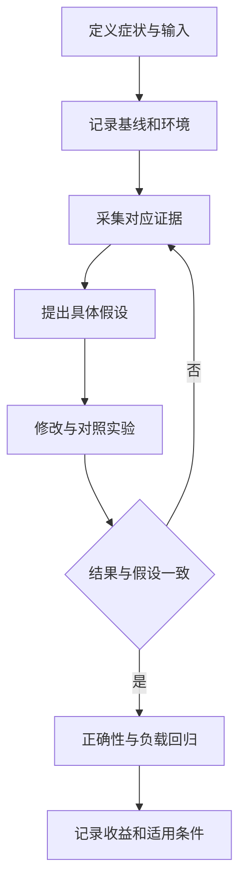
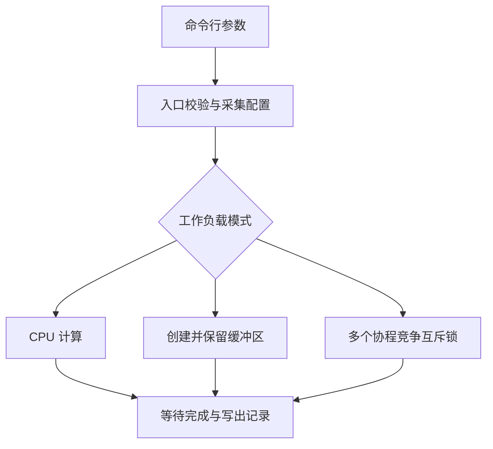

# Go 性能优化、pprof、trace 与 GC：完整学习笔记

> 整理日期：2026-10-22（UTC+8）。  
> 读者前提：已经能编写 Go 函数，了解切片、接口、goroutine、Channel、互斥锁和基本 HTTP 服务。  
> 版本口径：语义与接口以引用的官方文档为准；本次核验使用 Go 1.27.3。`testing.B.Loop` 需要 Go 1.24 或更新版本，`runtime/trace.FlightRecorder` 需要 Go 1.25 或更新版本，正式的 `goroutineleak` profile 需要 Go 1.27。正文会区分这些接口与较早版本可用的基本诊断方法。

本章的学习任务是：当一个服务“越来越慢、越来越占内存、goroutine 越来越多”时，能够解释应该采集什么证据，证据能说明什么，以及怎样判断一次修改确实解决了问题。工具命令是实现这一任务的手段；真正需要掌握的是从现象到因果解释的过程。

全文采用独立示例与可复现实验，接口语义参考 Go 官方文档，历史机制结合官方发布说明和设计文档解释。实验项目用于演示从性能症状、采样证据到假设验证的完整过程；其中的测量结果仅代表文中记录的运行环境。

<a id="section-001"></a>

> **统一运行基线：** 建议使用 Go 1.27.3，示例模块声明采用 `go 1.27.0`。文中出现其他 Go 版本时，仅用于说明特性引入时间或历史实现差异；第三方依赖仍以对应模块的版本要求为准。


*图示：性能优化闭环。*

## 正文导航

- [正文导航](#section-002)
- [一、Go 实际项目的性能分析工具](#section-003)
  - [1.1 先把“慢”写成可以检查的问题](#section-004)
  - [1.2 一张表选择合适工具](#section-005)
  - [1.3 平均值、分位数与负载变化](#section-006)
  - [1.4 先建立可比较的基线](#section-007)
- [二、pprof 分析](#section-008)
  - [2.1 使用：先分清采集端与分析端](#section-009)
  - [2.2 采集 CPU：确定计算花在哪里](#section-013)
  - [2.3 Goroutine 的泄漏分析](#section-017)
  - [2.4 GC 压力分析，结合 trace](#section-022)
  - [2.5 Benchmark 分析](#section-027)
  - [2.6 内存逃逸：理解生命周期，不背语法口诀](#section-033)
  - [2.7 锁的分析：先找临界区，再考虑替换工具](#section-037)
  - [2.8 阻塞分析：blockprofile](#section-041)
  - [2.9 Trace 分析：把一次执行展开成时间线](#section-045)
  - [2.10 分析流程总结：把证据串成可检查的解释](#section-050)
- [三、实际项目的情况：完整可复现实验【补充讲解案例】](#section-052)
  - [3.1 为什么用一个小项目串起前面的工具](#section-053)
  - [3.2 文件职责与调用顺序](#section-054)
  - [3.3 完整源码](#section-055)
  - [3.4 第一次运行：先确认结构正确](#section-061)
  - [3.5 实验 A：从 CPU 热点定位重复计算](#section-062)
  - [3.6 实验 B：比较分配与保留](#section-063)
  - [3.7 实验 C：从两个方向观察同一把锁](#section-064)
  - [3.8 实验 D：把锁等待放到时间线上](#section-065)
  - [3.9 实验 E：基准、逃逸与 PGO 的关系](#section-066)
  - [3.10 实际核验记录与结论边界](#section-067)
- [四、Go GC](#section-068)
  - [4.1 什么是 GC](#section-069)
  - [4.2 GC 相关术语](#section-071)
  - [4.3 Go 的 GC 发展演变史](#section-077)
  - [4.4 GC 与日常代码：如何减少无意义的工作](#section-082)
  - [4.5 本节总结](#section-087)
- [五、总结、复习与综合练习](#section-088)
  - [5.1 将知识组织成实际排查顺序](#section-089)
  - [5.2 三十道复习问答](#section-090)
  - [5.3 综合练习一：CPU 很低，接口却排队](#section-121)
  - [5.4 综合练习二：分配很多，还是保留太久](#section-122)
  - [5.5 综合练习三：优化结果能否被别人复现](#section-123)
- [官方资料索引](#section-124)
- [示例核验说明](#section-125)

<a id="section-003"></a>

## 一、Go 实际项目的性能分析工具

<a id="section-004"></a>

### 1.1 先把“慢”写成可以检查的问题

假设一个行情查询接口在开发机上响应很快，上线后调用方却说“偶尔要等很久”。这句话至少可能对应四类不同现象：处理一个请求需要执行大量计算；请求本身计算很少，却长期等待锁或数据库；并发请求太多，排队时间变长；少量请求遇到慢依赖，使尾部延迟明显升高。四者的修复方式不同，不能只凭“慢”就调整 GC 参数。

先记录观察对象：哪个路由、什么输入大小、每秒多少请求、多少并发、成功率如何、延迟分布怎样。再记录变化条件：是否只在某次发布后出现，是否与高峰、缓存失效、数据库变慢或实例重启同步。这样写出的假设才可以被证据支持或否定。例如，“所有请求都慢”与“仅缓存未命中的请求慢”会直接决定接下来分析整个进程还是某条业务路径。

性能指标也需要明确分母。CPU 使用率可以按单核或整机归一化；吞吐量可以统计到达、完成或成功请求；延迟可以从客户端发送时开始，也可以只计算服务端 Handler。某项数字没有口径时，即使看起来很精确，也不能公平比较。一次超时后立即返回错误可能降低平均响应时间，却让业务质量更差，因此延迟必须与成功率、超时率一起看。

把常用概念放在同一请求上理解：客户端总共等待 120 毫秒，其中服务端排队 70 毫秒、业务计算 10 毫秒、下游调用 40 毫秒。CPU profile 更容易突出实际消耗 CPU 的那 10 毫秒；执行 trace 有机会显示当前 Go 进程内等待和调度的时间关系；跨服务的追踪才可能继续解释下游 40 毫秒的组成。不同工具的空白区域，不代表那个时间不存在。[官方诊断总览](https://go.dev/doc/diagnostics)。

<a id="section-005"></a>

### 1.2 一张表选择合适工具

| 观察到的现象 | 首先考虑的证据 | 可以回答的问题 | 单独不能证明的事情 |
|---|---|---|---|
| CPU 长时间接近资源上限 | CPU profile、吞吐量、实例配额 | 哪些调用栈消耗 CPU | 所有请求为何等待这么久 |
| Go 堆持续增长 | 多个时刻的 heap profile、存活堆指标 | 哪些分配位置关联到仍存活对象 | 谁在业务上错误地保留它们 |
| GC 频繁，存活堆不大 | allocs profile、分配速率、GC CPU | 是否制造了大量短命对象 | 每一个临时对象都值得优化 |
| goroutine 数持续增长 | goroutine profile、创建与退出计数 | 堆积在哪类调用栈 | 所有等待中的 goroutine 都泄漏 |
| CPU 不高，响应却很慢 | block、mutex、trace、下游指标 | 是否在等待同步、调度或外部资源 | 外部数据库执行计划一定有问题 |
| 修改后“感觉更快” | 基准测试、端到端对照实验 | 指定工作负载下是否改善 | 其他输入和生产负载也必然改善 |
| 怀疑并发读写错误 | race detector、针对性并发测试 | 实际执行路径上是否发现数据竞争 | 没有报告就等于没有并发错误 |
| 某次请求偶发长尾 | 有界 trace、任务标记、请求日志 | 这次执行的时间顺序 | 仅靠采样 profile 完整复原这次请求 |

这里的 profile 可以理解为“按某种成本聚合的调用栈记录”。采样 CPU 时，成本是 CPU 时间；查看存活堆时，成本是采样并估计出的存活分配大小；查看互斥锁时，成本是争用等待。不要把不同 profile 中的数字加在一起，它们可能采用不同单位、采样方式和时间范围。[runtime/pprof](https://pkg.go.dev/runtime/pprof)。

<a id="section-006"></a>

### 1.3 平均值、分位数与负载变化

平均延迟把所有请求放进同一个算术平均。若九个请求耗时 10 毫秒，一个耗时 1 秒，平均值为 109 毫秒；这个值既不能代表大部分调用方，也不能充分描述最慢调用方。分位数描述排好序的样本位置，例如第九十五百分位常被写成 p95。不同监控系统采用不同的插值、桶和估计方式，比较时要保持算法和采样窗口一致。

下面只实现示例用的“最近秩”分位数：对百分位参数乘样本量后向上取整，取对应位置。实际生产系统可能用直方图近似，而不会永久保存所有请求时长。示例输入的单位是毫秒，输出数字是人为样本的计算结果，不是本章 Go 程序的跑分。

```go
// 运行示例：PERF-01
package main

import (
	"fmt"
	"math"
	"slices"
)

func nearestRank(values []int, percentile float64) int {
	if len(values) == 0 || percentile <= 0 || percentile > 1 {
		panic("invalid input")
	}
	ordered := slices.Clone(values)
	slices.Sort(ordered)
	return ordered[int(math.Ceil(percentile*float64(len(ordered))))-1]
}

func main() {
	samples := []int{10, 10, 10, 10, 10, 10, 10, 10, 10, 1000}
	total := 0
	for _, x := range samples {
		total += x
	}
	fmt.Println("mean:", total/len(samples))
	fmt.Println("p50:", nearestRank(samples, 0.50))
	fmt.Println("p95:", nearestRank(samples, 0.95))
}
```

输出：

```text
mean: 109
p50: 10
p95: 1000
```

示例使用标准库的切片复制与排序，避免为了统计而改变调用者的原始样本顺序。[slices.Clone](https://pkg.go.dev/slices#Clone)、[slices.Sort](https://pkg.go.dev/slices#Sort)、[math.Ceil](https://pkg.go.dev/math#Ceil)。

并发量也不是越大越好。假设服务稳定处理每秒一百个请求，单个请求在系统内平均停留十分之一秒，那么系统内平均大约有十个请求。这个关系可以用稳定排队系统的直觉理解：单位时间进入的量乘以每项停留时间，得到同时在场的量。若依赖变慢而入口流量不降，停留时间增长，排队和内存占用也可能增长。实际系统有拒绝、超时、重试与突发时，必须重新检查统计范围，不能把这一简化关系当作所有时刻的等式。

<a id="section-007"></a>

### 1.4 先建立可比较的基线

一次可比较的实验至少记录：Go 版本、程序提交或源码版本、构建参数、操作系统与架构、CPU 配额和 `GOMAXPROCS`、内存上限、输入数据、并发度、运行时长、是否预热、是否开启采样或 race 检测。只写“优化后快了百分之二十”而不记录这些条件，后续很难复现，也很难识别环境变化。

缓存是常见干扰源。同一程序连续运行两次，第二次可能命中文件系统缓存、连接池、应用缓存或已经建立的 TLS 连接。若旧版本只测冷启动，新版本只测热状态，所谓改进可能来自测量顺序。可以为冷启动和稳态分别设计实验，或者交替运行两个版本；每种方法都要说明它回答的是什么问题。

正确性检查应先于性能比较。把完整 JSON 校验删掉、提前返回错误或漏算部分订单，都可能让程序显著变快，却改变了业务语义。本章的基准对照会先检查两种实现的输出一致，再测量成本。端到端比较还应同时观察失败率、超时率和结果质量，避免把错误执行得更快当成优化成功。

<a id="section-008"></a>

## 二、pprof 分析

<a id="section-009"></a>

### 2.1 使用：先分清采集端与分析端

`runtime/pprof` 位于被观察的 Go 进程内，负责生成性能记录；`net/http/pprof` 把部分采集能力暴露为 HTTP Handler；`go tool pprof` 在分析端读取记录，完成聚合、过滤、定位源码与可视化。被观察服务不一定与分析机器相同：可以在问题实例采集文件，再到开发机分析。分析时尽量保存与记录匹配的可执行文件和源码，以便解析符号、内联和行号。[runtime/pprof](https://pkg.go.dev/runtime/pprof)、[net/http/pprof](https://pkg.go.dev/net/http/pprof)。

最常见的快速接入是空白导入 `net/http/pprof`，让包初始化时向默认 HTTP 多路复用器注册路由。问题是业务服务若也直接使用默认复用器，这些诊断路由可能跟着业务端口一起暴露。本章使用显式创建的 `ServeMux`，把业务与诊断 Handler 的可达范围写清楚。导入诊断包仍会影响默认复用器，但只要业务服务器始终使用自己的显式 Handler，就不会自动包含默认路由。

诊断数据可能含有函数名、文件路径、调用参数与业务标签。CPU profile、堆采样和 trace 也有额外开销。因此实际部署中通常让诊断端点只对受控访问路径开放，并限定采样时间。这里不是要求给每个学习程序搭建复杂鉴权，而是把“能够收集”与“应该对谁开放”分开考虑。

<a id="section-010"></a>

#### 2.1.1 用独立的复用器注册诊断路由

下面直接调用 Handler，不绑定端口，便于观察路由隔离的效果。业务复用器没有诊断路由，所以返回 404；诊断复用器显式注册了索引，返回 200。`httptest` 是标准库测试 HTTP 行为的工具，其请求和响应记录器可以在进程内完成这次调用。[httptest.NewRecorder](https://pkg.go.dev/net/http/httptest#NewRecorder)。

```go
// 运行示例：PERF-02
package main

import (
	"fmt"
	"net/http"
	"net/http/httptest"
	"net/http/pprof"
)

func main() {
	business := http.NewServeMux()
	business.HandleFunc("GET /health", func(w http.ResponseWriter, r *http.Request) {
		fmt.Fprint(w, "ok")
	})
	diagnostics := http.NewServeMux()
	diagnostics.HandleFunc("GET /debug/pprof/", pprof.Index)
	diagnostics.HandleFunc("GET /debug/pprof/profile", pprof.Profile)
	diagnostics.HandleFunc("GET /debug/pprof/trace", pprof.Trace)

	for _, handler := range []http.Handler{business, diagnostics} {
		req := httptest.NewRequest(http.MethodGet, "/debug/pprof/", nil)
		res := httptest.NewRecorder()
		handler.ServeHTTP(res, req)
		fmt.Println(res.Code)
	}
}
```

输出：

```text
404
200
```

真正启动服务器时，应分别配置 `http.Server{Addr: ..., Handler: business}` 与诊断服务器。监听地址可使用 `127.0.0.1:6060`，端口转发或代理策略由部署环境决定。诊断请求本身可能持续数秒至数十秒：若服务器 `WriteTimeout` 小于采样时长，请求可能在记录完成前就失败。不能把业务端口的超时参数未经分析地复制到诊断端口。[http.Server](https://pkg.go.dev/net/http#Server)。

<a id="section-011"></a>

#### 2.1.2 用 expvar 给现象提供业务背景

Profile 告诉开发者成本集中在哪里，但没有业务背景时，很难判断这些成本是否合理。比如序列化占比高，是编码实现低效，还是接口本来就要返回大量数据？计数器可以补充请求量、输入字节、错误数、缓存命中与拒绝数。`expvar` 提供简单的进程内变量发布和 JSON 展示，不等同于包含存储、告警与聚合的完整监控系统。[expvar](https://pkg.go.dev/expvar)。

```go
// 运行示例：PERF-03
package main

import (
	"encoding/json"
	"expvar"
	"fmt"
	"net/http/httptest"
)

func main() {
	requests := expvar.NewInt("lesson_requests_total")
	requests.Add(3)
	res := httptest.NewRecorder()
	req := httptest.NewRequest("GET", "/debug/vars", nil)
	expvar.Handler().ServeHTTP(res, req)
	var values map[string]json.RawMessage
	if err := json.Unmarshal(res.Body.Bytes(), &values); err != nil {
		panic(err)
	}
	fmt.Println("requests:", string(values["lesson_requests_total"]))
}
```

输出：

```text
requests: 3
```

同名变量重复发布会有问题，所以应在明确的初始化位置创建一次，而不是每次处理请求时调用 `NewInt`。标签或变量名也不能无限包含调用方 ID、订单 ID 等高变化值，否则监控本身可能带来内存和存储压力。记录必要的分组维度，例如路由类别、成功与失败；单次请求的具体关联通常交给结构化日志或追踪。

<a id="section-012"></a>

#### 2.1.3 常用采集命令与分析命令

以下命令假设开发者已运行受控的诊断服务器，且当前机器能够访问它。它们是复现步骤，不表示本笔记已经对某个真实线上服务采样。

```bash
go tool pprof -http=127.0.0.1:8081 'http://127.0.0.1:6060/debug/pprof/profile?seconds=15'
go tool pprof -http=127.0.0.1:8081 'http://127.0.0.1:6060/debug/pprof/heap'
go tool pprof -http=127.0.0.1:8081 'http://127.0.0.1:6060/debug/pprof/allocs'
go tool pprof -http=127.0.0.1:8081 'http://127.0.0.1:6060/debug/pprof/mutex'
go tool pprof -http=127.0.0.1:8081 'http://127.0.0.1:6060/debug/pprof/block'
```

这些命令各自占用分析界面的本地端口，需要逐项运行；并非同时启动五个进程争抢同一端口。图形界面的图视图可能需要 Graphviz 等额外依赖，文本界面则可以先完成多数定位工作。没有图形依赖不代表 profile 无法分析。[Go 官方 pprof 教程](https://go.dev/blog/pprof)、[pprof 官方命令说明](https://github.com/google/pprof/blob/main/doc/README.md)。

常用交互命令包括 `top` 查看热点，`top -cum` 查看累计成本，`list 函数名` 把成本映射到源码，`peek 正则` 观察调用关系。`flat` 表示归到当前函数自身的成本，`cum` 包含它调用的下游函数；如果多个父函数共享同一子函数，累计项存在重叠，不能把所有行简单相加。分析前先确认界面选择的是 CPU 时间、分配字节还是阻塞时间，否则热点排序可能回答了另一个问题。

<a id="section-013"></a>

### 2.2 采集 CPU：确定计算花在哪里

CPU profile 在程序运行期间采集正在使用 CPU 的调用栈，并据此估计计算成本的分布。它适合找重复解析、频繁编码、低效算法、过量日志格式化、加解密或 GC 标记等消耗。若一个 goroutine 大部分时间都睡眠或等待网络，CPU profile 不会把整段等待时间都算给它。

采样必须覆盖代表性工作负载。只记录服务启动阶段，可能看到初始化、连接建立和缓存预热；只在空闲时采样，得到的热点可能是运行时和诊断服务本身。每次开始前明确输入、流量与采样窗口，并在同一窗口记录完成请求数，才能进一步计算每个成功请求分摊的 CPU 成本。

<a id="section-014"></a>

#### 2.2.1 在程序内开启并停止 CPU 采集

下面把采样写到内存缓冲区，执行一段确定性的计算，再停止采集。它验证的是采集流程和缓冲区收到了记录，不保证短小样本一定有足够的 CPU 样本来定位热点。做真正分析时，使用第三部分的重复工作负载和文件输出，并给采样足够时间。

```go
// 运行示例：PERF-04
package main

import (
	"bytes"
	"fmt"
	"runtime/pprof"
)

var sink uint64

func main() {
	var recording bytes.Buffer
	if err := pprof.StartCPUProfile(&recording); err != nil {
		panic(err)
	}
	var sum uint64
	for i := uint64(0); i < 100000; i++ {
		sum += i * i
	}
	sink = sum
	pprof.StopCPUProfile()
	fmt.Println("computed:", sink > 0)
	fmt.Println("profile written:", recording.Len() > 0)
}
```

输出：

```text
computed: true
profile written: true
```

`StopCPUProfile` 必须先完成，随后才能把整个记录当作完整文件处理。业务程序里可以用 `defer` 保证退出路径停止采样，同时注意文件关闭顺序：应先停止采集，再关闭写入目标。整个进程不能随意启动多个互相冲突的 CPU 采样会话；若重复启动返回错误，要处理错误，而不是继续假定这次记录有效。[pprof.StartCPUProfile](https://pkg.go.dev/runtime/pprof#StartCPUProfile)、[pprof.StopCPUProfile](https://pkg.go.dev/runtime/pprof#StopCPUProfile)。

<a id="section-015"></a>

#### 2.2.2 用标签区分相似调用栈

同一个 JSON 编码函数可能服务多个业务路由。仅看函数名，很难知道是哪类请求贡献了成本。pprof 标签让开发者在同一调用栈之外附加少量稳定维度，例如 `route=quote` 或 `phase=parse`。标签是帮助聚合的分类，不应把每个请求 ID 都当作新类别。

```go
// 运行示例：PERF-05
package main

import (
	"context"
	"fmt"
	"runtime/pprof"
)

func main() {
	ctx := context.Background()
	pprof.Do(ctx, pprof.Labels("route", "quote"), func(labeled context.Context) {
		route, ok := pprof.Label(labeled, "route")
		fmt.Println(route, ok)
	})
	_, exists := pprof.Label(ctx, "route")
	fmt.Println("outside:", exists)
}
```

输出：

```text
quote true
outside: false
```

这个示例检验上下文中的标签作用域。真实 profile 是否记录某类标签，要看 profile 类型与当前实现；不能假定给堆对象自动增加了可按请求追踪的所有权。Go 1.27 还对采用对应模块版本的栈回溯标签展示作了调整，因此日志是否会出现标签也要结合工具链和模块版本核对。[pprof.Do](https://pkg.go.dev/runtime/pprof#Do)、[Go 1.27 Runtime](https://go.dev/doc/go1.27#runtime)。

<a id="section-016"></a>

#### 2.2.3 从热点走到修改：先问为什么调用这么多

热点有两种常见来源：一次调用本来就贵，或者单次很便宜但被调用太多。例如 `strconv.ParseInt` 占比高，不一定需要改写整数解析；可能每次查询都把相同配置字符串重新解析。把配置初始化一次，可能比替换标准库更直接。反过来，如果输入必须每次解析，那么缓存可能引入过期或无界内存，不能只看 CPU 节省。

可以用一个讲解比例判断优化上限：假设某段工作占总耗时的百分之二十，即使把它完全消除，其余百分之八十仍然存在，总耗时最多下降到原来的百分之八十。若某次报告声称仅修改这一段就快了十倍，要检查是否改变了工作量、并发、缓存或正确性。这个估算用于检查结论是否自洽，不代替实际测量，因为排队、锁竞争和资源饱和可能让端到端效应呈非线性。

CPU profile 中出现 GC、调度或内存分配函数时，要继续沿调用链寻找触发这些成本的业务路径。直接说“瓶颈在 runtime”并没有给出可操作原因。可能是每条日志都制造大量临时字符串，也可能是 goroutine 过多导致调度与根扫描增加。工具显示的是成本落点，工程修改通常发生在制造成本的地方。

<a id="section-017"></a>

### 2.3 Goroutine 的泄漏分析

<a id="section-018"></a>

#### 2.3.1 泄漏是生命周期问题，数量只是线索

goroutine 泄漏指本来应该结束的执行单元长期无法结束，持续保留栈、引用和相关资源。一个服务有一万个 goroutine，未必有问题：它可能正在服务一万个长连接。另一个服务只多出几十个 goroutine，也可能每次请求都遗留一个，最终不断积累。判断关键是创建原因、预期终止条件和实际退出行为。

最常见的路径是发送方与接收方对生命周期的理解不同。例如 Handler 超时返回了，后台 goroutine 却仍在向无缓冲结果通道发送；接收者已经不存在，这次发送就可能永久等待。另一个例子是工作协程在等待任务通道，而拥有任务通道的组件已经停止，却没有关闭通道或取消工作协程。GC 负责回收不可达内存，不能把普通业务 goroutine 自动当作“过期任务”关闭。

诊断时先观察时间序列：流量上升时数量增加，流量下降后是否回落？多次请求后，某个栈是否按相近斜率增加？再比较相同路由、相同错误路径与取消路径。单次快照无法告诉开发者这个等待已经持续一毫秒还是一个小时，需要结合多时刻样本或任务生命周期记录。

<a id="section-019"></a>

#### 2.3.2 给生产者同时设置发送与取消路径

下面的生产者每次准备发送下一个整数时，都可以接收取消信号。调用者拿到三个值后取消，并等待 `done`。`cancel()` 只发出信号；等待 `done` 才确认协程已经退出。这种区分对于测试“退出协议是否完整”非常重要。[context 文档](https://pkg.go.dev/context)、[Go Pipelines and cancellation](https://go.dev/blog/pipelines)。

```go
// 运行示例：PERF-06
package main

import (
	"context"
	"fmt"
)

func integers(ctx context.Context) (<-chan int, <-chan struct{}) {
	out := make(chan int)
	done := make(chan struct{})
	go func() {
		defer close(done)
		defer close(out)
		for n := 0; ; n++ {
			select {
			case out <- n:
			case <-ctx.Done():
				return
			}
		}
	}()
	return out, done
}

func main() {
	ctx, cancel := context.WithCancel(context.Background())
	values, done := integers(ctx)
	for i := 0; i < 3; i++ {
		fmt.Println(<-values)
	}
	cancel()
	<-done
	fmt.Println("producer stopped")
}
```

输出：

```text
0
1
2
producer stopped
```

如果把 `out <- n` 移到 `select` 外面，生产者可能在发送处卡住，永远没有机会检查取消信号。给结果通道加一个缓冲区只能容纳有限个未领取的结果，不能普遍解决无限生产或后续资源关闭问题。对于只产生一次结果的操作，容量为一的结果通道可能是合理的协议组成；对于持续流，通常仍需要明确取消、背压与退出等待。

业务任务也可能卡在不支持取消的函数里。把 Context 传给上层函数，并不会中断任意 CPU 循环或任意第三方阻塞调用；需要在合理的处理边界检查它，或者调用真正接受 Context 或截止时间的下游接口。取消不是抢占线程的通用按钮，而是由参与者共同遵守的协议。

<a id="section-020"></a>

#### 2.3.3 从调用栈识别“在等什么”

`goroutine` profile 可以输出当前 goroutine 的调用栈。文本形式适合快速查看，二进制形式适合进一步聚合。下面刻意让一个协程等在可释放的通道上，确认快照中能找到其函数，最后释放并等待结束。它展示如何观察一个等待状态，**没有制造永久泄漏**。

```go
// 运行示例：PERF-07
package main

import (
	"bytes"
	"fmt"
	"runtime/pprof"
)

//go:noinline
func waitForRelease(ready chan<- struct{}, release <-chan struct{}, done chan<- struct{}) {
	close(ready)
	<-release
	close(done)
}

func main() {
	ready := make(chan struct{})
	release := make(chan struct{})
	done := make(chan struct{})
	go waitForRelease(ready, release, done)
	<-ready
	var stacks bytes.Buffer
	if err := pprof.Lookup("goroutine").WriteTo(&stacks, 2); err != nil {
		panic(err)
	}
	fmt.Println("worker visible:", bytes.Contains(stacks.Bytes(), []byte("main.waitForRelease")))
	close(release)
	<-done
	fmt.Println("worker joined")
}
```

输出：

```text
worker visible: true
worker joined
```

看栈时应顺着业务函数往下读：等待 Channel 发送，说明它在等接收者或缓冲空间；等待互斥锁，说明需要找锁持有者和临界区；网络读取，说明要核对对端、超时和连接生命周期。状态文字帮助开发者分类，但无法替代对程序协议的理解。一个长期存在的后台工作池等待任务是正常现象；一个已被取消请求的子任务仍等结果，才需要进一步追查。

不建议把 `runtime.NumGoroutine()` 的瞬时差值写成严格的所有权断言。运行时、HTTP 客户端、测试框架和其他组件都可能创建 goroutine。测试具体组件时，更可靠的方法是暴露它自己的完成信号或等待接口，再用全局数量作为辅助趋势。测试等待应有合理超时，不能为了检查“是否泄漏”反过来让测试自己永久挂起。

<a id="section-021"></a>

#### 2.3.4 Go 1.27 的 goroutineleak profile

官方 Go 1.27 发布说明把 `goroutineleak` profile 纳入正式支持。它能利用可达性关系识别一类永远无法解除阻塞的 goroutine，并通过 `runtime/pprof` 和相应 HTTP 端点提供记录。这不同于把全部等待状态都列出来：它试图对某些等待给出更强的“无法再被唤醒”的判断。[Go 1.27 goroutine leak profile](https://go.dev/doc/go1.27#runtime)。

它仍不是业务生命周期的完整验证器。例如等待对象还被全局变量或可运行 goroutine 引用时，检测可能无法断定那个对象永远不会被操作；一个不断循环但业务上已经无用的 goroutine，也不一定属于其能够识别的阻塞模式。因此“该 profile 为空”和“服务没有任何 goroutine 泄漏”不能画等号。

```go
// 运行示例：PERF-08
package main

import (
	"fmt"
	"runtime/pprof"
)

func main() {
	fmt.Println("goroutine profile:", pprof.Lookup("goroutine") != nil)
	fmt.Println("goroutineleak profile:", pprof.Lookup("goroutineleak") != nil)
}
```

Go 1.27.3 下的输出：

```text
goroutine profile: true
goroutineleak profile: true
```

这里仅验证当前运行时注册了该 profile，不构造和遗留永久阻塞任务。较早版本的支持情况需要按发布说明检查，不能只把代码复制过去再假定接口名称有效。生产中仍应保留创建数、完成数、取消数与在途任务数的可观测关系。

<a id="section-022"></a>

### 2.4 GC 压力分析，结合 trace

<a id="section-023"></a>

#### 2.4.1 区分“现在活着多少”与“一直制造多少”

考虑两个请求处理器。A 每秒创建一百兆字节临时数据，但请求结束后大部分不再被引用；B 每秒只创建一兆字节，却把全部结果无限加入全局切片。A 可能分配速率高、GC CPU 成本高，而稳定存活堆较小；B 的 GC 频率不一定立刻突出，存活堆却持续增长。它们都可能让服务不健康，但前者优先研究分配来源，后者优先研究保留关系。

`heap` 与 `allocs` 记录共享相关分配统计，默认展示口径不同。`inuse_space` 看当前存活分配关联的字节，`alloc_space` 看累计分配关联的字节；对应的 `*_objects` 按对象数计。较大的对象数不一定意味着较大的内存，较大的累计分配也不等于同样多的数据此刻仍驻留在内存。[pprof Heap profile](https://pkg.go.dev/runtime/pprof#hdr-Heap_profile)。

在排查泄漏时，最好收集同类负载和相近 GC 状态下的多个堆快照。一次刚分配完但尚未完成 GC 的快照，与一次强制 GC 后的快照，口径可能不适合直接比较。官方 heap profile 对最近一次完成的 GC 有明确统计语义；不要把它当作任意纳秒上的所有对象精确清单。

<a id="section-024"></a>

#### 2.4.2 从 runtime/metrics 获取运行时指标

`runtime/metrics` 提供带名称、单位和类型的运行时度量。读取时先检查 `Value.Kind()`，再使用对应访问方法；不同 Go 版本的指标集合可能扩展，不能把所有名字都当作永远存在。下面只检查三个常见指标是否可读，不打印随运行变化的具体数值。[runtime/metrics](https://pkg.go.dev/runtime/metrics)。

```go
// 运行示例：PERF-09
package main

import (
	"fmt"
	"runtime/metrics"
)

func main() {
	samples := []metrics.Sample{
		{Name: "/gc/heap/allocs:bytes"},
		{Name: "/gc/heap/live:bytes"},
		{Name: "/sched/goroutines:goroutines"},
	}
	metrics.Read(samples)
	for _, sample := range samples {
		fmt.Println(sample.Name, sample.Value.Kind() == metrics.KindUint64)
	}
}
```

输出：

```text
/gc/heap/allocs:bytes true
/gc/heap/live:bytes true
/sched/goroutines:goroutines true
```

累计计数需要计算差分才能得到速率。例如两次 `/gc/heap/allocs:bytes` 的差除以间隔秒数，近似描述这段时间的分配字节率。不要把开机以来累计值直接解释成“当前每秒分配量”；进程重启、计数回绕或采集窗口中断也应由监控系统正确处理。涉及直方图的指标需要按桶的边界和计数解释，而不能直接强转为整数。

GC CPU 与进程 CPU 的关系也要保持口径一致。假设 GC 占用一核的计算资源，而服务实际获得八核配额，它与只获得一核的实例面临的竞争不同。观察 GC 比例之外，还应看总 CPU、完成吞吐、尾延迟和分配来源。只有一张“GC 次数很多”的图，不能决定应该调大 `GOGC`，因为当前内存预算可能已经很紧。

<a id="section-025"></a>

#### 2.4.3 强制 GC 是实验动作，不是日常优化策略

下面读取 GC 周期计数，主动执行一次 GC，再确认周期发生了变化。这可以帮助讲解或构造可比较的堆快照，但不能据此在每个请求结束后调用 `runtime.GC()`。频繁强制收集会改变运行时原本的节奏，还可能直接增加请求延迟。

```go
// 运行示例：PERF-10
package main

import (
	"fmt"
	"runtime"
	"runtime/metrics"
)

func cycles() uint64 {
	samples := []metrics.Sample{{Name: "/gc/cycles/total:gc-cycles"}}
	metrics.Read(samples)
	if samples[0].Value.Kind() != metrics.KindUint64 {
		panic("metric unavailable")
	}
	return samples[0].Value.Uint64()
}

func main() {
	before := cycles()
	runtime.GC()
	after := cycles()
	fmt.Println("cycle observed:", after > before)
}
```

输出：

```text
cycle observed: true
```

`runtime.GC()` 会阻塞调用它的 goroutine，直到相应收集完成。它不是“把进程所有内存立即还给操作系统”的承诺；对象回收、空闲页处理、操作系统驻留内存统计属于不同层面。[runtime.GC](https://pkg.go.dev/runtime#GC)、[runtime.MemStats](https://pkg.go.dev/runtime#MemStats)。

<a id="section-026"></a>

#### 2.4.4 什么时候该打开 trace

如果 profile 显示 GC 成本增加，却无法解释“为什么某个时间段请求集体变慢”，可以用执行 trace 对齐事件：并发标记何时运行，是否出现标记辅助，goroutine 是否长时间可运行但没有得到执行，是否发生同步阻塞或系统调用。trace 的优势在时间顺序，代价是记录量与采集扰动，因此要使用有界窗口并选择代表性问题时段。

`GODEBUG=gctrace=1` 可以输出简洁的 GC 周期日志，适合看趋势与阶段线索。日志字段与实现可能随版本改变，阅读时应查看当前 `runtime` 文档。它不是一个固定不变的业务日志格式，也不应成为程序正确性所依赖的解析协议。第三部分将把日志作为可选观察材料，而不把某一组机器上的毫秒值写成所有人的预期输出。

<a id="section-027"></a>

### 2.5 Benchmark 分析

<a id="section-028"></a>

#### 2.5.1 基准测试在回答一个受控的小问题

基准测试可以让同一段工作重复执行，估计每次操作的时间和分配成本。它适合比较两种解析、编码、数据结构或同步实现，但必须先定义“一次操作”是什么：处理一个字段、一个完整请求，还是一批一千条记录？如果两个版本每次循环完成的业务量不同，`ns/op` 就没有公平的比较基础。

微基准经常在稳定输入、无网络、单一进程和较小工作集下运行。这有利于减少噪声，却也限制了结论。一个缓存命中路径在微基准里很快，不代表在高峰缓存失效、并发竞争和下游限速时依然满足要求。理想的验证链是：先确认算法与输出，再做微基准找局部成本，最后回到代表性端到端负载。

<a id="section-029"></a>

#### 2.5.2 先比较两种实现的业务输出

下面对固定输入生成相同字符串：一种使用通用格式化，另一种使用具体类型转换和构建器。两者在此输入契约下输出一致；是否更快，要看后面的基准。不要把“看起来更底层”当成性能证明。[fmt.Sprintf](https://pkg.go.dev/fmt#Sprintf)、[strconv.Itoa](https://pkg.go.dev/strconv#Itoa)、[strings.Builder](https://pkg.go.dev/strings#Builder)。

```go
// 运行示例：PERF-11
package main

import (
	"fmt"
	"strconv"
	"strings"
)

func formatGeneric(symbol string, count int) string {
	return fmt.Sprintf("%s:%d", symbol, count)
}

func formatSpecific(symbol string, count int) string {
	var b strings.Builder
	b.Grow(len(symbol) + 24)
	b.WriteString(symbol)
	b.WriteByte(':')
	b.WriteString(strconv.Itoa(count))
	return b.String()
}

func main() {
	a := formatGeneric("BTCUSDT", 12)
	b := formatSpecific("BTCUSDT", 12)
	fmt.Println(a)
	fmt.Println("equal:", a == b)
}
```

输出：

```text
BTCUSDT:12
equal: true
```

构建器的 `Grow` 预留空间只是一个策略，可能减少后续扩容，也可能为短输入多预留一些容量。若输入规模差别很大，应该按典型与极端输入分别测量。对只有几个固定部分的字符串，直接拼接也可能被编译器优化得很好；不能机械要求所有拼接都改成 Builder。

<a id="section-030"></a>

#### 2.5.3 B.Loop 与传统 b.N 写法

Go 1.24 引入 `testing.B.Loop`。典型写法是先准备输入，再写 `for b.Loop() { ... }`，让测试框架管理迭代和计时。传统写法是从零循环到 `b.N`；它仍然可以使用，但同一个基准不要混用两种循环控制。`B.Loop` 对特定语法形式内的工作有防止完全消除的支持，但不意味着可以忽略业务结果与真实数据依赖。[testing.B.Loop](https://pkg.go.dev/testing#B.Loop)、[Go 1.24 testing](https://go.dev/doc/go1.24#testing)。

测试源码应放在以 `_test.go` 结尾的文件里，函数名以 `Benchmark` 开始，参数类型为 `*testing.B`。第三部分给出完整可复制的模块，而不是把无法独立构建的片段算作完整示例。常见运行命令如下：

```bash
go test ./...
go test -run='^$' -bench=. -benchmem -count=6 ./internal/workload
```

第一行先验证结果；第二行用正则跳过普通测试，只运行基准。`-benchmem` 请求输出内存分配信息，`-count=6` 重复测量。典型输出中的 `ns/op` 是每次操作时间，`B/op` 是平均分配字节，`allocs/op` 是平均分配次数；这些数字受环境和实现影响，不能把文档中的示意行当作开发者必须得到的固定值。[go test 参数](https://pkg.go.dev/cmd/go#hdr-Testing_flags)。

<a id="section-031"></a>

#### 2.5.4 用 AllocsPerRun 看一个明确的分配行为

`testing.AllocsPerRun` 可以在一个小实验里估计函数平均分配次数。下面把新建切片保存在包级变量中，使其在调用结束后继续可达，再检查是否观察到分配。它不会证明所有 `make` 都必须分配在堆，也不适合代表完整业务负载；作用是把“这个具体程序会制造需要保留的对象”变成可观察实验。

```go
// 运行示例：PERF-12
package main

import (
	"fmt"
	"testing"
)

var retained []byte

func main() {
	allocations := testing.AllocsPerRun(100, func() {
		retained = make([]byte, 1024)
	})
	fmt.Println("allocation observed:", allocations >= 1)
	fmt.Println("retained bytes:", len(retained))
}
```

输出：

```text
allocation observed: true
retained bytes: 1024
```

`AllocsPerRun` 会为测量调整执行条件，包括暂时使用一个 `GOMAXPROCS`，因此它的结果不能直接替代并行基准。更重要的是，减少一次分配可能让对象存活更久、增加复制或引入锁。优化目标应同时考虑 CPU、内存峰值、分配率、延迟和可维护性，而不是把 `allocs/op=0` 当作一切函数的强制目标。[testing.AllocsPerRun](https://pkg.go.dev/testing#AllocsPerRun)。

<a id="section-032"></a>

#### 2.5.5 重复测量与 benchstat

测量有波动，单次旧版本与单次新版本的差异可能来自后台任务、CPU 频率或虚拟化环境。`benchstat` 用于汇总与比较 Go 基准结果。应保留多次样本、输入和环境，再查看变化幅度及统计信息；即使统计上可区分，极小收益也可能不值得增加大量复杂性。[benchstat 官方文档](https://pkg.go.dev/golang.org/x/perf/cmd/benchstat)。

比较两个提交时应使用相同基准名称与参数，分别保存 `before.txt` 和 `after.txt`。若只是同一模块里两个不同函数的基准，它们的名字不同，默认展示不一定直接形成开发者想要的“同一行前后对照”，需要使用文档介绍的投影或组织相同基准入口。解释工具输出时要区分“没有足够证据表明不同”与“两者完全一样”。

还要避免测量工具影响结论：使用 `-race` 检查并发正确性后，通常另行运行不带 race 的性能基准；不要把 race 插桩后的速度与正常构建直接比较。CPU、精确分配、block 和 trace 采集也可能互相干扰，应按问题分轮采集，并说明哪些设置同时开启。[官方诊断工具的相互影响说明](https://go.dev/doc/diagnostics)。

<a id="section-033"></a>

### 2.6 内存逃逸：理解生命周期，不背语法口诀

<a id="section-034"></a>

#### 2.6.1 逃逸分析解决什么问题

局部变量在源码里写在函数内部，不代表它的存储只能活到函数返回。若它的地址被返回、交给其他更长寿命对象，或者编译器不能证明使用范围足够短，就需要确保这块存储在未来仍然有效。逃逸分析是编译器根据引用关系和生命周期做出的静态判断，帮助决定存储位置和相关优化。[Go GC 指南的逃逸分析说明](https://go.dev/doc/gc-guide#Where_values_live)。

可以把函数栈帧理解为一次调用的临时工作区，但不能把这个类比用成手工管理规则。Go 会保证合法指针的有效性；返回局部变量地址是合法写法，不会像某些语言里那样直接形成悬空指针。与此同时，返回指针也不等于每次运行必然产生一次独立堆分配：调用可能被内联，引用可能被证明不逃出更大的范围，结果还可能被其他优化改变。

```go
// 运行示例：PERF-13
package main

import "fmt"

func newCounter(start int) *int {
	counter := start
	return &counter
}

func main() {
	value := newCounter(41)
	*value++
	fmt.Println(*value)
}
```

输出：

```text
42
```

`*value++` 在 Go 中表示对指针所指的整数执行自增，不是移动指针。这个程序证明了返回值的使用合法，输出本身不能告诉开发者实际存储在栈还是堆。要研究当前编译结果，应使用编译器诊断，而不是根据“用了取地址”得出结论。

<a id="section-035"></a>

#### 2.6.2 如何阅读编译器诊断

在第三部分的模块中可以执行下面的命令，把编译器的优化诊断保存下来：

```bash
go build -gcflags='-m=2' ./cmd/lab
go test -gcflags='-m=2' ./internal/workload
```

`-m` 输出优化决策，较高详细级别会显示更多原因。默认参数作用范围与 `all=-m=2` 不同，后者可能连依赖和标准库都输出，容易淹没开发者关心的信息。应先聚焦自己的包，再在必要时扩展范围。诊断文本属于工具链输出，不是稳定的程序接口；不同版本的内联和优化会改变它。[cmd/compile 的 -m 选项](https://pkg.go.dev/cmd/compile)。

看到 `escapes to heap` 后，先定位是哪一个值，而不只是看整个函数名。例如把整数交给格式化函数时，接口转换和可变参数相关对象可能受到分析；这不等于函数中的每个变量都上堆。看到 `moved to heap` 也要结合调用点、内联与最终测量。若为了证明“某写法会逃逸”而关闭所有优化，开发者得到的是特定诊断条件，不能直接拿来解释正常生产构建。

常见的逃逸原因包括值被长期对象持有、接口或间接调用使编译器无法证明边界、闭包引用超过原调用生命周期，以及动态大小或较大对象带来的实现限制。但这些是检查线索，不是无条件口诀。“接口必逃逸”“闭包必逃逸”“make 必在堆上”都太绝对。比较同一段代码时，应记录工具链、构建参数与实际 `allocs/op`，让编译器证据和运行证据相互印证。

<a id="section-036"></a>

#### 2.6.3 小视图可能保留大对象

内存问题不只有“分配太多”，还有“保留太久”。一个很短的子字符串可能引用较大的原字符串存储；一个很短的子切片也可能仍引用完整底层数组。如果把这些小视图长期放入缓存，逻辑上只有几个字节，实际保留关系却可能更大。需要独立所有权时，可以复制所需部分；这会增加复制成本，但可能降低长期保留量。

```go
// 运行示例：PERF-14
package main

import (
	"fmt"
	"strings"
)

func prefixCopy(input string) string {
	return strings.Clone(input[:8])
}

func main() {
	large := strings.Repeat("ABCDEFGH", 1024)
	prefix := prefixCopy(large)
	fmt.Println(prefix)
	fmt.Println("length:", len(prefix))
}
```

输出：

```text
ABCDEFGH
length: 8
```

这个输出只检验业务内容，复制语义来自 `strings.Clone` 的接口约定；不要通过打印指针地址来构造脆弱的性能断言。对于空字符串或已知不会长期保留的短数据，无条件复制可能没有收益。应先从 heap profile 的分配位置找到相关对象，再检查业务容器是否一直保留它。[strings.Clone](https://pkg.go.dev/strings#Clone)。

<a id="section-037"></a>

### 2.7 锁的分析：先找临界区，再考虑替换工具

<a id="section-038"></a>

#### 2.7.1 锁争用如何影响吞吐和尾延迟

互斥锁让同一时刻只有一个执行者进入受保护区域。若这个区域只更新一个计数器，锁持有时间可能很短；若它包含 HTTP 调用、磁盘写入、慢格式化或大切片排序，其他 goroutine 就必须等待这些外部工作。并发越高，等待者越多，累计争用时间可能远大于某一个执行者实际持锁的时间。

`mutex` profile 通常把争用成本归到导致等待的临界区结束位置，即解锁调用栈；`block` profile 则更侧重阻塞发生的位置。看到 `Unlock` 很热，不代表解锁指令本身做了大量计算，而是它与此前持锁期间造成的等待关联。读 profile 时若混淆这一点，就会优化错误的位置。[pprof Mutex profile](https://pkg.go.dev/runtime/pprof#hdr-Mutex_profile)。

先确保数据正确，再缩短临界区。下面两个 goroutine 共同更新计数，互斥锁保证每次读改写不会互相覆盖。它只演示正确同步，不声称 Mutex 在此场景比其他方式快。

```go
// 运行示例：PERF-15
package main

import (
	"fmt"
	"sync"
)

func main() {
	var mu sync.Mutex
	var wg sync.WaitGroup
	count := 0
	for worker := 0; worker < 2; worker++ {
		wg.Add(1)
		go func() {
			defer wg.Done()
			for i := 0; i < 100; i++ {
				mu.Lock()
				count++
				mu.Unlock()
			}
		}()
	}
	wg.Wait()
	fmt.Println("count:", count)
}
```

输出：

```text
count: 200
```

这个例子在所有更新完成后读取结果；若读取发生在更新过程中，也需要同步。`WaitGroup` 用来等待任务，不会自动保护任务执行过程中的共享变量。使用指针接收者或含锁对象时，还要避免在使用后复制锁；`go vet` 可以帮助发现一部分常见误用。[sync.Mutex](https://pkg.go.dev/sync#Mutex)、[sync.WaitGroup](https://pkg.go.dev/sync#WaitGroup)。

<a id="section-039"></a>

#### 2.7.2 复制快照后，在锁外做较慢的工作

对于“读一批状态并进行编码”的场景，可以在锁内复制必要字段，再在锁外格式化或排序。这样做的代价是复制与快照内存，收益是减少持锁时间。若复制的对象仍包含可变指针、切片或 map，只复制外层结构可能不足以形成独立快照；必须按业务的共享关系决定复制深度。

```go
// 运行示例：PERF-16
package main

import (
	"fmt"
	"slices"
	"sync"
)

type Store struct {
	mu     sync.Mutex
	values map[string]int
}

func (s *Store) snapshot() map[string]int {
	s.mu.Lock()
	defer s.mu.Unlock()
	result := make(map[string]int, len(s.values))
	for key, value := range s.values {
		result[key] = value
	}
	return result
}

func main() {
	store := Store{values: map[string]int{"ETH": 2, "BTC": 1}}
	snapshot := store.snapshot()
	keys := make([]string, 0, len(snapshot))
	for key := range snapshot {
		keys = append(keys, key)
	}
	slices.Sort(keys)
	for _, key := range keys {
		fmt.Println(key, snapshot[key])
	}
}
```

输出：

```text
BTC 1
ETH 2
```

当前值是整数，所以复制 map 项就建立了独立快照。若值改成 `[]byte`，两个 map 仍可能共享同一底层数组，需要追加复制或采用不可变对象约定。也要明确快照时刻：它反映锁内读取时的状态，并不保证在发送 HTTP 响应时仍是最新值。性能优化不应悄悄改变一致性承诺。

<a id="section-040"></a>

#### 2.7.3 原子操作适合简单状态，但不自动保护业务不变量

单个计数器可以用原子操作更新，避免写出显式互斥区。下面和前面的计数例子得到相同业务结果；真正比较成本时，需要相同并发和工作量的基准，而不是凭代码行数判断。

```go
// 运行示例：PERF-17
package main

import (
	"fmt"
	"sync"
	"sync/atomic"
)

func main() {
	var count atomic.Int64
	var wg sync.WaitGroup
	for worker := 0; worker < 2; worker++ {
		wg.Add(1)
		go func() {
			defer wg.Done()
			for i := 0; i < 100; i++ {
				count.Add(1)
			}
		}()
	}
	wg.Wait()
	fmt.Println("count:", count.Load())
}
```

输出：

```text
count: 200
```

如果业务要求“库存减少一件，同时订单数增加一件”，分别对两个字段做原子更新不一定能让读者看到一致的组合状态。还可能需要锁、不可变快照或其他事务性协议。原子操作也会涉及共享缓存行和处理器间协调，高争用时并非没有成本。[sync/atomic](https://pkg.go.dev/sync/atomic)、[Go 内存模型](https://go.dev/ref/mem)。

`RWMutex` 适合某些读多写少的共享状态，但读锁也有管理成本，写者等待与调度会影响表现。分片锁能够降低不同键之间的争用，却需要解决跨分片操作与热点键偏斜。每种改动都应先说明它缩短了哪一段串行路径，再通过代表性负载验证。

<a id="section-041"></a>

### 2.8 阻塞分析：blockprofile

<a id="section-042"></a>

#### 2.8.1 等待并不天然是错误

等待任务的 worker、等待取消的后台任务、等待网络数据的连接处理器，都可能合理地处于阻塞状态。问题在于等待是否符合协议、是否有边界，以及它是否在高峰时形成过长队列。把所有阻塞都消除，可能只是把有序等待改成忙等，反而增加 CPU 消耗。

block profile 主要覆盖同步原语上的等待，例如通道、锁、条件变量和 WaitGroup。它不是对所有外部 I/O 等待的完整采样目录。若接口主要在等数据库或网络，应该结合执行 trace、客户端指标和下游观测；不能因为 block profile 看起来不突出，就断言服务没有等待瓶颈。[pprof Block profile](https://pkg.go.dev/runtime/pprof#hdr-Block_profile)。

<a id="section-043"></a>

#### 2.8.2 有界队列把资源上限写进协议

容量为二的通道最多缓冲两个未消费任务，第三个提交可以选择等待、超时或拒绝。下面选择立即拒绝；它把超载行为显式化。实际服务中，拒绝后需要返回可识别错误、记录计数，并决定调用方是否有预算重试。

```go
// 运行示例：PERF-18
package main

import "fmt"

func trySubmit(queue chan<- int, value int) bool {
	select {
	case queue <- value:
		return true
	default:
		return false
	}
}

func main() {
	queue := make(chan int, 2)
	fmt.Println(trySubmit(queue, 1))
	fmt.Println(trySubmit(queue, 2))
	fmt.Println(trySubmit(queue, 3))
	fmt.Println("queued:", len(queue))
}
```

输出：

```text
true
true
false
queued: 2
```

通道容量限制的是缓冲项数，不能独自限制整个系统的所有在途任务。如果每个请求先启动一个 goroutine，再让它阻塞着向队列发送，队列虽然有界，等待提交的 goroutine 仍可能无限增长。容量控制应放在创建昂贵任务之前，并把正在执行、排队和等待提交的数量一起考虑。

<a id="section-044"></a>

#### 2.8.3 显式开启采样并收集记录

block profile 默认不主动收集全部阻塞事件，需要通过 `runtime.SetBlockProfileRate` 配置。参数对应以时间为依据的采样策略，不应与 mutex 的事件采样率混为一谈。将参数设为一通常用于细致实验，真实服务需权衡开销，结束后恢复合理设置。[runtime.SetBlockProfileRate](https://pkg.go.dev/runtime#SetBlockProfileRate)。

```go
// 运行示例：PERF-19
package main

import (
	"bytes"
	"fmt"
	"runtime"
	"runtime/pprof"
	"time"
)

func main() {
	runtime.SetBlockProfileRate(1)
	defer runtime.SetBlockProfileRate(0)
	done := make(chan struct{})
	timer := time.AfterFunc(5*time.Millisecond, func() { close(done) })
	<-done
	timer.Stop()
	var recording bytes.Buffer
	if err := pprof.Lookup("block").WriteTo(&recording, 0); err != nil {
		panic(err)
	}
	fmt.Println("block profile written:", recording.Len() > 0)
}
```

输出：

```text
block profile written: true
```

示例使用短定时器产生一个可结束的等待，并验证 profile 能够写出。它不把实际阻塞毫秒数、样本数或某个调用栈条目写死，因为调度和采样存在变化。真实排查需要较长且代表性的工作负载，结合阻塞累计时间和完成工作量，判断等待是正常协调还是容量不足。

<a id="section-045"></a>

### 2.9 Trace 分析：把一次执行展开成时间线

<a id="section-046"></a>

#### 2.9.1 执行 trace 与分布式追踪回答不同问题

Go execution trace 记录一个 Go 进程的运行时执行事件，适合查看 goroutine 的创建、调度、阻塞、系统调用和 GC 活动。分布式追踪则围绕业务请求跨服务传播的关系组织事件。它们可以互补，但在 Go trace 中给任务命名，并不会自动让数据库服务或其他语言进程加入同一条完整链路。[runtime/trace](https://pkg.go.dev/runtime/trace)。

理解时间线时先分清几个状态：正在运行表示已获得执行机会；可运行表示准备好但尚未执行；等待表示还缺某个事件或资源。若 goroutine 长时间可运行，可能需要检查 CPU 饱和、配额和调度；若长期等待通道，需检查协议；若下游调用结束得很慢，应继续研究对端。状态与时间关系帮助缩小范围，不会自动给出唯一根因。

<a id="section-047"></a>

#### 2.9.2 用任务和区域增加业务含义

下面建立一个名为 `quote-request` 的任务，并在两个阶段增加区域标记。子 goroutine 使用同一个任务上下文，但每个区域在实际执行它的 goroutine 内开始和结束。任务用于关联业务活动，区域用于表达一段连续执行范围，不能随意跨协程结束别人的区域。

```go
// 运行示例：PERF-20
package main

import (
	"bytes"
	"context"
	"fmt"
	"runtime/trace"
)

func main() {
	var recording bytes.Buffer
	if err := trace.Start(&recording); err != nil {
		panic(err)
	}
	ctx, task := trace.NewTask(context.Background(), "quote-request")
	result := make(chan int, 1)
	done := make(chan struct{})
	go func() {
		defer close(done)
		trace.WithRegion(ctx, "calculate", func() {
			result <- 1 + 2 + 3
		})
	}()
	var total int
	trace.WithRegion(ctx, "wait-result", func() { total = <-result })
	<-done
	task.End()
	trace.Stop()
	fmt.Println("result:", total)
	fmt.Println("trace written:", recording.Len() > 0)
}
```

输出：

```text
result: 6
trace written: true
```

示例既接收计算结果，又等待 `done`，确保子 goroutine 的区域收尾完成后才结束任务并停止采样。发送结果与完成所有清理是两个事件：若只接收结果，发送者仍可能在执行后续代码。任务结束是观测标记，不是同步原语，因此应让任务生命周期与实际业务完成协议对齐。[trace.NewTask](https://pkg.go.dev/runtime/trace#NewTask)、[trace.WithRegion](https://pkg.go.dev/runtime/trace#WithRegion)。

<a id="section-048"></a>

#### 2.9.3 按问题选择分析视图

采集到 `trace.out` 后，可以运行：

```bash
go tool trace trace.out
go tool trace -pprof=sched trace.out > sched.pprof
go tool pprof -top sched.pprof
```

第一行打开交互式分析界面；后两行提取调度相关的 profile 并用文本方式查看。还可以按工具帮助查看支持的网络、同步阻塞和系统调用视图。不要把导出的调度等待 profile 当作 CPU profile：它回答的是等待执行机会的时间，而非实际消耗 CPU 的时间。[go tool trace](https://pkg.go.dev/cmd/trace)。

分析时先找到异常时间窗口，再看该窗口里谁在运行、谁在等待、GC 是否活跃、业务任务跨越哪些阶段。若只把整段 trace 缩成一张密集图片，很容易把正常活动误判成异常。应该把一个具体假设写在旁边，例如“这个请求在 CPU 不饱和时仍等了很久，是否卡在同一个通道？”然后让时间线支持或否定它。

<a id="section-049"></a>

#### 2.9.4 FlightRecorder：保留最近一段执行历史

偶发问题通常在出现之后才被注意到，此时重新开启 trace 可能错过前因。Go 1.25 的 Flight Recorder 能保留最近一段执行记录，在触发条件满足时导出快照。它仍有运行开销，窗口大小、导出并发、磁盘写入和触发频率都应有边界。[官方 Flight Recorder 介绍](https://go.dev/blog/flight-recorder)。

```go
// 运行示例：PERF-21
package main

import (
	"bytes"
	"context"
	"fmt"
	"runtime/trace"
	"time"
)

func main() {
	recorder := trace.NewFlightRecorder(trace.FlightRecorderConfig{
		MinAge:   time.Second,
		MaxBytes: 1 << 20,
	})
	if err := recorder.Start(); err != nil {
		panic(err)
	}
	var total int
	trace.WithRegion(context.Background(), "work", func() {
		for i := 1; i <= 3; i++ {
			total += i
		}
	})
	var snapshot bytes.Buffer
	_, err := recorder.WriteTo(&snapshot)
	recorder.Stop()
	if err != nil {
		panic(err)
	}
	fmt.Println("result:", total)
	fmt.Println("snapshot written:", snapshot.Len() > 0)
}
```

输出：

```text
result: 6
snapshot written: true
```

`MaxBytes` 是控制记录窗口的提示，不能当作整个记录器内存开销或导出字节数的严格硬上限；`MinAge` 也会受窗口容量影响。导出操作有并发限制，应集中管理，避免每一个慢请求都并发写出一份大文件。现代版本允许飞行记录与普通 trace 消费者在特定约束下并存，具体限制以所用版本 API 为准。[trace.FlightRecorderConfig](https://pkg.go.dev/runtime/trace#FlightRecorderConfig)。

<a id="section-050"></a>

### 2.10 分析流程总结：把证据串成可检查的解释

先确认症状和业务范围，再确定资源瓶颈类型；记录基线后选择采样工具，建立一个可证伪假设；用最小修改验证假设，最后在相同工作负载和关键错误路径上回归。这个过程允许回退：发现 CPU 并不是主要问题，就应转去观察等待和下游，而不是因为已经打开 pprof 就只在 CPU 热点里找答案。



“结果一致”至少包括两层：目标指标按预期改变，且没有用错误率、内存峰值或其他关键指标的恶化来换取表面收益。例如缩小一个缓冲区后堆内存下降，但调用方大量超时，这不是完整成功；换成无界缓冲让吞吐暂时上升，却把失败推迟到内存耗尽，也不算解决问题。

最后保存可复查材料：源码版本、构建命令、输入、profile、关键图表或文本、原始基准结果，以及为什么采取该修改。解释中应分清观察与推断：“mutex profile 在某个解锁栈累计时间高”是观察；“锁内调用下游使请求串行”是结合源码得出的假设；“移到锁外后在相同负载下降低等待且输出一致”才构成更完整的证据链。

<a id="section-051"></a>

#### 2.10.1 自定义资源 profile：把所有权变成可观察信息

对于连接租约、缓冲区借用等业务资源，还可以建立自定义 profile。`Add` 记录资源与申请栈，`Remove` 在释放时移除。这个机制记录的是开发者定义的资源生命周期，不会替开发者决定何时归还，也不会自动把遗漏归还修复。资源 token 要可比较，并保证每次申请、释放配对。

```go
// 运行示例：PERF-22
package main

import (
	"fmt"
	"runtime/pprof"
)

func main() {
	leases := pprof.NewProfile("lesson.open.leases")
	token := new(int)
	leases.Add(token, 0)
	fmt.Println("active:", leases.Count())
	leases.Remove(token)
	fmt.Println("active:", leases.Count())
}
```

输出：

```text
active: 1
active: 0
```

自定义 profile 会持有登记对象，因此如果忘记移除，诊断结构本身也会保留对象。这是一个特别值得记住的边界：观测代码也是程序，需要正确的所有权、容量和关闭协议。对只需要计数的资源，普通计数器可能更便宜；确实需要申请调用栈时，自定义 profile 才更有价值。[pprof.NewProfile](https://pkg.go.dev/runtime/pprof#NewProfile)。

<a id="section-052"></a>

## 三、实际项目的情况：完整可复现实验

<a id="section-053"></a>

### 3.1 为什么用一个小项目串起前面的工具

当前材料未包含原课程的项目仓库、请求样本或线上监控，所以本节建立一个独立的 `perflab` 讲解模块。它保留了真实分析所需的关键结构：入口解析配置，工作负载执行计算、分配或同步，诊断代码在同一进程内收集记录，测试负责检查业务输出。工作负载规模受到参数控制，方便在自己的机器上重复实验。

三个模式分别制造三种容易混淆的成本。`cpu` 在一定时间内重复整数计算；`alloc` 创建缓冲区并只保留其中一部分；`lock` 让多个 goroutine 在同一把锁下执行带等待的临界区。它们是为了隔离机制而构造的模型，并不代表真实交易所、Redis、Doris或任意生产服务的性能比例。

实验模块仅使用标准库，不需要启动外部数据库，也不依赖网络服务。主程序可以输出 CPU、堆、mutex、block 或执行 trace 文件，每次只允许选择一种记录，减少入门阶段同时打开大量采样后难以解释的干扰。真实环境中有些诊断可以组合，但应在理解其额外开销之后再决定。

<a id="section-054"></a>

### 3.2 文件职责与调用顺序

| 文件 | 在流程中的职责 | 主要输入与输出 |
|---|---|---|
| `go.mod` | 声明模块路径与 Go 版本要求 | 模块路径、语言与工具链最低要求 |
| `cmd/lab/main.go` | 解析参数、配置采集、运行工作负载、收尾 | 命令行参数进入；摘要与记录文件输出 |
| `internal/workload/work.go` | 实现可重复的业务工作 | 规模参数进入；校验值、保留缓冲区或计数输出 |
| `internal/workload/work_test.go` | 验证结果与生命周期 | 固定输入进入；通过或失败的测试报告输出 |
| `internal/workload/work_bench_test.go` | 测量局部工作成本 | 固定输入与测试循环进入；基准结果输出 |

这里的 `cmd` 与 `internal` 是组织方式，不是某个 Web 框架自动生成的业务要求。`internal` 同时具有 Go 导入规则上的约束，便于把实现限定在所属目录树中使用。`main` 的任务是组装与协调，格式化和工作负载则留在可测试包中。这样开发者既能从入口顺着调用链阅读，又能直接针对某个小函数做基准。[Go 项目组织](https://go.dev/doc/modules/layout)、[internal 包规则](https://pkg.go.dev/cmd/go#hdr-Internal_Directories)。



开始运行后，先拒绝明显不合适的参数，再打开记录文件并启动所选采样。工作负载执行完毕后，所有由它创建的协程都已经等待结束。堆记录在保留对象仍有效时采集，最后停止连续记录器并关闭文件。记录器的停止与文件关闭顺序不能反过来，否则缓冲数据可能无法写完整。

<a id="section-055"></a>

### 3.3 完整源码

按下面的相对路径创建文件即可运行。所有源码均完整列出；示例中的模块路径是本地讲解标识，不需要在互联网上拥有这个域名。模块没有第三方依赖，因此不需要为此实验添加 `go.sum`。

<a id="section-056"></a>

#### 3.3.1 模块声明

文件：`go.mod`

```gomod
module example.com/perflab

go 1.27.0
```

<a id="section-057"></a>

#### 3.3.2 工作负载实现

文件：`internal/workload/work.go`

```go
package workload

import (
	"fmt"
	"strconv"
	"strings"
	"sync"
	"time"
)

func FormatGeneric(symbol string, count int) string {
	return fmt.Sprintf("%s:%d", symbol, count)
}

func FormatSpecific(symbol string, count int) string {
	var b strings.Builder
	b.Grow(len(symbol) + 24)
	b.WriteString(symbol)
	b.WriteByte(':')
	b.WriteString(strconv.Itoa(count))
	return b.String()
}

func Checksum(iterations int) uint64 {
	value := uint64(1)
	for i := 0; i < iterations; i++ {
		value ^= uint64(i) + 0x9e3779b97f4a7c15
		value = (value << 7) | (value >> 57)
		value *= 0xbf58476d1ce4e5b9
	}
	return value
}

// Allocate retains one buffer in every keepEvery allocations.
// All arguments must be positive; callers validate them before use.
func Allocate(count, size, keepEvery int) [][]byte {
	var kept [][]byte
	for i := 0; i < count; i++ {
		buffer := make([]byte, size)
		buffer[0] = byte(i)
		if i%keepEvery == 0 {
			kept = append(kept, buffer)
		}
	}
	return kept
}

// Contended deliberately keeps simulated work inside a mutex.
// It models a problematic critical section, not recommended service code.
func Contended(workers, rounds int, pause time.Duration) int {
	var mu sync.Mutex
	var wg sync.WaitGroup
	total := 0
	for worker := 0; worker < workers; worker++ {
		wg.Add(1)
		go func() {
			defer wg.Done()
			for i := 0; i < rounds; i++ {
				mu.Lock()
				if pause > 0 {
					time.Sleep(pause)
				}
				total++
				mu.Unlock()
			}
		}()
	}
	wg.Wait()
	return total
}
```

`Checksum` 提供计算任务，返回值用于阻止整个业务结果被丢弃。`Allocate` 让“总共分配多少”与“最终保留多少”可以分别调节。`Contended` 故意把模拟等待放在锁内，形成可识别的争用；它用 WaitGroup 等待所有更新完成，确保采样结束时没有遗漏仍运行的工作任务。

`Allocate` 的输入由入口约束为正数。若把这个函数抽成面向任意调用方的公共库，应该进一步设计错误返回和参数契约；这里为了聚焦实验，保留了明确的包内讲解前提。研究性能时不能省略这些前提，否则另一个人可能用零长度缓冲区触发越界，却误以为示例描述了普遍可用的生产接口。

<a id="section-058"></a>

#### 3.3.3 正确性测试

文件：`internal/workload/work_test.go`

```go
package workload

import "testing"

func TestFormatEquivalent(t *testing.T) {
	cases := []struct {
		symbol string
		count  int
	}{
		{"BTCUSDT", 12},
		{"", 0},
		{"中文", -7},
		{"A:B", 123456},
	}
	for _, tc := range cases {
		got := FormatSpecific(tc.symbol, tc.count)
		want := FormatGeneric(tc.symbol, tc.count)
		if got != want {
			t.Fatalf("symbol=%q count=%d: got %q, want %q", tc.symbol, tc.count, got, want)
		}
	}
}

func TestAllocateRetention(t *testing.T) {
	kept := Allocate(5, 16, 2)
	if len(kept) != 3 {
		t.Fatalf("kept %d buffers, want 3", len(kept))
	}
	for i, buffer := range kept {
		if len(buffer) != 16 || buffer[0] != byte(i*2) {
			t.Fatalf("invalid buffer %d: size=%d first=%d", i, len(buffer), buffer[0])
		}
	}
}

func TestContendedCompletesAllUpdates(t *testing.T) {
	if got := Contended(4, 25, 0); got != 100 {
		t.Fatalf("got %d, want 100", got)
	}
}

func TestChecksumInputMatters(t *testing.T) {
	if Checksum(0) != 1 {
		t.Fatal("empty workload should preserve seed")
	}
	if Checksum(10) == Checksum(11) {
		t.Fatal("these neighboring fixtures should differ")
	}
}
```

格式化测试覆盖空字符串、中文、负数和包含冒号的符号，避免只在一个正常输入上确认“优化前后相同”。保留测试检查数量与内容，锁测试检查并发更新没有丢失。它们没有把时间和内存大小写成跨机器固定阈值，因为这些不是本组正确性测试要承诺的行为。

<a id="section-059"></a>

#### 3.3.4 基准测试

文件：`internal/workload/work_bench_test.go`

```go
package workload

import "testing"

var stringSink string
var numberSink uint64
var buffersSink [][]byte

func BenchmarkFormatGeneric(b *testing.B) {
	b.ReportAllocs()
	for b.Loop() {
		stringSink = FormatGeneric("BTCUSDT", 12)
	}
}

func BenchmarkFormatSpecific(b *testing.B) {
	b.ReportAllocs()
	for b.Loop() {
		stringSink = FormatSpecific("BTCUSDT", 12)
	}
}

func BenchmarkChecksum(b *testing.B) {
	for b.Loop() {
		numberSink = Checksum(1000)
	}
}

func BenchmarkAllocate(b *testing.B) {
	b.ReportAllocs()
	for b.Loop() {
		buffersSink = Allocate(100, 128, 16)
	}
}
```

这些基准把输出放到包级变量中，便于表达“调用结果确实会被保留”的契约。这个选择也会影响逃逸与存活，因此报告结论时应说清楚：测到的是当前返回值保留方式下的成本。真实调用者若立即解析、复制或丢弃结果，其优化机会可能不同。

格式化的两个基准使用相同的符号和整数；分配基准的一次操作创建一百个缓冲区，并保留其中每第十六个。因而它的 `B/op` 对应的是“一批缓冲区操作”，不能拿来与“一个缓冲区”的另一个基准直接比较。需要按单条业务记录报告时，可以额外计算或使用测试框架的自定义指标，并明确分母。

<a id="section-060"></a>

#### 3.3.5 程序入口与记录管理

文件：`cmd/lab/main.go`

```go
package main

import (
	"context"
	"errors"
	"flag"
	"fmt"
	"os"
	"runtime"
	"runtime/pprof"
	"runtime/trace"
	"time"

	"example.com/perflab/internal/workload"
)

func writeProfile(path, name string) (err error) {
	f, err := os.OpenFile(path, os.O_CREATE|os.O_TRUNC|os.O_WRONLY, 0o600)
	if err != nil {
		return err
	}
	defer func() { err = errors.Join(err, f.Close()) }()
	profile := pprof.Lookup(name)
	if profile == nil {
		return fmt.Errorf("profile %q unavailable", name)
	}
	return profile.WriteTo(f, 0)
}

func run() (err error) {
	mode := flag.String("mode", "cpu", "cpu, alloc, or lock")
	duration := flag.Duration("duration", 500*time.Millisecond, "CPU workload duration")
	n := flag.Int("n", 100, "allocation count or rounds per lock worker")
	size := flag.Int("size", 4096, "allocation size")
	keep := flag.Int("keep", 16, "retain one in every N allocations")
	workers := flag.Int("workers", 4, "lock workload workers")
	pause := flag.Duration("pause", 100*time.Microsecond, "simulated work inside lock")
	cpuFile := flag.String("cpu", "", "CPU profile output")
	heapFile := flag.String("heap", "", "heap profile output")
	traceFile := flag.String("trace", "", "execution trace output")
	mutexFile := flag.String("mutex", "", "mutex profile output")
	blockFile := flag.String("block", "", "block profile output")
	flag.Parse()
	if *mode != "cpu" && *mode != "alloc" && *mode != "lock" {
		return errors.New("mode must be cpu, alloc, or lock")
	}
	if *duration <= 0 || *duration > time.Minute || *n < 1 || *n > 1000000 ||
		*size < 1 || *size > 1<<20 || *keep < 1 || *workers < 1 || *workers > 64 ||
		*pause < 0 || *pause > time.Second {
		return errors.New("workload parameters outside documented teaching bounds")
	}
	if *mode == "alloc" && uint64(*n)*uint64(*size) > 256<<20 {
		return errors.New("teaching allocation workload exceeds 256 MiB total allocations")
	}
	activeProfiles := 0
	for _, path := range []string{*cpuFile, *heapFile, *traceFile, *mutexFile, *blockFile} {
		if path != "" {
			activeProfiles++
		}
	}
	if activeProfiles > 1 {
		return errors.New("choose one recording mode per run to reduce measurement interference")
	}
	var recording *os.File
	var stop func()
	defer func() {
		if stop != nil {
			stop()
		}
		if recording != nil {
			err = errors.Join(err, recording.Close())
		}
	}()
	if *cpuFile != "" || *traceFile != "" {
		path := *cpuFile
		if *traceFile != "" {
			path = *traceFile
		}
		recording, err = os.OpenFile(path, os.O_CREATE|os.O_TRUNC|os.O_WRONLY, 0o600)
		if err != nil {
			return err
		}
		if *cpuFile != "" {
			if err := pprof.StartCPUProfile(recording); err != nil {
				return err
			}
			stop = pprof.StopCPUProfile
		} else {
			if err := trace.Start(recording); err != nil {
				return err
			}
			stop = trace.Stop
		}
	}
	if *mutexFile != "" {
		old := runtime.SetMutexProfileFraction(1)
		defer runtime.SetMutexProfileFraction(old)
	}
	if *blockFile != "" {
		runtime.SetBlockProfileRate(1)
		defer runtime.SetBlockProfileRate(0)
	}
	ctx, task := trace.NewTask(context.Background(), "lab-"+*mode)
	var retained [][]byte
	var checksum uint64
	var completed int
	trace.WithRegion(ctx, "workload", func() {
		switch *mode {
		case "cpu":
			deadline := time.Now().Add(*duration)
			for time.Now().Before(deadline) {
				checksum += workload.Checksum(20000)
				completed++
			}
		case "alloc":
			retained = workload.Allocate(*n, *size, *keep)
			completed = *n
		case "lock":
			completed = workload.Contended(*workers, *n, *pause)
		}
	})
	task.End()
	if *heapFile != "" {
		runtime.GC()
		if err := writeProfile(*heapFile, "heap"); err != nil {
			return err
		}
	}
	if *mutexFile != "" {
		if err := writeProfile(*mutexFile, "mutex"); err != nil {
			return err
		}
	}
	if *blockFile != "" {
		if err := writeProfile(*blockFile, "block"); err != nil {
			return err
		}
	}
	fmt.Printf("mode=%s completed=%d retained=%d checksum=%d\n", *mode, completed, len(retained), checksum)
	runtime.KeepAlive(retained)
	return nil
}

func main() {
	if err := run(); err != nil {
		fmt.Fprintln(os.Stderr, "lab:", err)
		os.Exit(1)
	}
}
```

`run` 返回错误，`main` 只在它已经完成延迟清理之后决定退出状态。若在打开记录文件后直接调用会退出进程的函数，延迟停止和关闭可能得不到执行。示例用命名错误返回值配合 `errors.Join` 保留文件关闭错误；这样采集成功但最后写入失败时，不会静默报告“全部成功”。[errors.Join](https://pkg.go.dev/errors#Join)、[os.File.Close](https://pkg.go.dev/os#File.Close)。

`runtime.KeepAlive(retained)` 使这组保留缓冲区在对应观察点前保持有效，目的是稳定讲解中的存活关系。它不是互斥锁、内存屏障或通用资源管理机制，也不应被随意添加到所有函数结尾。如果需要保证文件、网络连接或锁释放，应通过明确的关闭和同步协议完成。[runtime.KeepAlive](https://pkg.go.dev/runtime#KeepAlive)。

<a id="section-061"></a>

### 3.4 第一次运行：先确认结构正确

进入包含 `go.mod` 的目录，执行：

```bash
go version
go test ./...
go build -o lab ./cmd/lab
./lab -mode=alloc -n=5 -size=16 -keep=2
./lab -mode=lock -n=25 -workers=4 -pause=0
```

Windows 可以构建为 `lab.exe`，并在 PowerShell 中通过 `./lab.exe` 运行。这里的路径写法按当前 shell 调整即可，Go 源码不需要因这两个平台而改变。首次核验关注两件事：测试通过，以及两次命令的摘要分别反映五次分配保留三个缓冲区、四个工作协程各执行二十五次更新。

这两条业务摘要的预期结果是：

```text
mode=alloc completed=5 retained=3 checksum=0
mode=lock completed=100 retained=0 checksum=0
```

CPU 模式的循环次数由时间窗口和当前机器决定，不能给出固定的 `completed` 或 `checksum`。它输出这些数字是为了说明执行了工作并消费结果；比较 CPU 性能时应使用基准和受控负载，而不是单看两个不同机器上的摘要大小。

<a id="section-062"></a>

### 3.5 实验 A：从 CPU 热点定位重复计算

先创建用于保存记录的目录，再让 CPU 工作负载运行一段时间。以下命令按 Bash 编写，并假设当前目录已有刚才构建的 `lab`；PowerShell 可把建目录命令改为 `New-Item -ItemType Directory -Force recordings`。

```bash
mkdir -p recordings
./lab -mode=cpu -duration=2s -cpu=recordings/cpu.pprof
go tool pprof -top ./lab recordings/cpu.pprof
go tool pprof -list=Checksum ./lab recordings/cpu.pprof
```

`top` 中应寻找工作负载相关的计算函数，但具体样本数和百分比取决于运行条件。即使函数被内联，符号与行号展示也可能和源码直觉不同，因此要结合 `list` 与构建版本看。若采样时间太短而记录中只有少量样本，先扩大代表性工作负载，而不是马上宣布“没有热点”。

接着问一个可以改变程序设计的问题：这些计算是否每个请求都必须重复？若输入完全相同且结果可安全复用，可能考虑预计算或有界缓存；若输入不同，需研究算法与实现；若计算只是为了讲解制造负载，就不能把删掉它称为现实业务优化。本实验锻炼的是定位调用栈，不是替任何实际算法给出性能结论。

<a id="section-063"></a>

### 3.6 实验 B：比较分配与保留

下面一次创建五百个、每个四千零九十六字节的缓冲区，每十六个保留一个。程序会在保留关系仍成立时执行 GC 并写出堆记录。

```bash
./lab -mode=alloc -n=500 -size=4096 -keep=16 -heap=recordings/heap.pprof
go tool pprof -top -inuse_space ./lab recordings/heap.pprof
go tool pprof -top -alloc_space ./lab recordings/heap.pprof
```

两条分析命令读取同一个记录，选择不同的统计口径。开发者应该关心“分配函数在两种视图中的相对角色”，而不是要求输出恰好等于五百乘四千零九十六。采样、切片头与其他运行时分配会影响记录；而且文档命令观察的是进程整体，不只是开发者脑中那批业务字节。

把 `-keep` 改为一时，所有缓冲区都会保留；改为更大的数时，保留比例降低。控制 `-n` 和 `-size` 不变，可以更清楚地观察保留关系的影响。随后再改变每次分配大小，看看同样数量的对象如何改变字节指标。一次只改变一个主要因素，才能把变化解释得清楚。

若真实服务表现为累计分配很高而存活堆稳定，优先研究短命对象和重复转换；若存活堆在相近负载、完成 GC 后持续增长，则检查缓存上限、切片保留、任务退出和资源登记。heap profile 给出分配位置线索，找到“谁还在持有”通常仍需要顺着数据结构和所有权分析。

<a id="section-064"></a>

### 3.7 实验 C：从两个方向观察同一把锁

对同一个锁工作负载分别采集 mutex 和 block，不在同一次运行里叠加。为了看见争用，多个 worker 共用一把锁，且临界区里有模拟等待。

```bash
./lab -mode=lock -n=20 -workers=4 -pause=100us -mutex=recordings/mutex.pprof
go tool pprof -top ./lab recordings/mutex.pprof
./lab -mode=lock -n=20 -workers=4 -pause=100us -block=recordings/block.pprof
go tool pprof -top ./lab recordings/block.pprof
```

两个 profile 都可能指向 `Contended`，但栈归因位置与成本含义不同。mutex 中的累计争用来自其他 goroutine 等待锁的时间；block 还可能记录主 goroutine 等待 WaitGroup 的位置。主 goroutine 在等待所有任务完成，是协调机制，不一定是需要删除的“瓶颈函数”。应继续找造成任务无法完成的串行段。

可以尝试把模拟等待移到锁外，仅让计数器更新留在临界区，然后重新测试和采集。对这个模型，这种修改保留了“每个 worker 完成固定次数更新”的结果；但对真实业务，锁内等待可能保护某个必须串行的外部操作。迁移到锁外前必须确认共享状态和顺序要求，不能把示例模型的改法机械应用到交易、文件更新或事务协调中。

<a id="section-065"></a>

### 3.8 实验 D：把锁等待放到时间线上

```bash
./lab -mode=lock -n=20 -workers=4 -pause=100us -trace=recordings/trace.out
go tool trace recordings/trace.out
go tool trace -pprof=sched recordings/trace.out > recordings/sched.pprof
go tool pprof -top recordings/sched.pprof
```

在交互式界面中寻找 `lab-lock` 任务和 `workload` 区域，再观察多个 goroutine 如何在运行和等待之间切换。这个实验没有实际数据库或远程网络，所以不能用它解释真实服务的网络时延；它用于学习调度与同步事件的阅读方法。

注意长任务与 CPU 热点不完全重合。锁内 `time.Sleep` 会让持锁者等待，其他 worker 又可能等待它持有的锁，最终墙上时间变长；但等待本身并没有一直执行 CPU 指令。这个模型正好解释了为什么“CPU 很低”不等于“服务还有能力立即处理更多请求”。

<a id="section-066"></a>

### 3.9 实验 E：基准、逃逸与 PGO 的关系

```bash
go test -run='^$' -bench=. -benchmem -count=6 ./internal/workload
go build -gcflags='-m=2' ./cmd/lab
```

先看两种格式化实现是否在当前输入与保留方式下表现不同，再看分配次数、分配字节和编译器诊断是否提供一致解释。即使具体实现的平均耗时更低，也不能据此宣称对所有字符串、整数、并发条件和编译器版本都更快。将场景扩展到长符号、大整数、不同输出消费方式，是进一步实验，而不是本轮小基准已经证明的事实。

PGO，即依据性能记录进行的编译优化，会让编译器利用代表性 CPU profile 作出更适合热点路径的决策。Go 支持通过 `-pgo` 指定记录；也支持约定位置的 `default.pgo`。它主要帮助编译器做更好的优化选择，不会替开发者修复业务中多余的网络往返、无界队列或错误的锁范围。[官方 PGO 文档](https://go.dev/doc/pgo)。

作为单独实验，可以在相同源码上用代表性采样记录构建 PGO 版本，再与关闭 PGO 的版本对照。讲解中的 `Checksum` 工作负载太单一，不能充当真实服务的代表性记录；给整个服务套用它，反而可能让结论失真。采样来源、负载比例和版本变化都应记录，性能回归也应包含非热点但重要的业务路径。

<a id="section-067"></a>

### 3.10 实际核验记录与结论边界

本节不是只给出尚未运行的命令。编写时在 `go1.27.3 linux/amd64` 下执行了随附实验，`GOMAXPROCS=2`，构建并行度为二。基准输出报告的 CPU 型号为 AMD EPYC 9V74；这只描述执行环境提供的型号，不表示实验独占该物理机器或其全部核心。系统为 Linux，依赖仅为标准库。

下面列出本次实际执行范围。CPU、heap、mutex、block 与 trace 采样均可按前文命令重新生成。profile、trace 和临时日志与机器、负载及运行时刻有关，因此不作为固定产物提交到仓库；生成后可在本地使用 `go tool pprof` 和 `go tool trace` 分析。诊断工具输出中的时间使用运行环境时区，正文的整理日期使用 UTC+8，二者显示的日期或时刻可能不同。

| 核验项 | 实际执行与观察 | 本次能够支持的结论 |
|---|---|---|
| 正确性测试 | `go test -p=2 ./...`，退出码零 | 四个测试通过；格式、保留逻辑、并发计数与计算样例符合约定 |
| 竞争检测 | `go test -race -p=2 ./...`，退出码零 | 已执行的测试路径没有报告数据竞争 |
| 构建 | 添加 `-buildvcs=false` 后成功生成可执行文件 | 入口和包结构可构建，随后采样使用同一可执行文件 |
| 基准 | 四个基准各三次，`-benchtime=50ms`、`-benchmem` | 基准管线可用；耗时数字仅是当前短时共享环境的样本 |
| CPU | 计算模式记录约四百毫秒，`pprof -top` 成功 | 本次主要样本归到 `Checksum`，符合工作负载设计 |
| heap | 五百次四 KiB 分配，每十六个保留一个，文件可解析 | 成功采集；本次小样本的 `inuse_space` 只显示运行时分配，不能证明业务没有存活对象 |
| mutex | 四个 worker、每个二十次更新、锁内等待一百微秒 | `top` 将累计争用归到 `Mutex.Unlock` 相关栈 |
| block | 同规模独立运行 | `top` 包含 `Mutex.Lock` 与 `WaitGroup.Wait`，对应等待者视角 |
| trace | 同规模独立运行，成功导出调度 profile | trace 收尾有效，`go tool trace -pprof=sched` 可解析该文件 |
| 逃逸诊断 | `go build -gcflags=-m=2`，退出码零 | 编译器诊断成功生成，具体信息以留存的 stderr 为准 |

最初构建时，外层工作目录的版本控制状态无法读取，Go 因获取 VCS 信息失败而退出；这发生在附加构建元数据的阶段。按工具提示加入 `-buildvcs=false` 后继续，本节保留首次错误的原因和修正方式，便于在相同环境问题出现时复现与排查。这个选项用于关闭本次构建的 VCS 信息写入，不是性能优化手段，也不代表需要修改业务源码。[go build 的 `-buildvcs` 参数](https://pkg.go.dev/cmd/go#hdr-Compile_packages_and_dependencies)。

两种格式化基准的原始样本也提供了一个有用的反例：在本次固定输入、输出被保留的条件下，`FormatGeneric` 的三次耗时为 `68.93`、`70.82`、`71.05 ns/op`，均为 `16 B/op`、`1 allocs/op`；`FormatSpecific` 为 `32.05`、`33.26`、`30.72 ns/op`，均为 `32 B/op`、`1 allocs/op`。这组记录表明，在这个局部实验里，耗时较低的一方并没有同时使用更少的分配字节。它支持“分别观察时间、字节与次数”的分析方法，不能支持所有输入、平台或生产负载上的速度保证。

heap 的结果同样需要诚实解释：本次确实保留了三十二个缓冲区，但采样视图没有出现 `Allocate` 的业务栈。默认内存采样会漏掉某些小规模分配，因此“没有显示”不是“没有发生”。读者若要继续观察，可以保持对象大小和保留比例不变，适当扩大 `-n`，或者另行设计显式调节 `runtime.MemProfileRate` 的小实验并记录额外开销；不能只反复截图直到出现喜欢的百分比，再隐去此前样本。这里保留原始记录，展示采样工具本来就有的解释边界。[runtime.MemProfileRate](https://pkg.go.dev/runtime#MemProfileRate)、[runtime/pprof 的 heap profile](https://pkg.go.dev/runtime/pprof#hdr-Heap_profile)。

本次没有宣称已经完成修复前后的统计显著性检验，也没有运行代表某个线上系统的压力测试。要评估一项实际优化，需要延长并重复基准、控制干扰、保存双方样本，再将局部结果与端到端延迟和资源指标结合。

本实验的正确性测试用于检查输出一致、保留逻辑和并发计数；race 检查只覆盖实际执行到的测试路径。基准管线的执行说明代码可以按该方式测量，单次或短时共享环境测量不足以构成生产性能结论。记录能被 `go tool pprof` 或 `go tool trace` 解析，说明格式与采集收尾有效，也不等于采样窗口足以代表当前的真实负载。

实际项目优化报告应同时保存“修复前”和“修复后”的同口径证据。本笔记不会把一次示例模型的采样结果包装成某个线上系统的收益，也不会把官方发布说明中针对其他工作负载的性能数字当作本项目的实测。读者可以沿用实验组织方式，再用自己的输入、配额与服务链路完成真正的对照分析。

<a id="section-068"></a>

## 四、Go GC

<a id="section-069"></a>

### 4.1 什么是 GC

GC 是 Garbage Collection，即垃圾回收。在 Go 中，运行时负责识别程序不再能够使用的某些存储，并在合适的时间回收。开发者通常不用逐个释放普通 Go 堆对象，但仍然需要设计对象的所有权和生命周期，因为运行时判断的是可达性，而不是“这个业务结果是不是已经过期”。

例如缓存里的一个订单对象已经超过业务有效期，但全局 map 仍保存着它的指针。对 GC 来说，它依然可以从程序根出发访问到，因此不能被当作垃圾回收。相反，两个对象互相引用，但整个环都无法从任何有效根访问到，就可以在合适的收集过程中被识别为不可达。引用成环本身并不是追踪式 GC 无法回收的理由。

内存释放与外部资源释放也不同。一个对象不再被引用，不代表文件描述符、数据库事务或远程租约可以等到某个不确定时刻才处理。需要及时释放的资源应显式 `Close`、提交、回滚或取消；GC 帮助管理内存，不能替代这些业务协议。即使最终清理机制存在，也不能把它作为严格时间要求的唯一保障。[Go GC 指南](https://go.dev/doc/gc-guide)、[os.File.Close](https://pkg.go.dev/os#File.Close)。

<a id="section-070"></a>

#### 4.1.1 用一个对象图理解可达性

下面是示例用图遍历，节点用整数表示。根指向节点零，零指向一，一与二互相引用，三完全孤立。遍历会标记前三个节点，节点三不可达。它展示“从根出发追踪”的逻辑，**没有实现 Go 运行时 GC**：真实 GC 还要处理并发修改、栈扫描、对象布局、内存分配和同步。

```go
// 运行示例：PERF-23
package main

import "fmt"

func mark(graph [][]int, roots []int) []bool {
	live := make([]bool, len(graph))
	queue := append([]int(nil), roots...)
	for len(queue) > 0 {
		current := queue[0]
		queue = queue[1:]
		if live[current] {
			continue
		}
		live[current] = true
		queue = append(queue, graph[current]...)
	}
	return live
}

func main() {
	graph := [][]int{{1}, {2}, {1}, nil}
	live := mark(graph, []int{0})
	count := 0
	for _, reachable := range live {
		if reachable {
			count++
		}
	}
	fmt.Println("reachable:", count)
	fmt.Println("unreachable:", len(graph)-count)
}
```

输出：

```text
reachable: 3
unreachable: 1
```

如果把根也移除，一和二即使仍互相引用，也没有外部路径能进入这个环。这个小模型有助于纠正“对象之间只要互相指着就永远不会回收”的误解。真实程序中判断某个对象是否仍可达，不能只看开发者手里这一条局部变量，还要考虑全局容器、闭包、在途 goroutine、定时任务和其他间接引用。

<a id="section-071"></a>

### 4.2 GC 相关术语

| 术语 | 本章中的含义 | 容易混淆的地方 |
|---|---|---|
| 栈 | goroutine 调用过程使用的存储区域 | 局部变量不保证都在栈上，栈空间本身也由运行时管理 |
| 堆 | 支持独立于某次函数调用存活的对象存储 | 堆大小不等于整个进程 RSS |
| 根 | GC 开始追踪的入口，例如相关栈和全局引用 | 根不仅仅是包级变量 |
| 可达对象 | 从根沿引用关系能够访问的对象 | 业务上无用但仍可达的缓存也在其中 |
| 存活堆 | 收集后确认仍需保留的堆对象集合及其大小 | 与累计分配量不同 |
| 分配速率 | 单位时间创建的堆存储量 | 高速率不一定意味着存活堆大 |
| 标记 | 识别仍可达对象的过程 | 标记不会直接把每个死亡对象的页归还给操作系统 |
| 清扫 | 在相关存储中处理未标记对象，形成可复用空间 | 清扫与操作系统页回收不是同一动作 |
| STW | Stop the World，暂停相关 Go 执行以完成必要协调 | 并发 GC 也可能有短暂 STW 阶段 |
| mutator | 执行业务、分配并修改对象图的程序部分 | 不是单指某一个调用方 goroutine |
| 写屏障 | 指针更新时协助 GC 保持追踪正确性的机制 | 不是应用层互斥锁，也不修复业务数据竞争 |
| 标记辅助 | 分配者在需要时承担一部分标记工作 | 成本可能出现在业务分配路径上 |
| pacer | 调节何时启动以及如何推进 GC 的控制逻辑 | 堆目标不是“到了这一字节才开始干活”的机械阈值 |
| scavenging | 将适当的空闲物理页资源交还操作系统的活动 | 对象死亡不等于 RSS 同时按对象大小下降 |
| 精确 GC | 能区分哪些位置包含指针 | 不等于知道所有业务对象的过期时间 |

这些术语从不同角度描述系统：有的描述存储位置，有的描述算法阶段，有的描述调度策略。把它们混成一条“垃圾回收流程口诀”，容易在排查时漏掉关键区别。比如应用看到堆对象已回收，而 RSS 仍较高，可以继续检查空闲页与其他内存组成，不能直接断言“GC 没有工作”。[runtime.MemStats](https://pkg.go.dev/runtime#MemStats)、[runtime/metrics](https://pkg.go.dev/runtime/metrics)。

<a id="section-072"></a>

#### 4.2.1 运行中的一轮 GC 大致如何推进

以本次核验工具链的运行时源码为依据，Go 的收集器总体采用并发标记与清扫，具有精确追踪、非分代与不压缩普通堆对象等特点。这里描述的是当前实现，不是要求所有未来 Go 实现都必须使用完全相同的内部结构。[runtime/mgc.go](https://go.dev/src/runtime/mgc.go)。

| 阶段 | 主要参与者与动作 | 应用侧可能观察到什么 |
|---|---|---|
| 准备新一轮标记 | 运行时完成必要清扫协调，暂停并切换阶段，启用相关屏障 | 短暂协调暂停，指标阶段变化 |
| 追踪根与对象 | 标记工作者扫描根和可达对象，应用同时继续运行 | GC 消耗 CPU，与业务共享资源 |
| 并发修改的协作 | 编译器插入的屏障记录必要指针变化，新分配对象按当前阶段处理 | 指针写入与分配成本随阶段有所变化 |
| 标记辅助 | 需要时让分配者帮助推进标记 | 分配较快的业务路径承担额外工作 |
| 标记终止 | 确认工作收敛，暂停完成必要收尾与阶段切换 | 另一段短暂停顿及统计更新 |
| 清扫与后续复用 | 后台或分配路径处理可回收存储，适时进行页层面处理 | 空闲空间增加，后续分配可复用，RSS 未必立即同步下降 |

并发的含义是部分 GC 工作与应用重叠，不能推导“应用完全感觉不到 GC 成本”。即使暂停很短，GC 仍然要读对象、追踪指针、维护元数据并使用 CPU。若程序快速制造对象，又把存活图做得很复杂，业务与收集器之间仍会争用计算和内存带宽。

另一个常见误区是把一轮 GC 当作瞬间快照后完全静止的图遍历。应用在标记期间还会删除、建立和转移引用，所以必须有屏障等协作机制保证不会把仍可能使用的对象漏掉。运行时还需要判断各工作队列是否真正结束，不能只看到一个局部队列暂时为空就宣布所有标记完成。

<a id="section-073"></a>

#### 4.2.2 三色抽象：白、灰、黑分别代表什么

可以把尚未确认可达的对象记为白色，已经发现但其出边尚未全部处理的对象记为灰色，完成扫描的对象记为黑色。标记过程中从根发现对象，把它们放入待扫描集合；扫描灰色对象时继续发现其引用目标，最后把当前对象视为已扫描。颜色是推理状态，不要求真实运行时给每个对象存放一个带这些名字的枚举字段。

白色也不等于“现在就能释放”。标记还在进行时，一个白对象可能稍后被发现；只有收集阶段及正确性条件允许时，才能判断哪些对象可回收。黑色也不代表业务对象不可修改，它只是 GC 已经扫描过该对象；应用如果随后修改它的指针关系，就需要屏障保证这种变化不会破坏追踪正确性。

三色抽象之所以有用，是因为它把复杂并发问题缩成一个具体风险：一个仍然可达的对象，能否因为引用关系变化而躲过所有后续扫描？后面的写屏障例子就围绕这个问题展开。它与 Go 内存模型讨论的“程序读写是否经过同步”有关联背景，但解决的是不同层面的问题；GC 安全不能替代无数据竞争的业务代码。

<a id="section-074"></a>

#### 4.2.3 GOGC：用内存余量换取不同的收集频率

`GOGC` 用来影响相对于上轮存活状态允许增长的堆预算。官方 GC 指南对其说明基准标注为 Go 1.19，因此这里使用它解释基础成本模型；Go 1.26/1.27 的实现变化另以发布说明和本次工具链源码核对。指南给出一个适合理解的目标模型：

$$
H_{\text{goal}} \approx H_{\text{live}} + (H_{\text{live}} + R)\frac{G}{100}
$$

其中，$H_{\text{live}}$ 是上轮确认的存活堆，$R$ 表示相关根扫描规模的近似项，$G$ 是 `GOGC`。这个公式帮助理解预算方向，不是让应用预测下一次 GC 的精确触发字节；实际运行时还考虑最低堆目标、并发标记进度、内存限制和其他实现约束。[GC 指南：GOGC](https://go.dev/doc/gc-guide#GOGC)。

假设存活堆四 MiB、根相关项一 MiB，`GOGC=100` 时模型目标为九 MiB。把 `GOGC` 改为二百时，模型增长预算加大，可能在更大的内存使用范围内减少收集频率；改为五十时，预算减小，可能需要更频繁地收集。这是权衡，不是一个值越大或越小就越先进。

```go
// 运行示例：PERF-24
package main

import "fmt"

func approximateGoalMiB(live, roots, gogc float64) float64 {
	return live + (live+roots)*gogc/100
}

func main() {
	for _, value := range []float64{100, 200, 50} {
		fmt.Printf("GOGC=%.0f goal=%.1f MiB\n", value, approximateGoalMiB(4, 1, value))
	}
}
```

输出：

```text
GOGC=100 goal=9.0 MiB
GOGC=200 goal=14.0 MiB
GOGC=50 goal=6.5 MiB
```

这是公式的讲解计算，不是读取当前进程实际堆目标。真实调参应同时观察分配速率、存活堆、GC CPU、尾延迟和内存余量，并通过相同负载对照。若主要问题是无界缓存不断增长，调节 `GOGC` 只能改变收集节奏，不能让仍被缓存引用的对象消失。

在稳定且足够大的堆模型下，提高增长预算往往减少单位时间内的 GC 周期，但每轮需要处理的对象图、根和内存带宽成本仍存在。程序输入变化很大时，不能简单把一个模型比例当作跨场景性能保证。调参前最好先减少明显无意义的分配和保留，再判断剩余成本是否值得用更大内存换取更少 CPU。

<a id="section-075"></a>

#### 4.2.4 GOMEMLIMIT：软限制与进程内存不是同一概念

Go 1.19 引入运行时内存软限制，既可用环境变量 `GOMEMLIMIT` 设置，也可调用 `debug.SetMemoryLimit`。它针对运行时管理的相关内存范围，不能保证整个进程 RSS、容器计费内存或外部库分配都严格低于同一个数。cgo 分配、其他映射及系统层面的开销，需要另外纳入预算。[Go 1.19 Runtime](https://go.dev/doc/go1.19#runtime)、[debug.SetMemoryLimit](https://pkg.go.dev/runtime/debug#SetMemoryLimit)。

这个范围可以直接核对。`debug.SetMemoryLimit` 文档给出的可观测口径是 `runtime.MemStats.Sys - runtime.MemStats.HeapReleased`；使用 `runtime/metrics` 时，对应 `/memory/classes/total:bytes` 减去 `/memory/classes/heap/released:bytes`。前者统计运行时取得的相关总内存，再扣除已经归还操作系统的堆内存；因此它与单独的 `HeapAlloc`、存活堆或进程 RSS 都不是同一个量。读取两个 metrics 指标时应放入同一组采样，并检查值类型；再将这个差额、当前软限制和系统层内存曲线放在一起，才能判断压力来自 Go 管理范围内还是范围外。指标名称和含义应以正在运行的版本为准。[debug.SetMemoryLimit 的内存定义](https://pkg.go.dev/runtime/debug#SetMemoryLimit)、[runtime/metrics 内存分类](https://pkg.go.dev/runtime/metrics)。

“软”意味着运行时会努力通过收集与回收控制内存，但不是越界即拒绝每一次分配的硬配额。如果程序确实需要保留八十 MiB 的活对象，开发者把限额设为六十四 MiB，GC 无法合法回收仍可达的那部分。反复收集又发现几乎没有东西可回收，会形成 GC 过度忙碌、业务难以前进的状态。为避免这种极端情况，运行时可能允许超出软限制。

容器总额假设是一 GiB，并不意味着 `GOMEMLIMIT` 应机械写成一 GiB。需要为运行时范围外内存、峰值变化以及系统统计差异留下空间。具体余量取决于服务使用的外部库、连接、映射和负载，不能给所有服务同一个万能百分比。设置之后应监测实际使用，而不是把环境变量存在当作已经解决 OOM。

`GOGC=off` 也不等价于在任何配置下彻底不存在 GC：内存限制仍可能推动收集，显式 `runtime.GC()` 也有自己的含义。阅读调参建议时应同时写出这两个设置，避免把只在某一配置下成立的判断扩展为普遍规律。[GC 指南：Memory limit](https://go.dev/doc/gc-guide#Memory_limit)。

```go
// 运行示例：PERF-25
package main

import (
	"fmt"
	"runtime/debug"
)

func main() {
	oldPercent := debug.SetGCPercent(150)
	defer debug.SetGCPercent(oldPercent)
	oldLimit := debug.SetMemoryLimit(64 << 20)
	defer debug.SetMemoryLimit(oldLimit)

	currentPercent := debug.SetGCPercent(150)
	currentLimit := debug.SetMemoryLimit(-1)
	fmt.Println("GOGC:", currentPercent)
	fmt.Println("memory limit MiB:", currentLimit>>20)
}
```

输出：

```text
GOGC: 150
memory limit MiB: 64
```

示例只展示 API 的设置、读取和恢复方式，没有证明六十四 MiB 是任何服务的合适值。`SetGCPercent` 返回上一个设置，第二次设置相同值用于取得当前值；`SetMemoryLimit` 的负参数可用于查询当前限制而不修改它。它们是进程级控制，不适合作为每个请求独立开关反复调整，因为不同请求会互相影响。[debug.SetGCPercent](https://pkg.go.dev/runtime/debug#SetGCPercent)。

<a id="section-076"></a>

#### 4.2.5 扫描成本与对象布局

相同字节量的对象不一定具有相同追踪成本。一个主要包含字节数据的大缓冲区，与大量互相引用的小结构体，在指针扫描、局部性和管理成本上可能不同。减少指针数量、压缩无必要的对象层级或复用合理大小的缓冲区，有时能降低 GC 压力，但也会影响表达能力、复制成本和代码复杂度。

把对象“拍扁”为连续数组可能改善局部性，但如果导致每次更新都复制整个大数组，收益可能被抵消。把指针换成索引可以让某些结构更紧凑，但需要额外边界与生命周期管理。性能设计应先给出具体数据规模、访问模式和更新频率，再比较整体成本，不能把“指针少”当作独立于业务的终极目标。

Go 的栈也需要扫描，并且大量 goroutine 的栈和其保留对象会影响整体内存。一个泄漏的 goroutine 即使只占用少量初始栈，也可能通过局部变量保留大型请求体或结果集合。因此 goroutine 泄漏与堆增长可以相互关联，不能把它们当作互不相关的两张监控图。

<a id="section-077"></a>

### 4.3 Go 的 GC 发展演变史

<a id="section-078"></a>

#### 4.3.1 Go 1.3 GC 机制的历史背景

Go 1.3 官方发布说明强调了栈扫描的精确性，并说明并发清扫、并行化等改进。精确扫描帮助运行时区分指针与非指针，避免把普通整数误当成引用而保留不需要的对象。图片的标题可以作为早期阶段的学习入口，但不能据此写成“Go 1.3 才第一次有标记清除”。[Go 1.3 Changes to the garbage collector](https://go.dev/doc/go1.3)。

学习标记清除时应把两步分开：先根据根和引用关系判断存活，再处理没有被标记的存储。早期实现中的停顿、并行程度和精确性是工程维度；“使用标记清除”本身不足以推导具体暂停时间。相同总体策略可以通过不同调度、屏障和扫描方式实现出不同表现。

历史资料中的暂停数字通常对应当时的实现、测试环境或目标，不是对今天每一个服务的时延承诺。引用历史版本的价值在于理解它解决了什么限制，而不是把旧图上的百分比或毫秒数直接抄进现代项目的性能预算。

<a id="section-079"></a>

#### 4.3.2 Go 1.5 并发 GC 的历史背景

Go 1.5 对收集器作了重要重构，让更多工作与调用方程序并发执行，并通过调度与算法配合降低暂停。三色抽象适合解释并发标记如何推进，但它并没有取代“标记清除”这个总体分类。准确表达应同时说明标记如何组织、清扫如何进行，以及哪些阶段还需要暂停。[Go 1.5 Garbage collector](https://go.dev/doc/go1.5)。

并发标记面临一个静态图没有的问题。假设对象 A 已经扫描过，B 尚未扫描，B 指向仍为白色的 C；应用把 C 的引用移到 A 中，并删除 B 到 C 的引用。若收集器不重新扫描 A，也没有屏障记录这次变化，后续扫描 B 时就可能看不到 C，虽然应用仍能通过 A 使用它。这个反例解释了为什么“标记时应用继续运行”需要额外协作。

写屏障在相关指针写入过程中记录必要信息，让新旧引用的变化不会导致存活对象被漏掉。它会带来一些指针更新成本，但可以减少为了获得静态视图而暂停全部应用的需求。这里存在吞吐、暂停和实现复杂度的取舍，不能只用“并发更快”概括。

<a id="section-080"></a>

#### 4.3.3 v1.8 混合写屏障机制

Go 1.8 的重要方向之一是消除停顿阶段的栈重新扫描。官方设计把删除屏障与插入屏障结合起来：修改引用时，需要保护被覆盖的旧引用；在相关条件下，也需要保护新写入的引用。这样可以防止应用把对象从一个尚待扫描的位置移动到一个不会再被扫描的位置，从而躲过收集器。[消除栈重新扫描设计](https://github.com/golang/proposal/blob/master/design/17503-eliminate-rescan.md)、[Go 1.8 Garbage Collector](https://go.dev/doc/go1.8)。

用文字走一遍：某 goroutine 准备覆盖堆对象的一个指针槽。删除部分先把该槽原来引用的对象纳入必要的追踪；如果当前栈仍处于设计中的灰色状态，插入部分还把新引用目标纳入追踪；随后才发布新的指针值。设计中的条件用于证明正确性，实际实现可能为了降低判断和内存顺序成本，采用更保守的处理方式。

下面是抽象模型，仅用字符串代表对象身份和颜色。它演示“灰栈情形下旧、新引用都得到保护”的步骤，**不会替换、控制或模拟完整 Go GC**。并发内存顺序、屏障缓冲、跨栈写入、批量复制与扫描元数据，都不在这个几十行模型内。

```go
// 运行示例：PERF-26
package main

import "fmt"

func shade(colors map[string]string, object string) {
	if object != "" && colors[object] == "white" {
		colors[object] = "gray"
	}
}

func writePointerModel(colors map[string]string, slot *string, next string, grayStack bool) {
	shade(colors, *slot)
	if grayStack {
		shade(colors, next)
	}
	*slot = next
}

func main() {
	colors := map[string]string{"old": "white", "new": "white"}
	slot := "old"
	writePointerModel(colors, &slot, "new", true)
	fmt.Println("old:", colors["old"])
	fmt.Println("new:", colors["new"])
	fmt.Println("slot:", slot)
}
```

输出：

```text
old: gray
new: gray
slot: new
```

当前运行时 `mbarrier.go` 的注释还解释了为何一些判断没有采用最精细的对象颜色条件：在并发和硬件内存顺序下，判断本身可能需要更昂贵的协调。学习源码时应区分“用于证明的概念伪代码”和“实际生成的屏障路径”，不要只抄四行伪代码就宣称完整理解了机器执行过程。[runtime/mbarrier.go](https://go.dev/src/runtime/mbarrier.go)。

混合屏障减少某类停顿需求，不等于消除了全部 STW，也不保证每轮标记得到严格等同于某一时刻业务视图的集合。某些在本轮中失去引用的对象可能被保守保留到后续周期，这类浮动垃圾是并发收集允许的现象。正确性首先要求不能提前回收仍可使用的对象，回收及时性则在算法与运行条件下权衡。

<a id="section-081"></a>

#### 4.3.4 从历史继续看到当前版本

| 版本节点 | 与本章直接相关的变化 | 学习时应保留的边界 |
|---|---|---|
| Go 1.19 | 运行时内存软限制 | 软限制不等于整个进程的硬上限 |
| Go 1.24 | `B.Loop`、清理相关 API 等现代接口 | 基准语法和资源管理机制要注明版本 |
| Go 1.25 | Green Tea 作为实验；Flight Recorder 可用 | 实验开关与正式 API 的生命周期不同 |
| Go 1.26 | Green Tea 默认启用 | 收益与工作负载、硬件有关 |
| Go 1.27 | 正式 goroutineleak profile，小对象分配路径等改进 | 泄漏检测不完整，分配优化不消除生命周期设计需求 |

Green Tea 重点改善标记与扫描小对象时的局部性及 CPU 扩展表现。可以把局部性理解为尽量让相近工作利用已经进入处理器缓存的数据，减少随机追踪带来的访问成本；这个直觉并不意味着把所有对象移动到连续区域，也不意味着 Go 已因此变成分代压缩收集器。版本叙述应以对应官方发布说明和当前源码为准。[Green Tea 官方介绍](https://go.dev/blog/greenteagc)、[Go 1.26 新 GC](https://go.dev/doc/go1.26#runtime)。

升级工具链可能改变分配、内联、采样归因与运行时成本。因此某个逃逸结论或优化技巧在旧版本成立，并不意味着新版本仍有相同收益。升级后的验证应保留正确性、关键负载与回归基准；不要为了延续旧结论而关闭新实现，却不说明比较条件。[Go 1.27 发布说明](https://go.dev/doc/go1.27)。

<a id="section-082"></a>

### 4.4 GC 与日常代码：如何减少无意义的工作

<a id="section-083"></a>

#### 4.4.1 sync.Pool 适合临时复用，不保证永久保存

`sync.Pool` 可以让多个调用复用临时对象，减少某些分配。但其中的对象可能被运行时移除，`Get` 不保证返回之前 `Put` 的那个对象。因此它不适合作为必须命中的业务缓存、连接所有权账本或需要持久保存的状态容器。[sync.Pool](https://pkg.go.dev/sync#Pool)。

```go
// 运行示例：PERF-27
package main

import (
	"bytes"
	"fmt"
	"sync"
)

func main() {
	pool := sync.Pool{New: func() any { return new(bytes.Buffer) }}
	buffer := pool.Get().(*bytes.Buffer)
	buffer.WriteString("Go")
	fmt.Println(buffer.String())
	buffer.Reset()
	pool.Put(buffer)

	next := pool.Get().(*bytes.Buffer)
	fmt.Println("empty:", next.Len() == 0)
	next.Reset()
	pool.Put(next)
}
```

输出：

```text
Go
empty: true
```

输出没有检查两次拿到的是不是同一个指针：无论复用旧缓冲还是新建缓冲，调用方都应得到符合约定的空状态。归还之后不能继续使用它的可变内容，因为下一位借用者可能已经开始修改。若要把内容交给异步消费者，必须在归还前复制，或建立明确的所有权转移协议。

池还有容量问题。一次异常大的请求可能把大缓冲区放回池中，让后续小请求仍然保留很大容量。可以按容量决定是否归还，或者使用分级策略，但每增加一种策略都需要考虑额外判断与并发成本。Pool 是否值得使用，应由分配热点和基准支持，而不是只要看到 `make` 就套一层池。

<a id="section-084"></a>

#### 4.4.2 缩短切片长度不一定清除后面的引用

把切片从三项缩成一项，只改变视图的长度，底层数组后面的引用不一定随之清空。如果底层数组继续被保留，尾部指针可能让原本不再需要的对象仍可达。可以在合适的所有权边界清除不再使用的引用。操作前要确认没有其他并发读者或别名还需要它们。

```go
// 运行示例：PERF-28
package main

import "fmt"

func main() {
	values := []*int{new(int), new(int), new(int)}
	kept := values[:1]
	clear(values[1:])
	fmt.Println("visible length:", len(kept))
	fmt.Println("tail cleared:", values[1] == nil && values[2] == nil)
}
```

输出：

```text
visible length: 1
tail cleared: true
```

这个例子确认尾部引用被置零，并没有承诺对象随后在哪一纳秒回收，也没有排除程序中其他地方仍然保留对象的可能。与 `strings.Clone` 的例子一样，优化的核心是理清谁持有哪块存储、需要保留多久，再决定复制、清除或改变数据结构。[Go 规范：clear](https://go.dev/ref/spec#Clear)、[Go 切片说明](https://go.dev/blog/slices-intro)。

<a id="section-085"></a>

#### 4.4.3 及时释放外部资源，谨慎使用最终清理机制

文件、网络连接和数据库事务的生命周期应由业务路径控制。使用 `defer` 可以覆盖许多函数退出路径，但把大量长寿命资源的释放都推迟到一个很晚结束的外层函数，也可能形成资源峰值。应让资源作用域与实际使用范围匹配，例如在处理每个文件的小函数内部打开并关闭，而不是在处理百万文件的循环外层统一等待返回。

现代 Go 提供清理与弱引用相关 API，适合特定封装和缓存设计，但它们没有把“对象不再需要”转化为可预测的即时回调。清理函数还需要避免通过其参数或闭包重新强引用目标对象；弱引用使用也需要考虑对象可能消失，以及重新取得强引用后的生命周期。学习这些机制时应先阅读各 API 的约束，而不是把它们用于替代显式 `Close`。[runtime.AddCleanup](https://pkg.go.dev/runtime#AddCleanup)、[weak](https://pkg.go.dev/weak)。

<a id="section-086"></a>

#### 4.4.4 内存增长时，按组成逐层检查

先判断增长发生在哪个指标：Go 存活堆、总分配速率、goroutine 栈、运行时元数据，还是进程 RSS。若只有 RSS 增长而 Go 堆相对稳定，要把外部库、映射和页回收状态纳入调查；若存活堆增长，就检查持续持有对象的业务结构；若分配率增长，检查请求量与每请求分配是否分别变化。

同样的“内存翻倍”可能来自业务量翻倍，也可能来自每次请求保留的数据翻倍。先按成功请求数、连接数或缓存条目数归一化，再结合绝对上限，才能区分合理增长与泄漏。归一化不会消除容量限制：每请求内存不变，但入口流量超过处理能力时，队列仍可能压垮实例。

<a id="section-087"></a>

### 4.5 本节总结

GC 的自动化减少了逐个对象释放的负担，但对象图、分配速率、根规模和业务保留关系仍由程序设计塑造。性能分析应把运行时工作与这些业务原因连起来：看到 GC CPU 高，要研究制造了什么对象；看到堆一直不降，要研究谁仍然持有；看到暂停短，也要继续看并发标记和辅助对 CPU 与延迟的影响。

历史版本帮助理解机制为何出现，当前文档和源码帮助确认今天的接口与实现。语言保证、编译器优化、运行时实现与某次测量属于不同层次；把这四层分开记录，才能避免把一个有用的经验写成无条件规则。

<a id="section-088"></a>

## 五、总结、复习与综合练习

<a id="section-089"></a>

### 5.1 将知识组织成实际排查顺序

开始排查时，先描述调用方受到的影响，并确认问题是否仍在发生。记录延迟、成功率、吞吐、CPU、内存和在途量之间的关系，再决定采集什么。一个“偶发慢”的问题，应该有请求级和时间窗口信息；一个“发布后成本增加”的问题，应该有同条件的版本对照；一个“运行久了才出问题”的问题，应该有随时间变化的保留或任务趋势。

阅读代码时，把每个昂贵操作放回业务链：谁调用它、调用多少次、输入多大、是否可以重复使用结果、需要保持什么一致性。只有找到成本产生的业务原因，修改才有明确目的。减少一次格式化、缩短一个锁范围、给队列增加上限，都可能有效，但它们分别改变不同资源和行为，应对应到实际证据。

完成修改后，除了重新采集目标证据，还要检查取消、超时、错误和关闭路径。许多“优化”在正常情况下很好看，失败时却遗留后台任务或保留大对象。把这些路径纳入测试与观察，可以避免把局部速度改善换成长时间运行后的不稳定。

<a id="section-090"></a>

### 5.2 三十道复习问答

<a id="section-091"></a>

#### 1. 接口响应慢但 CPU 很低，应该先看什么？

先检查等待时间的组成，包括请求排队、连接池、锁、通道、下游调用和限速，再选择 block、mutex、trace 与依赖指标。CPU 低只表示执行指令的资源没有被充分使用，不保证请求能立即取得它需要的其他资源。还需看是否受容器配额、实例负载不均或串行路径影响。

<a id="section-092"></a>

#### 2. CPU profile 中一个函数占比下降，能否直接宣布优化成功？

不能只看占比。其他函数变慢也会使它的相对占比下降。应比较同工作负载下的绝对 CPU 成本、成功请求数、吞吐和延迟，并确认输入及错误率一致。热点占比适合定位分布，性能结论需要可比较的总量与业务结果。

<a id="section-093"></a>

#### 3. `flat` 与 `cum` 分别表示什么？

`flat` 是归到函数自身的成本，`cum` 还包括其调用下游路径的成本。一个负责分发的大函数可能自身成本很低、累计成本很高。累计项之间可能重叠，因此不能把列表中全部 `cum` 相加当作总成本，也不能只优化累计第一名函数的表面代码。

<a id="section-094"></a>

#### 4. 为什么应保存与 profile 匹配的二进制和源码？

符号、内联和行号都与具体构建有关。拿另一个提交或另一套构建参数的源码去解释记录，可能把样本映射到错误位置。保留构建身份和环境还能帮助复现实验，区分真正代码改动与工具链优化、采样方式变化带来的差异。

<a id="section-095"></a>

#### 5. `heap` 看起来不大，是否说明分配成本低？

不一定。大量短命对象可能在收集后不再存活，所以存活堆不大，但累计分配字节、分配速率与 GC CPU 可能很高。需要结合 `alloc_space`、每请求分配和 GC 指标，区分持续制造临时对象与长期保留对象两种问题。

<a id="section-096"></a>

#### 6. 一次 heap profile 能否找到所有保留者？

它主要提供分配位置及相关样本统计，不是业务所有权的完整解释。开发者还要检查缓存、切片、闭包、goroutine 和全局结构如何持有对象。多时刻同口径快照可以提供增长趋势，但最终仍需通过数据流和生命周期找出不该继续保留的路径。

<a id="section-097"></a>

#### 7. goroutine 数量多是不是泄漏？

要看它们是否有合理职责和可达的退出条件。长连接服务可能合法拥有大量 goroutine；每个请求只遗留一个任务也可能构成持续泄漏。应结合流量回落后的数量、同类栈增长、创建与完成计数，以及组件自己的退出协议判断。

<a id="section-098"></a>

#### 8. `cancel()` 返回后，子任务是否一定已经退出？

不一定。它发布取消状态，子任务仍需要观察信号、结束阻塞并完成清理。需要确认退出时，应另行等待完成信号、WaitGroup 或其他明确等待接口。只有取消而没有等待，可能让测试结束或服务器关闭时仍有任务在运行。

<a id="section-099"></a>

#### 9. 为什么给通道加缓冲不总能修复泄漏？

缓冲只能容纳有限个尚未消费的值。无限生产、失去接收者或创建速度超过消费速度时，缓冲最终仍会用完。它也不会自动取消网络调用或关闭资源。应先定义生产何时停止、谁拥有关闭权、取消如何传播，再选择合适容量。

<a id="section-100"></a>

#### 10. Go 1.27 的 goroutineleak profile 为什么仍可能漏判？

它依据特定可达性关系识别一类永久阻塞，并不了解所有业务完成条件。等待对象仍被全局或可运行任务引用时，可能无法判定永远不会被操作；无用但仍在运行的循环也不一定属于其检测范围。应把它作为额外证据，而不是完整证明。

<a id="section-101"></a>

#### 11. mutex profile 中的 `Unlock` 很突出，是否应优化解锁指令？

应先检查此前临界区导致了多少等待。mutex profile 常把争用归因到临界区结束位置，不能把累计等待误读为解锁本身消耗了同样多 CPU。重点是锁内是否有慢 I/O、冗长计算、过大共享范围或特别集中的热点键。

<a id="section-102"></a>

#### 12. 为什么多个等待者的累计阻塞可能超过采样墙上时间？

它们可以同时等待。假设三个 goroutine 各等待一秒，累计等待可以接近三秒，而外部只过去一秒。这个数字适合衡量被阻塞工作量，不应直接当作单个请求的延迟，也不能与 CPU 秒不加区分地相加。

<a id="section-103"></a>

#### 13. block profile 是否包含所有数据库等待？

不能这样假定。它主要记录指定同步原语上的阻塞。数据库客户端内部等待连接池时可能表现为同步等待，真正网络往返或服务端执行还需要其他证据。执行 trace、客户端耗时分段和数据库自己的观测可以补足不同层面的信息。

<a id="section-104"></a>

#### 14. 为什么有界队列前也要控制任务创建？

如果先为每个请求创建 goroutine，再让这些 goroutine 排队提交，等待提交本身就可能无限增长。队列容量只约束通道缓冲项数。应在创建昂贵任务前决定接收、等待或拒绝，并把正在运行、排队与等待准入的资源一起纳入预算。

<a id="section-105"></a>

#### 15. `runtime/trace` 与分布式追踪有什么关系？

前者关注单个 Go 进程的运行时执行事件，后者关注跨服务业务请求的关联。它们分别帮助解释进程内调度与跨服务时间组成。给本地 trace 任务传 Context，不会自动完成远端协议传播和其他服务的埋点。

<a id="section-106"></a>

#### 16. Flight Recorder 的最大字节设置能否当作绝对内存上限？

不能。它是窗口控制参数，并不保证整个记录器的内存开销和每次导出字节数都严格不超过该值。还要限制导出触发频率、并发、保存数量和写盘开销，避免偶发问题引发过量诊断工作。

<a id="section-107"></a>

#### 17. `ns/op` 降低而 `B/op` 上升，该如何选择？

需要结合服务约束。CPU 紧张且内存充足时，某些空间换时间可能合理；内存受限或高并发时，更大的每请求分配可能增加 GC 和峰值风险。应比较代表性负载下的整体成本与尾延迟，并明确收益是否值得额外复杂度。

<a id="section-108"></a>

#### 18. 为什么带 `-race` 的性能结果通常不能直接当生产基准？

race 检测引入额外观测与同步开销，改变运行成本。它适合发现实际执行路径上的数据竞争，但应与正常构建的性能测量分开。无报告也不证明所有并发路径安全，仍需结合所有权、同步协议和覆盖范围分析。

<a id="section-109"></a>

#### 19. `B.Loop` 是否让基准设计自动正确？

它改善计时和迭代控制，并提供相关防消除支持，但不会替开发者选择代表性输入、保证工作量一致或避免测量到错误路径。基准仍要说明一次操作的定义、设置成本是否计入、结果如何消费，以及它与真实业务调用的差别。

<a id="section-110"></a>

#### 20. 返回局部变量地址是否一定造成堆分配？

合法性由语言与运行时保证，实际存储由编译器结合调用环境决定。内联和后续分析可能改变分配位置。应查看当前工具链的诊断和实际分配测量，而不是只按取地址、接口或闭包等语法特征下绝对结论。

<a id="section-111"></a>

#### 21. 看到逃逸诊断后是否都应该改成值传递？

不一定。复制很大的值可能增加 CPU 和栈成本，也可能改变共享与可变语义。先确认该分配是否位于热点、生命周期是否必要，再比较指针、值、复用或结构调整的整体成本。可读性和明确所有权也是设计的一部分。

<a id="section-112"></a>

#### 22. 业务已经不用一个对象，为什么 GC 还不回收？

因为业务“无用”不等于运行时“不可达”。全局缓存、闭包、底层数组尾部或未退出任务仍可能保存引用。应检查并删除不再需要的持有关系；单纯调用 GC 不能合法回收仍可被程序访问的对象。

<a id="section-113"></a>

#### 23. 标记清除与三色标记为什么不是二选一？

前者描述确认存活后处理死亡对象的总体回收策略，后者描述标记进度与正确性的抽象状态。同一个并发标记清扫收集器可以用三色概念解释。把历史标题当作互斥算法列表，会掩盖版本真正改变的精确性、并发性与屏障机制。

<a id="section-114"></a>

#### 24. 写屏障是不是让共享变量无需加锁？

不是。它帮助 GC 在指针关系变化时保持追踪正确性，不保证业务层多个字段的原子更新，也不替开发者建立合法的同步关系。仍应遵守 Go 内存模型，使用锁、通道、原子或不可变所有权等方式管理并发访问。

<a id="section-115"></a>

#### 25. 为什么混合写屏障减少重扫后还会有 STW？

消除某类栈重新扫描并不等于消除阶段切换与终止协调。运行时仍需要在合适时机建立一致的阶段状态并收尾。分析暂停与并发成本时，应看当前版本实际阶段和指标，不能把“并发 GC”理解为绝不暂停。

<a id="section-116"></a>

#### 26. `GOGC` 调大为什么可能使内存峰值增加？

它通常允许在存活状态之上使用更大的增长预算，从而减少某些条件下的收集频率。更宽的预算意味着对象可在下一轮收集前积累得更多。是否合适取决于内存余量、分配速率和其他限制，必须通过相同负载验证。

<a id="section-117"></a>

#### 27. 为什么把 GOMEMLIMIT 设得比活对象还小可能很糟？

GC 无法回收仍可达的必要数据，却可能为了努力满足限制而频繁工作，减少业务执行机会。限制是软的，运行时可能为避免过度收集而超出它。正确处理方式应包括减少保留集、限制负载或增加合理容量，而不只是继续压低数字。

<a id="section-118"></a>

#### 28. `sync.Pool` 归还后为什么不能再读取可变缓冲区？

对象的使用权已经交回池，另一个调用者可能取走并修改。继续读取可能产生错误数据或竞争。需要异步传递内容时，应复制必要数据，或延迟归还直到消费者完成；“池是并发安全的”不意味着借出的对象能任意共享。

<a id="section-119"></a>

#### 29. GC 已完成但 RSS 没明显下降，可能有哪些解释？

对象空间可能已可复用，但对应物理页还没有按同样节奏交还系统；进程还包含栈、元数据、外部库和映射等其他组成。应比较 Go 内存指标、页状态和进程范围，避免只凭一个 RSS 数字推导收集器失效。

<a id="section-120"></a>

#### 30. 怎样写一份可信的性能优化结论？

写清问题、源码版本、输入与负载、测量环境、指标口径、采样方式、具体改动、正确性验证和重复结果。分别标注实际观察、分析推断和尚未验证场景。收益应与代价一起报告，例如 CPU 降低但峰值内存上升，以及哪些输入上没有改善。

<a id="section-121"></a>

### 5.3 综合练习一：CPU 很低，接口却排队

**情境。** 一个查询服务每次请求都先拿全局锁，再访问下游缓存，最后更新本地统计。输入增多后 p95 明显上升，进程 CPU 仍不高。这里没有给真实测量数字，任务是设计调查方法，并在本章锁实验上做一个可以验证的缩小模型。

**任务。** 写出两个不同假设，分别说明会采集什么证据；把模拟下游等待放在锁内运行，分别采集 mutex、block 和 trace；在保持统计结果正确的前提下，把允许并行的部分移到锁外，再用相同参数观察。记录成功完成数，不把更快返回错误当作成功。

**参考思路。** 假设一是全局锁把下游等待串行化，预期可以在对应临界区看到争用，并在 trace 中看到多个等待者。假设二是下游本身达到限流或连接池上限，此时即使缩小锁也可能不能解决主要问题。实验模型只验证第一种机制，真实服务仍要继续观察下游。

**验收。** 给出修改前后的源码差异、工作量、结果一致性、至少两种互补证据，以及局限说明。若复制状态后在锁外操作，要说明快照是否允许过期，以及哪些跨字段关系仍需要原子保护。不得用简单删除等待或减少更新次数制造虚假的提速。

<a id="section-122"></a>

### 5.4 综合练习二：分配很多，还是保留太久

**情境。** 两个实例 RSS 都在上涨。实例 A 的缓存条目数稳定，但每请求累计分配增加；实例 B 的请求量稳定，缓存条目和完成 GC 后的存活堆一起增加。请分别设计诊断路线，不能对两个实例统一回答“调大 GOGC”。

**任务。** 用 `alloc` 模式保持总分配参数不变，只改变保留比例；观察同一份堆记录的 `alloc_space` 与 `inuse_space`。再构造一个有明确容量上限的结果缓存，检查删除条目是否同时解除相关引用。若条目包含子切片，分析其底层数组的保留关系。

**参考思路。** A 优先检查临时转换、重复编码、日志和对象创建的热点；B 优先检查过期、淘汰和任务完成后的持有关系。两者都应结合请求量归一化，并检查 Go 堆以外的内存。复制一个小视图可以减少长期保留，但会增加复制成本，应说明这个交换是否值得。

**验收。** 提交一张指标口径对照表，说明每个观察来自累计分配、存活堆还是进程内存；给出保留比例不同的实验记录；明确哪些现象已通过实验观察，哪些是对真实服务的待验证假设。不要承诺一次 GC 后 RSS 必然按逻辑对象大小立即下降。

<a id="section-123"></a>

### 5.5 综合练习三：优化结果能否被别人复现

**情境。** 同事提交一个修改，声称使用 Builder 后接口性能显著改善，只附一张单次基准截图。需要把它变成可复查的技术结论，而不只是重新跑一次并看到类似数字。

**任务。** 为旧、新实现建立相同输出契约，覆盖空值、中文、大整数和长输入；记录工具链、构建参数与结果消费方式；重复基准并保存原始文件；再选择一种代表性端到端负载。若使用 benchstat，解释它比较的行如何对应，而不是把不同业务量的两个名称直接比较。

**参考思路。** 先排除返回值被忽略、输入固定到过于容易优化、缓存冷热状态不同等测量偏差。再分别查看时间、分配次数和字节，检查减少格式化成本是否同时增加了保留容量。端到端场景若主要在等网络，局部改进可能很难体现在总延迟中，这不否定局部结果，但限制了其业务影响。

**验收。** 给出可复制的源码和命令、正确性测试、重复样本、结论适用范围与代价。若证据不足以支持原先声称的收益，应缩小结论，不必为了保留“优化成功”而选择性展示最好的一次运行。

<a id="section-124"></a>

## 官方资料索引

正文中的链接用于就近核对；下面按阅读目的归类，便于后续扩展。标准库网页可能随 Go 版本更新，历史变化以指定版本发布说明为准。所有实验解释和业务场景均为本笔记的讲解组织，不把它们冒充官方文档中的生产案例。

| 阅读目的 | 官方资料 |
|---|---|
| 选择诊断工具 | [Diagnostics](https://go.dev/doc/diagnostics) |
| profile 类型、采集与标签 | [runtime/pprof](https://pkg.go.dev/runtime/pprof) |
| HTTP 诊断接口 | [net/http/pprof](https://pkg.go.dev/net/http/pprof) |
| pprof 分析方法 | [Go pprof 教程](https://go.dev/blog/pprof)、[pprof 命令说明](https://github.com/google/pprof/blob/main/doc/README.md) |
| 执行记录与任务标记 | [runtime/trace](https://pkg.go.dev/runtime/trace)、[cmd/trace](https://pkg.go.dev/cmd/trace) |
| 最近执行窗口 | [Flight Recorder](https://go.dev/blog/flight-recorder) |
| 基准和分配测试 | [testing](https://pkg.go.dev/testing)、[benchstat](https://pkg.go.dev/golang.org/x/perf/cmd/benchstat) |
| 编译器优化诊断 | [cmd/compile](https://pkg.go.dev/cmd/compile) |
| 基于记录的编译优化 | [PGO](https://go.dev/doc/pgo) |
| GC 的基础成本模型 | [GC Guide](https://go.dev/doc/gc-guide) |
| 运行时指标与控制 | [runtime/metrics](https://pkg.go.dev/runtime/metrics)、[runtime/debug](https://pkg.go.dev/runtime/debug)、[runtime](https://pkg.go.dev/runtime) |
| 业务计数发布 | [expvar](https://pkg.go.dev/expvar) |
| 并发正确性 | [Race detector](https://go.dev/doc/articles/race_detector)、[内存模型](https://go.dev/ref/mem)、[sync](https://pkg.go.dev/sync) |
| 取消与退出 | [context](https://pkg.go.dev/context)、[Pipelines](https://go.dev/blog/pipelines) |
| 早期版本变化 | [Go 1.3](https://go.dev/doc/go1.3)、[Go 1.5](https://go.dev/doc/go1.5)、[Go 1.8](https://go.dev/doc/go1.8) |
| 混合屏障设计与实现 | [消除栈重扫提案](https://github.com/golang/proposal/blob/master/design/17503-eliminate-rescan.md)、[mbarrier.go](https://go.dev/src/runtime/mbarrier.go)、[mgc.go](https://go.dev/src/runtime/mgc.go) |
| 现代版本变化 | [Go 1.19](https://go.dev/doc/go1.19)、[Go 1.24](https://go.dev/doc/go1.24)、[Go 1.25](https://go.dev/doc/go1.25)、[Go 1.26](https://go.dev/doc/go1.26)、[Go 1.27](https://go.dev/doc/go1.27) |
| 新标记扫描实现背景 | [Green Tea](https://go.dev/blog/greenteagc) |
| 资源清理与弱引用 | [runtime.AddCleanup](https://pkg.go.dev/runtime#AddCleanup)、[weak](https://pkg.go.dev/weak) |

<a id="section-125"></a>

## 示例核验说明

**本篇代码核验记录**

- 本次实际工具链：`go version go1.27.3 linux/amd64`。
- 从本文提取的 28 个完整编号程序均已独立编译运行，28 个程序的标准输出与文中输出一致。
- 独立程序核验默认使用 `go 1.27.0` 模块语言设置；这表示本次验证配置，不代表每个示例都要求该最低版本。
- 未标为完整编号程序的片段、安装命令、外部服务部署步骤和操作系统界面说明，不计入上述程序数量。

**完整性能实验的实际核验**

- 随附的 5 文件实验项目完成了 15 项最终成功执行步骤，包含正确性测试、`-race`、构建、4 个基准各 3 次，以及 CPU、heap、mutex、block、trace 和逃逸诊断。
- 本次基准使用 `GOMAXPROCS=2`，每组 50 ms、重复 3 次，运行环境由多个任务共享；这些结果只用于展示分析方法及有限场景的观察，不构成生产性能收益或统计显著性结论。
- heap 记录成功生成并解析，但本次小规模采样未显示业务分配栈。正文保留了这一结果及其解释，没有将“未采到”解释成“没有分配或存活对象”。
- 本仓库不包含机器相关的原始采样文件和临时日志；需要复现实验时，可按本节命令重新生成。初次 VCS 元数据读取失败及随后添加 `-buildvcs=false` 的修正过程已在正文中说明。
