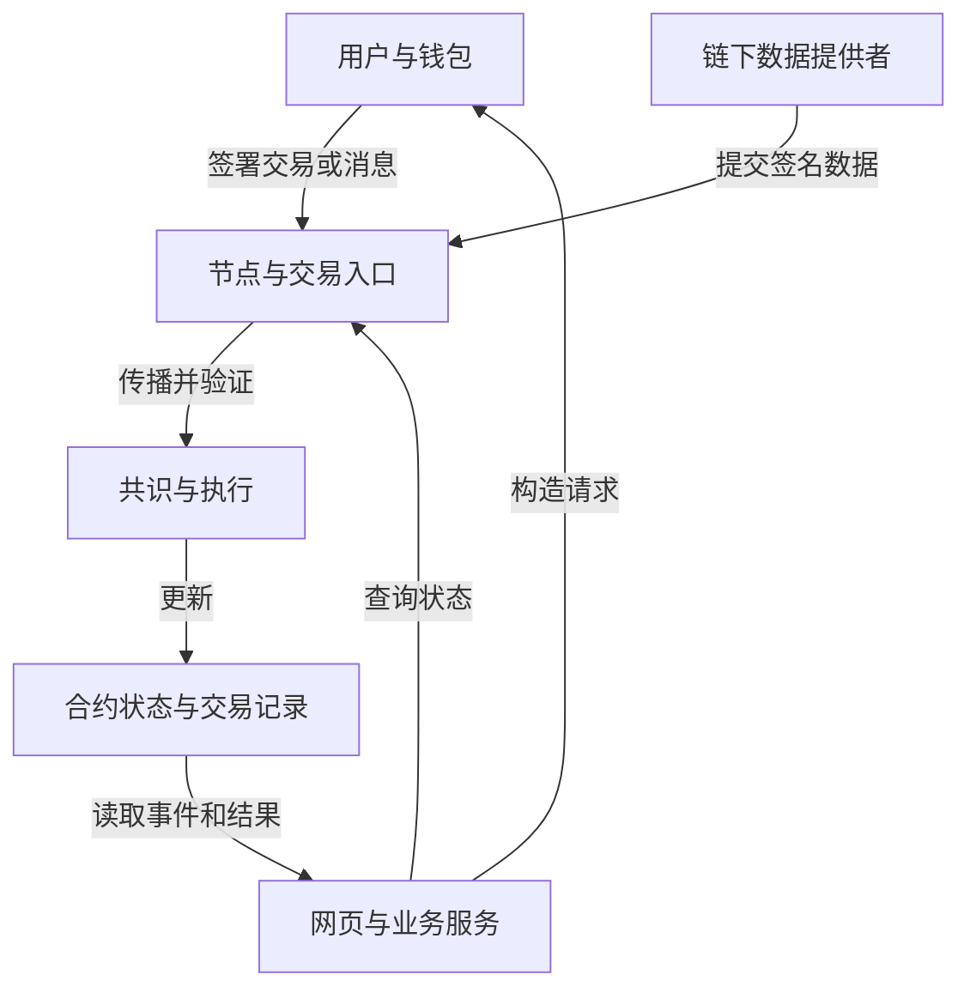

# 区块链与 Web3 的关系及发展趋势

## 本篇目录
- [一、本部分导读](#一本部分导读)
- [二、本篇学习目标](#二本篇学习目标)
- [三、主要内容](#三主要内容)
  - [3.1 本讲要解决的五个问题](#31-本讲要解决的五个问题)
  - [3.2 先建立四个概念](#32-先建立四个概念)
  - [3.3 一个完整应用通常部署在哪里](#33-一个完整应用通常部署在哪里)
- [四、区块链与 Web3 的关系](#四区块链与-web3-的关系)
- [五、Web3 在金融体系](#五web3-在金融体系)
  - [5.1 金融业务首先需要解决什么问题](#51-金融业务首先需要解决什么问题)
  - [5.2 钱包、公钥、私钥、地址与资产](#52-钱包公钥私钥地址与资产)
  - [5.3 用一笔 25 单位的支付走完整个流程](#53-用一笔-25-单位的支付走完整个流程)
  - [5.4 签名保护的是明确的消息，而不是人的模糊意图](#54-签名保护的是明确的消息而不是人的模糊意图)
  - [5.5 Go 实验：签名正确、内容篡改、跨域和重放](#55-go-实验签名正确内容篡改跨域和重放)
  - [5.6 金融体系为什么还需要链外安排](#56-金融体系为什么还需要链外安排)
- [六、Web3 溯源](#六web3-溯源)
  - [6.1 溯源的对象究竟是什么](#61-溯源的对象究竟是什么)
  - [6.2 一条溯源记录需要包含什么](#62-一条溯源记录需要包含什么)
  - [6.3 哈希、签名与链上存证怎样配合](#63-哈希签名与链上存证怎样配合)
  - [6.4 为什么“数据有签名”仍可能遗漏重要材料](#64-为什么数据有签名仍可能遗漏重要材料)
  - [6.5 隐私：把数据换成哈希也不一定隐藏了内容](#65-隐私把数据换成哈希也不一定隐藏了内容)
- [七、本篇与知识体系的关系](#七本篇与知识体系的关系)
- [一图看懂本篇流程](#一图看懂本篇流程)
- [官方实现与代码阅读入口](#官方实现与代码阅读入口)


## 一图看懂本篇流程


把 Web3 应用想成一间线上商店：网页是柜台，钱包是签字工具，区块链是共同记账的账本，智能合约是自动执行的业务规则。商品是否真的发货，仍要由物流或商家提供证据。

> **怎么读这张图：**从左向右看，先确认输入是什么，再看系统如何检查和处理，最后看结果如何保存或验证。图中是帮助理解的简化流程，协议细节仍以本篇后续说明和官方规范为准。


例如，在线商店卖一张演唱会门票：用户在网页选择座位，钱包确认付款，合约记录票权转移。用户是否真的进入场馆，还需要闸机和主办方核验。

## 官方实现与代码阅读入口

以下链接指向对应技术的官方文档、标准或项目源码。阅读代码时，建议先从本篇涉及的核心数据结构或验证入口开始，再沿调用关系查看后续处理。

- [Ethereum.org：Web3](https://ethereum.org/en/web3/)
- [Ethereum.org：智能合约](https://ethereum.org/en/developers/docs/smart-contracts/)
- [Solidity 官方文档](https://docs.soliditylang.org/)

**代码来源说明：**官方仓库中的实现代码才代表相应项目的真实实现。正文中用于解释概念的短代码或实验片段，如未明确标出官方文件路径，应按教学演示理解，不能直接当作 Bitcoin Core、Go Ethereum 或其他客户端的生产代码。实际开发应对照上方官方版本、规范和测试。


## 一、本部分导读
> 本讲定位：把区块链应用放回实际业务流程，理解密码学能证明什么、合约控制什么，以及现实世界仍由谁负责。本文为原创学习笔记，教学数字与示例程序均明确用于解释机制，不是实际业务统计。

## 二、本篇学习目标
- 区块链与 Web3 的关系及发展趋势
- 理解核心概念、运行流程和参与角色
- 能够区分协议保证、实现细节与应用层假设
- 能够结合代码或实际场景分析边界与风险

## 三、主要内容

<a id="sec-003"></a>
### 3.1 本讲要解决的五个问题

学完本讲，应当能够说明：

1. 一个 Web3 应用里，网页、钱包、节点、智能合约分别负责什么。
2. 支付授权为什么需要数字签名，签名正确为什么还不等于付款已经完成。
3. 区块链溯源为什么可以帮助核验历史记录，却不能自动证明商品是真的。
4. 稳定币、银行存款、链原生资产、RWA 代币之间有什么区别。
5. 判断某项 Web3 应用是否值得使用时，如何比较成本、信任假设和实际效果。

本讲的重点关键在于能够沿着“谁提交数据—谁签名—谁验证—谁执行—谁保存状态—出错后谁承担责任”的顺序读懂一个系统。

<a id="sec-004"></a>
### 3.2 先建立四个概念

**密码学**提供处理信息的数学工具。例如，哈希用于计算内容摘要，数字签名用于验证特定密钥对消息的授权，认证加密用于保护机密数据。它本身不会组织一个金融市场，也不会判断货物是否实际交付。

**区块链**是一类共同维护状态与历史记录的系统。参与节点需要按照协议验证输入、执行规则，并对记录的顺序达成一致。哈希和签名是其中的构件；网络传播、共识、执行环境和存储同样不可少。

**智能合约**是部署在区块链上的程序及其状态。它能够依据链上可取得的输入执行规则。例如，满足授权、余额和金额条件时更新代币余额。它不会因为名字带有“智能”就理解自然语言合同，也不会自己去现场检查货物。[R2]

**Web3**在本讲中指一类借助区块链、用户密钥和可编程资产构建应用的思路及生态。这个词没有覆盖所有使用者的唯一严格定义；讨论具体系统时，应说清哪些能力由链提供、哪些仍由平台提供。[R1]

可以把它们放在一个关系表中：

| 层次 | 核心问题 | 常见输入与输出 | 本身不能保证的事情 |
|---|---|---|---|
| 密码学 | 消息是否改变、由什么密钥授权 | 消息、密钥、签名、摘要 | 消息描述的现实事实为真 |
| 区块链协议 | 哪些状态变化被共同接受 | 交易、区块、状态根 | 每种业务都值得上链 |
| 智能合约 | 满足条件后怎样改变业务状态 | 调用参数、合约存储、事件 | 输入价格、身份材料天然可靠 |
| Web3 应用 | 用户怎样完成一项业务 | 界面、钱包、API、合约、链下服务 | 界面和后台必然去中心化 |

<a id="sec-005"></a>
### 3.3 一个完整应用通常部署在哪里



图中没有把“钱”画成从钱包文件流入合约文件。钱包主要保存或使用授权凭据；链上余额是账本状态。钱包签名、交易传播、合约记账是不同动作，不能混成一个黑箱。[R3]

---

<a id="sec-006"></a>

## 四、区块链与 Web3 的关系

<a id="sec-007"></a>

## 五、Web3 在金融体系

<a id="sec-008"></a>
### 5.1 金融业务首先需要解决什么问题

把“金融”暂时换成最简单的记账问题：Alice 有 100 个单位，准备给 Bob 25 个单位。系统必须回答：

1. 这条指令是不是 Alice 授权的？
2. 这 25 个单位此前是否已经花掉？
3. Bob 的收款地址和金额是否被中途改过？
4. 两个互相冲突的付款请求，哪个先执行？
5. 扣款、入账发生在哪里，失败时如何处理？
6. 记录里的“25 个单位”究竟代表什么资产？

数字签名主要帮助回答第 1、3 个问题；状态检查帮助回答第 2 个问题；交易排序和共识帮助回答第 4 个问题；执行规则处理第 5 个问题；资产发行和兑付安排决定第 6 个问题。单独拥有一种密码算法，不能完成整套金融系统。

传统系统可能由银行维护账户数据库并验证客户指令；链上系统通常通过协议规则、签名和共享状态执行相应步骤。比较两者时，不能只比较数据库写入速度，也要比较信任谁、谁有回滚权限、谁处理争议、谁承担保管与兑付责任。

<a id="sec-009"></a>
### 5.2 钱包、公钥、私钥、地址与资产

**私钥**是授权操作需要保护的秘密材料。**公钥**用于验证相应签名。**地址**是协议用于标识账户或合约的标记，具体生成方法由链决定，不能把所有区块链地址都当成同一种公钥哈希。

钱包是一种交互工具。它可能自行持有密钥，也可能调用硬件设备、多方签名服务或智能合约账户。讨论“我控制资产”时，需要进一步区分：

| 情形 | 谁能发起实际授权 | 用户持有什么 | 主要依赖 |
|---|---|---|---|
| 自持密钥的普通账户 | 私钥持有人 | 密钥或恢复材料 | 设备安全、备份、协议验证 |
| 托管账户 | 服务商控制的签名系统 | 登录账户及对服务商的请求权 | 服务商运营、权限与兑付 |
| 多人共同管理 | 达到规定门槛的一组参与者 | 各自的密钥份额或独立密钥 | 门槛设计、协作与恢复流程 |
| 智能合约账户 | 合约规定的授权逻辑 | 取决于账户设计 | 合约代码、授权模块、升级权限 |

以太坊普通外部账户常以签名授权交易，但应用支持合约钱包时，不能只检查某个外部账户式签名恢复结果。ERC-1271 为合约账户提供了判断签名是否被其授权逻辑接受的接口。[R3] [R6]

“掌握私钥”意味着拥有某类技术授权能力，不自动等于该资产在现实世界中的法律所有权。例如，某人盗走密钥后能够发起链上转移，并不意味着盗窃因此变成合法转让。

<a id="sec-010"></a>
### 5.3 用一笔 25 单位的支付走完整个流程

下面是**教学模型**：某个代币有 6 位小数，Alice 的余额是 100，Bob 的余额是 20。暂不考虑代币自身的特殊转账机制。

用户看见的 25，写入整数参数时是：

$$
\text{amount}=25\times 10^6=25{,}000{,}000.
$$

这个换算必须在所有参与方之间一致。代码里使用整数最小单位，能够避免把 `0.1` 这类十进制值交给二进制浮点后出现不合预期的表示和舍入。

| 步骤 | 发生位置 | 输入 | 输出或状态变化 |
|---|---|---|---|
| 1. 构造业务请求 | 网页、客户端 | 代币地址、Bob 地址、金额 | 待确认的支付内容 |
| 2. 生成授权 | 钱包或签名设备 | 交易编码、账户状态、网络标识 | 签名后的交易 |
| 3. 广播 | 节点入口 | 已签名交易 | 交易进入网络传播流程 |
| 4. 验证 | 节点 | 签名、nonce、费用条件等 | 接受或拒绝待执行输入 |
| 5. 排序并执行 | 区块构建与执行环境 | 当前状态、交易顺序 | 调用代币合约 |
| 6. 修改余额 | 代币合约 | Alice 的余额、25 单位 | Alice 75，Bob 45 |
| 7. 查询确认 | 钱包、商户服务 | 交易回执、区块状态 | 显示成功、失败或待确认 |

如果是商户合约代替 Alice 调用 `transferFrom`，通常还需要 Alice 预先授予相应额度或提供受支持的授权机制。ERC-20 的 `approve` 是额度授权，`transferFrom` 是使用授权转移代币；两者不是同一步。[R5]

**签名成功不等于第 6 步已经发生。** 余额不足、交易过期、代币被暂停、合约条件不满足、费用条件不足，都可能导致交易没有按预期执行。执行失败也不等于没有任何成本：某些链上失败交易仍会消耗执行费用，协议账户 nonce 等状态的处理还应按相应交易规则判断。

<a id="sec-011"></a>
### 5.4 签名保护的是明确的消息，而不是人的模糊意图

假设只签名字符串 `pay 25`，验签者不知道应当付给谁、用哪一种币、在哪条链执行，也不知道是否允许执行两次。一个业务授权应尽可能绑定必要上下文：

$$
m=\operatorname{Encode}(\text{用途},\text{版本},\text{网络},\text{应用},
\text{收款人},\text{金额},\text{订单号},\text{nonce},\text{截止时间}).
$$

这里的 `Encode` 指把结构化字段编码成双方都能唯一解释的字节序列。它必须避免两组不同字段编码成相同字节。例如，直接拼接两个变长字符串时，`("ab","c")` 与 `("a","bc")` 都可能得到 `abc`。可使用明确长度、类型和字段顺序的编码；JSON 场景还需要考虑规范化，不能假设随意序列化所得的字节一定相同。[R12]

**域隔离**是把同样的数据在不同用途或应用中的含义分开。例如，同一个金额在“查看报价”和“授权扣款”两个用途下，应当形成不同待签消息。**防重放**是阻止已经使用过的合法授权再次执行。这两个目标有关联，却不相同：把链 ID 写进消息可以区分网络，但同一条链上的重复执行仍需要 nonce、已使用订单集合或其他业务状态约束。

EIP-712 提供结构化数据的哈希、类型编码及签名域机制，标准本身不负责完整的业务防重放。使用它的应用仍要自行检查并消耗 nonce 等状态。[R4]

<a id="sec-012"></a>
### 5.5 Go 实验：签名正确、内容篡改、跨域和重放

**实验位置。** 这段代码模拟商户后台接收用户签名订单。它只完成业务授权验证，不向任何区块链广播交易，也不扣款。选择 Go 标准库 Ed25519，是为了让读者集中观察消息与状态如何协同；这份签名格式不能拿去调用以太坊的 `ecrecover`，也不是以太坊交易或 EIP-712 的实现。[R7]

**输入。** 订单含应用域、收款人、金额、订单号、nonce 和过期时间。本实验固定一种教学计价单位；真实多币种系统还必须签名并检查代币标识。验证器同时核对商户预期的金额和订单号，避免把任意签名消息当成该订单的授权。

**过程。** 用户编码并签名；验证器检查约定的域和业务条件；验签成功后检查 nonce，最后记录已使用状态。

**输出。** 首次提交成功；同一授权再次提交失败；篡改金额不能继续通过验签；跨应用域或过期订单也不能被接受。

将代码保存为 `order_signature.go`，运行 `go run order_signature.go`。仅依赖 Go 标准库。

```go
package main

import (
	"crypto/ed25519"
	"crypto/rand"
	"crypto/sha256"
	"encoding/binary"
	"errors"
	"fmt"
)

// Order is an off-chain teaching message, not an Ethereum transaction.
type Order struct {
	ChainID   uint64
	Contract  [20]byte
	Recipient [20]byte
	Amount    uint64 // Smallest units: 25_000_000 means 25 units at 6 decimals.
	Nonce     uint64
	Expires   uint64 // Unix seconds; an order is valid at exactly Expires.
	InvoiceID [32]byte
}

func appendUint64(dst []byte, value uint64) []byte {
	var encoded [8]byte
	binary.BigEndian.PutUint64(encoded[:], value)
	return append(dst, encoded[:]...)
}

// Fixed field lengths and order make this teaching encoding unambiguous.
// It is NOT the EIP-712 encoding and is not intended as a new standard.
func encodeOrder(order Order) []byte {
	message := []byte("web3-notes/order/v1\x00")
	message = appendUint64(message, order.ChainID)
	message = append(message, order.Contract[:]...)
	message = append(message, order.Recipient[:]...)
	message = appendUint64(message, order.Amount)
	message = appendUint64(message, order.Nonce)
	message = appendUint64(message, order.Expires)
	return append(message, order.InvoiceID[:]...)
}

// This verifier is scoped to ONE buyer and used by ONE goroutine.
type Verifier struct {
	Buyer     ed25519.PublicKey
	ChainID   uint64
	Contract  [20]byte
	Recipient [20]byte
	Amount    uint64
	InvoiceID [32]byte
	Used      map[uint64]bool
}

func (v *Verifier) Accept(order Order, signature []byte, now uint64) error {
	if len(v.Buyer) != ed25519.PublicKeySize {
		return errors.New("invalid buyer public key")
	}
	if order.ChainID != v.ChainID || order.Contract != v.Contract {
		return errors.New("wrong application domain")
	}
	if order.Recipient != v.Recipient || order.Amount == 0 ||
		order.Amount != v.Amount || order.InvoiceID != v.InvoiceID {
		return errors.New("invalid payment terms")
	}
	if now > order.Expires {
		return errors.New("expired order")
	}
	if !ed25519.Verify(v.Buyer, encodeOrder(order), signature) {
		return errors.New("invalid signature")
	}
	if v.Used[order.Nonce] {
		return errors.New("nonce already used")
	}
	if v.Used == nil {
		v.Used = make(map[uint64]bool)
	}
	v.Used[order.Nonce] = true
	return nil
}

func main() {
	publicKey, privateKey, err := ed25519.GenerateKey(rand.Reader)
	if err != nil {
		panic(err)
	}
	var contract, recipient [20]byte
	contract[19] = 1
	recipient[19] = 2
	const now uint64 = 1_800_000_000 // Fixed teaching clock, not the real clock.
	order := Order{
		ChainID: 31337, Contract: contract, Recipient: recipient,
		Amount: 25_000_000, Nonce: 7, Expires: now + 300,
		InvoiceID: sha256.Sum256([]byte("invoice-2026-001")),
	}
	signature := ed25519.Sign(privateKey, encodeOrder(order))
	verifier := Verifier{
		Buyer: publicKey, ChainID: 31337,
		Contract: contract, Recipient: recipient,
		Amount: 25_000_000, InvoiceID: order.InvoiceID,
		Used: make(map[uint64]bool),
	}
	fmt.Println("first accepted:", verifier.Accept(order, signature, now) == nil)
	fmt.Println("replay accepted:", verifier.Accept(order, signature, now) == nil)
	changed := order
	changed.Amount = 250_000_000
	fmt.Println("tampered signature valid:",
		ed25519.Verify(publicKey, encodeOrder(changed), signature))
	wrongDomain := order
	wrongDomain.ChainID = 1
	fmt.Println("other chain accepted:",
		verifier.Accept(wrongDomain, signature, now) == nil)
	expired := order
	expired.Nonce = 8
	expired.Expires = now - 1
	expiredSignature := ed25519.Sign(privateKey, encodeOrder(expired))
	fmt.Println("expired accepted:",
		verifier.Accept(expired, expiredSignature, now) == nil)
}
```

代码已使用 Go 1.27.3 运行，以下布尔结果与实际运行一致。具体签名不打印，因此不会受随机生成的密钥影响：

```text
first accepted: true
replay accepted: false
tampered signature valid: false
other chain accepted: false
expired accepted: false
```

值得逐步观察的地方有四处：

1. `encodeOrder` 将字段长度和顺序固定下来，避免字符串无边界拼接。金额和 nonce 都使用 8 字节大端整数，这只是本实验的格式约定。
2. `ed25519.Sign` 签的是完整消息；`InvoiceID` 的 SHA-256 摘要只用于标识订单，不意味着必须先将所有 Ed25519 消息哈希一次。SHA-256 API 见 [R17]。
3. `Verifier.Buyer` 固定了期望买家的公钥。不能让提交者同时任选公钥与订单，然后把“某个公钥验签成功”误当成指定买家的授权。
4. `Used` 是验证器的业务状态。数字签名的数学性质不会自动记住一条消息是否执行过。

**实验边界。** 这里的验证器只服务一个买家，且只在一个 goroutine 中使用。多用户系统必须按签名者区分 nonce；并发服务必须将“查 nonce—执行业务—记为已用”设计成一致的原子操作；进程内 map 不能承担生产系统的持久防重放。验签通过后若扣款失败，还要定义授权是否可以重试。以上都是业务协议的一部分，并不是换一个签名算法就能消除的问题。

<a id="sec-013"></a>
### 5.6 金融体系为什么还需要链外安排

把某种资产记成代币，只解决了记录、转移与程序接口的一部分问题。若代币代表美元存款、仓库里的黄金或某个基金的份额，就还需要知道：

- 谁持有底层资产，资产是否被重复承诺。
- 代币持有人对发行方、托管方或其他主体拥有什么请求权。
- 什么时候能够赎回，赎回条件和费用是什么。
- 价格与余额信息由谁提供，更新多久一次。
- 管理员能否冻结、增发、销毁、升级或迁移合约。

这也是为什么“使用区块链”不等于“已经消除中介”。有的中介职能转为代码；有的被重新分工；有的，例如现实资产保管和争议处理，仍然需要现实组织承担。

<a id="sec-014"></a>

## 六、Web3 溯源

<a id="sec-015"></a>
### 6.1 溯源的对象究竟是什么

**溯源**是根据标识与事件记录，追查一个对象经历了哪些处理、由谁交接以及在什么条件下发生变化。记录对象既可以是商品批次，也可以是数据集、软件构件或实验样本。

先以一批牛奶为**教学例子**：农场生产 `BATCH-001`，检测机构出具检测结果，物流公司记录冷链交接，零售商记录收货。系统希望后来的核验者能够找到这些材料，并核对它们是否被改过。

“牛奶是真的合格”和“某检测机构在某时声明其合格”是两个不同命题。区块链直接处理的是第二种可编码的声明。要支持第一种判断，还需要采样程序、检测能力、设备校准、身份核验和责任安排。NISTIR 8202 第 7.3 节讨论了链上系统与现实输入之间的这个边界。[R10]

<a id="sec-016"></a>
### 6.2 一条溯源记录需要包含什么

教学记录可以具有以下字段：

```text
schemaVersion: 1
batchId: BATCH-001
eventType: cold_chain_handover
actorId: logistics-company-A
sequence: 2
observedAt: 2026-10-23T08:00:00Z
temperatureMilliCelsius: 3800
previousCommitment: <上一条记录承诺>
attachmentDigest: <附件摘要>
```

其中 `3800` 表示 3.8 摄氏度，采用整数计量单位是为了避免不同语言的浮点和格式处理产生歧义。`observedAt` 是提交者声称的观察时间；它不等于链上记录时间。`sequence` 是该批次的业务顺序；它也不等于区块高度。

至少有三种时间需要分别记录：

| 时间 | 由谁产生 | 能说明什么 | 不能单独说明什么 |
|---|---|---|---|
| 事件发生时间 | 设备或业务人员 | 提交者声称事件发生于何时 | 声称是否真实 |
| 系统接收时间 | 接收服务 | 服务何时收到材料 | 材料是否及时上链 |
| 链上记录时间 | 区块协议与交易位置 | 相应交易在链上的记录位置 | 真实事件发生的精确时刻 |

因此，设备延迟上报、离线采集或伪造过去时间，都不能靠在合约里写一个 `timestamp` 字段自动解决。

<a id="sec-017"></a>
### 6.3 哈希、签名与链上存证怎样配合

设原始文件为 $D$，规范编码后计算：

$$
h=H(D),\qquad \sigma=\operatorname{Sign}(sk,m).
$$

其中消息 $m$ 应把摘要 $h$ 与批次、事件类型、序号、用途及必要上下文绑定。不要只签一个没有上下文的摘要，否则难以判断它原本是哪个业务的哪一份材料。

一个实际可实现的流程是：

1. 采集方按照约定格式生成原始记录，保存原始文件。
2. 计算文件摘要，并将摘要与业务上下文一起签名。
3. 验证服务核对采集方身份、签名、字段格式和提交权限。
4. 合约记录摘要或承诺及相关索引；原文件根据访问控制保存在链外。
5. 核验者取得原文件后重新计算摘要，再比对链上记录。
6. 若需要证明记录已进入特定区块，还应验证对应交易或收据的包含关系及所依赖的区块状态。

哈希相等提供的是内容一致性证据；签名增加密钥授权关系；账本提供共同接受的顺序和历史；三者承担不同任务。链外原文件若已丢失，仅剩摘要通常不能恢复文件，也不能完成需要阅读内容的审计。

<a id="sec-018"></a>
### 6.4 为什么“数据有签名”仍可能遗漏重要材料

假设物流规则要求在 10 个预定时刻各上传一次温度。有人只提交其中 7 个温度正常的记录，且 7 条记录的签名全部有效。在签名算法满足安全假设、公钥与报告者绑定正确且私钥未泄露的前提下，系统可以验证这 7 条消息由对应私钥签署、签后内容未被改动；这既不证明现场温度真实，也不能推出缺失的 3 次采样均正常。

若完整性是业务目标，就需要在签名之外定义“预期应该有什么”：例如预登记采样时刻、递增序号、已签收清单，以及缺失、迟到、冲突的处理规则。**真实性、未改动、完整性和及时性是不同的性质。** 这是从业务要求推出的系统设计判断，不是某种签名算法额外提供的保证。

同样，10 个签名节点如果都复制同一台损坏传感器的数据，签名数量并不等于 10 个独立来源。系统需要分析来源之间的依赖关系，不能只数公钥数量。

<a id="sec-019"></a>
### 6.5 隐私：把数据换成哈希也不一定隐藏了内容

假设温度只可能是整数 `0` 到 `10`，攻击者可以把 11 个候选值逐一哈希，找出链上的摘要对应哪一个。哈希难以反求的直观说法，不能替代对输入空间大小的检查。

如果目标是暂时隐藏某个值，可考虑类似：

$$
c=H(\text{domain}\parallel r\parallel\operatorname{Encode}(D)),
$$

其中 $r$ 是足够长的秘密随机数，`domain` 是用途标识。之后公开 $D,r$ 才能核验。这个例子表达了哈希承诺的基本直觉：随机数帮助防止对小范围数据的离线枚举，哈希帮助约束公开时不能随意更换内容。具体安全性质仍依赖规范编码、随机性和哈希假设；仅把一个公开短序号当作盐，并不能取得同样效果。

对于长期保密的附件，还要使用认证加密、密钥分发和访问控制。链上承诺、链外加密文件与访问授权应分别设计，不能把“存了一个哈希”当作完整的隐私方案。

<a id="sec-020"></a>


## 七、本篇与知识体系的关系

- 所属部分：第一部分：区块链基础理论
- 返回总目录：[README](../README.md)
