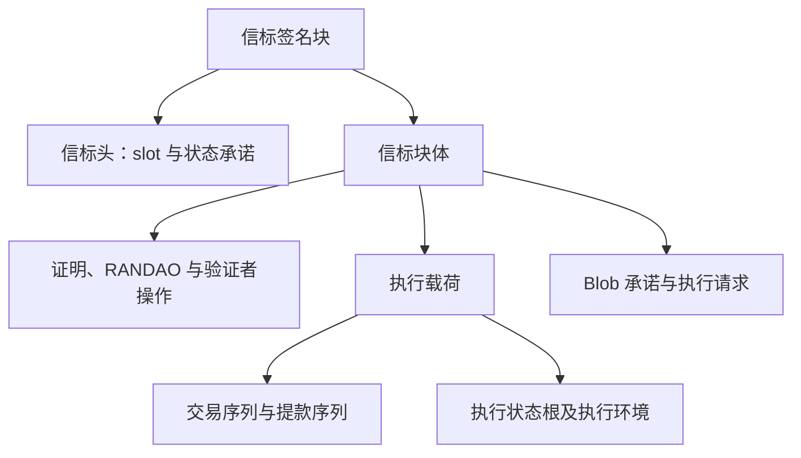
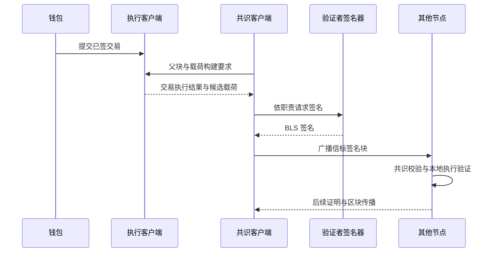

# 账户模型、交易与状态转换

## 本篇目录
- [一、本篇学习目标](#一本篇学习目标)
- [二、三 A、ETH2.0 的介绍：执行层与共识层如何组成以太坊](#二三-aeth20-的介绍执行层与共识层如何组成以太坊)
  - [2.1 教学补充：先辨认参与者和部署位置](#21-教学补充先辨认参与者和部署位置)
  - [2.2 以太坊里面的区块组织形式](#22-以太坊里面的区块组织形式)
  - [2.3 以太坊出块流程](#23-以太坊出块流程)
  - [2.4 Ethereum 怎么防止 PoS 链产生分叉](#24-ethereum-怎么防止-pos-链产生分叉)
  - [2.5 32—2048 ETH 问题：分清门槛、有效余额和真实余额](#25-322048-eth-问题分清门槛有效余额和真实余额)
  - [2.6 以太坊的三棵树](#26-以太坊的三棵树)
- [三、三 B、Ethereum 虚拟机](#三三-bethereum-虚拟机)
  - [3.1 EVM 结构](#31-evm-结构)
  - [3.2 一笔交易在 Ethereum 里面的生命周期](#32-一笔交易在-ethereum-里面的生命周期)
  - [3.3 教学补充：一次完整的计数器调用应怎样复述](#33-教学补充一次完整的计数器调用应怎样复述)
- [四、账户状态包含什么](#四账户状态包含什么)
- [五、外部账户与合约账户](#五外部账户与合约账户)
  - [5.1 外部账户（Externally Owned Account，EOA）](#51-外部账户externally-owned-accounteoa)
  - [5.2 合约账户（Contract Account）](#52-合约账户contract-account)
- [六、账户模型与 UTXO 模型](#六账户模型与-utxo-模型)
- [七、重放攻击（Replay Attack）](#七重放攻击replay-attack)
- [八、状态转移必须确定](#八状态转移必须确定)
- [九、本讲小结](#九本讲小结)
- [十、本篇与知识体系的关系](#十本篇与知识体系的关系)
- [一图看懂本篇流程](#一图看懂本篇流程)
- [官方实现与代码阅读入口](#官方实现与代码阅读入口)


## 一图看懂本篇流程


账户模型像银行账户：余额记录在账户名下，转账时从付款方扣除、给收款方增加。nonce 像每次转账的流水序号。

> **怎么读这张图：**从左向右看，先确认输入是什么，再看系统如何检查和处理，最后看结果如何保存或验证。图中是帮助理解的简化流程，协议细节仍以本篇后续说明和官方规范为准。


例如，银行账户有 500 元，支付 80 元后余额变成 420 元。账户模型直接更新余额；nonce 则像转账流水号，避免旧指令重复处理。

## 官方实现与代码阅读入口

以下链接指向对应技术的官方文档、标准或项目源码。阅读代码时，建议先从本篇涉及的核心数据结构或验证入口开始，再沿调用关系查看后续处理。

- [Ethereum 执行规范](https://github.com/ethereum/execution-specs)
- [Go Ethereum core](https://github.com/ethereum/go-ethereum/tree/master/core)
- [Ethereum JSON-RPC](https://ethereum.org/en/developers/docs/apis/json-rpc/)

**代码来源说明：**官方仓库中的实现代码才代表相应项目的真实实现。正文中用于解释概念的短代码或实验片段，如未明确标出官方文件路径，应按教学演示理解，不能直接当作 Bitcoin Core、Go Ethereum 或其他客户端的生产代码。实际开发应对照上方官方版本、规范和测试。


## 一、本篇学习目标
- 账户模型、交易与状态转换
- 理解核心概念、运行流程和参与角色
- 能够区分协议保证、实现细节与应用层假设
- 能够结合代码或实际场景分析边界与风险

## 二、三 A、ETH2.0 的介绍：执行层与共识层如何组成以太坊

本节沿用历史标题，具体讲解使用 Pectra 的 EL/CL 架构。“两个客户端”表示职责分工，不表示两条互不相关、各自拥有 ETH 资产的链。应用开发者看到的账户、交易与合约状态，由执行层处理；哪个有效执行结果进入被接受的历史，由共识层约束。

<a id="sec-012"></a>
### 2.1 教学补充：先辨认参与者和部署位置

| 组件或角色 | 主要输入 | 主要输出 | 通常放在哪里 | 不应混淆的权限 |
|---|---|---|---|---|
| 钱包与用户签名器 | 收款人、金额、calldata、链 ID、费用参数 | 签名后的交易字节 | 用户设备、硬件设备或独立签名服务 | 普通 RPC 节点不需要获得用户私钥 |
| 执行客户端 EL | 交易、父执行状态、执行载荷、区块环境 | 执行结果、收据、执行状态根、有效性判定 | 全节点的本地进程或受控服务 | 不能独自决定最终的规范链 |
| 共识客户端 CL | 信标块、证明、时间与共识状态 | fork choice、检查点、对 EL 的执行指令 | 与 EL 配对的节点进程 | 不能跳过执行有效性规则任意确认转账 |
| 验证者客户端与签名器 | 由共识状态决定的职责、待签消息 | 区块提议、attestation 等 BLS 签名 | 可与 CL 同机，也可分离 | 持有验证者签名能力，不等于持有用户钱包私钥 |
| 执行载荷构建者 | 交易池、私有订单流、父状态和规则 | 候选交易顺序与执行载荷 | 本地 EL，或外部 builder 系统 | 构建候选载荷不自动拥有信标提议资格 |
| RPC 服务和索引器 | 已验证数据、数据库、日志 | 查询结果、检索与统计 | 自建节点或第三方服务 | 回答查询不等于给出了独立可验的证明 |

钱包可以通过第三方 RPC 提交交易，但签名应发生在钱包或用户授权的签名环境。把私钥发给普通 JSON-RPC 服务器，并不是以太坊交易验证的必要步骤。节点能够从签名恢复授权地址，检查链 ID、nonce 与余额，因而不需要知道私钥。

EL 和 CL 各有需要处理的网络数据。两者在本机或受控网络中通过 Engine API 协作；面向普通应用的 JSON-RPC 与 Engine API 不是同一个接口。前者支持读取余额、模拟调用和提交交易，后者让 CL 向 EL 传递候选载荷、选链结果与构建要求。部署时应把这些接口按其职责理解，不能因为都使用 JSON 格式就把它们视为可互换入口。[节点架构](https://ethereum.org/developers/docs/nodes-and-clients/node-architecture/)

<a id="sec-013"></a>
### 2.2 以太坊里面的区块组织形式

#### 2.2.1 以太坊的区块头：先问是哪一层的头

在 Pectra，讨论“区块头”至少有三种容易混淆的对象：执行区块头、信标区块头，以及信标状态里缓存的执行载荷头。三者彼此关联，但不是把同一串字段改个名字。

| 对象 | 所属语境 | 主要承诺什么 | 常见根字段的含义 |
|---|---|---|---|
| Execution block header | 执行层区块与 JSON-RPC | 执行前后关系、交易与收据、执行环境 | `stateRoot` 是账户状态 MPT 根 |
| `BeaconBlockHeader` | 共识层信标块 | slot、提议者、父块、信标状态、块体 | `state_root` 是信标状态的 SSZ 根 |
| `ExecutionPayloadHeader` | 共识层容器中的执行载荷摘要 | 执行载荷字段及其列表承诺 | 其中 `state_root` 仍是执行层账户状态 MPT 根 |

最后一行尤其容易答错：**一个字段位于共识层定义的容器中，不代表该字段的值就变成了共识状态根。**`ExecutionPayload.state_root` 与 `ExecutionPayloadHeader.state_root` 直接保存对应执行结果的状态根，其值与执行区块头的 `stateRoot` 一致；外层 `BeaconBlock.state_root`、`BeaconBlockHeader.state_root` 才指向整个信标状态。容器自身进行 SSZ Merkle 化，又是另一层计算。[Capella 容器与载荷头转换规则](https://ethereum.github.io/consensus-specs/specs/capella/beacon-chain/)

下面按用途整理 **Prague 执行区块头**。字段拼写采用 RPC 常见形式，规范源代码的 snake_case 名称可能不同。此表是固定分叉的字段表，不能当作未来所有分叉的永久全集。

| 类别 | 字段 | 读法与用途 |
|---|---|---|
| 链接与位置 | `parentHash`、`number`、`timestamp` | 指向父执行块，记录执行块高度与时间 |
| 三种执行承诺 | `stateRoot`、`transactionsRoot`、`receiptsRoot` | 分别绑定执行后账户状态、本块交易顺序和本块收据顺序 |
| 日志筛选 | `logsBloom` | 2048 位的概率筛选结构；不是日志真实性证明 |
| 费用接收 | `beneficiary` / `miner` / `feeRecipient` | 接收相应执行费用的地址；历史名称可能仍含 miner |
| Gas | `gasLimit`、`gasUsed`、`baseFeePerGas` | 执行预算、实际计量及基础费用，不是同一单位 |
| PoS 随机性相关 | `mixHash` / `prevRandao` | 相应历史字段承载前一 RANDAO 混合值的语义 |
| PoW 遗留约束 | `difficulty`、`nonce`、`sha3Uncles` | 在 PoS 规则下取约定值，不再提供工作量证明竞争 |
| 附加信息 | `extraData` | 有长度限制的附加字节，不应自动当可信业务声明 |
| 提款承诺 | `withdrawalsRoot` | 执行层提款列表的认证根 |
| Blob 计量 | `blobGasUsed`、`excessBlobGas` | Blob 资源用量与费用演化所需信息 |
| 跨层绑定 | `parentBeaconBlockRoot` | 引入父信标块根的协议字段 |
| 执行请求 | `requestsHash` | 绑定规定顺序的执行层请求数据摘要 |

Prague 的规范 `Header` 定义共有这些 21 项。`requestsHash` 并不是第四棵 MPT；它依照 EIP-7685 对相应请求数据执行指定的 SHA-256 组合计算。不要看到 `Root` 或 `Hash` 后缀就假定数据都采用同一种树。[Prague blocks.py](https://ethereum.github.io/execution-specs/src/ethereum/forks/prague/blocks.py.html)、[EIP-7685](https://eips.ethereum.org/EIPS/eip-7685)

PoS 下 `difficulty` 为零、`nonce` 为八个零字节，ommer 列表为空，相关头字段保留兼容约束；`mixHash` 的 PoS 语义还要结合 EIP-4399 看待，不能只从早期 Merge 提案摘一句“归零”就套到 Pectra。[EIP-3675](https://eips.ethereum.org/EIPS/eip-3675)、[EIP-4399](https://eips.ethereum.org/EIPS/eip-4399)

**一个具体的读取顺序：**拿到执行块时，先检查父哈希和高度，再根据本分叉规则核对费用、时间与字段约束，重执行交易得到状态和收据，然后重新计算对应根并比对。如果只把区块头的哈希重算正确，仍不能断言其交易执行正确；哈希只能绑定某个声明，不能替你执行声明中的程序。

#### 2.2.2 以太坊的区块体：交易只是其中一部分

执行区块体在此快照下包含交易序列、受 PoS 约束为空的 ommer 序列、提款序列。共识层 `BeaconBlockBody` 则包含用于共识处理的对象，例如 RANDAO reveal、attestation、罚没证据、同步委员会相关数据，以及执行载荷、Blob 承诺和 Electra 执行请求。名称有继承关系，具体可用字段应沿分叉规范逐层读取。

两种“块体”所回答的问题不同。EL 需要知道“按什么顺序执行哪些交易和系统操作”；CL 还需要知道“谁在什么时间提出该块，哪些验证者表达了什么意见，怎样更新验证者与检查点状态”。把两层块体画成一个仅含交易数组的方框，会漏掉以太坊 PoS 的关键机制。



Blob 的大块数据不能简单等同于 EVM calldata。EIP-4844 定义专门的数据与承诺路径；EVM 可以接触相应版本化哈希等规定信息，并不能任意直接读取 Blob 全部内容。承诺能够约束数据一致性，数据是否被网络获得、保存多久和如何被 Rollup 使用，需要另行分析。[EIP-4844](https://eips.ethereum.org/EIPS/eip-4844)

这里也要分清两个长得相似的列表根：执行头的 `transactionsRoot` 是交易 MPT 根；共识层 `ExecutionPayloadHeader.transactions_root` 是按 SSZ 类型规则得到的交易列表根。它们可以承诺同一组交易，却使用不同构造，不能直接比较要求相等。`withdrawals_root` 也有类似的层级与编码区别。

<a id="sec-014"></a>
### 2.3 以太坊出块流程

#### 2.3.1 出块流程补充：从时间安排到最终确认

Pectra 主网使用 12 秒 slot、每个 epoch 32 个 slot。因此一个 epoch 的标称长度为：

$$
12\times32=384\text{ 秒}=6.4\text{ 分钟}。
$$

slot 是时间位置，执行块高度是链上块的序号。如果某个 slot 没有有效块，slot 仍然继续推进，下一有效执行块的高度只比其父执行块增加一。于是“第 100 个 slot”与“高度 100”不是天然相等；`slot % 32` 可以定位 epoch 内位置，不能据此推出执行高度。[共识验证者规范](https://ethereum.github.io/consensus-specs/specs/phase0/validator/)

下面的流程描述一条正常路径。真实网络中的传播、接收和验证会并行发生，任何一个时刻的本地视图都可能暂时不完整。

1. **获取父状态与职责。**共识客户端已同步到一个可接受的历史，依据共识状态计算当前 slot 的提议者和 attestation 职责。职责不是靠钱包在网页上点击“抢到”的。
2. **产生交易候选。**用户钱包签署交易，EL 接收、初步校验并传播。候选交易可以来自公开交易池，也可以通过别的投递路径送到构建者；候选集合本身不是全网共识对象。
3. **请求构建执行载荷。**提议相关流程给出父块、时间戳、费用接收地址等要求。EL 或外部构建系统选择交易顺序并执行，产生候选载荷。不同排序可能产生不同结果和费用收入。
4. **装配并签署信标块。**被选中的验证者把执行载荷与必要的共识对象组装起来，用验证者 BLS 密钥签署规定消息。构建者可以提供载荷，但最终提议职责依旧属于协议选择的提议者。
5. **广播与独立验证。**其他节点检查共识规则，向自己的 EL 请求执行验证。EL 从父状态重执行，核对交易、系统操作、状态根和收据等内容；CL 不能仅凭一个熟悉的提议者签名接受无效执行。
6. **验证者作证明。**按职责参与的验证者针对所看到的有效链头与检查点投票。签名可以聚合以减少传播和存储负担，但聚合不是免除逐项条件检查。
7. **选择本地链头。**fork choice 结合允许的分支、最新有效投票和协议规定的其他因素决定 head。网络分歧可能产生短暂重组，尚未最终确定的交易位置可能变化。
8. **形成检查点最终性。**FFG 按 epoch 检查点和足够有效余额支持来推进 justified / finalized。应用可根据其业务风险区分刚被包含、较稳定和最终确定，而不是把收到一个哈希视为同等保证。

在 Prague Engine API 中，方法版本按用途演化：例如 `engine_newPayloadV4` 传递执行请求相关参数，`engine_getPayloadV4` 返回相应构建结果，而 `engine_forkchoiceUpdatedV3` 仍用于该阶段的 fork-choice 更新。**Prague 并不意味着所有方法名都统一变成 V4。**实现必须按网络、分叉和方法契约匹配参数。[Prague Engine API](https://github.com/ethereum/execution-apis/blob/main/src/engine/prague.md)



这张图采用本地构建路径。若使用外部 builder、relay 等服务，候选载荷的构建与交付路径会更复杂；不要把外部服务的交付承诺误写成 Pectra 已在协议中完整实现了所有形式的 proposer-builder separation。最终用户应关心的是有效性校验是否保留、数据是否可得，以及额外服务在哪一步可能影响审查、可用性与收入。

共识消息和普通用户交易还使用不同的签名体系。用户交易通常使用 secp256k1 ECDSA；以太坊 PoS 验证者使用 BLS 签名与对应的域和消息编码。BLS 聚合减少了多个签名的表示开销，但它不会让一个未授权者获得投票权。投票权来自验证者集合及有效余额；签名负责证明是哪个已登记公钥认可了哪个带上下文的消息。

**域分离为什么必要？**假设同一密钥既签区块又签某类证明，如果两种消息的编码可能混淆，攻击者就可能尝试让一种用途的签名在另一用途被接受。协议把消息类型、分叉等上下文纳入签名域，使“相同字段数值”不自动成为“相同签名消息”。这是密码学中用途隔离思想在共识协议里的具体运用。

#### 2.3.2 长程攻击：旧签名能够通过，为什么仍不该信旧分支

考虑一个离线很久的新节点。它只知道很久以前的验证者集合，后来一部分验证者已经退出并完成提款。攻击者若收集了这些旧验证者的签名能力，可能从很早的位置构造另一套看起来有完整历史签名的分支，再把它交给缺少近期上下文的新节点。

这种攻击与“篡改一个已知区块后继续保持原哈希”不同。攻击者可以重新计算整条候选分支的哈希和签名，并不需要破解哈希函数。真正的争议在于：这些历史身份的签名应不应该使很久后的节点接受另一套历史？

也不能简单说“有罚没就绝对不会发生”。罚没要对仍处于相关经济约束中的余额产生作用；早已退出并越过相应可罚没窗口的旧身份，使纯粹依靠当前经济惩罚的论证不再完整。因此以太坊使用弱主观性框架：节点启动或在离线过久后，需要从可靠渠道取得足够近期的检查点，再在该锚点约束下验证后续历史。[弱主观性说明](https://ethereum.org/developers/docs/consensus-mechanisms/pos/weak-subjectivity/)

这个检查点不是“以后所有块都不用验证”的许可证。节点仍要检查后续签名、状态转换与分叉规则；它只是排除与所接受近期锚点冲突的古老历史。可把流程理解为先确定讨论的是哪条已接受历史，再验证这条历史之后的新证据。

做实验时可以把检查点视为二元组“epoch 与 block root”。如果实验只保存高度而没有根，同一高度可能对应不同分支，不能起到相同绑定作用。如果从单一不可信网页照抄根，也不能把这种选择包装成纯数学推导出来的确定事实。

长期离线时到底多长需要更新检查点，并不是永远固定的“若干天”口诀。相关时期受验证者集变化、余额与协议参数约束；应查询目标分叉的弱主观性规则。本文讲清依赖关系，不把某个历史估值当作跨版本的硬编码常数。

<a id="sec-015"></a>
### 2.4 Ethereum 怎么防止 PoS 链产生分叉

#### 2.4.1 先修正问题：允许短暂分支，限制冲突历史的后果

开放网络无法保证所有节点同时收到同一消息。两台诚实节点可能短时间选择不同 head；同一 slot 也可能出现恶意重复提议。协议需要判断哪些块有效、当前沿哪个分支扩展，以及何时某段历史获得更强承诺，而不是假定分叉从来不存在。

把机制拆开更清晰：

| 问题 | 机制 | 不能单独保证什么 |
|---|---|---|
| 谁认可了消息，消息是否被替换 | 数字签名与哈希 | 不决定该消息应该成为规范历史 |
| 当前未最终确定区域选哪个 head | LMD-GHOST 及其协议配套规则 | 不等于所有后代已最终确定 |
| 哪些 epoch 检查点有足够支持 | Casper FFG | 不能脱离网络与参与者假设谈无条件活性 |
| 矛盾签名怎样形成证据和代价 | slashing 与相应余额处理 | 不让旧私钥从数学上失效 |
| 离线很久后接受哪套历史 | 弱主观性检查点 | 不免除之后的独立验证 |

Gasper 的核心是 LMD-GHOST 与 Casper FFG 的组合；其余机制分别提供认证、惩罚与历史锚定支持。教学中可以分别理解“沿分支选头”和“给历史检查点建立最终性”，但真实规则还包括检查点过滤、时序、提议者相关权重等细节，不能把几十行玩具程序直接当成客户端实现。[Gasper](https://ethereum.org/developers/docs/consensus-mechanisms/pos/gasper/)

#### 2.4.2 LMD-GHOST 的权重思路与小例子

LMD 强调每个验证者的最新相关消息，GHOST 沿候选树逐层选择得到更高支持的子树。为教学起见，先忽略协议中的其他因素，定义：

$$
W(B)=\sum_{v\in V}w_v\cdot
\mathbf{1}\{\operatorname{latest}(v)\text{ 指向 }B\text{ 或其后代}\}。
$$

这里的 $w_v$ 是该教学快照中的有效权重。若一个验证者先支持 A，后来更新为支持 B，其权重不会永久累计在 A、B 两边；否则攻击者反复发消息就能人为膨胀总票数。最新消息替换就是防止这种重复计数的一部分，消息是否允许替换、是否具有可罚没矛盾，还需要真实协议规则判定。

设根 R 下有 A 与 B 两支，验证者权重分别为 32、32、64。前两个支持 A 的后代，第三个支持 B 的后代，则两支都是 64。必须有确定的平局规则才能使同视图节点得到同结果。后续第二个验证者的有效最新意见落在 B 支，教学权重就变为 A=32、B=96。

真实 fork-choice 不是“哪个块高度最高选哪个”，也不是“哪边有更多验证者名字选哪边”。Pectra 中可变有效余额使“人头数”和“权重”更不能混用；有大量不同身份并不自动意味着占有大量有效余额。[共识 fork-choice 规范中的过滤、权重与 `get_head`](https://ethereum.github.io/consensus-specs/specs/phase0/fork-choice/)

下面程序仅模拟最新消息替换、子树加权和可信锚点。**它不实现以太坊 LMD-GHOST，不包含 BLS、真实 epoch 投票时序、提议者提升、检查点资格过滤或罚没。它用字符串较小者处理平局，与规范按区块根处理平局的细节也不同。**代码中的 `voteSlot` 只是简化模型中的消息时间，不能据此让真实验证者在同一 target epoch 签署互相冲突的证明。

运行：`go run code/ch08/fork_choice/main.go`。

```go
package main

import (
	"fmt"
	"sort"
)

type Block struct {
	ID, Parent string
	Slot       uint64
}
type Vote struct {
	Block string
	Slot  uint64
}
type Demo struct {
	Blocks map[string]Block
	Weight map[string]uint64
	Latest map[string]Vote
	Anchor string
}

func (d Demo) descendant(child, ancestor string) bool {
	for child != "" {
		if child == ancestor {
			return true
		}
		b, ok := d.Blocks[child]
		if !ok {
			return false
		}
		child = b.Parent
	}
	return false
}

func (d Demo) vote(validator, block string, voteSlot uint64) error {
	if _, ok := d.Weight[validator]; !ok {
		return fmt.Errorf("unknown validator")
	}
	b, ok := d.Blocks[block]
	if !ok || b.Slot > voteSlot || !d.descendant(block, d.Anchor) {
		return fmt.Errorf("invalid target relative to trusted anchor")
	}
	if old, ok := d.Latest[validator]; ok && voteSlot <= old.Slot {
		return fmt.Errorf("stale or equal-slot vote")
	}
	d.Latest[validator] = Vote{block, voteSlot}
	return nil
}

func (d Demo) score(block string) uint64 {
	var weight uint64
	for who, vote := range d.Latest {
		if d.descendant(vote.Block, block) {
			weight += d.Weight[who]
		}
	}
	return weight
}

// Educational heaviest-subtree walk, not Ethereum's full fork-choice algorithm.
// No BLS, epochs, proposer boost, justified filtering, slashing, or networking.
func (d Demo) head() string {
	head := d.Anchor
	for {
		var children []string
		for id, b := range d.Blocks {
			if b.Parent == head {
				children = append(children, id)
			}
		}
		if len(children) == 0 {
			return head
		}
		sort.Strings(children)
		best := children[0]
		for _, candidate := range children[1:] {
			if d.score(candidate) > d.score(best) {
				best = candidate
			}
		}
		head = best
	}
}

func main() {
	d := Demo{
		Blocks: map[string]Block{
			"R": {"R", "", 0}, "A": {"A", "R", 1}, "B": {"B", "R", 1},
			"A2": {"A2", "A", 2}, "B2": {"B2", "B", 3},
		},
		Weight: map[string]uint64{"v1": 32, "v2": 32, "v3": 64},
		Latest: map[string]Vote{}, Anchor: "R",
	}
	for _, v := range []struct {
		who, block string
		slot       uint64
	}{
		{"v1", "A2", 2}, {"v2", "A2", 2}, {"v3", "B2", 3},
	} {
		if err := d.vote(v.who, v.block, v.slot); err != nil {
			panic(err)
		}
	}
	fmt.Printf("A=%d B=%d head=%s (demo tie rule)
", d.score("A"), d.score("B"), d.head())
	if err := d.vote("v2", "B2", 4); err != nil {
		panic(err)
	}
	fmt.Printf("latest-vote replacement: A=%d B=%d head=%s
", d.score("A"), d.score("B"), d.head())
	fmt.Println("old vote rejected:", d.vote("v2", "A2", 2) != nil)
	d.Anchor = "B"
	fmt.Println("trusted anchor B -> head:", d.head())
	fmt.Println("conflicting-branch vote rejected:", d.vote("v1", "A2", 5) != nil)
}
```

实测输出：

```text
A=64 B=64 head=A2 (demo tie rule)
latest-vote replacement: A=32 B=96 head=B2
old vote rejected: true
trusted anchor B -> head: B2
conflicting-branch vote rejected: true
```

最后两行只演示“在接受的锚点之下继续选链”。它们没有证明锚点本身正确；若你把锚点改成错误的根，程序依然会机械地遵守这个错误输入。这正说明输入信任与后续计算正确性是两个不同层面。

#### 2.4.3 Casper FFG、法定多数与最终性

FFG 对 epoch 检查点建立带 source、target 的投票关系。获得足够有效余额支持的检查点可以被 justified；在规定的检查点关系与条件满足后，较早检查点变为 finalized。通常正常网络中会在后续 epoch 推进，但不要把“每过固定几分钟所有交易必然最终确定”当成不带条件的时钟保证。

用固定验证者集、归一化总权重为 1 的简化模型说明阈值作用：两个集合 A、B 若各有至少 $2/3$ 权重，则

$$
\operatorname{weight}(A\cap B)
\ge \operatorname{weight}(A)+\operatorname{weight}(B)-1
\ge\frac13。
$$

因此两套矛盾的足够多数证据不可能由完全不重叠的诚实集合各自形成。FFG 的双重投票与包围投票条件，使产生相应冲突最终性所需的矛盾行为具有可追责性。这个集合推导解释了阈值直觉；真实跨 epoch、动态余额和完整最终性证明必须遵守协议假设，不能只凭这三行式子宣称所有场景都已证明。

一个数字例子：总有效权重为 96，阈值为 64。A 证据由甲、乙各 32 组成；B 证据由乙、丙各 32 组成。共同的乙占 32，即总量的三分之一。如果两份证明具有协议定义的冲突关系，乙的签名可能构成罚没证据；若它们只是正常的前后继承关系，则不能把“在不同时间投了两次”本身视为违规。

双重提议、相同 target epoch 的矛盾投票、包围投票是不同条件。尤其是“包围”关注 source/target epoch 区间的包含关系；并非只要两条消息的 block root 不同就可以罚没。签名器需要保存防重复和防冲突签名状态，跨机器迁移时也要处理这种状态连续性。[验证者规范的防罚没条件](https://ethereum.github.io/consensus-specs/specs/phase0/validator/)

如果支持最终性的活跃参与不足，链可能继续产生块却暂时不推进最终性。协议中的 inactivity leak 会影响长期不参与者的余额与相对权重，帮助恢复活性；它不意味着每次小幅延迟都会立即发生同等严重处罚。应区分错过职责的一般惩罚与可证明冲突行为的 slashing。

“最终确定”也不能表述为违反任何假设都永远不可能改写。其保证建立在足够诚实权重、密码学安全、客户端正确执行和相应网络假设等前提下。发生严重协议级冲突时，节点不应随意自动接受任意一个宣传为“新最终块”的根；这种情形已超出普通短暂重组的处理范围。

<a id="sec-016"></a>
### 2.5 32—2048 ETH 问题：分清门槛、有效余额和真实余额

#### 2.5.1 三个数字概念先分开

“32—2048 ETH”这项规则描述验证者有效余额的上限与复合规则，不用于规定普通钱包的 ETH 持有范围，也不要求每个验证者必须补到 2048 ETH。它涉及 **Pectra/EIP-7251 的验证者有效余额规则**。

| 概念 | 意义 | 一个可能的例子 |
|---|---|---|
| 激活所需最低有效余额 | 验证者能够进入激活流程需要满足的余额条件之一 | 仍为 32 ETH |
| 实际共识余额 | 信标状态记录的验证者余额，会随存入、收益、惩罚、提款变化 | 32.4、100.2、2050 ETH 等，是否能保持取决于后续处理 |
| 有效余额 | 共识权重与奖励等计算采用的离散化、受上限约束的余额 | 32、100、2048 ETH 等 |
| 最大有效余额 | 由提款凭证类型决定的有效余额封顶 | 普通执行提款凭证通常 32；0x02 复投凭证 2048 ETH |

EIP-7251 保留 32 ETH 的最低激活余额，将使用复投提款凭证的验证者最大有效余额提高到 2048 ETH。规范通过凭证前缀与 `get_max_effective_balance` 等逻辑区分情况。[EIP-7251](https://eips.ethereum.org/EIPS/eip-7251)

#### 2.5.2 0x00、0x01、0x02 凭证对应什么

提款凭证表达的是提款相关的控制信息，与在线用于提议和证明的验证者 BLS 签名密钥分工不同。不能把“验证者公钥”直接当作最终提款的执行层地址。

| 前缀 | 教学名称 | 重点理解 |
|---|---|---|
| `0x00` | 历史 BLS 提款凭证 | 历史形式，需要按协议规定处理到执行地址凭证的转换 |
| `0x01` | 执行地址提款凭证 | 指定执行地址；有效余额上限维持 32 ETH，超额余额按规则处理 |
| `0x02` | Compounding 执行提款凭证 | 指定执行地址并启用复投语义；最大有效余额为 2048 ETH |

这里的“复投”是协议层有效余额可以随符合条件的余额增长而提高，不是保证获得固定收益率。惩罚、排队、余额更新阈值与其他处理仍会影响结果。钱包显示余额增加，也不说明有效余额当场按完全相同的小数金额增加。

在 Electra 规范中，有效余额按规定的增量与滞后更新逻辑计算并受相应上限限制。滞后区间减少微小余额波动导致的频繁有效余额变化，因此“实际余额直接取最小值”只是很粗的直觉，不是每一个 epoch 都可直接照抄的精确更新程序。[Electra `get_max_effective_balance` 与余额处理](https://ethereum.github.io/consensus-specs/specs/electra/beacon-chain/)

#### 2.5.3 四个小案例

**案例 A：32 ETH 的 0x01 验证者。**其有效余额上限仍是 32 ETH。后续有奖励超过此水平时，关键在于结合该凭证的提款与余额规则处理。

**案例 B：32 ETH 的 0x02 验证者。**它满足最低激活余额条件，但不因为前缀变成 0x02 就立刻获得 2048 ETH 权重。它的有效余额仍由实际余额和更新规则决定。

**案例 C：100 ETH 的 0x02 验证者。**在满足相应更新、队列与资格条件后，可以具有超过 32 ETH 的有效余额。这有助于理解为何用验证者数量估算总投票权会失真。

**案例 D：实际余额为 2050 ETH 的 0x02 验证者。**“最大有效余额 2048 ETH”不等于“数据库绝不可能出现更大实际余额”，也不等于“存入交易的金额上限就是 2048 ETH”。超出部分如何被处理、何时可提取要按具体提款规则判断；它不会贡献超过上限的有效权重。

这四个例子只说明概念关系，不承诺具体一次存入何时完成激活或何时更新余额。状态机里还有待处理队列和限额，链上时点必须结合实际状态查询。

#### 2.5.4 从存入到退出：参与者究竟做什么

学习验证者生命周期，可以画出以下阶段：构造有效的存入数据，提交执行层存入操作，相关数据成为共识层可处理请求，进入待处理及激活流程，激活后按职责签名，最后通过规定路径退出并等待提款处理。每一阶段都有条件；支付了交易费不代表立即成为活跃验证者。

Pectra 还包含让执行层提款地址发起相关退出请求的 EIP-7002、改进存入数据供给的 EIP-6110，以及与有效余额调整配套的合并机制。它们解决不同问题：谁能发起请求、请求如何进入 CL、已有验证者余额如何整合，不能把它们统称成一个“质押按钮升级”。[Pectra 官方功能说明](https://blog.ethereum.org/2025/04/23/pectra-mainnet)

例如运营者原来管理多个 32 ETH 验证者，希望减少维护的身份数量，可以研究协议规定的 consolidation 路径。但“把两份私钥合成一份”不是该流程的准确描述；请求资格、提款控制、源验证者退出与目标余额处理都要符合规范。签名密钥仍应遵守自己的防冲突状态与权限边界。

<a id="sec-017"></a>
### 2.6 以太坊的三棵树

#### 2.6.1 为什么要分别承诺状态、交易和收据

考虑 Alice 调用合约把计数器从 7 改成 9。至少有三个不同问题：她提交了什么交易？本次执行是否成功、产出了什么日志？执行后合约和账户的持久数据是什么？三个问题对应不同数据集合，因此执行头分别保存三种根。

| 树 | 键 | 值的主要含义 | 跨块特点 |
|---|---|---|---|
| 状态树 | `Keccak256(address20)` | 账户记录的 RLP 编码 | 表达该块执行后的全局账户状态 |
| 交易树 | `RLP(transactionIndex)` | 该位置交易的规定编码 | 每个执行块重新构造 |
| 收据树 | `RLP(transactionIndex)` | 对应交易收据的规定编码 | 每个执行块重新构造，顺序对应交易 |

交易与收据树的索引键 **不是统一先做 Keccak 的地址键**。索引 0 的 RLP 是 `0x80`，索引 1 是 `0x01`，索引 128 是 `0x8180`。如果实现者把索引写成 ASCII 字符串 `"128"`，或把所有 key 都套一层哈希，会得到另一棵树。[以太坊 MPT 数据映射](https://ethereum.org/developers/docs/data-structures-and-encoding/patricia-merkle-trie/)

typed transaction 的编码也要保留类型前缀。不能把所有交易都当作最早的 legacy RLP 列表，不能把收据里某次调用的日志和交易字节直接混在同一个值里。认证树对字节非常精确；同一段可读文本若序列化不同，根就不同。

三棵树也链上还存在其他树形与承诺结构。每个账户可以通过 `storageRoot` 引用自己的存储树；共识层使用 SSZ 结构；提款、其他请求与证明对象还有自己的编码。“三棵树”适合记忆执行头的三个经典根，但不应该成为拒绝认识其他承诺结构的理由。

#### 2.6.2 以太坊的状态树详解

账户状态可以写成：

$$
\operatorname{Account}=
[\operatorname{nonce},\operatorname{balance},
\operatorname{storageRoot},\operatorname{codeHash}]。
$$

`balance` 使用 wei 表示账户持有的原生 ETH；ERC-20 余额通常是代币合约存储中的映射条目，不会自动变成这个字段。`nonce` 与外部交易顺序和某些账户操作相关；`codeHash` 约束代码字节，代码本体按客户端规则存储。`storageRoot` 引向该账户的存储状态，而不是另一张全网地址余额表。

账户地址有 20 字节，但状态树采用其 Keccak-256 摘要作为路径。对一个 32 字节存储槽位置，存储树又通常以该位置 32 字节表示的 Keccak-256 为键。这里的 Keccak-256 是以太坊使用的变体，不能随手替换成标准化后的 SHA3-256。

假设合约 C 的普通 `uint256 value` 位于槽 0。查询这项状态的逻辑是：先用 C 的地址找到账户，取得账户内 `storageRoot`，再以槽位置 0 的 32 字节编码经过 Keccak 后查其存储树。这个零是槽位置，不是“把变量名 `value` 做哈希”。Solidity 的 mapping、动态数组等位置推导另有布局规则，不能把所有变量都当成顺序槽。

**两层证明的输入与输出：**输入是可信执行状态根、账户地址、目标槽及服务器返回的账户证明和存储证明；先验证账户记录属于状态根，再从记录取出 `storageRoot`，最后验证槽值属于该存储根。输出只能是“在这个根所承诺的状态中，该账户或槽具有这个值或满足不存在条件”。

`eth_getProof` 这样的接口可返回相应证明数据，但证明依赖的区块根仍需有来源。若根和值都来自同一个不可信服务器且根未经独立认证，服务器可以构造一套内部自洽的虚假世界。证明的功能是把查询值绑定到已接受的根，而不是创造根的可信性。[EIP-1186](https://eips.ethereum.org/EIPS/eip-1186)

状态树可以共享未修改的节点。改变一个槽只需要重算其存储路径及相关账户路径，其他账户不必逐字节复制。持久化数据库中的缓存、修剪与归档策略属于客户端工程选择；根的数学意义不等于节点一定保存了所有历史状态的完整查询材料。

如果证明不包含目标叶子，也不一定能直接断言“不存在”。需要看到在认证路径上出现足以证明无法继续匹配的节点或空分支；若路径下一步是哈希引用，而提供者没有给出对应编码，则只是材料不足。另一方面，父节点中内联的孩子可以直接解析，不必强制要求独立的证明数组项。

#### 2.6.3 教学补充：SSZ 根怎样与执行 MPT 根区分

SSZ 按类型进行序列化和 Merkle 化。固定长度向量与可变长度列表即使补零后数据看起来相同，其根仍可能不同，因为列表还要把实际长度混入。它不是“对一份任意 JSON 文本取一次哈希”，更不是把执行层的 RLP 数据改名为 SSZ。[SSZ 开发者说明](https://ethereum.org/developers/docs/data-structures-and-encoding/ssz/)

用一个限定类型的例子说明：`Vector[uint64, 8]` 有固定 8 个 64 位无符号整数，每个整数按小端序编码。每 4 个数填满一个 32 字节 chunk，所以一共两个 chunk。将两个 chunk 连接后计算 SHA-256，得到这个简单向量的根。

若类型换成 `List[uint64, 8]`，最大容量仍是 8，但实际长度可以是 4。先按容量要求得到数据部分的树根，再把长度以 32 字节小端形式与它组合哈希。于是 `[1,2,3,4]` 与 `[1,2,3,4,0,0,0,0]` 作为列表具有不同根，即便补零后的数据部分相同。

下面程序只完整实现 **这两个限定类型** 的根计算，同时展示交易树索引的 RLP 编码。它不生成 BeaconState，不构造完整 MPT，也不把 SHA-256 冒充成以太坊执行层的 Keccak。

运行：`go run code/ch08/ssz_and_keys/main.go`。

```go
package main

import (
	"crypto/sha256"
	"encoding/binary"
	"fmt"
)

type Root [32]byte

func hashPair(a, b Root) Root {
	var input [64]byte
	copy(input[:32], a[:])
	copy(input[32:], b[:])
	return sha256.Sum256(input[:])
}

// Fixed limit of 8 uint64 values: basic elements pack four per chunk.
func chunks(values []uint64) ([2]Root, error) {
	var out [2]Root
	if len(values) > 8 {
		return out, fmt.Errorf("limit 8 exceeded")
	}
	for i, v := range values {
		binary.LittleEndian.PutUint64(out[i/4][(i%4)*8:], v)
	}
	return out, nil
}

func vectorRoot(values []uint64) (Root, error) {
	if len(values) != 8 {
		return Root{}, fmt.Errorf("Vector[uint64,8] requires 8 values")
	}
	c, err := chunks(values)
	if err != nil {
		return Root{}, err
	}
	return hashPair(c[0], c[1]), nil
}

func listRoot(values []uint64) (Root, error) {
	c, err := chunks(values)
	if err != nil {
		return Root{}, err
	}
	var length Root
	binary.LittleEndian.PutUint64(length[:8], uint64(len(values)))
	return hashPair(hashPair(c[0], c[1]), length), nil
}

// RLP of a nonnegative integer, sufficient for a transaction/receipt index.
// This does not build an MPT and does not hash an Ethereum state key.
func rlpIndex(v uint64) []byte {
	if v == 0 {
		return []byte{0x80}
	}
	var b [8]byte
	binary.BigEndian.PutUint64(b[:], v)
	i := 0
	for b[i] == 0 {
		i++
	}
	data := b[i:]
	if len(data) == 1 && data[0] < 0x80 {
		return append([]byte(nil), data...)
	}
	out := []byte{0x80 + byte(len(data))}
	return append(out, data...)
}

func main() {
	v := []uint64{1, 2, 3, 4, 0, 0, 0, 0}
	vr, err := vectorRoot(v)
	if err != nil {
		panic(err)
	}
	lr4, err := listRoot(v[:4])
	if err != nil {
		panic(err)
	}
	lr8, err := listRoot(v)
	if err != nil {
		panic(err)
	}
	fmt.Printf("Vector[uint64,8] root: %x
", vr)
	fmt.Printf("List[uint64,8] length4 root: %x
", lr4)
	fmt.Printf("List[uint64,8] length8 root: %x
", lr8)
	fmt.Println("same padded data, different lengths:", lr4 != lr8)
	c, _ := chunks(v)
	fmt.Println("two-chunk vector reconstruction:", hashPair(c[0], c[1]) == vr)
	c[1][0] = 1
	fmt.Println("tampered chunk rejected:", hashPair(c[0], c[1]) != vr)
	_, err = listRoot(make([]uint64, 9))
	fmt.Println("over limit rejected:", err != nil)
	for _, i := range []uint64{0, 1, 127, 128, 256} {
		fmt.Printf("MPT index %d -> RLP %x
", i, rlpIndex(i))
	}
}
```

实测要点：固定向量根为 `2418ec906306a60cf821bf15f2c3f798c5c8908f1ef40a9e300084665ab4618f`；两个列表根不同；修改 chunk 后验证失败；超过列表容量被拒绝；索引 0、1、127、128、256 分别编码为 `80`、`01`、`7f`、`8180`、`820100`。

这个例子把“根的计算依赖类型与长度规则”具体化了。SSZ 根本身并不显式编码类型名称，不同类型也可能得到相同根，因此验证方必须预先知道 schema。真实证明还需要明确列表最大长度、路径位置和上下文根。如果验证者只知道一个 32 字节摘要，却不知道它对应什么结构，无法仅凭摘要长度推导所有这些语义。

<a id="evm"></a>

<a id="sec-018"></a>

## 三、三 B、Ethereum 虚拟机

<a id="sec-019"></a>
### 3.1 EVM 结构

#### 3.1.1 EVM 是确定性执行规则，不是所有节点共用的一台机器

每个执行客户端依据同一分叉规则独立执行交易。如果起始状态、交易顺序和环境输入相同，正确实现应计算出相同结果。并不需要把每一条机器指令送往某个中心 EVM 服务器，再要求全网相信返回值。

可以用状态转换表达式描述一次执行：

$$
(S',R)=\operatorname{Apply}(S,T,E;F)。
$$

其中 $S$ 是父状态或前一笔交易执行后的状态，$T$ 是交易，$E$ 是区块时间、费用等允许访问的环境，$F$ 是目标分叉规则，$S'$ 是新状态，$R$ 包含成功状态、Gas 计量与日志等结果。把 $F$ 写出来很有必要：同样字节码在不同 EVM 分叉下，指令是否存在、Gas 价格或行为可能不同。

智能合约不能随意读取宿主机文件，也不能直接发 HTTP 请求去查实时价格。否则不同节点面对不同网页响应、时区或本地文件时就会产生不一致结果。需要外部数据时，必须由规定的链上输入路径提供，例如预言机交易；此时系统还要分析是谁报告数据、怎样更新和异常如何处理。

#### 3.1.2 栈、程序计数器和指令

EVM 是栈式虚拟机。栈元素为 **256 位**，每个调用帧的操作数栈最多 **1024 项**。指令从栈上取参数并压回结果；例如相加需要两个输入，存储写入需要槽位置和值等输入。程序计数器标记当前读取字节码的位置。[Solidity 0.8.30 的 EVM 结构说明](https://docs.soliditylang.org/en/v0.8.30/introduction-to-smart-contracts.html#storage-transient-storage-memory-and-the-stack)

教学例子“把 2 和 3 压栈后相加”说明的是栈式求值，不代表 Solidity 源码会逐字翻译成同一段字节码。优化器可能合并常量、改变存储读取次数或重排等价的中间计算。调试时要区分源代码、编译器中间表示、部署时 initcode 和最终存储的 runtime bytecode。

256 位机器字也不意味着所有 Solidity 类型都占一个独立 32 字节存储槽。编译器对某些小类型可以按布局规则打包；但算术、ABI、内存与存储各有不同表示规则，不能从“uint8 是 8 位”直接推导某条指令只收取八分之一 Gas。

还要区分两种上限：**操作数栈深度**与**外部调用深度**是不同约束。一个函数压入太多栈项，和合约之间递归调用太深，是不同失败原因。实际递归还会受 Gas 转发等规则影响，往往没到形式上的调用深度上限就无法继续。

#### 3.1.3 六类数据区域

| 区域 | 数据性质 | 生命周期 | 主要使用方式 | 常见误解 |
|---|---|---|---|---|
| Stack | 256 位临时操作数 | 当前调用帧 | 算术、控制流和指令参数 | 与 Solidity 的所有局部变量不是一一固定对应 |
| Memory | 按字节寻址、按规则扩展 | 当前调用帧 | 编解码、临时数组、返回数据构造 | 内部消息调用不会共享同一块原始 memory |
| Calldata | 当前调用输入字节 | 当前调用帧 | 函数选择器和参数 | 数据在链上公开，不因变量写作 private 而隐藏 |
| Returndata | 最近外部调用的返回字节 | 随调用结果维护 | 正常返回或错误数据 | 有错误数据不表示交易一定成功 |
| Storage | 账户持久键值状态 | 跨交易保留 | 余额映射、权限、业务记录 | 不是任意合约都能直接读取写入别人的槽 |
| Transient storage | 账户执行上下文中的临时键值 | 一笔交易结束时清空 | 跨调用协作、交易内临时标记 | 比 memory 长寿，但不跨交易持久 |

Memory 的成本包含扩展因素，不是无限免费空间。Calldata 也是实际字节，需要支付和遵守对应交易计量。Storage 对持久状态的影响会反映到状态树；日志则属于收据结果，不会因为 emit 了一条事件就自动创建一个可被合约以后直接查询的 storage 变量。

Transient storage 由 EIP-1153 引入。它在同一交易内可以在相应账户上下文的不同调用帧之间可见，交易结束后清空；调用帧回滚会撤销该帧及其后代产生的相关修改。`DELEGATECALL` 下仍要按调用上下文确定它属于谁，不能把它理解为全网共享的临时字典。[EIP-1153](https://eips.ethereum.org/EIPS/eip-1153)

一个很实用的区分题：合约 A 调用 B，B 内部创建 memory 数组，并写自己的 storage 与 transient storage。B 成功返回后，A 不会自动得到 B 的 memory 指针；A 只能通过返回字节等机制得到需要的数据。B 的 storage 成功提交后能被后续交易继续看到，B 的 transient storage 则只在当前交易范围内有意义。

#### 3.1.4 ABI、函数选择器和公开输入

以 `set(uint256,bool)` 为例，调用数据通常由四字节函数选择器与 ABI 编码参数组成。选择器来自规范函数签名字符串的 Keccak-256 前四字节；参数按 ABI 规则编码。节点收到的并关键在于一串字节，合约的分发逻辑决定怎样解释它。

选择器只有四字节，因此它不是全局唯一的身份凭证。两个不同函数签名可能具有同一选择器，代理、回退函数与 ABI 不匹配也可能改变解释。正确交互需要确认目标地址、链 ID、已部署代码或可信 ABI，以及数据所表达的业务含义。

ABI 编码中的动态类型使用偏移与长度。对签名消息或哈希承诺，开发者还应注意编码歧义：如果把多个变长字段不带边界拼接，`("ab","c")` 与 `("a","bc")` 可能形成相同拼接字节。密码学不能弥补输入格式本身不唯一的问题。签名验证必须建立在精确、唯一且绑定用途的编码上。[Solidity ABI 规范](https://docs.soliditylang.org/en/v0.8.30/abi-spec.html)

链上可见性也要准确理解。Solidity 的 `private` 主要限制其他 Solidity 代码通过其接口直接访问，不提供密文保密性。交易 calldata、执行结果及存储都可能被节点观察和分析。真正的隐私系统需要另行设计承诺、加密或零知识证明及其密钥和数据流。

#### 3.1.5 CALL、DELEGATECALL 与 STATICCALL

普通 `CALL` 进入目标账户的执行上下文。目标看到的直接 `msg.sender` 是调用它的账户；如果 A 调用 B，B 中的 `msg.sender` 通常是 A，而不一定是最外层用户。依赖 `tx.origin` 代替正确授权设计会混淆外层来源与当前调用者。返回数据则通过相应缓冲区及复制指令处理，可包括失败时的错误字节。[EIP-211](https://eips.ethereum.org/EIPS/eip-211)

`DELEGATECALL` 执行另一个地址的代码，却保留调用者账户的存储、地址等执行上下文，`msg.sender` 和 `msg.value` 按该指令语义保留。它是代理与库的重要基础：升级代理实现时，改变的是后续执行采用的逻辑，不是神奇地迁移出一套全新的账户状态。[EIP-7](https://eips.ethereum.org/EIPS/eip-7)

这也解释了存储布局为什么是升级约束。若旧实现把槽 0 当作管理员地址，而新实现把槽 0 当作计数器，代码可以完全正常编译，链上执行也可以确定一致，但业务权限会被错误解释。共识能一致执行错误业务逻辑，不能自动推断开发者本来的意图。

`STATICCALL` 引入只读执行限制。它不允许被调用路径执行受禁止的状态修改；即便源码函数名叫 `getSomething`，也要看字节码实际做什么。`eth_call` 则是 RPC 层模拟执行请求，它可以模拟某些会写状态的路径但不把结果提交到链上，两者不是同一个概念。[EIP-214](https://eips.ethereum.org/EIPS/eip-214)

#### 3.1.6 预编译与密码学计算

某些地址由执行环境实现指定功能，调用者通过类似合约调用的方式使用它们，这就是预编译。其行为由分叉规则定义，不是从该地址读一段普通 Solidity runtime bytecode 之后执行。

在本讲涉及的密码学场景中，可以遇到椭圆曲线签名恢复、哈希、配对检查和 Blob 相关证明验证等功能。Pectra 还引入 BLS12-381 相关预编译。这里必须区分两件事：**共识层本来就用 BLS 验证验证者消息**，和**执行层合约能够调用特定 BLS12-381 运算预编译**；它们不是同一个升级才一起诞生的能力。[EIP-2537](https://eips.ethereum.org/EIPS/eip-2537)

预编译通常只检查某个数学关系。一个配对等式成立，不表示输入一定表达了你的业务授权；调用者仍需处理公钥来源、消息域、群成员检查要求、身份与金额绑定等上层条件。把底层密码学运算拼起来并自动宣称“完成身份验证”，会遗漏最关键的语义。

<a id="sec-020"></a>
### 3.2 一笔交易在 Ethereum 里面的生命周期

#### 3.2.1 第一步：把用户意图变成明确的交易字段

假设 Alice 想把计数器设为 7。钱包至少需要确定链 ID、Alice 当前 nonce、目标合约地址、calldata、是否附带 ETH、Gas 上限和费用参数。前端显示的“设置为 7”应该与这些实际字段对应，而不是只让用户相信一个漂亮按钮。

节点可以帮助估算 Gas 和读取 nonce，但钱包仍要决定签什么。`pending` 视图反映的是所询问节点已知道的候选状态，不是所有节点已达成一致的未来。Alice 在另一钱包同时发出交易时，同一 nonce 可能竞争；某个节点的估算结果也可能因后续状态变化不再适用。

这里的交易 nonce 首先帮助规定同一账户的交易次序并防止已用 nonce 重放。跨链重放还需要链 ID 等签名域约束。它与 PoW 历史区块头中的 nonce 不是同一个概念，也不是要求用随机数发生器每次随机挑一个交易序号。

#### 3.2.2 第二步：按交易类型构造签名消息

| 类型 | 此快照中的学习重点 | 不能忽略的差异 |
|---|---|---|
| Legacy | 原始交易形式及后续链 ID 保护 | 没有统一的 typed 前缀结构 |
| Type 1 / EIP-2930 | Access list | 访问列表影响预热与计量，不是权限列表 |
| Type 2 / EIP-1559 | Fee cap 与 priority fee cap | 签名和编码包含类型、链 ID 等字段 |
| Type 3 / EIP-4844 | Blob 相关交易 | 额外费用与版本化哈希；不能用普通 calldata 模型替代 |
| Type 4 / EIP-7702 | 设置 EOA 代码委托 | authorization list 还有独立签名与 nonce 条件 |

这些类型通过 EIP-2718 的可扩展信封思想避免把所有新功能挤进同一个旧式列表解释。以 Type 2 为例，签名覆盖类型前缀和规定字段编码的 Keccak-256 摘要；节点按该类型规则恢复发送者。`r`、`s` 与恢复信息是签名表示的一部分，不是私钥。[EIP-2718](https://eips.ethereum.org/EIPS/eip-2718)、[Prague 交易类型定义](https://ethereum.github.io/execution-specs/src/ethereum/forks/prague/transactions.py.html)

用户应该签署准确的字节语义。签名只能保证某个密钥认可了该消息，不能保证钱包界面的解释诚实，也不能保证合约之后按用户想象的业务规则运行。密码学授权与用户知情理解需要通过可靠的钱包展示和协议设计连接起来。

#### 3.2.3 Pectra 专题：EIP-7702 改变了哪条账户直觉

较早的入门资料常把账户简化成“EOA 完全没有代码、合约账户有代码”。Pectra 的 Type 4 交易允许符合条件的 EOA 设置代码委托指示器，让后续执行在该账户上下文中使用指定地址的代码。因此绝对化的“EOA 永远不能执行委托逻辑”已经不适用于本讲快照。

一个 authorization tuple 包含链 ID、委托地址、nonce 和签名分量等信息。它的签名者可以不同于支付外层交易费用的发送者，这为费用赞助和某些账户能力提供基础；但授权本身不自动实现完整钱包权限体系。具体委托代码仍需要定义谁能调用、怎样防重放和哪些动作被允许。[EIP-7702](https://eips.ethereum.org/EIPS/eip-7702)

要特别记住三条边界。第一，EOA 设置委托后仍不等于与所有普通合约账户完全相同，外层交易签名、账户 nonce 与委托规则继续适用。第二，授权元组的 `chain_id=0` 有跨链适用的特殊语义，不能笼统说每份授权天然只对当前链有效。第三，**授权处理形成的委托设置不会因为后续执行部分 revert 就自动撤销**。

这第三条是“回滚整笔交易”口号的反例。协议把某些前置处理与 EVM 执行快照分开；普通交易已经有 nonce 与 Gas 结算保留，7702 又增加了必须单独理解的授权处理。只有明确说明回滚的是哪个阶段、哪个调用帧的状态，才不会在实现或审计时误判结果。

授权列表还存在逐项处理条件，某个授权项不满足相应条件时的处理不应被简化成“外层交易必然整体无效”。同时交易结构本身也有必须满足的有效性约束。编写钱包或验证工具时应照规范区分这两层，而不是从一个看似合理的布尔函数推出所有结果。

#### 3.2.4 第三步：广播、交易池与打包选择

签名后，钱包向节点提交原始交易。节点可检查基本格式、签名、链 ID、费用和本地状态相关条件，然后决定是否进入本地交易池并传播。交易池是客户端和节点本地的数据结构，其容量、替换策略与转发政策不等于区块共识规则。

例如 fee cap 暂时低于当前 base fee 的交易，可能不被立即选入区块；某些节点是否保留它，属于具体客户端策略。未来 nonce 的交易也可能先等待前序交易出现。反之，某个 RPC 返回交易哈希只证明它识别或接收了这份字节，不能保证交易最终会被包含。

构建者考虑交易依赖、有效性、费用和其他排序因素。当 Alice 的两个候选交易使用同一 nonce 时，一条有效历史中不能把它们都当作两个独立顺序的普通外发交易执行成功。所谓“加速”或“取消”通常依赖替换竞争，不是钱包获得了撤回已最终确定历史的特权。

#### 3.2.5 第四步：预验证和执行结果必须分开

先看两组情况：

| 情况 | 例子 | 可否作为有效交易纳入有效执行块 | nonce 与费用 |
|---|---|---|---|
| 预验证不成立 | 签名不合法、nonce 不匹配、无法覆盖要求的费用、类型结构不合法 | 不能按该无效形式纳入有效区块 | 没有由这次无效纳入产生的正常链上结算 |
| 有效交易执行失败 | 合约主动 `revert`、某调用执行异常导致顶层失败 | 可以纳入，收据 status 为 0 | 外层交易 nonce 仍消耗，已计量 Gas 仍收费 |

节点交易池的临时拒绝、`eth_estimateGas` 模拟报错、已经广播但没入块、入块后 status=0，是四种不同状态。区块浏览器展示的一个红色“失败”通常指其中的执行结果，不代表该块包含了违反签名或 nonce 规则的交易。

实际执行规范先做交易检查，再进行 nonce、预扣及授权等规定处理，并进入消息执行和后续费用结算。不能把验证签名、检查余额、运行合约、回滚状态全部塞进一个没有边界的 `try/catch` 里。[Prague `process_transaction`](https://ethereum.github.io/execution-specs/src/ethereum/forks/prague/fork.py.html)

#### 3.2.6 第五步：Gas 是预算，费用是预算乘价格后的结算

令 base fee 为 $b$，用户最大单价为 $f$，最大优先费为 $p$。当交易具备本分叉下的有效性条件且 $f\ge b$ 时，Type 2 的实际优先单价与有效单价为：

$$
p_{\rm eff}=\min(p,f-b),\qquad
g_{\rm price}=b+p_{\rm eff}。
$$

若本次执行最终计量为 $u$ Gas，则普通执行费用、基础费销毁和优先费分别为：

$$
\operatorname{fee}=u(b+p_{\rm eff}),\quad
\operatorname{burn}=ub,\quad
\operatorname{tip}=up_{\rm eff}。
$$

所有金额计算应用整数最小单位，不应用浮点数表示 wei。`gasLimit` 是本次交易愿意提供的上限，`maxFeePerGas` 是单价上限，二者相乘用于判断是否具备足够的最大费用承担能力，不代表最后一定按这个最大值收费。

**小例子：**base fee=20 Gwei，fee cap=35 Gwei，priority cap=3 Gwei，有效单价为 23 Gwei。若用了 30,000 Gas，执行费用为 690,000 Gwei，即 0.00069 ETH；其中销毁 0.0006 ETH，优先费为 0.00009 ETH。即使合约最后 revert，这个已经发生的计算与带宽成本也不能靠回滚变成免费。[EIP-1559](https://eips.ethereum.org/EIPS/eip-1559)

如果 base fee 升至 34 Gwei，同样的参数只剩 1 Gwei 的实际优先费；它不会仍按 3 Gwei 支付并突破 35 Gwei 的上限。如果 base fee 超过 35 Gwei，该交易无法按原参数成为当前有效载荷中的普通 Type 2 交易。

基础费如何变化也依赖上一块。忽略激活特例，令上一块目标 Gas 为 $G_t=G_{limit}/2$，实际用量为 $G_u$，基础费为 $b$，则高于目标时按规定的整数除法增加，低于目标时减少；常见分母为 8，增加分支还规定最小增量 1 wei。

举例取 $b=100$ Gwei、$G_u=1.5G_t$，则理论增量为 $100\times0.5/8=6.25$ Gwei，新值为 106.25 Gwei。实际程序必须在 wei 中按规范顺序取整；如果只把这个连续比例公式作为浮点近似，不能保证逐块匹配客户端。

这套公式也不能覆盖所有 Pectra 计量细节。EIP-7623 对 calldata 密集交易加入 Gas 下限相关规则；Blob 交易还有独立 Blob Gas 费用；授权列表、访问列表、合约创建、退款上限等也影响成本。讲解“普通转账 21,000 Gas”时必须限定场景：目标与执行上下文、数据和交易类型不能随意换成更复杂调用。[EIP-7623](https://eips.ethereum.org/EIPS/eip-7623)

#### 3.2.7 Go 完整示例：把有效性拒绝、执行失败与结算分开

下面是**授权检查之后的简化 Type 2 结算模型**。它用 `math/big` 保存整数，显式检查 U256 范围；输入 `success` 和 `gasUsed` 代表已经得到的教学执行结果，而不是由代码中的 EVM 算出来。程序不包含 secp256k1、不广播交易、不实现完整 Pectra Gas 规则，也不支持 Blob 或 7702 授权处理。

程序先做不可变的检查，再复制状态进行结算，因而无效输入不会污染原状态。执行失败时扣除实际费用并增加 nonce，成功时再转移金额。这里使用名字表示教学账户，真实地址、签名与编码应交给经过审查的客户端库处理。

运行：`go run code/ch08/fee_state/main.go`。

```go
package main

import (
	"fmt"
	"math/big"
)

var max256 = new(big.Int).Sub(new(big.Int).Lsh(big.NewInt(1), 256), big.NewInt(1))

func number(s string) *big.Int {
	x, ok := new(big.Int).SetString(s, 10)
	if !ok {
		panic("bad integer")
	}
	return x
}

func isU256(x *big.Int) bool { return x != nil && x.Sign() >= 0 && x.Cmp(max256) <= 0 }

type State struct {
	Balances map[string]*big.Int
	Nonces   map[string]uint64
	Burned   *big.Int
}

func (s State) clone() State {
	n := State{map[string]*big.Int{}, map[string]uint64{}, new(big.Int).Set(s.Burned)}
	for k, v := range s.Balances {
		n.Balances[k] = new(big.Int).Set(v)
	}
	for k, v := range s.Nonces {
		n.Nonces[k] = v
	}
	return n
}

func (s State) balance(who string) *big.Int {
	if v, ok := s.Balances[who]; ok {
		return new(big.Int).Set(v)
	}
	return new(big.Int)
}

func (s State) credit(who string, amount *big.Int) error {
	v := new(big.Int).Add(s.balance(who), amount)
	if !isU256(v) {
		return fmt.Errorf("recipient balance overflow")
	}
	s.Balances[who] = v
	return nil
}

type Tx struct {
	From, To        string
	Nonce, GasLimit uint64
	Value, FeeCap   *big.Int
	PriorityFeeCap  *big.Int
}

type Receipt struct {
	Success                   bool
	GasUsed                   uint64
	EffectivePrice, Fee, Burn *big.Int
	Tip                       *big.Int
}

// Teaching model for type-2 fee settlement, after authorization was checked.
// gasUsed/success are supplied execution outcomes, NOT computed by an EVM.
func apply(s State, tx Tx, baseFee *big.Int, gasUsed uint64, success bool) (State, Receipt, error) {
	bad := func(message string) (State, Receipt, error) {
		return s, Receipt{}, fmt.Errorf("%s", message)
	}
	if tx.From == "" || tx.To == "" {
		return bad("empty teaching account")
	}
	if !isU256(tx.Value) || !isU256(tx.FeeCap) || !isU256(tx.PriorityFeeCap) || !isU256(baseFee) {
		return bad("non-U256 input")
	}
	if tx.Nonce != s.Nonces[tx.From] || tx.Nonce == ^uint64(0) {
		return bad("wrong or exhausted nonce")
	}
	if tx.GasLimit < 21000 || gasUsed < 21000 || gasUsed > tx.GasLimit {
		return bad("invalid gas bounds in this demo")
	}
	if tx.PriorityFeeCap.Cmp(tx.FeeCap) > 0 || tx.FeeCap.Cmp(baseFee) < 0 {
		return bad("invalid fee caps")
	}
	upfront := new(big.Int).Mul(new(big.Int).SetUint64(tx.GasLimit), tx.FeeCap)
	upfront.Add(upfront, tx.Value)
	if !isU256(upfront) {
		return bad("upfront requirement exceeds U256")
	}
	if s.balance(tx.From).Cmp(upfront) < 0 {
		return bad("insufficient maximum upfront balance")
	}
	tipPerGas := new(big.Int).Sub(tx.FeeCap, baseFee)
	if tipPerGas.Cmp(tx.PriorityFeeCap) > 0 {
		tipPerGas.Set(tx.PriorityFeeCap)
	}
	price := new(big.Int).Add(baseFee, tipPerGas)
	gas := new(big.Int).SetUint64(gasUsed)
	fee := new(big.Int).Mul(gas, price)
	burn := new(big.Int).Mul(gas, baseFee)
	tip := new(big.Int).Mul(gas, tipPerGas)

	n := s.clone()
	n.Nonces[tx.From]++
	n.Balances[tx.From] = new(big.Int).Sub(n.balance(tx.From), fee)
	if success {
		n.Balances[tx.From].Sub(n.Balances[tx.From], tx.Value)
		if err := n.credit(tx.To, tx.Value); err != nil {
			return bad(err.Error())
		}
	}
	if err := n.credit("fee-recipient", tip); err != nil {
		return bad(err.Error())
	}
	n.Burned.Add(n.Burned, burn)
	return n, Receipt{success, gasUsed, price, fee, burn, tip}, nil
}

func main() {
	s := State{
		Balances: map[string]*big.Int{"alice": number("1000000000000000000")},
		Nonces:   map[string]uint64{}, Burned: new(big.Int),
	}
	tx := Tx{"alice", "bob", 0, 50000, number("100000000000000000"), number("35000000000"), number("3000000000")}
	base := number("20000000000")
	var r Receipt
	var err error
	s, r, err = apply(s, tx, base, 30000, false)
	if err != nil {
		panic(err)
	}
	fmt.Printf("revert: status=%t nonce=%d bob=%s fee=%s
", r.Success, s.Nonces["alice"], s.balance("bob"), r.Fee)
	tx.Nonce = 1
	s, r, err = apply(s, tx, base, 21000, true)
	if err != nil {
		panic(err)
	}
	fmt.Printf("success: status=%t nonce=%d bob=%s fee=%s
", r.Success, s.Nonces["alice"], s.balance("bob"), r.Fee)
	before := s.balance("alice")
	_, _, err = apply(s, tx, base, 21000, true)
	fmt.Println("replay rejected:", err != nil, "state unchanged:", before.Cmp(s.balance("alice")) == 0)
	tx.Nonce = 2
	tx.FeeCap = new(big.Int).Set(max256)
	_, _, err = apply(s, tx, base, 21000, true)
	fmt.Println("overflow rejected:", err)
	fmt.Printf("alice=%s bob=%s tips=%s burned=%s
", s.balance("alice"), s.balance("bob"), s.balance("fee-recipient"), s.Burned)
}
```

实测输出：

```text
revert: status=false nonce=1 bob=0 fee=690000000000000
success: status=true nonce=2 bob=100000000000000000 fee=483000000000000
replay rejected: true state unchanged: true
overflow rejected: upfront requirement exceeds U256
alice=898827000000000000 bob=100000000000000000 tips=153000000000000 burned=1020000000000000
```

逐行解释：第一笔失败，Bob 没收到 0.1 ETH，但 Alice 已消费 nonce 0 并支付费用；第二笔使用 nonce 1 成功，Bob 得到 0.1 ETH；重放第二笔因 nonce 已使用而拒绝；把费用上限设为 U256 最大值导致最大承担额超出范围，程序拒绝且不篡改原状态。

最后可做守恒核对：Alice 剩余金额、Bob 获得金额、费用接收者余额与累计销毁额相加，应回到初始的 1 ETH。这个核对比只打印 `success=true` 更有教学价值，因为它同时检查了费用拆分与转账路径是否重复扣款。此模型没有加入共识奖励发行等其他系统流，不能把它当作全网 ETH 供给变化模型。

#### 3.2.8 第六步：回滚究竟回滚什么

`REVERT` 可以终止当前执行路径、返回错误字节，并撤销该调用帧应撤销的状态与日志。它与耗尽全部 Gas 的异常并非完全一样：正常 `REVERT` 通常保留尚未使用的 Gas 供上层规则处理，而不是无条件烧掉整份 `gasLimit`。[EIP-140](https://eips.ethereum.org/EIPS/eip-140)

当 B 被 A 调用时，B 回滚不一定使最外层交易失败。若 A 捕获错误并继续执行，A 在适当边界之外的修改可以保留，最终收据仍可能为 status=1。若错误向上传播到顶层并触发顶层失败，相关 EVM 执行修改整体回滚，但外层 nonce、费用以及已经说明的 7702 授权处理等仍按各自规则处理。

Solidity 的 `try/catch` 适用于相应外部调用等场景；它不是对所有内部表达式都通用的异常捕获器。下面让两个合约显式形成外部调用边界，观察“内层失败、外层成功”。[Solidity 错误处理与 try/catch](https://docs.soliditylang.org/en/v0.8.30/control-structures.html#try-catch)

#### 3.2.9 Solidity 完整示例：存储、日志与内外层失败

编译器固定为 **Solidity 0.8.30**。本例只使用 Shanghai 已支持的普通调用、存储、事件和自定义错误；本地验证采用 Shanghai EVM 目标，**不据此声称验证了 Pectra 的 7702 或其他升级机制**。合约无资金管理与权限角色，任何地址都可以调用 `set`，用意是观察执行效果。

```solidity
// SPDX-License-Identifier: MIT
pragma solidity 0.8.30;

// Educational state/log rollback example. It holds no funds and has no roles.
contract CounterJournal {
    uint256 public value;

    error DeliberateFailure(uint256 attempted);
    event Changed(address indexed actor, uint256 previousValue, uint256 nextValue);

    function set(uint256 nextValue, bool failAfterWrite) external {
        uint256 previousValue = value;
        value = nextValue;
        emit Changed(msg.sender, previousValue, nextValue);
        if (failAfterWrite) revert DeliberateFailure(nextValue);
    }
}

contract CallerJournal {
    uint256 public attempts;
    event Attempted(bool success);

    function trySet(CounterJournal target, uint256 nextValue, bool failAfterWrite) external {
        attempts += 1;
        try target.set(nextValue, failAfterWrite) {
            emit Attempted(true);
        } catch {
            emit Attempted(false);
        }
    }
}
```

推荐按三个阶段观察：

| 操作 | 顶层收据 | `CounterJournal.value` | 保留的日志 | 结论 |
|---|---|---|---|---|
| `set(7,false)` | 成功 | 7 | `Changed` | 正常提交存储和事件 |
| `set(9,true)` | 失败 | 仍为 7 | 不保留该失败调用的 `Changed` | 先写后报错仍会回滚 |
| `CallerJournal.trySet(counter,11,true)` | 成功 | 仍为 7 | 外层 `Attempted(false)` | 内层失败被捕获，外层 `attempts` 仍增加 |

第二步实际发送时，开发工具可能先估算 Gas，发现会回滚后拒绝广播。为了观察“已经入块的失败交易”，本地测试需要显式设置足够 Gas 上限，让这笔明知失败的教学交易被发送到隔离开发链。不要把仅发生在模拟阶段的报错当作已产生链上手续费。

观察日志时，应同时核对 `status`、日志归属地址与交易哈希。内层先 emit 后 revert 的事件不会保留在最终收据中；外层 catch 后新 emit 的事件可以保留。索引器必须以真实收据及链上确认状态为依据，不能仅凭调试追踪中曾出现的 `LOG` 指令就向用户宣布事件已生效。

**本地实测结果：**Solidity 0.8.30 编译成功，Ganache 7.9.2 使用 Shanghai 规则执行。`set(7,false)` 后值为 7 且存在一条 `Changed`；显式设置 Gas 上限发送 `set(9,true)` 后收据 `status=0`、`logs=0`、值仍为 7、`gasUsed>0`，EOA nonce 增加 1；`trySet(counter,11,true)` 的外层收据成功，`attempts=1`、计数器仍为 7，只有一条外层 `Attempted(false)` 日志。这些观察验证的是本节的调用与回滚边界，不是 Pectra 特有功能。

#### 3.2.10 第七步：收据、状态根、查询与最终性

执行完成后，客户端形成收据，累计 Gas，计算日志 Bloom，再与本块其他交易结果一起构造收据树。`status=1` 表示该交易顶层执行成功，不表示所有业务目标都已实现。例如低级调用返回 false 后合约仍正常返回，顶层状态可以成功；业务结果需要结合接口定义、返回值处理、存储与事件判断。

交易完成“执行”之后，还要完成“共识意义上的接受”。它先出现在候选执行载荷，被某个有效信标块承载，随后随着证明和检查点推进而获得更强确认。一条查询 API 的 `latest` 只代表该节点当前所选 head；`safe`、`finalized` 等标签表达不同确认语义，应用需了解节点支持和协议上下文。

交易收据证明可以把某个收据绑定到可信 `receiptsRoot`，但不能单独证明全部历史日志都已检索到，也不能保证你保存了后续重组后的正确版本。状态证明、收据证明、共识最终性和数据可用性分别回答不同问题，把它们连起来才是一条完整的验证链。

<a id="sec-021"></a>
### 3.3 教学补充：一次完整的计数器调用应怎样复述

现在把前面的组件串在一起。Alice 的钱包从可信界面取得目标地址与 ABI，把参数 7 和 false 编成 calldata，指定 nonce、费用和链 ID，再在本地签名。签名后的交易发送到 EL，其本地交易池接收候选；某个构建者选择它并在父状态上执行。

EVM 读取函数选择器，进入目标逻辑，在 storage 中写入 7，产生事件，扣除对应 Gas。执行客户端得到成功收据与新状态，重算交易、收据和状态根。提议者把这个执行载荷放入信标块，用自己的 BLS 密钥签署；这份 BLS 签名不替代 Alice 原来的 secp256k1 签名，两种授权处于不同层次。

其他节点在接受共识消息的同时独立检查执行，之后验证者按职责作证明。Alice 可以先查询到成功收据，但应把它与所在块的后续确认状态一起理解。若出现短暂重组，该笔交易可能重新入池或出现在另一块；如果新的前序状态不同，甚至可能产生不同执行结果。

因此“交易哈希相同”也不等于“所有可能上下文中的执行结果完全相同”。哈希绑定交易本身的字节，执行结果还依赖它被放到哪个父状态和什么顺序。对状态转换系统来说，消息真实性与执行上下文同样关键。

<a id="ecosystem"></a>

<a id="sec-022"></a>


## 四、账户状态包含什么

课程介绍的账户状态主要包括：

- **nonce**：记录账户已使用的交易序号。
- **balance**：账户余额。
- **storageRoot**：合约存储状态对应的根哈希。
- **codeHash**：账户代码的哈希。

外部账户通常由私钥对应的签名控制；合约账户则通过已部署的代码和状态参与执行。课程中的以太坊地址为
160 位，即 20 字节，通常显示为 40 个十六进制字符。

## 五、外部账户与合约账户

### 5.1 外部账户（Externally Owned Account，EOA）

- 由私钥控制，交易由相应签名授权。
- 可以主动发起交易。
- 账户状态包含余额和 nonce。
- 账户创建可以在本地完成，不需要事先向所有节点登记。

### 5.2 合约账户（Contract Account）

- 包含已部署的代码及相关存储状态。
- 可以在交易执行过程中被调用，并进一步调用其他合约。
- 不能像外部账户那样独立生成一笔由自身私钥签名的顶层交易；执行由外部交易或既有调用流程触发。
- 合约执行可能改变其存储状态和余额。

## 六、账户模型与 UTXO 模型

| 维度       | 比特币 UTXO 模型           | 以太坊账户模型                           |
|------------|----------------------------|------------------------------------------|
| 状态表示   | 尚未花费的交易输出集合     | 每个账户的显式状态                       |
| 转账检查   | 输入引用必须有效且未被花费 | 账户余额、nonce 和交易规则必须满足要求   |
| 部分支付   | 通常消费输入并创建找零输出 | 从余额扣除金额，剩余部分保留在账户状态中 |
| 资产来源   | 输入需要引用前序输出       | 账户余额由系统维护的状态和历史交易推导   |
| 额外关注点 | 双花与输入来源             | 重放、顺序和状态一致性                   |

## 七、重放攻击（Replay Attack）

重放攻击是把已经处理过的有效消息再次提交，试图让系统重复执行同一操作。课程用账户转账说明：如果节点只检查签名和余额，而没有区分交易的先后序号，同一笔已签名交易就可能被重复广播。

以太坊账户中的 nonce 为每笔由该账户发起的交易提供顺序标识：

1.  节点记录账户当前 nonce，例如 20。
2.  下一笔有效交易携带 nonce 21，并受到签名保护。
3.  交易执行成功后，账户 nonce 更新为 21。
4.  若再次提交 nonce 为 21
    的同一笔交易，节点发现该序号已被使用，就不会把它当作下一笔新交易执行。

nonce
也帮助节点按照账户的交易顺序处理状态更新。具体协议还包含其他交易有效性规则，本讲重点是
nonce 的防重放作用。

## 八、状态转移必须确定

节点处理一笔交易时，需要从当前账户状态出发执行验证和更新。对于相同的状态、交易与协议规则，不同节点必须得到一致结果，否则各节点的账户余额、nonce
或合约存储就会分歧。

## 九、本讲小结

账户模型把余额与交易序号作为明确状态维护。外部账户负责发起交易，合约账户负责按代码参与执行；nonce
帮助防止同一交易被重复处理，并维护账户交易顺序。

[课程视频：P15
以太坊账户](https://www.bilibili.com/video/BV1Vt411X7JF/?p=15) ·


## 十、本篇与知识体系的关系

- 所属部分：第七部分：以太坊架构、共识与EVM
- 返回总目录：[README](../README.md)
