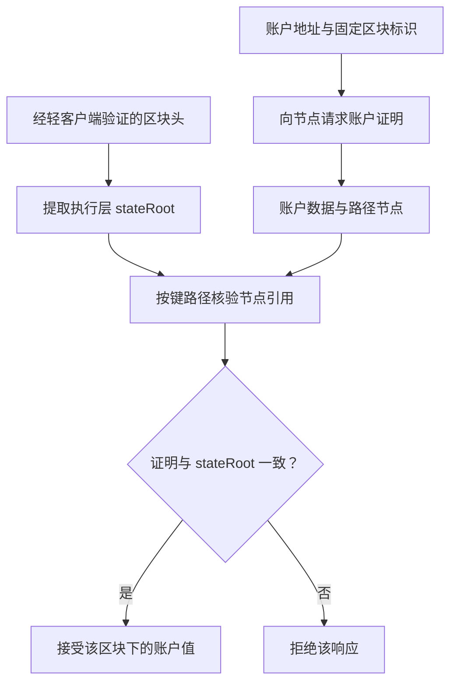

# 哈希指针、区块链与 Merkle 树

## 本篇目录
- [一、本部分导读](#一本部分导读)
- [二、本篇学习目标](#二本篇学习目标)
- [三、主要内容：为什么区块链需要这些数据结构](#三主要内容为什么区块链需要这些数据结构)
  - [3.1 从一个具体问题开始](#31-从一个具体问题开始)
  - [3.2 密码学和数据结构各负责哪一半](#32-密码学和数据结构各负责哪一半)
  - [3.3 一次账户查询的完整流程](#33-一次账户查询的完整流程)
  - [3.4 建议的学习顺序](#34-建议的学习顺序)
- [四、区块链的基本数据结构](#四区块链的基本数据结构)
  - [4.1 Merkle 树：用一个根承诺一批数据](#41-merkle-树用一个根承诺一批数据)
  - [4.2 比特币交易结构：交易怎样进入 Merkle 根](#42-比特币交易结构交易怎样进入-merkle-根)
  - [4.3 前缀树：按键的组成逐段查找](#43-前缀树按键的组成逐段查找)
  - [4.4 从两种结构走向 MPT](#44-从两种结构走向-mpt)
- [五、哈希指针](#五哈希指针)
- [六、区块如何连接成链](#六区块如何连接成链)
- [七、Merkle 树如何工作](#七merkle-树如何工作)
- [八、Merkle Proof：只证明一笔交易](#八merkle-proof只证明一笔交易)
  - [8.1 证明的边界](#81-证明的边界)
- [九、区块头与区块主体](#九区块头与区块主体)
- [十、为什么这两种结构重要](#十为什么这两种结构重要)
- [十一、本讲小结](#十一本讲小结)
- [十二、本篇与知识体系的关系](#十二本篇与知识体系的关系)
- [一图看懂本篇流程](#一图看懂本篇流程)
- [官方实现与代码阅读入口](#官方实现与代码阅读入口)


## 一图看懂本篇流程


哈希链像一串带编号的封条：后一张封条写着前一张的指纹。Merkle 树像把一大叠收据逐层两两盖章，最后只需记住最上面的总指纹。

> **怎么读这张图：**从左向右看，先确认输入是什么，再看系统如何检查和处理，最后看结果如何保存或验证。图中是帮助理解的简化流程，协议细节仍以本篇后续说明和官方规范为准。


例如，仓库有 8 箱货物，把每箱的编号和内容摘要逐层汇总成总摘要。审计人员只拿到其中一箱和证明路径，也能核对它是否属于这批货。

## 官方实现与代码阅读入口

以下链接指向对应技术的官方文档、标准或项目源码。阅读代码时，建议先从本篇涉及的核心数据结构或验证入口开始，再沿调用关系查看后续处理。

- [Bitcoin Core Merkle 实现](https://github.com/bitcoin/bitcoin/blob/master/src/consensus/merkle.cpp)
- [Bitcoin 区块链开发指南](https://developer.bitcoin.org/devguide/block_chain.html)

**代码来源说明：**官方仓库中的实现代码才代表相应项目的真实实现。正文中用于解释概念的短代码或实验片段，如未明确标出官方文件路径，应按教学演示理解，不能直接当作 Bitcoin Core、Go Ethereum 或其他客户端的生产代码。实际开发应对照上方官方版本、规范和测试。


## 一、本部分导读
> 本文系统讲解区块链的基本数据结构、Merkle Patricia Trie、MPT 操作、轻节点证明、Bloom Filter 及区块头与区块体。公式推演、示例数据和代码用于帮助理解机制。
> 以太坊部分围绕明确的 MPT 机制和相应升级规范讲解；涉及区块字段时标注适用升级，不能把一张字段表当成所有历史区块或未来区块的永久格式。
> 代码主要使用 Go 标准库。四个完整程序分别实现 Merkle 包含证明、HP 编解码、Bloom Filter、带承诺和版本快照的简化前缀树。它们帮助理解机制；其中自定义哈希树和前缀树不与以太坊 MPT 的链上编码兼容。

## 二、本篇学习目标
- 哈希指针、区块链与 Merkle 树
- 理解核心概念、运行流程和参与角色
- 能够区分协议保证、实现细节与应用层假设
- 能够结合代码或实际场景分析边界与风险

## 三、主要内容：为什么区块链需要这些数据结构

<a id="sec-002"></a>
### 3.1 从一个具体问题开始

假设某条链有一百万个账户，你想确认 Alice 在区块高度 $h$ 时的余额是 20。完整节点可以把整个状态数据库交给你，但手机钱包不适合下载和重新处理全部数据。

另一种办法是让服务器只回复一句：“Alice 的余额是 20。”这很省通信，却需要你相信服务器没有修改答案。区块链的数据结构要解决的，是如何在**提供较少数据**的同时，让你能**独立核验这份答案与某个已认可状态一致**。

为此，需要把任务拆开：

| 需要解决的问题 | 结构或机制 | 它提供什么 |
|---|---|---|
| 一批交易中是否包含某条交易 | Merkle 树 | 数据项到根的哈希路径 |
| 给定账户或存储槽，快速定位对应值 | 前缀树、MPT | 依键查找的路径 |
| 只保存一个摘要，仍能核验很多键值对 | 认证数据结构 | 根承诺和查询证明 |
| 查询大量日志前，快速排除明显不相关的区块 | Bloom Filter | 带假阳性的低成本筛选 |
| 根摘要属于哪个区块 | 区块头 | 将摘要与高度、父块等上下文绑定 |
| 应该相信哪个区块头 | 共识和轻客户端协议 | 对区块历史及确认状态的判断 |

这里的**认证数据结构**，指能够附带证明、让验证方检查查询结果的数据结构。“认证”不是说必须给每个节点加数字签名；在 MPT 中，关键是从数据到可信根的一条可核对的哈希关系。

<a id="sec-003"></a>
### 3.2 密码学和数据结构各负责哪一半

哈希函数 $H$ 将任意长度字节串映射为固定长度摘要。在安全参数足够且算法没有被攻破时，攻击者很难给出两份不同的合法编码却得到相同摘要。认证树利用这一点，把“完整数据是否一致”缩减成“根摘要是否一致”。

但是，仅有哈希还不够。你必须回答：

- 输入是否有明确的编码？`("ab", "c")` 和 `("a", "bc")` 不能在没有长度信息时都编码成 `abc`。
- 叶子与内部节点是否会被混淆？
- 子节点顺序是否有约定？
- 一棵树里有多少项，哪些项属于本轮？
- 根摘要来自已验证区块头，还是攻击者随意发来的字符串？

数据结构提供组织方式，编码规则消除歧义，哈希提供内容绑定，共识为特定根建立区块上下文。任何一个环节缺失，最后的“验证成功”都可能只是在验证一个更弱的命题。

<a id="sec-004"></a>
### 3.3 一次账户查询的完整流程

下面是围绕以太坊 MPT 的概念流程。省略了实际客户端的缓存、网络重试和具体轻客户端同步消息，但保留了信任关系。



验证方接受的命题是：

> 在指定区块头承诺的状态中，这个账户具有这份账户记录。

它没有因此证明“该账户的现实身份就是 Alice”“未来余额仍是 20”“节点提供了所有你可能感兴趣的账户”。这些属于其他问题。

**官方依据：**[EIP-1186：eth_getProof](https://eips.ethereum.org/EIPS/eip-1186) 将账户、存储证明与区块头的状态根关联；[以太坊轻客户端文档](https://ethereum.org/en/developers/docs/nodes-and-clients/light-clients/) 介绍了轻客户端如何减少数据需求以及它与完整节点的区别。

<a id="sec-005"></a>
### 3.4 建议的学习顺序

第一次阅读时，先理解 Merkle 树怎样从四份数据得到一个根，再理解前缀树如何按键定位。随后把这两个想法合起来学习 MPT。HP 和 RLP 则回答“这棵树如何变成每个节点都能一致解释的字节”。

阅读到 Bloom Filter 时，需要有意识地区分两种目标：

- Merkle/MPT 的核心问题是“能否核验这份结果”。
- Bloom 的核心问题是“能否先排除大量不可能命中的候选”。

它们可以配合工作，但不能相互替代。把所有带哈希的数据结构都称为“密码学证明”，会在这里产生第一个重要误解。

<a id="part2"></a>
<a id="sec-006"></a>

## 四、区块链的基本数据结构

<a id="sec-007"></a>
### 4.1 Merkle 树：用一个根承诺一批数据

#### 4.1.1 定义与必要性

**Merkle 树，又称默克尔树**，是一种把数据摘要逐层组合，最终得到一个根摘要的树形结构。最常见的教学形式是二叉树，每个内部节点有两个子节点。

假设有四条数据：

- $d_0=\text{“A:10”}$
- $d_1=\text{“B:20”}$
- $d_2=\text{“C:30”}$
- $d_3=\text{“D:40”}$

定义：

$$
L_i=H(0x00\parallel d_i),
$$

$$
P_{01}=H(0x01\parallel L_0\parallel L_1),\qquad
P_{23}=H(0x01\parallel L_2\parallel L_3),
$$

$$
R=H(0x01\parallel P_{01}\parallel P_{23}).
$$

其中，$\parallel$ 表示字节拼接；$L_i$ 是叶子摘要；$P_{01},P_{23}$ 是中间摘要；$R$ 是根。前面的 `0x00` 与 `0x01` 是不同用途的标识，称为**域分离**：让叶子输入和内部节点输入属于不同的编码空间。

这种标识关键在于避免同一段字节既可以被解释为一份原始数据，又可以被解释为两个子节点摘要。哈希函数只看字节，不知道人类期望的语义。

**规则来源：**[RFC 9162 §2.1](https://www.rfc-editor.org/rfc/rfc9162.html#section-2.1) 给出了区分叶子与内部节点的 Merkle 树定义。本文用账户式字符串构造新的教学例子；它不是比特币原生 Merkle 树格式，也不是以太坊 MPT。

#### 4.1.2 为什么一份小证明可以验证一个叶子

如果你已经可信地获得 $R$，别人想证明 $d_2$ 在树中，不需要发送全部四条数据，只要提供：

1. $L_3$，因为你需要它与自己算出的 $L_2$ 合成 $P_{23}$；
2. $P_{01}$，因为你需要它与 $P_{23}$ 合成根；
3. 与顺序有关的信息，例如叶子索引及树大小。

验证过程如下：

$$
L_2'=H(0x00\parallel d_2),
$$

$$
P_{23}'=H(0x01\parallel L_2'\parallel L_3),
$$

$$
R'=H(0x01\parallel P_{01}\parallel P_{23}').
$$

最后检查 $R'=R$。如果别人把 `C:30` 改成 `C:300`，第一步的结果就会变化，除非能完成相应的密码学攻击，否则无法继续得到同一个根。

在有 $n=2^h$ 个叶子的平衡二叉树中，单条路径有 $h=\log_2 n$ 层，因此证明通常只需 $h$ 个兄弟摘要。若摘要长度是 32 字节，1024 个叶子的路径包含 10 个摘要，摘要部分为 320 字节。这里没有计算数据本身、叶子索引、树大小、序列化头和协议封装；不能把 320 字节宣称为所有系统中的完整证明大小。

#### 4.1.3 为什么必须约定顺序

一般来说：

$$
H(L\parallel R)
e H(R\parallel L).
$$

所以“给一串兄弟摘要”本身不一定足以验证。你还需要知道每一步兄弟在左还是在右，或由索引及树形推导方向。

另一类应用会在每次合并前对两个摘要排序，这样可以省去左右方向，但得到的是另一种协议：它通常不直接证明某个元素在原列表中的位置。智能合约空投中常见的排序 Merkle 树，不能直接拿来解释比特币交易序号，也不能与保留顺序的验证器混用。

设计一个叶子格式时，也要绑定它实际代表的业务。若空投叶子只含地址而不含领取数量，证明无法限制可领取多少。若跨多个合约复用相同根，而叶子没有链和合约的上下文，还可能发生本不期望的跨域复用。

#### 4.1.4 奇数个叶子怎么办

“Merkle 树”不是唯一一种固定编码。对于奇数个叶子，协议可以选择复制最后一个、与空节点组合，或使用由叶子数确定的不平衡树。每种方法都必须给出一致规则。

本文 Go 程序采用后者：把 $n>1$ 个叶子分成左侧最大的 $2$ 的幂和剩余右侧。例如 5 个叶子分成 $4+1$，6 个叶子分成 $4+2$。叶子数和索引共同确定证明的方向与长度。这个选择可以让示例覆盖非满树，而不引入“复制最后一个叶子”造成的数量解释问题。

在任何具体协议里，验证器必须使用该协议的算法，不能从“都叫 Merkle 树”推导出证明兼容。

#### 4.1.5 完整 Go 示例：生成、验证与拒绝篡改

保存为 `main.go` 后运行：

```bash
go run main.go
```

```go
package main

import (
	"crypto/sha256"
	"fmt"
)

type Hash [32]byte

// Step records the sibling hash and its position relative to the current node.
type Step struct {
	Sibling Hash
	Left    bool
}

func leaf(data []byte) Hash {
	b := append([]byte{0}, data...)
	return sha256.Sum256(b)
}

func branch(left, right Hash) Hash {
	b := make([]byte, 1, 65)
	b[0] = 1
	b = append(b, left[:]...)
	b = append(b, right[:]...)
	return sha256.Sum256(b)
}

// Split at the largest power of two strictly smaller than n; n must exceed 1.
func split(n int) int {
	k := 1
	for k <= (n-1)/2 {
		k *= 2
	}
	return k
}

func root(items [][]byte) Hash {
	switch len(items) {
	case 0:
		return sha256.Sum256(nil)
	case 1:
		return leaf(items[0])
	default:
		k := split(len(items))
		return branch(root(items[:k]), root(items[k:]))
	}
}

func prove(items [][]byte, index int) ([]Step, error) {
	if index < 0 || index >= len(items) {
		return nil, fmt.Errorf("index out of range")
	}
	if len(items) == 1 {
		return nil, nil
	}
	k := split(len(items))
	if index < k {
		p, err := prove(items[:k], index)
		return append(p, Step{root(items[k:]), false}), err
	}
	p, err := prove(items[k:], index-k)
	return append(p, Step{root(items[:k]), true}), err
}

// directions derives the expected proof shape from the trusted size and index.
func directions(size, index int) []bool {
	if size == 1 {
		return nil
	}
	k := split(size)
	if index < k {
		return append(directions(k, index), false)
	}
	return append(directions(size-k, index-k), true)
}

func verify(data []byte, size, index int, proof []Step, expected Hash) bool {
	if size <= 0 || index < 0 || index >= size {
		return false
	}
	dirs := directions(size, index)
	if len(dirs) != len(proof) {
		return false
	}
	h := leaf(data)
	for i, s := range proof {
		if s.Left != dirs[i] {
			return false
		}
		if s.Left {
			h = branch(s.Sibling, h)
		} else {
			h = branch(h, s.Sibling)
		}
	}
	return h == expected
}

func main() {
	items := [][]byte{[]byte("A:10"), []byte("B:20"), []byte("C:30"), []byte("D:40"), []byte("E:50")}
	r := root(items)
	p, err := prove(items, 2)
	if err != nil {
		panic(err)
	}
	fmt.Printf("root=%x
proof_steps=%d
", r, len(p))
	fmt.Println("valid:", verify([]byte("C:30"), 5, 2, p, r))
	fmt.Println("tampered value:", verify([]byte("C:300"), 5, 2, p, r))
	fmt.Println("wrong index:", verify([]byte("C:30"), 5, 1, p, r))
	bad := append([]Step(nil), p...)
	bad[0].Sibling[0] ^= 1
	fmt.Println("tampered sibling:", verify([]byte("C:30"), 5, 2, bad, r))
}
```

程序中几个函数各自承担的工作：

| 函数 | 输入与输出 | 为什么需要 |
|---|---|---|
| `leaf` | 原始数据 → 叶子摘要 | 将业务数据绑定到树中 |
| `branch` | 左右摘要 → 父摘要 | 逐层承诺子树内容 |
| `split` | 叶子数 → 分割位置 | 固定非满树的形状 |
| `root` | 数据列表 → 根 | 构造整批数据的承诺 |
| `prove` | 数据列表、索引 → 兄弟路径 | 只导出验证所需的摘要 |
| `directions` | 树大小、索引 → 预期方向 | 防止证明自己任意解释位置 |
| `verify` | 值、大小、索引、证明、根 → 布尔值 | 独立检查查询结论 |

其中 `verify` 不会读取其他叶子的原文。它依赖可信根和约定好的树形规则，而不是依赖证明提供方“口头说明”树是如何构建的。

输出应包含：

```text
proof_steps=3
valid: true
tampered value: false
wrong index: false
tampered sibling: false
```

根摘要也会打印出来。这里的 3 步来自五叶树中索引 2 的路径：先在左侧四叶子树内走两层，再与右侧的第五个叶子合并一层。

**边界：**这个例子没有数字签名、共识、网络、磁盘数据库和交易执行。它演示的是包含证明，不是一条完整区块链。`size` 和 `index` 的含义必须由上层协议绑定；生产系统还要为证明长度和输入大小设置资源限制。

<a id="sec-008"></a>
### 4.2 比特币交易结构：交易怎样进入 Merkle 根

#### 4.2.1 交易是结构化消息，不是“金额字符串”

比特币交易的关键组成包括版本号、输入列表、输出列表和锁定时间。每个输入引用以前某笔交易的某个输出；每个输出给出金额与花费条件。教学上可以写成：

| 组成 | 简化例子 | 作用 |
|---|---|---|
| 输入 | 引用旧交易 $T$ 的第 0 个输出 | 指出花费哪份未花费输出 |
| 解锁材料 | 按对应脚本规则提供签名等信息 | 满足被引用输出的花费条件 |
| 输出 0 | 给 Bob 6 个单位 | 规定新资金的花费条件 |
| 输出 1 | 找零给 Alice 3 个单位 | 产生另一个新输出 |
| 差额 | 输入 10、输出共 9 | 在有效交易条件下形成 1 个单位费用 |

“10、6、3、1”仅为计算关系教学，不是现实转账费率建议。比特币中的输出金额以聪为整数单位处理，不能用浮点数随意近似。

交易签名验证与 Merkle 证明回答不同问题：

- 签名和脚本验证回答：该笔花费是否得到相应授权、是否满足条件？
- Merkle 证明回答：某个交易标识是否被某个区块头的交易根包含？

一笔在任意自建树中的交易即使有有效包含证明，也不能因此认定已经被比特币网络接受。

**资料：**[Bitcoin Developer Reference：Transactions](https://developer.bitcoin.org/reference/transactions.html) 描述交易序列化；[Bitcoin Developer Reference：Block Chain](https://developer.bitcoin.org/reference/block_chain.html) 描述区块头及交易 Merkle 根。

#### 4.2.2 txid、wtxid 与见证数据

对隔离见证交易，`txid` 和 `wtxid` 不是同一个概念：

- `txid` 根据不带见证部分的传统交易序列化计算。
- `wtxid` 根据包含见证部分的序列化计算。
- 区块头的传统交易 Merkle 根以交易的 `txid` 为基础。
- 见证数据通过另一个见证承诺机制被约束，该承诺放入 coinbase 交易的特定输出，再间接受到区块头约束。

所以，“所有交易字节都直接进入区块头那棵树”是不准确的简化。更准确的描述是：协议规定不同数据如何形成承诺，并将这些承诺连接到区块头。

**依据：**[BIP-141：Transaction ID 与 Commitment structure](https://github.com/bitcoin/bips/blob/master/bip-0141.mediawiki)。本文只提炼标识与承诺关系，具体脚本格式应以 BIP 正文为准。

#### 4.2.3 比特币 Merkle 计算与教学树的区别

比特币使用其协议指定的双 SHA-256、交易标识、字节序和奇数节点处理规则。本文教学树使用 `SHA256(域标识 || 数据)`，两者计算出的根不会相同。

如果你调试区块根不匹配，应依次检查：

1. 是否使用了正确的交易顺序。
2. 叶子是原始交易、`txid` 的内部字节，还是界面显示的十六进制字符串。
3. 是否混淆显示字节序与内部字节序。
4. 是否将 `wtxid` 当成 `txid`。
5. 奇数节点处理是否遵循比特币规则。
6. 是否意外对十六进制文本再做哈希。

特别是最后一项，`0xab` 这个单字节，与字符串 `"ab"` 的两个 ASCII 字节 `0x61 0x62`，哈希输入完全不同。后面的 MPT 编码也会反复遇到这一问题。

<a id="sec-009"></a>
### 4.3 前缀树：按键的组成逐段查找

#### 4.3.1 基本概念

**前缀树，Trie**，把键拆成字符、字节或更小单位，相同前缀共用路径。这里先用字符解释：

| 键 | 值 |
|---|---:|
| `car` | 10 |
| `cart` | 20 |
| `cat` | 30 |

三个键先共用 `c → a`。之后 `car` 和 `cart` 走 `r`，`cat` 走 `t`。`car` 已经在 `r` 处结束，但 `cart` 还需要继续走一个 `t`。

这个例子说明，**一个节点可以既代表某个键的结束，又拥有子节点**。因此，不能用“没有孩子才存值”来实现所有前缀树；这也是 MPT 分支节点为什么需要第 17 个值槽的重要直觉。

查询 `cart` 时，按 `c,a,r,t` 逐步走路径。查询 `cap` 时，在需要寻找 `p` 的地方发现分支不存在，就知道这个键不在树中。与一般哈希表相比，前缀树把键的结构显式保留在路径里。

#### 4.3.2 优势：什么场景真正受益

前缀树的价值关键在于它利用了键的结构。

**第一，前缀查询自然。**例如找出所有以 `car` 开头的键，先走到 `car` 的节点，再枚举其子树即可。对于很多词典和路由类任务，这比扫描所有键更直接。

**第二，查找成本主要与键长有关。**在理想化模型中，逐单位访问的成本为 $O(L)$，其中 $L$ 是键的长度。这个结论没有自动包含实际数据库 I/O、内存缓存命中和节点压缩成本。

**第三，缺失位置有结构信息。**查询不存在的键，可以明确指出是在某个分支没有孩子，还是某条压缩路径不匹配。认证前缀树可以把这种结构信息用于不存在证明。

**第四，相同前缀可以共享。**这既节省重复存储，也让更新只影响相关路径。但“共享前缀越长越好”并非无条件成立：一条很长但没有分叉的链，仍可能产生大量节点，需要路径压缩。

#### 4.3.3 缺点：为什么还需要 Patricia 压缩

如果把一个 32 字节的键拆成 64 个半字节，每个半字节建立一层，即使只有一条记录，也可能走很多层。若每个节点都准备 16 个子槽，大部分槽又是空的，空间利用率会很低。

此外，指针式节点分散在内存或数据库中，读取路径不一定连续。理论上只走几十层，现实中却可能触发多次随机读取。数据结构的渐进复杂度不能替代硬盘、缓存和编码成本分析。

另一项缺点是：原始键的前缀关系可能暴露业务结构。例如多个键共同以某个租户编号开头，单从树形就能观察到聚集关系。把键哈希后路径会更均匀，但这并不等于加密，也会失去自然前缀查询。

<a id="sec-010"></a>
### 4.4 从两种结构走向 MPT

把本节两种机制放在一起：

- Trie 负责“根据键走到值”。
- Patricia 压缩负责“把连续无分叉的路径合并”。
- Merkle 化负责“把节点内容及子节点引用纳入根承诺”。

于是，一次查询既有一条可寻找的路径，也有一条可验证的路径。这是下一节 MPT 的核心。若先记住这三个职责，再阅读叶子、扩展、分支、HP 编码，就不容易被术语淹没。

<a id="part3"></a>
<a id="sec-011"></a>


## 五、哈希指针

普通指针通常表示本地内存地址；哈希指针这一说法强调两项信息：

- 如何定位或引用某份数据；
- 该数据对应的哈希摘要。

在分布式网络中，本地内存地址不能直接作为跨机器引用。实际系统会传递哈希值，并通过本地存储索引或向其他节点请求相应数据。课程用“哈希指针”来描述这种结构关系。

## 六、区块如何连接成链

每个区块头包含前一个区块的哈希。设区块 $B_i$ 的哈希为
$H(B_i)$，下一个区块记录该值：

$$
B_{i+1}.\text{prevHash}=H(B_i)
$$

如果修改较早区块的内容，其哈希会改变；后续区块保存的前序哈希便无法与修改后的内容对应。若要让后续链条重新匹配，攻击者需要重新计算后续区块，并面对共识机制的工作量要求。

这种结构支持篡改检测，并不能单独阻止拥有足够资源的攻击者重算链条。安全性还依赖共识规则、算力分布和节点验证。

## 七、Merkle 树如何工作

Merkle 树是一种用哈希摘要组织多份数据的树形结构：

1.  每笔交易先计算自己的哈希，作为叶节点。
2.  相邻节点的哈希拼接后再次哈希，得到父节点。
3.  持续向上计算，最终得到根哈希（Merkle Root）。
4.  区块头保存根哈希，区块主体保存交易列表。比特币中的 Merkle
    树按区块中的交易组织，主要用于包含证明；它本身不是面向任意键值查找和不存在证明而设计的有序字典结构。

根哈希把整组交易绑定到一个固定长度的摘要中。交易内容改变，相关叶节点及其祖先节点都会变化，最终影响根哈希。

## 八、Merkle Proof：只证明一笔交易

轻节点不必下载整棵树。若要验证交易 $t$ 是否被某个区块承诺，只需取得：

- 交易 $t$ 本身；
- 从该交易叶节点到根节点路径上的兄弟哈希；
- 可用于核对的区块头及其根哈希。

验证方从交易哈希开始，按路径顺序拼接兄弟哈希并逐层计算，最终得到的根哈希若与区块头中的根哈希一致，则交易被包含在该树所承诺的交易集合中。

若树有 $n$ 个叶节点，平衡二叉树中的证明通常只需要 $O(\log n)$
个兄弟哈希，而非整棵树的数据。

### 8.1 证明的边界

Merkle Proof
证明的是“交易被纳入该根哈希所承诺的集合”。它本身不证明交易在业务规则上有效，也不单独证明该区块处于最终被接受的链上。轻节点还需检查区块头链与工作量证明，并依赖全节点对交易有效性的验证。

## 九、区块头与区块主体

- **区块头**：保存前序区块哈希、交易 Merkle
  根、时间戳、难度编码、随机数等字段。
- **区块主体**：保存区块中的交易数据。

区块头较小，便于轻节点同步与验证；区块主体包含具体交易内容，通常需要全节点保存和检查。使用哈希引用构建的数据结构还应避免循环依赖：若两个对象的哈希互相依赖，就无法先确定任一对象的最终内容与哈希。

## 十、为什么这两种结构重要

| 结构      | 主要作用                       | 主要限制                         |
|-----------|--------------------------------|----------------------------------|
| 哈希链    | 连接区块历史、检测历史内容变化 | 需要配合共识才能抵抗重写         |
| Merkle 树 | 汇总交易、提供短包含证明       | 包含证明不等于完整交易验证       |
| 哈希索引  | 根据哈希定位数据               | 具体数据仍需节点保存或从网络取得 |

## 十一、本讲小结

哈希链把区块历史连接起来；Merkle
树把区块内部的交易汇总起来。区块头中的哈希摘要使轻节点可以验证部分信息，而不必保存完整账本。

[课程视频：P3
数据结构](https://www.bilibili.com/video/BV1Vt411X7JF/?p=3) ·


## 十二、本篇与知识体系的关系

- 所属部分：第三部分：区块链数据结构与验证
- 返回总目录：[README](../README.md)
