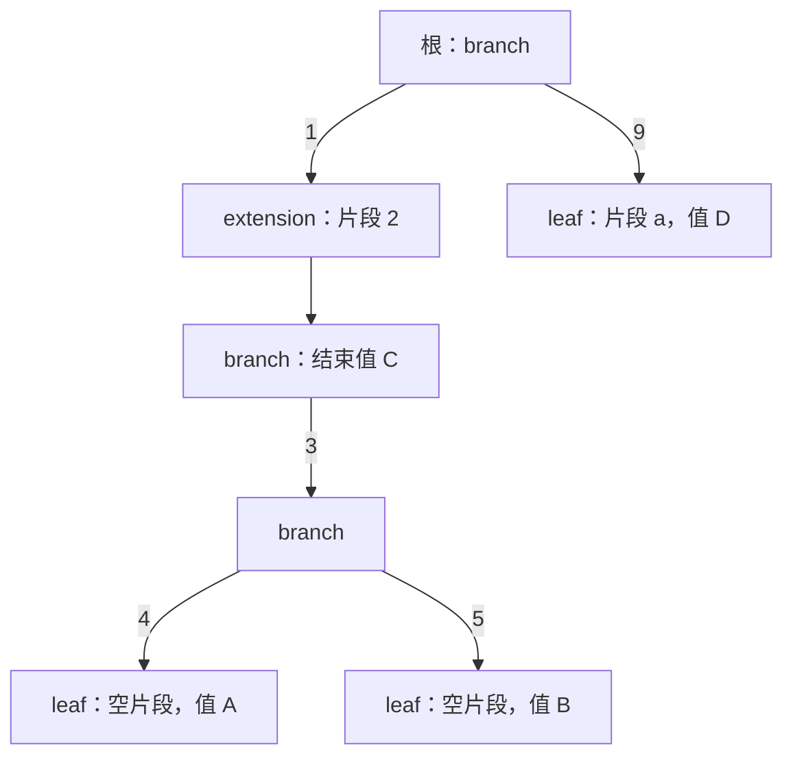
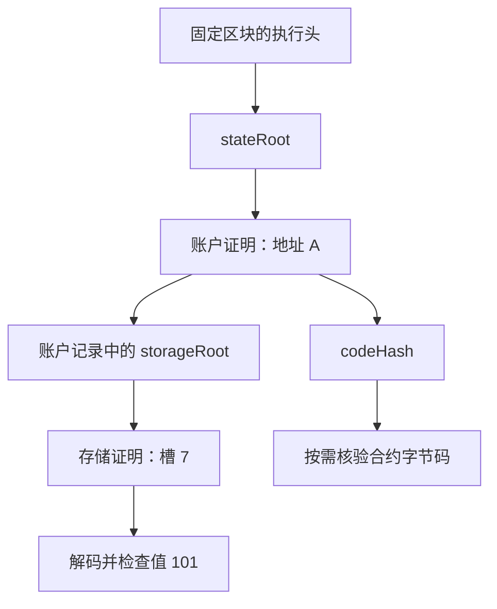

# 区块、交易与 UTXO 数据结构

## 本篇目录
- [一、本篇学习目标](#一本篇学习目标)
- [二、MPT 树：节点、路径、编码与安全键](#二mpt-树节点路径编码与安全键)
  - [2.1 MPT 的作用：把字典变成可验证的状态承诺](#21-mpt-的作用把字典变成可验证的状态承诺)
  - [2.2 四种节点：先看语义，再看编码](#22-四种节点先看语义再看编码)
  - [2.3 路径压缩：从四个键完整走一遍](#23-路径压缩从四个键完整走一遍)
  - [2.4 节点怎样存进数据库：RLP、内联与哈希引用](#24-节点怎样存进数据库rlp内联与哈希引用)
  - [2.5 专门回答：Val 存数据还是哈希索引](#25-专门回答val-存数据还是哈希索引)
  - [2.6 Key 的三种表示：Raw、Hex、HP](#26-key-的三种表示rawhexhp)
  - [2.7 安全 MPT：为什么某些 Key 先做哈希](#27-安全-mpt为什么某些-key-先做哈希)
  - [2.8 不是所有以太坊 Trie 都把 Key 再哈希](#28-不是所有以太坊-trie-都把-key-再哈希)
  - [2.9 教学补充：合约 mapping 为什么看起来“哈希了两次”](#29-教学补充合约-mapping-为什么看起来哈希了两次)
  - [2.10 本节检查点](#210-本节检查点)
- [三、MPT 的基本操作](#三mpt-的基本操作)
  - [3.1 Get：查找一个 Key 到底需要做什么](#31-get查找一个-key-到底需要做什么)
  - [3.2 Insert：插入时为什么会拆分节点](#32-insert插入时为什么会拆分节点)
  - [3.3 Delete：删除后为什么还要合并](#33-delete删除后为什么还要合并)
  - [3.4 Update：值变化与根变化](#34-update值变化与根变化)
  - [3.5 Commit：计算根、提交节点、写盘不是一回事](#35-commit计算根提交节点写盘不是一回事)
  - [3.6 完整 Go 示例：前缀键、增删改查与版本快照](#36-完整-go-示例前缀键增删改查与版本快照)
- [四、MPT 在区块链中的应用](#四mpt-在区块链中的应用)
  - [4.1 四种常见承诺分别承诺什么](#41-四种常见承诺分别承诺什么)
  - [4.2 账户记录为何不是一个“余额数字”](#42-账户记录为何不是一个余额数字)
  - [4.3 从 stateRoot 验证一个合约槽：两层证明](#43-从-stateroot-验证一个合约槽两层证明)
  - [4.4 JSON-RPC 应如何固定上下文](#44-json-rpc-应如何固定上下文)
  - [4.5 收据、日志和状态不能相互代替](#45-收据日志和状态不能相互代替)
  - [4.6 区块执行时，根是怎样算出来的](#46-区块执行时根是怎样算出来的)
  - [4.7 对钱包、跨链和审计的不同意义](#47-对钱包跨链和审计的不同意义)
- [五、UTXO 是什么](#五utxo-是什么)
- [六、交易怎样更新 UTXO 集合](#六交易怎样更新-utxo-集合)
  - [6.1 数字示例](#61-数字示例)
- [七、为什么 UTXO 有利于检测双花](#七为什么-utxo-有利于检测双花)
- [八、交易费和区块奖励](#八交易费和区块奖励)
- [九、区块头与挖矿搜索空间](#九区块头与挖矿搜索空间)
- [十、UTXO 模型的特点](#十utxo-模型的特点)
- [十一、本讲小结](#十一本讲小结)
- [十二、本篇与知识体系的关系](#十二本篇与知识体系的关系)
- [一图看懂本篇流程](#一图看懂本篇流程)
- [官方实现与代码阅读入口](#官方实现与代码阅读入口)


## 一图看懂本篇流程


UTXO 像手里的几张现金钞票。买东西时要拿出具体哪几张，付款后这些旧钞票作废，系统再生成给商家的钱和找零。

> **怎么读这张图：**从左向右看，先确认输入是什么，再看系统如何检查和处理，最后看结果如何保存或验证。图中是帮助理解的简化流程，协议细节仍以本篇后续说明和官方规范为准。


例如，手里有两张礼品卡，分别还剩 70 元和 30 元。买 80 元商品时，系统消费两张卡的余额并生成相应找零或剩余额度记录。

## 官方实现与代码阅读入口

以下链接指向对应技术的官方文档、标准或项目源码。阅读代码时，建议先从本篇涉及的核心数据结构或验证入口开始，再沿调用关系查看后续处理。

- [Bitcoin Core 源码](https://github.com/bitcoin/bitcoin/tree/master/src)
- [Bitcoin 交易开发指南](https://developer.bitcoin.org/devguide/transactions.html)

**代码来源说明：**官方仓库中的实现代码才代表相应项目的真实实现。正文中用于解释概念的短代码或实验片段，如未明确标出官方文件路径，应按教学演示理解，不能直接当作 Bitcoin Core、Go Ethereum 或其他客户端的生产代码。实际开发应对照上方官方版本、规范和测试。


## 一、本篇学习目标
- 区块、交易与 UTXO 数据结构
- 理解核心概念、运行流程和参与角色
- 能够区分协议保证、实现细节与应用层假设
- 能够结合代码或实际场景分析边界与风险

## 二、MPT 树：节点、路径、编码与安全键

<a id="sec-012"></a>
### 2.1 MPT 的作用：把字典变成可验证的状态承诺

MPT 是 **Merkle Patricia Trie** 的缩写。这里把它理解为“经过路径压缩、并且能够用根摘要验证的前缀树”。

对于键值集合

$$
D=\{(k_1,v_1),(k_2,v_2),\ldots,(k_n,v_n)\},
$$

规范的构造过程给出一个根：

$$
R=\operatorname{Root}(D).
$$

当某个键的值从 $v$ 改为 $v'$ 时，通常只需要重建相关路径上的节点及摘要，而不必重新编码所有无关分支。由于没有变化的子树摘要仍可复用，状态根适合表示持续演化的大型状态。

这里的“相同数据产生相同根”需要固定四类规则：键预处理、节点归一化、字节编码和哈希算法。两份字典逻辑相同，如果一份保留了冗余扩展节点，另一份合并了路径，随意编码就可能产生不同根。因此 MPT 的规范形态并不是只为节省空间，也是确定性的一部分。

以太坊 MPT 的密码学角色是**绑定**：在安全假设下，同一个可信根不能被任意解释成矛盾的状态。它不提供保密性，也不自动保证数据可下载。状态根是压缩承诺，不是状态数据库的可逆压缩包。

<a id="sec-013"></a>
### 2.2 四种节点：先看语义，再看编码

| 节点 | 抽象形式 | 消耗多少路径 | 末尾字段的意义 |
|---|---|---:|---|
| 空节点 | 空 | 无可继续路径 | 不存在子树 |
| 分支节点 | `[c0,…,c15,value]` | 选择子槽时消耗 1 个 nibble | 第 17 项是恰好在此结束的键的值 |
| 叶子节点 | `[HP(剩余路径, leaf), value]` | 消耗全部剩余路径 | 业务值的字节串 |
| 扩展节点 | `[HP(公共路径, extension), child]` | 消耗一段公共路径 | 指向后续节点的引用 |

这里的 **nibble，半字节**，是 4 个比特，可表示 0 到 15。一个字节 `0xab` 对应两个 nibble：`a` 和 `b`，也就是数值 10 和 11。

**规范核对入口：**[Ethereum：Merkle Patricia Trie](https://ethereum.org/en/developers/docs/data-structures-and-encoding/patricia-merkle-trie/) 的节点定义与 compact encoding 部分；[Geth trie 包文档](https://pkg.go.dev/github.com/ethereum/go-ethereum/trie) 可以进一步查看客户端的操作边界。以下路径示例和推演为本文构造。

#### 2.2.1 空节点：三种“空”不要混淆

MPT 里的“空节点”表示这个位置没有子树。在编码中会使用规定的空表示；但概念上它不同于：

1. 一个合法键映射到长度为 0 的业务值；
2. 一个存储槽按 EVM 规则读取为整数 0；
3. 整棵状态树为空所对应的根摘要。

某个客户端 API 可能把“写入空字节值”定义成删除操作，因此是否允许空值作为独立记录，是接口和上层状态规则共同决定的。

以太坊空 Trie 根与空代码哈希也是不同常量：

$$
R_{\varnothing}=\operatorname{Keccak256}(\operatorname{RLP}(\text{空字节串})),
$$

$$
\text{EmptyCodeHash}=\operatorname{Keccak256}(\text{空字节串}).
$$

前者的哈希输入包含 RLP 的空串编码，后者直接对零长度字节串哈希。输入不同，结果自然不同。记忆常量不如先理解各自承诺的对象。

#### 2.2.2 分支节点：为什么是 17 项

前 16 项分别对应下一位 nibble 的 16 种可能取值。最后一项用于表示“当前完整路径本身就是一个键”。

例如同时存有键 `12` 和 `1234`。在走完 `12` 时：

- 如果用户查询 `12`，应该立即读到它的值。
- 如果用户查询 `1234`，还要继续沿第 `3` 个子槽查找。

如果没有第 17 项，就只能让一个节点在“终点”和“中途”二选一，无法自然表示这种前缀关系。

但在经过哈希、所有键都固定为 64 个 nibble 的状态 Trie 中，不会出现一个完整键是另一个更长完整键前缀的普通情形。这不代表分支节点规则改变了，而是固定长度键限制了哪些结构会实际出现。

分支节点选择子槽本身已经消耗一个 nibble。例如走 `child[3]` 后，后续节点的路径片段不再重复包含这一个 `3`。把它重复编码，是手工构造 MPT 时很常见的错误。

#### 2.2.3 叶子节点：存“最后一段路径”和最终值

叶子节点说明：沿前面的路径走到这里后，剩余键必须与节点里的路径片段完全匹配，然后才能读到值。

如果查询还剩 `[a,b]`，而叶子路径是 `[a,b,c]`，这是不匹配，不是“查询前缀一样所以找到了”。反过来，叶子路径为 `[a]`，查询还剩 `[a,b]`，也不匹配。

叶子路径可以为空。比如分支节点已经通过子槽消耗了键的最后一个 nibble，那么接下来的叶子只需要表示“此处结束并存值”，其剩余路径就是空序列。HP 的 leaf 标记仍然必须保留。

#### 2.2.4 扩展节点：一次跳过公共路径

扩展节点不表示一个完整键的结束，而是说：“接下来这一段路径没有分叉，可以一次匹配过去。”

若当前查询剩余路径为 `[1,2,3,4]`，扩展节点的路径片段为 `[1,2,3]`，匹配成功后，还剩 `[4]` 交给子节点。若查询为 `[1,2,9,4]`，应直接判定该路径不存在，不应忽略不匹配位置继续往下找。

因此，叶子和扩展节点虽然都只有两个字段，但语义不同：

- 叶子终止一次键值匹配。
- 扩展节点继续到另一节点。

这一区别由 HP 标记编码，而不是由第二个字段的“看起来像不像哈希”猜测。

<a id="sec-014"></a>
### 2.3 路径压缩：从四个键完整走一遍

#### 2.3.1 教学数据

以下键用十六进制表示原始字节。例如 `1234` 表示两个字节 `0x12 0x34`，不是四个 ASCII 字符。为了看清结构，这里使用未进行安全哈希预处理的短键。

| 原始键 | nibble 路径 | 值 |
|---|---|---|
| `0x1234` | 1, 2, 3, 4 | A |
| `0x1235` | 1, 2, 3, 5 | B |
| `0x12` | 1, 2 | C |
| `0x9a` | 9, a | D |

先只插入 `1234 → A`。整棵树可以是一片叶子，路径直接保存 `[1,2,3,4]`，没有必要建立四层只有一个孩子的节点。

再插入 `1235 → B`。两个键共享 `[1,2,3]`，在最后一位 `4` 与 `5` 分叉。因此，规范结构可以是：

- 一个扩展节点保存公共片段 `[1,2,3]`；
- 它指向一个分支节点；
- 分支 `4` 指向空路径叶子 A，分支 `5` 指向空路径叶子 B。

再插入 `12 → C`。新键在旧扩展片段中途结束。不能把 C 塞进扩展节点，因为扩展节点不是存值终点。需要把旧片段拆成：

- 扩展 `[1,2]`；
- 一个分支节点，其第 17 项存 C；
- 该分支的 `3` 子槽通向原来的 `4/5` 分支。

最后插入 `9a → D`。根路径第一位就不同，于是顶层改为分支：



观察：顶层分支已经消耗 `1`，所以扩展节点只保存 `2`；第二个分支选择 `3` 后，其下方分支直接选择 `4` 或 `5`；最后两片叶子的片段为空。

#### 2.3.2 路径压缩节省了什么

如果一段长度为 20 的路径只有唯一后继，逐 nibble 的普通树可能需要经过 20 个节点。路径压缩把这段路径放进一个节点的片段字段，查询时一次比较这 20 个 nibble。

节省主要发生在：

- 节点对象和指针数量；
- 编码中重复的结构开销；
- 路径上的数据库查找次数；
- 证明需要传递的节点数量。

它没有让键本身的信息凭空消失。需要匹配的 20 个 nibble 仍必须在某处表示，比较它们也仍需要计算。正确表述应是“减少结构和访问开销”，而不是“无论键多长查询都只需一步”。

#### 2.3.3 根何时会变化

给定完整、规范化的树形和编码，当 `1234` 的值由 A 改为 A' 时：

1. 对应叶子的编码变化。
2. 父节点的子引用变化。
3. 其祖先节点依次变化。
4. 根摘要最终变化。

`9a → D` 的子树没有变，它的内容和引用可以继续使用。这种“局部路径变更、其他分支复用”是状态承诺能够支持增量更新的原因。

但当插入一个与旧键共享部分前缀的新键，或删除后使某个分支只剩一个孩子，变化不只是某个值：树形也需要拆分或合并。MPT 更新同时处理逻辑字典与规范结构。

<a id="sec-015"></a>
### 2.4 节点怎样存进数据库：RLP、内联与哈希引用

#### 2.4.1 首先区分三个层次

学习资料经常把“节点”“节点编码”和“节点在数据库中的键”混在同一行。建议始终分为三层：

| 层次 | 例子 | 用途 |
|---|---|---|
| 逻辑节点 | leaf、extension、branch | 表示路径和内容关系 |
| 节点字节 | `RLP(node)` | 形成所有实现一致的字节表示 |
| 存取方式 | 内联子节点，或凭哈希/存储索引取出节点字节 | 组织实际数据库访问 |

在经典的基于内容寻址的解释中，大节点可以按 `hash → encoded node` 保存。但真实客户端可能使用路径式数据库、缓存和历史层等优化。共识约束的是根和节点引用语义，不要求每个客户端磁盘文件内部都采用同一键空间。

因此，“MPT 的节点引用是哈希”与“磁盘数据库每一条键必定等于哈希”是两个不同层面的问题。

#### 2.4.2 RLP 的职责

**RLP，Recursive Length Prefix，递归长度前缀编码**，为字节串和嵌套列表定义确定的字节表示。它告诉解析器哪些字节属于一个字符串，哪些组成一个列表，而不负责解释“这 32 字节是地址还是哈希”。

小例子：

| 对象 | RLP 十六进制 | 说明 |
|---|---|---|
| 空字节串 | `80` | 字符串类型、长度 0 |
| 空列表 | `c0` | 列表类型、长度 0 |
| 单字节 `01` | `01` | 位于可直接编码范围 |
| 字节串 `12 34` | `82 12 34` | 字符串长度为 2 |
| 整数 0 | `80` | 以最短大端字节表示整数 0，再编码 |
| 字节串 `00` | `00` | 不等于整数 0 的规范 RLP 表示 |

RLP 本身无法“知道”某个 `00` 是一个字节，还是一个不规范的整数 0。上层字段类型必须规定如何解释。节点结构与字段类型共同决定合法性。

**依据：**[Ethereum RLP 文档：Definition 与 Examples](https://ethereum.org/en/developers/docs/data-structures-and-encoding/rlp/)。这里仅列学习节点编码所需的少数基本例子，完整长字符串规则应查原规范。

#### 2.4.3 32 字节边界针对的是整个子节点编码

对非根子节点 $N$，概念规则为：

$$
\operatorname{Ref}(N)=
\begin{cases}
N\text{ 的内联结构}, & |\operatorname{RLP}(N)|<32,\\
\operatorname{Keccak256}(\operatorname{RLP}(N)), & |\operatorname{RLP}(N)|\ge 32.
\end{cases}
$$

这里的长度是**整个节点 RLP 编码的字节长度**，不是 Key 长度，也不是 Value 长度。

以内联形式放入父节点时，它作为嵌套节点结构编码，不能在已经得到 RLP 字节后，错误地把它再次当成普通业务字节串包装一层。对于哈希引用，父节点里存的是 32 字节摘要这一字节串。

为什么要内联？假设一个小叶子的完整编码只有 7 字节。让父节点直接保存这 7 字节所代表的结构，比存一个 32 字节摘要再多做一次外部查找更合算。对于大节点，使用固定长度摘要则可以避免不断复制整个子树。

根是特殊边界：对外的 Trie 根仍以固定长度摘要表示。不能因为整棵树很小，就把“内联小节点”规则套到区块头里，把 `stateRoot` 改成任意长度节点编码。

**实现依据：**[Geth trie/hasher.go](https://github.com/ethereum/go-ethereum/blob/master/trie/hasher.go) 区分 `len(enc) < 32` 与强制哈希；[Geth trie/trie.go](https://github.com/ethereum/go-ethereum/blob/master/trie/trie.go) 的根计算调用使用根哈希语义。

#### 2.4.4 用一个短叶子手算边界

设叶子剩余路径为空、值是一个字节 `0x41`。空 leaf 路径的 HP 编码是 `0x20`，逻辑叶子是：

```text
[ 0x20, 0x41 ]
```

两个字段都是单字节、且各自可直接 RLP 编码，所以整个列表编码为：

```text
c2 20 41
```

长度为 3 字节，作为非根子节点时可以内联。如果它就是整棵树的根，对外根仍计算 `Keccak256(c22041)`。

现在把值改成一个长度为 29 字节的字节串：

- HP 字段仍占 1 字节。
- 值自身要用 1 字节长度前缀加 29 字节内容，占 30 字节。
- 列表负载为 31 字节，列表前缀再占 1 字节。
- 整个节点编码为 32 字节。

这时已经满足“至少 32 字节”，因此非根父引用使用哈希。这个例子清楚展示：不能靠值是否小于 32 字节做决策，值长度为 29 时整个节点已经达到边界。

<a id="sec-016"></a>
### 2.5 专门回答：Val 存数据还是哈希索引

正确识别过程有两个阶段。

**第一阶段，确定节点语义。**

- 对 17 项分支节点，前 16 项是子引用，第 17 项是终止值。
- 对 2 项短节点，解析第一个字段的 HP 标记。
- 如果是叶子，第二项是最终值。
- 如果是扩展，第二项是子节点引用。

**第二阶段，只在“子引用”这个语义位置上判断引用类型。**

子引用可能为空、内联的子节点，或 32 字节哈希引用。内联的判断条件是**整个子节点的 RLP 编码不足 32 字节**，与它是否属于“两项短节点”不是同一个概念：branch 也可能内联；leaf、extension 也可能因编码达到 32 字节而改用哈希引用。解析器必须遵守相应 RLP 类型和长度规则，拒绝不合规形式。

为什么不能用“32 字节就是哈希”？

假设一个业务值本身是 32 字节的随机数，放在叶子第二项中。它仍然是业务值，而不是下一节点的地址。又比如账户值里包含 `storageRoot` 与 `codeHash`，这些字段本身确实有哈希语义，但整个叶子第二项在 MPT 层仍是一段账户记录字节；需要先按账户格式解码，才能解释里面的子字段。

一个字段的含义首先来自**所在结构和类型**，其次才是字节长度。用长度替代类型判断，会把有效值误当引用，或把恶意引用当普通数据，最终使证明验证与状态解释不一致。

<a id="sec-017"></a>
### 2.6 Key 的三种表示：Raw、Hex、HP

#### 2.6.1 Raw：原始字节是输入事实

**Raw** 指键的原始字节，不是“尚未加密的字符串”的专门术语。它可能是一个账户地址的哈希，也可能是一个交易序号的 RLP 编码。

例如：

```text
Raw bytes = [0xab, 0xcd]
```

对应两个字节。若先写：

```go
raw := []byte("abcd")
```

得到的是四个 ASCII 字节 `61 62 63 64`，不是 `ab cd`。从十六进制文本构造原始字节应使用十六进制解码，而不是直接转换字符串。

#### 2.6.2 Hex：把每个字节拆成两个 nibble

把上面的 `ab cd` 拆成 nibble：

```text
[a, b, c, d]
```

一些客户端内部使用一个字节保存一个 nibble，虽然每项只需要 4 bit。这样做便于逐项访问和操作，属于内存表示的便利选择。

某些内部实现还使用数值 16 作为“路径结束”的标记。要注意：16 不是合法十六进制路径数字；它是内部哨兵。最终进入 HP 字节时，结束属性编码进标志位，而不是原样把 nibble 16 拼进路径。

因此，“Hex 编码”在 MPT 教材中通常指 nibble 序列，而不总是日常说的十六进制字符串。阅读 Go 源码时，必须看类型与函数约定。

#### 2.6.3 HP：同时表示奇偶长度和节点类型

压缩后片段可能有奇数个 nibble。字节必须装两个 nibble，且解析器需要知道短节点是 leaf 还是 extension。HP 用首个 nibble 的两位信息解决这两个问题。

令：

- $t=0$：extension；
- $t=1$：leaf；
- $o=0$：片段长度为偶数；
- $o=1$：片段长度为奇数。

标志：

$$
f=2t+o.
$$

| $f$ | 节点类型 | 片段长度 | 第一个字节的组成 |
|---:|---|---|---|
| 0 | extension | 偶数 | `0` 标志 + `0` 填充 |
| 1 | extension | 奇数 | `1` 标志 + 第一个路径 nibble |
| 2 | leaf | 偶数 | `2` 标志 + `0` 填充 |
| 3 | leaf | 奇数 | `3` 标志 + 第一个路径 nibble |

取片段 `ab` 与 `abc`，逐一计算：

| 输入片段 | 节点类型 | 构造的 nibble 序列 | HP 字节 |
|---|---|---|---|
| `[a,b]` | extension | `[0,0,a,b]` | `00 ab` |
| `[a,b,c]` | extension | `[1,a,b,c]` | `1a bc` |
| `[a,b]` | leaf | `[2,0,a,b]` | `20 ab` |
| `[a,b,c]` | leaf | `[3,a,b,c]` | `3a bc` |
| 空片段 | leaf | `[2,0]` | `20` |

**注意：**最后一项是合法的空路径叶子。空路径扩展在编码层可以表示出来，但在规范化树结构中一般没有跳过路径的作用，应由结构层避免保留这种冗余节点。编码函数与树形合法性检查并不是同一个职责。

#### 2.6.4 HP 完整 Go 示例

下面把“是否 leaf”作为独立布尔参数，输入路径只允许 0 到 15，避免把内部哨兵与真实 nibble 混用。解码器拒绝非法标志和偶数长度形式中不为 0 的填充位。

```go
package main

import (
	"bytes"
	"fmt"
)

// Nibbles contains only digits 0..15. Leaf status is passed separately.
func encodeHP(path []byte, isLeaf bool) ([]byte, error) {
	for _, n := range path {
		if n > 15 {
			return nil, fmt.Errorf("invalid nibble: %d", n)
		}
	}
	flag := byte(0)
	if isLeaf {
		flag = 2
	}
	odd := len(path)%2 == 1
	out := make([]byte, 1, 1+len(path)/2)
	if odd {
		out[0] = (flag+1)<<4 | path[0]
		path = path[1:]
	} else {
		out[0] = flag << 4
	}
	for i := 0; i < len(path); i += 2 {
		out = append(out, path[i]<<4|path[i+1])
	}
	return out, nil
}

func decodeHP(encoded []byte) ([]byte, bool, error) {
	if len(encoded) == 0 {
		return nil, false, fmt.Errorf("empty compact encoding")
	}
	flag := encoded[0] >> 4
	if flag > 3 {
		return nil, false, fmt.Errorf("invalid HP flag")
	}
	odd := flag&1 == 1
	if !odd && encoded[0]&15 != 0 {
		return nil, false, fmt.Errorf("nonzero even-path padding")
	}
	var path []byte
	if odd {
		path = append(path, encoded[0]&15)
	}
	for _, b := range encoded[1:] {
		path = append(path, b>>4, b&15)
	}
	return path, flag&2 != 0, nil
}

func bytesToNibbles(raw []byte) []byte {
	path := make([]byte, 0, 2*len(raw))
	for _, b := range raw {
		path = append(path, b>>4, b&15)
	}
	return path
}

func main() {
	cases := []struct {
		name string
		path []byte
		leaf bool
	}{
		{"extension-even", []byte{0xa, 0xb}, false},
		{"extension-odd", []byte{0xa, 0xb, 0xc}, false},
		{"leaf-even", []byte{0xa, 0xb}, true},
		{"leaf-odd", []byte{0xa, 0xb, 0xc}, true},
		{"leaf-empty", nil, true},
	}
	for _, c := range cases {
		encoded, err := encodeHP(c.path, c.leaf)
		if err != nil {
			panic(err)
		}
		decoded, leaf, err := decodeHP(encoded)
		if err != nil || !bytes.Equal(decoded, c.path) || leaf != c.leaf {
			panic("round trip failed")
		}
		fmt.Printf("%s: %x roundtrip=true
", c.name, encoded)
	}
	fmt.Printf("raw ab -> nibbles %v
", bytesToNibbles([]byte{0xab}))
	fmt.Printf("ASCII ab -> nibbles %v
", bytesToNibbles([]byte("ab")))
	_, _, err := decodeHP([]byte{0x21})
	fmt.Println("reject bad padding:", err != nil)
	_, err = encodeHP([]byte{16}, true)
	fmt.Println("reject nibble 16:", err != nil)
}
```

主要输出：

```text
extension-even: 00ab roundtrip=true
extension-odd: 1abc roundtrip=true
leaf-even: 20ab roundtrip=true
leaf-odd: 3abc roundtrip=true
leaf-empty: 20 roundtrip=true
raw ab -> nibbles [10 11]
ASCII ab -> nibbles [6 1 6 2]
reject bad padding: true
reject nibble 16: true
```

这里 `0x21` 会被拒绝：首 nibble `2` 表示偶数长度 leaf，第二个 nibble 应是固定填充 0，却出现了 1。宽松解码器如果把多种字节表示默认为同一条路径，就可能破坏规范编码的一致性。

#### 2.6.5 三种表示不是任意互换的三层加密

完整流程应写成：

```text
上层业务键
→ 按该 Trie 类型做必要的哈希或序列化
→ Raw 字节
→ 全路径 nibble 序列
→ 建树并分割成各节点的路径片段
→ 仅对 leaf/extension 的片段做 HP 编码
→ 节点 RLP 编码
→ 根据引用规则计算哈希或内联
```

HP 编码的是**节点片段**，不是通常意义上把完整 Key 编码一次就到处复用。分支节点的分叉 nibble 由子槽位置表达，不放进子节点片段重复计算。

Raw→nibble 是可逆的拆分，HP 是带类型信息的可逆紧凑编码，RLP 是结构化序列化。它们都不是加密。真正不可逆的步骤是可选的 Key 哈希和节点哈希，但不可逆也不等于能够保密。

<a id="sec-018"></a>
### 2.7 安全 MPT：为什么某些 Key 先做哈希

#### 2.7.1 直接使用业务键的问题

如果攻击者可以自由选择大量键，就可能有意制造很长的公共前缀，使树形、查找路径或证明分布偏离均匀情况。直接存储可变长业务字符串，还会把输入长度直接带入路径管理，增加资源边界问题。

例如，所有键都以几十字节相同的租户标识开头，再在末尾分叉。普通前缀查询可能喜欢这种聚集，但状态数据库未必需要按这些前缀检索，反而更希望键空间分布固定、均匀。

这并不是说未经哈希的 Patricia 树“不安全到不能使用”。安全需求取决于谁能选择键、长度有没有上限、操作如何计费、是否依赖前缀关系和如何防拒绝服务。所谓 secure trie 描述的是额外的键预处理约束。

#### 2.7.2 方案：固定长度哈希键

以太坊状态与存储的典型路径是：

$$
k_{\text{account}}=\operatorname{Keccak256}(\text{20 字节地址}),
$$

$$
k_{\text{storage}}=\operatorname{Keccak256}(\operatorname{BE}_{32}(\text{存储槽编号})).
$$

$\operatorname{BE}_{32}$ 表示把数值编码为 32 字节大端形式，必要时在左侧补零。哈希结果为 32 字节，再拆成 64 个 nibble。

对应地，查询方不能拿地址的可见十六进制字符逐位走 state trie；它需要先计算协议规定的哈希路径。

**核对入口：**[Geth StateTrie 文档](https://pkg.go.dev/github.com/ethereum/go-ethereum/trie#StateTrie) 说明其键哈希行为；[Ethereum MPT 文档的 State Trie 部分](https://ethereum.org/en/developers/docs/data-structures-and-encoding/patricia-merkle-trie/#state-trie) 说明账户路径和账户记录。这里应把“地址字节”和“地址字符串”区分开。

#### 2.7.3 优势及其成立条件

哈希键使路径长度固定，并在理想化的哈希输出分布下使前缀大致均匀。攻击者若想让一个新键与目标共享额外 $b$ 个指定前缀比特，通常需要约 $2^b$ 次试验；这是随机输出模型下的估计，不是任何现实攻击的精确成本。

固定长度也使验证器可以给路径处理设定清楚的上界。对相同长度的键，算法不必面对任意长字符串直接进入树路径。

但哈希不能消除拒绝服务：攻击者仍可能提交很多不同键、迫使状态增长、诱发大量磁盘操作。状态租金、Gas、资源上限、数据库策略和网络限流解决的是另一部分问题。

#### 2.7.4 劣势：前缀、排序与可恢复性

哈希键会失去业务键的自然顺序：

- 原来相邻的时间戳，哈希后不再相邻；
- 原来同一用户的键，哈希后不再共享明显前缀；
- 直接枚举“所有 `user:alice:` 开头的记录”不再自然；
- 仅从哈希路径，通常不能恢复原始键，需要额外保留 preimage 或从业务数据获取。

所以，MPT 上的“范围证明”如果针对哈希键排序，只能说明哈希空间中的某个范围完整，不能自动转换成“业务时间范围完整”。这在把认证数据库技术用于审计时尤其重要。

<a id="sec-019"></a>
### 2.8 不是所有以太坊 Trie 都把 Key 再哈希

一个常见错误是把 secure state trie 的规则推广到所有 MPT。应当按承诺对象分别记忆：

| Trie | 键的来源 | 进入路径前的关键处理 | 值的语义 |
|---|---|---|---|
| 账户状态 Trie | 20 字节账户地址 | `Keccak256(address)` | 账户记录 |
| 合约存储 Trie | 32 字节存储槽编号 | `Keccak256(slot)` | 该槽非零数值的规范编码 |
| 区块交易 Trie | 交易在块内的索引 $i$ | `RLP(i)`，不额外套用 secure-key 哈希 | 对应交易编码 |
| 区块收据 Trie | 交易在块内的索引 $i$ | `RLP(i)`，不额外套用 secure-key 哈希 | 对应收据编码 |
| EIP-4895 提款 Trie | 提款在列表内的索引 | 按其规范的索引 Trie 规则 | 提款对象编码 |

前四种的根和对象关系应配合执行规范理解；提款根的规定见 [EIP-4895：withdrawals root](https://eips.ethereum.org/EIPS/eip-4895)。

`RLP(0)` 是 `0x80`，不是字节 `0x00`。因此第 0 笔交易的 Trie 路径也不是想当然的一个零。这是理解“索引也是一种键”时必须处理的编码细节。

另外，“交易哈希”不是交易 Trie 的键。交易哈希用于标识交易，而块内 Trie 用索引保留交易顺序；两者承担不同职责。

<a id="sec-020"></a>
### 2.9 教学补充：合约 mapping 为什么看起来“哈希了两次”

设 Solidity 合约中 `mapping(address => uint256) balances` 被安排在存储槽 $p=3$。对地址 $a$，先计算这个映射元素的**EVM 存储槽位置**：

$$
s=\operatorname{Keccak256}(\operatorname{pad}_{32}(a)\parallel \operatorname{BE}_{32}(3)).
$$

随后，存储 Trie 要根据这个槽去查值，于是其安全路径为：

$$
k=\operatorname{Keccak256}(s).
$$

这两次哈希解决不同问题：

1. 第一层由 Solidity 存储布局决定：把逻辑映射键和 mapping 的槽号组合，定位 EVM 的 256 位槽编号。
2. 第二层由 storage trie 的安全键规则决定：把槽编号映射到固定、分散的 Trie 路径。

如果把第二层漏掉，常会得到“从 RPC 能查到值，但自己验证 storageProof 时找不到路径”的错误。如果反过来给 `eth_getStorageAt` 传入第二层哈希，可能等于在查询另一个槽。

**依据：**[Solidity 0.8.27 官方文档：Mappings and Dynamic Arrays](https://docs.soliditylang.org/en/v0.8.27/internals/layout_in_storage.html#mappings-and-dynamic-arrays)。此处只讨论 `address` 这类值类型键；动态字节和字符串键有自己的布局细节，不能机械套用所有值都左补零的说法。

<a id="sec-021"></a>
### 2.10 本节检查点

学习完 MPT 的结构，至少应能独立回答：

- 为什么选择某个 branch 子槽后，路径会少一个 nibble？
- 为什么 leaf 的第二项即使恰为 32 字节，也不能自动当成子节点引用？
- 为什么叶子剩余片段可以为空，扩展片段却通常需要有实际内容？
- 为什么 RLP 编码不足 32 字节的子节点可内联，但区块头中的根仍是固定长度？
- 为什么账户地址哈希化没有让账户余额变成隐私数据？
- 为什么 RLP 索引键与 hashed address 键不能用同一套“全部先哈希”的代码？

如果不能清楚回答，建议回到 `1234、1235、12、9a` 的小树，手工走一遍查询与插入。用短路径理解语义，比先阅读大型客户端中的缓存和持久化细节更有效。

<a id="part5"></a>
<a id="sec-022"></a>

## 三、MPT 的基本操作

<a id="sec-023"></a>
### 3.1 Get：查找一个 Key 到底需要做什么

MPT 的 Get 可以分成两条同时推进的线：

- **逻辑路径线**：还剩哪些 nibble 没有匹配？
- **认证引用线**：当前节点是否对应上一层承诺的引用？

完整节点做普通内部查找时，已经信任自己的数据库组织；处理外部证明时，第二条线必须显式核验。

对于查询 `1235`，按照第三节最终的小树：

| 步骤 | 当前节点 | 剩余路径 | 动作 |
|---|---|---|---|
| 1 | 根分支 | `1,2,3,5` | 选择子槽 1，消耗 1 |
| 2 | 扩展，片段 `2` | `2,3,5` | 匹配并消耗片段 2 |
| 3 | 有结束值 C 的分支 | `3,5` | 查询尚未结束，选择子槽 3 |
| 4 | 分支 | `5` | 选择子槽 5 |
| 5 | 空路径叶子 B | 空 | 查询恰好结束，返回 B |

若在步骤 3 查询的剩余路径已经为空，应该读该分支的结束值 C，而不是继续找子节点。

#### 3.1.1 四种“查不到”的情况

1. **分支缺失**：需要走的子槽为空。
2. **压缩片段不匹配**：extension 或 leaf 的路径与查询剩余部分不一致。
3. **查询在没有终止值的位置结束**：路径到这里存在，但并没有以此为完整键的记录。
4. **数据库缺节点**：理论上子引用存在，但本地存储没有对应节点数据。

前三项可以表示字典中没有该键。第四项是数据不完整或读取故障，不能直接当成“键不存在”。例如恶意证明提供者故意漏发某个中间节点，验证器应该返回“证明不完整/无效”，而不是接受“不存在”的结论。

这是认证查询最重要的错误处理区分之一：**缺少证据，不是不存在的证据。**

#### 3.1.2 Get 的复杂度怎样理解

设键长为 $L$ 个 nibble。路径上的片段比较总共不会凭空超过键中需要检查的内容；但每个节点的加载成本还取决于缓存和数据库布局。

因此，讨论性能时至少记录：

- 访问了多少个逻辑节点；
- 读取了多少字节的节点编码；
- 产生多少次数据库随机 I/O；
- 做了多少次 Keccak；
- 是否命中内联节点与缓存；
- 证明是否重复发送共享祖先。

只写“O(log n)”容易掩盖 MPT 与普通平衡二叉树的区别。固定长度哈希键常带来良好的平均路径分布，但 MPT 的结构首先由键的 nibble 决定。

<a id="sec-024"></a>
### 3.2 Insert：插入时为什么会拆分节点

插入新键不仅是“在末尾加一片叶子”，还可能改变已有节点的类型。

| 遇到的情况 | 结构变化 |
|---|---|
| 空位置 | 建立保存全部剩余路径的叶子 |
| 已有完全相同的叶子键 | 按接口语义覆盖值或报告已存在 |
| 与旧叶子只共享部分片段 | 提取公共前缀，建立分支，再挂两条剩余路径 |
| 扩展片段完全匹配 | 消耗片段，递归插入子树 |
| 扩展片段只部分匹配 | 拆开扩展，在分叉处建立分支 |
| 键在现有路径中途结束 | 在对应分支的第 17 项存终止值 |
| 当前分支还有后续 nibble | 选择对应子槽递归处理 |

以 `1234 → A` 插入 `1235 → B` 为例：

1. 新旧叶子的最长公共前缀为 `123`。
2. 新建分支，子槽 `4` 与 `5` 分别对应 A、B。
3. 两个子槽都已经消耗最后一个 nibble，因此子叶片段为空。
4. 如果公共前缀非空，在上方建立 extension `123`。
5. 重新编码相关节点并形成新根。

这里“最长公共前缀”只是数组比较，不是密码学计算；哈希发生在结构确定之后。把每个处理步骤都叫“哈希计算”，会让代码业务逻辑变得难以辨认。

<a id="sec-025"></a>
### 3.3 Delete：删除后为什么还要合并

设原来只有：

- `1234 → A`
- `1235 → B`

删除 `1235` 后，下方分支只剩 `4` 一条路，且没有自己的终止值。此时继续保留一个几乎全空的分支没有必要。可以把：

- 上方 extension `123`；
- 单独分支选择 `4`；
- 空路径叶子 A；

合并成一片路径为 `1234` 的叶子。

但如果同时还有 `12 → C`，就不能随意把含终止值 C 的分支合并成普通 extension，因为 extension 没有保存“键在这里结束”的业务值槽。归一化必须保留所有键值语义。

常见的合并情况包括：

- 没有值、没有孩子的节点变空。
- 只有终止值、没有孩子的分支变为适当的叶子表示。
- 没有终止值、只有一个孩子的分支可以压缩。
- 相邻的扩展片段可以拼接。
- 扩展节点接叶子时可以把片段合并进叶子。

实现时最容易遗漏的反例是“一个键是另一个键的前缀”。删除 `car` 不应删除 `cart`；删除 `cart` 也不应让 `car` 的终止值消失。后面的 Go 程序专门展示这个区别。

<a id="sec-026"></a>
### 3.4 Update：值变化与根变化

更新已有 Key 的值，逻辑路径通常不变，但节点引用可能变化。例如值变长后，一个原本不足 32 字节、被内联的小叶子可能达到哈希引用阈值，于是父节点的编码方式也改变。

因此，更新有两个层面的影响：

1. 内容层：值不同，根承诺应不同。
2. 编码层：长度变化可能改变内联与哈希引用的边界。

对节点缓存，需要把受影响祖先标记为脏，或使用不可变节点构造新路径，避免缓存旧哈希仍被误用。这里的“脏节点”只是“修改后尚未完成相应哈希/提交处理”的实现状态，不是非法数据。

对于以太坊存储，上层通常会把零值视为没有实际存储项来规范表示。若自己编写通用键值 Trie，可以选择允许空值，但不能宣称它与具体客户端删除语义完全一致。

<a id="sec-027"></a>
### 3.5 Commit：计算根、提交节点、写盘不是一回事

把 Commit 标为“持久化 MPT”。作为入门方向可以理解，但阅读真实 Go 客户端时需要进一步拆开。

| 阶段 | 做什么 | 完成后能说明什么 |
|---|---|---|
| 内存更新 | 调整节点与值 | 当前内存视图已变化 |
| 根计算 | 编码并计算相关摘要 | 得到该视图的根 |
| 节点集合提交 | 收集本轮修改的节点或差异 | 得到数据库更新材料 |
| 数据库更新/批写 | 将节点或状态层写入存储系统 | 新状态能被相应存储层访问 |
| 耐久化与检查点 | 按数据库策略保证恢复能力 | 崩溃后能否恢复到相应版本 |
| 链状态接受 | 将状态根与有效区块关联 | 该状态成为客户端认可的某个链上状态 |

“调用了 Hash()”不等于已经持久化；“写盘完成”不等于区块已经最终确认；“当前根变了”也不说明其他节点已经接受这份状态。

在所核对的 Geth `trie.Trie` 接口中，`Hash()` 不写数据库，`Commit(collectLeaf)` 收集修改节点并返回根与节点集，提交后的 Trie 对象需要按新的根及数据库重新创建后继续使用。具体调用链还要经过 trie database 和状态管理层；版本不同，类型与方法签名可能调整。

**依据：**[Geth trie.go 中 Hash 与 Commit 的说明](https://github.com/ethereum/go-ethereum/blob/master/trie/trie.go)，以及 [trie 包 API 文档](https://pkg.go.dev/github.com/ethereum/go-ethereum/trie#Trie.Commit)。这里不提供未经版本锁定的 Geth 初始化样板，以免把旧教程 API 当作永久接口。

#### 3.5.1 为什么历史根不等于历史数据永远存在

如果节点 $N$ 内容不可变，使用内容摘要标识它，就可以让新旧版本共享未改变的子树。旧根仍可指向旧状态，这很适合快照和历史查询。

但后续数据库可能修剪旧节点。旧区块头里的根依然存在，却未必有节点继续保留对应的全部状态数据。因此：

- 根承诺的历史真实性可以保留；
- 查询该历史状态所需的数据可能已经被清理；
- 若需要历史证明，可能必须访问保留历史状态的服务或节点。

“区块链永久保存”必须说明永久保存的具体对象。区块、收据、状态快照、Trie 中间节点和 blob 数据的保存策略，不是同一个问题。

<a id="sec-028"></a>
### 3.6 完整 Go 示例：前缀键、增删改查与版本快照

这个程序故意实现**字节前缀树**，不实现 Patricia 压缩、HP、RLP 和 Keccak。它加入一个自定义、确定性序列化的 SHA-256 根，让你观察更新如何改变承诺；`commit` 则把整棵树深拷贝到内存，模拟版本保存。

这是对几个概念的最小组合，不是 Geth MPT 的缩小复刻，也不是真实磁盘持久化实现。

```go
package main

import (
	"crypto/sha256"
	"encoding/binary"
	"fmt"
	"sort"
)

// This is a byte trie with a custom commitment, NOT an Ethereum MPT.
type Node struct {
	children map[byte]*Node
	value    []byte
	present  bool
}

type Hash [32]byte

func newNode() *Node { return &Node{children: make(map[byte]*Node)} }

func (n *Node) put(key string, value []byte) {
	cur := n
	for i := 0; i < len(key); i++ {
		if cur.children[key[i]] == nil {
			cur.children[key[i]] = newNode()
		}
		cur = cur.children[key[i]]
	}
	cur.value = append([]byte(nil), value...)
	cur.present = true
}

func (n *Node) get(key string) ([]byte, bool) {
	cur := n
	for i := 0; i < len(key); i++ {
		cur = cur.children[key[i]]
		if cur == nil {
			return nil, false
		}
	}
	return append([]byte(nil), cur.value...), cur.present
}

func (n *Node) delete(key string) bool {
	if len(key) == 0 {
		wasPresent := n.present
		n.value, n.present = nil, false
		return wasPresent
	}
	child := n.children[key[0]]
	if child == nil {
		return false
	}
	removed := child.delete(key[1:])
	if !child.present && len(child.children) == 0 {
		delete(n.children, key[0])
	}
	return removed
}

func (n *Node) clone() *Node {
	x := newNode()
	x.value = append([]byte(nil), n.value...)
	x.present = n.present
	for k, c := range n.children {
		x.children[k] = c.clone()
	}
	return x
}

func (n *Node) hash() Hash {
	// Encoding: tag | presence | length:u64 | value | child-count:u16 | sorted children.
	b := []byte{0x54, 0}
	if n.present {
		b[1] = 1
	}
	var length [8]byte
	binary.BigEndian.PutUint64(length[:], uint64(len(n.value)))
	b = append(b, length[:]...)
	b = append(b, n.value...)
	keys := make([]int, 0, len(n.children))
	for k := range n.children {
		keys = append(keys, int(k))
	}
	sort.Ints(keys)
	var count [2]byte
	binary.BigEndian.PutUint16(count[:], uint16(len(keys)))
	b = append(b, count[:]...)
	for _, k := range keys {
		h := n.children[byte(k)].hash()
		b = append(b, byte(k))
		b = append(b, h[:]...)
	}
	return sha256.Sum256(b)
}

// A full in-memory snapshot models versions; this is not disk persistence.
func commit(n *Node, versions map[Hash]*Node) Hash {
	h := n.hash()
	versions[h] = n.clone()
	return h
}

func main() {
	t := newNode()
	t.put("car", []byte("10"))
	t.put("cart", []byte("20"))
	t.put("cat", []byte("30"))
	versions := make(map[Hash]*Node)
	r1 := commit(t, versions)
	v, ok := t.get("car")
	fmt.Printf("car=%s exists=%t
", v, ok)
	t.put("car", []byte("11"))
	r2 := commit(t, versions)
	fmt.Println("update changes root:", r1 != r2)
	fmt.Println("delete car:", t.delete("car"))
	_, carExists := t.get("car")
	v, cartExists := t.get("cart")
	fmt.Printf("car exists=%t; cart=%s exists=%t
", carExists, v, cartExists)
	v, ok = versions[r1].get("car")
	fmt.Printf("old snapshot car=%s exists=%t
", v, ok)
	t.put("empty", nil)
	_, emptyExists := t.get("empty")
	fmt.Println("empty value differs from absent:", emptyExists)
}
```

实测输出：

```text
car=10 exists=true
update changes root: true
delete car: true
car exists=false; cart=20 exists=true
old snapshot car=10 exists=true
empty value differs from absent: true
```

#### 3.6.1 调用链与数据流

`main → put` 插入三个键；`commit → hash + clone` 形成根和一个独立快照。更新 `car` 后再提交，根发生变化；删除 `car` 时，`cart` 仍有子路径，所以清理逻辑只删除已经无值、无孩子的空节点。

`present` 字段用于区分：

- 这个键不存在；
- 这个键存在，值恰好为空。

没有这个字段，仅检查 `len(value)==0` 就会混淆二者。真实 Ethereum storage 的上层规则可以把零值约定为删除，但通用数据结构需要先决定自己的语义。

#### 3.6.2 为什么哈希前必须排序孩子

Go 的 `map` 遍历顺序不保证固定。如果直接“遍历 map，把每个孩子摘要拼起来”，同样的数据在不同遍历顺序下可能得到不同根。

程序先取出所有子标签并排序，然后按顺序编码。它还给 value 写入固定宽度的长度，并写入孩子数量，确保不同结构不会因为拼接方式含糊而被编码成相同字节。

注意，这种问题发生在哈希函数被调用之前。即使使用最强的哈希算法，也无法挽救已经发生歧义的输入编码。

#### 3.6.3 程序刻意省略的工程工作

示例每次提交都深拷贝整棵树，时间和空间随整个树增长，目的只是让历史版本不会被后续修改污染。真实系统会考虑结构共享、写时复制、差异集、批量哈希与缓存。

程序也没有并发保护。若多个 goroutine 同时改动节点和 map，需要明确的锁、单写者模型或不可变结构设计。给某个 map 加一把锁并不自动保证“更新多个节点到同一个根”的事务一致性。

生产实现还必须定义错误恢复、磁盘批写顺序、修剪策略、输入长度限制、证明资源上限和持久版本的生命周期。学习示例没有承担这些职责。

<a id="part6"></a>
<a id="sec-029"></a>

## 四、MPT 在区块链中的应用

<a id="sec-030"></a>
### 4.1 四种常见承诺分别承诺什么

“以太坊有一棵 MPT”过于笼统。更准确地说，协议使用若干类承诺，分别组织不同对象。

| 对象 | 典型根 | 跨区块如何变化 | 查询实例 |
|---|---|---|---|
| 全局账户状态 | `stateRoot` | 以上一状态为基础执行区块后得到新根 | 某账户余额、nonce、代码哈希 |
| 单个账户的存储 | 账户记录里的 `storageRoot` | 该账户存储槽变化时更新 | 合约某个槽的数值 |
| 某区块交易列表 | `transactionsRoot` | 每块根据自己的交易列表构建 | 第 $i$ 笔交易是什么 |
| 某区块收据列表 | `receiptsRoot` | 每块根据执行结果构建 | 第 $i$ 笔交易的执行结果和日志 |

交易 Trie 和收据 Trie 不等于“所有历史交易汇总的一棵不断追加的树”。它们通常针对某一个区块。状态 Trie 则表示执行到某个状态点后的当前映射。

状态根没有直接把每笔历史交易逐条放进去。它承诺的是最终映射，而历史由区块链上的交易和区块关系另行组织。不同交易历史有可能产生同样的某部分状态；要证明过程，不能只看结果承诺。

<a id="sec-031"></a>
### 4.2 账户记录为何不是一个“余额数字”

以太坊账户记录包含 nonce、余额、storageRoot 与 codeHash。一个账户的余额只是其中一项。查询时，证明返回的是账户记录的编码，而不只是一个独立裸余额。

假设服务器说：

```text
balance = 20
storageRoot = R_s
codeHash = H_c
```

验证器应核对被证明的原始账户记录，解析这些字段，并确认显示给用户的数字正是解码得到的值。不能只验证了一个节点摘要，就信任 JSON 旁边随意附带的 `balance` 字段。

类似地，`codeHash` 只承诺代码摘要。若需要理解合约行为，还要取到字节码、计算哈希并核对；如果需要理解其高级语言逻辑，还涉及编译、源码对应和代理合约实现地址等问题。一个正确的账户证明不会自动告诉你“合约业务安全”。

<a id="sec-032"></a>
### 4.3 从 stateRoot 验证一个合约槽：两层证明

假设要验证合约地址 $A$ 在固定区块 $B$ 的第 7 号存储槽值为 101。

完整验证关系：

1. 从已经认可的 $B$ 的执行头提取 `stateRoot`。
2. 对地址 $A$ 做正确的键哈希，验证账户证明。
3. 从已验证账户记录中解析出 `storageRoot`。
4. 把槽号 7 编为 32 字节，再做存储键哈希。
5. 使用该 `storageRoot` 验证存储证明。
6. 解码被证明的值，检查是否为 101。



如果服务器把另一个账户的 `storageRoot` 和当前账户名拼在一起，只验证第二层存储证明会被骗。两层证明必须串起来，账户身份、槽号、区块上下文都不能省。

这里的 7 和 101 是教学数据，未指向某个真实主网合约。实际查询的槽位需要遵循编译器布局和合约版本，不一定就是源码中第七个变量。

<a id="sec-033"></a>
### 4.4 JSON-RPC 应如何固定上下文

一个账户证明请求可以写成以下模板：

```json
{
  "jsonrpc": "2.0",
  "method": "eth_getProof",
  "params": [
    "<20字节合约地址>",
    ["0x0000000000000000000000000000000000000000000000000000000000000007"],
    "<固定区块号>"
  ],
  "id": 1
}
```

尖括号内容需要替换，此处不是可直接运行的主网查询。响应通常包含账户证明、账户字段、各槽的 storageProof 等内容，详细格式见 [EIP-1186](https://eips.ethereum.org/EIPS/eip-1186)。

调试阶段经常使用 `latest`，但验证时不能把两个时间点的响应混合：第一次请求返回了区块 $B$ 的根，第二次 `latest` 已经变成 $B+1$，证明自然不匹配。更严重的是，攻击者可能有意提供某个较旧但有效的状态，让你把“曾经有余额”当成“现在可用”。

因此，上层任务至少应约定网络标识、区块标识、认可的确认程度和允许的状态新旧范围。密码学证明对状态内容的正确性负责，是否足够新由业务协议负责。

<a id="sec-034"></a>
### 4.5 收据、日志和状态不能相互代替

假设一个代币合约发出 `Transfer(A,B,10)` 事件。验证一条日志被收据根包含，可以证明该日志出现在指定区块的相应执行结果中；但它不直接证明所有代币合约都采用相同语义，也不保证事件与余额更新一定对应。

恶意或非标准合约完全可能发出名称相似的事件，却执行不同逻辑。因此，事件证明至少还需要绑定：

- 发出事件的合约地址；
- 事件签名 topic；
- 对应的字段解码方式；
- 该合约在相关区块的代码与业务语义。

如果业务真正要知道“B 在区块结束时持有多少”，余额槽证明可能更直接。如果业务要知道“某次交易执行中是否发出了这条事件”，收据证明更合适。二者对应不同命题。

**实现对照：**[Geth receipt.go](https://github.com/ethereum/go-ethereum/blob/master/core/types/receipt.go) 区分收据的共识字段、存储编码与附加查询信息。不要把 RPC 显示的所有便利字段都当成收据 Trie 中原样编码的内容。

<a id="sec-035"></a>
### 4.6 区块执行时，根是怎样算出来的

以一个简化账户系统为例，初始状态是：

| 账户 | 余额 | nonce |
|---|---:|---:|
| Alice | 100 | 4 |
| Bob | 20 | 0 |

区块中有一笔授权 Alice 转给 Bob 7 个单位、并消耗 1 个单位费用的交易。暂不展开 Ethereum 真实费率和地址规则，只演示状态转换：

1. 验证交易授权和 nonce。
2. 检查余额、交易格式与执行资源条件。
3. 按规则执行：Alice 的余额变成 92，Bob 变成 27，Alice nonce 变成 5。
4. 根据协议给出费用归属、销毁等结果；它们也会影响相关状态。
5. 把所有受影响账户更新到状态结构。
6. 得到新状态根。
7. 生成收据，并把本块收据构造成对应承诺。

其他完整节点要验证这个区块，不能只核对“打包者给出的状态根长度是 32”。它们需要依据自己的有效父状态执行相同转换，得到相同根。否则打包者完全可以提交一个格式正确、但内容来自随意改账的根。

这说明认证树不能替代执行规则。树能证明“某个值属于这个状态”，执行验证才检查“这个状态是否由合法上一状态和交易产生”。

<a id="sec-036"></a>
### 4.7 对钱包、跨链和审计的不同意义

**钱包场景：**钱包可以在较小资源开销下验证余额与存储，但仍要考虑节点不可用、证明过旧、地址选错和合约语义。

**跨链场景：**目标链上的合约可以验证源链状态或事件证明，但首先需要一个可信的源链根。若根由一个多签桥委员会提交，安全性还依赖委员会；若根由轻客户端导入，则依赖该轻客户端及其共识假设。把“支持 Merkle proof”称为“无需任何信任的跨链”是不完整的。

**审计场景：**审计者可以检查某条记录是否存在、某个键是否不存在；若要验证“所有符合条件的记录均已返回”，还要验证完整性。普通点查询证明不会自动覆盖未被查询的键。

这里的共同设计方法是：先写清要证明的命题，再选择根与证明类型。不要先选一个流行数据结构，随后把它不能覆盖的业务保证一并归给它。

<a id="part7"></a>
<a id="sec-037"></a>


## 五、UTXO 是什么

UTXO 是 Unspent Transaction Output
的缩写，指**尚未被花费的交易输出**。一个 UTXO 至少可以由以下信息定位：

- 产生它的交易哈希（txid）；
- 它在该交易中的输出序号（vout）；
- 输出金额及花费条件。

某个地址或密钥控制的可花费资产，可以理解为其能够满足花费条件的 UTXO
金额之和。系统并不需要把这些输出合并成一个永久的账户余额字段。

## 六、交易怎样更新 UTXO 集合

每笔有效交易执行时，节点需要：

1.  查找交易输入所引用的 UTXO。
2.  验证这些输出存在且尚未被花费。
3.  验证签名或其他解锁条件。
4.  从 UTXO 集合中移除本次交易消耗的输入。
5.  将本次交易创建的新输出加入集合。

因此，同一笔交易的多个输出可能处于不同状态：其中一些已被花费，另一些仍在
UTXO 集合中。

### 6.1 数字示例

假设 Alice 的可花费输入为 7 BTC 和 5 BTC，总额为 12 BTC。她构造交易：

- 向 Bob 支付 8 BTC；
- 向自己控制的新地址找零 3 BTC；
- 剩余 1 BTC 作为交易费。

$$
\text{Fee}=\sum \text{Inputs}-\sum \text{Outputs}=12-(8+3)=1
$$

原来的两个输入被移除，新的 8 BTC 输出和 3 BTC 找零输出成为新
UTXO。若没有找零输出，未分配的差额可能全部成为交易费。

## 七、为什么 UTXO 有利于检测双花

节点收到新交易时，只需检查每个输入引用的输出是否仍在当前 UTXO 集合中：

- **存在且未花费**：在其他检查通过的前提下，输入具备继续验证的条件。
- **不存在**：可能是来源无效、引用错误，或该输出已经被花费。
- **同一输出被两笔冲突交易引用**：两笔交易不能同时消耗同一份资产。

UTXO
集合是由已接受的交易历史推导出的状态。节点不能只因某个交易声称自己有余额，就接受它。

## 八、交易费和区块奖励

交易费是输入金额减去输出金额的差额。矿工有动力把有效交易纳入区块，因为这样可能获得交易费。区块奖励交易（通常称
coinbase transaction）则用于领取协议允许的区块补贴及该区块交易费。

区块补贴、交易费与网络资源成本共同影响矿工选择哪些交易。交易越多，区块占用的带宽通常越大，传播和验证成本也会增加。

## 九、区块头与挖矿搜索空间

课程介绍的比特币区块头包含以下关键字段：

- 版本信息；
- 前一区块的区块头哈希；
- Merkle 根；
- 时间戳；
- 难度目标的紧凑编码（常见名称为 `nBits`）；
- `nonce` 随机数。

矿工不断改变 nonce，计算区块头哈希。由于 nonce
字段有限，实际实现还可通过改变 coinbase
交易中的额外随机数据等方式，间接改变 Merkle 根，扩展搜索空间。

## 十、UTXO 模型的特点

**优点**

- 输入必须引用明确的历史输出，资产来源可追溯。
- 节点可用 UTXO 集合快速检查输出是否仍可花费。
- 一笔交易可以组合多个输入并创建多个输出。

**代价**

- 花费时需要明确指出每个输入的来源。
- 若只花费某个输出的一部分，通常需要创建找零输出。
- 丢失密钥控制权的 UTXO 可能长期无法花费，但节点仍需按规则处理其状态。

## 十一、本讲小结

UTXO
是比特币当前可花费状态的核心表示。交易消费旧输出并产生新输出，交易费来自输入与输出的差额。理解
UTXO 后，交易验证、双花防护和找零机制就能放进同一套状态更新流程中理解。

[课程视频：P5
比特币实现](https://www.bilibili.com/video/BV1Vt411X7JF/?p=5) ·


## 十二、本篇与知识体系的关系

- 所属部分：第三部分：区块链数据结构与验证
- 返回总目录：[README](../README.md)
