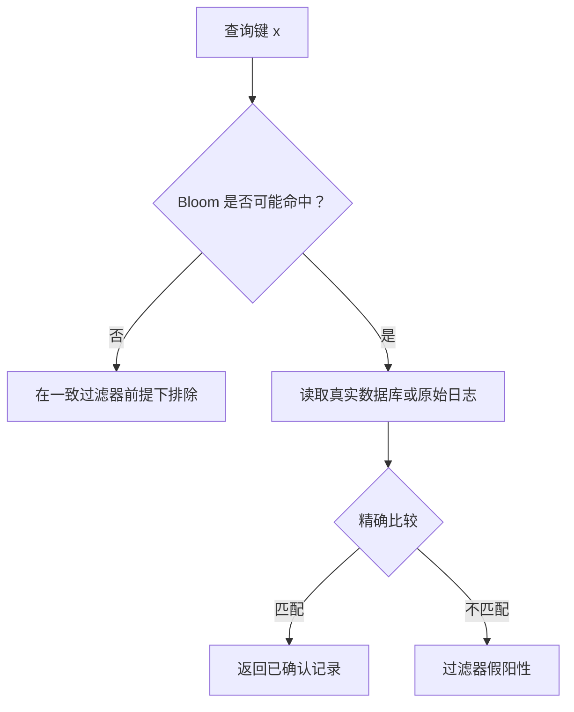

# Trie、Patricia Trie 与 MPT

## 本篇目录
- [一、本篇学习目标](#一本篇学习目标)
- [二、轻节点扩展与默克尔证明](#二轻节点扩展与默克尔证明)
  - [2.1 轻节点轻在哪里](#21-轻节点轻在哪里)
  - [2.2 以太坊轻客户端的两段验证关系](#22-以太坊轻客户端的两段验证关系)
  - [2.3 包含证明、非包含证明和范围证明](#23-包含证明非包含证明和范围证明)
  - [2.4 如何证明一个键不存在](#24-如何证明一个键不存在)
  - [2.5 包含证明为什么不保证完整返回](#25-包含证明为什么不保证完整返回)
  - [2.6 证明新鲜度、最终性与数据可用性](#26-证明新鲜度最终性与数据可用性)
  - [2.7 验证器真正应该检查什么](#27-验证器真正应该检查什么)
  - [2.8 教学补充：从论文问题看证明成本](#28-教学补充从论文问题看证明成本)
- [三、布隆过滤器（Bloom Filter）](#三布隆过滤器bloom-filter)
  - [3.1 基本特点：它只给“排除”与“候选”](#31-基本特点它只给排除与候选)
  - [3.2 数据结构：$m$ 个比特与 $k$ 个位置映射](#32-数据结构m-个比特与-k-个位置映射)
  - [3.3 一个能手工核对的插入与查询例子](#33-一个能手工核对的插入与查询例子)
  - [3.4 为什么普通 Bloom 不能直接删除](#34-为什么普通-bloom-不能直接删除)
  - [3.5 误判率：公式解决什么问题](#35-误判率公式解决什么问题)
  - [3.6 完整 Go 示例：参数选择、查询与确定性假阳性](#36-完整-go-示例参数选择查询与确定性假阳性)
  - [3.7 进阶优化一：计数布隆过滤器](#37-进阶优化一计数布隆过滤器)
  - [3.8 进阶优化二：分层布隆过滤器](#38-进阶优化二分层布隆过滤器)
  - [3.9 以太坊 logsBloom：哪些内容真正进入过滤器](#39-以太坊-logsbloom哪些内容真正进入过滤器)
  - [3.10 比特币中的相关应用与边界](#310-比特币中的相关应用与边界)
  - [3.11 何时适合用，何时不能直接用](#311-何时适合用何时不能直接用)
  - [3.12 本节总结](#312-本节总结)
- [四、状态树保存什么](#四状态树保存什么)
- [五、为什么普通哈希表不够](#五为什么普通哈希表不够)
- [六、从 Trie 到 Patricia Trie](#六从-trie-到-patricia-trie)
- [七、MPT 的主要节点类型](#七mpt-的主要节点类型)
- [八、为什么每次只更新部分路径](#八为什么每次只更新部分路径)
- [九、状态根的用途](#九状态根的用途)
- [十、序列化的作用](#十序列化的作用)
- [十一、本讲小结](#十一本讲小结)
- [十二、本篇与知识体系的关系](#十二本篇与知识体系的关系)
- [一图看懂本篇流程](#一图看懂本篇流程)
- [官方实现与代码阅读入口](#官方实现与代码阅读入口)


## 一图看懂本篇流程


Trie 像电话簿按姓名首字母逐层找人；Patricia Trie 会把只有一条路的连续字母压缩起来。MPT 再把节点内容和哈希关联。

> **怎么读这张图：**从左向右看，先确认输入是什么，再看系统如何检查和处理，最后看结果如何保存或验证。图中是帮助理解的简化流程，协议细节仍以本篇后续说明和官方规范为准。


例如，通讯录按姓名首字母查找联系人。输入“王小明”时沿着“王—小—明”的路径查找；路径压缩减少只有单一路径的重复节点。

## 官方实现与代码阅读入口

以下链接指向对应技术的官方文档、标准或项目源码。阅读代码时，建议先从本篇涉及的核心数据结构或验证入口开始，再沿调用关系查看后续处理。

- [Go Ethereum Trie](https://github.com/ethereum/go-ethereum/tree/master/trie)
- [Ethereum 执行规范](https://github.com/ethereum/execution-specs)

**代码来源说明：**官方仓库中的实现代码才代表相应项目的真实实现。正文中用于解释概念的短代码或实验片段，如未明确标出官方文件路径，应按教学演示理解，不能直接当作 Bitcoin Core、Go Ethereum 或其他客户端的生产代码。实际开发应对照上方官方版本、规范和测试。


## 一、本篇学习目标
- Trie、Patricia Trie 与 MPT
- 理解核心概念、运行流程和参与角色
- 能够区分协议保证、实现细节与应用层假设
- 能够结合代码或实际场景分析边界与风险

## 二、轻节点扩展与默克尔证明

<a id="sec-038"></a>
### 2.1 轻节点轻在哪里

**完整节点**会处理验证所需的区块及状态转换。**轻节点**尽量只保留能够支撑信任判断的较小信息，在需要具体状态时再向外部节点请求数据与证明。

轻节点减少了本地计算和存储，但多出三个问题：

1. 怎样获得并验证可信的根？
2. 怎样让不可信服务器为某个查询提供可验证回答？
3. 服务器拒绝服务或只提供过旧答案时怎么办？

MPT 主要解决第二项。第一项与共识、同步和信任锚有关，第三项属于可用性与新鲜度。

因此，“手机不保存完整区块链”不能自动推导出“手机一定完全信任中心化 RPC”。中间存在可验证轻客户端设计；反过来，一个普通 RPC 钱包如果根本没有检查证明，也不能因为访问的是区块链数据就被称为独立验证的轻客户端。

<a id="sec-039"></a>
### 2.2 以太坊轻客户端的两段验证关系

在以太坊 PoS 机制中，可以把学习路线拆成两段：

- 共识侧：从可信启动点出发，验证轻客户端更新、同步委员会相关信息、签名与相应证明，维护所认可的头和最终性状态。
- 执行侧：在与这些头绑定的执行数据中取得 `stateRoot` 等承诺，再验证账户、存储或其他查询结果。

同步委员会聚合签名属于轻客户端更新结构中的认证材料，不应笼统说“执行层区块头本身直接塞着所有验证者的签名”。

**规范依据：**[Ethereum Consensus Specs：Altair Light Client Sync Protocol](https://ethereum.github.io/consensus-specs/specs/altair/light-client/sync-protocol/) 明确区分 `LightClientBootstrap`、`LightClientUpdate`、`finalized_header`、`finality_branch` 和 `sync_aggregate`。后续升级扩展结构时，应阅读目标升级对应规范，不能只用 Altair 字段解析所有后续数据。

对于初学者，先把“签名认证某些头”“SSZ 证明绑定共识对象字段”“MPT 证明绑定执行状态键值”分开。它们不是同一种证明格式，只是在信任链上相互连接。

<a id="sec-040"></a>
### 2.3 包含证明、非包含证明和范围证明

| 证明种类 | 想回答的问题 | 典型材料 | 不自动回答的问题 |
|---|---|---|---|
| 包含证明 | $k$ 的值是否为 $v$ | 从可信根通向目标值的节点 | 还有哪些其他键 |
| 非包含证明 | $k$ 是否不存在 | 路径上被认证的空槽或不匹配终点 | 服务器是否提供了最新根 |
| 多重证明 | 多个键值是否都正确 | 共享路径被去重后的节点集 | 查询集合之外是否漏报 |
| 范围证明 | 排序区间内的记录是否完整 | 区间记录与边界/结构证明 | 未被协议定义的业务排序关系 |
| 一致性证明 | 新日志是否保留旧日志前缀 | 两个根之间的特定关系证明 | 新增内容是否真实或合法 |

表中“一致性证明”是追加日志类结构中的概念，与任意 MPT 状态更新不同。账户余额可以减少，键可以删除，不能直接把状态树当作只追加日志套用相同定义。

Geth 提供的 [VerifyRangeProof](https://pkg.go.dev/github.com/ethereum/go-ethereum/trie#VerifyRangeProof) 也明确要求区间叶子连续、按键单调排列。是否为业务上所需的范围，仍要检查键的排序语义。

<a id="sec-041"></a>
### 2.4 如何证明一个键不存在

继续使用第三节的小树，查询 `1236`：

1. 根分支的 `1` 子槽存在。
2. extension `2` 匹配。
3. 分支 `3` 存在。
4. 下一个分支只有 `4` 和 `5`，`6` 子槽为空。

如果第四步的分支节点通过前面的引用一路连到可信根，那么它的空 `6` 槽也被根承诺。提供者不能把一个原本非空的槽悄悄改空，因为节点编码和根都会改变。

另一种情况是查询 `9b`：到达 leaf `a → D` 时，剩余查询片段 `b` 与 `a` 不匹配。已认证的这片叶子也可以证明相应查询路径不存在。

判断证据是否缺失，必须先看下一步引用的编码。如果下一步是哈希引用，而证明没有提供与该哈希匹配的节点编码，证据就不足，不能据此断言键不存在；如果孩子已经内联在父节点中，则应直接解析父节点中的嵌套结构，无需另有一个独立证明项。

本例把 A、B 分别编码为单字节值时，第四步分支的两个空路径叶子各占 3 字节，其余 15 个空项各占 1 字节，再加 1 字节列表前缀，整个分支的 RLP 长度为 $2\times3+15+1=22$ 字节，因此它会内联在上一分支的 `3` 子槽中。拿到已认证的上一分支编码，就已经拿到了这份内联孩子；不能因为证明数组没有单独列出“第四步节点”，就判定证据缺失。返回“没有找到哈希引用对应的节点”是网络/证据状态，返回“在认证路径中到达空槽”才是逻辑字典状态。

<a id="sec-042"></a>
### 2.5 包含证明为什么不保证完整返回

假设一个数据服务承诺了四条记录：

| 编号 | 金额 |
|---|---:|
| 1 | 10 |
| 2 | 20 |
| 3 | 30 |
| 4 | 40 |

你问：“返回所有金额至少 20 的记录。”服务器只返回编号 2 和 4，并附上两份完全正确的包含证明。

验证这两份证明会成功，但编号 3 被遗漏了。原因是每份证明只说明对应记录存在，从未声明“不存在其他符合条件的记录”。

要验证完整性，必须额外设计，例如：

- 采用与查询条件对应的有序认证索引及区间证明；
- 枚举一个已经承诺、边界明确的键集合，并检查每个位置；
- 证明一个计算过程确实扫描或处理了所有规定输入；
- 在协议中给出明确的数据登记与缺失记录规则。

这里没有声称其中某一种方法自动适合所有业务。关键是把“返回项正确”与“返回集合完整”分成不同保证。

对区块链预言机、审计日志和跨机构数据汇总，这个差别常比单条哈希校验更重要。即使签名和 Merkle proof 全部正确，选择性漏报仍可能改变统计结果。

<a id="sec-043"></a>
### 2.6 证明新鲜度、最终性与数据可用性

考虑三个不同攻击：

**旧状态攻击。**服务器发来上周的有效余额证明，余额当时是 100，但现在已经花完。密码学验证可通过，却不满足“现在余额”的业务要求。修复方向是绑定请求区块和认可的新鲜度范围。

**分叉状态攻击。**证明指向一个有效但未最终确认、后来被排除的区块。证明本身可能没有错，错在业务把该块的确认级别理解得太强。修复方向是让根的选择遵循相应确认策略。

**拒绝提供攻击。**服务器知道节点，但不给你数据。哈希承诺不能强迫对方发送内容。修复方向可能包括多源获取、数据复制、可用性机制和超时处理；这些并不由点证明本身解决。

于是，一份合格的验证结果最好在语义上包含：

```text
链标识 + 区块标识 + 该块的认可状态 + 查询键 + 已验证的值/不存在结论
```

只返回一个 `true`，却没有记录它到底验证了哪个区块和哪个键，会使系统很容易在后续流程中丢失上下文。

<a id="sec-044"></a>
### 2.7 验证器真正应该检查什么

可将认证查询验证器分为以下步骤：

1. **固定任务。**记录链、区块、对象类型、账户地址、槽号或交易索引。
2. **确定根。**从已认可的头或其他可信承诺取得根；不要从未认证的响应字段随意接收根。
3. **规范化键。**按状态、存储、交易等类型应用正确预处理。
4. **检查编码。**拒绝不规范 RLP、非法 HP 标记、错误节点项数等。
5. **检查引用。**每一步核对哈希引用或内联结构，不跳过中间层。
6. **检查路径。**准确消耗 nibble，区分完整匹配、前缀匹配和不匹配。
7. **解释终点。**确认得到的是合法值，或一个已认证的不存在结论。
8. **解析业务值。**按账户、收据等类型解码，不能信任旁边附带的未认证字段。
9. **限制成本。**对证明总字节数、节点数和解析深度设置合理边界。

第 9 项关键在于避免服务器发送极大或异常输入拖垮验证方。强密码学和健壮实现是互补关系。

<a id="sec-045"></a>
### 2.8 教学补充：从论文问题看证明成本

如果进一步研究认证数据结构，不应只比较“哈希几次”。可以把评价指标分为：

| 维度 | 可测指标 | 常见混淆 |
|---|---|---|
| 通信 | 证明字节数、重复节点比例 | 只计算摘要数量，漏掉节点编码 |
| 计算 | 证明生成和验证耗时 | 把生成方缓存预热与验证方冷启动混比 |
| 存储 | 状态大小、历史版本保留量 | 只比较根长度 |
| 更新 | 每次写入的脏节点数、写放大 | 把只读查询优化当更新优化 |
| 查询能力 | 点查询、范围查询、缺失证明 | 相同“可验证”标签下比较不同功能 |
| 安全语义 | 根来源、完整性、新鲜度、可用性 | 把所有保证归到 Merkle proof |

公平基线必须服务同一查询语义。例如，一个只提供单键包含证明的方案，不能直接宣称比提供完整范围证明的方案“全面更高效”，因为两者承担的任务不同。若把某种压缩或缓存迁移到新区块链场景，还需要检查它是否改变更新模型、客户端信任或最坏情况成本。

<a id="part8"></a>
<a id="sec-046"></a>

## 三、布隆过滤器（Bloom Filter）

<a id="sec-047"></a>
### 3.1 基本特点：它只给“排除”与“候选”

**Bloom Filter，布隆过滤器**，用一个位数组近似表示集合。对某个元素的查询结果只有两种合理解释：

- 返回否：在标准构建与查询条件下，元素一定没有被加入该过滤器代表的集合。
- 返回是：元素可能存在，也可能是假阳性，需要进一步查询真实数据。

**假阳性**指不存在的元素被回答为“可能存在”。**假阴性**指实际存在的元素被回答为“不存在”。

标准、正确维护的 Bloom Filter 只插入不删除，使用一致的参数和哈希函数，位数组未损坏且包含所有相关插入时，不产生假阴性。这个结论有前提：若过滤器落后于数据库、新插入没有同步、并发写覆盖或有人错误清零，就可能在系统层面漏掉真实元素。

**原始来源：**Burton H. Bloom 的 [Space/Time Trade-offs in Hash Coding with Allowable Errors，1970，正文第 422–423 页](https://courses.cs.washington.edu/courses/csep521/21wi/readings/bloom_cacm.pdf) 给出了允许误报以降低空间开销的结构思想。下面的数值、推导和代码是本文的教学展开。

<a id="sec-048"></a>
### 3.2 数据结构：$m$ 个比特与 $k$ 个位置映射

定义：

- $m$：位数组长度，以 bit 为单位；
- $n$：已加入的不同元素数量，用于估计负载；
- $k$：每个元素映射的位置数；
- $h_j(x)$：第 $j$ 个位置映射，输出 $0,\ldots,m-1$。

初始所有位都为 0。插入 $x$ 时设置：

$$
B[h_1(x)]=\cdots=B[h_k(x)]=1.
$$

查询 $x$ 时检查：

$$
\operatorname{MaybeContains}(x)=
\bigwedge_{j=1}^{k}B[h_j(x)].
$$

逻辑与 $\wedge$ 表示所有位置都要为 1。只要有一个位置是 0，就可以排除 x；全部为 1，只说明它要求的这些位恰好都已被某些元素设置。

这里所谓“$k$ 个哈希函数”不一定需要实现 $k$ 个完全不同的密码算法。工程上可以由同一哈希内核加不同域标识，或采用经分析的派生方法产生多个位置。具体方案的相关性和偏差会影响误判估计，不能随便取同一个位置重复 $k$ 次后仍套用独立模型。

<a id="sec-049"></a>
### 3.3 一个能手工核对的插入与查询例子

以下位置是为教学指定的映射结果，不是声称某个真实 SHA-256 实现对这些字符串恰好产生这些下标。

取 $m=32$、$k=3$：

| 元素 | 三个位置 | 是否插入 |
|---|---|---|
| x | 2、7、11 | 是 |
| y | 7、15、23 | 是 |
| z | 2、15、23 | 否 |
| q | 4、7、23 | 否 |

#### 3.3.1 插入 x，再插入 y

插入 x 后，1 位集合为：

$$
\{2,7,11\}.
$$

插入 y 后，1 位集合为：

$$
\{2,7,11,15,23\}.
$$

位置 7 被两次命中，但普通 Bloom 只存 0 或 1，不记录次数，也不记录由谁设置。

#### 3.3.2 查询已插入与未插入元素

- 查询 x：2、7、11 全为 1，返回“可能存在”。x 确实存在。
- 查询 y：7、15、23 全为 1，返回“可能存在”。y 确实存在。
- 查询 z：2、15、23 也全为 1，返回“可能存在”。但 z 从未插入，这是一个假阳性。
- 查询 q：位置 4 是 0，返回“不存在”。

z 的假阳性不需要找到 SHA-256 的完整输出碰撞。它只要求几个取模后的下标恰好都落在已置 1 的位置。因此，用密码学强哈希也不会消除 Bloom 的假阳性，这是结构有意接受的近似误差。

<a id="sec-050"></a>
### 3.4 为什么普通 Bloom 不能直接删除

假设要删除 x，你把位置 2、7、11 清零。可是 y 也依赖位置 7，之后查询 y 就会遇到 0，产生假阴性。

位数组无法区分“这个 1 只由 x 贡献”还是“这个 1 同时被多个元素共享”。因此，普通 Bloom Filter 通常通过重建来反映删除，或使用下面的计数变体。

同样，重复插入一个元素不会留下计数。若应用把“添加两次、删除一次”当成多重集合操作，普通 Bloom 没有足够信息实现这种语义。

<a id="sec-051"></a>
### 3.5 误判率：公式解决什么问题

公式的目的，是在预计存放 $n$ 个元素时，选择多少 bit 和多少位置，使额外查询开销保持在可接受范围内。

在每次位置映射近似均匀独立的模型下，某一位一次不被命中的概率为：

$$
1-\frac{1}{m}.
$$

插入 $n$ 个元素、每个产生 $k$ 次置位机会后，这一位仍为 0 的概率为：

$$
\Pr[B_i=0]=\left(1-\frac{1}{m}\right)^{kn}.
$$

当 $m$ 较大时，可近似为：

$$
\Pr[B_i=0]\approx e^{-kn/m}.
$$

所以某一位为 1 的概率近似为 $1-e^{-kn/m}$。再近似把新查询的 $k$ 个命中位置视为独立，可得到常用的误判率估计：

$$
p\approx\left(1-e^{-kn/m}\right)^k.
$$

这里必须用“近似”。有限位数组中，各位占用事件以及查询位置之间会有相关性；哈希派生也可能不是完全独立。该式适合常规参数规划，不是对任何数据、任何攻击者选择和任何实现都成立的精确等式。

#### 3.5.1 为什么哈希次数不是越多越好

当 $k$ 很小时，每个元素只占很少位，查询约束弱，容易误报。增加 $k$ 会增加查询条件，但也会更快把数组填满。如果几乎所有位都为 1，再检查很多位也没有帮助。

在常用近似模型下，使误判率较小的连续最优值为：

$$
k^*\approx\frac{m}{n}\ln 2.
$$

此时位数组大约一半位置为 1。实际 $k$ 必须取整数，并结合哈希计算成本，比较附近的整数即可。为了把误判率从某个数字微调得更低而增加很多计算，在真实系统里未必划算。

#### 3.5.2 根据目标误判率反推空间

给定目标 $p$，常用近似为：

$$
m\approx-\frac{n\ln p}{(\ln 2)^2}.
$$

例如计划放 1000 个元素、目标误判率约 1%：

$$
m\approx-\frac{1000\ln 0.01}{(\ln 2)^2}\approx9585.1\text{ bit}.
$$

取整为 9586 bit 后：

$$
k\approx\frac{9586}{1000}\ln2\approx6.64,
$$

可选择 $k=7$。如果使用字节数组，需要 $\lceil9586/8\rceil=1199$ 字节。结构体、切片头和内存分配器开销没有包含在这个数字里。

若实际插入数量增加到远高于 1000，原先的 1% 目标不再成立。容量规划必须考虑真实负载，而不是创建过滤器时填了一个目标值就认为以后永远保证该误判率。

#### 3.5.3 误判率与查询命中率也不是同一个数字

假设 10000 次查询中，只有 100 次针对真实存在的元素，另外 9900 次是真正不存在的元素。若假阳性率约为 1%，大约会出现 99 次额外候选。

于是，返回“可能存在”的约 199 次里，只有 100 次是真的。即使假阳性率很低，“阳性结果有多可信”还取决于真实命中的基础比例。这是为什么接口名应使用 `MaybeContains`，而不能把它包装成精确的 `Exists`。

这个数量只是概率模型下的期望教学示例，不是实际测量结果。具体运行还会受到数据分布、参数取整和哈希实现影响。

<a id="sec-052"></a>
### 3.6 完整 Go 示例：参数选择、查询与确定性假阳性

程序使用 `SHA256(位置编号 || 元素)` 派生下标，展示一种清楚的域区分方法。它没有实现 Ethereum 的 Keccak 位选择规则，也没有声称是最高性能 Bloom 实现。

```go
package main

import (
	"crypto/sha256"
	"encoding/binary"
	"fmt"
	"math"
)

type Bloom struct {
	bits []byte
	m    uint64
	k    uint32
}

func newBloom(m uint64, k uint32) *Bloom {
	if m == 0 || k == 0 {
		panic("m and k must be positive")
	}
	return &Bloom{bits: make([]byte, (m+7)/8), m: m, k: k}
}

// A domain-separated SHA-256 for each position: educational, not Ethereum Bloom.
func (b *Bloom) positions(data []byte) []uint64 {
	result := make([]uint64, b.k)
	msg := make([]byte, 4+len(data))
	copy(msg[4:], data)
	for i := uint32(0); i < b.k; i++ {
		binary.BigEndian.PutUint32(msg[:4], i)
		h := sha256.Sum256(msg)
		result[i] = binary.BigEndian.Uint64(h[:8]) % b.m
	}
	return result
}

func (b *Bloom) add(data []byte) {
	for _, p := range b.positions(data) {
		b.bits[p/8] |= byte(1 << (p % 8))
	}
}

func (b *Bloom) maybeContains(data []byte) bool {
	for _, p := range b.positions(data) {
		if b.bits[p/8]&byte(1<<(p%8)) == 0 {
			return false
		}
	}
	return true
}

func optimal(n int, target float64) (uint64, uint32) {
	if n <= 0 || target <= 0 || target >= 1 {
		panic("invalid parameters")
	}
	m := uint64(math.Ceil(-float64(n) * math.Log(target) / (math.Ln2 * math.Ln2)))
	k := uint32(math.Round(float64(m) / float64(n) * math.Ln2))
	if k == 0 {
		k = 1
	}
	return m, k
}

func main() {
	m, k := optimal(1000, 0.01)
	fmt.Printf("n=1000 target=1%% -> m=%d bits, k=%d
", m, k)
	approx := math.Pow(1-math.Exp(-float64(k)*1000/float64(m)), float64(k))
	fmt.Printf("approx_false_positive=%.4f
", approx)
	b := newBloom(m, k)
	for _, name := range []string{"alice", "bob", "carol"} {
		b.add([]byte(name))
	}
	fmt.Println("alice:", b.maybeContains([]byte("alice")))
	fmt.Println("bob:", b.maybeContains([]byte("bob")))
	fmt.Println("not-inserted:", b.maybeContains([]byte("not-inserted")))
	// One bit deliberately demonstrates a false positive without randomness.
	tiny := newBloom(1, 1)
	tiny.add([]byte("alice"))
	fmt.Println("one-bit bloom says mallory may exist:", tiny.maybeContains([]byte("mallory")))
}
```

实测关键输出：

```text
n=1000 target=1% -> m=9586 bits, k=7
approx_false_positive=0.0100
alice: true
bob: true
not-inserted: false
one-bit bloom says mallory may exist: true
```

最后故意创建 $m=1,k=1$ 的极小过滤器。加入任何一个元素后，唯一的 bit 就是 1，于是所有其他元素都会被回答为“可能存在”。这个例子不依赖随机碰巧出现假阳性，能直接展示：过滤器没有足够的信息区分元素。

#### 3.6.1 代码在业务流程中的位置

假设一个服务先查询内存 Bloom，再决定是否访问昂贵数据库：



若数据库添加新记录，Bloom 必须及时反映。最简单的顺序设计仍需要考虑失败与并发：例如先写数据库、后更新 Bloom，中间宕机会造成过滤器落后；先更新 Bloom、后写数据库，即使后者失败，通常只是多一个假阳性。具体事务策略应结合恢复流程设计，不能仅凭操作顺序就认为所有一致性问题都解决。

#### 3.6.2 实现边界

示例没有并发同步。多个 goroutine 同时对同一字节执行读改写 `|=`，可能丢失某些置位，进而造成实际漏查。可以采用锁、分片、原子字操作或单写者模型，但要与查询的可见性要求配合。

程序也没有允许客户端任意指定超大参数。生产接口应检查 $m$、$k$、分配长度和溢出，不应让未经限制的网络输入触发巨大内存分配。这里的参数由程序固定，演示规模很小。

<a id="sec-053"></a>
### 3.7 进阶优化一：计数布隆过滤器

**Counting Bloom Filter** 把每个位替换成小计数器。插入时对相关计数器加 1；删除已确认存在的元素时减 1；查询时看相关计数器是否都大于 0。

沿用 x 和 y 的例子：

| 位置 | 插入 x 与 y 后的计数 | 正确删除 x 后 |
|---:|---:|---:|
| 2 | 1 | 0 |
| 7 | 2 | 1 |
| 11 | 1 | 0 |
| 15 | 1 | 1 |
| 23 | 1 | 1 |

共享位置 7 仍保留 y 的一次贡献，因此查询 y 不会被误删 x 影响。

但必须明确三项条件：

1. **只能删除确定插入过、且尚未删除的元素。**Bloom 查询为阳性不够，因为它可能是假阳性。
2. **计数器不能错误溢出或下溢。**4 bit 计数器最大只能表示 15，如何处理饱和必须有明确策略。
3. **插入与删除次数应符合应用的集合/多重集合语义。**重复添加若没有对应记录，可能导致删除不平衡。

若把未插入的 z 当成存在而删除，位置 15 与 23 会被减到 0，y 就被破坏了。计数器让删除成为可能，但没有把近似成员判断变成精确判断。

一个公开 Go 实现可在 [BoomFilters 的 counting.go](https://github.com/tylertreat/BoomFilters/blob/master/counting.go) 中查看。这里将它作为数据结构实现阅读材料，不将其中任意删除调用直接推荐为安全业务逻辑。

<a id="sec-054"></a>
### 3.8 进阶优化二：分层布隆过滤器

“分层 Bloom”并不是唯一固定的国际标准算法名。它可以泛指按时间、分片、文件或树层组织多个过滤器。为了不混淆，本文用一个明确结构说明：

- 叶层：每个数据分片一个 Bloom。
- 父层：把子过滤器按位 OR，代表其元素集合的并集。
- 查询：若父层可排除，就跳过整个子树；若父层可能命中，再继续检查孩子。

要按位 OR，子过滤器必须采用兼容的长度、位映射和参数。不同哈希定义的 bit 数组不能因为长度相同就直接合并并保留原语义。

例如四个日志分片 $S_1,\ldots,S_4$：

- $B_{12}=B_1\lor B_2$；
- $B_{34}=B_3\lor B_4$；
- 查询某个 topic 时先查 $B_{12},B_{34}$，能排除的一半就不再访问。

代价是上层覆盖的元素更多，更容易趋于全 1。最坏情况下，上层过滤器完全不能剪枝，反而多出一些查询成本。因此“层级树必然把查询从线性降为对数”并不成立。

**已有工作：**[Crainiceanu 与 Lemire，Bloofi: Multidimensional Bloom Filters，正文 §4.1–4.2](https://arxiv.org/html/1501.01941v3) 将多个 Bloom 组织成层次索引，父节点用子过滤器的 OR 表示并集。本文分片例子为教学构造，没有复述其性能实验数字，也不将分层组合声称为新方案。

<a id="sec-055"></a>
### 3.9 以太坊 logsBloom：哪些内容真正进入过滤器

以太坊的日志 Bloom 使用 2048 bit，即 256 字节。对每个日志，加入：

- 发出日志的合约地址；
- 日志的每一个 topic。

普通日志 `data` 字段不作为这些逐项 Bloom 输入。查询某个未索引事件参数时，通常不能指望 `logsBloom` 直接筛选它。

位选择通过 Keccak 的结果导出 3 个位置。实现上可以从摘要前六字节的三个 16 位片段取低 11 位；11 位恰好表示 0 到 2047。字节数组中的索引方向还要遵守协议约定，不能把“第 0 bit”随意解释成展示字符串最左侧。

**实现依据：**[Geth core/types/bloom9.go](https://github.com/ethereum/go-ethereum/blob/master/core/types/bloom9.go) 的 `CreateBloom`、`MergeBloom` 与 `bloomValues`。本文 Go 通用例子使用 SHA-256，不与该格式互操作。

#### 3.9.1 同一块里地址和 topic 分别命中，仍可能没有匹配日志

假设某区块有两条日志：

| 日志 | 发出地址 | topic |
|---|---|---|
| $L_1$ | 合约 A | X |
| $L_2$ | 合约 B | Y |

你查询“合约 A 发出的 topic Y”。区块级 Bloom 可能同时包含 A 的位和 Y 的位，因为两者分别来自不同日志，但这个区块没有任何一条日志满足 A 与 Y 的组合。

这是结构丢失组合关系带来的候选误报。即使没有任何位哈希碰撞，也会发生。类似地，过滤器不会完整保留 topic 的位置关联和日志内部字段关系。

所以，Bloom 只能帮助决定是否进一步获取并检查收据/日志，不能代替逐条匹配，更不能代替收据根证明。

#### 3.9.2 “Bloom 无假阴性”还要根可信、范围完整

若一个恶意服务直接给你一个全零 Bloom，你当然会漏掉全部日志。标准结构无假阴性的结论，是在过滤器正确反映目标集合的条件下成立。

对于区块链，要么你自己从数据构建过滤器，要么过滤器来自经验证的区块头或其他受约束承诺。即使每个区块 Bloom 都正确，如果服务故意漏掉整个区块范围，查询仍不完整。

因此，要证明“某个高度范围没有某类事件”，至少要定义并完整覆盖该范围内的可信区块。不能把某个服务返回“没有结果”当作密码学保证。

<a id="sec-056"></a>
### 3.10 比特币中的相关应用与边界

[BIP-37](https://github.com/bitcoin/bips/blob/master/bip-0037.mediawiki) 定义了 Bloom 过滤式的轻钱包交易筛选消息。客户端把与自己关注对象有关的过滤器交给对端，对端按它筛选数据。

这类方案可以减少传输，但查询兴趣可能通过过滤器、请求模式和网络关联被推断。假阳性让对端不一定立即确定每一项真实兴趣，不代表已经获得形式化隐私保证。过滤器也不能强迫对端返回所有命中项。

[BIP-158](https://github.com/bitcoin/bips/blob/master/bip-0158.mediawiki) 的紧凑区块过滤器采用 Golomb-coded set 相关机制，并不是把普通 Bloom 的位数组简单换个名字。学习时应把“近似集合过滤”这个共同目标与具体算法分开。

<a id="sec-057"></a>
### 3.11 何时适合用，何时不能直接用

| 场景 | 是否适合 | 原因 |
|---|---|---|
| 数据库前置排除不存在的键 | 适合，需保持同步 | 假阳性只是多一次读取 |
| 日志扫描的候选区块筛选 | 适合 | 先排除大量无关数据 |
| 网络缓存摘要 | 可用，需考虑过期与隐私 | 允许少量无效请求换更小摘要 |
| 判断签名是否有效 | 不适合作最终判断 | 签名验证不能接受概率性误放行 |
| 判断一个用户是否有权限 | 不适合作唯一授权 | 假阳性可能让无权限者通过 |
| 防止重复提款或重复领取 | 不适合作唯一精确账本 | 假阳性可能误拒合法请求；错误同步更危险 |
| 证明某条数据已被区块包含 | 不足以单独完成 | Bloom 不提供路径到根的精确包含证明 |

一个允许误报的结构是否可用，要看误报的后果。如果误报只导致多读一次磁盘，可以接受；如果误报意味着多支付一次资金、跳过签名或错误授权，就必须由精确机制完成最终判断。

<a id="sec-058"></a>
### 3.12 本节总结

Bloom 的主要收益来自：用很小的内存，快速回答大部分“肯定没有”的查询；接受少量“可能有但其实没有”导致的后续工作。

它不是加密集合，不是哈希签名，也不是证明系统。它的概率保证、同步前提和业务后果必须一起分析。与 Merkle/MPT 配合时，一个负责减少候选，另一个负责核验候选与承诺的关系。

<a id="part9"></a>
<a id="sec-059"></a>


## 四、状态树保存什么

状态树实现从账户地址到账户状态的映射：

$$
\text{Address}\longrightarrow\text{Account State}
$$

课程中账户地址为 160 位（20 字节），通常显示为 40
个十六进制字符。账户状态包含
nonce、balance，以及合约相关的存储根和代码哈希等字段。

每个区块对应一个状态根哈希。区块头中的状态根承诺该区块执行完成后的账户状态，节点可通过证明路径验证某个账户状态是否与该根哈希对应。

## 五、为什么普通哈希表不够

哈希表适合在本地按键查找和更新，平均查找效率高。但它本身没有直接提供可由区块头根哈希验证的路径证明。若每次出块后再把全部账户重新组织成普通
Merkle 树，绝大多数没有变化的账户也会被重复处理，成本较高。

普通 Merkle
树主要按叶节点位置组织数据。若账户需要通过地址查找、插入或更新，还需要额外解决键的顺序和结构变化问题。

## 六、从 Trie 到 Patricia Trie

Trie（前缀树）沿着键的字符逐步分支。以太坊地址由十六进制字符组成，每一位可对应一个分支。Trie
的结构由键本身决定，插入顺序变化不会改变同一组键所对应的基本路径结构。

普通 Trie 的缺点是可能存在很多只有一个子节点的长路径。Patricia Trie
通过路径压缩把这类单一路径合并，降低树的高度并减少冗余节点。

MPT
再把树节点之间的普通引用改成哈希引用。这样既保留按键查找的结构，也能从节点内容计算出根哈希，并通过哈希依赖检测数据变化。

## 七、MPT 的主要节点类型

课程用以下三类节点解释修改版 MPT：

- **Branch
  Node（分支节点）**：当键在某一位出现不同取值时，保存多个可能的后续分支。
- **Extension
  Node（扩展节点）**：保存一段共享路径，压缩单一路径上的多个键字符。
- **Leaf Node（叶节点）**：保存键路径的终点及其对应值。

在以太坊的具体编码中，节点采用相应的序列化规则保存，节点引用可以是哈希引用，也可能按协议规则以内嵌形式表示。理解核心逻辑时，应先关注键路径、节点类型和根哈希之间的关系。

## 八、为什么每次只更新部分路径

假设某个区块中的交易只改变账户 A 和账户 B
的状态。更新状态树时，只需要创建或修改从根到这些账户对应叶节点的相关路径；未受影响的子树可以继续共享。

这形成了**持久化数据结构**的效果：旧状态对应的节点可以保留，新状态创建一组包含变化的路径节点。相邻区块的状态树因此能够共享大量未变化节点，而不必把所有账户状态完全复制一遍。

## 九、状态根的用途

1.  **完整性校验**：节点对账户状态做未经协议允许的修改，会改变相关路径及根哈希。
2.  **状态证明**：可提供从根到目标账户的证明路径，让验证方检查账户余额或其他状态字段。
3.  **状态一致性**：不同节点执行同一组交易后，应得到相同的状态根；根哈希不一致说明状态或执行过程存在差异。
4.  **存在性与不存在性证明**：验证方可以沿键路径检查目标账户；若路径在分支处不匹配或在符合规则的位置终止，可用相应路径信息证明该键未包含在所承诺的树中。

状态树适合证明账户状态，但证明某笔交易发生及其执行结果，通常还需要交易树和收据树。

## 十、序列化的作用

树节点需要转化为可存储、可传输的字节序列。课程提到 RLP（Recursive Length
Prefix）作为以太坊历史实现中的一种简单序列化方法。它规定如何把字节串和嵌套列表编码为字节序列，使节点能够对相同结构生成一致编码。

## 十一、本讲小结

MPT
将按键查找、路径压缩与哈希承诺结合起来。它能根据账户地址定位状态、对局部变化生成新路径，并通过状态根让节点验证状态完整性。

[课程视频：P16
以太坊状态树](https://www.bilibili.com/video/BV1Vt411X7JF/?p=16) ·


## 十二、本篇与知识体系的关系

- 所属部分：第三部分：区块链数据结构与验证
- 返回总目录：[README](../README.md)
