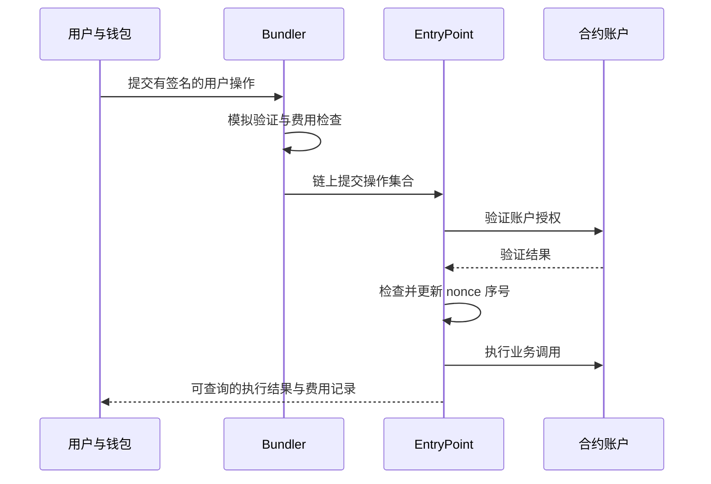
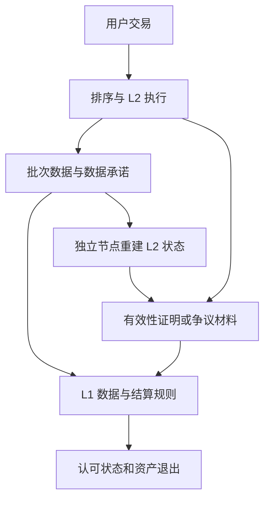
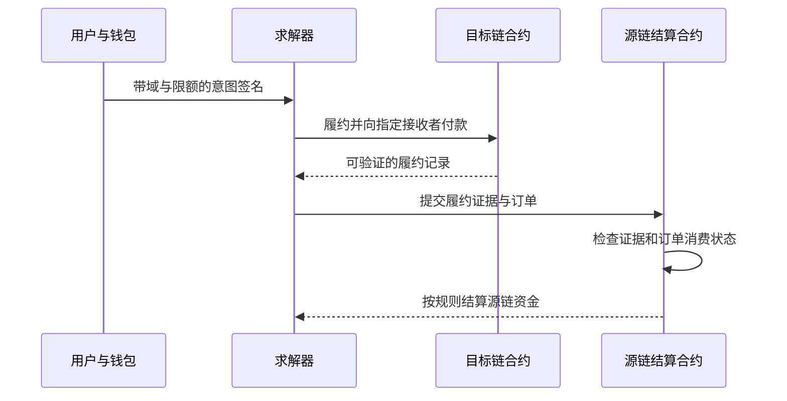
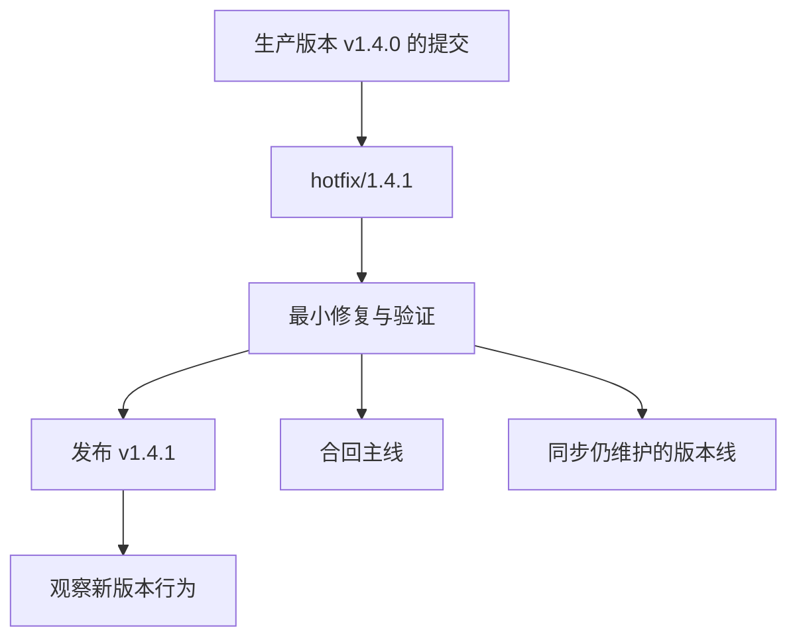

# 区块链开发工具、节点与 RPC

## 本篇目录
- [一、本篇学习目标](#一本篇学习目标)
- [二、主要内容](#二主要内容)
- [三、智能合约、Token、钱包、NFT 和 DeFi 解析](#三智能合约token钱包nft-和-defi-解析)
  - [3.1 智能合约](#31-智能合约)
  - [3.2 A 钱包与账户抽象（补充标题中的“钱包”）](#32-a-钱包与账户抽象补充标题中的钱包)
  - [3.3 Token 和 NFT](#33-token-和-nft)
  - [3.4 DeFi](#34-defi)
- [四、L1、L2 和 L3 链的基本结构简介](#四l1l2-和-l3-链的基本结构简介)
  - [4.1 基础主链 L1](#41-基础主链-l1)
  - [4.2 扩容层 L2](#42-扩容层-l2)
  - [4.3 应用专用链 L3](#43-应用专用链-l3)
- [五、链抽象技术解决方案简介](#五链抽象技术解决方案简介)
  - [5.1 ZK Rollup 的结构（DA 层以 EIP-4844 说明）](#51-zk-rollup-的结构da-层以-eip-4844-说明)
  - [5.2 OP Rollup 的结构（DA 层以 EIP-4844 说明）](#52-op-rollup-的结构da-层以-eip-4844-说明)
  - [5.3 基于 Layer2 的链抽象](#53-基于-layer2-的链抽象)
- [六、开发中常用一些工具](#六开发中常用一些工具)
  - [6.1 常用浏览器的基本使用](#61-常用浏览器的基本使用)
  - [6.2 常用数据平台的基本使用](#62-常用数据平台的基本使用)
  - [6.3 链上数据分析工具、代码分析工具](#63-链上数据分析工具代码分析工具)
- [七、GitHub 的使用规范](#七github-的使用规范)
  - [7.1 SemVer 定义](#71-semver-定义)
  - [7.2 项目中使用规范](#72-项目中使用规范)
  - [7.3 分支保护规则](#73-分支保护规则)
  - [7.4 Coverage](#74-coverage)
  - [7.5 Issue](#75-issue)
- [一图看懂本篇流程](#一图看懂本篇流程)
- [官方实现与代码阅读入口](#官方实现与代码阅读入口)


## 一图看懂本篇流程


开发工具像维修汽车的一套工具箱：节点提供链上状态，RPC 是诊断接口，脚本提交操作，区块浏览器帮助查看结果。

> **怎么读这张图：**从左向右看，先确认输入是什么，再看系统如何检查和处理，最后看结果如何保存或验证。图中是帮助理解的简化流程，协议细节仍以本篇后续说明和官方规范为准。


例如，开发者在本地启动节点，用 RPC 查询区块高度，再发送测试交易并读取回执。这样能把钱包、节点和合约之间的调用关系逐步看清。

## 官方实现与代码阅读入口

以下链接指向对应技术的官方文档、标准或项目源码。阅读代码时，建议先从本篇涉及的核心数据结构或验证入口开始，再沿调用关系查看后续处理。

- [Geth RPC 文档](https://geth.ethereum.org/docs/interacting-with-geth/rpc)
- [Bitcoin Core RPC](https://developer.bitcoin.org/reference/rpc/)
- [Foundry Book](https://book.getfoundry.sh/)

**代码来源说明：**官方仓库中的实现代码才代表相应项目的真实实现。正文中用于解释概念的短代码或实验片段，如未明确标出官方文件路径，应按教学演示理解，不能直接当作 Bitcoin Core、Go Ethereum 或其他客户端的生产代码。实际开发应对照上方官方版本、规范和测试。


## 一、本篇学习目标
- 区块链开发工具、节点与 RPC
- 理解核心概念、运行流程和参与角色
- 能够区分协议保证、实现细节与应用层假设
- 能够结合代码或实际场景分析边界与风险

## 二、主要内容

本讲的核心问题是：**如何把密码学原语组合成可验证的应用，并用工程流程保持这种可验证性？** 哈希函数使某段字节与一个摘要绑定；数字签名使某项授权与一个密钥绑定；Merkle 证明使某个成员与可信根绑定；KZG 承诺使多项式数据与承诺绑定。它们的结论都带有输入、验证规则和信任前提。把公钥换成攻击者公钥、把主网换成测试网、把资产地址换成同名假币地址，即使验证函数返回成功，业务结论也可能完全错误。[R1] [R2]

学习本讲时，可以反复使用下面的分析表。

| 对象 | 需要确认的输入 | 验证主体 | 成功后改变什么 | 仍需另外检查什么 |
|---|---|---|---|---|
| 合约调用 | 链、目标地址、函数、参数、发送者 | 执行节点/EVM | 合约存储、余额、日志 | 代码与权限是否符合业务 |
| Token 授权 | owner、spender、amount、nonce、期限 | Token 合约 | allowance | 获授权对象能做什么 |
| Rollup 批次 | 前后状态根、批次数据、协议版本 | L1 合约与验证节点 | 被认可的 L2 状态 | 数据可用性、升级权限、退出路径 |
| 跨链意图 | 源资产、目标资产、最低到账、截止时间 | 钱包、求解器、结算合约 | 多链资产与订单状态 | 跨链证明、失败退款、重放保护 |
| 软件发布 | 源码提交、依赖、构建配置、产物摘要 | CI 和部署方 | 实际运行的软件版本 | 审查、测试、签名者与构建环境可信度 |

建议按“状态—权限—证据—生命周期”的顺序阅读。先弄清应用究竟保存哪些状态，再看谁能修改；随后找出验证这些修改的证据；最后检查重试、失败、回退、升级和链重组时会发生什么。这样，钱包弹窗、区块浏览器页面和 GitHub 绿色勾号就会变成有明确含义的证据，而不会被误读成笼统的安全保证。

<a id="sec-002"></a>

## 三、智能合约、Token、钱包、NFT 和 DeFi 解析

<a id="sec-003"></a>
### 3.1 智能合约

#### 3.1.1 合约是确定性的状态转换程序

对 EVM 应用，可用下式描述一次执行：

$$
(S',\,r)=\operatorname{Execute}(S,\,tx,\,B,\,rules)
$$

$S$ 是执行前状态；$tx$ 是交易；$B$ 是允许读取的区块上下文；$rules$ 是指定升级版本下的执行规则；$S'$ 是执行后状态；$r$ 表示成功、回退及其他执行结果。确定性意味着同样的已约定输入和规则应得到相同结果。它不意味着所有节点看到的待打包交易相同，也不意味着合约可以直接访问任意网页。外部事实要通过预言机等机制进入链上，可信度来自这个输入机制。[R3]

合约通常有四类需要分开理解的内容：运行时字节码定义可执行行为；存储保存跨交易持续存在的状态；内存服务于当前调用；日志用于表达事件，便于客户端检索。合约函数的返回值、交易 receipt 和事件日志也不是同一种东西。对一笔已经上链的普通交易，调用者通常从 receipt、日志或后续状态查询获取结果，不能把 RPC 的交易哈希当成 Solidity 函数返回值。[R3] [R4]

例如一个库存合约可以维护 `stock[productId]`。调用 `reserve(id, n)` 时，先检查调用者身份和数量，再减少库存，最后发出事件。如果减库存之后执行失败并回退，那么该次调用范围内的存储和日志都会撤销。外围合约若通过 `try/catch` 捕获内部失败，外围自己的状态修改可能继续保留。第 8 讲的回退实验专门验证了这个区别；本讲则在 Token 和 NFT 上观察权限如何触发状态转换。

#### 3.1.2 ABI、选择器、签名摘要各自解决什么问题

外部函数调用数据通常由 4 字节函数选择器和 ABI 编码参数组成。选择器取规范函数签名字符串的 Keccak-256 摘要前四字节。例如 `transfer(address,uint256)` 与 `transfer(address,uint128)` 是不同签名。因为选择器只有 32 位，不同字符串理论上可以碰撞；“选择器相同”不能独立证明完整 ABI 或源代码相同。[R5]

ABI 编码还承担结构化表达的任务。若直接把两个变长字符串拼接，`("ab","c")` 和 `("a","bc")` 都变成 `abc`，产生的是编码歧义，不能据此宣称找到了 Keccak 碰撞。需要同时绑定类型、边界和业务域。例如结构化消息可以包含协议名、版本、chainId、合约地址、操作类型、金额、nonce 和期限。编码正确只是必要条件；必须确认合约实际检查了每个字段，而不是在前端弹窗里显示后就丢弃。

这里有三种不同的哈希用途：函数选择器用于路由；交易哈希用于标识序列化交易；授权消息摘要用于数字签名。把某个授权摘要误当作交易哈希，或者用普通字符串哈希替代协议规定的 EIP-712 摘要，会造成无法互认或重放风险。密码学代码最容易出错的地方之一，就是“哈希函数选对了，但哈希的字节不对”。

#### 3.1.3 权限、重入和升级应该怎样分析

权限问题应写成明确的谓词，例如 `msg.sender == owner`、`roles[CALLER]` 或“由指定公钥签名且 nonce 未使用”。单纯存在 `owner` 变量不构成访问控制，必须检查每条敏感路径是否执行权限判断。对代理合约，还要追踪实现地址与升级控制者：用户调用的地址可能保持不变，但其委托执行的逻辑已经改变。源代码验证应包括代理、实现和初始化配置，不能只看代理壳。[R3] [R5]

重入涉及控制权被外部调用交还给对方后，对方再次进入尚未完成的逻辑。一个有用的分析方法是列出不变量：总余额与负债是否匹配，提款额度是否在外部转账前扣减，外部回调能否第二次消费同一授权。`checks-effects-interactions`、重入锁和拉取式支付是工具，但不能替代对跨函数、跨合约共享状态的检查。一次函数调用安全，不等于组合后的协议安全。

升级又引入时间维度：今天审阅的代码和明天运行的代码可能不同。需要将实现字节码、存储布局、升级权限、延迟机制和迁移步骤纳入审阅。密码学签名能证明某个管理员授权了一次升级；它不能证明升级保持了旧版本的不变量。这一点也会在本讲 GitHub 发布流程中再次出现。

在 Solidity 中，`private` 约束的是语言层面的访问方式，并不把公开链上的存储加密。将明文密码或长期密钥写入合约存储，不能因为声明为 private 就获得保密性。需要隐藏数据时，应设计明确的链下加密、承诺或隐私协议，并说明密钥与公开元数据的边界。[R41]

<a id="sec-004"></a>
### 3.2 A 钱包与账户抽象（补充标题中的“钱包”）

#### 3.2.1 A.1 钱包管理控制能力，资产状态保存在链上

钱包软件帮助用户生成或使用密钥、查询链上状态、构造请求、解释签名内容并广播交易。Token 余额通常保存在 Token 合约的映射中；NFT 的 owner 记录保存在对应合约中。恢复同一套密钥后可以重新查询资产，是因为控制关系和资产记录不依赖原来的手机界面。相反，删除钱包应用不会删除链上 Token，丢失唯一的控制密钥却可能失去调用权限。

“地址拥有资产”的说法需要结合账户类型。传统 EOA 的交易授权依赖私钥签名；合约账户的授权由代码规定，可以采用多签、会话密钥、限额、恢复联系人或其他验证规则。外观相同的十六进制地址不表示相同的授权方式，更不能通过地址字符串判断一个钱包是否支持某种签名标准。[R6] [R7]

#### 3.2.2 A.2 ERC-4337 的参与者和执行过程

ERC-4337 描述了围绕 `UserOperation`、EntryPoint 和 bundler 的账户抽象流程。钱包形成用户操作；bundler 组织操作并通过普通链上交易提交；EntryPoint 协调账户验证和执行；可选 paymaster 依据策略承担费用。实际版本中的字段和调用接口要与部署的 EntryPoint 匹配，不能把不同版本示例拼接使用。[R6]



这个流程把“用户如何证明授权”从固定的单一 EOA 签名方式中抽象出来，但仍然需要付出真实执行资源。所谓代付 gas，是某个实体依据规则付费，并没有消除 gas。还应区分用户操作验证成功、其执行成功、bundler 外层交易成功这几个结果；前端仅显示外层交易哈希，可能不足以解释某一条用户操作的实际结果。

ERC-4337 的标准 nonce 可拆为 192 位 key 和 64 位 sequence。对应 sender/key 的序号由 EntryPoint 维护和检查，账户可以对 key 施加额外规则。因此，账户授权验证与 EntryPoint 的序号约束应分别理解，不能把所有防重放状态都默认归给账户自己的存储。[R6]

#### 3.2.3 A.3 EIP-7702 与 ERC-4337 的关系

EIP-7702 为 EOA 设置代码委托提供了协议机制。被授权的地址可出现指向代码地址的委托标记，具体行为按协议和被委托代码执行。它与 ERC-4337 处在不同层面：一个提供账户执行能力的协议变化，另一个定义用户操作的组织、验证及提交方式；它们可以配合，不能当作同一规范的两个名称。[R7]

委托授权也不等于把 EOA 的全部控制权永久转换成某个固定合约钱包。原密钥仍然是授权模型的重要部分，委托代码的权限、初始化、撤销或替换行为需要另外分析。对用户而言，“只签名、不发交易”仍可能产生可由其他人提交的有效授权；费用暂时由别人支付，并不降低这份授权的业务影响。

#### 3.2.4 A.4 读懂签名弹窗的五个对象

一份可以审阅的授权至少应让用户识别：在哪条链；给哪个验证合约；授权谁；允许执行什么；何时和以什么 nonce 失效。钱包 UI 的名称和图标只是解释层，链上最终使用的是实际编码字段。遇到链抽象服务时，这些字段会进一步涉及源链、目标链、接收者与退款路径。

例如 Alice 只想让路由器花费 50 单位代币，而请求实际是 `setApprovalForAll(operator,true)`，两者不是“大同小异的授权”。前者可能是 ERC-20 的有限 allowance；后者在 ERC-721 中通常意味着该 operator 可以管理 Alice 在此合集当前及后续持有的 NFT，直到撤销。安全解释必须基于协议语义和目标合约，不能仅基于“Approve”这个按钮文字。[R8] [R9]

<a id="sec-005"></a>
### 3.3 Token 和 NFT

#### 3.3.1 Token 是合约维护的权利或余额记录

同一条 EVM 链上的两个合约都可以把名称设为 “USD”，它们依然是两种不同的资产。用于识别资产的关键通常是链 ID 和合约地址；名称、符号、图标和小数位只是进一步的元数据。对跨链封装资产还需追踪发行或托管机制：相同符号并不自动保证同一储备、同一赎回对象或同一桥接路径。

ERC-20 规定了可互换代币的常用接口与事件。`balanceOf` 读取余额；`transfer` 由当前调用者直接转移自己的余额；`approve` 设置某个 spender 的额度；`transferFrom` 让符合条件的调用者消费 owner 的额度并转移余额。调用方必须处理接口返回值，不能把“没有 revert”一律解释为转账成功。标准中的 `name`、`symbol` 和 `decimals` 是可选元数据，读取失败时客户端应有明确处理方式。[R8]

小数位不会让 EVM 存储浮点数。若 `decimals = 6`，界面显示 1.25，链上通常处理整数 1,250,000。计算时应保持最小单位整数，展示时再格式化。Go 中使用 `float64` 处理大额 uint256 会丢失精度；业务金额应使用 `math/big.Int`，并明确每个乘除操作的舍入方向。就算每次舍入只差一个最小单位，循环或套利路径也可能放大影响。

#### 3.3.2 `approve → transferFrom` 的完整状态变化

假设 Alice 持有 1,000 个最小单位代币，路由器 R 的额度初始为 0。Alice 先调用 `approve(R,100)`，余额仍是 1,000，只有 allowance 变为 100。随后 R 调用 `transferFrom(Alice,Bob,40)`，若成功，则 Alice 余额减为 960、Bob 增加 40、普通有限额度减为 60。第二次若请求花费 70，则应因额度不足失败。具体实现可能对最大 uint256 额度采用特殊处理，所以不能把“每次 allowance 都减小”扩大为所有数值下的通用标准结论。[R8] [R10]

授权本身没有保证后续价格、路由或接收者。若用户希望“最多花费 100，并至少收到 95 单位另一种资产”，需要在执行交易或签名订单中另外绑定输出要求。权限验证只回答“R 有没有花费能力”，价格保护回答“这次执行是否满足交易条件”，两者缺一不可。

授权更新还涉及交易排序。把已有非零额度直接改成另一非零额度时，spender 可能在新授权生效前消费旧额度。ERC-20 文档指出了客户端先清零再设置的交互思路；但这不是魔法锁，用户必须知道清零确认前已有额度仍可能被使用。更完整的设计可以采用一次性意图、明确 nonce、限额和期限，并让实际消费路径检查这些约束。[R8]

#### 3.3.3 Permit：把 allowance 设置授权做成可转交的签名

ERC-2612 的 `permit` 让 owner 用结构化签名授权额度设置，其他人可以提交这份签名。典型字段包括 owner、spender、value、nonce、deadline；EIP-712 域将签名绑定到相应的链和验证合约等上下文。正确实现使用 nonce 防止同一份授权被再次消费，并检查期限。`permit` 成功后改变的是 allowance，通常仍需后续 `transferFrom` 才移动代币。[R11]

这里最值得理解的攻击边界是：修改签名绑定的 amount、chainId 或 verifyingContract 会使验证失败；原样转交给别人提交，并不会因为提交人不是 owner 就天然无效，因为协议本来就支持代提交。如果业务要求指定提交人、价格、目标链或某笔订单，必须通过相应协议把这些要求绑定进去，不能期待 ERC-2612 自动覆盖所有业务条件。

本讲本地验证包含有效 permit、错误链、金额被改、重复提交和已过期五类情况。真实应用还需要考虑不支持该扩展的 Token、不同签名格式以及钱包兼容性。不能仅因函数名叫 `permit` 就假定所有项目使用完全相同的结构体和规则。

#### 3.3.4 NFT：唯一编号与转移权限

ERC-721 将一个合约中的不同 tokenId 区分开来。完整资产身份通常是“链 ID、合约地址、tokenId”三元组；仅说“#1 NFT”无法唯一识别资产。`ownerOf(id)` 查询该编号的当前 owner，`approve` 授权单个 tokenId，`setApprovalForAll` 授权某个 operator 管理该 owner 在整个合集中的 NFT。[R9]

单枚授权在转移后会被清除；合集 operator 授权与该 owner 关联，应单独撤销。`safeTransferFrom` 对接收合约执行兼容性检查，帮助避免把 NFT 发给不实现所需接收接口的合约。不过，一个正确返回接收值的合约仍可能具有恶意或不合适的后续逻辑，因此“safe”在这里具有特定协议含义，不是对接收者全部行为的担保。[R9]

元数据还要单独分析。`tokenURI` 可能指向可变 HTTP 资源、内容寻址资源或链上编码数据。链上拥有 tokenId 不自动等于拥有图像版权，也不保证外部服务器永久在线。若需要证明文件没有变化，可以记录文件摘要或内容寻址标识；若需要证明权利归属，则要明确权利文件、发行者声明及其适用条件。密码学能建立文件一致性和签名关系，不能凭空创造现实世界的法律权利。

#### 3.3.5 Solidity 实验：标准 Token、Permit 与 NFT 权限

下面用经过广泛使用的库构造教学资产，避免为了演示而手写 ECDSA 验证、allowance 或 NFT 回调。源文件为 `code/ch09/solidity/LearningAssets.sol`，固定 Solidity 0.8.30 与 OpenZeppelin Contracts 5.0.2。这是为了使课程示例可复现，不表示这些版本在所有项目中都应长期固定使用。[R10]

```solidity
// SPDX-License-Identifier: MIT
pragma solidity 0.8.30;

import {ERC20} from "@openzeppelin/contracts/token/ERC20/ERC20.sol";
import {ERC20Permit} from "@openzeppelin/contracts/token/ERC20/extensions/ERC20Permit.sol";
import {ERC721} from "@openzeppelin/contracts/token/ERC721/ERC721.sol";

// Teaching assets for a local chain. No admin minting or upgrade mechanism.
contract LearningToken is ERC20, ERC20Permit {
    constructor() ERC20("Learning Token", "LRN") ERC20Permit("Learning Token") {
        _mint(msg.sender, 1000 * 10 ** decimals());
    }
}

contract LearningNFT is ERC721 {
    constructor() ERC721("Learning NFT", "LNFT") {
        _safeMint(msg.sender, 1);
        _safeMint(msg.sender, 2);
    }
}
```

`LearningToken` 在构造时铸造 1,000 个显示单位；该实现默认采用 18 位小数，因此最小单位总量为 $1000\times10^{18}$。合约没有公开后续增发接口。`LearningNFT` 只在部署时为部署者创建编号 1、2，没有附加 URI 管理或销售功能。这里继承 `ERC20Permit` 既添加 permit 接口，也提供其 nonce 和域处理；继承并不代表应用已经拥有 DEX、价格保护或支付路由。

本地测试实际检查了：总供应量与部署者余额；有限额度 `transferFrom` 的余额及额度变化；超额度拒绝；permit 的链、金额、期限和 nonce；NFT 未授权转移、单枚授权转移并清除授权、合集授权与撤销；不兼容接收合约被安全转移拒绝。验证脚本随源码包提供。脚本在临时本地链上运行，不需要钱包助记词，也没有向任何公共网络部署。

<a id="sec-006"></a>
### 3.4 DeFi

#### 3.4.1 从“金融功能”理解合约组合

DeFi 应用可以将兑换、借贷、抵押、清算和资产管理等规则写成可调用的状态机。分析时先列出资产账本与负债，再看价格从哪里来、如何触发清算、是否允许升级以及调用失败时如何回退。所谓可组合性，是一个协议能调用或持有另一个协议的资产与接口；它同时意味着上游故障可以传递到下游。

例如某借贷市场把一种 LP Token 作为抵押品。此时借贷协议的可靠性不仅依赖自己的清算代码，还依赖 LP 资产对应的池子规则、资产本身的行为、预言机、流动性和治理权限。数字签名与状态证明可以证明调用被授权、记录被包含，却无法保证抵押物具有稳定的外部价格。密码学验证和经济机制分析必须同时存在。

#### 3.4.2 恒定乘积 AMM 的推导与整数实现

考虑一个简化的双资产储备池，储备为 $x,y$，忽略手续费时维持 $xy=k$。输入资产数量为 $a$，则输出数量为：

$$
b=y-\frac{xy}{x+a}=\frac{ay}{x+a}.
$$

输出不是 $a\cdot y/x$，因为交易本身改变了储备比。输入越大，相对储备越大，平均成交价格与交易前边际价格的偏差越明显。采用 Uniswap V2 风格的 0.3% 输入手续费并向下取整时：

$$
b=\left\lfloor\frac{997ay}{1000x+997a}\right\rfloor.
$$

这里的 997/1000 是这个具体模型的参数，不是全部 AMM 的统一费率；集中流动性池、动态费率和不同 Token 行为需要使用相应协议公式。该整数表达与 Uniswap V2 官方库的报价逻辑一致。[R12]

以下完整 Go 程序用大整数实现报价，并模拟一笔更早成交的交易改变储备。源文件：`code/ch09/amm_quote/main.go`。

```go
package main

import (
	"errors"
	"fmt"
	"math/big"
)

// Constant-product quote with a 0.3% input fee, matching the V2-style formula.
// This pure arithmetic example does not transfer assets or read a live pool.
func quote(amountIn, reserveIn, reserveOut *big.Int) (*big.Int, error) {
	if amountIn == nil || reserveIn == nil || reserveOut == nil || amountIn.Sign() <= 0 || reserveIn.Sign() <= 0 || reserveOut.Sign() <= 0 {
		return nil, errors.New("amount and reserves must be positive")
	}
	adjusted := new(big.Int).Mul(amountIn, big.NewInt(997))
	numerator := new(big.Int).Mul(adjusted, reserveOut)
	denominator := new(big.Int).Mul(reserveIn, big.NewInt(1000))
	denominator.Add(denominator, adjusted)
	return new(big.Int).Quo(numerator, denominator), nil
}

func mustQuote(a, x, y int64) *big.Int {
	q, err := quote(big.NewInt(a), big.NewInt(x), big.NewInt(y))
	if err != nil {
		panic(err)
	}
	return q
}

func check(name string, ok bool) {
	fmt.Printf("%s: %v
", name, ok)
	if !ok {
		panic(name)
	}
}

func main() {
	// All values are integer base units; token decimals are a display convention.
	x, y := int64(1000000), int64(1000000)
	input, reserveIn, reserveOut := big.NewInt(10000), big.NewInt(x), big.NewInt(y)
	q, err := quote(input, reserveIn, reserveOut)
	if err != nil {
		panic(err)
	}
	fmt.Println("quoted output:", q)
	minOut := new(big.Int).Quo(new(big.Int).Mul(q, big.NewInt(99)), big.NewInt(100))
	fmt.Println("minimum output at 1% tolerance:", minOut)
	// An earlier trade changes the reserves before our trade executes.
	firstOut := mustQuote(100000, x, y).Int64()
	actual := mustQuote(10000, x+100000, y-firstOut)
	fmt.Println("output after earlier trade:", actual)
	check("minimum output rejects changed price", actual.Cmp(minOut) < 0)
	check("zero input rejected", func() bool { _, e := quote(big.NewInt(0), big.NewInt(x), big.NewInt(y)); return e != nil }())
	check("reserves remain caller-owned", input.Cmp(big.NewInt(10000)) == 0 && reserveIn.Cmp(big.NewInt(x)) == 0 && reserveOut.Cmp(big.NewInt(y)) == 0)
	kBefore := new(big.Int).Mul(big.NewInt(x), big.NewInt(y))
	kAfter := new(big.Int).Mul(big.NewInt(x+10000), new(big.Int).Sub(big.NewInt(y), q))
	check("fee-inclusive reserve product does not decrease", kAfter.Cmp(kBefore) >= 0)
}
```

在构造数据 $x=y=1,000,000$、$a=10,000$ 下，输出为 9,871 个最小单位；以报价的 99% 向下取整形成 `minOut=9772`。若前面先发生了 100,000 输入的同方向交易，自己的实际报价降为 8,167，低于 `minOut`，因此应用应拒绝这次执行。程序只计算这个条件，没有发送交易，也没有实现真实路由器。

该算例把价格影响和滑点区分开：价格影响来自自己这笔交易改变曲线位置；滑点容忍度是提交时允许实际执行相对预期偏离多少。其他交易、排序变化和 MEV 都可能影响执行前的储备。签名保证用户授权的交易字节没有被任意改写，却不保证成交前世界状态保持不变；`minOut`、期限和订单约束必须由执行合约检查。

#### 3.4.3 借贷、清算与预言机的关系

用一个教学模型说明抵押约束。假设抵押数量为 $c$，价格为 $p$，清算阈值为 $\lambda$，债务价值为 $d$，定义健康因子：

$$
HF=\frac{cp\lambda}{d}.
$$

在 $c=1.5$、$p=2000$、$\lambda=0.8$、$d=2000$ 时，$HF=1.2$；若价格降至 1600，$HF=0.96$。在使用这一判定方式且阈值为 1 的假设协议中，第二种情况进入可清算区间。实际协议可以使用多资产加权、隔离模式、不同清算参数和不同利息累计方式，不能直接用这组教学参数推断某个线上头寸。

重要的是，链上合约所计算的 $p$ 来自某个预言机输入。这个输入可能有签名和时间戳，但签名只证明指定数据提供者认可了该值。还应检查更新频率、过期判断、异常值处理、报价精度和市场操纵成本。一个瞬时 AMM 价格如果可以被低成本移动，再被借贷合约当作可靠抵押估值，可能产生经济攻击，即使所有 ECDSA 验证都正确。

#### 3.4.4 闪电贷、原子性与跨链边界

闪电贷把借出资金与在同一交易中归还的检查组合起来；归还条件不满足时，相关交易状态回退。这使一笔交易可以临时使用较大资金，但没有取消手续费、执行成本、价格影响或协议限制。它放大了某些可组合操作的可达状态，因而开发者应在攻击者可能短时获得大资金的前提下审查不变量。

单条链上一次交易的原子性不能直接外推到跨链流程。A 链锁定、B 链铸造、第三方在另一链兑换通常发生在不同共识和时间轴中。一个环节失败时，需要退款、超时或补偿状态机；浏览器显示某一笔交易成功，只说明对应链上这一步成功。第 6 讲的跨链章节提供了完整的事件标识、证明验证和防重放模型。

#### 3.4.5 用不变量组织 DeFi 审查

学习时比记住很多攻击名称更有效的方法，是把协议声明写成可执行检查。例如有限授权不得被超额消费；未清偿债务不能在抵押不足时无条件增加；总发行与资产来源应满足规定关系；资产转换要满足最低输出；已消费 nonce 不能第二次生效；失败调用不能留下不应该保留的状态。还要明确这些不变量在哪个时间点成立，是每次外部调用前、每次交易结束后，还是每个结算周期后。

同一不变量可以同时用于单元测试、模糊测试、静态分析后的人工复核和线上监控。测试数据覆盖的是有限情形，形式化断言覆盖的是明确模型；二者都需要把预言机、Token 回调、升级管理员和跨链消息这些外部行为纳入假设。后面的工具与 GitHub 规范，就是让这些假设和验证证据随代码一起流转。

<a id="sec-007"></a>

## 四、L1、L2 和 L3 链的基本结构简介

<a id="sec-008"></a>
### 4.1 基础主链 L1

#### 4.1.1 L1 基本结构

L1 是某个架构中的基础共识与结算层。它需要规定交易或消息的有效性、区块组织方式、链选择或最终性规则，以及状态如何从旧值转到新值。以 Ethereum 为例，执行层维护交易执行和执行状态，共识层组织验证者、区块提议与最终性。不能把“L1”直接等同于“只负责共识而不执行”；不同系统会把执行、数据可用性和结算功能分配到不同组件。[R13]

一个学习用的 L1 验证过程可以拆成：验证块和交易编码；验证签名及权限；检查 nonce、余额和资源限制；按确定顺序执行；重算状态承诺；检查与区块所声明的根一致；最后依据共识规则决定接受哪条历史。签名检验与状态根匹配分别承担授权和一致性检查。它们并不替代共识，因为两个候选块都可能局部有效，但不能同时成为同一高度上的最终历史。

L1 上的“结算”至少包含一种裁决意义：当某个 L2 提交状态承诺、证明或争议时，L1 合约依据规则更新可接受状态，控制资产退出或消息释放。实际结算强度还取决于合约是否可升级、证明机制是否完整启用、谁可以参与争议、数据在哪里发布，以及紧急权限能否绕过通常规则。仅看到一个项目把根写到了主网，并不能推出它已完整继承主网的所有安全属性。

#### 4.1.2 优缺点：从验证成本和共享资源理解

L1 的主要优点是提供公共的排序、状态和结算基准，使互不认识的参与者能按共同规则验证结果。很多应用直接使用同一状态空间，跨合约组合相对直接，基础资产与退出规则也较容易定位。对学习者来说，可以从交易、区块、状态根和共识证据追溯一项操作，不必先跨越多个结算层。

约束来自全网验证与共享资源。区块容量、执行预算、存储和网络传播都有成本；无限提高这些上限会增加节点要求，影响谁能独立验证。拥堵时，交易竞争有限空间，而高性能并不只有“每秒交易数”一个指标。应同时观察真实工作负载、最终性时间、硬件条件、状态增长、失败率和用户总费用。不同 L1 的设计可以选择不同取舍，不能用单个峰值数字证明某一方案全面更优。

一个具体取舍是数据保留：为了让历史可验证，系统必须明确哪些数据需要长期保存、由谁保存、何时允许裁剪，以及新节点如何得到可信起点。把旧数据从普通节点删除可能降低成本，但不会自动消除归档服务和历史验证需求。这也是后面讨论 blob 的有限保留窗口时必须说明的背景。

<a id="sec-009"></a>
### 4.2 扩容层 L2

#### 4.2.1 Layer2 的结构

在本讲的 Rollup 语境中，L2 把大量执行放在链下或独立执行环境中，再把规定的数据、承诺和验证材料交给 L1。一个典型系统包含用户入口、排序器、执行节点、批次提交者、证明者或挑战者，以及 L1 上的桥和结算合约。不同项目可能让同一运营方承担多个角色，也可能逐步开放参与；角色名称相同不代表权限模型相同。[R13] [R14]



一笔 L2 交易通常经历多个强度不同的阶段。排序器接收请求，不等于主网已经保证该结果；排序器给出快速回执，不等于批次数据已发布；数据所在 L1 区块最终化，也不一定表示所有退出争议期已结束。用户应分别询问执行结果、数据可恢复性、结算可撤销性与提款可完成性，不能把界面的一个“confirmed”当成全部阶段的共同定义。

还要区分 L2 和侧链。侧链通常依靠自己的共识决定有效历史，通过桥与另一条链相连；Rollup 通过规定的证明、争议和数据发布机制让基础层参与裁决其状态。EVM 兼容说明执行接口或语义相似，不单独决定它是 L1、L2、侧链或联盟链。项目分类应依据真实验证与退出机制，而不是 RPC 接口长得是否像 Ethereum。[R13]

#### 4.2.2 优缺点：收益与新增假设并存

批处理可以把基础层固定成本摊薄，多笔交易共享数据发布和证明开销。L2 还可以采用不同虚拟机、压缩方式和应用规则，给实验更大空间。在用户量足够、批次有效组织时，平均每笔成本可能下降，但这不是与拥堵、数据价格和运维成本无关的恒定承诺。

新增复杂性主要包括排序可用性、证明系统、桥接合约、升级管理、数据获取和不同阶段的确认语义。比如中心化排序器停机未必意味着资金立刻失窃，却可能影响提交交易和快速成交；是否存在可用的强制包含或退出路径，需要逐项检查。有效性证明验证通过也不能自动修复被管理员替换的验证合约，权限结构必须和密码学机制一起分析。

可以用一个简化成本分解帮助理解：

$$
F_{\mathrm{user}}\approx F_{\mathrm{execution}}+F_{\mathrm{DA\ allocation}}+F_{\mathrm{proof/settlement\ allocation}}+F_{\mathrm{service}}.
$$

它是分析框架，不是所有链统一的计费公式。有的链将数据费拆出，有的按压缩后字节估计，有的用补贴平滑波动。判断“更便宜”时，应选同类操作并明确是否包含存款、退出、授权和跨链步骤。一次很便宜的 L2 转账，不足以证明完整跨链使用流程同样便宜。

<a id="sec-010"></a>
### 4.3 应用专用链 L3

L3 没有一个跨全部生态统一的强制定义。常见用法是：应用在 L2 之上再部署执行或 Rollup 层，把结算放到该 L2，再通过 L2 间接连接 L1。另一种市场用法可能只表示应用层服务，阅读项目文档时必须先确定它指的是哪一种。本文采用前一种分层执行与结算含义。

例如一个游戏把高频动作在应用层执行，将批次或证明提交给 L2，L2 再按自身协议与 L1 结算。这样可以调整 gas 计价、访问规则和执行环境，但结果的可恢复性涉及多层数据与证明。若 L3 数据没有进入其声明的可用性体系，即使上层不断发布摘要，独立用户也可能无法重建状态或构造退出证据。

应画出真实依赖关系：L3 的验证器部署在哪里；L2 怎样认可它；L2 自身怎样被 L1 认可；每层资产托管在哪个合约；哪个管理员可以升级；哪种故障触发退出。嵌套证明可以减少某些链上验证成本，但证明电路、数据发布和退出状态机仍然存在。多一层不自动带来更强安全性，也不必然导致更弱安全性，结论取决于这些具体规则。

| 比较项 | L1 | Rollup 型 L2 | 结算于 L2 的应用型 L3 |
|---|---|---|---|
| 主要裁决位置 | 自身共识 | L1 上的规则与合约 | L2 上的规则，再依赖 L2 结算 |
| 交易执行 | 依具体设计 | 独立执行环境 | 应用专用环境 |
| 数据要求 | L1 规则规定 | 必须明确可恢复 L2 状态的数据位置 | 必须逐层说明，不能只写“继承 L1” |
| 常见优势 | 统一基准与直接组合 | 批处理、定制执行、成本分摊 | 应用定制与更细的资源配置 |
| 重点审查 | 共识、客户端与资源成本 | 证明、DA、桥、排序和升级 | L2 依赖之外的新增验证与退出规则 |

<a id="sec-011"></a>

## 五、链抽象技术解决方案简介

<a id="sec-012"></a>
### 5.1 ZK Rollup 的结构（DA 层以 EIP-4844 说明）

#### 5.1.1 证明的命题是“执行符合规则”

一个简化有效性证明可以把公开输入写成旧状态根 $R_0$、新状态根 $R_1$、批次数据承诺 $C$、链标识及执行规则版本；把执行轨迹、状态读取路径和中间计算作为见证。证明者要证明存在某组见证，使规定的状态转换约束成立。验证合约验证的是这个明确命题，而不是一句泛泛的“这些交易没问题”。[R14]

$$
\exists w:\quad \operatorname{ValidTransition}(R_0,R_1,C,\mathrm{chain},\mathrm{version};w)=1.
$$

约束遗漏会改变证明含义。例如电路检查了余额相加相减，却未检查发送者授权，那么证明只能说明算术满足这些残缺规则。又如证明中没有绑定链标识或合约域，某些上下文下可能发生跨实例复用。密码学的可靠性建立在证明系统与被证明关系都正确的前提上，电路、公共输入和合约连接同样需要审查。

“ZK Rollup”在产业语境中常用来指采用有效性证明的 Rollup；并不表示默认隐藏全部交易与账户。证明系统具有零知识性质和应用实际保密，是两个需要分别检查的问题。若恢复状态所需的交易数据公开发布，用户仍可能被关联分析。需要隐私时，应说明哪些字段被隐藏、哪些公开、如何防止重复花费，以及观察者能从时间和金额关系推断什么。[R14]

#### 5.1.2 一批交易的端到端过程

用户首先提交有授权的交易。排序器确定顺序，执行节点计算中间状态和结果；批次数据经过指定编码后形成承诺；证明者根据一致的执行规则生成证明。L1 合约检查当前认可的旧根是否与提交内容衔接、数据承诺是否满足发布规则、证明是否通过，然后才推进认可的新状态。退出操作还会检查用户消息或余额属于被认可的状态，并防止同一退出被重复执行。

独立节点则从数据发布层获取批次，检查编码与承诺，重建交易序列和状态。它们不必把排序器给出的数据库视为权威。这个过程说明有效性和数据可用性各自的作用：前者限制错误状态被接受，后者支持用户恢复状态和形成后续操作证据。只有一个正确的根却拿不到所需数据，仍会损害系统的可用性。

#### 5.1.3 EIP-4844 的 blob 与普通 calldata

EIP-4844 引入携带 blob 的交易与独立的 blob gas 计费机制，便于 Rollup 发布数据。blob 的内容以共识层传播的数据对象处理，执行层交易关联其版本化哈希；EVM 可以通过规定方式获得这些哈希，但不能像读取普通 calldata 一样逐字节读取完整 blob。需要在 EVM 验证特定值时，可使用协议规定的点求值验证机制。[R15]

在 EIP-4844 的编码中，一个 blob 包含 4,096 个域元素，每个编码 32 字节，总计 131,072 字节，即 128 KiB。每个域元素必须是相应有限域中的规范值，不能把任意 32 字节块不经检查就当作合法域元素。应用若把普通字节流映射成域元素，需要确定唯一编码、长度和填充方式，否则会出现无法互认或多义解码。

要区分三个大小与对象：blob 是 131,072 字节数据；压缩 KZG 承诺是 48 字节；关联到执行层的版本化哈希是 32 字节。48 字节承诺不是压缩后可逆恢复的完整 blob。若它能够独自恢复任意 128 KiB 数据，就违背了基本的信息量限制。承诺只是把数据绑定到一个较短的可验证对象。[R15] [R16]

本笔记用历史升级基线解释容量参数：Dencun 引入时每块目标 3 个 blob、上限 6 个；Pectra 的 EIP-7691 将其调整为目标 6、上限 9。**这两组数字是相应升级的参数，不作为 2026 年所有后续升级的当前上限。** blob 的常规保留也不是永久归档承诺；EIP-4844 初始规范中的最小服务窗口为 4,096 epoch，按 32 个 slot/epoch、12 秒/slot 约为 18.2 天。应用的长期历史获取应有相应归档方案。[R15] [R17]

#### 5.1.4 从多项式除法理解 KZG

设在有限域上有多项式 $f(X)$，想证明它在点 $z$ 上取值 $y$。若 $y=f(z)$，则 $f(X)-y$ 被 $X-z$ 整除，因此存在：

$$
q(X)=\frac{f(X)-y}{X-z}.
$$

使用教学有限域 $\mathbb{F}_{101}$，取 $f(X)=3+2X+5X^2$，$z=4$，得到 $y=91$。此时 $q(X)=22+5X$，因为 $(X-4)(22+5X)=5X^2+2X-88$，而 $-88\equiv13\pmod{101}$，等于 $f(X)-91$ 的常数项。这只是帮助理解整除关系的小数值例子；真正的安全群和参数远大于 101。

KZG 的结构化参考串提供与秘密 $\tau$ 的幂相关的群元素。证明者通过这些公开群元素计算承诺 $C=f(\tau)G_1$ 和证明 $\pi=q(\tau)G_1$，不需要知道 $\tau$ 本身。借助双线性配对，验证关系可以写成：

$$
e(C-yG_1,G_2)=e(\pi,\tau G_2-zG_2).
$$

验证者使用公开参考串中的 $\tau G_2$，并没有获得秘密标量 $\tau$。若把自己随意选择且已知的 $\tau$ 当作生产参数，会破坏相关绑定安全性。这也是可信设置仪式需要关注秘密贡献删除和至少一个参与者诚实等具体前提的原因。实际 Ethereum 实现还规定群点编码、子群检查、域元素编码和挑战生成等细节，不能只实现一条配对等式就宣称兼容。[R16]

blob 中的 4,096 个域元素在规范中按特定求值域表示多项式，而不是简单当作 $a_0,a_1,\ldots$ 系数数组。教材中的系数表达与规范中的求值表达可以通过插值或 FFT 相关变换联系起来，但输入格式不同。这个区别是从数学公式走到字节级实现时的重要边界。

#### 5.1.5 KZG 证明、执行证明与 DA 证据的区别

| 证据 | 典型声明 | 无法单独推出的结论 |
|---|---|---|
| KZG 点求值证明 | 承诺的多项式在给定点的值为 y | 全部交易执行正确、数据向全网可用 |
| blob 与 KZG 一致性验证 | 给定 blob 与指定承诺相符 | 任意其他节点都下载到了数据 |
| Rollup 有效性证明 | 规定关系下旧状态到新状态的转换有效 | 未写进电路的业务条件成立 |
| DA 机制中的获取或抽样证据 | 按相应模型支持数据可获得性 | 永久保存、外部事实真实 |

承诺绑定性通常表示攻击者不能对同一承诺构造互相矛盾的合法打开；它不等于加密保密性。KZG 的数据承诺用途也不能被自动描述成零知识支付。学习时要逐条写出证明的公共输入和成功条件，避免因为底层都用了椭圆曲线，就把功能混成一类。

#### 5.1.6 Go 实验：真正计算 blob 承诺和 KZG 证明

这个示例调用 go-ethereum **v1.15.11** 的 `crypto/kzg4844`，使用库提供的 Ethereum 设置和 Go 后端，实际计算承诺、blob 证明和点求值证明。它不是用 SHA-256 代替 KZG 的示意代码。源文件为 `code/ch09/kzg_blob/main.go`，同目录提供固定依赖的 `go.mod` 和 `go.sum`。[R18]

```go
package main

import (
	"crypto/sha256"
	"fmt"

	"github.com/ethereum/go-ethereum/crypto/kzg4844"
)

func check(name string, ok bool) {
	fmt.Printf("%s: %v
", name, ok)
	if !ok {
		panic(name)
	}
}

func main() {
	// Use the Go backend and the library's Ethereum trusted setup.
	if err := kzg4844.UseCKZG(false); err != nil {
		panic(err)
	}
	var blob kzg4844.Blob
	// Each 32-byte word must encode a canonical field element.
	// Here the first two evaluations are 1 and 2; the rest are zero.
	blob[31], blob[63] = 1, 2
	commitment, err := kzg4844.BlobToCommitment(&blob)
	if err != nil {
		panic(err)
	}
	proof, err := kzg4844.ComputeBlobProof(&blob, commitment)
	if err != nil {
		panic(err)
	}
	check("blob proof accepted", kzg4844.VerifyBlobProof(&blob, commitment, proof) == nil)
	changed := blob
	changed[31] = 3
	check("modified blob rejected", kzg4844.VerifyBlobProof(&changed, commitment, proof) != nil)

	var point kzg4844.Point
	point[31] = 7
	opening, value, err := kzg4844.ComputeProof(&blob, point)
	if err != nil {
		panic(err)
	}
	check("point opening accepted", kzg4844.VerifyProof(commitment, point, value, opening) == nil)
	badValue := value
	badValue[31] ^= 1
	check("modified evaluation rejected", kzg4844.VerifyProof(commitment, point, badValue, opening) != nil)

	versionedHash := kzg4844.CalcBlobHashV1(sha256.New(), &commitment)
	manual := sha256.Sum256(commitment[:])
	manual[0] = 1
	check("versioned hash agrees", manual == versionedHash)
	fmt.Printf("blob bytes=%d commitment bytes=%d proof bytes=%d
", len(blob), len(commitment), len(proof))
	fmt.Printf("versioned hash=%x
", versionedHash)
}
```

示例把前两个域求值设为 1、2，其余为 0；生成 blob 证明后改变数据，旧证明会验证失败。接着选择域点 7，生成单点打开，再改变声明值，验证也失败。最后通过库函数和手工拼接分别得到版本化哈希，并检查二者一致。版本 1 的规则是：

$$
\operatorname{versionedHash}(C)=\mathtt{0x01}\;\Vert\;\operatorname{SHA256}(C)[1:32].
$$

因此它总共仍是 32 字节。不是“0x01 加上完整 32 字节 SHA-256”形成 33 字节，也不是用 Ethereum 常见的 Keccak-256 替换这里的 SHA-256。协议指定什么哈希和编码就必须采用什么，不能凭“Ethereum 通常用 Keccak”做统一替换。[R15]

本次实际运行得到 `blob bytes=131072 commitment bytes=48 proof bytes=48`，5 项检查全部通过；版本化哈希为 `01fda29d7d209d37e25fb02c202264d5deec82c8a44db01c38d7277c18a9b286`。该结果验证本地数学与编码关系，未生成 blob 交易、未做网络传播、未验证 Rollup 电路，也未证明公共网络上的 DA。

<a id="sec-013"></a>
### 5.2 OP Rollup 的结构（DA 层以 EIP-4844 说明）

#### 5.2.1 乐观提交与争议裁决

Optimistic Rollup 允许先提交状态声明，再通过规定的争议机制检查错误声明。它要求有能力的参与者能够获取数据、独立重执行并在有效期限内提出挑战。具体系统会规定争议游戏、保证金、时间预算、可参与角色和最终裁决条件；不能把“允许挑战”理解成“有人指出错误就自动撤销”。[R19] [R20]

一个重要区别是有效性证明的提交条件和故障证明的争议条件：前者通常要求一个可验证证明才能推进相应状态；后者的认可过程包含可被反驳的声明与挑战规则。两类系统都需要正确的执行语义、数据与结算合约，真正安全性取决于完整实现和治理配置，不能只依据 ZK 或 OP 标签排序。

#### 5.2.2 用八步执行轨迹说明交互式争议

假设批次由八个抽象执行步骤组成，正确轨迹是 $s_0\to s_1\to\cdots\to s_8$。提交者声称终态为 $s'_8$，挑战者重执行后发现与自己结果不同。在简化二分模型中，双方先比较第 4 步承诺；如果前半一致而后半不同，就把争议缩小到后四步；再比较第 6 步；最后定位到某一单步。L1 验证器只需对这个受争议步骤执行规定的检查，而不必一次重执行全部八步。

理想的单一路径二分定位规模约为 $O(\log n)$ 轮，但这不等于实际协议只需要三个链上交易或固定三轮。真实争议协议可能包含多个子游戏、不同参与者、多层轨迹、计时规则和特殊状态。本文的八步模型用于解释“从大计算定位到小争议”的思路；具体工程行为应以相应版本规范为准。[R19]

挑战者必须知道正确轨迹，才能构造有意义的反驳。因此“数据承诺存在”和“批次数据可用”在这里尤其不能混为一谈。拿到一个根却拿不到数据，无法凭空计算执行轨迹。数据发布层要支持及时获取，挑战窗口和数据获取策略也必须相容。

#### 5.2.3 从 L1 数据确定性推导 L2 历史

OP Stack 的推导规则说明节点如何从 L1 区块、存款消息和批次数据构造 L2 输入。blob 和 calldata 是不同的数据载体，最终仍需通过协议规定的解码、排序与有效性检查进入同一确定的派生流程。L1 重组可能改变所依赖的数据历史，节点应据此调整相关 L2 视图，不能仅相信排序器此前发过的一份回执。[R20]

在这一语境下，经常会看到 unsafe、safe、finalized 等头部状态。它们具有具体客户端和协议定义，大体反映本地快速信息、可从基础层数据推导、以及所依赖基础层历史已最终化等不同强度。**这些标签不应直接等同于提款可立即完成。** 提款涉及所使用桥合约、状态声明、证明与争议规则，应按实际流程分别追踪。

用户侧可以维护四个字段：L2 交易执行状态、批次所依赖的 L1 区块、相应状态声明/争议状态、提款消息是否已完成。把四个字段压成一个布尔值，容易把“交易执行失败但已包含”“执行成功但数据尚未发布”“数据最终化但退出条件未满足”等状态混在一起。

#### 5.2.4 ZK 与 OP 的比较方式

| 问题 | 有效性证明型 Rollup | 乐观争议型 Rollup |
|---|---|---|
| 错误状态如何被阻止或否定 | 验证规定的有效性证明 | 通过可参与的争议与故障证明机制 |
| 核心验证材料 | 公共输入、证明、验证密钥/规则 | 状态声明、执行轨迹争议、单步等证据 |
| 数据为什么重要 | 支持恢复状态、使用资产和独立参与 | 还支撑重执行与及时发起争议 |
| 主要新增实现风险 | 电路、证明系统、公共输入连接 | 争议游戏、计时、执行裁决与参与限制 |
| 退出时间 | 取决于证明、结算及桥规则 | 取决于争议窗口和桥规则 |
| 不能省略的共通检查 | 数据、升级权限、桥、强制路径、客户端一致性 | 数据、升级权限、桥、强制路径、客户端一致性 |

“ZK 一定即时提款”“OP 一律七天”“使用 blob 就是完整 Rollup”都是过度简化。可以用一条真实退出状态机逐步找时间来源：哪一步等待区块，哪一步等待证明，哪一步等待争议，哪一步需要用户再次提交。比较的是可执行规则，而不是宣传词的长度。

<a id="sec-014"></a>
### 5.3 基于 Layer2 的链抽象

#### 5.3.1 抽象的是用户操作复杂度

链抽象希望让用户表达目标，而由系统处理选链、gas、桥接、兑换和执行。例如用户表达“用 A 链上的资产 X，在 B 链至少收到 95 单位资产 Y，并在某时刻前完成”。这与一份固定路由交易不同：求解器可以寻找路径，但必须满足被用户授权的边界。抽象减少前端操作步骤，底层仍然存在不同链的最终性和验证规则。

应区分几类参与者：钱包解释并签署用户意图；求解器寻找执行路径并可能预先垫资；bundler 提交账户抽象操作；paymaster 依据政策付费；桥或消息协议提供跨链证据；结算合约决定谁可以领取锁定资产。一个服务商可以同时承担多个角色，但每种角色的失败后果和权限仍需单独记录。[R6] [R21]

#### 5.3.2 一份跨链意图应绑定的内容

从密码学角度，签名至少应绑定协议与版本、源链和目标链、相关验证合约、输入资产与最大数量、输出资产与最低数量、接收者、nonce、截止时间，以及允许的失败或退款规则。若协议允许多个填单者，还应说明部分成交、剩余量和订单消费状态怎样更新。资产身份应使用完整上下文，不能只签符号字符串。

例如 Alice 签名“至多扣 100 X，Bob 在 B 链至少收到 95 Y”。若签名没有绑定 B 链的 Y 合约地址，攻击者可以选择同名低价值资产；若未绑定 Bob，接收者可能被替换；若没有域分离，同一份签名可能被另一个部署实例接受；若 nonce 仅在前端保存，多个后端可以重复提交。因此 nonce 和消费状态必须在实际裁决位置得到一致约束，而不是让某个网页记住“按钮点过了”。

ERC-7683 是跨链意图互操作方向的标准化工作之一。本次读取的页面仍标记为 Draft，并采用面向解析器和通用订单表示的设计。草案接口可能变化，本文只把它作为互操作设计参考，不把早期文章中的某个结构体当成永久固定 ABI，也不把遵循订单格式等同于跨链验证可信。[R21]

#### 5.3.3 先垫付、后结算的资金与证据流程



这个模型减少用户等待完整跨链资产移动的体验，但求解器承担流动性与结算延迟成本；合约还必须验证目标链履约记录。签名不能替代目标链最终性证明，求解器的或 HTTP 响应也不能自动成为可裁决证据。若采用委员会、轻客户端或乐观验证，需要清楚说明实际采用哪种机制。

失败路径同样要写成状态机：未填单、已部分填单、目标链付款已发生但证明未提交、证明被拒、订单过期、源链资金已结算。这些状态决定谁能退款以及退款后是否还能领取款项。超时的含义也要明确是源链时间、目标链时间还是协议定义的期限；不同链的时间不能未经约束直接当成同一钟表。

#### 5.3.4 评估链抽象服务的五个问题

第一，用户到底签了什么，能否独立解码并核对资产、金额和域？第二，目标链履约由什么证据证明，裁决者是否验证了可信的最终历史？第三，订单消费与退款是否互斥，重试是否幂等？第四，服务停止或某条链停机时，用户还有什么可执行路径？第五，前端显示的总价格是否包括桥、兑换、代付、求解器和退出费用？

这些问题将钱包体验重新连接到底层密码学。链抽象可以把“该选哪个网络、准备哪种 gas”交给系统，但用户仍然需要一个可审阅的授权和结果。对开发者而言，最有价值的抽象是减少重复实现，同时保留清晰的验证边界；把边界藏起来，会让故障更难解释，也更难补救。

<a id="sec-015"></a>

## 六、开发中常用一些工具

<a id="sec-016"></a>
### 6.1 常用浏览器的基本使用

#### 6.1.1 先确定对象，再解释页面

区块浏览器把节点数据、索引数据和标签整理成易读页面。使用前先确认网络和对象：同一格式的地址可能存在于多条 EVM 链；交易哈希、区块哈希和地址的长度、用途各不相同。浏览器的地址标签、风险提示和美元估值属于额外数据层，不应与协议原生状态混为一谈。

建议为一次调查保存最小可复核记录：链 ID 或网络、对象哈希、区块高度与区块哈希、查询时间、数据来源、解释所依据的 ABI/协议版本。如果只保存一张带有绿色勾号的，之后遇到重组、代理升级、索引纠错或价格数据更新，就很难复现当时的结论。数据证据最好保留原始字段，并在其上添加解释。

本文依据官方文档说明使用方法，没有替用户登录任何平台、签名或查询私人钱包。下面的导航名称描述功能而不依赖某个会随改版变化的按钮位置。浏览器也无需私钥才能查询公共链数据；要求助记词才能“查看余额”的页面，与公共查询的实际需求不一致。

#### 6.1.2 OKLink

OKLink 提供多链数据与开发接口。基本使用时先选择所需网络，再根据地址、交易或区块进入对应视图。对交易，应核对真实目标地址、状态、所属区块、费用和资产变化；对 Token，应核对链与合约地址，再读取名称和小数位；对合约，应结合实际部署字节码、代理信息和已验证源码理解行为。其官方开发文档还说明了合约验证相关接口和输入格式。[R22]

一个适合练习的任务是：解释为什么某笔交易的 `to` 是路由器，而收到资产的人是另一个地址。先看顶层调用目标，再看解码参数、内部调用和 Token 日志。如果仅把 `to` 当成最终收款人，会误读很多 DEX 兑换和聚合器交易。不同链上“内部交易”可能是索引器对执行轨迹的表达，不代表用户另外签署了同样数量的独立链上交易。

若需要使用 API 建立报告，应保存请求参数中的链标识、分页位置、时间范围与返回状态。结果数量达到单页上限时必须继续分页；同一事件也不能因重试被重复累计。针对地址标签，应把“服务商标注为某实体”与“密码学证明该实体控制地址”分开陈述。标签可以帮助调查，但其准确性来自归因方法与维护过程。

#### 6.1.3 mempool

mempool 是面向 Bitcoin 的开源可视化与探索工具。学习时可以从待确认交易、费率分布和最近区块进入，再查看交易输入、输出、费用和确认状态。这里的 mempool 是服务节点所观察到的待处理交易集合；不同节点的接收策略、网络视图和替换行为会使其内容不同，不存在一个每个节点都完全同步的全网唯一待处理列表。[R23]

理解 Bitcoin 费用时，应区分绝对手续费与费率。手续费通常由输入金额总和减去输出金额总和得到，费率常以 sat/vB 表达。一个交易多付绝对手续费，不保证它的费率更高；还要考虑虚拟大小、祖先交易和矿工策略。浏览器给出的预计确认时间是依据观察和模型做出的估计，不能当作共识保证。

查看交易时逐一追踪输入引用的前序输出与新生成的输出。一个输出属于哪个脚本类型、是否已被花费、花费交易是否确认，分别回答不同问题。把一笔交易的全部输出都当成“支付给商家的金额”，会忽略找零或多收款人。对地址页面，余额也是根据脚本或地址映射和当前已知 UTXO 计算的结果，并非 Bitcoin 协议中的一个账户余额字段。

练习顺序可以是：选一笔已确认普通转账，记录 txid、wtxid（若相关）、区块哈希、输入引用、输出脚本、费用和 vsize；再解释哪一项是协议对象、哪一项是浏览器推测。最后换一笔未确认交易，观察为何“当前有若干确认”与“预计下一块进入”具有完全不同的证据强度。

#### 6.1.4 Etherscan

Etherscan 的交易、合约与 Token 页面适合分析 EVM 应用。其官方 API 文档采用通过 `chainid` 指定网络的多链访问方式；调用时应按实际服务规则处理鉴权、限流和返回状态，不应把某个示例 API key 或固定免费额度写进长期笔记。[R24]

阅读一笔合约交易，可以按下面的顺序组织证据。

1. 确定网络、交易哈希、发送者、nonce、目标地址和调用数据。
2. 查 receipt 的执行状态，记录区块哈希、gasUsed 与 effectiveGasPrice。
3. 使用对应版本 ABI 解码 input；遇到代理时追踪真正的实现与执行上下文。
4. 查看日志的发出合约、topics、data 与日志索引，检查其是否来自预期资产合约。
5. 必要时查看执行轨迹，并区分内部调用失败被捕获与整笔交易失败。
6. 固定区块哈希读取块末状态；若需单笔交易执行前后的状态差异，使用对应执行轨迹、状态差分或按顺序重放，避免把块末状态或当前状态当成该交易刚执行后的状态。[R42]

“源码已验证”通常表示平台按给定编译配置把源码与链上字节码建立了匹配关系。它没有证明代码没有漏洞，也没有替代对代理管理员、初始化、外部依赖和编译参数的审查。对可升级合约，应记录查询时的实现地址以及历史升级事件；旧审计报告若针对不同实现，不能自动覆盖当前字节码。

日志分析有一个实用陷阱：任意合约都能发出形似 `Transfer(address,address,uint256)` 的事件。看到该 topic 并不足以证明指定 Token 发生转账，还要绑定发出日志的合约地址，并按照其实际语义解释。ERC-20 与 ERC-721 的标准 `Transfer` 具有相同参数类型签名，但 indexed 字段分布不同：标准 ERC-20 通常有 3 个 topic，数量在 data；标准 ERC-721 通常有 4 个 topic，tokenId 也 indexed。[R8] [R9]

#### 6.1.5 Solscan

Solscan 面向 Solana，其交易详情围绕签名、账户、指令、程序调用、日志和余额变化等对象组织。不能把 EVM 的单一 `to`、合约调用习惯直接套用过去。一次 Solana 交易可以包含多条指令并调用不同程序，跨程序调用还会产生内部指令或相关执行记录；分析应结合账户权限与调用程序。[R25]

基本练习可先确定交易签名与执行状态，再列出参与账户和 signer，识别每条指令调用哪个 program，随后查看原生资产与 Token 账户的前后余额。要区分钱包公钥、Token 账户地址、mint 地址和程序地址：同一资产的 mint 标识与用户持有它的 Token 账户不是同一种对象。最后结合日志解释失败在哪一步发生，而不是只复制一行错误码。

跨生态分析尤其需要保留语义。EVM receipt 的日志 topic、Bitcoin 输出脚本和 Solana 指令账户不是可以一一替换的字段。统一数据平台可以把它们映射成“转移”或“交互”，但映射本身是一层解释。报告应能够回溯到原始协议对象，才能在解析器更改时重算结果。

#### 6.1.6 一张跨浏览器核对表

| 问题 | Bitcoin 侧重点 | EVM 侧重点 | Solana 侧重点 |
|---|---|---|---|
| 谁授权 | 输入脚本/见证与被花费 UTXO | 交易签名、账户或合约授权 | 签名者与指令权限 |
| 什么状态改变 | UTXO 创建与消费 | 账户、合约存储、余额 | 账户数据与余额 |
| 如何定位执行 | 脚本与交易有效性 | 调用数据、receipt、日志、trace | 指令、程序、内部指令、日志 |
| 资产身份 | 原生 BTC 或额外应用规则 | 链和 Token 合约地址 | 网络与 mint/相应资产定义 |
| 索引器可能增加什么 | 地址归集、找零推断、应用协议解释 | 标签、Token 元数据、内部调用解析 | 程序/指令解码、账户归因 |

这些映射帮助组织调查，不意味着三种系统的验证规则完全一样。实际结论仍需回到相应规范和网络版本。

<a id="sec-017"></a>
### 6.2 常用数据平台的基本使用

#### 6.2.1 Dune：原始数据、解码数据与整理数据

Dune 的数据目录区分 raw、decoded 和 curated 三类层次。原始层接近区块、交易、日志和调用轨迹；解码层利用 ABI 等描述解释事件和函数；整理层将数据清洗、归一化形成便于跨链或跨协议分析的表。三者的适用范围不同：整理层能提高效率，原始层有助于调查特殊字段与解释差异。[R26]

写查询前先定义指标。若问题是“有多少用户使用了某协议”，必须说明用户是地址、账户、签名者还是估计的自然人；若问题是“交易量”，必须说明按 swap、路由、顶层交易还是 Token 转移计数。一个聚合路由可能发出多次 Transfer，直接把所有转移金额相加会把中间跳数重复算入经济成交量。

还要检查时间范围、网络、表的更新延迟、是否包含失败交易、是否处理重组、美元价格来自何处。表名和字段可能调整，读取本次平台目录后再写查询，比复制旧文章中的 SQL 更可靠。下面提供的是自包含的教学数据与查询逻辑，不冒充一次在线 Dune 查询结果。

```sql
WITH raw_events(chain_name, day, tx_hash, log_index, token, amount_raw, removed) AS (
    VALUES
      ('chainA', '2026-10-01', 'tx1', 0, 'tokenX', 1000000, 0),
      ('chainA', '2026-10-01', 'tx1', 0, 'tokenX', 1000000, 0),
      ('chainA', '2026-10-01', 'tx1', 1, 'tokenX', 2000000, 0),
      ('chainA', '2026-10-01', 'tx2', 0, 'tokenX', 3000000, 1)
), canonical_events AS (
    SELECT DISTINCT chain_name, day, tx_hash, log_index, token, amount_raw
    FROM raw_events
    WHERE removed = 0
)
SELECT chain_name, day, token,
       COUNT(*) AS event_count,
       COUNT(DISTINCT tx_hash) AS transaction_count,
       SUM(amount_raw) AS total_base_units
FROM canonical_events
GROUP BY chain_name, day, token;
```

这组数据中第二行是同一事件的重复采集，最后一行被标记为移除。结果应为 2 个事件、1 笔交易、3,000,000 个最小单位。如果错误地按原始行求和，会得到 7,000,000。若该 Token 的小数位为 6，正确的展示量为 3，但这个数仍只是被选中转移事件的总量，不能自动叫作 DEX 成交量。

生产索引器还需要保存区块哈希及规范链关系，并以事件身份和重组状态管理数据。上面的 `DISTINCT` 只消除教学样本中的完全重复行；如果同一身份对应冲突内容，不能靠 `DISTINCT` 解决，应检查来源、块归属与版本。实际 uint256 求和也可能超过数据库定长整数或某种 decimal 容量，必须选择合适类型和溢出处理方式。

#### 6.2.2 DefiLlama：读懂 TVL、费用与收入的口径

DefiLlama 的官方文档提供数据和适配器相关说明。阅读这类平台时，要先区分 TVL、成交量、费用和协议收入：锁定资产的估值是存量，某时间区间的交易量或费用是流量；用户支付的全部费用也未必都归协议或代币持有人。不同协议还可能把借入资产、递归抵押或跨链封装资产采用不同统计方式。[R27]

一个简单例子：某池持有 100 单位资产，价格从 10 变为 12，在数量不变时，其估值会从 1000 增加到 1200。这个 TVL 增加本身不证明新增用户或净流入。若想研究资金流，需要把价格变化与数量变化分开；若想跨协议合计，还要检查同一底层资产是否被多层凭证重复计入。

使用方法是先读具体指标定义，再查适配器或数据来源，最后保存查询日期和版本。不要用一张榜单替代对协议偿付、流动性或权限的分析。平台数据适合提出问题和建立对照，最终解释应与资产和协议状态对应。

#### 6.2.3 The Graph：让事件变成可查询模型

Subgraph 通常通过 manifest 指定数据源和事件，通过 schema 定义实体，通过 mapping 把链上事件转换为可查询数据。开发者再用 GraphQL 查询这些实体。这个流程减少每次查询都重新扫描链的成本，但也意味着返回值受索引进度、映射逻辑、数据源和重组处理影响。[R28]

例如订单合约发出 `OrderCreated`、`Filled`、`Cancelled`，映射将其合成为订单实体。若取消事件的处理逻辑漏了一个分支，查询结果可能仍显示订单开放，而链上合约早已拒绝成交。调试时应同时保留原始事件与派生实体，确定错误来自链、解码、映射还是查询条件。索引器响应快，并不会让派生实体升级为共识真相。

#### 6.2.4 跨平台对账的最小步骤

先选一个范围明确的对象，例如同一链、同一合约、同一个最终化区块区间。然后用节点或浏览器获取原始事件，再用数据平台查询对应记录，比较事件身份和金额最小单位。发现差异时，优先检查分页、时间边界、时区、失败交易、重组、元数据小数位和解析版本。只有这些口径一致后，总量差异才适合归因于业务行为。

金额展示也应保留原始值。例如报告既保存 `amount_raw=1000000`、`decimals=6`，也保存展示值 1。若未来发现某平台错误地用了 18 位小数，可以从原始数据恢复，而不必猜测已经格式化的字符串。证据可复算，是数据工程中与密码学可验证性最接近的一种习惯。

<a id="sec-018"></a>
### 6.3 链上数据分析工具、代码分析工具

#### 6.3.1 JSON-RPC：从页面解释回到原始字段

Ethereum JSON-RPC 用于读取区块、交易、receipt、状态等数据。`eth_getTransactionReceipt` 的结果为 `null` 时，表示该节点当前没有返回对应已包含交易的 receipt；不能直接断言交易执行失败，也不能仅凭一次查询就证明交易永远不存在。执行失败的已包含交易通常有可查询 receipt，并在规定字段中反映状态。[R4]

RPC 数字常以十六进制 quantity 表示，而字节串 data 是另一类编码。quantity 应采用规定的紧凑格式，如零为 `0x0`；一个 ABI 编码的 uint256 数据字则通常保留完整 32 字节宽度。把两类数据使用同一个“去掉前导零”函数处理，容易破坏协议表示。所有金额和费用计算都应保持整数精度。

下面程序只创建本地 HTTP 模拟服务，再执行只读 RPC 请求，因此任何人都能复现实验，不需要公共节点、API key 或真实交易。它验证 JSON-RPC 外层版本和 ID、HTTP 错误、响应大小、交易哈希，并分别处理空结果与正常 receipt。日志解析还检查发出合约和 ERC-20 事件形状。源文件：`code/ch09/rpc_receipt/main.go`。

```go
package main

import (
	"bytes"
	"context"
	"encoding/hex"
	"encoding/json"
	"errors"
	"fmt"
	"io"
	"math/big"
	"net/http"
	"net/http/httptest"
	"strings"
	"time"
)

type Log struct {
	Address string   `json:"address"`
	Topics  []string `json:"topics"`
	Data    string   `json:"data"`
	Removed bool     `json:"removed"`
}
type Receipt struct {
	TransactionHash   string `json:"transactionHash"`
	BlockHash         string `json:"blockHash"`
	BlockNumber       string `json:"blockNumber"`
	Status            string `json:"status"`
	GasUsed           string `json:"gasUsed"`
	EffectiveGasPrice string `json:"effectiveGasPrice"`
	Logs              []Log  `json:"logs"`
}

func receipt(ctx context.Context, endpoint, tx string) (*Receipt, error) {
	request := struct {
		JSONRPC string   `json:"jsonrpc"`
		ID      int      `json:"id"`
		Method  string   `json:"method"`
		Params  []string `json:"params"`
	}{"2.0", 1, "eth_getTransactionReceipt", []string{tx}}
	payload, err := json.Marshal(request)
	if err != nil {
		return nil, err
	}
	req, err := http.NewRequestWithContext(ctx, http.MethodPost, endpoint, bytes.NewReader(payload))
	if err != nil {
		return nil, err
	}
	req.Header.Set("Content-Type", "application/json")
	client := &http.Client{Timeout: 2 * time.Second}
	resp, err := client.Do(req)
	if err != nil {
		return nil, err
	}
	defer resp.Body.Close()
	if resp.StatusCode != http.StatusOK {
		return nil, fmt.Errorf("HTTP status %d", resp.StatusCode)
	}
	body, err := io.ReadAll(io.LimitReader(resp.Body, (1<<20)+1))
	if err != nil {
		return nil, err
	}
	if len(body) > 1<<20 {
		return nil, errors.New("response too large")
	}
	var reply struct {
		JSONRPC string          `json:"jsonrpc"`
		ID      int             `json:"id"`
		Result  json.RawMessage `json:"result"`
		Error   *struct {
			Code    int    `json:"code"`
			Message string `json:"message"`
		} `json:"error"`
	}
	if err = json.Unmarshal(body, &reply); err != nil {
		return nil, err
	}
	if reply.JSONRPC != "2.0" || reply.ID != 1 {
		return nil, errors.New("unexpected RPC envelope")
	}
	if reply.Error != nil {
		return nil, fmt.Errorf("RPC %d: %s", reply.Error.Code, reply.Error.Message)
	}
	if bytes.Equal(bytes.TrimSpace(reply.Result), []byte("null")) {
		return nil, nil
	}
	var result Receipt
	if err = json.Unmarshal(reply.Result, &result); err != nil {
		return nil, err
	}
	if !strings.EqualFold(result.TransactionHash, tx) {
		return nil, errors.New("transaction hash mismatch")
	}
	return &result, nil
}

func quantity(s string) (*big.Int, error) {
	if !strings.HasPrefix(s, "0x") || len(s) < 3 {
		return nil, errors.New("bad hex quantity")
	}
	if len(s) > 3 && s[2] == '0' {
		return nil, errors.New("non-canonical leading zero")
	}
	for _, c := range s[2:] {
		if !(c >= '0' && c <= '9' || c >= 'a' && c <= 'f' || c >= 'A' && c <= 'F') {
			return nil, errors.New("bad hex digit")
		}
	}
	n, ok := new(big.Int).SetString(s[2:], 16)
	if !ok || n.Sign() < 0 {
		return nil, errors.New("bad number")
	}
	return n, nil
}

const transferTopic = "0xddf252ad1be2c89b69c2b068fc378daa952ba7f163c4a11628f55a4df523b3ef"

func erc20Amount(l Log, expectedToken string) (*big.Int, error) {
	if l.Removed || !strings.EqualFold(l.Address, expectedToken) || len(l.Topics) != 3 || !strings.EqualFold(l.Topics[0], transferTopic) {
		return nil, errors.New("wrong emitter or event shape")
	}
	for _, topic := range l.Topics[1:] {
		if !strings.HasPrefix(topic, "0x") || len(topic) != 66 {
			return nil, errors.New("bad address topic")
		}
		word, err := hex.DecodeString(topic[2:])
		if err != nil {
			return nil, err
		}
		if !bytes.Equal(word[:12], make([]byte, 12)) {
			return nil, errors.New("non-canonical address word")
		}
	}
	if !strings.HasPrefix(l.Data, "0x") || len(l.Data) != 66 {
		return nil, errors.New("bad uint256 word")
	}
	data, err := hex.DecodeString(l.Data[2:])
	if err != nil {
		return nil, err
	}
	return new(big.Int).SetBytes(data), nil
}

func check(name string, ok bool) {
	fmt.Printf("%s: %v
", name, ok)
	if !ok {
		panic(name)
	}
}

func main() {
	// A local fixture makes the lesson reproducible without public RPC or API keys.
	tx := "0x" + strings.Repeat("a", 64)
	token := "0x" + strings.Repeat("1", 40)
	l := Log{Address: token, Topics: []string{transferTopic, "0x" + strings.Repeat("0", 24) + strings.Repeat("2", 40), "0x" + strings.Repeat("0", 24) + strings.Repeat("3", 40)}, Data: fmt.Sprintf("0x%064x", 1000000000000000000)}
	fixture := Receipt{TransactionHash: tx, BlockHash: "0x" + strings.Repeat("b", 64), BlockNumber: "0x10", Status: "0x1", GasUsed: "0xea60", EffectiveGasPrice: "0x3b9aca00", Logs: []Log{l}}
	server := httptest.NewServer(http.HandlerFunc(func(w http.ResponseWriter, r *http.Request) {
		var req struct {
			Method string   `json:"method"`
			Params []string `json:"params"`
		}
		if err := json.NewDecoder(r.Body).Decode(&req); err != nil {
			http.Error(w, "bad request", 400)
			return
		}
		w.Header().Set("Content-Type", "application/json")
		if req.Method != "eth_getTransactionReceipt" {
			io.WriteString(w, `{"jsonrpc":"2.0","id":1,"error":{"code":-32601,"message":"read method only"}}`)
			return
		}
		var result any
		if len(req.Params) == 1 && req.Params[0] == tx {
			result = fixture
		}
		json.NewEncoder(w).Encode(map[string]any{"jsonrpc": "2.0", "id": 1, "result": result})
	}))
	defer server.Close()
	ctx, cancel := context.WithTimeout(context.Background(), 3*time.Second)
	defer cancel()
	r, err := receipt(ctx, server.URL, tx)
	if err != nil || r == nil {
		panic("fixture receipt missing")
	}
	check("receipt reports successful execution", r.Status == "0x1")
	gas, err := quantity(r.GasUsed)
	if err != nil {
		panic(err)
	}
	price, err := quantity(r.EffectiveGasPrice)
	if err != nil {
		panic(err)
	}
	fmt.Println("execution fee in wei:", new(big.Int).Mul(gas, price))
	amount, err := erc20Amount(r.Logs[0], token)
	if err != nil {
		panic(err)
	}
	fmt.Println("transfer base units:", amount)
	forged := r.Logs[0]
	forged.Address = "0x" + strings.Repeat("4", 40)
	_, err = erc20Amount(forged, token)
	check("same topic from wrong contract rejected", err != nil)
	missing, err := receipt(ctx, server.URL, "0x"+strings.Repeat("c", 64))
	check("null result kept distinct", err == nil && missing == nil)
	_, leadingZero := quantity("0x00")
	_, signed := quantity("0x+1")
	check("non-canonical quantities rejected", leadingZero != nil && signed != nil)
}
```

本次输出中，模拟 receipt 的执行 gas 为 60,000，effectiveGasPrice 为 1 gwei，因此执行费为：

$$
60{,}000\times10^9=60{,}000{,}000{,}000{,}000\ \mathrm{wei}=0.00006\ \mathrm{ETH}.
$$

这只是本地构造字段的算术结果，不是某笔真实转账的费用测量。blob 费用、特定 L2 的额外数据费等需要按相应交易类型和链的规则另行计算，不能把这一乘法当成所有网络完整总费的唯一公式。[R4] [R15]

示例的 Transfer 数据为 $10^{18}$ 个最小单位。程序没有擅自把它显示为某个特定 Token 的 1 枚，因为小数位属于应另外读取和验证的资产元数据。把相同 topic 搬到另一个发出地址后会被拒绝；找不到 receipt 时保留 `nil`；`0x00` 和 `0x+1` 这类非规范 quantity 会被拒绝。

RPC 响应通过这些语法和字段检查，仍不意味着已经获得密码学包含证明。受信节点可以帮助查询；若要降低对单个提供商的信任，需要自运行节点、交叉对照或验证相应证明与可信根。高度不是唯一历史标识，固定区块哈希可以帮助避免查询前后遇到不同分叉。`latest`、`safe`、`finalized` 等标签的支持与语义也应按链和客户端确认。[R4]

#### 6.3.2 Foundry：从编译、调用到性质测试

Foundry 提供面向合约开发的工具：Forge 用于构建和测试，Cast 用于与链上对象和 RPC 交互，Anvil 提供本地节点环境。官方测试文档说明了测试筛选、失败断言、事件检查、模糊测试与固定区块 fork 测试等能力。笔记这里说明方法；本包实际 Solidity 验证使用后文列明的 solc、ethers 和 Ganache 脚本，没有把未运行的 Forge 命令冒称为已通过测试。[R29]

对于一个已经配置好的 Foundry 项目，可以从以下命令开始：

```bash
forge build
forge test
forge test --match-test test_RevertWhen_Unauthorized -vv
forge test --match-contract TokenTest -vv
```

测试名称必须与项目实际代码一致。读合约状态时，`cast call` 对应只读模拟调用；发送交易需要不同命令和明确签名能力。fork 测试可以复用某个已知区块的状态，但应固定链、区块号，必要时记录区块哈希以及 RPC 来源。它验证的是给定起点和测试输入下的行为，不能保证任意未来价格、排序或管理员动作都安全。

对本讲 Token 例子，最有价值的测试关键在于检查错误 spender、超额消费、nonce 重放、错误 chainId、期限过期和恶意接收者。模糊测试可以生成不同金额与调用顺序；状态不变量测试可以在多次操作之后验证余额和额度关系。输入空间与不变量设计决定测试价值，仅增加随机次数未必发现被模型排除的风险。

#### 6.3.3 Slither：把静态线索转成可验证问题

Slither 是 Solidity 静态分析工具，可以在不执行每条交易路径的情况下分析代码结构并输出检测结果。它适合帮助定位权限、重入、未检查调用结果和数据流等问题，但报告需要人工结合上下文判断；误报与漏报都可能存在，检测器没有报警不能作为没有漏洞的证明。[R30]

处理一个告警可以按四步进行：定位源代码和实际编译配置；解释攻击者能控制的输入；构造能够违反业务不变量的最小路径；用测试或更强分析验证后决定修复或记录理由。若告警来自不参与部署的示例代码，应在报告中说明范围；若来自代理的旧实现，应确认当前使用情况。直接把所有告警加入忽略列表，会丢失未来回归的线索。

#### 6.3.4 工具组合与证据等级

| 方法 | 主要回答的问题 | 常见局限 | 本讲适合检查的对象 |
|---|---|---|---|
| 浏览器/RPC | 某个节点或索引器报告了什么 | 来源信任、重组与解释层 | receipt、余额、授权和日志 |
| 静态分析 | 代码结构存在什么可疑模式 | 模型与检测器覆盖有限 | 权限、调用顺序和状态依赖 |
| 单元测试 | 指定输入是否得到预期结果 | 输入与断言有限 | permit 重放、超额消费 |
| 模糊/状态性质测试 | 多种输入序列能否破坏不变量 | 仍依赖模型与资源边界 | 余额、额度、订单消费状态 |
| 形式化验证 | 给定模型中某个命题是否成立 | 模型、环境假设和证明范围 | 精确定义的状态转换性质 |
| 独立复核 | 实现与业务意图是否一致 | 依赖人员理解与审阅范围 | 跨模块连接、升级与异常路径 |

完整工程通常需要多种方法互补。本课程的代码验证旨在使教学机制可重复观察；它没有涵盖真实资金系统的全部并发、资源、运维和恶意环境，也不构成生产审计结论。把验证范围写清楚，是为了让读者知道下一步还需要检查什么，而不是让通过的实验承担其没有证明的命题。

<a id="sec-019"></a>

## 七、GitHub 的使用规范

这一部分把中的工程条目与密码学应用联系起来。下面给出的是一套可采用的团队约定，而不是 GitHub 强制所有项目采用的唯一流程。版本号、分支、标签和保护规则应服务于可审阅、可复现和可追溯；它们不能单独证明算法、合约或部署一定正确。

<a id="sec-020"></a>
### 7.1 SemVer 定义

Semantic Versioning 以 `MAJOR.MINOR.PATCH` 表达对已声明公共 API 的兼容性承诺：不兼容修改提高主版本；向后兼容的新功能提高次版本；向后兼容的问题修复提高修订版本。预发布后缀如 `-rc.1` 参与版本优先级比较；构建元数据如 `+build.7` 携带附加信息，不参与该比较。关键前提是先说明什么属于公共 API，否则“是否兼容”没有稳定参照。[R32]

对区块链项目，公共接口可能远多于函数名。例如 SDK 导出的 Go 类型、RPC 字段、Solidity ABI、事件语义、交易编码、签名域、存储布局和链下索引器规则都可能被外部系统依赖。一个返回类型未变的函数，如果把金额单位从最小单位改成显示单位，也可能构成严重不兼容；一个事件仍有相同字段，如果取消某类必要发出条件，也可能破坏索引器。

| 变化 | 兼容性分析示例 | 版本处理思路 |
|---|---|---|
| 修复文档拼写或不改变公共行为的 bug | 旧调用者不需改动 | 通常为 patch |
| 添加可选查询接口，旧接口保持语义 | 增加功能而不破坏原约定 | 通常为 minor |
| 改变签名编码或必须增加字段 | 旧签名和旧客户端不再互认 | 通常为 major，并设计迁移 |
| 删除已承诺支持的 RPC 字段 | 旧客户端读取失败 | 通常为 major |
| 修复安全检查，拒绝原本不符合规范的输入 | 需区分规范承诺与偶然行为 | 公开说明影响，按已声明兼容范围判断 |
| 更换底层依赖但保持接口 | 接口可能兼容，行为与构建风险仍需验证 | 不可只看依赖版本号机械推断 |

`0.y.z` 表示初始开发阶段，SemVer 不要求此阶段接口稳定；但“处于 0.x”不等于可以不通知集成方就破坏正在使用的资产协议。对已经部署、无法任意撤销的合约，迁移和权限说明往往比发布号本身更重要。发布 `v2.0.0` 不会自动把链上的旧合约升级，也不会自动迁移旧签名的 nonce 或用户余额。

还要分清几类版本：软件发布版本、网络协议分叉版本、合约实现版本和签名域版本可以相关，但不是同一个字段。修改一个 npm 包的版本号不会让 EIP-712 域自动改变；修改域版本会影响签名验证，却未必改变代理地址。发布文档应给出它们之间的明确映射。

<a id="sec-021"></a>
### 7.2 项目中使用规范

#### 7.2.1 分支命名规范

分支名主要帮助协作识别意图，不参与合约授权或密码学验证。团队可以采用 `feature/123-permit-support`、`fix/456-replay-check`、`docs/789-blob-notes`、`release/1.4`、`hotfix/1.4.1` 等形式，把类型、Issue 编号和简短目的放在一起。保持名称稳定、可读，比设计大量难记缩写更有价值。

一条分支应围绕可解释的变更展开。例如“给订单验证补上 chainId”应同时包含编码变更、签名者适配、验证逻辑和必要测试，避免只改一半导致端到端不兼容。不要把无关格式化、依赖大升级和核心密码学修改混入同一审阅单元，否则审阅者很难确认行为差异。若确实必须联动，应在 PR 中说明依赖关系与合并顺序。

分支本身是可移动引用，不能作为唯一部署身份。“部署了 main”没有说明具体是哪一个提交；分支继续推进后也无法单凭名称复现当时内容。至少应记录 commit SHA；对于构建产物，还需要记录具体产物摘要和构建配置。

#### 7.2.2 squash merge 使用

Squash merge 将一个 PR 的变更组合成目标分支上的一个新提交，有利于让主线以问题或功能为单位阅读。GitHub 的官方说明同时指出，它改变了目标分支上的提交组织；原分支中多个提交与新 squash 提交不是同一个提交对象，因此新对象具有自己的 SHA。[R33]

适合 squash 的情况是一个 PR 中有多次临时修正、格式调整和补充测试，而这些提交不需要单独保留主线意义。若一个长期维护分支包含多个需要保留独立历史的提交，也可能更适合 merge 或 rebase，具体应由团队约定。不能为了统一按钮操作而忽略追踪修复、回移和审计的需要。

密码学项目还需要关注签名链：原分支上某个提交有有效签名，并不意味着一个重新构造的 squash 提交自动继承那份原签名所覆盖的对象。发布流程应对最终要发布的提交、标签或产物进行相应验证，而不是仅检查 PR 中曾出现过一个 Verified 标记。讨论记录和审阅记录可以保留上下文，但它们是不同类型的证据。[R35]

一份有用的 squash 提交说明应回答三件事：原来什么行为有问题；修改后如何处理；如何验证。例子可以是：

```text
fix: bind bridge authorization to destination chain

The previous digest omitted destinationChainId, so an authorization
could be accepted by another deployment using the same signer set.

Include the destination chain and verifying contract in the encoded
message. Add rejection cases for another chain and another contract.
Existing signatures use the old format and must be reissued.
```

这个示例说明完整上下文绑定的重要性；它不是对本课程代码曾存在该漏洞的声明。好的提交说明也会把迁移影响写进去，使后续发布者知道“测试都通过”之外仍有什么外部配合要求。

#### 7.2.3 Release 分支

Release 分支用于某条版本线稳定化或维护，不一定每个项目都需要。一个可采用的流程是：从已达到功能范围的主线提交建立 `release/1.4`；在该分支只接受范围明确的修复、兼容性调整和发布说明；准备候选版本；经过验证后在确定提交上建立版本标签。主线可以继续后续开发，稳定分支保持目标范围。

加密应用的候选版本验证应覆盖跨组件互认。例如 Go 后端签出的消息，Solidity 验证器能否接受；新 RPC 服务返回的数据，旧客户端能否按既有约定解释；修改后的 Token 事件能否被索引器正确解析。仅在每个仓库内部运行单元测试，可能漏掉“双方各自按自己的格式正常工作，但格式不同”的集成问题。

对合约发布，应记录编译器、optimizer、EVM 目标版本、库链接、构造参数、部署链和合约地址。如果使用代理，还应记录实现地址、初始化调用、存储布局和升级权限。源码相同但编译参数不同，可能产生不同字节码；软件发布版本相同而链上实现不同，也需要在记录中显式区分。

候选阶段发现问题，应修复后产生新的可识别候选版本，并保留旧结果与新结果的对应关系。不要把已经分发的同名版本文件偷偷覆盖为另一份内容，否则用户无法通过版本名判断自己拿到的是哪一版。SemVer 对已发布内容不可随意修改的要求，正是为了维护这种稳定性。[R32]

#### 7.2.4 Hotfix 分支

Hotfix 处理已经发布版本的紧急修复。通常应从真实生产版本对应的提交或标签出发，而不是直接从包含未发布功能的最新主线开始。否则一次小修复可能附带大量尚未验证的行为。修复完成后，除了发布修订版本，还需要把相关改动带回主线和仍受支持的版本分支，避免下一次正常发布重新引入问题。



紧急不意味着可以略过关键兼容性分析。比如修复签名重放可能需要旧授权失效、用户重新签名、桥接队列重新编码或索引器重新同步。必须确定哪些旧状态继续可用、哪些需要迁移、如何避免同一消息同时按新旧格式结算。若只能暂停某项功能，也应明确暂停影响的具体路径与恢复条件，而不是用一个笼统开关掩盖状态不一致。

回移修复也不总能机械 cherry-pick。旧分支可能采用不同存储布局、库接口或消息版本，冲突解决后要核对语义是否保持。一个文本上无冲突的回移，也可能因周边假设不同而出错。发布者应记录哪些版本受影响、哪些分支已修复以及如何验证。

#### 7.2.5 需要外部配合的 breaking change

外部配合意味着变更影响仓库之外的调用者或状态持有者。例如后端改了签名摘要，钱包和合约都要更新；事件格式改变，索引器和数据分析要同步；跨链包格式变更，两边验证规则与未结算消息必须协调；合约存储布局改变，旧状态不能盲目按新结构解释。

一个完整迁移说明至少应列出旧行为、新行为、受影响对象、启用条件、过渡期、兼容处理和失败恢复方法。对于不可逆的链上状态变化，不能把“回滚镜像”当作回滚业务状态。软件可以换回旧版本，但新版本已经发出的链上交易、消耗的 nonce 或发生的资产转移可能不会随之撤销。

可以用下面的迁移矩阵检验遗漏：

| 组件或状态 | 旧版与新版是否互认 | 何时切换 | 必须保留的证据 |
|---|---|---|---|
| 签名生成 SDK | 消息编码或域变化时通常需区分 | 验证端支持相应格式之后 | 测试向量、域与版本说明 |
| 链上验证器 | 取决于是否显式支持双版本 | 治理或升级交易执行时 | 实现地址、升级交易、字节码 |
| 未消费订单 | 可能继续有效或按规则撤销 | 依据迁移政策 | 订单 ID、nonce、撤销状态 |
| 索引器 | 旧新事件可能需要并行解析 | 按区块或部署边界切换 | 起始块、ABI、映射版本 |
| 数据库与缓存 | 新字段可能影响旧读者 | 兼容性部署顺序中切换 | schema、迁移记录、备份 |
| 外部合作方 | 需要公开契约测试 | 双方完成验证后 | 确认的协议版本与验收结果 |

双版本过渡要避免形成双花窗口。若新旧验证路径各自使用独立的“已消费”集合，攻击者可能把同一经济意图换一种编码再次提交。设计中需要确定统一业务身份或明确撤销旧版本，并将版本选择纳入签名和消费规则。这个问题与第 6 讲跨链事件 ID 的设计密切相关：业务唯一性不能只依赖某一种签名字节表示。

#### 7.2.6 DevOps 部署只用 tag

可以将发布证据组织为四层：人类可读的版本号；精确源码提交；构建过程和依赖；产物的内容摘要。镜像部署若只使用可移动的 `latest` 标签，很难复现；记录具体 digest 可以识别对应镜像。合约部署则应记录实际部署字节码与链上地址，同时说明编译参数和构造输入。

签名标签把某个标签对象和签名密钥联系起来。验证签名时，还要确认这个密钥是否是团队认可的发布身份、是否已撤销、签名对象是否正是要部署的对象。下面是说明流程的本地命令示例，只有在项目已配置签名身份并选定发布提交时才有意义；本课程没有在用户仓库执行这些命令。

```bash
git rev-parse HEAD
git show --stat HEAD
git tag -s v1.4.0 -m "Release v1.4.0"
git verify-tag v1.4.0
git rev-parse 'v1.4.0^{commit}'
```

GitHub 的 artifact attestation 将产物摘要与仓库、提交、工作流等构建来源联系起来。消费者必须实际验证证明并应用自己的可信来源策略，才能从中获得帮助。它能说明产物如何产生，不能证明该源码没有漏洞，也不能把被攻击的构建环境自动变安全。[R37]

对 CI 本身也要控制权限：工作流 token 采用所需最小权限；不把来自不受信 PR 的代码放到拥有生产密钥的环境执行；审查外部 Action；需要不可变依赖时固定到完整提交 SHA，并通过受控流程更新。不能仅因一个 Action 的名字熟悉，就给予它任意读取机密或发布的能力。官方安全文档提供了这些策略背后的工作流风险说明。[R36]

<a id="sec-022"></a>
### 7.3 分支保护规则

保护规则可以要求评审、指定状态检查、限制直接推送和强制推送、要求线性历史或签名提交等。具体能力与仓库设置相关；某些角色或配置可能存在绕过路径，因此“仓库开了保护”不等于所有身份都无法跳过。应在规则中明确哪些分支和标签受保护、哪些主体可以绕过，以及例外如何留下记录。[R34]

对涉及密码学或资产状态的项目，可以把必要检查分成几类：编译与静态检查；关键不变量与负例；跨语言或跨组件测试向量；依赖与编译配置变更审阅；升级或迁移说明。检查名称要稳定且能够识别真实运行结果，不能让另一个无关任务返回同名绿色状态后代替关键测试。

评审也有时效性。一份 PR 在审阅后又加入核心逻辑变化，需要重新确认相关审批是否仍适用。自动合并队列或合并前检查可以帮助验证目标分支最新状态下的组合结果，但不能替代对新差异的理解。密码学格式尤其容易在两份各自正确的并行 PR 合并后出现不一致，例如一份更新字段顺序，另一份更新客户端缓存。

代码所有者规则可以把关键路径分配给熟悉的人，但也要避免所有知识只集中在一个账号。高价值变更的目标是让多个具备背景的审阅者独立理解威胁模型、数据编码和失败路径，而不是机械收集审批人数。评审记录应写出验证了哪些性质、仍依赖哪些假设。

<a id="sec-023"></a>
### 7.4 Coverage

覆盖率衡量测试执行过的代码范围，需要说明是语句、行、分支还是其他指标。Go 的覆盖工具报告语句覆盖，并支持单元测试与应用集成测试的覆盖数据收集。100% 语句覆盖意味着相关语句在所记录执行中被触达，不意味着所有输入、所有调用顺序或所有业务条件都被验证。[R31]

一个常见反例是：签名验证函数每条语句都运行过，但测试从未修改 chainId，因而无法发现域分离遗漏。另一个反例是：提款函数每一行都执行了，但没有模拟外部回调，所以未观察到重入路径。覆盖率适合帮助发现完全未触及的代码，也适合跟踪测试结构；它不适合单独充当密码学正确率或安全评分。

在一个已有 Go module 和测试文件的项目里，可以使用：

```bash
go test ./...
go test -race ./...
go test -coverprofile=coverage.out ./...
go tool cover -func=coverage.out
go tool cover -html=coverage.out
```

这些命令是通用项目用法。源码包中的各讲教学程序按独立目录运行，并非一个统一根 module，不能直接假设在源码包根目录执行 `go test ./...` 就会涵盖全部示例。本次提供的验证记录来自实际 `go run` 与 Solidity 本地执行检查，没有虚构一个覆盖率百分比。

更有价值的测试计划可以围绕性质列出正反例。

| 性质 | 正例 | 应拒绝或另外处理的情况 |
|---|---|---|
| 消息授权绑定上下文 | 正确链、合约、金额与签名 | 错误链、合约、金额、协议版本 |
| 消费一次性 | 首次 nonce 或订单成功 | 重复提交、并发重试、不同签名编码重放 |
| 资产守恒或规定的发行规则 | 合法转移或已授权发行 | 重复铸造、整数溢出、舍入套利 |
| 证明绑定数据 | 正确叶、路径、根或 KZG 数据 | 错误方向、错误根、篡改数据与声明值 |
| 失败状态一致 | 正常回退与补偿 | 部分状态遗留、日志误报、退款后再结算 |
| 版本互操作 | 官方向量和跨语言相同结果 | 大小端、长度、域、哈希算法错配 |

测试计划中的“应检查”与“本次已运行”应明确分开。前者指导后续工程，后者需要有日志、版本和输入作为证据。这样做能让覆盖报告、代码审阅和发布记录共同回答问题，而不是各自提供一个无法解释的绿色图标。

<a id="sec-024"></a>
### 7.5 Issue

#### 7.5.1 Bug：把观察转成可复现的问题

Bug Issue 的价值在于让另一个人能够复现、定位并判断修复是否有效。对于链上应用，应包含网络、软件版本、区块上下文、合约地址与相关协议版本；如果涉及签名，提供可公开的测试公钥、消息和签名向量；如果涉及金额，保留最小单位和小数位。不要仅写“转账失败”或“签名不对”，因为这可能分别来自交易编码、权限、余额、价格条件、网络或索引延迟。

下面是可直接复制的模板。敏感凭证不属于复现所需的正常内容；使用临时测试密钥和构造数据即可复现多数编码或验证问题。影响线上资金的未修复漏洞应遵循项目公布的私密报告渠道，避免在普通公开 Issue 中过早暴露可利用细节。

```markdown
<a id="sec-025"></a>


## 一、UTXO 是什么

UTXO 是 Unspent Transaction Output
的缩写，指**尚未被花费的交易输出**。一个 UTXO 至少可以由以下信息定位：

- 产生它的交易哈希（txid）；
- 它在该交易中的输出序号（vout）；
- 输出金额及花费条件。

某个地址或密钥控制的可花费资产，可以理解为其能够满足花费条件的 UTXO
金额之和。系统并不需要把这些输出合并成一个永久的账户余额字段。

## 二、交易怎样更新 UTXO 集合

每笔有效交易执行时，节点需要：

1.  查找交易输入所引用的 UTXO。
2.  验证这些输出存在且尚未被花费。
3.  验证签名或其他解锁条件。
4.  从 UTXO 集合中移除本次交易消耗的输入。
5.  将本次交易创建的新输出加入集合。

因此，同一笔交易的多个输出可能处于不同状态：其中一些已被花费，另一些仍在
UTXO 集合中。

### 数字示例

假设 Alice 的可花费输入为 7 BTC 和 5 BTC，总额为 12 BTC。她构造交易：

- 向 Bob 支付 8 BTC；
- 向自己控制的新地址找零 3 BTC；
- 剩余 1 BTC 作为交易费。

$$
\text{Fee}=\sum \text{Inputs}-\sum \text{Outputs}=12-(8+3)=1
$$

原来的两个输入被移除，新的 8 BTC 输出和 3 BTC 找零输出成为新
UTXO。若没有找零输出，未分配的差额可能全部成为交易费。

## 三、为什么 UTXO 有利于检测双花

节点收到新交易时，只需检查每个输入引用的输出是否仍在当前 UTXO 集合中：

- **存在且未花费**：在其他检查通过的前提下，输入具备继续验证的条件。
- **不存在**：可能是来源无效、引用错误，或该输出已经被花费。
- **同一输出被两笔冲突交易引用**：两笔交易不能同时消耗同一份资产。

UTXO
集合是由已接受的交易历史推导出的状态。节点不能只因某个交易声称自己有余额，就接受它。

## 四、交易费和区块奖励

交易费是输入金额减去输出金额的差额。矿工有动力把有效交易纳入区块，因为这样可能获得交易费。区块奖励交易（通常称
coinbase transaction）则用于领取协议允许的区块补贴及该区块交易费。

区块补贴、交易费与网络资源成本共同影响矿工选择哪些交易。交易越多，区块占用的带宽通常越大，传播和验证成本也会增加。

## 五、区块头与挖矿搜索空间

课程介绍的比特币区块头包含以下关键字段：

- 版本信息；
- 前一区块的区块头哈希；
- Merkle 根；
- 时间戳；
- 难度目标的紧凑编码（常见名称为 `nBits`）；
- `nonce` 随机数。

矿工不断改变 nonce，计算区块头哈希。由于 nonce
字段有限，实际实现还可通过改变 coinbase
交易中的额外随机数据等方式，间接改变 Merkle 根，扩展搜索空间。

## 六、UTXO 模型的特点

**优点**

- 输入必须引用明确的历史输出，资产来源可追溯。
- 节点可用 UTXO 集合快速检查输出是否仍可花费。
- 一笔交易可以组合多个输入并创建多个输出。

**代价**

- 花费时需要明确指出每个输入的来源。
- 若只花费某个输出的一部分，通常需要创建找零输出。
- 丢失密钥控制权的 UTXO 可能长期无法花费，但节点仍需按规则处理其状态。

## 本讲小结

UTXO
是比特币当前可花费状态的核心表示。交易消费旧输出并产生新输出，交易费来自输入与输出的差额。理解
UTXO 后，交易验证、双花防护和找零机制就能放进同一套状态更新流程中理解。

[课程视频：P5
比特币实现](https://www.bilibili.com/video/BV1Vt411X7JF/?p=5) ·


## 一、状态树保存什么

状态树实现从账户地址到账户状态的映射：

$$
\text{Address}\longrightarrow\text{Account State}
$$

课程中账户地址为 160 位（20 字节），通常显示为 40
个十六进制字符。账户状态包含
nonce、balance，以及合约相关的存储根和代码哈希等字段。

每个区块对应一个状态根哈希。区块头中的状态根承诺该区块执行完成后的账户状态，节点可通过证明路径验证某个账户状态是否与该根哈希对应。

## 二、为什么普通哈希表不够

哈希表适合在本地按键查找和更新，平均查找效率高。但它本身没有直接提供可由区块头根哈希验证的路径证明。若每次出块后再把全部账户重新组织成普通
Merkle 树，绝大多数没有变化的账户也会被重复处理，成本较高。

普通 Merkle
树主要按叶节点位置组织数据。若账户需要通过地址查找、插入或更新，还需要额外解决键的顺序和结构变化问题。

## 三、从 Trie 到 Patricia Trie

Trie（前缀树）沿着键的字符逐步分支。以太坊地址由十六进制字符组成，每一位可对应一个分支。Trie
的结构由键本身决定，插入顺序变化不会改变同一组键所对应的基本路径结构。

普通 Trie 的缺点是可能存在很多只有一个子节点的长路径。Patricia Trie
通过路径压缩把这类单一路径合并，降低树的高度并减少冗余节点。

MPT
再把树节点之间的普通引用改成哈希引用。这样既保留按键查找的结构，也能从节点内容计算出根哈希，并通过哈希依赖检测数据变化。

## 四、MPT 的主要节点类型

课程用以下三类节点解释修改版 MPT：

- **Branch
  Node（分支节点）**：当键在某一位出现不同取值时，保存多个可能的后续分支。
- **Extension
  Node（扩展节点）**：保存一段共享路径，压缩单一路径上的多个键字符。
- **Leaf Node（叶节点）**：保存键路径的终点及其对应值。

在以太坊的具体编码中，节点采用相应的序列化规则保存，节点引用可以是哈希引用，也可能按协议规则以内嵌形式表示。理解核心逻辑时，应先关注键路径、节点类型和根哈希之间的关系。

## 五、为什么每次只更新部分路径

假设某个区块中的交易只改变账户 A 和账户 B
的状态。更新状态树时，只需要创建或修改从根到这些账户对应叶节点的相关路径；未受影响的子树可以继续共享。

这形成了**持久化数据结构**的效果：旧状态对应的节点可以保留，新状态创建一组包含变化的路径节点。相邻区块的状态树因此能够共享大量未变化节点，而不必把所有账户状态完全复制一遍。

## 六、状态根的用途

1.  **完整性校验**：节点对账户状态做未经协议允许的修改，会改变相关路径及根哈希。
2.  **状态证明**：可提供从根到目标账户的证明路径，让验证方检查账户余额或其他状态字段。
3.  **状态一致性**：不同节点执行同一组交易后，应得到相同的状态根；根哈希不一致说明状态或执行过程存在差异。
4.  **存在性与不存在性证明**：验证方可以沿键路径检查目标账户；若路径在分支处不匹配或在符合规则的位置终止，可用相应路径信息证明该键未包含在所承诺的树中。

状态树适合证明账户状态，但证明某笔交易发生及其执行结果，通常还需要交易树和收据树。

## 七、序列化的作用

树节点需要转化为可存储、可传输的字节序列。课程提到 RLP（Recursive Length
Prefix）作为以太坊历史实现中的一种简单序列化方法。它规定如何把字节串和嵌套列表编码为字节序列，使节点能够对相同结构生成一致编码。

## 本讲小结

MPT
将按键查找、路径压缩与哈希承诺结合起来。它能根据账户地址定位状态、对局部变化生成新路径，并通过状态根让节点验证状态完整性。

[课程视频：P16
以太坊状态树](https://www.bilibili.com/video/BV1Vt411X7JF/?p=16) ·


## 本篇与知识体系的关系

- 所属部分：第九部分：工程工具与综合实践
- 返回总目录：[README](../README.md)
