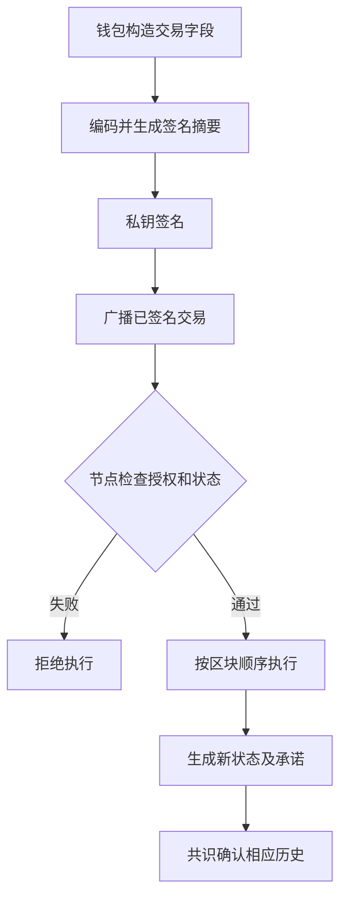

# 密码学基础与哈希函数

## 本篇目录
- [一、本部分导读](#一本部分导读)
- [二、本篇学习目标](#二本篇学习目标)
- [三、主要内容](#三主要内容)
  - [3.1 先明确这讲要解决的七个问题](#31-先明确这讲要解决的七个问题)
  - [3.2 学习顺序与本讲符号](#32-学习顺序与本讲符号)
- [四、区块链和密码学的关系](#四区块链和密码学的关系)
  - [4.1 区块链主要需要可验证性，公开账本并不天然保密](#41-区块链主要需要可验证性公开账本并不天然保密)
  - [4.2 走一轮：一份授权如何进入区块链](#42-走一轮一份授权如何进入区块链)
  - [4.3 三种经常被合并的“可信”](#43-三种经常被合并的可信)
  - [4.4 身份、密钥和权限的关系](#44-身份密钥和权限的关系)
- [五、Hash 函数](#五hash-函数)
  - [5.1 Hash 函数的定义](#51-hash-函数的定义)
  - [5.2 Hash 函数的算法](#52-hash-函数的算法)
  - [5.3 补充：承诺与 commit–reveal 的基本思想](#53-补充承诺与-commitreveal-的基本思想)
- [六、密码学的发展简史](#六密码学的发展简史)
  - [6.1 古典密码学：隐藏字母排列规则](#61-古典密码学隐藏字母排列规则)
  - [6.2 近代密码：从手工操作走向机器与通信理论](#62-近代密码从手工操作走向机器与通信理论)
  - [6.3 现代密码学：从“看起来难破”转向明确模型](#63-现代密码学从看起来难破转向明确模型)
  - [6.4 量子密码学：先区分两条方向](#64-量子密码学先区分两条方向)
- [七、密码学哈希函数](#七密码学哈希函数)
  - [7.1 抗碰撞性（Collision Resistance）](#71-抗碰撞性collision-resistance)
  - [7.2 隐藏性（Hiding）](#72-隐藏性hiding)
  - [7.3 谜题友好性（Puzzle Friendliness）](#73-谜题友好性puzzle-friendliness)
- [八、数字签名](#八数字签名)
- [九、随机数为什么重要](#九随机数为什么重要)
- [十、数字承诺：先固定结果，再公开内容](#十数字承诺先固定结果再公开内容)
- [十一、常见误区](#十一常见误区)
- [十二、本讲小结](#十二本讲小结)
- [十三、本篇与知识体系的关系](#十三本篇与知识体系的关系)
- [一图看懂本篇流程](#一图看懂本篇流程)
- [官方实现与代码阅读入口](#官方实现与代码阅读入口)


## 一图看懂本篇流程


哈希像给文件算一个短指纹：下载文件后重新算一次，指纹相同可以帮助确认内容没变。签名则像本人用专属印章确认一份文件。

> **怎么读这张图：**从左向右看，先确认输入是什么，再看系统如何检查和处理，最后看结果如何保存或验证。图中是帮助理解的简化流程，协议细节仍以本篇后续说明和官方规范为准。


例如，把毕业证扫描件上传前计算 SHA-256，毕业生和学校各自保存摘要。之后收到文件时重新计算并比较，可以发现文件内容是否发生变化。

## 官方实现与代码阅读入口

以下链接指向对应技术的官方文档、标准或项目源码。阅读代码时，建议先从本篇涉及的核心数据结构或验证入口开始，再沿调用关系查看后续处理。

- [Go SHA-256](https://pkg.go.dev/crypto/sha256)
- [Go Ed25519](https://pkg.go.dev/crypto/ed25519)
- [Bitcoin Core](https://github.com/bitcoin/bitcoin)

**代码来源说明：**官方仓库中的实现代码才代表相应项目的真实实现。正文中用于解释概念的短代码或实验片段，如未明确标出官方文件路径，应按教学演示理解，不能直接当作 Bitcoin Core、Go Ethereum 或其他客户端的生产代码。实际开发应对照上方官方版本、规范和测试。


## 一、本部分导读
> 阅读目标：从“区块链为什么要用密码学”走到“能够读懂哈希、加密、ECDSA、BLS、Schnorr 的输入、输出、验算关系和安全前提”。代码以 Go 为主，补充 Solidity 的链上授权示例。

## 二、本篇学习目标
- 密码学基础与哈希函数
- 理解核心概念、运行流程和参与角色
- 能够区分协议保证、实现细节与应用层假设
- 能够结合代码或实际场景分析边界与风险

## 三、主要内容

<a id="sec-002"></a>
### 3.1 先明确这讲要解决的七个问题

1. 节点怎样发现收到的数据与已经承诺的数据不一致？——哈希与认证数据结构。
2. 节点怎样检查某笔交易获得了相应密钥的授权？——数字签名。
3. 怎样把几十万笔交易压缩成一个可公开比较的摘要？——Merkle 树等结构，第4讲继续展开。
4. 怎样让某些链下文件只有获授权者能阅读？——认证加密及密钥管理。
5. 两个从未共享密钥的人怎样建立会话密钥？——经过身份认证的密钥协商。
6. 很多验证者分别签名后，怎样减少携带的签名数据？——BLS 聚合签名。
7. 多个控制者怎样联合产生一个可验证的签名？——Schnorr 多重签名或专门的门限签名协议。

前六个问题都没有直接回答“全网最终接受哪一条历史”。那属于共识与分叉选择；密码学为其提供可验证的消息和承诺，但不能独立完成全网一致决策。

<a id="sec-003"></a>
### 3.2 学习顺序与本讲符号

先把“数据是什么”与“谁有权操作”分开，再学习算法。看到 `hash`，优先问输入字节如何产生；看到 `signature`，优先问签名究竟绑定了哪些业务字段。

| 符号 | 含义 | 容易混淆的地方 |
|---|---|---|
| $m$ | 消息，实际是一个字节序列 | 屏幕显示相同的文字不代表字节编码一定相同 |
| $H$ | 密码学哈希函数 | 不是可用密钥还原的加密函数 |
| $K$ | 对称密钥 | 不能公开写进智能合约 |
| $sk,pk$ | 私钥、公钥 | 公钥本身不自动证明现实身份 |
| $\sigma$ | 数字签名 | 不等于把消息变成密文 |
| $N$ | 加密使用的 nonce | 与交易序号、签名临时标量不是同一个对象 |
| $k$ | 某些签名算法中的秘密临时标量 | 泄露或错误复用可能泄露长期私钥 |
| $p$ | 有限域模数 | 不应与曲线子群阶 $q$ 或 $n$ 混用 |
| $q,n$ | 素数阶子群的阶 | 标量运算在这个模数下进行 |

<a id="sec-004"></a>

## 四、区块链和密码学的关系

<a id="sec-005"></a>
### 4.1 区块链主要需要可验证性，公开账本并不天然保密

设 Alice 想向 Bob 转账 10 个单位。公开链上的节点通常需要读到发送方、接收方、金额和执行所需的数据，才能检查余额、授权和状态变化。因此，常见公开链并不是“把每笔交易加密后交给所有节点保存”。

它更典型地完成以下分工：

| 系统需求 | 所用机制 | 能证明什么 | 不能单独证明什么 |
|---|---|---|---|
| 标识一段数据 | 哈希 | 给定字节与某个摘要是否对应 | 摘要最初是否来自可信主体 |
| 检查交易授权 | 数字签名 | 相应签名密钥对这些字节作过授权 | 用户是否看懂授权、设备是否被盗 |
| 承诺大量数据 | Merkle 根、状态根 | 数据或状态与根之间的关系 | 根属于最终链、数据一定可下载 |
| 建立共同历史 | 共识、分叉选择、最终性机制 | 在各自假设下达成某种一致性 | 链外输入在现实世界中一定真实 |
| 保存私密内容 | AEAD、访问控制、密钥分发 | 未获密钥者难以读懂内容；修改可被检测 | 已获得明文者不会复制内容 |
| 隐藏计算见证 | 零知识证明等专门方案 | 对某个明确关系的知识或正确性 | 自动隐藏所有元数据、自动保证程序无漏洞 |

以太坊账户的授权、交易编码和执行规则可分别在官方的[账户文档](https://ethereum.org/en/developers/docs/accounts/)与[交易文档](https://ethereum.org/en/developers/docs/transactions/)中查阅。这里的表格是对系统职责的教学划分，不能把其中任何一行当作完整安全体系。

<a id="sec-006"></a>
### 4.2 走一轮：一份授权如何进入区块链



具体看一个教学交易：`Alice → Bob，10 units，nonce=7，chain=111`。

1. **钱包决定消息。** 金额用整数最小单位表达，不能把浮点数 `0.1` 的语言相关表示直接拿来签。
2. **编码器决定字节。** 字段顺序、类型、长度、链标识与用途必须明确。签名算法不认识“收款人”，只认识字节。
3. **签名器使用私钥。** 私钥留在本地或硬件签名设备；发出消息和签名。
4. **节点检查协议条件。** 检查消息是否被相应公钥授权，并按协议检查账户 nonce、费用支付能力等；具体业务规则还需在执行时检查。有效期只有在应用明确规定时才存在，普通以太坊交易没有通用的 `deadline` 字段。
5. **执行器改变状态。** 即使签名正确，余额不足也应失败。签名证明授权，不提供余额。
6. **共识决定接受哪次执行。** 在允许重组的阶段，一笔曾被观察到的交易可能离开当前规范链。

“验证签名通过”和“交易执行成功”是两个状态。进一步的“交易成功”和“已达到目标最终性”也不同。写应用时应分别记录。

<a id="sec-007"></a>
### 4.3 三种经常被合并的“可信”

假设一个仓库把温度 `5°C` 签名并上链：

- **传输完整性：** 消息到达后仍是 `5°C`。
- **主体授权：** 仓库登记的私钥对这条记录签过名。
- **事实真实性：** 货物当时确实处于 `5°C`。

前两项可以由签名和协议检查支持。第三项还依赖传感器、校准、采集过程和治理。攻击者完全可以用真实私钥签署虚假的温度。这解释了为什么预言机、溯源和 RWA 系统不能只用“上链+签名”作为全部论证。

<a id="sec-008"></a>
### 4.4 身份、密钥和权限的关系

公钥通常对应一个密码学身份。若要把它映射成“某银行”“Alice 本人”或“仓库 A”，还需要登记、证书、可信目录、合约治理或其他身份绑定规则。

同一自然人可能控制多个地址；一个合约地址也可能由多个人、门限签名或可升级规则共同控制。因此：

$$
\text{地址} 
eq \text{自然人};\qquad
\text{签名有效} 
eq \text{所有业务条件均满足}.
$$

这两个不等式是开发边界，不是密码算法的缺陷。算法回答的问题本来就比业务系统窄。

<a id="sec-009"></a>

## 五、Hash 函数

<a id="sec-010"></a>
### 5.1 Hash 函数的定义

#### 5.1.1 从任意字节到固定长度摘要

密码学哈希函数可写作：

$$
H:\{0,1\}^{*}\rightarrow\{0,1\}^{n}.
$$

输入是任意有限长度的比特串，输出是 $n$ 位摘要。例如 SHA-256 的摘要为 256 位，即 32 字节；用十六进制显示通常是 64 个字符。这里的“固定长度”指原始摘要，不是界面展示长度。

同样的字节输入，在同一算法下得到同样的结果。加一个空格、改变换行方式、换一个字符编码，就可能改变摘要。

**教学例：** 保存一份合同的 SHA-256。半年后拿到一份候选合同，重新算哈希并比较，可以检查它是否与原来承诺的字节一致。若原始哈希也被攻击者替换，这个比较就失去依据。因此摘要需要放在一个可信或可验证的承诺位置。

#### 5.1.2 三种安全性质需要分开

| 性质 | 攻击者已知什么 | 想做什么 | 理想 $n$ 位哈希的通用经典攻击量级 |
|---|---|---|---|
| 原像抗性 | 一个目标摘要 $y$ | 找 $x$，使 $H(x)=y$ | 约 $2^n$ |
| 第二原像抗性 | 一个固定消息 $x$ | 找不同的 $x'$，使 $H(x')=H(x)$ | 约 $2^n$，具体构造和消息长度需另看 |
| 碰撞抗性 | 可以自由选择两个消息 | 找 $x
e x'$ 且摘要相同 | 约 $2^{n/2}$ |

这些是理想化的通用量级，不是对任意哈希算法的无条件定理，也不是运行时的精确秒数。实际安全还取决于算法有没有结构性弱点。

为什么碰撞更容易？因为可以任意选择“一对”，不必命中特定目标。抽取 $t$ 个近似均匀的 $n$ 位摘要时，碰撞概率近似为：

$$
P_{\mathrm{coll}}\approx1-\exp\!\left(-\frac{t(t-1)}{2\cdot2^n}\right).
$$

当 $t$ 在 $2^{n/2}$ 数量级时，碰撞不再罕见。这就是生日界。教学上把输出缩成 8 位，只有 256 种值，十几到几十个样本就有明显碰撞机会；这不代表 SHA-256 也能用这么少的样本找到碰撞。

**“唯一指纹”只是比喻。** 任意长输入映射到有限输出，碰撞必然存在。安全要求是，在规定资源和攻击模型下难以找到有用的碰撞。有关 SHA-2 的规范入口见 [FIPS 180-4](https://csrc.nist.gov/pubs/fips/180-4/upd1/final)。

#### 5.1.3 雪崩效应不等于安全证明

改变一个输入位，输出经常会改变许多位，这种现象有助于理解扩散。但“改一点输入，输出看起来完全不同”只是观察现象；许多不安全函数也能做到。评估密码学安全要问能否找到原像、碰撞、相关输入攻击等，而不能只看输出像不像乱码。

#### 5.1.4 哈希不是加密，也不是匿名化万能工具

加密通常具有密钥及相应解密过程。哈希没有一个通用的“解密密钥”，也不承诺把所有输入信息都隐藏起来。

例如工资只可能是 5,000、6,000、7,000 三个值。攻击者把三个值分别哈希，就能通过比较推测原值。即使所用哈希函数没有被破解，小输入空间依然允许枚举。

因此，把手机号、身份证号、低熵选择项直接哈希后公开，不能简单称为隐私保护。随机盐可以阻止某些预计算，但若盐公开且候选空间很小，攻击者仍能逐个猜。密码存储还应使用专门的慢速、抗硬件并行的口令派生方案，而不是一次快速 SHA-256。

#### 5.1.5 区块链中的四种典型用途

1. **内容标识：** 对确定的交易序列化结果计算标识。不同协议不一定使用同一哈希或同一编码。
2. **哈希指针：** 后继记录包含前序记录的摘要，建立可检测的链接。
3. **树形承诺：** 把许多数据分层哈希到一个根，让证明只携带路径信息。
4. **计算或签名的输入绑定：** 把复杂消息压成固定格式摘要，或把域信息与消息绑定。

哈希指针不等于不可重写。攻击者若控制全部存储，可以修改数据并重新计算后续所有哈希。必须有外部可信根、签名、共识成本或最终性规则，才有抗替换依据。第2讲的哈希链代码专门演示了这种区别。

<a id="sec-011"></a>
### 5.2 Hash 函数的算法

#### 5.2.1 常见算法怎样选择

| 算法/接口 | 本讲中的定位 | 使用注意 |
|---|---|---|
| SHA-256 / SHA-512 | 通用密码学哈希；适合学习摘要、HMAC、签名预处理 | 必须与具体协议规定一致 |
| SHA3-256 | 标准化 SHA-3 家族中的 256 位摘要 | 不能替代 Ethereum 的 Keccak-256 |
| Keccak-256 | Ethereum 多种承诺、地址和 ABI 场景所用哈希 | 与 SHA3-256 的域分隔/填充不同 |
| RIPEMD-160 | 某些已有协议中的地址相关结构 | “协议使用”不代表新系统应照搬所有旧组合 |
| MD5、SHA-1 | 学习历史与兼容旧数据 | 不应用于新设计的抗碰撞安全需求 |

Go 的 `crypto` 是一组密码相关接口与子包所在的标准库区域，不是一个能自动选择所有算法的万能包。常用入口包括 `crypto/sha256`、`crypto/aes`、`crypto/cipher`、`crypto/ecdsa`、`crypto/ed25519`、`crypto/rand`。Go 团队维护的 `golang.org/x/crypto` 是扩展模块，**不属于标准库**。参见 [Go crypto](https://pkg.go.dev/crypto)、[扩展 sha3 包](https://pkg.go.dev/golang.org/x/crypto/sha3)。

#### 5.2.2 SHA-256 的内部思路

不要求初学者背常量表，但应了解它不是把输入“截成 32 字节”。其基本过程是：给消息加规定的填充和长度描述；按 512 位分组；从固定初始状态开始，对每个分组执行消息扩展与轮函数；最后输出八个 32 位状态字。

一个分组的处理结果会影响下一个分组。长消息仍然能得到固定长度输出，因为内部状态长度固定。这也解释了为什么有“逐段写入”的接口：数据可以分批送入，最终摘要与一次性输入相同。

教学上可以比较 `sha256.Sum256(all)` 与 `sha256.New()` 后多次 `Write(part)`。需要注意，`Sum(nil)` 返回当前摘要字节，通常不清空原状态；它不是“向内部再写入一个 nil”。具体 API 以 [crypto/sha256](https://pkg.go.dev/crypto/sha256) 为准。

#### 5.2.3 Keccak 与 SHA-3 的海绵结构

海绵结构可以理解为一个固定大小的内部状态：输入分块“吸收”进去，每次经过置换混合；需要输出时，从规定位置“挤出”摘要。这里的吸收和挤出只是描述运算阶段的比喻，真实算法处理的是比特状态。

Keccak-256 与 SHA3-256 使用密切相关的构造，但协议层面的域分隔与填充不同。因此两者对空输入就会给出不同结果。不能因为名称中都有“256”或某些旧接口叫 `sha3`，就互换它们。[FIPS 202](https://csrc.nist.gov/pubs/fips/202/final)定义 SHA-3；Go 的 [`NewLegacyKeccak256`](https://pkg.go.dev/golang.org/x/crypto/sha3#NewLegacyKeccak256)明确提供兼容已有 Keccak 系统的接口。

**代码：用 Go 直接比较空输入。** 此例要求 Go 1.24+，并安装固定版本的扩展模块；依赖命令见文末。

```go
package main

import (
	"crypto/sha3"
	"fmt"
	legacy "golang.org/x/crypto/sha3"
)

func main() {
	standard := sha3.Sum256(nil)
	h := legacy.NewLegacyKeccak256()
	_, _ = h.Write(nil)
	fmt.Printf("SHA3-256(empty): %x
", standard)
	fmt.Printf("Keccak256(empty): %x
", h.Sum(nil))
}
```

可观察到：

```text
SHA3-256(empty): a7ffc6f8bf1ed76651c14756a061d662f580ff4de43b49fa82d80a4b80f8434a
Keccak256(empty): c5d2460186f7233c927e7db2dcc703c0e500b653ca82273b7bfad8045d85a470
```

这个例子不是在比较谁“更安全”；它展示的是**协议兼容性**。拿错误的哈希算法生成状态根、签名摘要或地址，即使算法本身很强，也会得到协议不接受的结果。

#### 5.2.4 比哈希算法更常见的错误：输入编码不唯一

假设系统用 `H(from || amount)` 签名，但没有定义字段边界：

```text
("ab", "c")  → "abc"
("a", "bc")  → "abc"
```

这里甚至没有找到哈希碰撞：**输入给哈希的字节本来就是同一个字符串。** 哈希函数无法替你恢复业务字段的边界。

解决方式是使用明确的类型、字段顺序和长度编码。Solidity 中 `abi.encode` 与 EIP-712 有相应用途；`abi.encodePacked` 在多个动态长度字段组合时可能歧义。参见 [Solidity ABI 规范：非标准紧凑模式](https://docs.soliditylang.org/en/v0.8.30/abi-spec.html#non-standard-packed-mode)。

另一种错误是缺少**域隔离**：同一段字节在“登录”“转账”“投票”三个场景中被解释成不同授权。域隔离就是把用途、版本、链或合约等上下文放进承诺输入，让不同协议的消息分开。

#### 5.2.5 HMAC：给哈希加入共享密钥的消息认证

普通哈希任何人都能计算。攻击者改完消息后也能重新算一个摘要。因此若两个服务已经安全共享密钥 $K$，可用消息认证码 MAC 来检查消息的来源与完整性。

HMAC 是一个有规范定义的构造，不能随意用 `SHA256(key || message)` 替代。后者对某些哈希构造会受到长度扩展等问题影响，也缺少应有的安全论证。HMAC 的概念入口是 [RFC 2104](https://www.rfc-editor.org/rfc/rfc2104.html)，Go 接口见 [`crypto/hmac`](https://pkg.go.dev/crypto/hmac)。

HMAC 与数字签名的最大区别是：验 MAC 的人也持有共享密钥，通常也能生成同样的 MAC。因此它适合两方认证，却不能直接满足“让任意第三方验证、同时只有一个主体能签”的需求。

**完整 Go 示例：编码边界与 HMAC。**

```go
package main

import (
	"bytes"
	"crypto/hmac"
	"crypto/rand"
	"crypto/sha256"
	"encoding/binary"
	"fmt"
)

// Each field carries its byte length; this is an educational protocol encoding.
func encodeFields(fields ...string) []byte {
	var b bytes.Buffer
	for _, s := range fields {
		if uint64(len(s)) > uint64(^uint32(0)) {
			panic("field too large")
		}
		if err := binary.Write(&b, binary.BigEndian, uint32(len(s))); err != nil {
			panic(err)
		}
		b.WriteString(s)
	}
	return b.Bytes()
}

func mac(key, msg []byte) []byte {
	h := hmac.New(sha256.New, key)
	_, _ = h.Write(msg)
	return h.Sum(nil)
}

func main() {
	a := []byte("ab" + "c")
	b := []byte("a" + "bc")
	fmt.Println("ambiguous concatenation:", sha256.Sum256(a) == sha256.Sum256(b))
	a = encodeFields("TRANSFER/v1", "ab", "c")
	b = encodeFields("TRANSFER/v1", "a", "bc")
	fmt.Println("structured encoding differs:", sha256.Sum256(a) != sha256.Sum256(b))
	fmt.Printf("SHA256(abc): %x
", sha256.Sum256([]byte("abc")))
	key := make([]byte, 32)
	if _, err := rand.Read(key); err != nil {
		panic(err)
	}
	tag := mac(key, a)
	fmt.Println("valid HMAC:", hmac.Equal(tag, mac(key, a)))
	fmt.Println("tampered HMAC:", hmac.Equal(tag, mac(key, b)))
}
```

运行后前两项为 `true`，表示未经长度编码的两个业务对象确实混淆，而编码后被区分。合法 HMAC 为 `true`，篡改后的验证为 `false`。`hmac.Equal` 用于认证标签比较；不要把不同语言的普通字符串比较当作处理所有秘密相关数据的通用做法。

<a id="sec-012"></a>
### 5.3 补充：承诺与 commit–reveal 的基本思想

如果 Alice 先公布“我选了数字 7”，Bob 可以看到后再选择。可先公布：

$$
C=H(\operatorname{Encode}(\text{domain},\text{Alice},7,r)),
$$

其中 $r$ 是足够长的新鲜随机数。之后 Alice 公布数字和 $r$，验证者重算摘要。

- **绑定性：** Alice 难以在公布 $C$ 后改口成另一组有效开口。
- **隐藏性：** Bob 在看到开口之前难以从 $C$ 猜出选项，依赖随机数熵和哈希模型等条件。

如果去掉 $r$，而选项只有 1 到 10，Bob 十次哈希就能枚举答案。若允许 Alice 看到他人的开口后拒绝公开自己的选择，还存在“最后揭示者”问题。因此 commit–reveal 不是自动公平的随机数发生器，业务还要设计截止、押金或其他规则。这是教学推导，用来区分“承诺性质”与“完整交互协议”。

<a id="sec-013"></a>

## 六、密码学的发展简史

<a id="sec-014"></a>
### 6.1 古典密码学：隐藏字母排列规则

古典密码常对文字进行替换或置换。凯撒移位把字母编号整体平移，例如把 A 当成 0，使用密钥 $k=3$：

$$
c=(m+3)\bmod26;\qquad m=(c-3)\bmod26.
$$

它适合说明明文、密文、密钥与算法的区别，却不适合保护现代数据：密钥只有 26 种，攻击者可以全部尝试。更复杂的单表替换还可能保留语言的频率特征，被统计分析利用。

这段历史的学习重点是：不能因为人眼暂时读不懂密文，就认定系统安全。应明确攻击者可以看到多少消息、能尝试多少次、是否知道算法。

<a id="sec-015"></a>
### 6.2 近代密码：从手工操作走向机器与通信理论

“古典—近代—现代”的分期并无全世界唯一的年份界线。教学上可以用机械密码机、电子通信以及数学安全分析的引入作为过渡线索，而不把某一年当作所有体系同时改变的时间。

现代思维的一项基础是：算法可以公开，安全主要依赖密钥和明确假设。一次一密展示了信息论安全的可能性，但要求密钥真正随机、与消息等长、秘密分发且不复用。

若两个消息使用同一密钥流 $K$：

$$
C_1=M_1\oplus K,\quad C_2=M_2\oplus K
\Rightarrow C_1\oplus C_2=M_1\oplus M_2.
$$

密钥在异或中被消掉。攻击者未必立刻得到两个原文，但已获得本不应暴露的关系。这一小推导会在流密码 nonce 复用时再次出现。

<a id="sec-016"></a>
### 6.3 现代密码学：从“看起来难破”转向明确模型

现代密码学通常先定义目标，再规定攻击者能力，最后给出安全假设和证明或分析。

例如“加密安全”可以问：攻击者选择两个等长明文，得到其中一个的密文后，能否比猜硬币更可靠地判断是哪一个？这比“密文看不懂”严格得多。若系统公开明文长度，等长条件就是为了把不可避免的长度信息与内容保密分开讨论。

又如“签名不可伪造”通常允许攻击者获得自己选择的若干消息的签名，再要求其不能为未获签名的新消息伪造有效签名。这就是后文会提到的选择消息攻击视角。

作者官网公开的《Introduction to Modern Cryptography》第3版目录把安全定义、认证加密、哈希、公钥加密与签名分别讨论；这里借鉴的是这种分析方法，而不是宣称已获得该书全部正文。[作者页面及目录/前言](https://www.cs.umd.edu/~jkatz/imc.html)。

<a id="sec-017"></a>
### 6.4 量子密码学：先区分两条方向

| 方向 | 核心手段 | 运行环境 | 对区块链意味着什么 |
|---|---|---|---|
| 量子密钥分发 QKD | 借助量子物理过程建立密钥 | 需要相应物理链路及设备，仍需认证 | 不是把普通智能合约改几个函数就获得的能力 |
| 后量子密码 PQC | 采用针对量子攻击设计的经典数学算法 | 在经典计算机上运行 | 可以研究替换签名、密钥建立机制，但需修改协议和工程实现 |

足够强的容错量子计算机会威胁基于整数分解和离散对数的现有公钥体系。哈希和对称密码面临的通用量子加速方式不同，不能说“量子计算一出现，所有密码同时失效”。这里不预测何时会出现足以攻击实际网络的机器。

NIST 在 2024 年发布的 FIPS 203、204、205 分别对应 ML-KEM、ML-DSA、SLH-DSA。它们的作用不同：KEM 建立共享秘密，后两者提供签名。实际使用还要检查标准勘误与实现维护情况。[FIPS 203](https://csrc.nist.gov/pubs/fips/203/final)｜[FIPS 204](https://csrc.nist.gov/pubs/fips/204/final)｜[FIPS 205](https://csrc.nist.gov/pubs/fips/205/final)。

区块链迁移还涉及公钥暴露状态、地址格式、交易大小、验签开销、既有资产转移与治理。仅说“换成抗量子算法”没有回答旧私钥控制的资产如何安全迁移，也没有回答节点如何部署同一套新规则。

<a id="sec-018"></a>


## 七、密码学哈希函数

哈希函数把任意长度的输入映射为固定长度的摘要：

$$
h = H(m)
$$

其中 $m$ 是输入消息，$H$ 是哈希函数，$h$ 是固定长度的哈希值。课程以 256
位哈希输出为例。

### 7.1 抗碰撞性（Collision Resistance）

碰撞指两个不同输入得到相同哈希值：

$$
x 
e y,\qquad H(x)=H(y)
$$

有限长度的输出空间必然会发生碰撞；抗碰撞性表示攻击者难以有效找到这样的输入对。它支持内容完整性校验：如果文件内容改变，哈希值通常也会改变，攻击者难以构造另一个不同文件来保持原摘要不变。

**示例：**
上传文件前保存其哈希值，下载后重新计算并比较。哈希一致是完整性校验的重要依据，但前提是参考哈希本身可信。

### 7.2 隐藏性（Hiding）

隐藏性关注从哈希值推测输入是否可行。它依赖输入空间足够大且具有足够的不确定性。若输入只能从很小的候选集合中选择，攻击者可以逐一计算哈希值进行猜测。

因此，在承诺方案中，通常把随机数 $r$ 与秘密值 $x$ 一起哈希：

$$
c = H(x \parallel r)
$$

其中 $\parallel$
表示拼接。随机数使输入具有足够的不确定性，降低从公开摘要猜出 $x$
的风险。

### 7.3 谜题友好性（Puzzle Friendliness）

给定区块头和随机数，哈希输出难以提前预测。若要求输出小于目标阈值
$T$，矿工需要反复尝试：

$$
H(\text{block header}\parallel nonce)\le T
$$

课程将这种性质与挖矿联系起来：在没有已知捷径的前提下，寻找合格输入需要大量试算。

## 八、数字签名

数字签名使用一对密钥：

- **私钥**：由持有人保管，用于生成签名。
- **公钥**：可公开，用于验证签名。
- **签名**：证明相应消息获得了私钥控制者的授权，并使消息内容的变化能够被检测。

典型流程：

1.  发送方构造交易 $m$。
2.  使用私钥对交易或其规定的摘要签名。
3.  验证方根据交易、公钥和签名执行验证。
4.  验证通过只说明签名满足规则；交易仍需通过余额、输入来源、是否重复花费等账本检查。

签名提供授权与完整性验证，不负责隐藏交易内容。比特币的金额和交易关系可从公开账本中观察。

## 九、随机数为什么重要

生成私钥时需要可靠的随机源，避免不同参与者生成可预测或重复的密钥。签名算法内部使用的随机量也必须符合算法要求；随机量复用或可预测可能导致私钥泄露。

## 十、数字承诺：先固定结果，再公开内容

现实中的“封存信封”可以用来理解数字承诺：

1.  先选定秘密值 $x$ 和随机数 $r$。
2.  计算 $c=H(x\parallel r)$，公开 $c$。
3.  之后公开 $x$ 与 $r$。
4.  验证者重新计算哈希并与 $c$ 比较。

承诺值让结果先被固定，公开前又不直接暴露秘密。该机制的安全性取决于哈希性质、随机数质量和具体编码方式。

## 十一、常见误区

- 哈希不是加密：没有用于“解密还原原文”的密钥。
- 哈希值变化通常能提示内容变化，但前提是比较的参考哈希可信。
- 哈希输出固定长度，不意味着碰撞在数学上不存在。
- 签名有效不等于交易一定合法；账本状态和共识规则仍需独立验证。
- “地址不是真名”只提供假名性，不能自动保证交易隐私。

## 十二、本讲小结

哈希函数提供摘要与可验证的计算谜题；数字签名提供授权证明。二者配合账本状态与共识规则，构成比特币交易验证的基础。

[课程视频：P2
密码学原理](https://www.bilibili.com/video/BV1Vt411X7JF/?p=2) ·


## 十三、本篇与知识体系的关系

- 所属部分：第二部分：区块链密码学基础
- 返回总目录：[README](../README.md)
