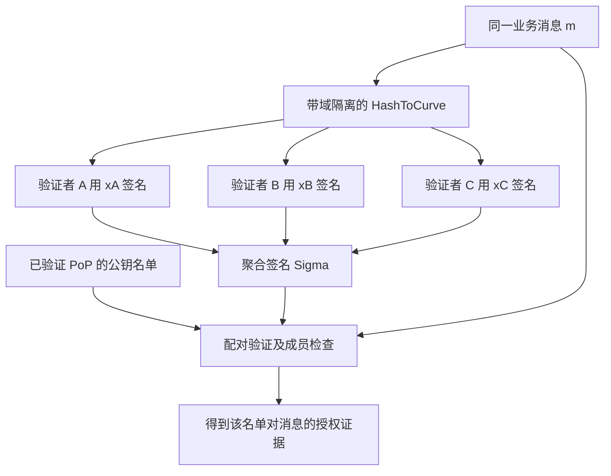

# 对称加密、非对称加密与密钥管理

## 本篇目录
- [一、本篇学习目标](#一本篇学习目标)
- [二、对称加密和非对称加密](#二对称加密和非对称加密)
  - [2.1 对称加密](#21-对称加密)
  - [2.2 非对称密码：把三种用途分开](#22-非对称密码把三种用途分开)
  - [2.3 混合加密：为什么两种体系通常一起用](#23-混合加密为什么两种体系通常一起用)
  - [2.4 区块链开发中的应用位置](#24-区块链开发中的应用位置)
- [三、补充 A：读懂公钥密码所需的最小数学基础](#三补充-a读懂公钥密码所需的最小数学基础)
  - [3.1 1 模运算：数值按固定周期回到同一类](#31-1-模运算数值按固定周期回到同一类)
  - [3.2 2 模逆：不是小数意义上的除法](#32-2-模逆不是小数意义上的除法)
  - [3.3 3 群：元素与一种可组合的运算](#33-3-群元素与一种可组合的运算)
  - [3.4 4 循环群、阶、子群](#34-4-循环群阶子群)
  - [3.5 5 有限单群与 Schnorr 参数选择](#35-5-有限单群与-schnorr-参数选择)
  - [3.6 6 离散对数：正向易算，反向需要困难假设](#36-6-离散对数正向易算反向需要困难假设)
  - [3.7 7 椭圆曲线：点和标量处在不同的运算空间](#37-7-椭圆曲线点和标量处在不同的运算空间)
  - [3.8 8 三种“随机数”不要混用](#38-8-三种随机数不要混用)
- [四、补充 B：数字签名、ECDSA 与以太坊授权](#四补充-b数字签名ecdsa-与以太坊授权)
  - [4.1 1 签名算法究竟输出什么](#41-1-签名算法究竟输出什么)
  - [4.2 2 正确性与不可伪造性是不同问题](#42-2-正确性与不可伪造性是不同问题)
  - [4.3 3 ECDSA 的密钥生成、签名与验证](#43-3-ecdsa-的密钥生成签名与验证)
  - [4.4 4 Go 示例：用标准库运行 ECDSA](#44-4-go-示例用标准库运行-ecdsa)
  - [4.5 5 Ed25519、ECDSA 和 Schnorr 怎样区分](#45-5-ed25519ecdsa-和-schnorr-怎样区分)
  - [4.6 6 Ethereum 的地址恢复与 `ecrecover`](#46-6-ethereum-的地址恢复与-ecrecover)
  - [4.7 7 EIP-712：签名应绑定完整的业务解释](#47-7-eip-712签名应绑定完整的业务解释)
  - [4.8 8 完整 Solidity 示例：一次性签名记录](#48-8-完整-solidity-示例一次性签名记录)
- [五、补充 C：BLS 算法——密钥、签名、验证与聚合](#五补充-cbls-算法密钥签名验证与聚合)
  - [5.1 1 为什么需要 BLS](#51-1-为什么需要-bls)
  - [5.2 2 算法参数：双线性配对是什么](#52-2-算法参数双线性配对是什么)
  - [5.3 3 密钥生成](#53-3-密钥生成)
  - [5.4 4 消息先映射到曲线点，再签名](#54-4-消息先映射到曲线点再签名)
  - [5.5 5 验证签名](#55-5-验证签名)
  - [5.6 6 图解单签与聚合](#56-6-图解单签与聚合)
  - [5.7 7 不同消息与相同消息的聚合](#57-7-不同消息与相同消息的聚合)
  - [5.8 8 rogue-key 攻击：为什么不能任意相加公钥](#58-8-rogue-key-攻击为什么不能任意相加公钥)
  - [5.9 9 完整 Go 示例：三人 PoP 与同消息 BLS 聚合](#59-9-完整-go-示例三人-pop-与同消息-bls-聚合)
  - [5.10 10 BLS 在区块链中能做什么、不能做什么](#510-10-bls-在区块链中能做什么不能做什么)
- [六、Schnorr 签名算法与原理](#六schnorr-签名算法与原理)
  - [6.1 Schnorr 签名算法](#61-schnorr-签名算法)
  - [6.2 基于素数阶有限循环群的 Schnorr 签名](#62-基于素数阶有限循环群的-schnorr-签名)
  - [6.3 Bitcoin BIP340：通用公式如何变成明确协议](#63-bitcoin-bip340通用公式如何变成明确协议)
  - [6.4 基于有限循环群的 Schnorr 多重数字签名](#64-基于有限循环群的-schnorr-多重数字签名)
  - [6.5 MuSig2：从代数草图到具体多签协议](#65-musig2从代数草图到具体多签协议)
  - [6.6 门限 Schnorr 与 FROST：为什么不是“少收几份多签”](#66-门限-schnorr-与-frost为什么不是少收几份多签)
  - [6.7 适用场景与选择依据](#67-适用场景与选择依据)
- [七、私钥丢失与私钥泄露有什么区别？](#七私钥丢失与私钥泄露有什么区别)
  - [7.1 私钥丢失](#71-私钥丢失)
  - [7.2 私钥泄露](#72-私钥泄露)
  - [7.3 交易所托管与自托管](#73-交易所托管与自托管)
- [八、转错地址怎么办？](#八转错地址怎么办)
- [九、为什么不能把私钥简单截断后分给多人？](#九为什么不能把私钥简单截断后分给多人)
- [十、交易为什么需要确认？](#十交易为什么需要确认)
- [十一、比特币能否实现绝对共识？](#十一比特币能否实现绝对共识)
- [十二、本讲小结](#十二本讲小结)
- [十三、本篇与知识体系的关系](#十三本篇与知识体系的关系)
- [一图看懂本篇流程](#一图看懂本篇流程)
- [官方实现与代码阅读入口](#官方实现与代码阅读入口)


## 一图看懂本篇流程


对称加密像家里和家人共用同一把门钥匙；非对称密码像邮箱的投递口和取件钥匙。钥匙丢失、复制或泄露，后果各不相同。

> **怎么读这张图：**从左向右看，先确认输入是什么，再看系统如何检查和处理，最后看结果如何保存或验证。图中是帮助理解的简化流程，协议细节仍以本篇后续说明和官方规范为准。


例如，手机与服务器建立安全连接：双方先协商会话密钥，再用对称加密保护后续大量数据。私钥不能随意复制到聊天软件或网盘。

## 官方实现与代码阅读入口

以下链接指向对应技术的官方文档、标准或项目源码。阅读代码时，建议先从本篇涉及的核心数据结构或验证入口开始，再沿调用关系查看后续处理。

- [Go AES](https://pkg.go.dev/crypto/aes)
- [Go ECDH](https://pkg.go.dev/crypto/ecdh)
- [Go 随机数](https://pkg.go.dev/crypto/rand)

**代码来源说明：**官方仓库中的实现代码才代表相应项目的真实实现。正文中用于解释概念的短代码或实验片段，如未明确标出官方文件路径，应按教学演示理解，不能直接当作 Bitcoin Core、Go Ethereum 或其他客户端的生产代码。实际开发应对照上方官方版本、规范和测试。


## 一、本篇学习目标
- 对称加密、非对称加密与密钥管理
- 理解核心概念、运行流程和参与角色
- 能够区分协议保证、实现细节与应用层假设
- 能够结合代码或实际场景分析边界与风险

## 二、对称加密和非对称加密

<a id="sec-019"></a>
### 2.1 对称加密

#### 2.1.1 算法定义：同一秘密密钥参与加密与解密

抽象形式为：

$$
K\leftarrow\operatorname{Gen};\quad
C\leftarrow\operatorname{Enc}_K(M);\quad
M\leftarrow\operatorname{Dec}_K(C).
$$

这里的生成、加密、解密是三个接口。真实方案还可能有 nonce、初始化向量、关联数据和认证标签，不能只根据这三个简写实现协议。

对称加密适合大数据：钱包备份、数据库字段、链下合同、通信内容等。难点之一是密钥如何分发、保管、轮换和恢复。把密钥写死在前端源码或公开合约中，会使加密失去预期意义。

#### 2.1.2 AES 是分组密码，工作模式决定如何处理完整消息

AES 一次处理 128 位，即 16 字节的分组；可选密钥长度为 128、192、256 位。AES-256 的“256”是密钥长度，不是分组长度。[FIPS 197](https://csrc.nist.gov/pubs/fips/197/final)。

若直接独立加密每一个分组，重复明文分组会呈现重复密文分组。这就是 ECB 模式暴露模式的根源。现实数据有可见结构：金额模板、图像区域、重复字段。单个分组密码的安全性并不会自动消除整条消息的结构泄露。

| 方案 | 主要性质 | 初学者需要知道的限制 |
|---|---|---|
| ECB | 每块独立 | 暴露重复模式，不作为一般敏感数据加密方案 |
| CBC | 使用 IV 串联分组 | 需要正确 IV、填充与独立认证；错误处理可能引出填充预言机 |
| CTR | 把分组密码变成密钥流 | 本身不认证；相同密钥下计数器输入不能重复 |
| GCM | 加密并认证 | 对 nonce 使用规则敏感，不能复用相同密钥/nonce 组合 |
| ChaCha20-Poly1305 | 流密码与认证组合 | 也是 AEAD，仍要遵守 nonce 和消息量限制 |

表格用于理解机制，不是鼓励手写这些组合。工程上优先使用维护良好的 AEAD 接口。GCM 规范见 [SP 800-38D](https://csrc.nist.gov/pubs/sp/800/38/d/final)，ChaCha20-Poly1305 见 [RFC 8439](https://www.rfc-editor.org/rfc/rfc8439.html)。

#### 2.1.3 AEAD：加密时一起检查“有没有被改”和“用于哪里”

AEAD 是“带关联数据的认证加密”。可写为：

$$
(C,T)=\operatorname{Seal}(K,N,M,A),
$$

$$
\operatorname{Open}(K,N,C,T,A)=M\ \text{或}\ \bot.
$$

$N$ 是 nonce；$A$ 是关联数据 AAD；$T$ 是认证标签；$\bot$ 表示失败。

**具体场景：** 正文是发票金额，AAD 放 `业务版本、租户、记录编号`。正文被加密，AAD 可以明文发送，但同样参与认证。如果攻击者把租户 A 的密文搬到租户 B 名下，即使正文密文没改，AAD 不一致也应导致失败。

AAD 不会自动传输或保存。加密端和解密端必须能获得完全相同的 AAD 字节。它也不是秘密存放区，因为其目标是完整性绑定而非保密。

#### 2.1.4 nonce 不是密码，但复用可能毁掉安全性

nonce 的一般含义是某种“单次使用的值”，是否需要随机、长度多大、是否允许计数器，取决于具体算法。不能把所有 nonce 都概括成“随便生成的随机数”。

GCM 常使用 96 位 nonce。同一密钥下复用 nonce 会泄露明文关系，并破坏认证保证。随机生成 nonce 只能使重复概率小，不能使它严格为零，因此仍需要消息量上限与密钥轮换。

Go 1.24 引入 `cipher.NewGCMWithRandomNonce`：由库生成并前置随机 nonce，调用者向 `Seal/Open` 传 `nil` nonce；其 `NonceSize()` 为 0，额外开销为 28 字节。文档规定同一密钥不要加密超过 $2^{32}$ 条消息。这里按具体 API 讲解，而不是自行设计格式。[Go AEAD 文档](https://pkg.go.dev/crypto/cipher#NewGCMWithRandomNonce)。

#### 2.1.5 完整 Go 示例：发票加密及三个失败分支

```go
package main

import (
	"crypto/aes"
	"crypto/cipher"
	"crypto/rand"
	"fmt"
)

func main() {
	key := make([]byte, 32)
	if _, err := rand.Read(key); err != nil {
		panic(err)
	}
	block, err := aes.NewCipher(key)
	if err != nil {
		panic(err)
	}
	// Go 1.24+: nonce is generated and prepended by Seal.
	aead, err := cipher.NewGCMWithRandomNonce(block)
	if err != nil {
		panic(err)
	}
	msg := []byte("invoice: Alice pays Bob 100 units")
	aad := []byte("INVOICE/v1|chain=111|contract=demo|record=7")
	sealed := aead.Seal(nil, nil, msg, aad)
	plain, err := aead.Open(nil, nil, sealed, aad)
	if err != nil {
		panic(err)
	}
	fmt.Println("recovered:", string(plain))
	fmt.Println("overhead:", len(sealed)-len(msg))
	bad := append([]byte(nil), sealed...)
	bad[len(bad)-1] ^= 1
	_, err = aead.Open(nil, nil, bad, aad)
	fmt.Println("tampered ciphertext rejected:", err != nil)
	_, err = aead.Open(nil, nil, sealed, []byte("wrong context"))
	fmt.Println("wrong AAD rejected:", err != nil)
	wrongKey := make([]byte, 32)
	if _, err := rand.Read(wrongKey); err != nil {
		panic(err)
	}
	wrongBlock, err := aes.NewCipher(wrongKey)
	if err != nil {
		panic(err)
	}
	wrongAEAD, err := cipher.NewGCMWithRandomNonce(wrongBlock)
	if err != nil {
		panic(err)
	}
	_, err = wrongAEAD.Open(nil, nil, sealed, aad)
	fmt.Println("wrong key rejected:", err != nil)
}
```

这段程序只在内存里生成密钥，结束后不保留。实际钱包备份必须另行设计密钥保存与恢复；将密文保存成功、把密钥丢掉，并不能恢复文件。

逐步看输入输出：

1. `rand.Read` 产生 32 字节 AES 密钥；`aes.NewCipher` 建立分组密码对象。
2. `NewGCMWithRandomNonce` 为分组密码添加消息级的随机 nonce、加密与认证。
3. `Seal` 产生携带 nonce 和标签的输出。
4. `Open` 同时检查密文、密钥与 AAD 是否匹配。
5. 修改最后一位、替换 AAD 或换密钥，都得到错误；应用应拒绝该结果。

程序输出的 `overhead` 为 28。不要把密文的随机变化误认为不稳定：同一消息加密多次通常应得到不同密文，但都能用正确参数解开。

<a id="sec-020"></a>
### 2.2 非对称密码：把三种用途分开

公钥密码具有公钥与私钥，但不是所有公钥算法都提供加密。至少要区分：

| 类型 | 发送方/发起方做什么 | 接收方/验证方做什么 | 主要目的 |
|---|---|---|---|
| 公钥加密 | 用接收方公钥加密 | 接收方用私钥解密 | 内容保密 |
| 数字签名 | 用签名方私钥签署消息 | 任意验证者用公钥验证 | 授权、完整性、可公开验证的证据 |
| 密钥协商 | 各方使用自己的私钥与对方公钥 | 得到相同共享秘密，再派生密钥 | 建立后续对称密钥 |

ECC 是“椭圆曲线密码”的算法家族背景。ECDSA 是签名；ECDH 是密钥协商。把“ECC”直接当成一个统一的加密函数，会混淆协议目标。

#### 2.2.1 RSA：用小数理解算术，不把教材 RSA 当安全实现

教学取 $p=5,q=11$，得到 $N=pq=55$；取 $e=3$，以及满足 $ed\equiv1\pmod{40}$ 的 $d=27$。消息 $m=7$ 时：

$$
c=7^3\bmod55=13,\qquad
m=13^{27}\bmod55=7.
$$

这个例子只解释模幂如何建立可逆关系。模数太小可以直接分解；裸 RSA 还具有确定性和代数可塑性，不能直接用于真实加密。

现实应用需使用规定编码方案，例如 RSA-OAEP 用于加密、RSA-PSS 用于签名。OAEP 对可加密消息长度有上限，通常使用混合加密，不直接加密大文件。具体接口与区别见 [RFC 8017](https://www.rfc-editor.org/rfc/rfc8017.html)和 [Go crypto/rsa](https://pkg.go.dev/crypto/rsa)。

#### 2.2.2 Diffie–Hellman：公开交换材料，秘密来自各自私钥

在合适的循环群里，Alice 选 $a$ 并公开 $g^a$，Bob 选 $b$ 并公开 $g^b$。两边都可算出：

$$
(g^b)^a=(g^a)^b=g^{ab}.
$$

旁观者只看到公开材料，不应能高效求出这个共享值。这里依赖相应困难假设，并非因为“模运算天然不可逆”。

小例子取 $p=23,g=2,a=3,b=4$：Alice 公布 8，Bob 公布 16，双方共享值均为 2。小群很容易穷举，只用于验算。

**关键限制：密钥协商不自动认证身份。** 中间人可分别与 Alice 和 Bob 建立两条密钥，转发并读取通信。真实协议需要证书、预共享认证、公钥指纹或签名等手段认证交换的公钥及上下文。

#### 2.2.3 ECDH 后为什么还要 KDF

ECDH 输出的是共享秘密材料，不应随意截取、直接重复用于所有方向和用途。KDF（密钥派生函数）把输入秘密、salt 与上下文派生成所需密钥。

HKDF 分为提取和扩展两个阶段；`info` 用于绑定用途，比如 `Alice-to-Bob/aes256gcm` 与 `Bob-to-Alice/aes256gcm` 应产生不同的流量密钥。HKDF 不是抗弱口令猜测方案，不能把简单用户密码当成高熵 ECDH 输出。[RFC 5869](https://www.rfc-editor.org/rfc/rfc5869.html)。

#### 2.2.4 Go 示例：X25519 协商，再用 HKDF 分离用途

以下示例**假定对方公钥已经通过独立机制认证**；它没有实现 TLS 握手，也没有自行解决中间人问题。Go API 见 [`crypto/ecdh`](https://pkg.go.dev/crypto/ecdh)与 [`crypto/hkdf`](https://pkg.go.dev/crypto/hkdf)。

```go
package main

import (
	"bytes"
	"crypto/ecdh"
	"crypto/hkdf"
	"crypto/rand"
	"crypto/sha256"
	"fmt"
)

func main() {
	curve := ecdh.X25519()
	alice, err := curve.GenerateKey(rand.Reader)
	if err != nil {
		panic(err)
	}
	bob, err := curve.GenerateKey(rand.Reader)
	if err != nil {
		panic(err)
	}
	// This example assumes the peer public keys have already been authenticated.
	aliceSecret, err := alice.ECDH(bob.PublicKey())
	if err != nil {
		panic(err)
	}
	bobSecret, err := bob.ECDH(alice.PublicKey())
	if err != nil {
		panic(err)
	}
	salt := make([]byte, 32)
	if _, err := rand.Read(salt); err != nil {
		panic(err)
	}
	transcript := append([]byte("CHANNEL/v1|"), alice.PublicKey().Bytes()...)
	transcript = append(transcript, bob.PublicKey().Bytes()...)
	ctx := sha256.Sum256(transcript)
	info := fmt.Sprintf("Alice-to-Bob/aes256gcm/%x", ctx)
	ka, err := hkdf.Key(sha256.New, aliceSecret, salt, info, 32)
	if err != nil {
		panic(err)
	}
	kb, err := hkdf.Key(sha256.New, bobSecret, salt, info, 32)
	if err != nil {
		panic(err)
	}
	reverseInfo := fmt.Sprintf("Bob-to-Alice/aes256gcm/%x", ctx)
	reverse, err := hkdf.Key(sha256.New, aliceSecret, salt, reverseInfo, 32)
	if err != nil {
		panic(err)
	}
	fmt.Println("shared secret agrees:", bytes.Equal(aliceSecret, bobSecret))
	fmt.Println("derived keys agree:", bytes.Equal(ka, kb))
	fmt.Println("directions separated:", !bytes.Equal(ka, reverse))
}
```

三行结果都应为 `true`。程序不打印私钥、共享秘密或会话密钥，只检查两方是否一致。`transcript` 固定按 Alice 公钥、Bob 公钥排列，角色顺序本身也是协议的一部分。

<a id="sec-021"></a>
### 2.3 混合加密：为什么两种体系通常一起用

公钥体系解决密钥建立或分发问题；对称 AEAD 处理大量数据。一个完整场景可按如下方式组织：

1. 接收者发布经过认证的公钥。
2. 发送者通过指定的密钥封装/协商协议建立共享密钥材料。
3. KDF 将材料绑定到算法版本、双方身份和会话上下文。
4. AEAD 用派生密钥加密数据，AAD 绑定对象和用途。
5. 接收者验证协议参数及认证标签后接受明文。

若使用静态密钥，长期私钥泄露可能影响历史通信。前向保密通常需要临时密钥、正确认证和及时销毁临时秘密；它不是“使用 ECDH”四个字自动附赠的性质。

<a id="sec-022"></a>
### 2.4 区块链开发中的应用位置

对称加密常出现于钱包本地密钥库、加密备份、链下资料存储和节点间安全传输。它不应被误用为“把私钥放在智能合约里，让合约替大家保密”。普通公开链的执行环境必须允许节点验证状态，合约存储、调用参数和可复现执行不等于秘密环境。

Solidity 的 `private` 限制的是源码层面的访问方式，不提供链上数据机密性。要使合约在不暴露秘密的情况下验证关系，必须采用有明确安全模型的其他机制，如零知识证明、专用保密执行系统或不同的协议设计；不能靠变量可见性修饰符完成。参见 [Solidity 安全说明：Private Information and Randomness](https://docs.soliditylang.org/en/v0.8.30/security-considerations.html#private-information-and-randomness)。

<a id="sec-023"></a>

## 三、补充 A：读懂公钥密码所需的最小数学基础

> 本节是为衔接缺失目录而补写的教学内容，不代表原来的“六”或“七”标题。

<a id="sec-024"></a>
### 3.1 1 模运算：数值按固定周期回到同一类

$17\bmod5=2$，因为 $17=3\cdot5+2$。在模 5 运算中，2、7、12、17 代表相同的剩余类。密码学常把计算限制在这样的有限集合里，使消息、密钥和验证关系可以用有限长度表示。

但“取模以后丢掉信息”不等于“密码学安全”。`x mod 5` 的原像很好找。安全来自更完整的构造和特定困难问题，而不是取模这个符号本身。

<a id="sec-025"></a>
### 3.2 2 模逆：不是小数意义上的除法

若存在 $a^{-1}$ 满足：

$$
aa^{-1}\equiv1\pmod q,
$$

则 $a^{-1}$ 是 $a$ 在模 $q$ 下的逆元。例如 $3^{-1}\bmod11=4$，因为 $3\cdot4=12\equiv1\pmod{11}$。

逆元存在当且仅当 $\gcd(a,q)=1$。当 $q$ 为素数时，每个非零元素都有逆元。后面的 ECDSA 与 nonce 复用推导，都要检查被求逆的分母不是零。

代码中不能把模逆写成普通整数除法。比如 `9 / 3` 得到的整数 3，与 `9 * inverse(3) mod 11` 在这个例子碰巧同值；换个数就不成立。模运算中先理解定义，再选库接口。

<a id="sec-026"></a>
### 3.3 3 群：元素与一种可组合的运算

群关键在于一个集合加一种满足规则的运算。关键要求包括：运算结果仍在集合内；满足结合律；有单位元；每个元素有逆元。

两种常用写法：

- **乘法写法：** $g^a\cdot g^b=g^{a+b}$，单位元记为 1。
- **加法写法：** $aG+bG=(a+b)G$，单位元记为 $\mathcal O$。

椭圆曲线通常用加法写法。$aG$ 是按群运算反复相加产生的标量乘，不是把点坐标都乘以 $a$。

<a id="sec-027"></a>
### 3.4 4 循环群、阶、子群

若一个元素 $g$ 的重复运算能生成整个群，这个群叫循环群。群的阶是其元素数量；元素的阶是使其回到单位元所需的最小正整数。

例如模 23 乘法下，从 2 开始依次乘 2：

$$
2,4,8,16,9,18,13,3,6,12,1.
$$

共有 11 个不同元素，之后重复。因此 2 生成一个阶为 11 的循环子群。模 23 的所有非零元素一共有 22 个，不能把这两个集合的大小混为一谈。

这也解释了为什么参数经常同时有 $p$ 和 $q$：元素本身在模 $p$ 的域里表示，但指数或标量按照子群阶 $q$ 取模。

<a id="sec-028"></a>
### 3.5 5 有限单群与 Schnorr 参数选择

“有限单群”在群论里有明确含义：只有平凡正规子群的有限群。它不是“只有一种运算的群”，也不是“有限循环群”的简称。

Schnorr 通常选用**离散对数困难的素数阶有限循环群**。素数阶循环群确实也是单群，但任意有限单群未必具有适合 Schnorr 的结构和安全假设。因此本文保留术语作为目录记录，算法正文使用准确的群条件。

对于有限域实现，常取大素数 $p,q$，使 $q\mid p-1$，再选阶恰为 $q$ 的生成元 $g$。验证收到的公钥时，还需要确认它落在正确子群、编码合法且符合非单位元要求。

<a id="sec-029"></a>
### 3.6 6 离散对数：正向易算，反向需要困难假设

给定 $x$，可以通过重复平方快速计算 $g^x$；给定 $g$ 和 $Y=g^x$，求 $x$ 是离散对数问题。

我们的 11 元素群可以把所有 $g^x$ 列出来，所以毫无安全性。真实参数必须足够大，并排除可利用的特殊结构。椭圆曲线群与有限域乘法群的最佳攻击方式不同，因此不能只根据“密钥位数相同”就判断安全强度相同。

还要区分几个问题：从 $g^a$ 求 $a$；从 $g^a,g^b$ 求 $g^{ab}$；判断给定第三个元素是否为 $g^{ab}$。它们之间有关系，却不是可以不加条件地互换的同一个安全假设。

<a id="sec-030"></a>
### 3.7 7 椭圆曲线：点和标量处在不同的运算空间

一种常见曲线形式是：

$$
y^2=x^3+ax+b\pmod p.
$$

满足方程的点，再加上单位元 $\mathcal O$，在规定的点加法下构成群。为避免退化，需要判别式等条件；协议通常固定经过研究的曲线，不让每个开发者临时设计参数。

选定基点 $G$，其阶为 $n$：

$$
Q=dG,
$$

$d$ 是私钥标量，$Q$ 是公钥点。点的坐标模 $p$ 计算，标量通常模 $n$ 计算。验签公式里出现两个模数，是因为两种对象不同，而不是作者可以随便选择模数。

Ethereum 常见 EOA 交易使用 secp256k1；Go 标准库示例使用的 `elliptic.P256()` 是另一条曲线。两条曲线都能用于 ECDSA，并不意味着其公钥和签名可互换。曲线、编码、摘要规则和签名格式都必须匹配。[Ethereum 账户文档](https://ethereum.org/en/developers/docs/accounts/)｜[Go ECDSA 文档](https://pkg.go.dev/crypto/ecdsa)。

<a id="sec-031"></a>
### 3.8 8 三种“随机数”不要混用

| 对象 | 是否必须保密 | 主要要求 | 错误后果示例 |
|---|---|---|---|
| 私钥 | 是 | 足够熵、正确范围、长期保护 | 攻击者取得控制权 |
| ECDSA/Schnorr 临时秘密 $k$ | 是 | 按协议安全生成，不能错误复用 | 私钥可被代数恢复 |
| AEAD nonce | 通常否 | 遵守特定算法对唯一性/随机性的要求 | 泄露明文关系或破坏认证 |
| 账户交易 nonce | 通常否 | 按协议推进并检查 | 同一授权可能被重复执行 |
| 口令派生 salt | 通常否 | 阻止不必要的跨用户预计算复用 | 相同口令更容易被批量猜测 |

Go 的 `crypto/rand` 面向安全随机数；`math/rand` 面向模拟等用途，不能因为输出“看起来随机”就拿来生成私钥。对于确定性签名，临时秘密也应由经过分析的算法派生，不是直接使用当前时间或消息序号。[Go crypto/rand](https://pkg.go.dev/crypto/rand)。

<a id="sec-032"></a>

## 四、补充 B：数字签名、ECDSA 与以太坊授权

<a id="sec-033"></a>
### 4.1 1 签名算法究竟输出什么

一个签名方案有三个核心算法：

$$
(sk,pk)\leftarrow\operatorname{KeyGen}(1^\lambda),
$$

$$
\sigma\leftarrow\operatorname{Sign}(sk,m),\qquad
\operatorname{Verify}(pk,m,\sigma)\in\{\mathrm{true},\mathrm{false}\}.
$$

$\lambda$ 表示安全参数。签名方输入秘密私钥和消息，产生签名字节；验证者输入公钥、相同消息和签名，得到接受或拒绝。

这里没有“验证者解密出消息”的必要步骤。通常消息本来就是公开的，签名只是在数学上与它绑定。RSA 某些算术形式让人容易联想到反向加密，但 ECDSA、Schnorr、BLS 都说明“私钥加密”不是签名的通用定义。

<a id="sec-034"></a>
### 4.2 2 正确性与不可伪造性是不同问题

**正确性**要求诚实生成的签名应通过验证。一个程序每次返回 `true`，也可以“接受所有诚实签名”，却显然不安全。

**不可伪造性**要求攻击者即使拿到很多已选消息的签名，也难以为新的消息造出有效签名。常见术语 EUF-CMA 指“在选择消息攻击下的存在性不可伪造”。其中“新消息”与“同一消息的新签名编码”又不同；若还要求后者不可产生，就涉及更强的性质。

签名可作为某密钥授权的证据，但现实中的责任归属还受密钥被盗、登记身份、代理授权、时间和证据制度影响。因此学习时可以用“难伪造的数字印章”作比喻，不能把它扩展成“自然人永远无法否认任何签名”的绝对结论。

<a id="sec-035"></a>
### 4.3 3 ECDSA 的密钥生成、签名与验证

本节给出标准代数骨架，不代替完整编码、参数和边界检查。规范入口是 [FIPS 186-5](https://csrc.nist.gov/pubs/fips/186-5/final)。

#### 4.3.1 3.1 参数与密钥生成

固定一条椭圆曲线、基点 $G$、基点阶 $n$ 和消息摘要规则。选择：

$$
d\in\{1,\ldots,n-1\},\qquad Q=dG.
$$

$d$ 保密，$Q$ 公开。收到外部公钥时不能只检查字节长度，还要按实现验证编码、曲线成员、单位元和相应子群条件。

#### 4.3.2 3.2 签名

把消息摘要按协议映射成整数 $z$。安全生成本次秘密标量 $k$：

$$
R=kG,\qquad r=x_R\bmod n,
$$

$$
s=k^{-1}(z+rd)\bmod n.
$$

签名是 $(r,s)$，若出现规定不允许的零值则重新按算法处理。$x_R$ 是点 $R$ 的横坐标；$k^{-1}$ 是模 $n$ 逆元；不是浮点数 $1/k$。

#### 4.3.3 3.3 验证

先检查 $r,s$ 位于合法范围，再计算：

$$
w=s^{-1}\bmod n,\quad u_1=zw\bmod n,\quad u_2=rw\bmod n,
$$

$$
X=u_1G+u_2Q.
$$

拒绝单位元等无效情况，随后检查 $x_X\bmod n=r$。

为什么成立？将 $Q=dG$ 代入：

$$
X=(zs^{-1}+rs^{-1}d)G
  =s^{-1}(z+rd)G
  =kG=R.
$$

这证明的是诚实签名的验算关系。它没有单独证明攻击者无法伪造；安全性还需要困难假设和完整方案分析。

#### 4.3.4 3.4 一个可手算的椭圆曲线例子

**以下仅是小参数教学例，不能用于真实资产。** 取：

$$
E:y^2=x^3+2x+2\pmod{17},\quad G=(5,1),\quad n=19.
$$

设 $d=7$，则 $Q=7G=(0,6)$。把某条教学消息的摘要整数设为 $z=11$，临时秘密取 $k=3$：

- $R=3G=(10,6)$，所以 $r=10$。
- $3^{-1}\bmod19=13$。
- $s=13(11+10\cdot7)\bmod19=8$。

验证方算出 $w=8^{-1}\bmod19=12$，因此 $u_1=18,u_2=6$：

$$
X=18G+6Q=(18+6\cdot7)G=60G=3G=(10,6).
$$

横坐标确实为 10，验算通过。这里 $z=11$ 是为了展示计算而指定的教学输入，不声称来自某个真实交易的哈希。

#### 4.3.5 3.5 为什么临时秘密复用可能暴露私钥

同一 $k$ 用于不同摘要 $z_1,z_2$ 时，$r$ 相同：

$$
s_1=k^{-1}(z_1+rd),\qquad s_2=k^{-1}(z_2+rd)\pmod n.
$$

相减后：

$$
k=(z_1-z_2)(s_1-s_2)^{-1}\bmod n,
$$

再得到：

$$
d=(s_1k-z_1)r^{-1}\bmod n.
$$

式子要求相应分母可逆，并且两次签名确实对应同一有效临时标量关系。实践中还要考虑签名规范化的符号等细节。它解释了一个核心原则：长期私钥没打印到日志里，不代表不会被临时随机数错误泄露。

<a id="sec-036"></a>
### 4.4 4 Go 示例：用标准库运行 ECDSA

本例使用 **P-256 + SHA-256 + ASN.1 签名编码**。它用于解释 API，不是 Ethereum secp256k1 的交易签名实现，也不能直接交给 `ecrecover`。

```go
package main

import (
	"crypto/ecdsa"
	"crypto/elliptic"
	"crypto/rand"
	"crypto/sha256"
	"fmt"
)

func main() {
	// P-256 demonstrates ECDSA; it is NOT Ethereum's secp256k1.
	priv, err := ecdsa.GenerateKey(elliptic.P256(), rand.Reader)
	if err != nil {
		panic(err)
	}
	message := []byte("APPROVE/v1|chain=111|asset=demo|amount=100|nonce=7")
	digest := sha256.Sum256(message)
	sig, err := ecdsa.SignASN1(rand.Reader, priv, digest[:])
	if err != nil {
		panic(err)
	}
	fmt.Println("valid signature:", ecdsa.VerifyASN1(&priv.PublicKey, digest[:], sig))
	wrong := sha256.Sum256([]byte("APPROVE/v1|chain=111|asset=demo|amount=900|nonce=7"))
	fmt.Println("changed amount accepted:", ecdsa.VerifyASN1(&priv.PublicKey, wrong[:], sig))
	other, err := ecdsa.GenerateKey(elliptic.P256(), rand.Reader)
	if err != nil {
		panic(err)
	}
	fmt.Println("wrong public key accepted:", ecdsa.VerifyASN1(&other.PublicKey, digest[:], sig))
}
```

输出依次是 `true / false / false`。可以从数据流理解调用：

1. `GenerateKey` 得到私钥对象，里面可以访问对应公钥。
2. `sha256.Sum256` 为应用消息得到固定长度摘要。
3. `SignASN1` 对摘要签名并返回 ASN.1 编码的结果。
4. `VerifyASN1` 要求同一曲线公钥、同一摘要和有效签名。

这条固定字符串虽然写有 `nonce=7`，程序没有维护已使用 nonce 的状态。因此它验证的是签名，**没有实现完整业务防重放**。第1、2讲和下一个 Solidity 示例才演示状态检查。

<a id="sec-037"></a>
### 4.5 5 Ed25519、ECDSA 和 Schnorr 怎样区分

| 方案 | 主要背景 | 本讲中的用途 | 互操作提醒 |
|---|---|---|---|
| ECDSA | 椭圆曲线上的传统签名方案 | 解释 Ethereum EOA 常见授权背景和标准库 API | 曲线、摘要和编码都要一致 |
| Ed25519 | EdDSA 的具体实例，采用 Edwards 曲线和规定编码 | 第1、2讲无外部依赖的签名例子 | 不能交给 secp256k1 的 `ecrecover` |
| Schnorr | 基于离散对数的签名结构 | 后文讲线性验算、多签与 Bitcoin BIP340 | 通用 Schnorr 公式不自动等于 BIP340 |
| BLS | 使用双线性配对的签名 | 聚合多个签名 | 不能拿普通 ECDSA 验签器验证 |

Ed25519 的签名算法本身按确定方式从秘密与消息派生内部材料；私钥初始种子仍需安全随机生成。具体算法与变体见 [RFC 8032](https://www.rfc-editor.org/rfc/rfc8032.html)，不要把“签名可确定生成”理解为“私钥可以选择简单常数”。

<a id="sec-038"></a>
### 4.6 6 Ethereum 的地址恢复与 `ecrecover`

`ecrecover` 输入一个 32 字节摘要以及恢复参数和 ECDSA 签名分量，恢复对应地址，失败时返回零地址。它不自动知道这条摘要代表哪种业务，也不自动检查是否过期、是否被重复使用、签名者是否有权限。

还要注意 ECDSA 的签名可塑性：在某些表示规则下，同一消息和公钥可能有不同有效签名表示。若把“签名字节是否出现过”当作唯一防重放标识，可能出问题。应使用协议明确的 nonce 或消息标识，并使用库处理合法范围、低 `s` 等编码规则。[Solidity 密码学函数](https://docs.soliditylang.org/en/v0.8.30/units-and-global-variables.html#mathematical-and-cryptographic-functions)｜[OpenZeppelin ECDSA/SignatureChecker](https://docs.openzeppelin.com/contracts/5.x/api/utils/cryptography)。

普通 EOA 的签名验证和合约账户的签名验证不同。合约钱包可以根据多签、权限或其他逻辑接受签名；[ERC-1271](https://eips.ethereum.org/EIPS/eip-1271)提供相应验证接口。因此一个希望支持合约签名者的应用，不能永远只做一次 `ecrecover`。

<a id="sec-039"></a>
### 4.7 7 EIP-712：签名应绑定完整的业务解释

EIP-712 为结构化数据定义类型化哈希与域。一个摘要可概括为：

$$
D=\operatorname{Keccak256}(\texttt{0x1901}\parallel\mathrm{domainSeparator}\parallel\mathrm{hashStruct}).
$$

域通常包含应用名称、版本、链标识与验证合约等字段；消息结构则包含具体操作的数据。EIP-712 本身不提供自动防重放，必须由应用设计并检查 nonce、期限或状态。[EIP-712 原文](https://eips.ethereum.org/EIPS/eip-712)。

**教学授权：** Alice 签署“允许执行者 R，在指定链的指定合约中，记录内容摘要 $h$，使用 nonce 7，并在给定期限前提交”。

如果漏掉某个字段，可能出现不同问题：

| 未绑定的信息 | 可能发生的业务误解释 |
|---|---|
| 验证合约 | 相同结构被另一份合约接受 |
| 链标识 | 授权被搬到另一条链 |
| 执行者 | 任何看到签名的人可能代为提交；是否有害取决于业务 |
| 内容摘要/金额/接收者 | 相应业务参数可能被替换 |
| nonce 与使用状态 | 同一个有效授权被执行多次 |
| 有效期 | 授权可能一直有效，除非有独立撤销规则 |

链标识隔离也有边界：如果两个环境故意共享相同 chain ID、合约地址和域，仍需额外协议区分。域隔离解决的是明确定义的上下文混淆，而不是“所有可能的跨环境重放”。

<a id="sec-040"></a>
### 4.8 8 完整 Solidity 示例：一次性签名记录

此合约只记录用户自己签署的内容摘要，没有转账，也没有证明摘要所代表的现实内容为真。它展示域、执行者、nonce、期限与合约签名者支持。

复现环境固定为 Solidity **0.8.30**、OpenZeppelin Contracts **5.0.2**、Shanghai EVM。这是本例的已验证版本组合，不表示这些版本是当前最新版本。安装与完整执行记录见文末。

```solidity
// SPDX-License-Identifier: MIT
pragma solidity 0.8.30;

import {EIP712} from "@openzeppelin/contracts/utils/cryptography/EIP712.sol";
import {SignatureChecker} from "@openzeppelin/contracts/utils/cryptography/SignatureChecker.sol";

// Educational authorization recorder; it does not transfer money or prove a fact is true.
contract SignedRecord is EIP712 {
    struct Approval {
        address signer;
        address executor;
        bytes32 contentHash;
        uint256 nonce;
        uint256 deadline;
    }
    bytes32 public constant APPROVAL_TYPEHASH = keccak256(
        "Approval(address signer,address executor,bytes32 contentHash,uint256 nonce,uint256 deadline)"
    );
    mapping(address => uint256) public nonces;
    event Recorded(address indexed signer, bytes32 indexed contentHash, uint256 nonce);
    error InvalidApproval();

    constructor() EIP712("CryptoNotesRecord", "1") {}

    function digest(Approval calldata a) public view returns (bytes32) {
        return _hashTypedDataV4(keccak256(abi.encode(
            APPROVAL_TYPEHASH, a.signer, a.executor, a.contentHash, a.nonce, a.deadline
        )));
    }

    function record(Approval calldata a, bytes calldata signature) external {
        if (a.signer == address(0) || a.executor != msg.sender ||
            block.timestamp > a.deadline || a.nonce != nonces[a.signer]) {
            revert InvalidApproval();
        }
        if (!SignatureChecker.isValidSignatureNow(a.signer, digest(a), signature)) {
            revert InvalidApproval();
        }
        nonces[a.signer] = a.nonce + 1;
        emit Recorded(a.signer, a.contentHash, a.nonce);
    }
}
```

**完整调用顺序：**

1. 部署合约，确定实际 chain ID 与合约地址。
2. 客户端读取 `nonces[signer]`，构造 `Approval`。
3. 钱包按 EIP-712 域 `CryptoNotesRecord`、版本 `1` 和合约地址签名。
4. 被指定的 `executor` 提交结构与签名。
5. 合约先检查签名者、执行者、期限与 nonce，再验证签名。
6. 成功后递增 nonce 并发出事件；再次提交同一授权会被拒绝。

`SignatureChecker` 可以检查 EOA 签名，也可以调用 ERC-1271 规则。合约账户的签名有效性可能随其状态改变，所以不能把过去某时刻验证成功当成永久有效。

这里采用每签名者递增 nonce，意味着授权按序消费。它简单但不支持任意顺序并行执行，也没有单独的取消接口。这些是业务状态机设计的选择；增加并行 nonce、撤销与权限系统时，要重新检查授权语义。

该示例在本地链上检查了：正确授权成功、nonce 递增、消息修改拒绝、错误执行者拒绝、错误链域拒绝、错误验证合约拒绝、过期拒绝、重放拒绝，以及 ERC-1271 合约账户授权成功。通过这些检查不等于完成生产系统审计，但能验证本节介绍的主要路径。

<a id="sec-041"></a>

## 五、补充 C：BLS 算法——密钥、签名、验证与聚合

<a id="sec-042"></a>
### 5.1 1 为什么需要 BLS

假设 100 个验证者对某个区块投票。如果每个人提供一份独立签名，接收者要携带很多签名字节。BLS 的一项重要能力是：在指定条件下，把多份签名合成为一个群元素，并对组合后的授权关系进行验证。

这减少的是签名部分的表示成本。验证者是谁、投了什么、权重多大，仍要通过消息、名单或位图等信息确定。不能把“一份聚合签名”写成“全部投票信息都变为常数大小”。

以太坊共识规范使用 BLS12-381，公钥为 G1 中的压缩点，48 字节；签名为 G2 中的压缩点，96 字节。这里选取相同的群方向讲解，避免与另一种把签名放在 G1 的变体混淆。[Ethereum 共识规范：BLSPubkey 与 BLSSignature](https://github.com/ethereum/consensus-specs/blob/master/specs/phase0/beacon-chain.md)。

<a id="sec-043"></a>
### 5.2 2 算法参数：双线性配对是什么

取三个阶为素数 $q$ 的群 $G_1,G_2,G_T$，以及双线性配对：

$$
e:G_1\times G_2\rightarrow G_T.
$$

若 $P\in G_1,Q\in G_2$，则关键关系是：

$$
e(aP,bQ)=e(P,Q)^{ab}.
$$

“双线性”指输入两边的标量可以对应到输出的指数中。$G_T$ 通常使用乘法记号，而 $G_1,G_2$ 常用加法记号；不要把三种对象都当成普通整数相乘。

配对还要非退化、可高效计算，并选用满足所需困难假设的具体群。双线性关系允许验证方检查标量关系，但不会直接输出私钥标量。

教学上可把它理解成“能比较两边是否携带相同秘密系数的特殊检查器”。这个类比不能替代真实群定义，也不能用普通整数乘法写一个函数就声称实现了配对。

<a id="sec-044"></a>
### 5.3 3 密钥生成

固定生成元 $P\in G_1$。安全选择私钥：

$$
x\in\mathbb Z_q^*,\qquad PK=xP.
$$

私钥是标量，公钥是点。密钥生成需按密码套件规定从足够熵的材料派生、检查范围并处理编码。真实实现不要用 `hash(userName)` 生成私钥。

本讲的真实 Go 示例使用 `blst.KeyGen`，不手工拼接私钥字节。`blst` 是独立的密码学实现库，不是 Go 标准库。

<a id="sec-045"></a>
### 5.4 4 消息先映射到曲线点，再签名

需要一个符合协议的 hash-to-curve 函数：

$$
H_2:\{0,1\}^{*}\rightarrow G_2.
$$

签名为：

$$
\sigma=xH_2(m).
$$

`hash-to-curve` 不等于“做一个 SHA-256，把结果当横坐标”，也不等于“把普通哈希整数乘到固定基点”。它需要规范的映射、域隔离和子群处理。[RFC 9380](https://www.rfc-editor.org/rfc/rfc9380.html)给出相关框架和套件。

**为什么不能直接用 $H_2(m)=h(m)Q$，且 $h(m)$ 对所有人已知？** 如果收到一个签名：

$$
\sigma=xh(m)Q,
$$

在 $h(m)
e0$ 时，攻击者可算：

$$
h(m)^{-1}\sigma=xQ.
$$

之后对任意新消息 $m'$，都能构造 $h(m')xQ$。攻击者未必恢复了整数 $x$，却已经能伪造签名。这个教学推导说明：公式里写一个 $H$，并不意味着随意选择一个“类似哈希”的实现就安全。

<a id="sec-046"></a>
### 5.5 5 验证签名

验证关系为：

$$
e(PK,H_2(m))\overset{?}=e(P,\sigma).
$$

代入诚实生成过程：

$$
e(xP,H_2(m))=e(P,H_2(m))^x=e(P,xH_2(m)).
$$

验证者不需要知道 $x$，也不从签名中“解密”消息。它重新计算消息对应的曲线点，再检查配对关系。

在执行代数检查之前，必须按套件验证编码、点是否在曲线上、是否属于正确子群，以及是否出现不允许的单位元。若把任意网络字节直接当作合法群元素，数学正确性不能保证实现安全。

<a id="sec-047"></a>
### 5.6 6 图解单签与聚合



图中的“已验证 PoP”关键在于同消息快速聚合验证所需的重要前提。后文解释原因。

<a id="sec-048"></a>
### 5.7 7 不同消息与相同消息的聚合

对不同消息 $m_i$，每个签名为 $\sigma_i=x_iH_2(m_i)$，聚合：

$$
\Sigma=\sum_{i=1}^{N}\sigma_i.
$$

验证可检查：

$$
e(P,\Sigma)\overset{?}=\prod_{i=1}^{N}e(PK_i,H_2(m_i)).
$$

右侧仍涉及所有消息和公钥。实现可以使用多配对等优化，但不能因此宣称不同消息的验证工作完全与人数无关。

若所有人签相同消息 $m$，则可以令：

$$
PK_{\mathrm{agg}}=\sum_i PK_i,
$$

检查：

$$
e(PK_{\mathrm{agg}},H_2(m))=e(P,\Sigma).
$$

这个简洁关系需要公钥注册及相应安全条件。BLS 的 Basic、Augmentation、Proof-of-Possession 方案对输入和验证要求不同，不能把一套代码中省掉的检查用另一套方案的名字补上。本文按 PoP 方案讲同消息聚合，规范依据是 **IRTF BLS Internet-Draft 工作草案**，不是已发布的 BLS RFC。[BLS 草案 §3](https://datatracker.ietf.org/doc/html/draft-irtf-cfrg-bls-signature-07)。

<a id="sec-049"></a>
### 5.8 8 rogue-key 攻击：为什么不能任意相加公钥

假设诚实人的公钥为 $PK_A$。攻击者选择自己知道的标量 $b$，却登记：

$$
PK_B=bP-PK_A.
$$

两者聚合公钥恰好是 $bP$。攻击者可以独自计算 $bH_2(m)$，让一个天真的聚合验签器误认为 A 与 B 都签了消息。攻击者并不知道登记公钥 $PK_B$ 对应的独立私钥，也不需要诚实人的签名。

**PoP（Proof of Possession，私钥持有证明）**要求登记者证明自己确实知道与登记公钥对应的私钥。它通常对序列化公钥生成一个专门用途的证明，并与业务签名使用不同的域分隔标签。

验证者必须先验证每个公钥及 PoP，再允许它进入同消息快速聚合。库函数名里有 `FastAggregateVerify`，不代表它会自动替应用执行所有登记流程。不同库的 API 合同需要逐项阅读。[blst Go API](https://pkg.go.dev/github.com/supranational/blst/bindings/go)。

<a id="sec-050"></a>
### 5.9 9 完整 Go 示例：三人 PoP 与同消息 BLS 聚合

此例固定使用 `github.com/supranational/blst v0.3.16` 的 Go 绑定。它需要 C 编译环境与 CGO；标准库没有可直接替代的 BLS 签名接口。

```go
package main

import (
	"crypto/rand"
	"fmt"

	blst "github.com/supranational/blst/bindings/go"
)

var sigDST = []byte("BLS_SIG_BLS12381G2_XMD:SHA-256_SSWU_RO_POP_")
var popDST = []byte("BLS_POP_BLS12381G2_XMD:SHA-256_SSWU_RO_POP_")

func main() {
	message := []byte("VOTE/v1|chain=111|round=9|block=demo")
	pks := make([]*blst.P1Affine, 0, 3)
	sigs := make([]*blst.P2Affine, 0, 3)
	seen := make(map[string]bool)
	for i := 0; i < 3; i++ {
		ikm := make([]byte, 32)
		if _, err := rand.Read(ikm); err != nil {
			panic(err)
		}
		sk := blst.KeyGen(ikm)
		if sk == nil {
			panic("KeyGen failed")
		}
		pk := new(blst.P1Affine).From(sk)
		if !pk.KeyValidate() {
			panic("invalid key")
		}
		encoded := pk.Compress()
		if seen[string(encoded)] {
			panic("duplicate signer")
		}
		seen[string(encoded)] = true
		pop := new(blst.P2Affine).Sign(sk, encoded, popDST)
		if pop == nil || !pop.Verify(true, pk, true, encoded, popDST) {
			panic("invalid proof of possession")
		}
		sig := new(blst.P2Affine).Sign(sk, message, sigDST)
		if sig == nil || !sig.Verify(true, pk, true, message, sigDST) {
			panic("invalid signature")
		}
		pks = append(pks, pk)
		sigs = append(sigs, sig)
	}
	agg := new(blst.P2Aggregate)
	if !agg.Aggregate(sigs, true) {
		panic("aggregation failed")
	}
	signature := agg.ToAffine()
	fmt.Println("public key bytes:", len(pks[0].Compress()))
	fmt.Println("aggregate signature bytes:", len(signature.Compress()))
	// Fast verification is used only AFTER all public keys passed PoP verification.
	fmt.Println("aggregate valid:", signature.FastAggregateVerify(true, pks, message, sigDST))
	fmt.Println("changed message:", signature.FastAggregateVerify(true, pks, []byte("tampered"), sigDST))
	fmt.Println("missing signer:", signature.FastAggregateVerify(true, pks[:2], message, sigDST))
}
```

实际数据流如下：

1. 每个参与者取得 32 字节安全随机材料，用 `KeyGen` 产生私钥。
2. 公钥放在 G1，消息签名与 PoP 放在 G2。
3. `popDST` 与 `sigDST` 明确分离用途。
4. 每个公钥先做 `KeyValidate`，再检查对其压缩编码的 PoP。
5. 只有通过这些检查的公钥进入名单；名单拒绝重复公钥。
6. 聚合三份签名，然后验证完整名单、原消息与聚合签名。
7. 修改消息或少提供一个签名者公钥，验证结果为 `false`。

样例输出：

```text
public key bytes: 48
aggregate signature bytes: 96
aggregate valid: true
changed message: false
missing signer: false
```

代码在本地生成所有密钥，因此尚未演示网络反序列化与登记持久化。真实接收外部字节时，应检查解码失败、长度、子群与单位元，并保存已验证的登记状态。检查公钥不重复也不等于抵抗女巫攻击：一个人仍可生成许多不同公钥，成员资格要由协议另行确定。

<a id="sec-051"></a>
### 5.10 10 BLS 在区块链中能做什么、不能做什么

| 能帮助实现的目标 | 仍需额外机制处理的事项 |
|---|---|
| 把许多签名合成一个签名对象 | 哪些人有权投票、权重如何计算 |
| 对同一对象形成紧凑授权证据 | 消息是否对应当前轮次、链和有效候选 |
| 在规则允许时减少传输签名字节 | 名单、位图、消息、证书与重传仍有开销 |
| 验证多个密钥的授权关系 | 被签署的价格、传感器数据是否真实 |
| 支持专门设计的门限 BLS 协议 | 分布式密钥生成、份额管理、掉线与恶意份额处理 |

尤其要区分：**聚合签名**常把不同私钥下的独立签名合成；**门限签名**通常把一个秘密的控制能力分散，让满足门槛的份额共同产生一个签名。两者能在某些构造中结合，但不是同一个词。

对区块链验证者投票而言，签名还必须绑定轮次、分叉域、消息类型和被投对象。否则，即使签名不能伪造，旧轮次的真实签名也可能被搬到新轮次。这是“授权上下文”的问题，不是换一个更强签名算法就能自动修好的问题。

<a id="sec-052"></a>

## 六、Schnorr 签名算法与原理

> 这里回到“九”。算法先采用通用循环群记号，随后说明 Bitcoin BIP340 的具体约定。通用公式、手算小例和生产协议是三个不同层次。

<a id="sec-053"></a>
### 6.1 Schnorr 签名算法

#### 6.1.1 算法参数

选用阶为大素数 $q$ 的循环群，生成元为 $G$；此处先用加法记号。选择带域隔离的挑战哈希函数，把上下文、公钥、临时公开点和消息映射到标量：

$$
e=H_{\mathrm{chal}}(\operatorname{Encode}(\mathrm{domain},R,P,m))\in\mathbb Z_q.
$$

$P$ 是长期公钥；$R$ 是本次签名的临时公开点；$m$ 是消息。哈希输入关键在于把这次证明的关键对象一起绑定。工程协议必须确定点编码、标量编码和挑战派生方式。

#### 6.1.2 密钥生成

选择秘密标量 $x\in\{1,\ldots,q-1\}$，公开：

$$
P=xG.
$$

私钥不需要上传给验证者。验证者能用 $P$ 检查线性关系，但在所选困难假设下不应能由 $P$ 高效恢复 $x$。

#### 6.1.3 签名生成

安全生成本次临时秘密 $k$，计算：

$$
R=kG,\qquad e=H_{\mathrm{chal}}(\mathrm{domain},R,P,m),
$$

$$
s=k+ex\pmod q.
$$

签名可表示为 $(R,s)$，或按具体协议只编码 $R$ 的一部分和 $s$。另外也存在使用 $(e,s)$ 以及不同符号约定的变体。本文统一使用加号形式，不能把别处的减号验证公式直接拼进来。

#### 6.1.4 签名验证：一条线性关系

验证者按协议检查点和标量编码，再重算 $e$，检查：

$$
sG\overset{?}=R+eP.
$$

成立原因非常直接：

$$
sG=(k+ex)G=kG+e(xG)=R+eP.
$$

这个关系把临时秘密 $k$ 和长期秘密 $x$ 融合在一个响应 $s$ 里。验证者无需得到两个秘密，也能检查响应与公开量的一致性。

Schnorr 的安全分析通常基于离散对数困难性和对挑战哈希的相应模型。上面的三行代数只说明正确性，不能独立推出“任何实现都不可伪造”。

#### 6.1.5 优点与限制

其线性结构便于设计多重签名、门限签名和批量验证；规范化后的签名格式也可以很紧凑。但这些能力需要各自的协议，不能把多个已有独立签名的字节简单相加。

批量验证尤其要区别于聚合签名：批量验证把很多独立验证任务一起计算，输入的签名通常仍然存在；聚合签名则改变输出的签名表示。未经设计地把多条验签方程相加，可能让攻击者构造相互抵消的错误，需要规范规定的随机系数等处理。[BIP340：设计与批量验证](https://bips.dev/340/)。

#### 6.1.6 与交互式身份证明的联系

一个交互式 Schnorr 身份证明可以简化为：证明者先发送 $R$，验证者发送不可预测挑战 $e$，证明者返回 $s=k+ex$。验证方检查相同的群关系。

把挑战改为对消息与公开材料的哈希，可以得到非交互签名的思路。这个变化通常称为 Fiat–Shamir 变换，需要相应模型和安全论证。签名公开了消息以及签名关系，不意味着消息内容变成零知识，也不能把“使用了 Schnorr”直接等同于“整笔交易隐私”。

<a id="sec-054"></a>
### 6.2 基于素数阶有限循环群的 Schnorr 签名

#### 6.2.1 什么是这里实际需要的群

“有限单群”。按本讲 A.5 的澄清，下面采用有限域乘法群中的**素数阶循环子群**，具体约定：

- $p,q$ 为素数，$q\mid p-1$；
- $g\in\mathbb Z_p^*$ 的阶为 $q$；
- 公钥和临时公开量在该子群中；
- 标量取模 $q$，群元素乘法取模 $p$。

这与上一节加法记号的思想相同，只是把 $xG$ 写成 $g^x$，把点相加写成群元素相乘。

#### 6.2.2 算法参数、密钥与签名

**算法参数：** $(p,q,g,H_{\mathrm{chal}})$，以及固定的编码与域标识。

**密钥生成：**

$$
x\in\mathbb Z_q^*,\qquad Y=g^x\bmod p.
$$

**签名生成：**

$$
R=g^k\bmod p,
$$

$$
e=H_{\mathrm{chal}}(\operatorname{Encode}(\mathrm{domain},Y,R,m))\bmod q,
$$

$$
s=k+ex\bmod q.
$$

这里把哈希结果模 $q$ 写成概念公式。真实套件应使用规定的哈希到标量方法及安全参数，处理分布与编码问题，而不是随便截取几个字节。

#### 6.2.3 签名验证

在检查 $Y,R$ 的范围、子群归属和 $s$ 的范围后，计算挑战并验证：

$$
g^s\overset{?}=R\cdot Y^e\pmod p.
$$

关键检查可以理解为：

- 没有接受来自另一个群的公钥。
- 没有把同一标量的多种非规范编码都当成合法。
- 消息、公钥、临时承诺及用途对应同一条挑战。
- 群关系确实成立。

不能只检查最后一行等式就省掉前面的边界条件。

#### 6.2.4 手算一轮

使用不安全的小参数：

$$
p=23,\ q=11,\ g=2,\ x=3,\ k=4.
$$

由此 $Y=2^3\bmod23=8$，$R=2^4\bmod23=16$。为了手算，**假定本次规范编码经挑战哈希后得到 $e=5$**；这是教学给定值，不声称是后面程序对某条消息的实际哈希。

$$
s=4+5\cdot3\bmod11=8.
$$

左侧：$2^8\bmod23=3$。右侧：$16\cdot8^5\bmod23=16\cdot16\bmod23=3$。两边相同，签名通过。

| 阶段 | Alice 持有/产生什么 | 验证者需要什么 |
|---|---|---|
| 初始化 | 私钥 3，公钥 8 | 参数与公钥 8 |
| 临时承诺 | 秘密 4，公开量 16 | 公开量 16 |
| 挑战 | 绑定消息后得到 5 | 自己重新计算同一挑战 |
| 响应 | $s=8$ | $s=8$ 与消息 |
| 验证 | 不再额外发送私钥 | 比较两个群元素 |

#### 6.2.5 同一临时秘密复用的代价

若对两个消息使用相同 $k$ 和 $R$，产生不同挑战 $e_1,e_2$：

$$
s_1=k+e_1x,\qquad s_2=k+e_2x\pmod q.
$$

当 $e_1
e e_2$ 时：

$$
x=(s_1-s_2)(e_1-e_2)^{-1}\bmod q.
$$

沿用上例，第一份 $e_1=5,s_1=8$；第二份设 $e_2=2$，则 $s_2=10$。于是：

$$
x=(8-10)(5-2)^{-1}\bmod11
  =9\cdot4\bmod11=3.
$$

私钥被恢复了。这个结果也解释了 Schnorr 身份证明里的“两个不同挑战、同一承诺”为什么很关键：同一代数结构既用于安全论证，也暴露错误 nonce 管理的后果。

#### 6.2.6 完整 Go 教学程序：正确验证与 nonce 复用

以下程序的群只有 11 个元素，私钥和 nonce 被故意固定，算术也不是恒定时间实现。它仅用于复现上述代数，不能保护真实资产。

```go
package main

import (
	"crypto/sha256"
	"encoding/binary"
	"fmt"
)

// Tiny integers ONLY illustrate algebra. They provide no cryptographic security.
const p, q, g int64 = 23, 11, 2

func mod(x, n int64) int64 { return (x%n + n) % n }
func pow(a, n int64) int64 {
	r := int64(1)
	for n > 0 {
		if n&1 != 0 {
			r = r * a % p
		}
		a = a * a % p
		n >>= 1
	}
	return r
}
func challenge(y, r int64, message string) int64 {
	b := []byte("TOY-SCHNORR/v1")
	for _, v := range []int64{p, q, g, y, r} {
		var buf [8]byte
		binary.BigEndian.PutUint64(buf[:], uint64(v))
		b = append(b, buf[:]...)
	}
	b = append(b, []byte(message)...)
	h := sha256.Sum256(b)
	e := int64(0)
	for _, v := range h {
		e = (e*256 + int64(v)) % q
	}
	return e
}
func verify(y, r, s int64, message string) bool {
	if y <= 1 || y >= p || r <= 1 || r >= p || s < 0 || s >= q {
		return false
	}
	if pow(y, q) != 1 || pow(r, q) != 1 {
		return false
	}
	e := challenge(y, r, message)
	return pow(g, s) == r*pow(y, e)%p
}
func main() {
	x, k := int64(3), int64(4) // Deliberately fixed only for this tiny toy.
	y, r := pow(g, x), pow(g, k)
	m1 := "pay Bob 10"
	e1 := challenge(y, r, m1)
	s1 := mod(k+e1*x, q)
	// A tiny q causes many challenge collisions; select a different challenge.
	m2 := ""
	e2 := e1
	for i := 0; e2 == e1; i++ {
		m2 = fmt.Sprintf("changed message %d", i)
		e2 = challenge(y, r, m2)
	}
	s2 := mod(k+e2*x, q) // Intentional nonce reuse to demonstrate the failure.
	den := mod(e1-e2, q)
	inv := int64(1)
	for den*inv%q != 1 {
		inv++
	}
	recovered := mod((s1-s2)*inv, q)
	fmt.Println("valid:", verify(y, r, s1, m1))
	fmt.Println("changed message:", verify(y, r, s1, m2))
	fmt.Println("invalid subgroup:", verify(5, r, s1, m1))
	fmt.Println("secret recovered after nonce reuse:", recovered)
}
```

注意代码专门寻找一个挑战不同的第二消息，因为小群的挑战只有 11 种，消息变化很容易碰到同一个挑战。若教学程序把“任何修改都一定失败”写成绝对性质，反而会误导读者。真实系统是通过足够大的安全参数，让相关攻击概率在模型中可忽略。

运行结果包含：合法签名 `true`，选定的修改消息 `false`，错误子群公钥 `false`，复用临时秘密恢复出的私钥为 `3`。

#### 6.2.7 优点和应用边界

有限域版本便于理解模幂和验证关系，可以用于研究密码协议或复核数学。实际 Bitcoin 的 Schnorr 签名使用 secp256k1 椭圆曲线及 BIP340 格式，并不是把上面的 $p=23$ 改成大数就完成了 Bitcoin 实现。

从有限域迁移到曲线时，要重新确定群、编码、哈希到标量、密钥生成和验证边界；从单签迁移到多签时，还要增加参与者身份与交互状态管理。公式相似不意味着原安全保证可以不加检查地迁移。

<a id="sec-055"></a>
### 6.3 Bitcoin BIP340：通用公式如何变成明确协议

#### 6.3.1 除了 $sG=R+eP$，还规定了什么

BIP340 使用 secp256k1，并采用 32 字节的 x-only 公钥和 64 字节签名。它为点恢复约定偶数纵坐标，并通过带标签哈希区分不同用途；挑战绑定临时点、公钥和消息。[BIP340 原文：公钥、签名、验证](https://bips.dev/340/)。

理解这些约定的原因比记大小更重要：

1. **只保留横坐标需要补充符号约定。** 同一横坐标通常对应两个相反的点，协议不能让双方任意选择。
2. **挑战包含公钥。** 防止相关公钥变换造成授权关系混淆。
3. **不同用途使用不同标签。** 避免挑战、nonce 派生或其他协议复用同一种哈希解释。
4. **临时点也要规范化。** 签名端和验证端必须使用一致的点代表。
5. **解析边界必须检查。** 例如横坐标不应超过域模数，响应标量不应超过子群阶。

这一段说明的是标准的必要约定；完整步骤仍应按规范和实现测试向量执行。

#### 6.3.2 Go 调库示例

以下使用 `btcec/v2 v2.3.5` 的 Schnorr 包。示例明确生成辅助随机数并使用 `CustomNonce`；它演示 BIP340 可验证签名及其长度，不实现 Bitcoin 交易 sighash 规则。

该版本签名实现包含需要注意的可变时间步骤，不能据此声称它已解决私钥侧信道问题。这里的选型用于教学和互操作验证，真实签名设备应单独选择适合其威胁环境的实现。[库文档与源码入口](https://pkg.go.dev/github.com/btcsuite/btcd/btcec/v2/schnorr)。

```go
package main

import (
	"crypto/rand"
	"crypto/sha256"
	"fmt"

	"github.com/btcsuite/btcd/btcec/v2"
	"github.com/btcsuite/btcd/btcec/v2/schnorr"
)

func main() {
	priv, err := btcec.NewPrivateKey()
	if err != nil {
		panic(err)
	}
	digest := sha256.Sum256([]byte("DEMO/v1|pay=100|nonce=7"))
	var aux [32]byte
	if _, err := rand.Read(aux[:]); err != nil {
		panic(err)
	}
	sig, err := schnorr.Sign(priv, digest[:], schnorr.CustomNonce(aux))
	if err != nil {
		panic(err)
	}
	pkBytes := schnorr.SerializePubKey(priv.PubKey())
	pk, err := schnorr.ParsePubKey(pkBytes)
	if err != nil {
		panic(err)
	}
	fmt.Println("public key bytes:", len(pkBytes))
	fmt.Println("signature bytes:", len(sig.Serialize()))
	fmt.Println("valid:", sig.Verify(digest[:], pk))
	wrong := sha256.Sum256([]byte("DEMO/v1|pay=900|nonce=7"))
	fmt.Println("changed amount:", sig.Verify(wrong[:], pk))
}
```

输出公钥长度 32、签名长度 64；原消息通过，修改金额后不通过。这里先做一次 SHA-256，是本例应用对字符串的摘要约定。具体 Bitcoin 交易该签哪些字节、承诺哪些输入输出，应由对应交易类型的 sighash 规范决定。

<a id="sec-056"></a>
### 6.4 基于有限循环群的 Schnorr 多重数字签名

本节对应“3.1 多重签名算法的基本思想”和“3.2 算法参数／密钥生成／签名生成／签名验证／优点／应用”。先给代数直觉，再解释为什么不能直接部署。

#### 6.4.1 基本思想：几个人分别保管控制能力

假设公司有三个管理者，希望共同批准一项操作。最直接的方法是合约分别验证三份签名；另一条路线是用多重签名协议，让三个人交互后产生一个可由聚合公钥验证的签名。

| 方式 | 密钥怎样持有 | 验证侧通常看到什么 | 是否通常需要签名者交互 |
|---|---|---|---|
| 合约级多签 | 每人独立密钥 | 多份签名与合约规则 | 不一定需要互相交互 |
| Schnorr 多重签名 | 每人独立密钥 | 一个聚合公钥与一个签名 | 通常需要 |
| 门限签名 | 分散一个秘密的份额或等价控制能力 | 通常为一个组公钥与一个签名 | 需要专门协议 |
| BLS 聚合 | 通常为多个独立密钥 | 聚合签名，加名单/消息等 | 独立签名可非交互聚合，但仍需注册条件 |

多重签名中的 `n-of-n` 与门限签名中的 `t-of-n` 是不同策略。有人掉线时，一个要求全部参与者的多签不能自动变成“剩下的人凑够几份也能签”。

#### 6.4.2 算法参数与密钥生成：先做不安全的代数草图

沿用阶为 $q$ 的乘法循环群，参与者 $i$ 有独立私钥 $x_i$ 和公钥：

$$
Y_i=g^{x_i}.
$$

若天真地设置 $Y=\prod_iY_i$，它在代数上等于 $g^{\sum_i x_i}$。因此直觉上可以让每个人贡献自己那一部分秘密作用。

但这只是代数草图：如果注册过程允许恶意选择公钥，会出现 rogue-key 攻击。攻击者登记 $Y_B=g^bY_A^{-1}$，聚合公钥就成为 $g^b$，从而把独自签名伪装成联合签名。

所以，不能把“各人公钥相乘”直接作为一个安全多签方案的完整密钥聚合过程。

#### 6.4.3 签名生成的直觉：统一挑战、分别响应

先假定公钥均已可信登记、参与者诚实协调，这只是为了展示等式：

1. 每人选择新的秘密 $k_i$，公开 $R_i=g^{k_i}$。
2. 聚合临时公开量 $R=\prod_iR_i$。
3. 所有人对相同 $R,Y,m$ 计算相同挑战 $e$。
4. 每人计算部分签名 $s_i=k_i+ex_i\pmod q$。
5. 聚合 $s=\sum_i s_i\pmod q$。

部分签名与最终签名的验证关系分别为：

$$
g^{s_i}=R_iY_i^e,\qquad
g^s=RY^e.
$$

若三个参与者对不同消息、不同名单或不同聚合点计算挑战，部分签名就不应混在同一会话中。协调者负责汇总消息，但不应获得所有人的长期私钥。

#### 6.4.4 用三个参与者走完一轮手算

继续使用不安全的小群 $p=23,q=11,g=2$。指定：

| 人员 | 私钥 $x_i$ | 公钥 $Y_i$ | 本次秘密 $k_i$ | 本次公开量 $R_i$ |
|---|---:|---:|---:|---:|
| A | 3 | 8 | 2 | 4 |
| B | 4 | 16 | 3 | 8 |
| C | 2 | 4 | 4 | 16 |

则：

$$
Y=8\cdot16\cdot4\bmod23=6,\quad
R=4\cdot8\cdot16\bmod23=6.
$$

同样为了手算，指定本轮挑战 $e=5$。部分响应为：

$$
s_A=2+5\cdot3\bmod11=6,
$$

$$
s_B=3+5\cdot4\bmod11=1,
$$

$$
s_C=4+5\cdot2\bmod11=3.
$$

最终 $s=6+1+3\bmod11=10$。验证：

$$
2^{10}\bmod23=12,\qquad
R Y^5\bmod23=6\cdot6^5\bmod23=12.
$$

这组数只说明联合响应如何组合，**没有实现抗恶意公钥、恶意 nonce 选择或并发会话攻击的多签协议**。

#### 6.4.5 用公钥系数修正 rogue-key 风险的思路

一种重要思路是先把规范排序的公钥名单绑定到 $L$，再为每个公钥派生系数：

$$
L=H(\operatorname{Encode}(Y_1,\ldots,Y_N)),\qquad
a_i=H_{\mathrm{coef}}(L,Y_i)\in\mathbb Z_q.
$$

聚合公钥改为：

$$
Y=\prod_iY_i^{a_i},
$$

部分签名改为：

$$
s_i=k_i+ea_ix_i\pmod q.
$$

相应验证式是 $g^{s_i}=R_iY_i^{ea_i}$。这样，恶意公钥的选择会反过来改变名单和系数，破坏简单抵消攻击的直接构造。

这些公式说明系数的作用，但**不是完整 MuSig2 实现或完整安全证明**。真实协议对系数派生、重复键、零值、点符号、nonce 和公钥微调有明确约定；不能拿这几行公式省略其余协议步骤。

#### 6.4.6 为什么多签的 nonce 比单签更难管理

单签时，签名者决定自己的一次完整签名。多签时，攻击者可能控制其他参与者、会话调度和协调消息，使受害者在不同上下文中处理相同临时材料。

如果一个秘密 nonce 被两个不同会话消费，部分签名也可能暴露长期私钥。仅用 `hash(privateKey || message)` 生成多人协议的 nonce，不能直接继承单签场景的安全性。

应把 nonce 视为需要持久化管理的单次秘密资源：分配给明确会话，使用后销毁，失败重试不能把已暴露的材料重新放回池中。会话消息、名单、聚合密钥和协调结果都要按协议核验。这是协议状态问题，不能靠最后调用一次验签函数补救。

<a id="sec-057"></a>
### 6.5 MuSig2：从代数草图到具体多签协议

MuSig2 为 BIP340 兼容的多重签名提供具体算法。BIP327 对密钥聚合、nonce 生成、聚合、部分签名、部分验证与最终聚合给出规范。[BIP327](https://bips.dev/327/)。

用角色视角理解一轮，而不在这里重写规范：

1. **共同确定上下文。** 所有人确认消息、完整公钥列表、聚合公钥及所需微调。
2. **第一轮公开 nonce。** 每个签名者按规范生成两份秘密 nonce 及其公开点，把公开材料送给协调者。
3. **形成公共会话。** 协调者聚合 nonce，签名者核验收到的会话材料并计算规范规定的系数与挑战。
4. **第二轮部分签名。** 每个人只用自己的秘密生成部分签名，随后使相应秘密 nonce 不可再用。
5. **核验和合成。** 检查部分签名后，合成一份 BIP340 可验证签名。

两份 nonce 和会话系数关键在于协议抵御恶意参与者的一部分。预计算可以把某些成本移到离线阶段，但不意味着完整业务总是无需通信或只有一次网络消息。

最终链上看见一个签名，不代表链下没有协调者、网络延迟、失败重试和状态保存成本。做研究或性能比较时，应把在线轮次、离线准备、参与者数、掉线处理和协调者工作一起计入。

<a id="sec-058"></a>
### 6.6 门限 Schnorr 与 FROST：为什么不是“少收几份多签”

门限方案希望在 $N$ 人中任意满足条件的 $t$ 人协作即可。典型做法把一个秘密 $x$ 与一个多项式联系起来，让各人持有不同份额；部分签名需要依照实际参与集合加权，不能简单相加。

教学上取模 11 的 $f(t)=3+2t$，秘密为 $f(0)=3$。编号 1、2 的份额分别为 5、7。重构常数项的系数为 $\lambda_1=2,\lambda_2=10$，于是：

$$
2\cdot5+10\cdot7\bmod11=3.
$$

直接把份额相加则得到 $5+7\bmod11=1$，不是秘密。真实门限签名关键在于让各方在协议里产生受保护的加权贡献。

FROST 是一类两轮 Schnorr 门限签名协议；RFC 9591 规定了相应套件与流程。它与 MuSig2 解决的密钥组织方式不同，也不意味着任意 FROST 套件的输出自动符合 Bitcoin BIP340。迁移时要逐项检查群、编码、挑战与签名格式。[RFC 9591](https://www.rfc-editor.org/rfc/rfc9591.html)。

<a id="sec-059"></a>
### 6.7 适用场景与选择依据

| 需求 | 可以研究的方向 | 必须同时考虑的代价或前提 |
|---|---|---|
| 每次必须全部管理者同意 | n-of-n Schnorr 多签，如明确适用的 MuSig2 | 签名轮次、在线协作、nonce 状态、掉线 |
| 允许部分成员缺席 | 门限 Schnorr/FROST 等 | 分布式密钥生成、份额恢复/更新、成员变更 |
| 许多独立投票签名压缩 | BLS 聚合 | 公钥登记、PoP、名单、消息域与配对成本 |
| 权限规则常变化，便于链上审计 | 合约级多签 | 合约存储和验签成本、升级与治理 |
| 单一钱包授权 | 对应链规定的标准签名 | 用户界面、硬件密钥、摘要构造和防重放 |

选择算法应由系统需求倒推。签名短、能聚合、能门限、能公开验证，是不同维度；没有一个属性能够替代其他属性。

<a id="sec-060"></a>


## 七、私钥丢失与私钥泄露有什么区别？

**图示内容：** 私钥丢失、泄露与多重签名

*图示说明：私钥丢失、私钥泄露和多人共同授权是三类不同风险，应分别采用备份、及时迁移和多重签名等措施。*

### 7.1 私钥丢失

如果没有备份、恢复方案或其他可用授权条件，私钥丢失后通常无法再花费由它控制的资产。去中心化账本没有一个中心机构可以仅凭身份验证替换该私钥。

### 7.2 私钥泄露

如果怀疑私钥已被他人掌握，攻击者可能签署转账交易。协议通常不会因为持有人声称密钥被盗就自动冻结地址或撤销私钥。能否转移资产取决于攻击者是否已经行动、资产是否仍可花费以及交易竞争的结果。

### 7.3 交易所托管与自托管

把资产放在中心化交易所时，通常由交易所管理链上私钥，登录密码和账户恢复流程由交易所系统控制。这与个人直接掌握私钥的自托管模式不同。托管服务引入了机构管理、账户安全与平台风险。

## 八、转错地址怎么办？

比特币协议一般不提供撤销已经确认交易的通用按钮。若接收方身份可知，可以联系对方协商退款；退款通常需要接收方再发起一笔新交易。

如果地址没有可用的私钥或对应的花费条件无法满足，资产可能长期无法花费。发送前核对地址、网络和金额是关键的操作防护。

## 九、为什么不能把私钥简单截断后分给多人？

假设一个 256 位私钥被拆成两段，每人保存 128
位。若其中一人知道自己持有的部分，攻击者的搜索范围就会显著缩小；这会降低原私钥的安全性。若任意一段丢失，要求所有片段重新拼接的方案也可能失去可用性。

更适合共同管理资产的方式是多重签名，例如 $m$-of-$n$：指定 $n$
个公钥，花费时至少需要 $m$
个对应的有效签名。这样可以在安全性与可用性之间设置明确条件。

## 十、交易为什么需要确认？

交易刚广播时，可能只在部分节点的待处理交易池中。交易被纳入区块后，才获得第一个区块确认；后续区块继续建立在该区块之上，确认深度随之增加。

在课程讨论的 PoW
模型中，确认深度增加通常会提高重写交易历史的成本。但确认数并非对所有金额、算力分布和网络条件都适用的固定安全保证。

## 十一、比特币能否实现绝对共识？

课程强调，比特币的共识具有概率性：在满足系统假设时，诚实节点通常会逐步收敛到同一条链，但近期历史仍可能因分叉或攻击而改变。这与具有严格最终性保证的共识模型不同。

## 十二、本讲小结

比特币把控制权交给密钥和协议规则：离线收款通常可行，丢失私钥通常无法恢复，泄露私钥不能靠协议层直接撤销。多重签名、备份、地址核对和适当的确认深度是不同层面的风险控制手段。

[课程视频：P11
比特币问答](https://www.bilibili.com/video/BV1Vt411X7JF/?p=11) ·


## 十三、本篇与知识体系的关系

- 所属部分：第二部分：区块链密码学基础
- 返回总目录：[README](../README.md)
