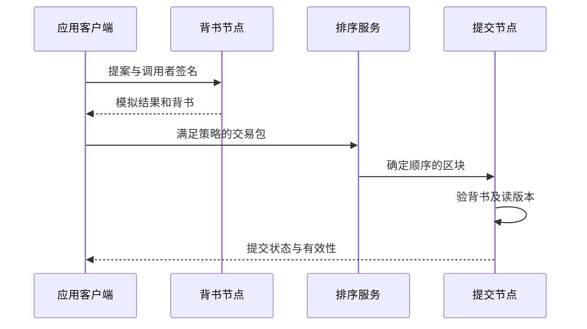
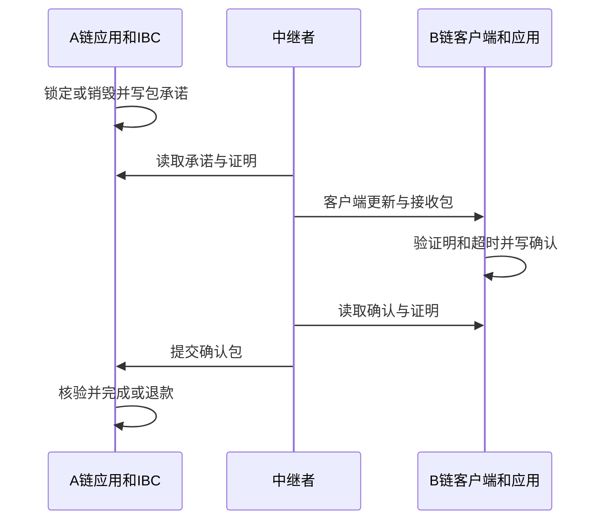

# 跨链互操作与跨链桥

## 本篇目录
- [一、本篇学习目标](#一本篇学习目标)
- [二、三 A、联盟链](#二三-a联盟链)
  - [2.1 A.1 联盟链的核心：多组织共同治理](#21-a1-联盟链的核心多组织共同治理)
  - [2.2 A.2 四个组织走一轮批准](#22-a2-四个组织走一轮批准)
  - [2.3 A.3 以 Fabric 为例理解执行、背书、排序和验证](#23-a3-以-fabric-为例理解执行背书排序和验证)
  - [2.4 A.4 为什么背书成功仍可能提交失败](#24-a4-为什么背书成功仍可能提交失败)
  - [2.5 A.5 通道、私有数据集合与加密的区别](#25-a5-通道私有数据集合与加密的区别)
  - [2.6 A.6 组织变更为什么是安全事件](#26-a6-组织变更为什么是安全事件)
  - [2.7 A.7 联盟链的收益和限制](#27-a7-联盟链的收益和限制)
- [三、三 B、公链](#三三-b公链)
  - [3.1 B.1 公链开放的是什么](#31-b1-公链开放的是什么)
  - [3.2 B.2 公链产币的问题：先区分三种对象](#32-b2-公链产币的问题先区分三种对象)
  - [3.3 B.3 一个发行与转账的教学状态机](#33-b3-一个发行与转账的教学状态机)
  - [3.4 B.4 原生币为什么常参与开放网络的资源约束](#34-b4-原生币为什么常参与开放网络的资源约束)
  - [3.5 B.5 公链的分叉问题：三种情形](#35-b5-公链的分叉问题三种情形)
  - [3.6 B.6 最长链、最重链与最终性](#36-b6-最长链最重链与最终性)
  - [3.7 B.7 为什么公链分叉会成为跨链桥的问题](#37-b7-为什么公链分叉会成为跨链桥的问题)
- [四、跨链互操作](#四跨链互操作)
  - [4.1 先定义“跨链”到底转移什么](#41-先定义跨链到底转移什么)
  - [4.2 EVM 链的跨链模式](#42-evm-链的跨链模式)
  - [4.3 目标链如何判断源链消息可信](#43-目标链如何判断源链消息可信)
  - [4.4 Go：委员会跨链凭证、防重放与原子更新](#44-go委员会跨链凭证防重放与原子更新)
  - [4.5 Cosmos：组件分工与 IBC](#45-cosmos组件分工与-ibc)
  - [4.6 任意链到任意链的跨链](#46-任意链到任意链的跨链)
  - [4.7 跨链故障的具体定位表](#47-跨链故障的具体定位表)
- [五、本篇与知识体系的关系](#五本篇与知识体系的关系)
- [一图看懂本篇流程](#一图看懂本篇流程)
- [官方实现与代码阅读入口](#官方实现与代码阅读入口)


## 一图看懂本篇流程


跨链桥像两个不同国家的银行清算系统之间的中转柜台。源链发生一笔锁定或销毁，目标链再按验证结果释放或铸造资产。

> **怎么读这张图：**从左向右看，先确认输入是什么，再看系统如何检查和处理，最后看结果如何保存或验证。图中是帮助理解的简化流程，协议细节仍以本篇后续说明和官方规范为准。


例如，用户把资产从一条链转到另一条链。桥先核实源链上的锁定事件，再在目标链按规则释放对应资产；如果桥的验证者被攻破，风险会传导到资产。

## 官方实现与代码阅读入口

以下链接指向对应技术的官方文档、标准或项目源码。阅读代码时，建议先从本篇涉及的核心数据结构或验证入口开始，再沿调用关系查看后续处理。

- [IBC 协议文档](https://ibcprotocol.org/)
- [Cosmos IBC 规范](https://github.com/cosmos/ibc)
- [Wormhole 文档](https://wormhole.com/docs/)

**代码来源说明：**官方仓库中的实现代码才代表相应项目的真实实现。正文中用于解释概念的短代码或实验片段，如未明确标出官方文件路径，应按教学演示理解，不能直接当作 Bitcoin Core、Go Ethereum 或其他客户端的生产代码。实际开发应对照上方官方版本、规范和测试。


## 一、本篇学习目标
- 跨链互操作与跨链桥
- 理解核心概念、运行流程和参与角色
- 能够区分协议保证、实现细节与应用层假设
- 能够结合代码或实际场景分析边界与风险

## 二、三 A、联盟链

<a id="sec-013"></a>
### 2.1 A.1 联盟链的核心：多组织共同治理

联盟链通常由多个可识别组织共同运行。加入维护者集合需要许可，但参与者之间不必完全信任。它试图让某一个组织无法单独改变共同认可的记录或规则。[R1]

这里真正需要统计的是独立控制域。甲公司部署 10 个节点、乙公司部署 1 个节点，如果协议按节点数投票且允许甲自行扩容，所谓“多数节点”就可能只是甲的多数副本。

有些系统按组织计票，有些按验证者权重计票；有些业务动作还要求指定角色共同背书。规则必须明确写在配置中，不能靠界面展示“多方参与”来替代。

<a id="sec-014"></a>
### 2.2 A.2 四个组织走一轮批准

教学例设工厂 A、仓库 B、运输商 C、审计方 D 各占一个治理席位，最多允许一个席位作恶。采用需要三个不同席位签名的批准规则。

如果每个诚实席位在同一高度和规则版本只签一个候选，则两个三人集合至少重合两人：

$$
|Q_1\cap Q_2|\ge |Q_1|+|Q_2|-n=3+3-4=2.
$$

在最多一个恶意席位的假设下，交集至少有一个诚实者。这为“两个冲突候选不能都获得这种证据”提供了组合学基础。但还需要协议保证诚实者在跨轮次、重启、配置变化后遵守相应锁定和签名规则。单独实现一个 `len(signatures)>=3`，还不等于实现了安全的 BFT 共识。

如果某笔交接业务要求仓库和运输商都认可，治理三签也不能自动取代这个业务要求。三个治理席位可能是 A、C、D，其中没有 B。系统可以同时存在“业务背书必须含 B、C”和“排序共识达到规定阈值”两种条件。

<a id="sec-015"></a>
### 2.3 A.3 以 Fabric 为例理解执行、背书、排序和验证

Fabric 的典型流程把交易模拟执行与背书、排序、提交验证分开。客户端先收集符合背书策略的模拟结果，再提交排序；节点收到排序后的区块，验证背书和读写集冲突等条件，只有有效交易的写集合进入状态数据库。[R3]



图中的“排序服务”是一个角色集合，具体故障模型取决于配置的排序实现。历史版本中的实现不能直接当作现行版本事实；第5讲单独比较 Fabric 0.6、后续排序方案与 CometBFT。[R4]

<a id="sec-016"></a>
### 2.4 A.4 为什么背书成功仍可能提交失败

假设库存键 `stock/B17` 当前值为 10，版本为 7。两个客户端几乎同时发起操作：

| 交易 | 模拟时读到的值和版本 | 模拟写入 |
|---|---|---|
| T1：取走 3 件 | 10，版本 7 | 7 |
| T2：取走 4 件 | 10，版本 7 | 6 |

两笔提案可能都得到合法背书，因为背书时各自看到的旧状态都允许执行。但若排序结果是 T1 在前，T1 提交后键版本改变，T2 原先依赖的版本 7 已过期。提交验证应拒绝把 T2 的模拟写集合直接应用，避免覆盖前一笔结果。

“无效”交易的记录可能仍留在区块中，用有效性标记区别；这不意味着它的写操作已经改变世界状态。应用应查询提交结果并决定是否基于新状态重试，不能把拿到背书当成库存扣减完成。

<a id="sec-017"></a>
### 2.5 A.5 通道、私有数据集合与加密的区别

Fabric 通道可以让一组组织维护相对独立的账本上下文；私有数据集合则允许同一通道的一部分组织保留某些实际数据，同时其他参与者持有相应哈希证据。实际私有数据经授权的点对点传播保存，排序服务不需要接收这些明文。[R5]

这并不等同于“所有参与者都持有同一份密文”。数据分发权限和密码学加密可以结合，但解决问题的环节不同：前者决定谁收到数据，后者决定拿到字节后谁能解释内容。

如果公开部分只保存“单价”的哈希，而单价只有几千个可能值，非授权方仍可能枚举。应用可以把足够长的随机盐与数据一起承诺，并将盐随私有数据交给授权方；同时要确保每个验证者按同一格式重算承诺。

<a id="sec-018"></a>
### 2.6 A.6 组织变更为什么是安全事件

假设委员会从 `{A,B,C,D}` 变为 `{B,C,D,E}`。旧集合的三签与新集合的三签不能在没有上下文的情况下混算。签名消息应绑定配置纪元、链标识、对象及动作；新配置应由当前有效规则授权，而不是由新加入者自己宣布有效。

一种教学表达是：

$$
M=\operatorname{Encode}(\text{domain},\text{chain},\text{epoch},h,R,\text{action}),
$$

其中 `epoch` 指成员配置版本，$h$ 指对象所在的高度或序号，$R$ 指承诺根。验签者先确定该纪元的可信成员集合，再检查签名，而不是从待验证消息里接受任意公钥列表。

密钥泄露、组织退出、证书失效和节点暂时离线需要不同的处理流程。退出组织的旧签名可能仍是某段历史的有效证据，但不应让其继续对当前配置投票。成员管理的持久化和恢复必须与共识状态一起考虑。

<a id="sec-019"></a>
### 2.7 A.7 联盟链的收益和限制

联盟链的价值常来自共享状态、明确身份、共同策略和可审计的职责分配。其代价包括成员准入、证书基础设施、跨组织运维、策略协商及治理停滞。

如果多数独立成员仍会联合批准虚假数据，密码学不会替他们辨别现场事实；如果能形成共识的必要成员长期离线，系统可能停止推进。安全性和活性也要分别讨论：停止写入可能维持一致性，却不能满足业务及时性。

因此设计时应列出哪些错误要阻止、哪些故障要继续服务、哪些争议只能通过链外程序处理。明确边界比声称“无须信任任何人”更有工程意义。

<a id="sec-020"></a>

## 三、三 B、公链

<a id="sec-021"></a>
### 3.1 B.1 公链开放的是什么

公链通常允许开放读取、提交交易和独立验证。参与共识仍需满足协议条件：PoW 需要提供有效工作量；PoS 需要满足质押、激活与验证者规则。开放并不等于没有成本、没有规则或每个用户自动成为出块者。

一个 RPC 服务商可能要求 API Key，也可能限制访问地区或速率。这是服务入口的策略，不直接改变底层网络的许可性质。反过来，公开网页可以展示联盟链数据，也不会让联盟共识自动变为无需许可。

<a id="sec-022"></a>
### 3.2 B.2 公链产币的问题：先区分三种对象

| 对象 | 谁定义发行规则 | 记在哪里 | 与密码学的关系 |
|---|---|---|---|
| 原生资产 | 链的协议规则及其升级过程 | 共识认可的账户或 UTXO 状态 | 签名控制花费，节点验证发行与转移规则 |
| 合约代币 | 合约代码、管理员或治理规则 | 合约自身状态 | 调用授权、合约状态一致性、许可签名 |
| 跨链表示资产 | 桥的托管、铸造和赎回规则 | 目标链的资产状态 | 外链事件证明或签名证据支持铸造/释放 |

创建一个字符串 `TOKEN`、一份哈希或一对密钥，都不会自动产生被全网接受的余额。发行量必须是状态机允许的结果，且所有验证者按规则重算。

在 Bitcoin 中，节点检查 coinbase 允许领取的补贴与费用上限；在 Ethereum 中，执行层和共识层按各自规则处理费用、奖励与相关余额变化。两者的发行机制不能都概括成“矿工解题就产生币”。PoS 下也没有 PoW 意义的挖矿解题。[R6] [R7]

<a id="sec-023"></a>
### 3.3 B.3 一个发行与转账的教学状态机

设某教学链规则允许初始化时发行 1,000 单位，后续每个有效区块最多新增 2 单位。用户转账只重新分配余额，不能增加总额。

记区块前总量为 $S_t$，实际发行量为 $I_t$，按明确规则销毁量为 $B_t$，则：

$$
S_{t+1}=S_t+I_t-B_t.
$$

这是一条会计恒等式，不是安全证明。验证者还要检查 $I_t$ 与 $B_t$ 是否由规则允许的事件产生，交易有没有重复花费，以及整数运算是否溢出。

假设 Alice 有 100，Bob 有 20，Alice 支付 10、另交 1 的费用。如果费用转给区块生产者，总量不因费用增加；若其中一部分被销毁，总量按销毁量减少。不能在把费用从 Alice 扣除后，又凭空给生产者多加一份同额发行。

<a id="sec-024"></a>
### 3.4 B.4 原生币为什么常参与开放网络的资源约束

开放网络需要决定谁有权占用区块空间、谁为验证和存储成本付费、如何限制廉价身份无限提交请求。手续费、工作量或质押是不同的资源约束设计。

但“采用一种稀缺资源”不自动给出整个系统的经济安全结论。资产价格、退出机制、攻击者可借用的资源、收益模型与治理权限都可能影响实际结果。本讲只解释机制，不把技术分类变成投资判断。

许可链也可以有费用记账单位，开放链也可能有特定的费用补贴或抽象机制。“需要费用”与“必须发行一种公开交易的新代币”不是同一命题。

<a id="sec-025"></a>
### 3.5 B.5 公链的分叉问题：三种情形

**临时竞争分支。** 两个合法区块在相近时间传播，不同节点暂时看到不同头部。协议需要分叉选择规则；未稳定的交易可能从当前主分支退出。

**规则升级导致的分歧。** 新旧客户端对区块有效性的判断可能不同。用集合表示，若新规则允许的区块集合是旧规则允许集合的子集，具有软分叉式收紧特征；若新规则允许旧节点认为无效的结构，则需要相应升级协调。实际升级还涉及部署和激活机制，不能只看版本号。

**共同体长期分裂。** 部分参与者持续维护不同规则和历史，形成不同网络。两边可能共享早期历史、地址和密钥格式，但后来余额和资产语义分别演化。

这三类问题不能都靠“等待六个确认”解决。等待确认主要处理某种分叉选择下的短期重组风险；规则分歧需要明确采用哪个协议；长期分裂后的资产需要分别识别网络和重放保护。

<a id="sec-026"></a>
### 3.6 B.6 最长链、最重链与最终性

Bitcoin 的有效分支选择关注累计工作量，而不是只比较区块数量。每个候选区块首先必须满足交易和区块规则，工作量不能让一笔本来无效的交易变成有效。[R6]

PoS 系统采用的权重、投票、锁定和最终性规则各不相同。Ethereum 的分叉选择与检查点最终性也不是“谁质押最多谁单独决定”。其安全结论依赖验证者行为、网络条件以及可信同步起点等假设。[R7]

所谓最终性应连同成立条件理解。协议定义的最终确定不等于数学上永远不可能出现违规历史；若关键假设被破坏，系统可能进入无法仅靠正常规则解决的异常情形。

<a id="sec-027"></a>
### 3.7 B.7 为什么公链分叉会成为跨链桥的问题

若 A 链一个未稳定的区块包含 Alice 锁定 100 单位的交易，B 链立即据此铸造 100 单位，而 A 后来重组使锁定交易消失，则两条链的资产约束已不一致。

B 链不能仅检查“交易曾经出现在某个区块里”。它还要采用适合 A 的确认策略或最终性证据，并考虑 A 的客户端升级、停滞和重组处理规则。

跨链系统往往把源链共识风险传播到目标链资产。目标链本身的共识继续正常，也不能自动恢复失去抵押或锁定依据的跨链资产。

<a id="sec-028"></a>

## 四、跨链互操作

<a id="sec-029"></a>
### 4.1 先定义“跨链”到底转移什么

跨链互操作是让一个系统依据另一个系统的可验证状态或事件执行动作。它可能传递资产、投票结果、账户控制指令、预言机消息或任意应用数据。[R8]

资产不是从 A 链的硬盘“飞到”B 链。更常见的是 A 上的锁定或销毁，触发 B 上的铸造、释放或流动性支付；两边用不同状态转换维持约定关系。

例如 A 链原生资产不能因为 EVM 兼容就直接出现在 B 的余额表中。B 必须有相应的代币表示、会计规则、流动性池或原生协议支持。用户在 B 拿到的东西与 A 上原资产之间是什么关系，需要从具体桥规则确定。

<a id="sec-030"></a>
### 4.2 EVM 链的跨链模式

#### 4.2.1 EVM 兼容不等于共享共识

EVM 兼容主要表示执行环境、字节码或开发接口具有某种兼容性。两条 EVM 链仍可能使用不同的验证者集合、分叉选择、最终性、费用规则和升级权限。

在 A 上调用 `balanceOf` 返回 100，B 的合约不能凭这个返回字符串判断 A 的真实状态。B 上的普通 EVM 执行也不会自动访问 A 的 RPC。外部信息必须由交易输入带入，并在 B 的规则中完成相应验证。

同一私钥通常能在多个兼容环境中派生相同格式的地址，但地址相同不意味着余额同步、nonce 同步或某份签名可以跨环境安全使用。交易及应用消息必须绑定正确的链、合约和用途。[R14] [R15]

#### 4.2.2 锁定—铸造与销毁—释放

设 Alice 在 A 有 100 单位资产 `X`，希望在 B 使用对应表示 `wX`。以下是忽略费用、损耗与兑换率变化的教学模型：

| 步骤 | A 链状态 | B 链状态 | 谁发起或验证 |
|---|---|---|---|
| 初始 | Alice 持有 100 X | Bob 持有 0 wX | 各链本地状态 |
| 锁定 | Alice 减少 100；桥托管增加 100 | 尚未变化 | Alice 授权，A 合约执行 |
| 证据形成 | 锁定事件达到采用的确认条件 | 尚未变化 | 源链验证者、观察者或证明生成者 |
| 中继 | 不再产生新的锁定 | 待处理消息进入 B | Relayer 提交证据 |
| 铸造 | 托管仍为 100 | Bob 增加 100 wX | B 的验证逻辑与资产合约 |
| 返回 | 等待销毁证据 | Bob 销毁 100 wX | Bob 在 B 发起 |
| 释放 | 托管减少 100；目标接收人增加 100 X | 已销毁 | A 验证 B 的销毁证据 |

Relayer 指中继者，是观察消息并提交交易的链下进程。中继者可以替用户支付目的链交易费，但不应仅因其负责搬运，就获得伪造消息的权限。

在没有待处理消息、费用和其他发行通道的稳定状态中，可以希望满足：

$$
\text{Escrow}_A(X)=\text{Outstanding}_B(wX).
$$

这不是每一瞬间都成立的同步不变量。锁定已完成、铸造尚未完成时，左边暂时更大；返回销毁已完成、释放尚未完成时也是如此。设计时应把在途负债纳入账务模型，而不是看到账面暂时不相等就判断被盗。

如果资产有转账扣费或余额重定价，`transferFrom(...,100)` 不一定使托管实际增加 100。桥应按其支持资产的真实语义计量，或明确拒绝不兼容类型。仅根据调用参数铸造，很容易破坏抵押关系。

#### 4.2.3 销毁—铸造、流动性网络与交换

**销毁—铸造**通常要求发行方或协议认可多个链上的发行控制权。源链销毁降低供应，目标链获证据后新增供应。它减少某些托管环节，但不能跳过证据验证和发行权限管理。

**流动性转移**可能由服务者先在 B 支付 Bob，再在 A 收回 Alice 的支付。用户看到的时间较短，背后仍存在流动性占用、报价、结算和失败恢复问题。快速到账不意味着底层跨链最终性变快。

**原子交换**以双方交换不同链上的资产为目标，不一定创建映射代币。哈希时间锁合约是一类经典思路：共同使用秘密的哈希约束领取，同时提供过期退款路径。它适合的资产操作能力、时间条件和失败行为与普通消息桥不同。

#### 4.2.4 哈希时间锁的小例子

Alice 知道秘密 $s$，公开 $h=H(s)$。Alice 在 A 锁定资产给 Bob，Bob 需要在 $T_A$ 前公开满足哈希关系的 $s$ 才能领取；Bob 在 B 锁定另一资产给 Alice，Alice 可以在更早的 $T_B$ 前用同一个秘密领取。

Alice 领取 B 的资产会公开 $s$，Bob 随后可用它领取 A 的资产。为了给 Bob 观察和提交的时间，应设计 $T_A>T_B$，且差值覆盖传播、确认、拥堵和时钟语义等假设。

如果 Alice 不领取，双方最终走各自退款路径。这里的“原子”是协议目标，不等于两条链在同一条数据库事务中同步提交。一个实现仍可能因为不正确的截止比较、交易重组、手续费不足或网络隔离而失效。哈希锁也可能暴露交换关系，并存在拖延、拒绝完成等经济行为。

<a id="sec-031"></a>
### 4.3 目标链如何判断源链消息可信

#### 4.3.1 先把信任模型分类

| 验证方式 | 目标链实际检查什么 | 主要信任和成本 |
|---|---|---|
| 运营方签名 | 指定公钥对消息的授权 | 运营方诚实、密钥安全、业务核验正确 |
| 多方委员会 | 足够独立成员对同一消息的签名 | 阈值假设、成员独立性、配置更新和签名规则 |
| 轻客户端 | 对端共识证据及状态证明 | 初始可信状态、共识假设、更新频率、验证开销 |
| 有效性证明支持的验证 | 证明电路表达的共识或执行关系 | 正确的陈述、验证密钥/程序版本、数据与状态绑定 |
| 乐观验证 | 提交声明，允许在窗口内反驳 | 至少一个有数据、有资金、有时间且不受持续审查的挑战者 |

“无需信任”应拆成具体信任来源。一个轻客户端可以减少对中继者的信任，但它依然依赖可信初始化和源链安全条件。零知识证明能证明某个计算关系，也不能让错误选择的信任起点自动变正确。

#### 4.3.2 一份 Ethereum 日志证明需要连接哪些对象

若桥根据某个执行交易的日志铸造资产，可把验证链条理解为：

1. 得到并认证源链区块头，确认它符合所采用的链和最终性规则。
2. 从该区块头取得可信 `receiptsRoot`。
3. 验证交易索引对应的收据是否属于该收据树，正确处理键编码和带类型的收据序列化。
4. 在收据中定位日志，检查发出日志的合约地址、事件主题、参数类型及各字段长度。
5. 检查目标链、目标合约、接收人、资产、数额和消息标识是否符合本桥规则。
6. 检查这个源事件尚未消费，再原子地执行目的链状态变化。

这是关于证明组成的教学拆解，不提供省略共识验证的生产实现。第4讲的 MPT 证明方法只覆盖其中一段；不能从“路径验证通过”直接跳到“源链交易已最终确定”。

同样，日志主题匹配并不够。任何合约都可以发出同名事件。必须检查日志的发出地址与可信桥配置一致；即使事件来自正确地址，也还要确认该合约逻辑和升级权限满足业务要求。

#### 4.3.3 消息必须绑定的上下文

一条跨链授权至少应考虑以下信息，具体协议可以采用不同编码，但不能遗漏对应语义：

- 协议名称、版本和动作类别。
- 源链与目标链身份，必要时包括网络创世或检查点上下文。
- 源桥和目标桥地址。
- 资产标识、单位、数额、接收人。
- 源交易、日志索引或源消息序号。
- 委员会配置纪元或轻客户端状态上下文。
- 适用期限、重放控制和必要的执行限制。

整数链标识应当与可信配置一起使用。恶意系统可以自称使用相同 `chainId`，所以该整数本身不是现实网络身份的密码学证明。源链客户端的可信根和配置负责建立更完整的绑定。

对这些字段进行结构化编码再签名，可以避免 `"ab"+"c"` 与 `"a"+"bc"` 这类拼接歧义。Solidity 的 `abi.encode`、明确的类型定义以及 EIP-712 域是相关工程工具，但每个协议仍需自行定义完整消息。[R15] [R16]

<a id="sec-032"></a>
### 4.4 Go：委员会跨链凭证、防重放与原子更新

#### 4.4.1 代码在流程中的位置

代码从“委员会已经检查源事件并签名”之后开始。目标端验证三份不同成员的 Ed25519 签名，检查域和资产，再消费源事件并更新教学余额。

四个公钥由程序生成并作为可信固定配置，阈值为三。这里没有 PoS、BLS、源链 RPC、真实代币托管，也没有验证源块最终性。`FinalizedBlock` 只是签名人关于源块的声明；真实性仍依赖委员会的核验行为。这样才能看清签名证据究竟替代了哪一部分信任。

源事件的重放标识由“源链、源桥、交易、日志索引”计算，不用签名字节充当唯一性依据。即使签名格式或签名人组合变化，同一个源事件也只能消费一次。程序还在修改状态前检查整数溢出，并用互斥锁保护本进程中的检查与更新。

```go
package main

import (
	"crypto/ed25519"
	"crypto/rand"
	"crypto/sha256"
	"encoding/binary"
	"errors"
	"fmt"
	"math"
	"sync"
)

// This is a committee-attestation model, not an Ethereum light client.
type Message struct {
	SourceChain, DestinationChain   uint64
	SourceBridge, DestinationBridge [32]byte
	CommitteeEpoch                  uint64
	FinalizedBlock, TxHash          [32]byte
	LogIndex                        uint32
	Recipient, Asset                [32]byte
	Amount                          uint64
}

func append64(dst []byte, n uint64) []byte {
	return binary.BigEndian.AppendUint64(dst, n)
}

func (m Message) SigningBytes() []byte {
	b := []byte("CryptoNotes/BridgeAttestation/v1\x00")
	b = append64(b, m.SourceChain)
	b = append64(b, m.DestinationChain)
	b = append(b, m.SourceBridge[:]...)
	b = append(b, m.DestinationBridge[:]...)
	b = append64(b, m.CommitteeEpoch)
	b = append(b, m.FinalizedBlock[:]...)
	b = append(b, m.TxHash[:]...)
	b = binary.BigEndian.AppendUint32(b, m.LogIndex)
	b = append(b, m.Recipient[:]...)
	b = append(b, m.Asset[:]...)
	return append64(b, m.Amount)
}

// The replay key identifies the source event, independently of its signature.
func (m Message) EventID() [32]byte {
	b := []byte("CryptoNotes/SourceEvent/v1\x00")
	b = append64(b, m.SourceChain)
	b = append(b, m.SourceBridge[:]...)
	b = append(b, m.TxHash[:]...)
	b = binary.BigEndian.AppendUint32(b, m.LogIndex)
	return sha256.Sum256(b)
}

type Witness struct {
	Member    int
	Signature []byte
}

type Receiver struct {
	mu       sync.Mutex
	Members  []ed25519.PublicKey // Fixed, trusted roster for this teaching epoch.
	Expected Message             // Only the domain fields and asset are used below.
	Used     map[[32]byte]bool
	Balances map[[32]byte]uint64
}

func (r *Receiver) Accept(m Message, witnesses []Witness) error {
	e := r.Expected
	if m.SourceChain != e.SourceChain || m.DestinationChain != e.DestinationChain ||
		m.SourceBridge != e.SourceBridge || m.DestinationBridge != e.DestinationBridge ||
		m.CommitteeEpoch != e.CommitteeEpoch || m.Asset != e.Asset {
		return errors.New("wrong domain, epoch, or asset")
	}
	if len(r.Members) != 4 || m.Amount == 0 || m.Recipient == ([32]byte{}) {
		return errors.New("invalid configuration or payload")
	}
	seen := make(map[int]bool)
	for _, w := range witnesses {
		if w.Member < 0 || w.Member >= len(r.Members) || seen[w.Member] {
			return errors.New("unknown or duplicate signer")
		}
		if !ed25519.Verify(r.Members[w.Member], m.SigningBytes(), w.Signature) {
			return errors.New("invalid signature")
		}
		seen[w.Member] = true
	}
	if len(seen) < 3 {
		return errors.New("need three distinct committee members")
	}

	// Atomic replay check and balance update within this one process.
	r.mu.Lock()
	defer r.mu.Unlock()
	id := m.EventID()
	if r.Used[id] {
		return errors.New("source event already consumed")
	}
	old := r.Balances[m.Recipient]
	if m.Amount > math.MaxUint64-old {
		return errors.New("balance overflow")
	}
	r.Balances[m.Recipient] = old + m.Amount
	r.Used[id] = true
	return nil
}

func check(name string, ok bool) {
	fmt.Printf("%s: %v
", name, ok)
	if !ok {
		panic(name)
	}
}

func main() {
	pubs := make([]ed25519.PublicKey, 4)
	keys := make([]ed25519.PrivateKey, 4)
	for i := range keys {
		pub, key, err := ed25519.GenerateKey(rand.Reader)
		if err != nil {
			panic(err)
		}
		pubs[i], keys[i] = pub, key
	}
	m := Message{SourceChain: 101, DestinationChain: 202, CommitteeEpoch: 7, Amount: 100}
	m.SourceBridge = sha256.Sum256([]byte("bridge-A"))
	m.DestinationBridge = sha256.Sum256([]byte("bridge-B"))
	m.FinalizedBlock = sha256.Sum256([]byte("claimed finalized block"))
	m.TxHash = sha256.Sum256([]byte("source transaction"))
	m.Recipient = sha256.Sum256([]byte("Bob"))
	m.Asset = sha256.Sum256([]byte("asset-A"))
	w := make([]Witness, 3)
	for i := range w {
		w[i] = Witness{Member: i, Signature: ed25519.Sign(keys[i], m.SigningBytes())}
	}
	fresh := func() *Receiver {
		return &Receiver{Members: pubs, Expected: m, Used: make(map[[32]byte]bool), Balances: make(map[[32]byte]uint64)}
	}
	check("two signatures rejected", fresh().Accept(m, w[:2]) != nil)
	check("duplicate signer rejected", fresh().Accept(m, []Witness{w[0], w[0], w[1]}) != nil)
	tampered := m
	tampered.Amount++
	check("changed amount rejected", fresh().Accept(tampered, w) != nil)
	wrongChain := m
	wrongChain.DestinationChain++
	check("other destination rejected", fresh().Accept(wrongChain, w) != nil)
	r := fresh()
	check("first event accepted", r.Accept(m, w) == nil)
	check("replay rejected", r.Accept(m, w) != nil)
	check("balance is 100", r.Balances[m.Recipient] == 100)
	over := fresh()
	over.Balances[m.Recipient] = math.MaxUint64
	check("overflow does not consume event", over.Accept(m, w) != nil && !over.Used[m.EventID()])
}
```

#### 4.4.2 运行结果与值得观察的失败分支

运行 `go run code/ch06/bridge_certificate/main.go`。预期八项检查均输出 `true`，其中“rejected”表示正确拒绝：两人签名不足、重复签名人、数额篡改、错误目标链、事件重放与余额溢出均不能完成记账。

还要注意没有被这个程序覆盖的问题：若三个成员共同签署不存在的源事件，程序仍会接受；若管理者把可信成员集合替换成自己控制的公钥，阈值也失去原先含义。改用 BLS 聚合只会改变签名表示和验证方式，不会自动消除这些治理和观察假设。

若把程序改成多个服务器共同消费消息，仅有进程内互斥锁不够。需要在共享数据库或链上状态机中实现原子条件更新，保证“已消费标记”与“资产变动”同时提交。服务重启后丢失 `Used` 集合，也会让旧事件再次生效。

<a id="sec-033"></a>
### 4.5 Cosmos：组件分工与 IBC

#### 4.5.1 Cosmos 不是“所有链共用一本账”

Cosmos 生态包含构建应用链的工具与互操作协议。Cosmos SDK 提供应用状态机组件；CometBFT 负责相应的网络共识与复制；IBC 定义跨链通信的抽象和消息语义。某条链可以使用其中一部分，不能仅凭名称认定其安全结构完全相同。[R17]

采用同一个 SDK 的两条链，仍可拥有不同验证者、治理规则和原生资产。IBC 让它们按约定验证对端消息，不会把所有链的安全性统一成一个不可分割的整体。

#### 4.5.2 版本边界：Classic 与 v2

查阅到的 IBC-Go 官方说明指出，从 ibc-go v10 开始，同一发行版可以包含 IBC Classic 与 IBC v2 两套独立协议路径。Classic 教学通常使用 client、connection、channel；v2 以客户端、路由器和应用负载组织通信，不能把 Classic 的通道握手字段直接套到 v2。[R12]

本讲逐步消息例子和 Go 承诺编码以 **IBC Classic、ibc-go v8.7.0 的 `CommitPacket`** 为固定基线。这样可以准确学习历史上广泛采用的结构，同时知道新版本的命名和流程已经不同。

| 对象 | Classic 中的作用 | 不应混淆为 |
|---|---|---|
| Client | 保存并更新对端共识状态，提供证明验证能力 | 一个普通 HTTP RPC 客户端 |
| Connection | 连接两端客户端及相应验证关系 | 一条一直保持在线的 TCP 连接 |
| Channel | 在应用端口之间确定通信及排序语义 | 一条所有应用无条件共享的全局队列 |
| Port | 将跨链消息关联到本地应用模块 | 操作系统网络端口号 |
| Relayer | 提交更新和包证明的链下程序 | 可自行决定事实真假的可信管理员 |

#### 4.5.3 轻客户端存什么、验证什么

轻客户端通常保留对端的已验证共识状态，例如某高度对应的状态根、时间和验证者相关信息。新提交的更新必须满足该客户端类型的验证规则，才能为后续状态证明提供可信根。[R9]

对于基于权益验证者的对端，客户端需要考虑信任期、验证者变化、时钟偏差与长期离线问题。某些客户端的安全要求会将信任期约束在解绑期以内，以降低旧验证者退出后凭旧密钥伪造历史的风险。不能只写“更新了一个更高的高度就可信”，也不能把不同客户端类型的具体规则混成统一常量。

跨链证明通常也要绑定高度。一个在旧高度成立的余额或收据，不能在没有其他约束时被当作当前状态。若客户端因证据异常被冻结或超过可接受信任窗口，正确行为可能是停止接受消息，而不是自动跳过验证继续服务。

#### 4.5.4 一轮包发送、接收、确认

教学例：A 链的 `transfer/channel-7` 向 B 发送序号 42 的包，包含资产、数量和接收人，设置 B 的超时高度为 1000。

1. **A 发送。** 应用先按资产转移规则锁定或销毁，核心模块记录包承诺，并增加相应发送序号。
2. **中继观察。** 中继者取得承诺所在高度的证明，必要时先更新 B 上关于 A 的客户端。
3. **B 验证。** B 检查客户端与通道上下文、包承诺证明、序号/接收状态及超时条件，再调用应用模块。
4. **B 接收。** 核心记录已接收信息，应用执行约定动作，并形成成功或失败确认。核心接收和应用结果应按协议的事务语义处理。
5. **确认返回。** 中继者把 B 的确认及其证明提交到 A。
6. **A 完成。** A 验证确认后删除待处理承诺，应用按成功或失败结果完成相应记账。

成功收到包，不一定意味着应用层转账成功。接收端可能形成错误确认，发送端应用再按错误处理返还原先锁定的资产。需要区分“通信包已处理”“应用执行结果”和“发送方已获知结果”。[R10] [R11]



#### 4.5.5 为什么“我没收到确认”不能直接退款

假设 B 已经给 Bob 发放了资产，但确认返回 A 的途中中继离线。若 A 仅因本地等待一分钟没有回信就退款，Alice 的原资产和 Bob 的目标资产会同时可用。

因此，超时需要证明目的链上的相关条件，而不是仅观察源链本地没有消息。Classic 的无序通道通常需要证明目的链尚无该包接收记录，并验证目的链已达到相应超时高度或时间；有序通道使用相应接收序号语义。不同版本还可能增加新的排序与超时模式，必须按选定规范处理。[R10]

如果目的链完全停机且没有新的可验证状态，源链不一定能够安全地证明超时条件已经满足。这是安全与可用性的实际边界：协议不应为了立即退款而允许已经支付与再次退款同时发生。

#### 4.5.6 包承诺为什么没有把所有字段都哈希进去

在选定的 ibc-go v8.7.0 实现中，承诺值是：

$$
C=\operatorname{SHA256}\bigl(
\operatorname{BE64}(t)\parallel
\operatorname{BE64}(r)\parallel
\operatorname{BE64}(h)\parallel
\operatorname{SHA256}(\text{data})\bigr),
$$

其中 $t$ 是超时时间戳，$(r,h)$ 是带修订号的超时高度，`BE64` 表示 8 字节大端编码。来源是该版本的 `CommitPacket`，并非本文自定义排列。[R13]

源端口、通道、序号通过存储路径以及已认证的通道和客户端上下文绑定。比如序号 42 的承诺位于：

```text
commitments/ports/transfer/channels/channel-7/sequences/42
```

验证者需要核对“哪一棵可信状态树中的哪一条键路径承诺了这个值”。仅把承诺摘要与包内计算结果比较，而不检查路径和通道上下文，会丢失协议原本提供的绑定关系。

这也是理解认证数据结构的关键：安全绑定可以分布在值编码、键路径、证明根和上层协议状态中，不能只盯着一个哈希函数的参数列表。

#### 4.5.7 Go：复现包承诺与确认承诺

下面代码只复现字节编码和摘要计算。它不实现完整 IBC 消息格式、标识符校验、Merkle 证明、轻客户端或超时处理。程序采用固定合法的教学标识符和数据。

```go
package main

import (
	"crypto/sha256"
	"encoding/binary"
	"fmt"
)

// Reproduces the packet commitment bytes of ibc-go v8.7.0 (IBC Classic).
// It does not verify Merkle proofs, a light client, or the packet lifecycle.
func packetCommitment(data []byte, timestamp, revision, height uint64) [32]byte {
	b := make([]byte, 24, 56)
	binary.BigEndian.PutUint64(b[0:8], timestamp)
	binary.BigEndian.PutUint64(b[8:16], revision)
	binary.BigEndian.PutUint64(b[16:24], height)
	h := sha256.Sum256(data)
	b = append(b, h[:]...)
	return sha256.Sum256(b)
}

func key(port, channel string, sequence uint64) string {
	// Fixed valid identifiers below; production identifiers need ICS-24 validation.
	return fmt.Sprintf("commitments/ports/%s/channels/%s/sequences/%d", port, channel, sequence)
}

func check(name string, ok bool) {
	fmt.Printf("%s: %v
", name, ok)
	if !ok {
		panic(name)
	}
}

func main() {
	data := []byte(`{"amount":"100","denom":"uatom","receiver":"bob","sender":"alice"}`)
	c := packetCommitment(data, 0, 2, 1000)
	fmt.Printf("commitment: %x
", c)
	fmt.Println("store key:", key("transfer", "channel-7", 42))
	check("same bytes agree", c == packetCommitment(data, 0, 2, 1000))
	check("different timeout differs", c != packetCommitment(data, 0, 2, 1001))
	changed := []byte(`{"amount":"101","denom":"uatom","receiver":"bob","sender":"alice"}`)
	check("different data differs", c != packetCommitment(changed, 0, 2, 1000))
	// Routing context is authenticated by its store path and channel/client state,
	// not by silently adding fields to the actual ICS-04 commitment function.
	check("sequence changes key", key("transfer", "channel-7", 42) != key("transfer", "channel-7", 43))
	check("channel changes key", key("transfer", "channel-7", 42) != key("transfer", "channel-8", 42))
	ack := []byte(`{"result":"AQ=="}`)
	fmt.Printf("acknowledgement commitment: %x
", sha256.Sum256(ack))
}
```

预期包承诺为 `d29e854e358134a41ac75cea4ef54131dd1a4931ba54b64ab81b44eb8e725590`。修改包数据或超时会改变承诺；改变序号或通道会改变存储路径。这两类变化由不同的验证环节负责发现。

JSON 对象语义相同但字段顺序不同，可能形成不同原始字节和承诺。跨链应用应明确传输编码；收到包后不应先随意重排再声称仍在验证同一份字节。

#### 4.5.8 ICS-20 的资产来源路径

IBC 代币转移要跟踪资产来源。资产离开其来源方向时通常进入托管并在另一端产生表示；沿适当路径返回时则销毁表示并释放对应托管。多跳路径会影响资产名称或来源追踪，不能仅凭两个资产都显示 `ATOM` 就认定可互换。[R11]

特别是 A→B 与 A→C→B 两条路径可能产生不同的追踪标识与风险链条。界面把它们显示为同名资产，不会消除不同托管路径、客户端和中继依赖。

<a id="sec-034"></a>
### 4.6 任意链到任意链的跨链

#### 4.6.1 “任意”需要协议适配条件

要从源链 A 到目标链 B 实现某类验证，通常至少需要：

| 条件 | 不满足时会怎样 |
|---|---|
| 源链提供可确定的消息或状态承诺 | 无法精确指定被证明的对象 |
| 能认证源链的承诺根 | 任意伪造根都能自带一份看似正确的路径证明 |
| B 能表达所需验证逻辑 | 需要额外验证器、外部委员会或其他信任模型 |
| 双方有相容的资产/消息语义 | 即使证明字节正确，也不知道本地应做什么 |
| 能实现唯一消费与失败恢复 | 重放、重复支付或永久锁定难以控制 |
| 数据与证明可取得 | 安全验证可能无法推进 |

因此“支持任意链”往往表示一个可扩展适配框架，而非无需对每条链的共识、编码和最终性做分析。某条链缺少可在目的链验证的证据时，方案可能采用委员会作为适配层；这应明确列入信任假设。

#### 4.6.2 从区块共识到业务含义的五层验证

可以把通用跨链接收写成五个相互依赖的判断：

$$
\operatorname{Accept}=C\land I\land D\land A\land U,
$$

这里 $C$ 是承诺根的共识或可信来源检查，$I$ 是包含关系检查，$D$ 是数据格式与域检查，$A$ 是业务授权和状态条件，$U$ 是唯一消费及原子更新。

这是本文用于分析的逻辑分解，不是某篇论文的定理。它强调，任一检查缺失都可能让整体语义失败。一个有效的 Merkle 证明主要覆盖 $I$，并不会自动覆盖其余四项。

#### 4.6.3 用零知识或有效性证明压缩验证

可以让证明系统表达“从可信旧状态出发，按指定程序验证了这段共识更新，得到新根”，目标链只验证较短证明。这样有机会减少链上验证计算，但验证器必须绑定旧状态、程序版本、新状态及相关输入承诺。

如果证明只表达“存在某棵树包含消息”，攻击者可以自己构造树；若证明不绑定源链配置，可能验证的是另一套规则。证明长度短，与其陈述正确且足够强，是两件不同的事情。

证明者的成本、证明生成延迟、可信设置、验证器升级和异常恢复也要计入设计。把共识验证搬入电路并不会让源链的恶意多数假设消失。

#### 4.6.4 延迟、费用与风险如何拆账

在一个串行的锁定—验证—铸造流程中，可以近似列出：

$$
T_{\mathrm{usable}}\approx T_{A\text{确认}}+T_{\text{中继}}+T_{\text{验证准备}}+T_{B\text{入块}}.
$$

若用户还要求 B 上最终确定，要继续加上相应等待；若采用乐观验证或延迟提款，还要加入相应窗口。实际系统可以流水化某些步骤，所以该式是用于分项估算的模型，不是所有桥的固定等式。

费用则可拆成源链执行、中继提交、目的链验证、证明生成、流动性和服务费用。某方案降低链上验证 Gas，可能同时增加链下证明计算；某方案提供即时支付，可能增加流动性资金成本。

跨链系统依赖多个组件时，不能轻率地把各部分“99.9%可靠”相乘得到整体结论。它们可能共用云服务、管理密钥、客户端代码或上游数据，因此故障高度相关。安全分析首先要辨认共同失效来源。

<a id="sec-035"></a>
### 4.7 跨链故障的具体定位表

| 现象 | 应先核对什么 | 不能直接推断什么 |
|---|---|---|
| 源链交易已广播，目标链无余额 | 源交易是否入块且成功、锁定事件是否真实存在 | 广播成功不等于锁定完成 |
| 已有源事件，目标链无处理 | 确认条件、客户端更新、中继提交、目的链费用 | 不一定是验证器拒绝 |
| 路径证明通过，消息仍拒绝 | 链/桥地址、资产、序号、期限、业务状态 | 不能认为证明实现有错 |
| 目的链已支付，源端仍等待 | 确认是否返回、发送承诺是否清除 | 不能仅按源端等待状态退款 |
| 同一消息被多次提交 | 唯一消费键和原子更新是否生效 | 重复网络消息不应造成重复资产变化 |
| 源链回滚，目的链已执行 | 源确认策略、暂停和异常恢复规则 | 目的链正常运行不能修补源抵押缺失 |
| 合约升级后旧证明失效 | 规则版本、验证密钥、存储结构和迁移安排 | 不一定是密码学算法突然失效 |

<a id="sec-036"></a>


## 五、本篇与知识体系的关系

- 所属部分：第五部分：链类型、跨链与模块化区块链
- 返回总目录：[README](../README.md)
