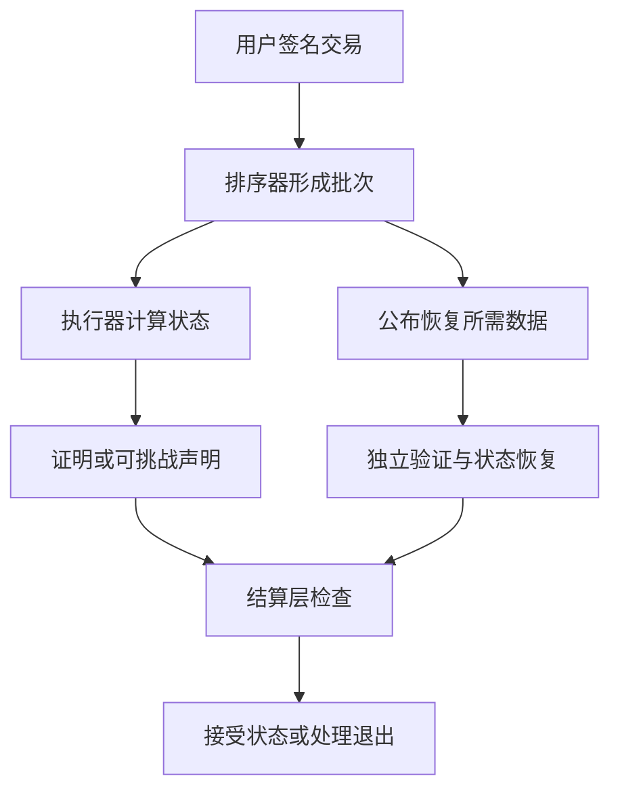

# Layer1、Layer2 与 Rollup

## 本篇目录
- [一、本篇学习目标](#一本篇学习目标)
- [二、模块化区块链](#二模块化区块链)
  - [2.1 模块化拆分的四项职责](#21-模块化拆分的四项职责)
  - [2.2 为什么把执行移到 Layer2](#22-为什么把执行移到-layer2)
  - [2.3 从一笔 L2 转账走完整流程](#23-从一笔-l2-转账走完整流程)
  - [2.4 状态根、数据承诺与有效性证明必须相互绑定](#24-状态根数据承诺与有效性证明必须相互绑定)
  - [2.5 乐观 Rollup 与有效性 Rollup](#25-乐观-rollup-与有效性-rollup)
  - [2.6 数据可用性为什么不是“有一个根”](#26-数据可用性为什么不是有一个根)
  - [2.7 EIP-4844 的 blob 在模块化结构中的位置](#27-eip-4844-的-blob-在模块化结构中的位置)
  - [2.8 数据可用性抽样的基本直觉](#28-数据可用性抽样的基本直觉)
  - [2.9 Rollup、Validium、侧链与主权执行层](#29-rollupvalidium侧链与主权执行层)
  - [2.10 Layer2 本身如何模块化](#210-layer2-本身如何模块化)
  - [2.11 哪些模块故障影响安全，哪些影响活性](#211-哪些模块故障影响安全哪些影响活性)
  - [2.12 模块化能降低什么成本，又转移了什么成本](#212-模块化能降低什么成本又转移了什么成本)
  - [2.13 Go：承诺正确、数据可用和执行正确是三个检查](#213-go承诺正确数据可用和执行正确是三个检查)
- [三、重点内容](#三重点内容)
  - [3.1 一张架构判断表](#31-一张架构判断表)
  - [3.2 易混淆的术语](#32-易混淆的术语)
  - [3.3 一个综合设计练习：仓单跨链融资](#33-一个综合设计练习仓单跨链融资)
  - [3.4 从设计走向验证：应检验哪些性质](#34-从设计走向验证应检验哪些性质)
- [四、复习题与参考答案](#四复习题与参考答案)
  - [4.1 问题](#41-问题)
  - [4.2 参考答案](#42-参考答案)
- [五、本篇与知识体系的关系](#五本篇与知识体系的关系)
- [一图看懂本篇流程](#一图看懂本篇流程)
- [官方实现与代码阅读入口](#官方实现与代码阅读入口)


## 一图看懂本篇流程


Rollup 像把很多人的快递先装进一个大箱子，再统一送到主干运输中心。大量交易在链外处理，结果或证明再提交到主链。

> **怎么读这张图：**从左向右看，先确认输入是什么，再看系统如何检查和处理，最后看结果如何保存或验证。图中是帮助理解的简化流程，协议细节仍以本篇后续说明和官方规范为准。


例如，游戏每秒产生大量道具交易。Rollup 把多笔操作批量处理，再把必要数据或证明提交到主链，主链负责按规则验证和结算。

## 官方实现与代码阅读入口

以下链接指向对应技术的官方文档、标准或项目源码。阅读代码时，建议先从本篇涉及的核心数据结构或验证入口开始，再沿调用关系查看后续处理。

- [Ethereum 扩容文档](https://ethereum.org/en/developers/docs/scaling/)
- [Optimism 规范](https://github.com/ethereum-optimism/specs)
- [Arbitrum 文档](https://docs.arbitrum.io/)

**代码来源说明：**官方仓库中的实现代码才代表相应项目的真实实现。正文中用于解释概念的短代码或实验片段，如未明确标出官方文件路径，应按教学演示理解，不能直接当作 Bitcoin Core、Go Ethereum 或其他客户端的生产代码。实际开发应对照上方官方版本、规范和测试。


## 一、本篇学习目标
- Layer1、Layer2 与 Rollup
- 理解核心概念、运行流程和参与角色
- 能够区分协议保证、实现细节与应用层假设
- 能够结合代码或实际场景分析边界与风险

## 二、模块化区块链

<a id="sec-037"></a>
### 2.1 模块化拆分的四项职责

“模块化”指把原本由一套网络或软件紧密完成的职责拆成可组合的部分。首先应确定拆的是什么，而不是把网络中出现的每一个服务都叫作一层。

| 职责 | 核心问题 | 典型输入与输出 |
|---|---|---|
| 执行 Execution | 交易按规则运行后发生什么变化？ | 旧状态、交易、环境 → 新状态、收据 |
| 排序/共识 Ordering/Consensus | 采用哪一个交易顺序或数据历史？ | 候选、投票/工作量 → 认可的序列或检查点 |
| 数据可用性 DA | 验证和恢复所需的数据是否已可获得？ | 数据块、承诺、传播/抽样 → 可用性判断 |
| 结算 Settlement | 哪个状态声明可最终接受，争议和退出如何处理？ | 状态根、证明/挑战 → 被接受状态及资产结算 |

这些职责不必一一对应四条链。Ethereum L1 可以同时承担多项职责；某 Rollup 的执行器和证明器可能在同一运营方控制下；某外部 DA 网络仍有自己的共识。模块分开部署，也不代表控制权已经分散。[R18] [R19]

<a id="sec-038"></a>
### 2.2 为什么把执行移到 Layer2

若每笔交易都由 L1 的所有完整验证节点执行，其吞吐会受到节点计算、网络传播和持久化能力的共同约束。Rollup 将较多执行放到链下或另一个执行域，再把用于恢复状态的数据和验证状态的机制连接到 L1。

这里的“链下”是相对于结算链而言，不代表执行没有规则或记录。L2 通常有自己的交易顺序、区块、账户状态和节点；L1 合约或协议机制处理状态声明与资产退出。[R20]

可以类比为很多人完成作业，提交可检查的结果与所需材料。但类比的边界在于：检查者关键在于执行明确的重算、挑战或证明验证规则。材料缺失会影响检查，即使结果附着一个很短的摘要。

<a id="sec-039"></a>
### 2.3 从一笔 L2 转账走完整流程

设 Alice 在某 Rollup 有 100 单位，向 Bob 转 10。一般化流程可分解为：

1. 钱包构造并签署属于该 L2 域的交易，包含 nonce、接收人和数额。
2. 排序器接收交易并决定候选顺序。排序器回执提供的是特定程度的预确认，强度依协议而定。
3. 执行器从旧状态运行交易，检查签名、nonce、余额和规则，形成新状态根。
4. 批次发布者把约定的数据发布到 L1 的 calldata、blob 或其他 DA 系统。
5. 其他节点按确定性推导规则恢复 L2 输入，并独立执行或检查证明。
6. 结算逻辑根据有效性证明或挑战规则接受状态声明。
7. 如涉及提款，还要验证提款消息及其消费状态，完成 L1 释放。

这是通用分析框架。不同 Rollup 的发布者、排序器、证明者和结算合约可能有不同组织方式，具体字段也不同。不能从一张通用架构图推出某个实际网络已经具备强制纳入、无需许可挑战或即时退出能力。



<a id="sec-040"></a>
### 2.4 状态根、数据承诺与有效性证明必须相互绑定

设 $R_{\mathrm{old}}$ 为可信旧状态根，$B$ 为有序批次，$C_B$ 为批次承诺，$v$ 为执行规则版本。正确状态转换的关系应同时涉及这些对象：

$$
R_{\mathrm{new}}=\operatorname{Root}\bigl(F_v(S_{\mathrm{old}},B)\bigr),
\quad \operatorname{Root}(S_{\mathrm{old}})=R_{\mathrm{old}},
\quad \operatorname{Commit}(B)=C_B.
$$

如果只证明“存在一个执行可得 $R_{\mathrm{new}}$”，却不约束旧根和批次，证明者可能选用另外一份输入。若公开数据属于批次 A，而证明执行的是批次 B，也会破坏节点重建同一状态的能力。

实际系统还会绑定链域、批次号、时间或 L1 来源上下文、系统交易和规则升级信息。这些属于证明的公开输入或相应承诺关系，不能留给链下口头约定。

<a id="sec-041"></a>
### 2.5 乐观 Rollup 与有效性 Rollup

**乐观方式**允许提交状态声明，并提供在规定窗口内反驳错误声明的机制。正常路径不需要为每批生成完整有效性证明，但系统依赖能够获得数据并及时发起有效挑战的参与者。错误声明的处理还涉及争议游戏、保证金、超时和合约权限。[R21]

**有效性方式**要求提交证明，验证器通过后才按规则接受状态转换。其优势是对状态正确性的接受不依赖同样的逐批反驳流程；代价包括证明生成、约束实现、验证器维护及特定证明系统的假设。[R22]

“ZK Rollup”这个名称不保证用户交易天然隐藏。很多系统使用零知识证明技术主要为了证明执行正确，仍会公开重建所需的交易或状态差异数据。隐私需要另行设计隐藏对象、公开输入和信息泄露边界。

<a id="sec-042"></a>
### 2.6 数据可用性为什么不是“有一个根”

假设运营方公布 `H(整批数据)`，但拒绝提供数据。你能在将来拿到一份候选数据时核对它是否匹配，却不能从 32 字节摘要反推出整个批次。

没有数据时，独立执行器不能重建账户状态；挑战者可能无法定位错误；新节点难以恢复；用户也可能拿不到退出所需的状态证明。具体影响取决于系统设计，不能一概说成“立即可盗走所有资产”，也不能说成“有证明就完全不受影响”。[R18]

数据可用性与长期存储还要区分：某协议在确认区块时确保数据能够下载，不一定承诺每个普通节点永久保存全部历史。归档、索引、快照与恢复服务需要独立安排。

<a id="sec-043"></a>
### 2.7 EIP-4844 的 blob 在模块化结构中的位置

EIP-4844 引入专门承载 blob 的交易格式和费用机制。Blob 的完整数据不能像 calldata 一样直接由普通 EVM 执行任意读取；交易和执行逻辑可关联相应版本化哈希，并通过规定的承诺与证明接口检查关系。[R23]

这使 Rollup 可以使用一种专门的数据发布资源，但不会替 Rollup 执行全部交易，也不会把 KZG 承诺变成状态转换证明。第9讲将给出 KZG 多项式关系及真实 Go 库示例。

参数要注明升级版本。Dencun 初始 blob 目标/上限为每块 3/6，Pectra 的 EIP-7691 调整为 6/9；这些是明确历史阶段的参数，不应作为未来所有升级通用的常量。本讲不把这组数字冒称 2026 年任意时刻的最新上限。[R24]

<a id="sec-044"></a>
### 2.8 数据可用性抽样的基本直觉

数据可用性抽样（DAS）让轻节点随机请求部分数据份额及其认证证明，以较小下载量获得数据可用性的概率性证据。实际协议通常还结合纠删码、网络传播与恢复机制。[R19]

为理解抽样本身，设攻击者固定隐藏比例为 $\alpha$ 的份额，每次独立均匀有放回抽一个份额。抽 $s$ 次都没有碰到隐藏份额的概率为：

$$
P_{\mathrm{miss}}=(1-\alpha)^s.
$$

取 $\alpha=1/4,s=30$，得到约 $0.0001786$，即约 $0.01786\%$。这只是给定隐藏比例和独立抽样的教学计算，不是某实际网络的完整安全指标。

真实分析还要考虑隐藏多少份额才足以阻止恢复、编码是否正确、不同轻节点的抽样相关性、对手能否按请求选择性响应、是否连接到诚实节点，以及足够样本是否最终汇集到可恢复数据的参与者。只写出上式就声称解决 DA，遗漏了大部分协议前提。

<a id="sec-045"></a>
### 2.9 Rollup、Validium、侧链与主权执行层

| 结构 | 状态正确性主要如何处理 | 数据和结算依赖 | 需要重点检查 |
|---|---|---|---|
| 以 L1 提供 DA 的 Rollup | 挑战或有效性验证 | 恢复所需数据进入约定的 L1 数据层，结算按 L1 机制执行 | 验证器、升级权、退出和强制纳入规则 |
| Validium 类设计 | 通常使用有效性证明 | 数据在外部系统，退出可依赖外部数据可用性 | 数据扣留时谁能恢复或退出 |
| 侧链 | 自己的共识维护状态 | 桥连接其他链，安全依赖其验证者及桥 | 不应仅因桥接 L1 就声称继承同等安全 |
| 主权执行/rollup 类设计 | 自己的节点按规则验证 | 可复用 DA，但规则与分叉决策未必由另一链合约裁定 | 谁决定升级、谁选择分支、谁解释 DA 数据 |

这些名称在不同项目中可能有差异。判断时应回到“谁验证什么、数据在哪里、谁裁决争议”，而不是只看营销标签。把 DA 换成外部系统，会改变原有数据安全假设，即使执行证明完全不变。

<a id="sec-046"></a>
### 2.10 Layer2 本身如何模块化

L2 内部也能拆分服务：

- 排序器负责交易纳入与排序。
- 执行节点按规则计算状态，可独立于排序器重算。
- 批次发布者负责将数据交给 DA 层。
- 证明者生成有效性证明，或挑战者监控并反驳错误声明。
- 结算合约验证状态声明并管理退出。
- 索引器把事件和状态整理成便于查询的数据库。

同一个主体可能兼任多项角色。角色解耦提供替换和并行机会，但也引入接口、故障恢复和版本协同成本。比如执行器升级而证明器仍使用旧规则，可能生成不匹配的根；发布者漏发批次，会使排序器的预确认无法转成可重建的正式历史。

共享排序器可以协调多个执行域的顺序，但不自动使多链交易具有原子性。要实现“全部成功或全部不发生”，仍须定义跨域提交条件、超时、回滚或补偿语义。

<a id="sec-047"></a>
### 2.11 哪些模块故障影响安全，哪些影响活性

| 故障或攻击 | 可能的直接影响 | 完整分析还需什么条件 |
|---|---|---|
| 排序器离线 | 新交易不能按正常入口推进 | 是否有替代排序器、强制提交和恢复规则 |
| 排序器提交错误状态 | 无效状态声明 | 证明能否阻止、挑战是否可用、管理员是否可绕过 |
| 数据发布者扣留数据 | 重算、挑战、同步或退出受阻 | DA 检查与处罚/回退机制 |
| 证明者离线 | 可验证状态推进延迟 | 其他人能否生成证明，是否存在专有依赖 |
| 索引器出错 | 页面余额、统计或交易列表错误 | 原始节点/RPC是否可独立核对 |
| 升级管理员失陷 | 验证规则或资产逻辑可能被替换 | 多签、延迟、退出窗口及实际权限范围 |

密码学验证正确的系统仍可能有暂停或升级特权。评价整体安全要把这些权限纳入模型，不能只分析最理想的正常路径。

<a id="sec-048"></a>
### 2.12 模块化能降低什么成本，又转移了什么成本

一个用于思考的批次成本模型是：

$$
C_{\mathrm{batch}}=F+P(N)+N\cdot c_{\mathrm{exec}}+D(N),
$$

其中 $F$ 为固定提交成本，$P(N)$ 为证明或检查成本，$c_{\mathrm{exec}}$ 为平均链下执行成本，$D(N)$ 为数据发布成本。平均每笔成本是该式除以 $N$。

用人为设定的“成本单位”举例：固定提交 100、证明 200、每笔执行 2、每笔数据 1，则每笔成本为 $3+300/N$。十笔成批时为 33，一千笔成批时为 3.3。此例只演示固定成本摊薄，不是市场费用或性能测量。

批次越大可能等待越久；证明成本未必线性；blob 空间低利用率会提高每笔分摊成本；DA 价格和拥堵也会变化。因此“批量更便宜”应与延迟、可用性和运营成本一起权衡。

<a id="sec-049"></a>
### 2.13 Go：承诺正确、数据可用和执行正确是三个检查

本程序有 Alice、Bob 两个账户。输入依次为 Alice 转 10 和转 5，nonce 分别为 0、1。验证者从可信旧状态重算，预期最终 Alice 为 85、nonce 为 2，Bob 为 35。

代码先核对有序批次承诺，再执行并比较状态根；当数据不可用、声明新根错误或顺序导致 nonce 不符时拒绝。为了专注状态转换，它假设交易授权已经由前置模块检查。这里的 `available` 是模拟环境给出的可用性标志，不是由一行布尔值实现了 DA 协议。

```go
package main

import (
	"crypto/sha256"
	"encoding/binary"
	"errors"
	"fmt"
	"math"
)

type Account struct{ Balance, Nonce uint64 }
type State [2]Account
type Transfer struct {
	From, To      uint8
	Amount, Nonce uint64
}

func stateRoot(s State) [32]byte {
	b := []byte("CryptoNotes/State/v1\x00")
	for i, a := range s {
		b = append(b, byte(i))
		b = binary.BigEndian.AppendUint64(b, a.Balance)
		b = binary.BigEndian.AppendUint64(b, a.Nonce)
	}
	return sha256.Sum256(b)
}

func batchCommitment(batch []Transfer) [32]byte {
	b := []byte("CryptoNotes/Batch/v1\x00")
	b = binary.BigEndian.AppendUint64(b, uint64(len(batch)))
	for _, t := range batch {
		b = append(b, t.From, t.To)
		b = binary.BigEndian.AppendUint64(b, t.Amount)
		b = binary.BigEndian.AppendUint64(b, t.Nonce)
	}
	return sha256.Sum256(b)
}

// Authorization is assumed to have been checked before this teaching function.
// This is full re-execution; it is neither a fraud-proof VM nor a ZK proof.
func execute(s State, batch []Transfer) (State, error) {
	next := s
	for _, t := range batch {
		if t.From > 1 || t.To > 1 || t.From == t.To || t.Amount == 0 {
			return s, errors.New("bad transfer")
		}
		from, to := &next[t.From], &next[t.To]
		if from.Nonce != t.Nonce || from.Nonce == math.MaxUint64 || from.Balance < t.Amount || to.Balance > math.MaxUint64-t.Amount {
			return s, errors.New("nonce, balance, or overflow")
		}
		from.Balance -= t.Amount
		from.Nonce++
		to.Balance += t.Amount
	}
	return next, nil
}

func validate(old State, data []Transfer, available bool, commitment, claimedRoot [32]byte) error {
	if !available {
		return errors.New("data unavailable: cannot re-execute")
	}
	if batchCommitment(data) != commitment {
		return errors.New("batch commitment mismatch")
	}
	next, err := execute(old, data)
	if err != nil {
		return err
	}
	if stateRoot(next) != claimedRoot {
		return errors.New("incorrect state transition")
	}
	return nil
}

func check(name string, ok bool) {
	fmt.Printf("%s: %v
", name, ok)
	if !ok {
		panic(name)
	}
}

func main() {
	old := State{{Balance: 100}, {Balance: 20}}
	batch := []Transfer{{From: 0, To: 1, Amount: 10, Nonce: 0}, {From: 0, To: 1, Amount: 5, Nonce: 1}}
	next, err := execute(old, batch)
	if err != nil {
		panic(err)
	}
	c, root := batchCommitment(batch), stateRoot(next)
	check("valid batch accepted", validate(old, batch, true, c, root) == nil)
	wrong := next
	wrong[1].Balance++
	check("committed data cannot justify wrong state", validate(old, batch, true, c, stateRoot(wrong)) != nil)
	check("commitment alone is not available data", validate(old, nil, false, c, root) != nil)
	reversed := []Transfer{batch[1], batch[0]}
	check("order changes commitment", batchCommitment(reversed) != c)
	_, err = execute(old, reversed)
	check("reordered nonces rejected", err != nil)
	fmt.Printf("final: Alice=%d nonce=%d Bob=%d
", next[0].Balance, next[0].Nonce, next[1].Balance)
}
```

这个程序执行完整重算，没有生成零知识证明，也没有实现争议游戏。真实 Rollup 可以把类似的规则放入证明或挑战机制，但还需绑定规则版本、系统输入、L1 数据来源和全体交易语义。

改变两条交易的顺序不仅会改变批次承诺，还会使第二条先遇到错误 nonce。哈希能发现输入变了；状态机能判断变化后的输入是否合法。两个模块的职责因此清晰分开。

<a id="sec-050"></a>

## 三、重点内容

<a id="sec-051"></a>
### 3.1 一张架构判断表

在阅读一个新项目时，可按以下顺序形成可核对的说明：

| 问题 | 应记录的具体内容 |
|---|---|
| 谁能维护账本？ | 成员准入、投票权重、独立控制域、退出规则 |
| 一笔交易如何生效？ | 认证、业务授权、执行、排序、提交与最终性 |
| 哪些数据保密？ | 谁持明文、谁持密文、谁持承诺、谁管理密钥 |
| 跨链接收信任什么？ | 源链可信状态、委员会或轻客户端、证明类型 |
| 如何防重复执行？ | 源事件唯一标识、域隔离、原子消费、持久化 |
| 失败怎样恢复？ | 错误确认、可证明超时、暂停、回退与人工治理 |
| 模块化拆在哪里？ | 排序、执行、DA、结算和索引的部署与控制者 |
| 一个模块坏了怎么办？ | 安全与活性影响，替代参与者和恢复路径 |

<a id="sec-052"></a>
### 3.2 易混淆的术语

| 术语 | 本讲采用的含义 | 常见误解 |
|---|---|---|
| 许可制 | 部分参与权限由明确管理规则授予 | 等于数据天然加密 |
| 联盟治理 | 多个组织共同控制某些规则与资源 | 多部署几台同属一家的机器就满足 |
| 背书 | 按策略认可特定模拟结果或业务陈述 | 已排序、已提交、已最终确定 |
| 中继 | 搬运消息及证据并提交交易 | 搬运者天然可信 |
| 轻客户端 | 验证并维护精简的对端可信状态 | 只连接别人提供的 RPC |
| 跨链表示资产 | 按某桥规则对应外部资产的本地表示 | 一定与原生资产拥有相同风险和可兑付性 |
| 数据承诺 | 固定数据并允许后续核对 | 数据已经公开且永久可下载 |
| 有效性证明 | 针对指定关系的可验证证据 | 自动证明所有业务目标和治理假设 |
| 模块化 | 将职责以明确接口拆分组合 | 自动降低所有成本或消除信任 |

<a id="sec-053"></a>
### 3.3 一个综合设计练习：仓单跨链融资

设联盟链记录仓库验收，公链合约允许依据仓单状态登记一种凭证。先按信息流拆解，而不是立即决定用哪种桥。

联盟链要定义谁能确认货物数量、如何防止一张仓单重复抵押、更新和撤销的业务条件。跨链层要说明如何认证联盟状态根或委员会声明。公链接收层要绑定仓单 ID、版本、发行域、接收人和动作，并记录已处理版本。

若现实货物已经损毁但联盟尚未登记，公链上的签名和证明依然可能全部通过。因此该系统的现实资产风险需要库存监管、保险、审计和争议机制配合。技术证明不能填补未观察到的现实事件。

若仓单版本 5 表示有效、版本 6 表示撤销，目的链不能在已经接受版本 6 后又接受延迟到达的版本 5。这里除了唯一消费，还需要单调版本或明确状态转换规则。消息只执行一次，不等于所有消息按正确业务顺序执行。

<a id="sec-054"></a>
### 3.4 从设计走向验证：应检验哪些性质

以下是这类系统值得验证的性质，而不是声称本讲代码已经实现全部性质：

1. **授权完整性：** 改接收人、数额、资产、链域、合约或配置纪元后，旧证据不能通过。
2. **唯一消费：** 同一源事件在并发、中继重试和服务重启后仍只能产生一次资产效果。
3. **状态原子性：** 错误处理不能留下“已经标记消费但没有支付”或“已经支付但未标记”的半完成状态。
4. **证据来源：** 错误链头、错误状态根和错误证明路径必须被拒绝。
5. **有序版本：** 过期状态不能覆盖较新业务状态。
6. **失败可恢复：** 在协议明确允许的情况下，超时或错误确认能完成退款；缺少证明时不能冒险退款。
7. **可观察性：** 可以区分未发送、待确认、证明失败、应用失败、已完成与等待确认回传。

对于模块化执行，还应检查“已公布数据”和“被证明执行的批次”是否相同；不同实现对排序、编码、整数边界和升级时刻是否一致。安全测试应围绕这些性质设计，而不是只统计成功提交了多少笔交易。

<a id="sec-055"></a>

## 四、复习题与参考答案

<a id="sec-056"></a>
### 4.1 问题

1. 一个集团在五个机房运行五个节点，为什么不一定形成五个独立信任主体？
2. 私有链上所有记录都有签名，是否能证明记录没有遗漏？
3. Fabric 背书成功后，为什么可能因读版本冲突而不更新状态？
4. 三份有效签名来自同一公钥的三次提交，能算三人批准吗？
5. 两条 EVM 链使用同一地址，为什么余额和 nonce 不会自动同步？
6. 为什么跨链重放键不宜仅使用签名字节？
7. 一份收据的 MPT 证明验证通过，是否足以铸造映射资产？
8. IBC 包承诺中没有序号，是否意味着序号未被认证？
9. 目的链已经支付，但确认没有返回时，源链为什么不能只按本地等待时间退款？
10. 采用 IBC 后，是否仍需关心对端验证者变更和轻客户端过期？
11. 一个 Rollup 的批次哈希正确，新状态根是否必然正确？
12. 有效性证明通过，但恢复数据被扣留，会产生什么问题？
13. DAS 教学公式 $(1-\alpha)^s$ 省略了哪些实际协议条件？
14. 使用外部 DA 后，系统是否仍可原封不动地沿用原来的安全声明？
15. 共享排序器是否自动实现跨链原子交易？
16. 从源链签名委员会换成 BLS 聚合，哪些成本和假设改变，哪些不变？

<a id="sec-057"></a>
### 4.2 参考答案

**1.** 关键在于独立控制权。共同管理员、共同根密钥或统一升级权限可能使五个节点同时受同一主体控制。地理冗余有助于可用性，但不能自动转化为治理独立性。

**2.** 不能。签名检查已经出现的数据是否获得相应授权；遗漏检测需要预先约定应出现的事件集合、签收证据或其他完整性规则。

**3.** 背书基于模拟时的状态。排序后前面的交易可能改变所读键版本，原模拟结果不再适用于提交时状态，因此需拒绝其写集合或重新发起。

**4.** 不能。成员需要按可信名单唯一识别并去重。还应防止同一控制者通过重复登记公钥绕过组织层面的独立性规则。

**5.** 每条链有独立状态机和历史。相同的地址派生规则仅产生相同形式的身份标识，不会同步账本。

**6.** 同一事件可以由不同签名集合证明，也可能存在不同编码。唯一消费应围绕规范化的源事件身份和域，而不是证明对象的偶然字节表示。

**7.** 不足。还需要认证根和源链确认条件、检查日志发出者与字段、业务权限及唯一消费。路径证明只连接数据与一个给定根。

**8.** 不是。序号通过承诺存储路径及已认证的通道状态绑定。验证时必须检查完整证明上下文，不能只比较值摘要。

**9.** 因为目的链可能已支付。需要目的链相关状态的证明来排除重复支付，而不是把消息延迟误判为从未执行。

**10.** 需要。客户端维护可信共识状态，必须遵守其类型规定的更新、信任期、冻结和恢复规则。IBC 不会使源链的安全假设消失。

**11.** 不必然。承诺固定输入数据，新根还必须由合法执行得到。错误执行可以为同一输入产生错误的声明根。

**12.** 可能影响独立同步、状态恢复、生成退出证明或系统活性。具体资金风险依退出和数据机制而定，不能仅凭“证明通过”排除这些问题。

**13.** 它假设固定隐藏比例和独立均匀抽样，未覆盖编码正确性、恢复阈值、网络隔离、选择性响应、样本汇聚和不同参与者相关性。

**14.** 不可以直接沿用。DA 的故障模型、验证方式、可恢复性和结算层验证接口变化后，需要重新检查组合安全与退出条件。

**15.** 不会。共享顺序解决部分协调问题；跨域交易的全部成功或失败还需提交协议、失败处理和相关状态约束。

**16.** 签名对象大小和验证/聚合过程改变，还需满足 BLS 变体的公钥与聚合前提；成员是否诚实、是否观察正确源事件、治理密钥是否可靠等假设仍然存在。

<a id="sec-058"></a>


## 五、本篇与知识体系的关系

- 所属部分：第五部分：链类型、跨链与模块化区块链
- 返回总目录：[README](../README.md)
