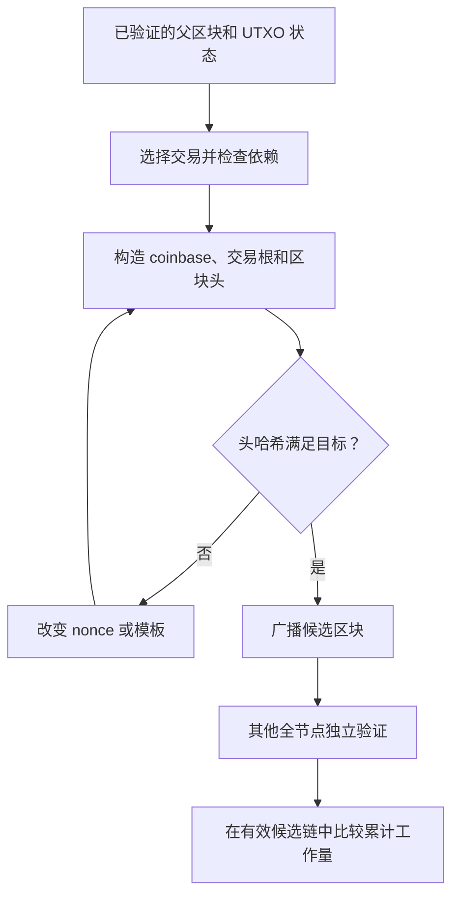

# UTXO、交易费与双花防护

## 本篇目录
- [一、本篇学习目标](#一本篇学习目标)
- [二、Bitcoin 的数据结构](#二bitcoin-的数据结构)
  - [2.1 Bitcoin 的基本的区块结构](#21-bitcoin-的基本的区块结构)
  - [2.2 区块的产生流程](#22-区块的产生流程)
  - [2.3 比特币解决区块分叉的问题](#23-比特币解决区块分叉的问题)
  - [2.4 确认位](#24-确认位)
- [三、通过浏览器和 RPC 看区块头和区块体](#三通过浏览器和-rpc-看区块头和区块体)
  - [3.1 浏览器里面看区块头的信息](#31-浏览器里面看区块头的信息)
  - [3.2 浏览器里面看区块体的信息](#32-浏览器里面看区块体的信息)
  - [3.3 通过 RPC 看区块头和区块体](#33-通过-rpc-看区块头和区块体)
- [四、Bitcoin 的共识算法](#四bitcoin-的共识算法)
  - [4.1 交易到落块的生命周期](#41-交易到落块的生命周期)
  - [4.2 挖矿难度问题](#42-挖矿难度问题)
  - [4.3 比特币减半问题](#43-比特币减半问题)
- [五、UTXO 是什么](#五utxo-是什么)
- [六、交易怎样更新 UTXO 集合](#六交易怎样更新-utxo-集合)
  - [6.1 数字示例](#61-数字示例)
- [七、为什么 UTXO 有利于检测双花](#七为什么-utxo-有利于检测双花)
- [八、交易费和区块奖励](#八交易费和区块奖励)
- [九、区块头与挖矿搜索空间](#九区块头与挖矿搜索空间)
- [十、UTXO 模型的特点](#十utxo-模型的特点)
- [十一、本讲小结](#十一本讲小结)
- [十二、本篇与知识体系的关系](#十二本篇与知识体系的关系)
- [一图看懂本篇流程](#一图看懂本篇流程)
- [官方实现与代码阅读入口](#官方实现与代码阅读入口)


## 一图看懂本篇流程


双花像拿同一张礼品卡去两家店同时消费。店员需要查卡里的余额和使用记录；Bitcoin 节点通过 UTXO 集合检查是否已经花掉。

> **怎么读这张图：**从左向右看，先确认输入是什么，再看系统如何检查和处理，最后看结果如何保存或验证。图中是帮助理解的简化流程，协议细节仍以本篇后续说明和官方规范为准。


例如，Alice 把同一张 100 元购物卡同时发给两家店。两家店都收到付款请求时，系统必须根据共享使用记录决定哪一笔可以被接受。

## 官方实现与代码阅读入口

以下链接指向对应技术的官方文档、标准或项目源码。阅读代码时，建议先从本篇涉及的核心数据结构或验证入口开始，再沿调用关系查看后续处理。

- [Bitcoin Core 交易验证](https://github.com/bitcoin/bitcoin/blob/master/src/validation.cpp)
- [Bitcoin Core UTXO](https://github.com/bitcoin/bitcoin/blob/master/src/coins.cpp)

**代码来源说明：**官方仓库中的实现代码才代表相应项目的真实实现。正文中用于解释概念的短代码或实验片段，如未明确标出官方文件路径，应按教学演示理解，不能直接当作 Bitcoin Core、Go Ethereum 或其他客户端的生产代码。实际开发应对照上方官方版本、规范和测试。


## 一、本篇学习目标
- UTXO、交易费与双花防护
- 理解核心概念、运行流程和参与角色
- 能够区分协议保证、实现细节与应用层假设
- 能够结合代码或实际场景分析边界与风险

## 二、Bitcoin 的数据结构

<a id="sec-005"></a>
### 2.1 Bitcoin 的基本的区块结构

Bitcoin 区块的逻辑主体是区块头与有序交易列表。网络消息或磁盘文件还可能带有消息魔数、长度等外层封装；不能把这些传输字段加进 80 字节区块头计算区块哈希。[区块参考][R05]

| 区块头字段 | 字节数 | 意义 | 常见误解 |
|---|---:|---|---|
| `version` | 4 | 区块版本及相关部署信号语境 | 不是所有置位都表示独立升级已经激活 |
| `previous block hash` | 32 | 前一区块头的双 SHA-256 标识 | 不直接存放前一区块全文 |
| `merkle root` | 32 | 本区块交易 txid 树的承诺 | 不等于全网 UTXO 集根 |
| `time` | 4 | 矿工填写并受共识上下文约束的时间戳 | 不是每笔交易的精确发生时间 |
| `nBits` | 4 | 工作量目标的压缩表示 | 不是哈希前必须有多少个字符 `0` |
| `nonce` | 4 | 头部中的一个搜索变量 | 不代表矿工只能尝试 $2^{32}$ 个候选 |

字段总长为 $4+32+32+4+4+4=80$。整数按小端序列化，哈希字段使用协议内部字节序；浏览器常见十六进制显示会反转区块哈希字节的呈现顺序。计算 `SHA256(SHA256(header))` 的原始 32 字节结果，与把浏览器显示的字符串直接当成原始字节，是两个不同操作。对照实现时，应先明确处理的是整数值、内部字节串还是显示文本。

交易列表先有 CompactSize 编码的交易数量，然后按顺序存放交易。首笔为 coinbase 交易，它没有普通意义上引用旧 UTXO 的输入，可按规则领取补贴与本区块手续费，但金额上限、脚本和成熟期仍受限制。coinbase 不是“交易所 Coinbase 发来的交易”。一般交易输入引用旧输出，输出创建新锁定条件；同一区块内后面的交易也可以消费前面交易创建的普通输出，只要满足相关规则。

Merkle 树将交易列表的改变压缩成头部中一个固定大小的变化。假设四个叶哈希为 $a,b,c,d$，以双 SHA-256 记作 $D$，根为 $D(D(a\Vert b)\Vert D(c\Vert d))$。证明第二个叶子在树中，可提供 $a$ 与右子树哈希。验证者还必须知道对应位置与已接受的根。Bitcoin 的具体树存在奇数层复制末尾节点等历史规则，因此通用 Merkle 教具与 Bitcoin 的实际树格式不能未经适配互换。[区块与 Merkle 说明][R04]

SegWit 后，区块头的传统交易树仍围绕 txid 构造；见证数据通过 coinbase 中的见证承诺另行绑定。`txid` 基于不含 witness 的交易序列化，`wtxid` 基于包含 witness 的序列化；对于非见证交易，两者相同。不能因为头部仍是 80 字节就推断见证没有被区块承诺，也不能把 txid、wtxid 和区块哈希当成同一种标识。[BIP141][R08]

<a id="sec-006"></a>
### 2.2 区块的产生流程

矿工先选择一个自己认为有效的父区块，再选择交易并按依赖关系安排顺序，创建 coinbase，计算交易根，然后不断构造候选区块头。交易选择常与手续费率、祖先依赖、节点策略和矿工自身目标有关，协议并不规定“必须完全按广播时间排序”。每个候选区块还须满足共识限制，发现 PoW 不能为无效交易提供豁免。

头部中的 `nonce` 用完后，可以改变 coinbase 中的 extraNonce 等数据，重新计算相关 Merkle 路径，从而得到新的根和新的搜索空间。extraNonce 不是新增的第七个区块头字段。矿工还会在允许范围内更新头部时间或重新选择交易。[挖矿开发指南][R11]



全节点收到区块后，既检查 PoW，也检查父链上下文、区块结构、每笔交易及消费后的状态。它不需要重复矿工失败的全部尝试；验证一个候选头的哈希相对便宜，而找到可用候选需要大量搜索。这个不对称成本正是工作量证明的关键。哈希结果偶然较小并不保证该区块一定成为长期保留的链尖，传播延迟还可能产生竞争区块。

<a id="sec-007"></a>
### 2.3 比特币解决区块分叉的问题

短时分叉可以在没有恶意攻击的情况下出现：两个矿工几乎同时在同一高度找到有效区块，网络不同部分先收到不同版本。此时“哪个先出现在我的屏幕上”不是全网共同的时间判据。节点维护候选分支，在满足本节点共识规则的链中比较累计工作量，随后可能切换活动链。[区块链开发指南][R04]

将某目标 $T$ 的区块记账工作量写作近似 $2^{256}/(T+1)$，就能理解为什么工作量比块数更合适：目标较小、难度较高的区块应贡献更多工作。实现采用整数化的等价计算。所谓“最长链”在实际讨论中应理解为工作量语境，而不是只数区块个数。一个攻击者提交一百万个不满足目标的头部，累计有效工作量也不会因此增加。

活动链重组时，节点撤销旧分支对 UTXO 集的更新，再应用新分支中的交易。旧分支里某笔交易可能也在新分支中，可能重新回到内存池等待收录，也可能因为与新分支冲突而失效。这是状态更新顺序发生改变，不是把旧文件中的某个字节悄悄改掉而保持所有哈希不变。

链选择只比较有效候选。即使攻击者拥有大量算力，也不能用 PoW 直接生成某个未知私钥的合法签名、任意增发超过规则的 BTC 或让自己的节点代码成为所有人的验证规则。大量算力的危险主要体现在重排、审查和对攻击者可控制输入进行双花等方面；共识系统与密码原语的失效模式必须分别分析。

<a id="sec-008"></a>
### 2.4 确认位

“确认位”，这里按常用术语解释为“确认数”。若交易位于当前活动链高度 $h$ 的区块，当前链尖高度为 $H$，确认数通常为 $H-h+1$：刚被活动链收录时算一次确认。它不是区块头里的一个 bit 字段；链尖增长或链重组都会改变它。RPC 对非活动链区块可能返回 `confirmations: -1`，这是接口表达状态的方法。[getblock][R06]

例如交易在高度 900000，链尖为 900005，确认数是 6，而不是 5。若发生两块深度的重组而该交易仍在共同祖先之后的新链较早位置，确认数要按新链重新计算；若交易未再被收录，就不能继续沿用旧浏览器界面上的确认数。钱包应绑定区块哈希和链状态，而不是只缓存一个越来越大的数字。

概率性最终性意味着更多有效后续工作通常使回滚更加困难，但没有一个有限确认数在所有攻击能力、网络分区和经济背景下都给出数学上的零风险。简单随机游走模型中，攻击者份额 $q<p=1-q$，若“此刻已落后 $z$ 个同等难度区块”，最终追平概率为 $(q/p)^z$；这只是一个条件模型，不是商户从首次广播开始等待 $z$ 次确认的完整风险公式。后一问题还需计算等待期间攻击者已挖出的私链进度。[白皮书概率模型][R01]

<a id="sec-009"></a>

## 三、通过浏览器和 RPC 看区块头和区块体

<a id="sec-010"></a>
### 3.1 浏览器里面看区块头的信息

区块浏览器通常将原始字段、计算字段和业务标签放在同一页面。阅读时先把“链上承诺了什么”和“网站解释了什么”分开。`previousblockhash`、`merkleroot`、`time`、`bits`、`nonce` 对应头部；`height`、`confirmations`、累计工作量和难度是根据区块及上下文计算或维护的信息；矿池名称常来自 coinbase 标记、已知地址或站方识别规则，并非区块头中的认证身份字段。

一个适合练习的固定对象是主网创世区块：

```text
区块哈希：000000000019d6689c085ae165831e934ff763ae46a2a6c172b3f1b60a8ce26f
version：1
previousblockhash：32 字节零
merkleroot：4a5e1e4baab89f3a32518a88c31bc87f618f76673e2cc77ab2127b7afdeda33b
time：1231006505
bits：1d00ffff
nonce：2083236893
```

这些固定字段可以与 Core 的创世构造参数、哈希断言相互核验。[chainparams 源码][R03] 浏览器页面上的“已有多少确认”则会随时间变化，本笔记不把它写成永久常数。创世块还有特殊历史语义，不能把它当作普通 coinbase 可花费行为的全面样板；它适合验证字节序与区块头哈希，不适合不加解释地推演普通钱包余额。

核查一个浏览器展示时，可依次检查网络是否为主网、查询值是区块哈希还是交易哈希、页面的高度是否与本地节点相符、区块是否属于活动链、字段是否为站方推断。如果仅凭远程页面而未验证区块头链及交易证明，得到的是该服务给出的查询结果，不能把“看到了哈希字符串”自动升级成自己完成了独立密码学验证。

<a id="sec-011"></a>
### 3.2 浏览器里面看区块体的信息

区块体页面最值得逐笔追踪的是输入的 outpoint、输出金额与脚本、手续费、交易重量及见证。一个输入一般不直接携带所消费输出的金额；浏览器为了计算手续费，会查询此前交易的相应输出。于是页面上输入旁边显示的金额是一项关联查询结果，不能误认为原始输入序列化里必有一个同名 `value` 字段。

地址标签同样是解释层：某些脚本可以转换为常见地址，另一些脚本没有通用地址表达。浏览器显示“未知脚本”并不自动意味着该交易不满足共识；相反，给某个输出成功显示出地址，也不能证明未来有人掌握花费它所需的密钥和脚本。区块浏览器的可读性不能替代逐条验证。

练习时可选择一笔两个输入、两个输出的普通支付，自己算出 `输入总额 - 输出总额`，再与浏览器费用对比；随后分别查看 `txid` 与 `wtxid`。对于见证交易，要注意签名等数据的实际位置；对于 coinbase，要识别其特殊输入和见证承诺。不要用普通交易“输入减输出”的公式把 coinbase 的新发行量误记成负手续费。

<a id="sec-012"></a>
### 3.3 通过 RPC 看区块头和区块体

下面只给已有本地节点的只读查询命令，不连接钱包、不生成支付、不广播交易。以固定创世哈希为例，`getblockheader` 的第二个参数是布尔值；`getblock` 的第二个参数是整数详细程度，两者容易混淆。

```bash
bitcoin-cli getblockheader 000000000019d6689c085ae165831e934ff763ae46a2a6c172b3f1b60a8ce26f true
bitcoin-cli getblockheader 000000000019d6689c085ae165831e934ff763ae46a2a6c172b3f1b60a8ce26f false
bitcoin-cli getblock 000000000019d6689c085ae165831e934ff763ae46a2a6c172b3f1b60a8ce26f 1
bitcoin-cli getblock 000000000019d6689c085ae165831e934ff763ae46a2a6c172b3f1b60a8ce26f 2
bitcoin-cli getblockchaininfo
```

`getblockheader ... false` 返回头部十六进制文本，80 字节应对应 160 个十六进制字符。`getblock ... 0` 返回完整区块序列化；`1` 返回区块信息和交易标识列表；`2` 展开交易；`3` 还提供额外的输入前序输出信息，但 Core 30.0 文档限定其适用于当前最佳链上的未裁剪区块。头部保留不意味着历史区块体也仍在本地磁盘。[getblock][R06]、[getblockheader][R07]

另一个常见查询是 `getrawtransaction`。未提供区块哈希时，历史链上交易查询通常依赖交易索引，内存池交易另有可查询范围；提供区块哈希可按特定区块定位，但节点还必须持有相应区块数据。收到“找不到交易”不能直接推出交易在全网不存在，更可能是查询范围、索引、裁剪或网络选择不符。[Core 30.0 getrawtransaction][R41]

RPC 返回的 JSON 对象应当当作解析结果来读。用于密码学计算时，必须按协议规定重新取得或构造规范字节，不能对任意 JSON 文本直接哈希：空格、字段顺序和数字表示都可能改变文本，但并不改变同一笔 Bitcoin 交易的规范序列化。本文的四个程序全部离线运行；上述 RPC 命令是可复用的查询示范，没有冒称已经对用户节点执行。

<a id="sec-013"></a>

## 四、Bitcoin 的共识算法

<a id="sec-014"></a>
### 4.1 交易到落块的生命周期

设 Alice 有两个已经确认且可花费的 UTXO，分别为 70,000 sat 和 50,000 sat。她准备给 Bob 90,000 sat，选择两个输入，创建 Bob 的 90,000 sat 输出和自己的 28,000 sat 找零输出，剩余 2,000 sat 作为手续费。网络验证的是整数等式 $70000+50000=90000+28000+2000$。手续费不必是一个写着“给矿工 2000”的普通输出；它由输入总额与输出总额的差额计算。

完整流程可分为八步。首先，钱包确认 Bob 给出的网络及地址类型，并将地址解码为目标 `scriptPubKey`。其次，选择输入并查询每个前序输出的金额、锁定条件、成熟状态及可能的未确认祖先。第三，确定输出、找零、费用和时间锁，再按输入所适用的签名规则构造承诺消息。第四，签名设备检查自己认可的收款对象、找零与费用，然后产生签名。第五，钱包组装最终交易并在本地做格式和脚本验证。第六，交易被发送给节点，经过共识可行性和该节点内存池策略检查后可能传播。第七，矿工将其放入候选区块，其他节点验证包含它的区块。第八，钱包持续跟踪活动链收录和确认变化。

其中“签名内容”不能随意简化成交易哈希字符串。Legacy、SegWit v0 与 Taproot 的签名消息构造不同，`SIGHASH` 标志还影响签名实际承诺哪些输入与输出。BIP143 为 SegWit v0 定义包含被花费金额等信息的摘要算法；Taproot 又在 BIP341 中定义自己的消息结构。某设备显示了一份交易，实际签名消息却没有承诺同样的输出，便会产生严重的授权差异。[BIP143][R09]、[BIP341][R19]

内存池不是全网唯一的一张表。不同节点接收交易的时间、策略和已知冲突可能不同。替换交易、父子交易打包和矿工选择也影响一笔交易能否收录。已广播、某浏览器可见、进入一个节点内存池，这三个事实都不能等同于落块。费用不足与交易脚本无效也应分开诊断：前者可能仍是共识允许但不易被选中的交易，后者即使付出高额费用也不能被正常全节点接受。

<a id="sec-015"></a>
### 4.2 挖矿难度问题

设理想化哈希输出均匀分布在 $0$ 到 $2^{256}-1$，有效条件为数值 $h\le T$，则单次尝试成功概率为

$$
p=\frac{T+1}{2^{256}},\qquad E[N]=\frac{1}{p}=\frac{2^{256}}{T+1}.
$$

这里的概率模型解释搜索成本，并不表示矿工会在第 $E[N]$ 次必然成功。若每秒进行 $r$ 次独立近似尝试，平均等待时间约为 $1/(rp)$；等待时间可能很短，也可能长于平均值很多。把十分钟平均目标理解成每个区块准时十分钟产生，会误读 PoW 的随机性。[挖矿机制][R11]

用 8 位玩具哈希做算术示例：输出范围是 0 到 255，取 $T=15$，每次命中概率为 $16/256=1/16$，平均 16 次成功。将目标改为 7，概率成为 $8/256=1/32$，难度加倍。真实网络关键在于比较完整 256 位整数；“前导零”只是便于观察的近似描述。

`nBits` 用一个指数和有效数压缩目标。对正值、指数 $e\ge3$ 的普通情形，可写为

$$
T=c\cdot256^{e-3},
$$

其中 $e$ 是最高字节，$c$ 是去除符号位后的有效数。创世 `0x1d00ffff` 对应 $e=29,c=65535$。完整实现还要拒绝负数、零、溢出和超过该网络上限的目标，不能只套这一行公式。[nBits 参考][R05]

主网通常每 2016 个区块调整目标，目标时间段为 1,209,600 秒。计算依据前一调整周期特定首尾区块时间差，先将该差值约束在目标时间段的四分之一到四倍之间，再按比例调整目标，并限制到主网 `powLimit`。由于历史端点选择，实际取的是周期首块与末块的时间差，含 2015 个相邻间隔；不要为了“看起来整齐”擅自改成另一个算法。Testnet、Testnet4 和 regtest 还有不同规则，主网公式不能直接当作所有网络的验证器。[Core pow.cpp][R10]、[主网参数][R03]

例如忽略压缩取整和边界，某周期用 1,008,000 秒完成，比例为 $5/6$，新目标为旧目标的 $5/6$，难度约增至原来的 $6/5$。如果观测时间极短，例如 100,000 秒，并不会把目标缩小十几倍，而会先应用调整幅度限制。难度调整是由历史区块决定的验证规则，矿工不能为自己的下一块任意填一个更容易的目标。

<a id="sec-016"></a>
### 4.3 比特币减半问题

主网区块补贴起始为 50 BTC，每经过 210000 个区块，按规则右移一位，也就是以 satoshi 整数单位减半；手续费不按这个规则减半。高度边界比“每四年”更精确，因为实际出块时间会波动。[Core 主网补贴间隔参数][R03]、[GetBlockSubsidy 实现][R47]

| 区块高度范围 | 每块补贴，BTC | 对应 satoshi |
|---|---:|---:|
| 0—209999 | 50 | 5,000,000,000 |
| 210000—419999 | 25 | 2,500,000,000 |
| 420000—629999 | 12.5 | 1,250,000,000 |
| 630000—839999 | 6.25 | 625,000,000 |
| 840000—1049999 | 3.125 | 312,500,000 |

表格是由高度计算的补贴阶段，不是对未来某个自然日的断言。忽略 satoshi 舍入时，几何级数给出 $210000\times50\times(1+1/2+1/4+\cdots)=21000000$ BTC 的理论上界；实际实现的整数截断，以及未领取补贴和不可花费输出等情况，又要求区分“规则允许发行上限”“历史实际领取数量”和“目前可流通数量”。这些概念不能只用一个余额数字替代。

若一个区块补贴为 312,500,000 sat，区块内普通交易费用合计 20,000,000 sat，则 coinbase 可领取的总额上限为 332,500,000 sat；少领不会把未领部分自动补发到下一块。矿工收入的两个部分具有不同来源：补贴来自发行规则，费用来自使用者放弃的输入输出差额。减半会改变收入结构，但它并不在协议层保证币价上涨、矿工盈利或任何投资回报。

<a id="sec-017"></a>


## 五、UTXO 是什么

UTXO 是 Unspent Transaction Output
的缩写，指**尚未被花费的交易输出**。一个 UTXO 至少可以由以下信息定位：

- 产生它的交易哈希（txid）；
- 它在该交易中的输出序号（vout）；
- 输出金额及花费条件。

某个地址或密钥控制的可花费资产，可以理解为其能够满足花费条件的 UTXO
金额之和。系统并不需要把这些输出合并成一个永久的账户余额字段。

## 六、交易怎样更新 UTXO 集合

每笔有效交易执行时，节点需要：

1.  查找交易输入所引用的 UTXO。
2.  验证这些输出存在且尚未被花费。
3.  验证签名或其他解锁条件。
4.  从 UTXO 集合中移除本次交易消耗的输入。
5.  将本次交易创建的新输出加入集合。

因此，同一笔交易的多个输出可能处于不同状态：其中一些已被花费，另一些仍在
UTXO 集合中。

### 6.1 数字示例

假设 Alice 的可花费输入为 7 BTC 和 5 BTC，总额为 12 BTC。她构造交易：

- 向 Bob 支付 8 BTC；
- 向自己控制的新地址找零 3 BTC；
- 剩余 1 BTC 作为交易费。

$$
\text{Fee}=\sum \text{Inputs}-\sum \text{Outputs}=12-(8+3)=1
$$

原来的两个输入被移除，新的 8 BTC 输出和 3 BTC 找零输出成为新
UTXO。若没有找零输出，未分配的差额可能全部成为交易费。

## 七、为什么 UTXO 有利于检测双花

节点收到新交易时，只需检查每个输入引用的输出是否仍在当前 UTXO 集合中：

- **存在且未花费**：在其他检查通过的前提下，输入具备继续验证的条件。
- **不存在**：可能是来源无效、引用错误，或该输出已经被花费。
- **同一输出被两笔冲突交易引用**：两笔交易不能同时消耗同一份资产。

UTXO
集合是由已接受的交易历史推导出的状态。节点不能只因某个交易声称自己有余额，就接受它。

## 八、交易费和区块奖励

交易费是输入金额减去输出金额的差额。矿工有动力把有效交易纳入区块，因为这样可能获得交易费。区块奖励交易（通常称
coinbase transaction）则用于领取协议允许的区块补贴及该区块交易费。

区块补贴、交易费与网络资源成本共同影响矿工选择哪些交易。交易越多，区块占用的带宽通常越大，传播和验证成本也会增加。

## 九、区块头与挖矿搜索空间

课程介绍的比特币区块头包含以下关键字段：

- 版本信息；
- 前一区块的区块头哈希；
- Merkle 根；
- 时间戳；
- 难度目标的紧凑编码（常见名称为 `nBits`）；
- `nonce` 随机数。

矿工不断改变 nonce，计算区块头哈希。由于 nonce
字段有限，实际实现还可通过改变 coinbase
交易中的额外随机数据等方式，间接改变 Merkle 根，扩展搜索空间。

## 十、UTXO 模型的特点

**优点**

- 输入必须引用明确的历史输出，资产来源可追溯。
- 节点可用 UTXO 集合快速检查输出是否仍可花费。
- 一笔交易可以组合多个输入并创建多个输出。

**代价**

- 花费时需要明确指出每个输入的来源。
- 若只花费某个输出的一部分，通常需要创建找零输出。
- 丢失密钥控制权的 UTXO 可能长期无法花费，但节点仍需按规则处理其状态。

## 十一、本讲小结

UTXO
是比特币当前可花费状态的核心表示。交易消费旧输出并产生新输出，交易费来自输入与输出的差额。理解
UTXO 后，交易验证、双花防护和找零机制就能放进同一套状态更新流程中理解。

[课程视频：P5
比特币实现](https://www.bilibili.com/video/BV1Vt411X7JF/?p=5) ·


## 十二、本篇与知识体系的关系

- 所属部分：第六部分：比特币原理与生态
- 返回总目录：[README](../README.md)
