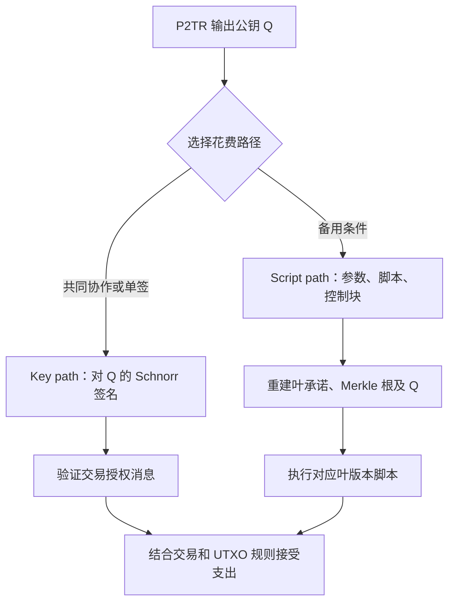
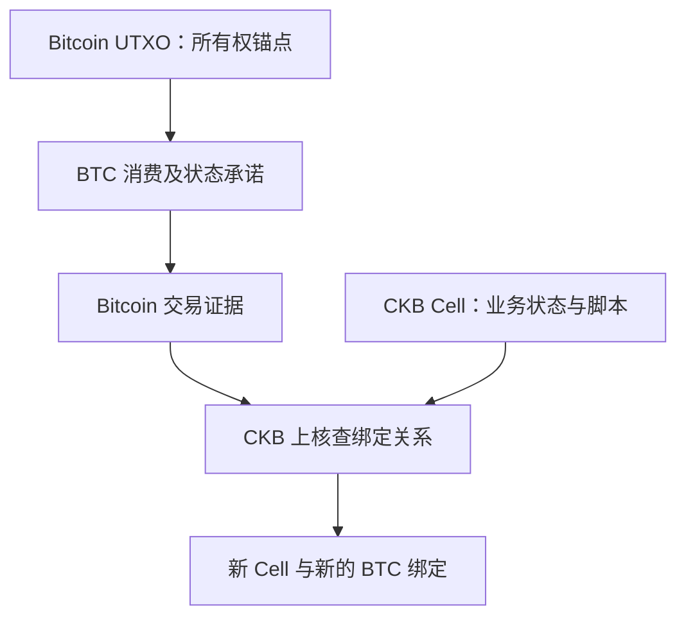

# Taproot、Schnorr 与比特币隐私

## 本篇目录
- [一、本篇学习目标](#一本篇学习目标)
- [二、Taproot 的升级过程](#二taproot-的升级过程)
  - [2.1 Taproot 升级的内容](#21-taproot-升级的内容)
  - [2.2 Taproot 概述](#22-taproot-概述)
  - [2.3 taproot 交易过程](#23-taproot-交易过程)
- [三、比特币的生态项目](#三比特币的生态项目)
  - [3.1 铭文](#31-铭文)
  - [3.2 铭文和符文](#32-铭文和符文)
  - [3.3 BRC20](#33-brc20)
  - [3.4 RGB/RGB++ 协议简介](#34-rgbrgb-协议简介)
- [四、附录 A. 四个完整 Go 实验与验证记录](#四附录-a-四个完整-go-实验与验证记录)
  - [4.1 1 UTXO 状态机：完整程序](#41-1-utxo-状态机完整程序)
  - [4.2 2 受限 Script 栈：完整程序](#42-2-受限-script-栈完整程序)
  - [4.3 3 Bech32 / Bech32m：完整程序](#43-3-bech32-bech32m完整程序)
  - [4.4 4 Taproot 树与 tweak：完整程序](#44-4-taproot-树与-tweak完整程序)
- [五、匿名性与假名性](#五匿名性与假名性)
- [六、地址为什么可能被关联](#六地址为什么可能被关联)
  - [6.1 多输入交易](#61-多输入交易)
  - [6.2 找零输出](#62-找零输出)
  - [6.3 地址重复使用](#63-地址重复使用)
- [七、现实身份如何与地址关联](#七现实身份如何与地址关联)
- [八、公开账本与银行账户的隐私差异](#八公开账本与银行账户的隐私差异)
- [九、隐私保护的边界](#九隐私保护的边界)
- [十、本讲小结](#十本讲小结)
- [十一、本篇与知识体系的关系](#十一本篇与知识体系的关系)
- [一图看懂本篇流程](#一图看懂本篇流程)
- [官方实现与代码阅读入口](#官方实现与代码阅读入口)


## 一图看懂本篇流程


Schnorr 签名可以理解为把多人的授权整理成更紧凑的证明；Taproot 让复杂花费条件可以通过不同路径表达。

> **怎么读这张图：**从左向右看，先确认输入是什么，再看系统如何检查和处理，最后看结果如何保存或验证。图中是帮助理解的简化流程，协议细节仍以本篇后续说明和官方规范为准。


例如，多人共同管理一个基金地址时，可以用符合协议的多签或聚合签名方案减少授权操作的复杂度。实际隐私效果还要看链上交易模式是否暴露参与关系。

## 官方实现与代码阅读入口

以下链接指向对应技术的官方文档、标准或项目源码。阅读代码时，建议先从本篇涉及的核心数据结构或验证入口开始，再沿调用关系查看后续处理。

- [BIP-340 Schnorr](https://github.com/bitcoin/bips/blob/master/bip-0340.mediawiki)
- [BIP-341 Taproot](https://github.com/bitcoin/bips/blob/master/bip-0341.mediawiki)
- [Bitcoin Core secp256k1](https://github.com/bitcoin-core/secp256k1)

**代码来源说明：**官方仓库中的实现代码才代表相应项目的真实实现。正文中用于解释概念的短代码或实验片段，如未明确标出官方文件路径，应按教学演示理解，不能直接当作 Bitcoin Core、Go Ethereum 或其他客户端的生产代码。实际开发应对照上方官方版本、规范和测试。


## 一、本篇学习目标
- Taproot、Schnorr 与比特币隐私
- 理解核心概念、运行流程和参与角色
- 能够区分协议保证、实现细节与应用层假设
- 能够结合代码或实际场景分析边界与风险

## 二、Taproot 的升级过程

<a id="sec-033"></a>
### 2.1 Taproot 升级的内容

Taproot 通常指相互配合的一组升级，而不是一个孤立的新地址前缀：BIP340 定义 secp256k1 上的 Schnorr 签名；BIP341 定义版本 1、32 字节 witness program 的 Taproot 花费规则；BIP342 定义相应的 Tapscript 执行规则。[BIP340][R18]、[BIP341][R19]、[BIP342][R20] `bc1p` 是地址编码的外在表现之一，核心仍是输出公钥承诺和不同支出路径的验证。

升级引入的收益包括更紧凑的单一 Schnorr 签名、可与多方签名协议配合的代数结构，以及备用条件的选择性揭示。收益有前提：若实际交易采用 script path，仍会揭示所用脚本及证明；若钱包把多人信息在链外公开，链上统一的输出形状不会抹掉那些信息。使用 Taproot 地址本身也不会自动开启 MuSig、隐私支付或任意复杂智能合约。

Tapscript 采用新的签名操作环境，`CHECKSIGADD` 可把多个签名检查结果累加，再与阈值比较。比如先检查 A 的签名得到 0 或 1，再加上 B、C 的结果，最后要求总和等于 2，就可表达相应的 `2-of-3` 策略。这里针对当前 32 字节 BIP340 公钥：有效非空签名计 1，空签名计 0；非空但验证失败的签名会立即令脚本失败，并不是只计 0 后继续。实际脚本还需确保栈顺序、空签名位置、签名消息与资源限制正确，不能把逻辑算式当作已经可广播的完整交易。[BIP342][R20]

<a id="sec-034"></a>
### 2.2 Taproot 概述

一个 Taproot 输出使用内部公钥 $P$，以及可选的脚本树根 $m$，生成输出公钥 $Q$。外部收款脚本只显示 $Q$ 的横坐标。花费时有两种主要路线：key path 提供对 $Q$ 有效的 Schnorr 签名；script path 揭示一片脚本叶、所需参数和控制块，证明这片叶属于当初承诺的树，并执行它。



如果业务中双方通常愿意协作，key path 可以表达常见路径；争议或超时恢复则作为脚本叶存在。这种安排把“平时怎样花”与“发生异常怎样恢复”分开。设计时应同时验证两者：不能只测试协作签名成功，却把备用脚本金额、时间锁或公钥写错。

#### 2.2.1 Huffman Tree

Huffman 树可以在叶子概率已知且每增加一层的成本相同的模型下，最小化平均叶深度。构造方法是每次合并权重最小的两个节点，把它们的权重相加再放回集合，直到只剩根。这里概率是设计者对未来花费路径的估计，不能从某个哈希值的大小推导出使用概率。

以四个备用条件 A、B、C、D 为课堂例子，条件概率分别为 0.5、0.25、0.125、0.125。先合并 C 与 D 得到 0.25，再把它们与 B 合并为 0.5，最后与 A 合并。叶深度为 1、2、3、3，平均深度是 $0.5\times1+0.25\times2+0.125\times3+0.125\times3=1.75$。完全平衡的四叶树平均深度为 2。这个例子的差异来自概率分布，而不是 Huffman 树必然比任意平衡树更好。

若四个条件等概率，平衡树已达到平均深度 2 的良好结果；若概率估计不可靠，过度偏斜可能让实际常用恢复路径变得昂贵。不同脚本长度、签名数量和其他 witness 材料还构成额外成本，所以优化树深只是总费用设计的一部分。

#### 2.2.2 Huffman Tree 在 Taproot 中的应用

此处 `1.2` 是编号，按原样保留。Taproot 控制块每增加一层 Merkle 路径增加 32 字节兄弟哈希，因此在固定脚本及其他参数的比较模型中，平均路径证明成本与平均深度成正比。上例中平衡树的平均控制块长度为 $33+32\times2=97$ 字节，Huffman 结构为 $33+32\times1.75=89$ 字节，平均少 8 字节 witness；这不是整个交易固定少 8 字节，也不能忽略其他栈项的长度前缀。

这里的 $p_i$ 应理解为“已经决定走脚本路径时，各叶子的条件使用概率”。如果绝大多数支出走 key path，树深优化对全体交易的平均贡献还要乘以脚本路径的发生概率。否则会高估收益。例如只有 10% 支出进入脚本路径，以上节约折算到所有支出的期望值仅为 0.8 witness 字节，尚未计算其他变化。

BIP341 把 Huffman 树作为已知路径概率时可考虑的构造方法，**没有要求共识只接受 Huffman 树**。[BIP341 构造建议][R19] 节点不认识设计者的概率，也不会检查某树是否最优。共识关心的是控制块和路径是否符合规则、能否重建原输出承诺。树可以不平衡，但路径深度仍有上限。

<a id="sec-035"></a>
### 2.3 taproot 交易过程

#### 2.3.1 创建 Taproot 公钥

先确定内部密钥的语义：它可能来自一个签名者，也可能是经过适当协议聚合的多个参与者公钥，还可能是为了禁用可用 key path 而选择的特殊不可知离散对数构造。无论哪种方式，最终提交给 Taproot tweak 的内部公钥使用 x-only 约定，对应提升到偶数 $y$ 的曲线点。把一个任意 32 字节串当成公钥而不检查是否可提升到曲线上，会产生错误。[BIP340][R18]

Taproot 使用带标签的哈希作域分离。记

$$
H_{tag}(x)=SHA256(SHA256(tag)\Vert SHA256(tag)\Vert x).
$$

标签关键在于按确切字节组合。不同标签将 TapLeaf、TapBranch、TapTweak 等用途分开，使同样的数据字节在不同角色下不会被当作相同承诺对象。域分离不是加密，标签本身完全公开。

对于脚本 $s$ 与叶版本 $v$，叶承诺包含版本、规范 CompactSize 长度和脚本字节。内部节点对两个子哈希按字节字典序排序，再做 TapBranch 标签哈希。这里不需要像某些位置敏感的 Merkle 证明那样逐层提供“兄弟在左还是右”的位图；排序规则本身消除左右歧义，但树的分组结构与叶深仍有意义。

$$
\begin{aligned}
k_{leaf}&=H_{TapLeaf}(v\Vert CompactSize(|s|)\Vert s),\\
k_{branch}&=H_{TapBranch}(\min(a,b)\Vert\max(a,b)),\\
t&=int(H_{TapTweak}(P_x\Vert m)),\\
Q&=P+tG.
\end{aligned}
$$

其中 $t\ge n$ 必须拒绝，不能在这里任意取模“修正”；$Q$ 为无穷远点也不允许。没有脚本树时使用空的树数据，即只哈希内部公钥，不是附加 32 字节零根。输出脚本为 `OP_1 PUSH32 Qx`，其典型十六进制前缀是 `51 20`。[BIP341][R19] 这两种 tweak 输入的区别也可以在 Core 的 `ComputeTapTweakHash` 分支中核对。[Core 公钥实现][R42]

##### 2.3.1.1 聚合公钥

“把公钥相加”只是理解聚合的入门代数，不能直接作为多人协议。若没有约束参与者如何选取公钥，恶意者可以针对别人的公钥选择特殊公钥，使简单总和变成自己可控制的点，这类问题常称 rogue-key attack。安全协议需要将参与者列表、每个公钥及相应系数绑定起来，还要处理顺序、重复和点有效性。[MuSig2/BIP327][R21]

示意地写 $P_{agg}=\sum_i a_iP_i$，系数 $a_i$ 与参与者列表及密钥有关。BIP327 的具体算法包含专门规则，不能把这一行示意公式替换成自己随意选择的系数算法。MuSig2 标准的基本目标是所有列入聚合的参与者共同完成签名，即 n-of-n；它不是自动实现任意 t-of-n 的门限签名协议。

多人共同确认最终输出时，不能只确认各自公钥，还应确认完整参与者列表、派生方式、内部公钥、备用脚本树和最终 tweak。一个协调者若偷偷替换恢复脚本，可能仍展示相同的参与者名字，却产生不同的输出公钥。各方应从共同认可的材料自行重建 $Q$，再接受相应收款条件。

##### 2.3.1.2 聚合签名

Schnorr 的基本关系是 $s=k+ex\pmod n$，对应验证式 $sG=R+eP$。BIP340 进一步规定公钥与 $R$ 的横坐标编码、偶数 $y$ 约定、挑战哈希和范围检查，真实签名不能只验证一个缺少这些约束的线性等式。[BIP340][R18]

一个仅展示线性关系的小数例子：在模 23 乘法群的阶 11 子群中取 $g=2$，令 $x=3,k=4,e=5$，得到 $P=2^3=8\pmod{23}$、$R=2^4=16\pmod{23}$、$s=4+5\times3=8\pmod{11}$。验证有 $2^8=3\pmod{23}$，而 $16\times8^5=3\pmod{23}$。这个极小群没有安全性，也不是 BIP340 曲线，只用于看清标量等式为何能变成群运算等式。

MuSig2 要让多方交互形成一个普通 BIP340 可验证签名，需要 nonce 交换、会话绑定、参与者数据检查和部分签名处理。它不是把几份互不关联的 ECDSA 或 Schnorr 签名字节拼接或相加。只看最后的链上签名，验证者通常不需要知道有多少参与者；但协作协议本身仍有通信失败和参与者中止等可用性问题。[BIP327][R21]

nonce 重用尤其危险。在最简单的单签等式中，同一 $k$ 对不同挑战给出 $s_1=k+e_1x$、$s_2=k+e_2x$，可解出 $x=(s_1-s_2)(e_1-e_2)^{-1}\pmod n$。MuSig2 有更丰富的 nonce 结构，但同样严格禁止重复使用秘密 nonce。把单签中的确定性 nonce 方法原样复制到多人交互协议，不能保证安全；应遵循具体协议的状态管理与销毁要求。[BIP340 多签注意事项][R18]、[BIP327 nonce 说明][R21]

##### 2.3.1.3 引入 MAST 抽象语法树

原目录使用“MAST 抽象语法树”这一说法。学习 Taproot 时更准确的落点是“用 Merkle 树承诺多个可选脚本条件”；它不要求钱包构建通用编译器意义上的抽象语法树。设计者可以把不同备用条件组织成不同叶子，花费时只揭示实际使用的一片叶及到根的兄弟哈希。

例如一个教学协作钱包有三条路径：正常时双方协作走 key path；A 失联后，B 在一定条件下使用脚本叶一恢复；另一异常情形走脚本叶二。发生第一种异常时，链上只必需揭示叶一及其证明，不必公开叶二完整脚本。观察者仍可能根据脚本、深度、交易模式和公开业务信息推断结构，因此这里提供的是选择性披露，而非“任何信息都不会泄露”。

树的承诺还带来备份责任。保存内部私钥但遗失脚本树，可能仍能走 key path，却失去某些备用路线；如果本来就没有可用 key path，丢失必要脚本或兄弟哈希可能使资金难以恢复。恢复文档应与钱包设计一起生成，而不是在签名者失联后再试图从输出公钥反推出脚本。

##### 2.3.1.4 Taproot 花费

key path 的主要授权材料是对输出公钥 $Q$ 有效的 Schnorr 签名。默认 `SIGHASH_DEFAULT` 的签名项为 64 字节，适用的非默认哈希类型可以附加一字节形成 65 字节；不能随意给默认签名再附一个 `00` 就认为等价。签名使用的是经规则调整的输出密钥，而非未 tweak 的内部密钥直接照签。[BIP341][R19]

script path 的 witness 在处理可选 annex 后，包含执行参数、被揭示脚本和控制块。控制块长度为 $33+32d$，其中 $0\le d\le128$。首字节同时携带叶版本与输出点奇偶信息，其后 32 字节是内部 x-only 公钥，再后面依次是 Merkle 路径兄弟哈希。当前 Tapscript 叶版本为 `0xc0`；控制首字节因此可能是 `0xc0` 或 `0xc1`，两者差异不是不同脚本版本。[BIP341][R19]

验证者首先从脚本和叶版本重建叶哈希，逐层加入兄弟哈希获得根，再用内部公钥和该根重新生成 $Q$。它既要比较 $Q$ 的横坐标，也要检查控制块中的奇偶位。承诺匹配后，还需按叶版本验证脚本及交易上下文；“Merkle 证明正确”只是证明这份条件被当初承诺，不能证明提交者已经满足这份条件。

附录 A.4 把这件事拆成可运行程序：先核对 BIP341 官方无树输出向量，再核对官方单叶脚本与控制块，最后构造双叶树并拒绝兄弟哈希、奇偶位或脚本的修改。双叶示例控制块为 65 字节，因为 $33+32\times1=65$。程序只检验承诺，故不会错误地把缺少签名的脚本路径宣布成真实可花费交易。[官方钱包向量][R22]

#### 2.3.2 总结

Taproot 的核心关系可以从三个检查理解：输出是否承诺了正确的内部密钥和条件；本次选择的支出路径是否与该承诺相符；该路径的授权条件是否被满足。Huffman 树优化的是特定成本模型中的证明长度，MuSig2 解决的是多方共同产生签名，Tapscript 规定的是脚本执行环境；它们服务于不同问题，不能混为一种自动功能。

阅读实际实现时，还应把密钥生成、公开点运算与秘密签名运算分开。附录 A.4 使用 `NonConst` 点运算接口处理公开内部公钥、公开树根和公开 tweak，没有用这些接口实现秘密私钥签名。生产签名需要合适的常数时间实现、秘密 nonce 管理和协议审计，不能从一个公开承诺计算示例推导出完整钱包的安全性。[btcec API][R40]

<a id="sec-036"></a>

## 三、比特币的生态项目

<a id="sec-037"></a>
### 3.1 铭文

先区分 Ordinal Theory 与 inscriptions。前者为 satoshi 按发行顺序编号，并按一套约定追踪其在输入和输出间的流动；后者把内容和元数据放入可识别的铭文结构，再关联到这套追踪体系中的 sat。Bitcoin Core 本身仍验证普通 BTC 金额、输入输出和脚本，不会为每个 sat 附加一个原生“收藏品编号”字段。[Ordinal Theory 概览][R24]

一个简化的 FIFO 教学例子：输入一带来按约定排列的 5 sat，记作 `[a,b,c,d,e]`；输入二带来 4 sat，记作 `[f,g,h,i]`。按交易输入顺序合并后，如果输出一有 3 sat、输出二有 5 sat，Ordinal 解释把 `[a,b,c]` 分给输出一，`[d,e,f,g,h]` 分给输出二，余下 `[i]` 进入手续费相关分配。这些字母关键在于为了展示额外追踪规则。

由此可知，普通钱包“找零选哪个输出”“重新排列输入输出”之类操作，对 BTC 金额可能无害，却可能改变带有铭文的 sat 按应用规则落入哪里。铭文钱包需要感知相关 UTXO、偏移与输出顺序，不能只检查总金额。支付 BTC 时误把承载铭文的 UTXO 当作普通费用来源，也不是 Bitcoin 验证器会自动替用户识别的业务错误。

铭文常通过 Taproot script path 中的 envelope 暴露内容。示意结构如下，其中实际序列化使用数据推入操作；文本内容不应直接当成比特币脚本操作码执行：

```text
OP_FALSE OP_IF
    <"ord"> <内容类型标签> <MIME 类型> <空分隔项> <内容数据块...>
OP_ENDIF
```

这个分支为假，所以其中的数据主要由应用解析器识别，而非作为链上业务程序执行。真正的花费授权仍需有相应条件。将 HTML 放进铭文，并不会让 Bitcoin 全节点执行 HTML；如何显示网页内容及隔离主动内容，是浏览器或客户端的职责。[铭文协议手册][R25]

创建铭文通常包含 commit 与 reveal。commit 交易创建一个承诺了将来铭文脚本的 Taproot 输出；reveal 交易消费它，并在 witness 中揭示脚本与内容。仅看见 commit 输出，通常不能从公钥反推出未揭示的内容。reveal 被收录后，观察者才能解析其 envelope，确定内容及关联信息。原始文件、脚本封装、承诺与揭示之间的每一步都应有明确字节对应关系。

铭文 ID 通常采用 `reveal交易txid` 加 `i` 再加该交易内铭文序号的形式。这个序号不是输出索引，也不是 sat 的 ordinal 数；不同标识服务于不同定位目的。显示页面上的“铭文编号”还经历过历史规则变化，不能代替稳定定位所需的 inscription ID。解析器应使用明确协议版本处理历史特殊情况。[铭文标识说明][R25]

#### 3.1.1 铭文的优势

铭文的一个直接特点是把内容相关字节发布在区块数据中，使拥有这些数据的节点或客户端能重新取得和校验，而不是只依赖某一个传统网页 URL。对于内容确实完整嵌入的作品，服务器关闭不必然等于内容从所有副本中消失。对使用外部链接、递归引用或渲染环境的作品，则还要逐项检查这些依赖，不能笼统说“内容已经永久可用”。

另一个特点是可组合性。客户端可按协议读取已有内容或递归端点，把多个已发布对象组合显示；官方递归文档也说明了接口与兼容性约定。[递归铭文][R26] 这里的组合由应用解释完成，不代表 Bitcoin Script 获得了任意访问其他铭文内容的通用调用能力。

内容完整性、授权关系和现实权利仍需区分。某份图像被写入链上可以证明特定字节曾被发布并被区块承诺，但不自动证明发布者拥有版权、图像描绘的事件真实发生，或持有铭文等于拥有法律上的所有相关权利。所谓“优势”应限于可验证数据与公开历史等机制属性，不能把后续法律、存储和经济问题都归入哈希保障。

<a id="sec-038"></a>
### 3.2 铭文和符文

#### 3.2.1 符文与铭文的概念

铭文主要围绕内容对象及其在 Ordinal 规则下的关联位置；Runes 主要围绕可替代资产单位及其在 UTXO 中的分配。前者并不是所有 Bitcoin 代币的统称，后者也不是“给铭文换了一个名字”。一个 UTXO 可以按 Runes 规则关联多种 Rune ID 的余额，而 Bitcoin 的原生金额字段仍只记录 BTC 的 satoshi 数量。[Runes 概览][R27]

| 项目 | Ordinals / inscriptions | Runes | 原始 BRC-20 模型 |
|---|---|---|---|
| 主要关注点 | sat 追踪与内容对象 | 可替代单位的铸造和分配 | 由铭文事件推导地址余额 |
| 数据入口 | witness 中的 inscription envelope | `OP_RETURN OP_13` runestone | 铭文内容中的协议 JSON |
| 资产位置的表达 | 关联 sat 的位置及转移 | 各 UTXO 的 Rune ID 余额 | 地址余额和一次性 transfer 事件 |
| 是否由 Core 原生解释 | 否 | 否 | 否 |
| 重要实现组件 | ord 追踪与铭文解析 | ord Runes 解释和状态更新 | 具体 BRC-20 索引器及其规则版本 |

这里“否”并不表示交易不依赖 Bitcoin。它们依赖 BTC 交易被有效收录以及相应的排序和数据，但额外的资产账本由另一个规则层解释。Full node 接受了交易，不会自动替应用宣布某次增发、转账或命名有效。阅读生态介绍时，首先应问“谁验证哪一层状态”，再讨论功能名称。

#### 3.2.2 符文和铭文的标准协议

铭文解析需要识别指定 envelope、字段和历史解释规则；Runes 从输出脚本中寻找 runestone，并把编码数据解释为铸造、刻蚀或分配指令。Runes 手册特别说明：**规范性依据是 ord 的实现，文字说明不是独立于实现的形式化规范。**因此本节是学习导读，开发兼容索引器时应固定 ord 版本或提交，结合对应测试向量，而不是仅凭本文的几条规则复刻生产解析器。[Runes 实现地位说明][R28]

Runestone 使用 `OP_RETURN OP_13` 开头的输出脚本作为识别入口，后面拼接的数据推入形成负载。整数编码采用 u128 范围的 LEB128 变长整数，不能用 Bitcoin CompactSize 编解码器直接替代。解析器选择第一个符合开头条件的输出；该输出如果解析失败，不能继续挑后面的另一个输出以“修复”这笔交易。[ord runestone 源码][R43]

Rune ID 使用刻蚀所在区块高度与交易索引组合，例如假设性的 `900100:3` 指相应区块里索引为 3 的交易刻蚀出的资产。名称、展示分隔符、符号和小数显示位属于其他元数据；同一显示名称的外观不应代替对 Rune ID 的核对。网络和历史上下文也属于定位的一部分，不能将测试环境中的 ID 当作主网同一资产。

Runestone 的 edict 可以明确指定资产 ID、数量和目的输出，未被显式分配的剩余单位按 pointer 或默认规则处理。它不是把资产“存进不可花费的 OP_RETURN 输出”：OP_RETURN 携带的是解释指令，资产余额一般分配给其他可花费输出；按规则分配到不可花费目标则可能构成销毁。[Runes][R27]

一个自创算术例子：输入 UTXO 按索引器状态持有某 Rune 的 100 个最小单位，runestone 将 30 分给输出 0，将 20 分给输出 1，并让未分配部分流向输出 2，则得到 30、20、50。三个输出的 BTC 金额可以分别是满足钱包策略的其他数值，两套金额单位没有“一 Rune 等于一 sat”的固定比例。BTC 输入输出守恒与 Rune 单位分配需要分别验证。

格式错误可能带来与普通“忽略无效请求”不同的后果。Runes 把特定畸形 runestone 解释为 cenotaph，相关输入 Rune 单位会被烧毁，部分 mint 计数等状态还可能按具体规则变化。未知偶数标签和某些整数、索引错误都可能进入这一语义；不能为了兼容性把所有未知字段默默跳过。[Runes 解析与 cenotaph][R28]、[ord 错误路径测试][R43]

##### 3.2.2.1 铭文与符文的铸造过程

铭文创建的基本流程是：准备内容和元数据，组织 envelope 及实际花费条件，计算 Taproot 承诺，形成 commit 交易，随后形成 reveal 交易，并由解析器在已确认历史中识别新对象。其新对象是否被某个进一步协议承认，还要经过那个协议的校验。比如一份成功出现的铭文 JSON，可能因为 ticker 不存在而不能产生 BRC-20 余额。

Runes 应区分 etching 与 mint。Etching 创建一种资产及其参数，可以包含预分配，也可以设置允许公众 mint 的条款；mint 是在条款允许的时间窗口和次数限制内创建对应单位。不是每个 Rune 都开放 mint，也不是每次普通 transfer 都需要再 etch 一个新资产。[Runes 基本概念][R27]

对于需要命名承诺的 Runes etching，规则要求先有适当的名称承诺，并在后续消费相关 Taproot 输出时证明；官方说明要求相关被花费输出至少达到六次确认。保留名称等特殊路径有另外处理，所以不能笼统说“所有 Runes 操作都和铭文一样必需 commit/reveal 两笔”。普通 mint 或已有 Rune 的 transfer 往往可由一笔包含相应 runestone 的 BTC 交易表达，具体还取决于钱包资金与交易组织。[Runes 名称承诺与铸造][R28]

铸造成功应分别核查：BTC 交易是否处在活动链，解析器是否识别了正确操作，资产条款是否允许此次 mint，得到的单位是否分配到自己可控制的输出。把手续费付出去只说明发生了链上支出，不能证明所有这些条件均成立。竞争性 mint 接近上限时，最终区块排序还可能与本地先看到的广播顺序不同。

#### 3.2.3 铭文解析器

解析器或索引器是一台按历史顺序重建应用状态的机器。它先取得 Bitcoin 已验证区块和交易，再解析 witness/输出脚本，跟踪相关 UTXO 和位置，提取事件，应用自己的协议规则，最后更新内容索引或资产账本。仅用正则表达式寻找某段字符串，可能把普通文件中的示例文字误认成真实协议事件，也可能忽略字段、版本和位置约束。

一份可靠的索引状态至少要记录所依赖的区块哈希与高度、实现版本、应用规则激活点和必要的撤销数据。发生重组时，它要回滚旧分支事件并沿新分支重放；如果只追加而不撤销，就可能出现已经离开活动链的 mint 仍然计入余额。Bitcoin 重组与应用索引重组并不是两套可以各自忽略的事情。

多个索引器给出不同余额时，可按以下顺序排查：是否在相同网络、相同区块哈希上；是否索引到相同高度；是否采用相同 inscription 识别规则；是否对 JSON 数字、字符编码、重复字段、无效操作、历史升级点和重组作了相同处理；是否存在实现缺陷。对着两个页面投票不能定义协议正确性，应该找出产生分歧的最早事件并重放。

Ordinal Theory 的编号规则、铭文 envelope 规则与 BRC-20 余额规则是不同阶段。普通 ord 索引能识别某个铭文，不代表已经按某个 BRC-20 实现计算完可用余额。Runes 同样有自己的状态更新。应用提供“全生态余额”界面时，底层可能实际上聚合了多个不同索引器。

#### 3.2.4 铭文和符文手续费消耗分析

手续费应从最终交易重量计算。设不含 witness 的基础大小为 $B$，含 witness 的总大小为 $S$，权重为 $W=3B+S$，虚拟大小为 $vsize=\lceil W/4\rceil$。在同一假定费用率 $f$ 下，可粗略按 $fee=f\times vsize$ 估算，实际钱包还要处理整数取整、交易包依赖和所需确认目标。[BIP141 权重定义][R08]

例如基础部分 100 字节、witness 增量 400 字节，则 $S=500,W=800,vsize=200$。把 500 总字节一律乘同一个 sat/vB 费率会高估此例；把 400 witness 字节当作“完全免费”又会低估。签名、脚本、控制块、内容分块及其长度前缀都贡献重量，payload 的裸文件长度不是交易 vsize。

下面只做假设性工程预算，数字不是主网测量，也不是当前费率预测。设三类交易经序列化测得的大小分别为 commit 150 vB、reveal 400 vB、后续 transfer 130 vB，统一取课堂费率 10 sat/vB：创建一次内容需约 5500 sat，创建后再转移需约 6800 sat。若另一笔简单 Rune 转移的假定大小为 180 vB，则为 1800 sat；这不意味着所有 Rune 转移都比所有铭文操作便宜，因为两者承担的内容、输入数量和签名条件可能完全不同。

长期使用还需看 UTXO 组织成本。拆出很多小输出，未来聚合时会增加输入数据与签名；把多个资产放在同一输出，可能使后续分离需要更复杂的分配。BRC-20 创建 transfer 铭文再发送的应用步骤也会产生额外交易成本。可比较的是一个完整业务流程的总费用与数据需求，而不是只挑其中最小的一笔交易。

<a id="sec-039"></a>
### 3.3 BRC20

#### 3.3.1 协议概述

BRC-20 最初是 domo 基于铭文提出的可替代单位实验，通过 `deploy`、`mint`、`transfer` 等事件重建余额。它借用了类似 ERC-20 的命名，但没有因此获得 Ethereum 合约的执行环境，也不自动拥有 `approve`、`transferFrom` 等 ERC-20 接口。BTC 全节点确认承载 JSON 的交易，不会在其 UTXO 集里原生增加一个 `BRC20Balance` 字段。[domo 原始说明][R29]

版本范围尤其重要。domo 页面注明保留原始实验说明，并指向后续资料。Layer1 Foundation 文档记录了 inscription 识别规则冻结及升级点，还列出高度 837090 后的 self-mint 和五位 ticker 扩展。因此本节用“原始三操作模型”讲机制，不宣称 2026 年所有实现仍然只接受最初四位 ticker 或完全同一套边界规则。[后续规则文档][R30]

应用协议的可验证性并不要求信任某一个网站的余额显示：原则上可以读取相同历史并运行相同规则自行重建。但如果生态参与者对采用哪一版规则意见不一致，便可能产生多个相互不兼容的账本解释。Bitcoin 共识只确定底层交易历史，不会替 BRC-20 自动仲裁所有索引器的规则争议。

#### 3.3.2 协议的细节

先创建一个完全虚构、仅在本文模拟的 ticker `note`。这不是对主网上名称可用性的查询，也不对应真实发行建议。课堂部署参数设为最大总量 1000、单次 mint 上限 100、零位小数。使用 JSON 字符串表达数值，是为了符合此处采用的格式约定，并避免各语言浮点数解析差异；不应把字符串自行转换成 `float64` 后四舍五入到账。

```json
{"p":"brc-20","op":"deploy","tick":"note","max":"1000","lim":"100","dec":"0"}
```

部署建立参数，不直接把 1000 个单位全部送给部署者。索引器需要先确认这个部署在所采用规则中有效，例如同一命名空间是否已经有被认可的部署。后来重复写入相同 ticker 的 JSON，不会自动覆盖先前规则。命名大小写、长度、字符编码和新增 self-mint 等扩展均应按所选规范版本处理，而非凭 UI 字符数猜测。[原始实验][R29]、[后续规则][R30]

该余额模型经常同时显示三个量：总余额 $B$、可用余额 $A$ 和被有效待转移铭文占用的余额 $T$，满足 $B=A+T$。只有理解这三个量，才能解释为什么一个地址明明显示有 200 个单位，却不能再创建金额 180 的 transfer 铭文：其中可能已有 150 被另一有效转移指令保留，可用量仅为 50。

##### 3.3.2.1 mint

在课堂部署之后，Alice 创建如下 mint 铭文，并使该铭文的第一个所有者位置属于自己：

```json
{"p":"brc-20","op":"mint","tick":"note","amt":"100"}
```

底层创建仍可能需要 commit/reveal 两步；应用上则由索引器识别 reveal 后的新 mint 事件，检查部署是否存在、数量是否合规、单次限额和剩余发行空间是否允许，再给符合规则的第一个所有者记账。若代刻服务先让铭文归自己再转交客户，原始模型中 mint 带来的余额并不会因后续交付铭文而自动跟着转走。[domo mint 语义][R29]

再次移动 mint 铭文，不等于再次领取 100，也不等于转走那 100。它是历史操作的载体，不是可以无限兑现的余额凭证。把它当作普通 NFT 收藏或传输，可以改变铭文本身的位置，却不必然改变 BRC-20 余额。UI 如果没有清楚区分“这是一份 mint 记录”和“这是仍有效的 transfer 凭证”，用户很容易误判。

若剩余总量仅为 60，而一笔合规 mint 请求 100，原始公开规则对越过总量边界的最后一笔采用只计有效剩余部分的处理，而不是增发到 1040。具体兼容实现还须核对对应规则版本。若同一区块中有多个竞争 mint，应用状态按认可的链内顺序推进，不能根据用户签名时间或服务收到请求时间决定谁先获得额度。[规则边界][R30]

##### 3.3.2.2 transfer

transfer 有两层容易混淆的“阶段”。底层铭文创建通常有 commit/reveal；应用层转账则是先创建有效 transfer 铭文并占用可用余额，再第一次转移该铭文以结算给接收方。因此“创建 transfer 铭文成功”还不等于“Bob 已经收到资产”。

假设 Alice 此前两次 mint 后总余额 200、可用余额 200，她在自己的地址创建：

```json
{"p":"brc-20","op":"transfer","tick":"note","amt":"150"}
```

索引器确认这份 transfer 有效后，Alice 的总余额仍为 200，可用量变为 50，待转移量为 150。Bob 此时仍是 0。随后 Alice 通过 BTC 交易把承载这份有效 transfer 铭文的位置交给 Bob。按原始模型的首次转移语义，Alice 总量减为 50，待转移量清零，Bob 获得 150。此处接收方由实际铭文转移结果决定，不是由用户任意附加的 JSON `to` 字段决定。[原始 transfer 流程][R29]

| 状态点 | Alice 总余额 | Alice 可用 | Alice 待转移 | Bob 总余额 |
|---|---:|---:|---:|---:|
| 创建 transfer 前 | 200 | 200 | 0 | 0 |
| transfer 铭文有效创建后 | 200 | 50 | 150 | 0 |
| 首次有效转给 Bob 后 | 50 | 50 | 0 | 150 |

若 Alice 在第二行状态下又创建 60 的 transfer，新请求应因可用量仅 50 而不能保留 60；已经支付的 BTC 费用不会因此自动退回。若她改变主意，将该 transfer 铭文首次转给自己，原始规则可释放其占用，恢复可用余额，而不是给自己额外增发 150。[余额控制][R30]

一份 transfer 铭文只应触发一次余额转移。Bob 再把已经完成结算的旧铭文转给 Carol，不会让那 150 再次转走。Bob 要转出自己的余额，应按规则创建新的有效 transfer 指令。索引器必须记录“已使用”的状态，否则复制或反复移动同一历史载体就可能制造错误账本。

#### 3.3.3 一些 brc-20 例子

为了检查概念，可以对同一个虚构部署逐步运行一组事件，而不是只看单条 JSON 是否长得像协议格式：

| 事件 | 前提 | 课堂期望解释 |
|---|---|---|
| mint 100 | 已部署、仍有额度、首个所有者为 Alice | Alice 增加 100 |
| 移动上述 mint 铭文给 Bob | mint 已经记账 | 铭文位置改变；不能据此把 100 记给 Bob |
| mint 101 | 单次上限为 100 | 本例规则下无效，不能因为付费就认可 |
| transfer 80 的铭文归 Alice | Alice 可用量至少 80 | 先保留 80，接收者尚未入账 |
| 首次把有效 transfer 转给 Bob | 前一步仍有效且未使用 | 结算相应余额给 Bob |
| 再次转发同一旧 transfer | 已经使用 | 不重复结算 |
| 对不存在 ticker 执行 mint | 无有效部署 | 内容仍可是一份铭文，不能产生此资产余额 |
| 在另一分支里出现重复 mint | 分支不在当前活动链 | 当前账本不能保留被回滚分支的记账结果 |

这些例子不是把全部规则压缩成一个兼容实现。生产解析还涉及字符、数字上界、小数精度、特殊铭文定义、索引器升级高度及历史异常处理。可复现的研究应在报告里记录采用哪个实现和规则集合；“遵循 BRC-20”这几个字不足以解释所有边界。

若两个索引器对同一条看起来正常的 transfer 给出不同结果，最有效的诊断材料是：相同链尖区块哈希、铭文 ID、此前部署事件、发送者在该事件之前的可用余额、首次移动所在的交易、规则版本。只比较最终总余额缺少足够上下文，也无法区分索引延迟和真正的规则分歧。

#### 3.3.4 基于 PSBT 的交易

##### 3.3.4.1 部分签名简介

PSBT 是 Partially Signed Bitcoin Transaction，即部分签名比特币交易的交换格式。它把交易构造与签名需要的信息组织在一个可由不同角色逐步补充的容器里：在线软件准备、硬件设备核查和签名、其他签名者补充授权、最终工具生成网络可传播交易。[BIP174][R31]

“部分签名”不表示把一个 ECDSA 签名从中间剪成几段。它可能指部分输入尚未签名，或一个多签输入只收集到若干参与者的完整签名，也可能是一份尚无签名但已有交易和 UTXO 信息的容器。PSBT 本身不是加密格式，Base64 也只是编码；其中可能暴露公钥、派生路径、脚本和金额等信息，应按实际内容理解其隐私属性。

签名者不能因为信息出现在 PSBT 里就默认真实。它应核对前序交易/输出与输入引用匹配，脚本与自身钱包策略匹配，输出及找零符合用户授权，手续费合理，所选 sighash 范围没有遗漏重要约束。离线签名的安全价值来自设备独立验证并显示关键内容，而不是因为文件扩展名看起来标准。

##### 3.3.4.2 Bitcoin 部分签名的组织形式

PSBT 的开头魔数是 `70 73 62 74 ff`，随后为全局 map、每个输入的 map 和每个输出的 map。键和值带规范长度编码，map 以零长度键结束；同一 map 中完整 key 不得重复。某个 keytype 在不同公钥或路径 keydata 下可以对应多个不同完整 key，所以实现不能简单地把“同类型出现两次”都当作重复。[BIP174][R31]

| 位置 | 常见材料 | 签名者为什么需要它 |
|---|---|---|
| Global map | PSBT 版本、交易相关全局材料 | 确定解释格式及拟签交易整体 |
| Input map | 前序输出/交易、赎回脚本、见证脚本、派生信息、已有签名 | 验证输入来源与授权条件 |
| Output map | 输出相关脚本和派生信息 | 识别拟支付对象与钱包自身找零 |
| Taproot 扩展字段 | 内部公钥、叶脚本/控制块、key path 或 script path 签名等 | 保留新输出类型需要的证明和授权材料 |

版本不能混用。PSBTv0 的全局未签名交易字段很重要，其中使用不含见证的交易序列化，输入 scriptSig 为空。PSBTv2 把相关交易信息拆到更多字段，要求版本为 2，并排除 v0 的全局 unsigned transaction 字段，以支持不同的构造工作流。把 v0 与 v2 字段任意拼在同一对象里，不会得到更兼容的文件。[BIP370][R32]

BIP371 为 PSBTv0 和 PSBTv2 都增加 Taproot 所需字段；它不是另一个“PSBTv1”。key path 签名字段与按公钥加叶哈希索引的 script path 签名字段承担不同角色。两个叶子即使使用同一公钥，其签名上下文也不能仅按公钥去重而丢失叶信息。[BIP371][R33]

#### 3.3.5 基于 PSBT 的交易

该标题再次出现此标题，本小节用一笔假设的铭文出售说明流程。卖家控制带铭文的 UTXO，买家提供支付所需 BTC 输入；双方希望一笔最终 Bitcoin 交易同时把目标铭文位置交给买家，把约定 BTC 输出交给卖家。PSBT 可以承载构造过程，但它不会替双方自动确认“卖的是哪份铭文”或“这个资产索引器认为余额有效”。

首先，协调工具确定所出售铭文 ID、当前 outpoint 与偏移，再设计输入输出顺序，保证按选定 Ordinal 规则不会把目标 sat 放入找零或费用。其次，确定卖家的收款输出、买家的接收输出、付款输入、找零和费用。第三，构造 PSBT 并附足可核查的 UTXO 与脚本信息。第四，双方或硬件签名器独立核对自己的授权范围，再加入签名。最后，组合器与终结器构造各输入的最终 `scriptSig`/witness，提取原始交易并验证完整交易；是否广播由实际交易系统处理，本笔记不执行这一动作。

这里的“原子”应精确表述。最终 BTC 交易的输入输出作为一个有效状态转换整体生效；铭文或 BRC-20 解释是否满足预期，还取决于相应协议规则、输入输出排列以及双方认可的索引状态。PSBT 不会把任意链下约定自动变成 Bitcoin 共识条件。如果卖家签的 sighash 未承诺关键输出，买家看到的报价界面也不能替代密码学绑定。

一些交易流程使用 `SIGHASH_SINGLE` 或 `ANYONECANPAY` 等较特殊范围，使另一方能够追加输入或安排对应输出。这需要精确理解“哪些字节受当前签名保护”，还要处理对应输入输出位置。本讲不把一个不完整的交易模板冒充通用安全市场合约；对普通学习者，先核查全部输入输出被明确授权的简单流程更有助于理解 PSBT 的职责边界。

对 BRC-20 交易，还要额外核对所交换的 transfer 铭文是否有效、是否已经使用、金额是否由发送者可用余额支持。对于 Runes，应核对 runestone 分配和 Rune ID。PSBT 的格式通用性正好说明它本身并不了解这些资产：同一个交易容器可以服务不同应用，但每种应用必须补上自己的预交易检查和最终确认。

<a id="sec-040"></a>
### 3.4 RGB/RGB++ 协议简介

RGB 与 RGB++ 名称相近，但验证架构不能直接合并。这里先按传统 RGB 的两层讲传统 RGB 的关键思想，再增加明确标为教学补充的 RGB++ 比较。RGB 资料存在演进版本，本节依据所引用公开设计文档解释“客户端验证、状态转换与一次性密封”的模型，不声称所有后续版本的编码或合约环境完全相同。[RGB 设计总览][R34]

#### 3.4.1 Bitcoin 层

RGB 把 Bitcoin UTXO 用作 single-use seal，即一次性密封的锚点。密封关键在于把“某个状态分配何时被消费”的唯一性与特定 outpoint 的消费关联起来。关闭某个密封，需要与消费该 Bitcoin 输出的见证交易及相应状态承诺对应。Bitcoin 在选定有效历史中阻止同一 UTXO 被重复消费，从而提供防冲突的基础。[RGB 单次密封][R35]

Bitcoin 层看到的仍然是自己的交易、锁定条件和承诺数据，不会自动执行 RGB 合约的所有状态规则。即使某个 BTC 输出确实被唯一消费，新的 RGB 状态仍可能违反总量守恒、类型或授权要求；这些问题需要相应验证层判断。把“密封只能关闭一次”直接等同于“任何新状态都合法”，是把排序唯一性误当成应用正确性。

例如 Alice 的 RGB 状态包含 100 个教学单位，绑定到某 BTC outpoint。她计划给 Bob 40，自己保留 60。相关状态转换要记录输入状态、输出分配及新的密封位置，并形成可被 Bitcoin 交易锚定的承诺。比特币网络确认的关键事实是旧密封对应的输出已按规则消费以及特定承诺已被发布；40 加 60 是否符合这份 RGB 合约，需要验证相应状态转换。

一次性也具有链上下文。若关闭密封的 BTC 交易因链重组退出活动链，客户端对状态的确认应相应回退或重新评估，不能把一次看到的未确认交易永久当成封印已经不可逆关闭。这里继承的是 Bitcoin 的实际确认与重组性质，不是另一个绝对最终性的保证。

#### 3.4.2 (2) RGB client 层

客户端取得合约创世定义、模式或验证规则、相关状态分配和必要历史证明后，验证自己要接收的状态。典型的验证问题包括：资产是否属于预期的合约；状态转换是否消耗了正确前置状态；金额或其他守恒条件是否成立；封印是否按 Bitcoin 证据被关闭；新分配是否真的指向接收者认可的密封。客户端不是只看“有一个哈希上链”便宣布验收。[RGB 客户端验证设计][R34]、[单次密封][R35]

证明和数据要区分。一个链上承诺能让人检查后来提供的数据是否匹配，却通常不能从承诺中恢复丢失的数据。若发送方不提供必要历史，接收方可能无法验证；若用户遗失自己未来转让时需要的材料，Bitcoin 完整区块副本也不保证包含全部 RGB 业务数据。这是数据可用性与备份问题，不能仅靠更强哈希算法解决。

客户端验证有利于只向相关参与者分发业务信息，减少全网保存所有合约细节的要求，但隐私不是无条件的。交易对手得到的历史、公开 Bitcoin 图结构、网络层元数据以及多次交易中的交叉信息仍可能泄露关联。是否能减少某类信息暴露，应根据具体合约和证明分发方式分析，不能把“链下保存”直接等价为“永远匿名”。

接收流程可以理解为一次带证据的交付：Bob 先给出自己认可的接收条件或密封安排；Alice 构造状态转换并准备对应 Bitcoin 锚定；Bob 检查收到的业务材料和链上证据；达到要求的确认状态后才把资产列为可继续转让。协议版本决定具体消息和编码，本节的步骤是解释职责，未伪造某版本 SDK 的实际 API。

**以下 RGB++ 对比用于补充传统 RGB 的相关概念。**

#### 3.4.3 教学补充：RGB++ 的同构绑定与额外验证层

RGB++ 公开轻论文与官方文档提出，将 Bitcoin UTXO 的所有权关联到 Nervos CKB 的 Cell，以 Cell 的数据和类型脚本维护更丰富的状态。这个“同构绑定”将 Bitcoin 消费与 CKB 状态更新建立可验证关系，不能简单说成 RGB 原有客户端程序换了个名字。[RGB++ 轻论文][R37]、[同构绑定说明][R38]

以简化模型解释，旧 Bitcoin UTXO 绑定一个携带资产状态的 CKB Cell。用户先计算拟进行的 CKB 状态转换及其承诺，再构造消费旧 BTC 输出并绑定该承诺的 Bitcoin 交易。相关证明随后用于 CKB 验证：检查 Bitcoin 交易证据及其消费的正确 outpoint，检查承诺与拟更新状态对应，再执行 CKB 自己的脚本条件，产生新的 Cell 与后继绑定。这里描述的是论文中的架构关系，不把轻论文示意哈希公式当作某个生产版本的精确序列化规范。[轻论文交易流程][R37]



这套设计的验证分工必须如实表达：Bitcoin 全节点仍没有执行 CKB 合约；CKB 侧需要按其规则验证状态及相关 BTC 证据；用户依赖的轻客户端、数据服务、确认深度和跨层可用性会影响整体保障。官方材料中的“继承 Bitcoin 安全”等概括，应拆成具体性质来理解，不能据此断言所有 CKB 状态错误都能由 BTC 共识独自阻止。

轻论文还讨论 transaction folding 等扩展，并指出某些功能会依赖 CKB 区块头等额外证据。因此，不宜从最简单的一对一示意图推论所有扩展都只有一次 BTC 消费、没有额外信任或验证需求。性能、共享状态和交互便利性应结合对应版本的脚本和客户端模型评估，不能只凭协议名称判断。

| 比较点 | 本节引用的传统 RGB 模型 | 本节引用的 RGB++ 架构 |
|---|---|---|
| Bitcoin 的直接职责 | UTXO 消费及状态承诺锚定 | UTXO 所有权与相关承诺锚定 |
| 业务状态主要验证者 | 持有必要证明的相关客户端 | CKB 脚本及相应客户端验证流程 |
| 业务数据组织 | 相关方保存和交换所需状态历史 | Cell 数据、类型脚本及跨层证明 |
| 必须关注的问题 | 证明交付、备份、历史验证、链重组 | CKB 验证与数据、绑定脚本、BTC 证据及两层确认 |
| 不能推出的结论 | BTC 收录即所有 RGB 状态合法 | BTC 共识原生执行全部 CKB 逻辑 |

这一比较也帮助统一理解前面的生态协议。Ordinals 需要 sat 追踪解释，BRC-20 需要事件状态重放，Runes 需要 runestone 与 UTXO 单位分配，RGB 需要相关状态证明，RGB++ 引入 CKB Cell 与绑定验证。它们都使用 Bitcoin，但从“使用 Bitcoin”到“所有语义由 Bitcoin 原生验证”之间，仍有必须明确写出的协议层。

<a id="sec-041"></a>

## 四、附录 A. 四个完整 Go 实验与验证记录

四个实验都是本笔记编写的教学程序。前三个只用 Go 标准库，第四个固定使用 `github.com/btcsuite/btcd/btcec/v2 v2.3.5`，模块文件也锁定直接使用的间接依赖。本次实际运行环境为 Go 1.27.3，四个程序全部退出码 0。它们不调用 RPC、不连接钱包、不广播交易、不输出秘密私钥；公开地址及公钥来自协议测试材料或本地教学状态，不能据此认定自己拥有对应链上资金。

| 实验 | 源文件位置 | 实际通过的关键检查 | 没有实现的能力 |
|---|---|---|---|
| UTXO 状态机 | `code/ch07/utxo_state/main.go` | 篡改、重复输入、超支、金额越界、重放拒绝；成功交易费用 100 | Bitcoin 真实签名、Script、链和网络 |
| 教学栈机 | `code/ch07/script_stack/main.go` | 算术和原像成功；错误原像、相同输入冒充碰撞失败 | 完整 Script、真实签名上下文 |
| Witness 地址 | `code/ch07/bech32_address/main.go` | 四个官方向量；错误网络/大小写/校验/版本算法/填充拒绝 | 私钥生成、钱包支付类型策略 |
| Taproot 承诺 | `code/ch07/taproot_tree/main.go` | 两组官方钱包向量；双叶证明；三种篡改拒绝 | 脚本执行、完整 sighash、真实交易签名 |

运行前三个实验时，进入对应目录执行 `go run main.go`。第四个目录同时放置下面的 `go.mod` 和程序，执行 `go run .`；首次运行需要已缓存或可取得固定模块依赖。随机密钥导致 UTXO 示例内部字节不同，但它的逻辑结果固定；Taproot 最后几个反例由 Go map 遍历输出，行顺序可能变化，不影响判定。

<a id="sec-042"></a>
### 4.1 1 UTXO 状态机：完整程序

```go
// 教学模型：使用 Ed25519 演示授权和 UTXO 状态转换，不是 Bitcoin 交易格式。
package main

import (
	"bytes"
	"crypto/ed25519"
	"crypto/rand"
	"crypto/sha256"
	"encoding/binary"
	"fmt"
)

const maxMoney uint64 = 21_000_000 * 100_000_000

type Outpoint struct {
	ID    [32]byte
	Index uint32
}
type Coin struct {
	Value uint64
	Owner [32]byte
}
type Tx struct {
	Inputs  []Outpoint
	Outputs []Coin
	Sigs    [][]byte
}
type View map[Outpoint]Coin

func put32(b *bytes.Buffer, n uint32) { _ = binary.Write(b, binary.LittleEndian, n) }
func put64(b *bytes.Buffer, n uint64) { _ = binary.Write(b, binary.LittleEndian, n) }

func body(tx Tx) []byte {
	var b bytes.Buffer
	b.WriteString("ch07/utxo/v1/test-network") // 明确演示协议及网络的域
	put32(&b, uint32(len(tx.Inputs)))
	for _, in := range tx.Inputs {
		b.Write(in.ID[:])
		put32(&b, in.Index)
	}
	put32(&b, uint32(len(tx.Outputs)))
	for _, out := range tx.Outputs {
		put64(&b, out.Value)
		b.Write(out.Owner[:])
	}
	return b.Bytes()
}

func digest(tx Tx, v View, index int) ([32]byte, error) {
	var b bytes.Buffer
	b.WriteString("ch07/sign-all-prevouts/v1")
	b.Write(body(tx))
	put32(&b, uint32(index))
	for _, in := range tx.Inputs {
		coin, ok := v[in]
		if !ok {
			return [32]byte{}, fmt.Errorf("missing or spent input")
		}
		put64(&b, coin.Value)
		b.Write(coin.Owner[:])
	}
	return sha256.Sum256(b.Bytes()), nil
}

func add(sum, value uint64) (uint64, error) {
	// 在加法之前检查，避免机器整数先溢出再比较。
	if value > maxMoney || sum > maxMoney-value {
		return 0, fmt.Errorf("money range exceeded")
	}
	return sum + value, nil
}

func apply(v View, tx Tx) (uint64, error) {
	if len(tx.Inputs) == 0 || len(tx.Inputs) > 1000 ||
		len(tx.Outputs) == 0 || len(tx.Outputs) > 1000 || len(tx.Sigs) != len(tx.Inputs) {
		return 0, fmt.Errorf("invalid vector sizes")
	}
	seen := make(map[Outpoint]bool)
	var inSum, outSum uint64
	for i, in := range tx.Inputs {
		if seen[in] {
			return 0, fmt.Errorf("duplicate input")
		}
		seen[in] = true
		coin, ok := v[in]
		if !ok {
			return 0, fmt.Errorf("missing or spent input")
		}
		var err error
		inSum, err = add(inSum, coin.Value)
		if err != nil {
			return 0, err
		}
		d, err := digest(tx, v, i)
		if err != nil || !ed25519.Verify(ed25519.PublicKey(coin.Owner[:]), d[:], tx.Sigs[i]) {
			return 0, fmt.Errorf("invalid signature at input %d", i)
		}
	}
	for _, out := range tx.Outputs {
		var err error
		outSum, err = add(outSum, out.Value)
		if err != nil {
			return 0, err
		}
	}
	if outSum > inSum {
		return 0, fmt.Errorf("outputs exceed inputs")
	}
	id := sha256.Sum256(body(tx)) // 教学标识，不是 Bitcoin txid。
	for i := range tx.Outputs {
		if _, exists := v[Outpoint{id, uint32(i)}]; exists {
			return 0, fmt.Errorf("output identifier already exists")
		}
	}
	// 全部验证结束后才提交；失败路径不会部分消费输入。
	for _, in := range tx.Inputs {
		delete(v, in)
	}
	for i, out := range tx.Outputs {
		v[Outpoint{id, uint32(i)}] = out
	}
	return inSum - outSum, nil
}

func key() ([32]byte, ed25519.PrivateKey) {
	pub, priv, err := ed25519.GenerateKey(rand.Reader)
	if err != nil {
		panic(err)
	}
	var p [32]byte
	copy(p[:], pub)
	return p, priv
}
func sign(tx *Tx, v View, priv ed25519.PrivateKey) {
	tx.Sigs = make([][]byte, len(tx.Inputs))
	for i := range tx.Inputs {
		d, err := digest(*tx, v, i)
		if err != nil {
			panic(err)
		}
		tx.Sigs[i] = ed25519.Sign(priv, d[:])
	}
}
func mustReject(label string, v View, tx Tx) {
	before := len(v)
	_, err := apply(v, tx)
	if err == nil || len(v) != before {
		panic("expected rejection without state change")
	}
	fmt.Println(label+":", err)
}

func main() {
	alice, aliceKey := key()
	bob, _ := key()
	start := Outpoint{ID: sha256.Sum256([]byte("teaching initial coin"))}
	v := View{start: Coin{Value: 1000, Owner: alice}}
	tx := Tx{Inputs: []Outpoint{start}, Outputs: []Coin{{600, bob}, {300, alice}}}
	sign(&tx, v, aliceKey)
	changed := tx
	changed.Outputs = append([]Coin(nil), tx.Outputs...)
	changed.Outputs[0].Value = 601
	mustReject("tampered output", v, changed)
	duplicate := Tx{Inputs: []Outpoint{start, start}, Outputs: []Coin{{1800, bob}}}
	sign(&duplicate, v, aliceKey)
	mustReject("duplicate input", v, duplicate)
	overspend := Tx{Inputs: []Outpoint{start}, Outputs: []Coin{{1001, bob}}}
	sign(&overspend, v, aliceKey)
	mustReject("signed overspend", v, overspend)
	outOfRange := Tx{Inputs: []Outpoint{start}, Outputs: []Coin{{^uint64(0), bob}}}
	sign(&outOfRange, v, aliceKey)
	mustReject("money range", v, outOfRange)
	fee, err := apply(v, tx)
	if err != nil || fee != 100 || len(v) != 2 {
		panic("valid transfer failed")
	}
	fmt.Printf("accepted: fee=%d, new UTXOs=%d
", fee, len(v))
	mustReject("replay", v, tx)
}
```

本次实际输出：

```text
tampered output: invalid signature at input 0
duplicate input: duplicate input
signed overspend: outputs exceed inputs
money range: money range exceeded
accepted: fee=100, new UTXOs=2
replay: missing or spent input
```

<a id="sec-043"></a>
### 4.2 2 受限 Script 栈：完整程序

```go
// 受限教学栈机：不是 Bitcoin Core Script 解释器，不能用于链上验证。
package main

import (
	"bytes"
	"crypto/sha256"
	"fmt"
)

type Instruction struct {
	Op   string
	Data []byte
}

func push(b []byte) Instruction { return Instruction{"PUSH", b} }
func op(s string) Instruction   { return Instruction{Op: s} }
func number(n int64) []byte {
	if n == 0 {
		return nil
	}
	negative := n < 0
	if negative {
		n = -n // 本例只编码受限整数，调用者不传 MinInt64。
	}
	var b []byte
	for n > 0 {
		b = append(b, byte(n))
		n >>= 8
	}
	if b[len(b)-1]&0x80 != 0 {
		b = append(b, 0)
	}
	if negative {
		b[len(b)-1] |= 0x80
	}
	return b
}
func decode(b []byte) (int64, error) {
	// 为了简明，本教学模型的数值操作只接受最小编码的 4 字节数。
	if len(b) > 4 {
		return 0, fmt.Errorf("number exceeds teaching limit")
	}
	if len(b) == 0 {
		return 0, nil
	}
	if b[len(b)-1]&0x7f == 0 && (len(b) == 1 || b[len(b)-2]&0x80 == 0) {
		return 0, fmt.Errorf("non-minimal number")
	}
	var n int64
	for i, v := range b {
		if i == len(b)-1 {
			v &= 0x7f
		}
		n |= int64(v) << (8 * i)
	}
	if b[len(b)-1]&0x80 != 0 {
		n = -n
	}
	return n, nil
}
func truth(b []byte) bool {
	for i, v := range b {
		if v != 0 {
			return !(i == len(b)-1 && v == 0x80) // 负零也是 false。
		}
	}
	return false
}
func boolean(v bool) []byte {
	if v {
		return []byte{1}
	}
	return nil
}
func run(program []Instruction) (bool, error) {
	var stack [][]byte
	pop := func() ([]byte, error) {
		if len(stack) == 0 {
			return nil, fmt.Errorf("stack underflow")
		}
		v := stack[len(stack)-1]
		stack = stack[:len(stack)-1]
		return v, nil
	}
	for _, ins := range program {
		switch ins.Op {
		case "PUSH":
			if len(ins.Data) > 520 {
				return false, fmt.Errorf("element too large")
			}
			stack = append(stack, append([]byte(nil), ins.Data...))
		case "2DUP":
			if len(stack) < 2 {
				return false, fmt.Errorf("stack underflow")
			}
			stack = append(stack, append([]byte(nil), stack[len(stack)-2]...), append([]byte(nil), stack[len(stack)-1]...))
		case "SWAP":
			if len(stack) < 2 {
				return false, fmt.Errorf("stack underflow")
			}
			n := len(stack)
			stack[n-1], stack[n-2] = stack[n-2], stack[n-1]
		case "ADD", "EQUAL":
			a, err := pop()
			if err != nil {
				return false, err
			}
			b, err := pop()
			if err != nil {
				return false, err
			}
			if ins.Op == "EQUAL" {
				stack = append(stack, boolean(bytes.Equal(a, b)))
			} else {
				x, err := decode(a)
				if err != nil {
					return false, err
				}
				y, err := decode(b)
				if err != nil {
					return false, err
				}
				stack = append(stack, number(x+y))
			}
		case "NOT", "VERIFY", "SHA256":
			a, err := pop()
			if err != nil {
				return false, err
			}
			switch ins.Op {
			case "NOT":
				n, err := decode(a)
				if err != nil {
					return false, err
				}
				stack = append(stack, boolean(n == 0))
			case "VERIFY":
				if !truth(a) {
					return false, fmt.Errorf("VERIFY failed")
				}
			case "SHA256":
				h := sha256.Sum256(a)
				stack = append(stack, h[:])
			}
		default:
			return false, fmt.Errorf("unsupported opcode %q", ins.Op)
		}
		if len(stack) > 1000 {
			return false, fmt.Errorf("stack too deep")
		}
	}
	// 本模型主动要求 clean stack；不是所有历史 Script 环境的通用规则。
	return len(stack) == 1 && truth(stack[0]), nil
}
func check(label string, p []Instruction, want bool) {
	ok, err := run(p)
	if (ok && err == nil) != want {
		panic(label)
	}
	fmt.Printf("%s: accepted=%v, error=%v
", label, ok && err == nil, err)
}
func main() {
	check("3+4=7", []Instruction{push(number(3)), push(number(4)), op("ADD"), push(number(7)), op("EQUAL")}, true)
	secret := []byte("classroom preimage")
	h := sha256.Sum256(secret)
	check("hash preimage", []Instruction{push(secret), op("SHA256"), push(h[:]), op("EQUAL")}, true)
	check("wrong preimage", []Instruction{push([]byte("wrong")), op("SHA256"), push(h[:]), op("EQUAL")}, false)
	check("x=y is not a collision", []Instruction{push(secret), push(secret), op("2DUP"), op("EQUAL"), op("NOT"), op("VERIFY"), op("SHA256"), op("SWAP"), op("SHA256"), op("EQUAL")}, false)
	// 独立演示截断到 8 位后的碰撞；VM 上面一直使用完整 SHA-256。
	seen := map[byte]string{}
	for i := 0; ; i++ {
		s := fmt.Sprintf("toy-%d", i)
		d := sha256.Sum256([]byte(s))
		if previous, ok := seen[d[0]]; ok {
			p := sha256.Sum256([]byte(previous))
			fmt.Printf("8-bit toy collision: %q / %q; prefix=%02x; full hashes equal=%v
", previous, s, d[0], p == d)
			break
		}
		seen[d[0]] = s
	}
}
```

本次实际输出：

```text
3+4=7: accepted=true, error=<nil>
hash preimage: accepted=true, error=<nil>
wrong preimage: accepted=false, error=<nil>
x=y is not a collision: accepted=false, error=VERIFY failed
8-bit toy collision: "toy-22" / "toy-31"; prefix=c7; full hashes equal=false
```

这个截断实验的任务是比较输出相同的一字节和不同的完整哈希，不能把它的输入拿去声称破解了完整 SHA-256 的碰撞阻力。

<a id="sec-044"></a>
### 4.3 3 Bech32 / Bech32m：完整程序

```go
// BIP173/BIP350 地址教学实现；不生成私钥、不查询余额、不发送交易。
package main

import (
	"bytes"
	"encoding/hex"
	"fmt"
	"strings"
)

const alphabet = "qpzry9x8gf2tvdw0s3jn54khce6mua7l"
const bech32m uint32 = 0x2bc830a3

func polymod(v []byte) uint32 {
	gen := [5]uint32{0x3b6a57b2, 0x26508e6d, 0x1ea119fa, 0x3d4233dd, 0x2a1462b3}
	chk := uint32(1)
	for _, x := range v {
		top := chk >> 25
		chk = (chk&0x1ffffff)<<5 ^ uint32(x)
		for i, g := range gen {
			if (top>>i)&1 != 0 {
				chk ^= g
			}
		}
	}
	return chk
}
func expand(hrp string) []byte {
	v := make([]byte, 0, 2*len(hrp)+1)
	for i := range hrp {
		v = append(v, hrp[i]>>5)
	}
	v = append(v, 0)
	for i := range hrp {
		v = append(v, hrp[i]&31)
	}
	return v
}
func convert(data []byte, from, to uint, pad bool) ([]byte, error) {
	var acc uint32
	var bits uint
	var out []byte
	mask := uint32((1 << to) - 1)
	maxAcc := uint32((1 << (from + to - 1)) - 1)
	for _, v := range data {
		if uint32(v)>>from != 0 {
			return nil, fmt.Errorf("input exceeds bit width")
		}
		acc = ((acc << from) | uint32(v)) & maxAcc
		bits += from
		for bits >= to {
			bits -= to
			out = append(out, byte((acc>>bits)&mask))
		}
	}
	if pad {
		if bits > 0 {
			out = append(out, byte((acc<<(to-bits))&mask))
		}
	} else if bits >= from || ((acc<<(to-bits))&mask) != 0 {
		return nil, fmt.Errorf("non-canonical padding")
	}
	return out, nil
}
func validProgram(version byte, program []byte) bool {
	return version <= 16 && len(program) >= 2 && len(program) <= 40 &&
		(version != 0 || len(program) == 20 || len(program) == 32)
}
func network(hrp string) bool { return hrp == "bc" || hrp == "tb" || hrp == "bcrt" }
func encodeRaw(hrp string, data []byte, constant uint32) string {
	values := append(expand(hrp), data...)
	values = append(values, make([]byte, 6)...)
	mod := polymod(values) ^ constant
	var b strings.Builder
	b.WriteString(hrp)
	b.WriteByte('1')
	for _, v := range data {
		b.WriteByte(alphabet[v])
	}
	for i := 0; i < 6; i++ {
		b.WriteByte(alphabet[(mod>>uint(5*(5-i)))&31])
	}
	return b.String()
}
func encode(hrp string, version byte, program []byte) (string, error) {
	if !network(hrp) || !validProgram(version, program) {
		return "", fmt.Errorf("invalid network or witness program")
	}
	data, err := convert(program, 8, 5, true)
	if err != nil {
		return "", err
	}
	constant := uint32(1)
	if version != 0 {
		constant = bech32m
	}
	return encodeRaw(hrp, append([]byte{version}, data...), constant), nil
}
func decode(addr, expectedHRP string) (byte, []byte, error) {
	if !network(expectedHRP) || len(addr) < 8 || len(addr) > 90 {
		return 0, nil, fmt.Errorf("invalid length or expected network")
	}
	if addr != strings.ToLower(addr) && addr != strings.ToUpper(addr) {
		return 0, nil, fmt.Errorf("mixed case")
	}
	for i := range addr {
		if addr[i] < 33 || addr[i] > 126 {
			return 0, nil, fmt.Errorf("invalid character range")
		}
	}
	addr = strings.ToLower(addr)
	separator := strings.LastIndexByte(addr, '1')
	if separator < 1 || separator+7 >= len(addr) || addr[:separator] != expectedHRP {
		return 0, nil, fmt.Errorf("wrong HRP or missing data")
	}
	data := make([]byte, len(addr)-separator-1)
	for i, c := range []byte(addr[separator+1:]) {
		n := strings.IndexByte(alphabet, c)
		if n < 0 {
			return 0, nil, fmt.Errorf("invalid data character")
		}
		data[i] = byte(n)
	}
	version := data[0]
	constant := uint32(1)
	if version != 0 {
		constant = bech32m
	}
	if polymod(append(expand(expectedHRP), data...)) != constant {
		return 0, nil, fmt.Errorf("checksum or encoding/version mismatch")
	}
	program, err := convert(data[1:len(data)-6], 5, 8, false)
	if err != nil || !validProgram(version, program) {
		return 0, nil, fmt.Errorf("invalid witness program or padding")
	}
	return version, program, nil
}
func mustHex(s string) []byte {
	b, err := hex.DecodeString(s)
	if err != nil {
		panic(err)
	}
	return b
}
func main() {
	// 来自 BIP350 的公开测试向量，不是钱包收款地址建议。
	vectors := []struct{ addr, hrp, script string }{
		{"BC1QW508D6QEJXTDG4Y5R3ZARVARY0C5XW7KV8F3T4", "bc", "0014751e76e8199196d454941c45d1b3a323f1433bd6"},
		{"tb1qrp33g0q5c5txsp9arysrx4k6zdkfs4nce4xj0gdcccefvpysxf3q0sl5k7", "tb", "00201863143c14c5166804bd19203356da136c985678cd4d27a1b8c6329604903262"},
		{"bc1p0xlxvlhemja6c4dqv22uapctqupfhlxm9h8z3k2e72q4k9hcz7vqzk5jj0", "bc", "512079be667ef9dcbbac55a06295ce870b07029bfcdb2dce28d959f2815b16f81798"},
		{"BC1SW50QGDZ25J", "bc", "6002751e"},
	}
	for _, test := range vectors {
		version, program, err := decode(test.addr, test.hrp)
		if err != nil {
			panic(err)
		}
		opcode := byte(0)
		if version != 0 {
			opcode = 0x50 + version
		}
		script := append([]byte{opcode, byte(len(program))}, program...)
		roundtrip, err := encode(test.hrp, version, program)
		if err != nil || !bytes.Equal(script, mustHex(test.script)) || roundtrip != strings.ToLower(test.addr) {
			panic("official vector mismatch")
		}
		fmt.Printf("official vector: v=%d length=%d script=%x
", version, len(program), script)
	}
	program := mustHex("79be667ef9dcbbac55a06295ce870b07029bfcdb2dce28d959f2815b16f81798")
	five, _ := convert(program, 8, 5, true)
	wrongEncoding := encodeRaw("bc", append([]byte{1}, five...), 1)
	badPadding := append([]byte(nil), five...)
	badPadding[len(badPadding)-1] |= 1 // 32 字节程序的最后 4 个填充位必须为零。
	wrongPadding := encodeRaw("bc", append([]byte{1}, badPadding...), bech32m)
	badCases := []struct{ address, network string }{
		{wrongEncoding, "bc"},
		{vectors[2].addr, "tb"},
		{"bC" + vectors[2].addr[2:], "bc"},
		{vectors[2].addr[:len(vectors[2].addr)-1] + "q", "bc"},
		{wrongPadding, "bc"},
	}
	for _, test := range badCases {
		if _, _, err := decode(test.address, test.network); err == nil {
			panic("invalid address accepted")
		} else {
			fmt.Println("rejected:", err)
		}
	}
}
```

程序成功重建的四份输出脚本是：

```text
0014751e76e8199196d454941c45d1b3a323f1433bd6
00201863143c14c5166804bd19203356da136c985678cd4d27a1b8c6329604903262
512079be667ef9dcbbac55a06295ce870b07029bfcdb2dce28d959f2815b16f81798
6002751e
```

最后一份是官方测试中的未来 witness 版本语法实例，不是本文建议使用的收款策略。解码器返回版本与字节程序后，钱包还需要独立决定是否支持相应支付类型。后三个当前常见类型的识别也不能仅依赖地址前缀。

<a id="sec-045"></a>
### 4.4 4 Taproot 树与 tweak：完整程序

`go.mod`：

```mod
module example.com/cryptonotes/ch07/taproot_tree

go 1.23.0

require github.com/btcsuite/btcd/btcec/v2 v2.3.5

require (
	github.com/btcsuite/btcd/chaincfg/chainhash v1.0.1 // indirect
	github.com/decred/dcrd/crypto/blake256 v1.0.0 // indirect
	github.com/decred/dcrd/dcrec/secp256k1/v4 v4.0.1 // indirect
)
```

`main.go`：

```go
// 只验证 Taproot 公钥承诺和控制块；不执行脚本、不签交易、不广播。
package main

import (
	"bytes"
	"crypto/sha256"
	"encoding/binary"
	"encoding/hex"
	"fmt"

	"github.com/btcsuite/btcd/btcec/v2"
	"github.com/btcsuite/btcd/btcec/v2/schnorr"
)

func tagged(tag string, parts ...[]byte) [32]byte {
	t := sha256.Sum256([]byte(tag))
	h := sha256.New()
	h.Write(t[:])
	h.Write(t[:])
	for _, part := range parts {
		h.Write(part)
	}
	var out [32]byte
	copy(out[:], h.Sum(nil))
	return out
}
func compactSize(n uint64) []byte {
	var b bytes.Buffer
	switch {
	case n < 253:
		b.WriteByte(byte(n))
	case n <= 0xffff:
		b.WriteByte(253)
		_ = binary.Write(&b, binary.LittleEndian, uint16(n))
	case n <= 0xffffffff:
		b.WriteByte(254)
		_ = binary.Write(&b, binary.LittleEndian, uint32(n))
	default:
		b.WriteByte(255)
		_ = binary.Write(&b, binary.LittleEndian, n)
	}
	return b.Bytes()
}
func leaf(script []byte) [32]byte {
	return tagged("TapLeaf", []byte{0xc0}, compactSize(uint64(len(script))), script)
}
func branch(a, b [32]byte) [32]byte {
	if bytes.Compare(a[:], b[:]) > 0 {
		a, b = b, a
	}
	return tagged("TapBranch", a[:], b[:])
}
func tweak(internal, root []byte) ([]byte, byte, error) {
	if len(internal) != 32 || (len(root) != 0 && len(root) != 32) {
		return nil, 0, fmt.Errorf("invalid key/root length")
	}
	pub, err := schnorr.ParsePubKey(internal) // lift_x：选择偶数 y。
	if err != nil {
		return nil, 0, err
	}
	h := tagged("TapTweak", internal, root)
	var scalar btcec.ModNScalar
	if scalar.SetByteSlice(h[:]) {
		return nil, 0, fmt.Errorf("tweak >= curve order")
	}
	var p, t, q btcec.JacobianPoint
	pub.AsJacobian(&p)
	btcec.ScalarBaseMultNonConst(&scalar, &t)
	btcec.AddNonConst(&p, &t, &q)
	if q.Z.IsZero() {
		return nil, 0, fmt.Errorf("point at infinity")
	}
	q.ToAffine()
	out := btcec.NewPublicKey(&q.X, &q.Y)
	return schnorr.SerializePubKey(out), out.SerializeCompressed()[0] & 1, nil
}
func verifyCommitment(output, script, control []byte) bool {
	if len(output) != 32 || len(control) < 33 || len(control) > 33+32*128 || (len(control)-33)%32 != 0 {
		return false
	}
	// 本例只处理当前 Tapscript 叶版本；不是完整的未来版本共识解释器。
	if control[0]&0xfe != 0xc0 {
		return false
	}
	root := leaf(script)
	for i := 33; i < len(control); i += 32 {
		var sibling [32]byte
		copy(sibling[:], control[i:i+32])
		root = branch(root, sibling)
	}
	x, parity, err := tweak(control[1:33], root[:])
	return err == nil && bytes.Equal(x, output) && parity == control[0]&1
}
func hx(s string) []byte {
	b, err := hex.DecodeString(s)
	if err != nil {
		panic(err)
	}
	return b
}
func main() {
	// BIP341 wallet-test-vectors.json 第一组，无脚本树。
	internal := hx("d6889cb081036e0faefa3a35157ad71086b123b2b144b649798b494c300a961d")
	x, _, err := tweak(internal, nil)
	if err != nil || !bytes.Equal(x, hx("53a1f6e454df1aa2776a2814a721372d6258050de330b3c6d10ee8f4e0dda343")) {
		panic("official no-tree vector failed")
	}
	fmt.Printf("official no-tree output key: %x
", x)
	// BIP341 第二组：单叶脚本及控制块，检验叶哈希和奇偶位。
	script := hx("20d85a959b0290bf19bb89ed43c916be835475d013da4b362117393e25a48229b8ac")
	control := hx("c1187791b6f712a8ea41c8ecdd0ee77fab3e85263b37e1ec18a3651926b3a6cf27")
	output := hx("147c9c57132f6e7ecddba9800bb0c4449251c92a1e60371ee77557b6620f3ea3")
	if !verifyCommitment(output, script, control) {
		panic("official single-leaf vector failed")
	}
	fmt.Println("official single-leaf commitment: true")
	// 自创双叶例子：复用公开测试公钥，不得向这些教学脚本付款。
	other := hx("20b617298552a72ade070667e86ca63b8f5789a9fe8731ef91202a91c9f3459007ac")
	a, b := leaf(script), leaf(other)
	root := branch(a, b)
	x, parity, err := tweak(internal, root[:])
	if err != nil {
		panic(err)
	}
	proof := append([]byte{0xc0 | parity}, internal...)
	proof = append(proof, b[:]...)
	if !verifyCommitment(x, script, proof) {
		panic("two-leaf proof failed")
	}
	fmt.Printf("two-leaf proof: true; control bytes=%d
", len(proof))
	badProof := append([]byte(nil), proof...)
	badProof[len(badProof)-1] ^= 1
	badParity := append([]byte(nil), proof...)
	badParity[0] ^= 1
	badScript := append([]byte(nil), script...)
	badScript[len(badScript)-1] ^= 1
	for label, ok := range map[string]bool{
		"changed sibling": verifyCommitment(x, script, badProof),
		"changed parity":  verifyCommitment(x, script, badParity),
		"changed script":  verifyCommitment(x, badScript, proof),
	} {
		if ok {
			panic("tampered commitment accepted")
		}
		fmt.Println(label+":", ok)
	}
}
```

本次实际输出的一种顺序：

```text
official no-tree output key: 53a1f6e454df1aa2776a2814a721372d6258050de330b3c6d10ee8f4e0dda343
official single-leaf commitment: true
two-leaf proof: true; control bytes=65
changed sibling: false
changed parity: false
changed script: false
```

程序中的官方无树例子来自 BIP341 钱包向量第一组；官方单叶脚本和控制块来自第二组。随后将两片公开测试脚本组合成双叶树，是本笔记自创的机制演示，不能把它标作第三个官方向量。[BIP341 钱包测试数据][R22] 这一分界使运行结果既有独立规范基准，又能观察修改数据时验证如何失败。

<a id="sec-046"></a>


## 五、匿名性与假名性

- **匿名性**：观察者难以把活动关联到特定身份。
- **假名性（Pseudonymity）**：活动使用地址或别名标识，现实身份不直接显示在账本中。

比特币地址可在本地生成，持有人也可以使用多个地址。多个地址并不自动意味着它们之间不可关联。

## 六、地址为什么可能被关联

### 6.1 多输入交易

一笔交易可能使用多个 UTXO
作为输入。如果多个输入同时被一笔交易花费，链上分析者可能推测这些输入由同一主体控制，因为花费时需要满足各自的授权条件。

这是分析启发式，不是逻辑上的绝对证明。例如，协作式交易或其他特殊交易构造可能使多个参与方共同输入。

### 6.2 找零输出

当输入总额大于支付金额时，交易通常会创建找零输出。观察者可能根据金额、输出脚本类型、地址使用模式和后续交易，推测哪个输出属于付款方。

例如，一笔交易输入合计 9 BTC，输出为 6 BTC 和 3
BTC。若外部信息显示商家应收到 6
BTC，另一个输出可能是找零，但仅凭金额不能保证判断正确。

### 6.3 地址重复使用

反复使用同一个地址会让不同收款事件更容易被聚合到一起。为不同用途生成不同地址可以降低某些直接关联，但无法消除交易图分析。

## 七、现实身份如何与地址关联

地址与现实世界发生联系时，身份暴露风险会增加，例如：

- 在需要身份验证的交易所购买或出售加密资产；
- 向公开展示地址的商家支付；
- 通过可识别的个人账户发布收款地址；
- 把链上交易与现实中的时间、金额或商品订单关联。

即使链上地址没有真实姓名，交易所记录、商家记录和公开信息仍可能提供关联线索。

## 八、公开账本与银行账户的隐私差异

比特币交易记录可以由公众读取和分析；传统银行账本通常由机构控制访问权限。因此，匿名性不能只从“是否要求实名开户”一个维度比较，还需要考虑账本透明度、机构访问权限、资金出入金渠道和现实交易信息。

## 九、隐私保护的边界

课程讨论了避免地址直接复用、减少不必要的交易关联等思路。这些做法只能改变可观察线索，无法保证完全匿名。人为增加无意义的输出也可能增加交易成本，并给节点带来额外的数据维护负担。

本讲聚焦于交易图与身份关联的基本机制，不把某种地址使用习惯当作隐私保证。

## 十、本讲小结

比特币的地址更接近公开账本中的假名标识。多输入交易、找零模式、地址重复使用以及交易所和商家信息都可能把链上活动与现实身份连接起来。隐私风险来自多种信息的组合，而非单个地址字段。

[课程视频：P12
比特币匿名性](https://www.bilibili.com/video/BV1Vt411X7JF/?p=12) ·


## 十一、本篇与知识体系的关系

- 所属部分：第六部分：比特币原理与生态
- 返回总目录：[README](../README.md)
