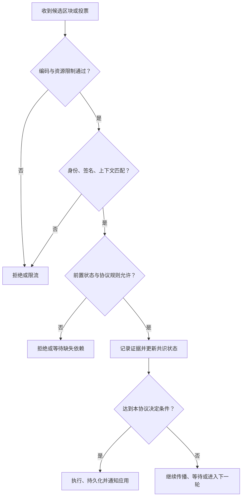

# 分布式共识基础与 FLP 理论

## 本篇目录
- [一、本篇学习目标](#一本篇学习目标)
- [二、本讲的知识主线](#二本讲的知识主线)
- [三、读完应当能够完成的任务](#三读完应当能够完成的任务)
- [四、怎么去理解共识算法](#四怎么去理解共识算法)
  - [4.1 从双花理解“签名为什么不够”](#41-从双花理解签名为什么不够)
  - [4.2 一次性共识、原子广播和状态机复制](#42-一次性共识原子广播和状态机复制)
  - [4.3 必须先声明的三组假设](#43-必须先声明的三组假设)
  - [4.4 FLP 告诉我们什么](#44-flp-告诉我们什么)
  - [4.5 共识并不负责“投票决定数学真伪”](#45-共识并不负责投票决定数学真伪)
- [五、共识算法相关的概念](#五共识算法相关的概念)
  - [5.1 确认位：先区分确认数、状态位和最终性](#51-确认位先区分确认数状态位和最终性)
  - [5.2 长程攻击](#52-长程攻击)
  - [5.3 区块分叉](#53-区块分叉)
- [六、多人共管资产：为什么选择多重签名](#六多人共管资产为什么选择多重签名)
- [七、分布式系统的不可能结论与比特币共识](#七分布式系统的不可能结论与比特币共识)
- [八、挖矿结果为什么不能直接冒领？](#八挖矿结果为什么不能直接冒领)
- [九、三个关键区分](#九三个关键区分)
- [十、本讲小结](#十本讲小结)
- [十一、本篇与知识体系的关系](#十一本篇与知识体系的关系)
- [一图看懂本篇流程](#一图看懂本篇流程)
- [官方实现与代码阅读入口](#官方实现与代码阅读入口)

## 一图看懂本篇流程

分布式共识像多人远程开会决定一份共同名单。有人暂时断网时，其他人无法立刻知道他是退出了还是网络延迟。

> **怎么读这张图：**从左向右看，先确认输入是什么，再看系统如何检查和处理，最后看结果如何保存或验证。图中是帮助理解的简化流程，协议细节仍以本篇后续说明和官方规范为准。

例如，跨国团队要对一份文件的最终版本达成一致。网络延迟时有人暂时没收到更新，系统需要规定等待、重试和何时认定结果。

## 官方实现与代码阅读入口

以下链接指向对应技术的官方文档、标准或项目源码。阅读代码时，建议先从本篇涉及的核心数据结构或验证入口开始，再沿调用关系查看后续处理。

- [FLP 论文](https://groups.csail.mit.edu/tds/papers/Lynch/jacm85.pdf)
- [MIT 分布式系统课程](https://pdos.csail.mit.edu/6.824/)

**代码来源说明：**官方仓库中的实现代码才代表相应项目的真实实现。正文中用于解释概念的短代码或实验片段，如未明确标出官方文件路径，应按教学演示理解，不能直接当作 Bitcoin Core、Go Ethereum 或其他客户端的生产代码。实际开发应对照上方官方版本、规范和测试。

## 一、本篇学习目标
- 分布式共识基础与 FLP 理论
- 理解核心概念、运行流程和参与角色
- 能够区分协议保证、实现细节与应用层假设
- 能够结合代码或实际场景分析边界与风险

## 二、本讲的知识主线

可以把区块链节点理解为一个具有网络入口、密码学检查、规则执行和持久化存储的复制状态机。设初始状态为 $S_0$，已经确定的交易序列为 $T_1,T_2,\ldots,T_k$，确定性的状态转换函数为 $F$，那么：

$$
S_i=F(S_{i-1},T_i).
$$

“确定性”意味着所有正确节点从同一个前置状态出发，执行相同且规则相同的输入，得到相同结果。智能合约不能让本机系统时间、未约定的随机数、某个外部网站临时返回的值直接决定共识状态。外部事实必须先变成协议承认的输入，再按共同规则执行。

这里有两个不同的一致性问题。第一个是**输入顺序一致**：先执行转账 A，还是先执行转账 B。第二个是**执行结果一致**：同一笔转账究竟使哪个账户余额增加多少。共识主要约束前者，并结合区块有效性规则约束后者；虚拟机、交易检查和状态转换函数使执行结果可复算。即使所有人签署了同一份错误程序的输出，也不能据此说明这个程序符合预期业务需求。

| 层次 | 主要输入 | 主要输出 | 密码学的作用 | 单靠本层解决不了什么 |
|---|---|---|---|---|
| 交易授权 | 交易内容、发送者公钥、签名 | 该内容是否得到相应密钥授权 | 数字签名、签名域、重放保护 | 两笔冲突交易谁先发生 |
| 数据承诺 | 区块体、状态、交易列表 | 哈希、Merkle 根、状态根 | 防止内容被无声替换，压缩校验对象 | 数据是否能下载到、内容是否真实 |
| P2P 传播 | 字节流、地址、消息标识 | 收到候选区块和投票 | 身份认证、传输保护、完整性检查 | 消息是否应成为正式历史 |
| 共识 | 有效候选块、投票、已知链和状态 | 链头、提交结果或最终性状态 | 认证投票，约束身份及权重 | 私钥被窃后的真实人类意愿 |
| 执行与存储 | 确定顺序的区块、前置状态 | 新状态、回执、索引 | 检查签名、哈希及证明 | 业务规则本身是否合理 |

这一分层是本讲的教学组织方式。以太坊的执行客户端和共识客户端分工、Fabric 的背书与排序分工，则是不同系统的具体工程实现。[S1] [S2]

## 三、读完应当能够完成的任务

你应能画出一笔交易从“被收到”到“被验证”“进入候选区块”“被网络选为链的一部分”“达到相应最终性条件”的不同阶段，并说明每个阶段能提供哪些证据。你还应能解释以下几个看似接近、实际上不同的判断。

“签名正确”是密码学判断；“签名者有资格投票”是成员集合判断；“签名权重达到法定人数”是阈值判断；“这些票满足当前轮次和锁规则”是协议判断；“被投票的区块已经完整取得且执行有效”是状态机判断。生产系统必须把这些检查组合起来，不能挑其中一个检查代替其他检查。

学习时建议保留一张五列草稿：**谁发消息、签的是什么、接收者检查什么、检查后更新什么状态、异常时怎样恢复**。随后学习 PoW、Gasper、PBFT 和 CometBFT，都可以填入同一张表，避免只记住算法缩写。

# 二、共识算法

## 四、怎么去理解共识算法

### 4.1 从双花理解“签名为什么不够”

假设 Alice 的账户有 10 个教学币。她签署两笔内容分别为“向 Bob 支付 8”和“向 Carol 支付 8”的交易，而且二者使用同一个账户 nonce。Bob 先收到第一笔，Carol 先收到第二笔。两份签名都可能完全正确：Alice 确实控制自己的私钥，也确实可以签署相互矛盾的指令。

如果每个节点都把“自己先收到的交易”立即视为不可撤回的最终结果，网络就可能产生两个账本。共识需要让正确节点对同一位置的处理达成一致，例如把第一笔放入正式历史，然后按 nonce 或余额规则拒绝第二笔。签名回答“谁授权了这段字节”，不能回答“所有人共同接受哪一条历史”。比特币白皮书讨论数字签名之外的双重支付问题，正是理解这一边界的起点。[S3]

同样，重复传播一笔交易与双花不是一回事。重复传播通常是**同一条消息多次到达**，可以通过交易标识、nonce 和状态检查避免重复执行；双花是**两个不同候选操作争夺同一份可花费状态**，必须由排序与有效性规则一起处理。

### 4.2 一次性共识、原子广播和状态机复制

一次性共识可以抽象成：一组参与者各有提议值，在某个故障模型下决定一个共同值。区块链则需要不断对高度 1、2、3……形成相互衔接的决定，因此通常更接近持续运行的状态机复制。节点不只是决定一个数字，还要处理客户端重复请求、崩溃恢复、追赶同步、成员变化和历史验证。

共识文献常用以下属性描述目标：

| 属性 | 直观含义 | 在账本中的对应问题 |
|---|---|---|
| 安全性 Safety | 不会产生相互矛盾的正确决定 | 两个正确节点不能把冲突区块都当成同一位置的最终结果 |
| 活性 Liveness | 在规定条件满足时能继续完成决定 | 正常交易不能永远卡在等待投票 |
| 有效性 Validity | 决定值符合所声明的有效性条件 | 无效签名、超额转账、错误状态根不能被接受 |
| 完整性或唯一决定 | 同一实例按规则最多决定一次 | 已提交高度不能因收到另一条普通消息而重做 |
| 可追责性 Accountability | 某些安全性破坏能留下可验证证据 | 同一验证者对冲突对象签名可形成处罚材料 |

这些属性的精确定义因论文和系统而异。例如 PoW 常用共同前缀、链增长、链质量等概率性属性描述持续账本，不能把 BFT 的单次确定性提交证明原封不动套到 PoW 上。本讲以直观属性帮助比较，不把所有协议宣称为同一种数学模型。

### 4.3 必须先声明的三组假设

第一组是**故障模型**。崩溃故障是节点停止或暂时无法响应；拜占庭故障还包括伪造自己发言、选择性发送、发送冲突内容、拒绝合作。攻击者通常不能凭空伪造未泄露的诚实私钥签名，这是密码学假设；但是攻击者控制的节点可以对任意内容签名，不能把“验签成功”当成“发言诚实”。

第二组是**网络模型**。同步模型假设消息延迟有已知上界；异步模型不提供这个上界；部分同步模型允许网络先经历未知时长的混乱，之后进入具有足够稳定延迟的阶段。超时只能说明“在本地等待期限内没有收到”，不能从密码学意义上证明对方作恶。

第三组是**成员与资源模型**。联盟链可以预先识别有投票资格的机构；开放网络需要使伪造大量身份不能免费获得大量投票权。PoW 把影响力与工作量关联，PoS 把影响力与协议认可的质押权重关联。创建一万个公钥非常容易，公钥本身不是稀缺资源。

这些假设共同决定安全性结论的适用范围。说“能容忍三分之一坏人”而不说明分母是节点数、验证者权重还是算力，也不说明网络条件，是一个不完整的技术陈述。

### 4.4 FLP 告诉我们什么

FLP 的结论针对确定性协议、完全异步通信以及即使只有一个进程可能崩溃的模型：不存在一个协议能够对所有允许的执行过程同时保证所需一致性与必然终止。这不是“现实系统永远不能达成共识”，也不是“区块链绕过了数学定理”。现实协议通过调整假设或目标工作，例如采用部分同步、随机化，或者提供概率意义的保证。[S4]

可以用一个延迟例子理解。节点 A 等待 B 的消息：B 可能已经宕机，也可能只是消息正在路上。如果 A 永远等，活性可能消失；如果 A 立即把 B 当作失效，又可能在网络另一侧已经进行某个决定时作出不兼容动作。协议需要对等待、证据、轮次和恢复建立严密规则，而不是用一个随意设定的超时解决所有问题。

### 4.5 共识并不负责“投票决定数学真伪”

假设某区块宣称执行交易后余额变成 1000，但本地按相同规则复算只应是 10。正确节点应拒绝这个区块，即使许多外部地址向它发送支持消息。在完整节点的验证逻辑里，**有效性检查先限定候选集合，共识再在可接受候选中选择历史**。

由此可以设计一个通用接收流程：

这张图是抽象模型，不规定所有系统完全相同的检查顺序。例如实现可能先做便宜的格式筛选，再异步验证签名；也可能缓存暂时缺少父块的消息。但是不能在正式提交前永久跳过必须的检查。

## 五、共识算法相关的概念

### 5.1 确认位：先区分确认数、状态位和最终性

**术语保留为“确认位”，以下按常见的“确认数”含义开展第一层解释。** 如果交易进入当前主链高度 $h$ 的区块，而链头高度为 $H$，常用确认数定义为：

$$
c=H-h+1.
$$

交易进入高度 100 的区块，当前链头为 105，则确认数为 6。这里把包含交易的那个区块算作第一个确认。某些应用还会展示“后续区块数”，相同情形显示 5；因此对接接口时应明确字段定义，不要只看中文名称。

确认数描述的是某笔交易在**某个观察者当前认可的历史**中的位置，不是全球原子地同步更新的变量。节点如果落后、被隔离、连接了错误网络，看到的 $H$ 就可能不同。交易未入块时，交易池中被多少个节点转发也不是确认数。

在 PoW 中，更多后续工作通常使重组这笔交易的成本和难度上升，但“6 次确认”不是一条适用于所有网络、所有金额、所有攻击条件的数学保证。商户根据价值、对手风险、网络状态选择等待策略，是**业务接受规则**；协议是否提供最终性，以及最终性成立需要什么假设，是**协议保证**。两者必须分别描述。[S3] [S5]

还需区分“交易已在最终化区块内”与“所有业务都已完成”。跨链到账、交易所内部记账、法币交割、链外商品交付都有额外流程。最终化只确定链上相应历史的协议状态，不自动替外部系统执行后续动作。

### 5.2 长程攻击

长程攻击讨论的是这样一类风险：攻击者利用较早时期的验证者密钥、旧成员集合或已退出参与者的签名能力，从很早的位置制作一段看似合法的替代历史，试图欺骗新加入或长期离线的节点。其重点不是“网络很慢”，也不只是重写最近两个区块。

设某 PoS 系统在时期 10 使用集合 $V_{10}$，后来大量成员退出，时期 200 使用集合 $V_{200}$。一个长期离线节点只知道很久以前的状态。攻击者如果取得足够多旧密钥，可能生成一条从时期 10 分出的长历史，并在这条伪造历史里安排后续成员集合。签名逐条都能验证，不等于历史来自当时真实的公共网络：数字签名通常不提供“这份签名一定在某个墙上时钟时刻产生”的证明。

这也说明，退出后是否仍可罚没、历史密钥是否被安全销毁、成员变化是否可验证，都会影响威胁模型。不能仅用“作恶就罚款”回答已经撤回抵押物的旧密钥风险，也不能把所有 PoS 协议对长程攻击的处理视为相同。

以太坊使用弱主观性相关机制帮助节点建立近期可信起点。新节点或长期离线节点需要获得一个足够新的可信检查点，并核对网络、区块根和对应状态；从该起点以后再独立验证。检查点应通过多个独立可信来源交叉核对，不能把某个随机 P2P 邻居声称的“最新根”当作天然正确答案。[S7]

弱主观性窗口不是可以永远硬编码为固定天数的生活常识。它与协议规则、验证者集合变化等条件有关，应按照相应版本规范或客户端建议处理。日常连续运行的节点和多年不更新的离线节点，面对的信任重建问题不同。

从密码学角度看，这一现象非常有教育意义：**合法签名只能证明某个公钥对消息的授权关系；是否把这个公钥在这一历史位置视为有权签名，还需要可信状态和协议规则。** 这一原则同样适用于证书撤销、企业成员离职、跨链轻客户端和委员会轮换。

### 5.3 区块分叉

“分叉”至少有三种常见含义，学习时先确定谈的是哪一种。

| 含义 | 起因 | 例子 | 主要处理方式 |
|---|---|---|---|
| 临时候选分支 | 网络延迟、同时出块、不同局部信息 | 同一父块出现两个有效子块 | 分叉选择规则与后续共识 |
| 规则升级分歧 | 不同节点采用不同有效性规则 | 某规则收紧或不兼容升级 | 升级协调、版本激活、治理 |
| 最终性冲突 | 故障或攻击超出安全假设等 | 两个互斥历史都出现冲突最终性证据 | 证据调查、恢复机制，可能需要社会层协调 |

“软分叉”和“硬分叉”通常属于规则兼容性的讨论。粗略地说，软分叉收紧有效集合，硬分叉可能使新规则接受旧节点拒绝的数据。但真正部署还涉及激活条件、节点行为和链选择，不能用一句“软分叉绝不会分链”替代分析。

临时分叉并不意味着密码学被破解。例如矿工 A 和 B 在传播延迟内分别找到同一父块的子块，两者都可能有效。问题是二者不能同时占据同一条线性历史的同一位置。正确节点需要保留候选分支和相关证据，再按协议选择。

链重组是节点从当前分支切换到另一个被规则认可的分支。应用不能只监听“收到新区块”，还应理解交易可能被移出未最终确定的历史。索引器可以记录每条事件对应的块哈希和高度，处理撤销和重放；对于强最终性系统则应识别真正的提交状态，避免把“提议已广播”当成提交。

分叉选择也不能跨越有效性边界：一个拥有巨量工作量但违反币量规则的区块，或一个带大量签名但执行结果无效的区块，不应被完整节点因为“更强”而接受。

## 六、多人共管资产：为什么选择多重签名

把一个私钥直接切成多段，会带来两个问题：

1.  **可用性问题**：任何必需片段丢失，都可能导致资产无法花费。
2.  **安全性问题**：当攻击者已知部分私钥时，需要搜索的未知部分变少，整体安全性会下降。

多重签名采用另一种设计：多个参与者各自拥有独立密钥，花费条件要求一定数量的有效签名。例如，3-of-5
方案要求 5 个参与者中的任意 3
个完成授权。它可以容忍部分参与者离线或丢失密钥，同时避免把单个私钥当作可拼接的密码片段。

## 七、分布式系统的不可能结论与比特币共识

在异步分布式模型中，消息延迟没有已知上限。若远程节点暂时无法联系，观察者可能无法判断它已经崩溃，还是消息只是延迟了。类似的模型假设会限制系统能够提供的共识保证。

课程强调：比特币并没有通过 PoW
获得传统意义上“一旦决定就永不改变”的绝对最终性。它通过工作量竞争让诚实节点在一定假设下逐步收敛，并让重写更深的历史通常需要更大成本。

这与分布式系统理论的关系，应结合各自的模型和保证来理解：

- 理论结论通常针对明确的通信、故障和安全假设。
- 实际协议可能采用概率性收敛，而非严格的不可逆决定。
- 不能把“实际运行中通常稳定”直接等同于“在所有条件下绝对保证”。

## 八、挖矿结果为什么不能直接冒领？

假设矿工 A
找到一个满足难度的区块头。其他矿工若想把同一个结果据为己有，通常需要修改区块内容，例如把奖励交易的收款地址改成自己的地址。这样会改变区块中的交易哈希，进而改变
Merkle 根与区块头哈希，原来的工作量证明通常就不再满足要求。

因此，区块内容、奖励归属和工作量证明通过哈希依赖关系绑定起来。

## 九、三个关键区分

| 问题                       | 正确理解                                                       |
|----------------------------|----------------------------------------------------------------|
| 哈希值能否当作网络引用？   | 可以作为内容标识或数据库索引，但实际数据仍需从本地或网络获取。 |
| 多人共管是否应拆分私钥？   | 课程推荐使用多重签名，按规则要求多个独立签名。                 |
| 比特币共识是否绝对不可逆？ | PoW 提供概率性收敛和重写成本，确认深度越大通常越难推翻。       |

## 十、本讲小结

比特币的安全性来自多个机制的组合：哈希值建立可验证引用，签名绑定授权，奖励交易与区块哈希相互绑定，共识机制处理多个候选历史。理解这些机制的边界，才能避免把某一项技术误认为完整的安全保证。

[课程视频：P13
比特币思考](https://www.bilibili.com/video/BV1Vt411X7JF/?p=13) ·
[进入以太坊部分](../第七部分：以太坊架构、共识与EVM/26_以太坊发展历史与整体架构.md)

## 十一、本篇与知识体系的关系

- 所属部分：第四部分：共识算法与P2P网络
- 返回总目录：[README](../README.md)
