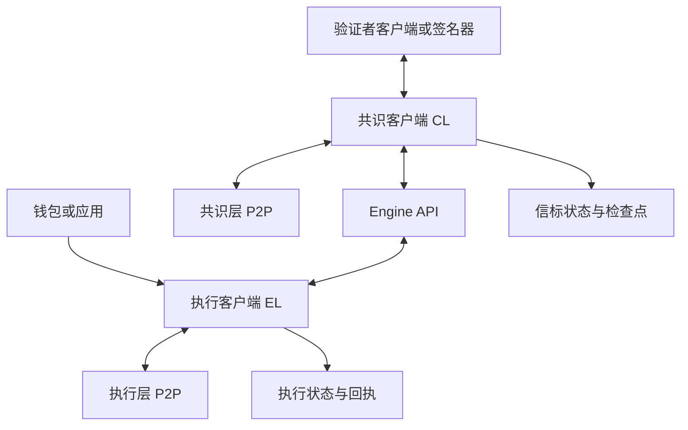
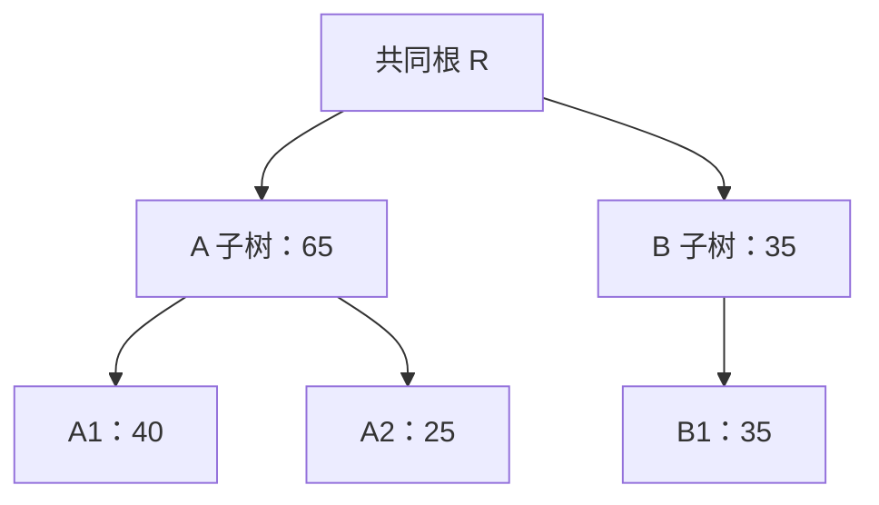
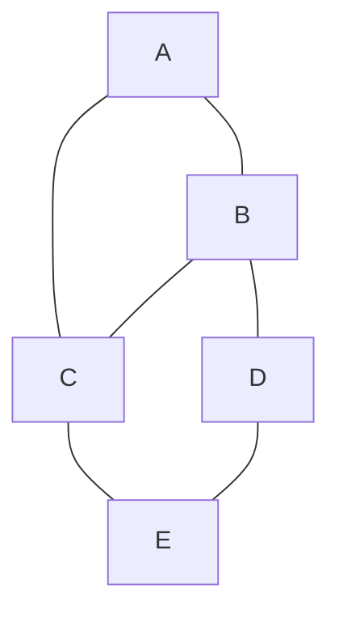

# PoW、挖矿与难度调整

## 本篇目录
- [一、本篇学习目标](#一本篇学习目标)
- [二、POW 共识算法](#二pow-共识算法)
  - [2.1 挖矿难度问题](#21-挖矿难度问题)
  - [2.2 比特币如何解决分叉问题](#22-比特币如何解决分叉问题)
- [三、POS 共识算法](#三pos-共识算法)
  - [3.1 从“消耗工作”到“承担可验证的权益责任”](#31-从消耗工作到承担可验证的权益责任)
  - [3.2 以太坊的 POS 共识算法](#32-以太坊的-pos-共识算法)
  - [3.3 ETH2.0 和 pactra 升级](#33-eth20-和-pactra-升级)
  - [3.4 以太坊的项目结构](#34-以太坊的项目结构)
  - [3.5 LSP：条件性解释为流动性质押协议](#35-lsp条件性解释为流动性质押协议)
  - [3.6 以太坊共识过程细化](#36-以太坊共识过程细化)
  - [3.7 理解区块的推导流程](#37-理解区块的推导流程)
  - [3.8 以太坊共识过程中怎么去解决区块分叉问题的](#38-以太坊共识过程中怎么去解决区块分叉问题的)
- [四、DPOS](#四dpos)
  - [4.1 把代表选举与代表之间的共识分开](#41-把代表选举与代表之间的共识分开)
  - [4.2 一个小规模选举例子](#42-一个小规模选举例子)
  - [4.3 成员轮换怎样影响安全](#43-成员轮换怎样影响安全)
  - [4.4 优势、代价与密码学边界](#44-优势代价与密码学边界)
- [五、PBFT](#五pbft)
  - [5.1 问题模型：已知成员之间的拜占庭复制](#51-问题模型已知成员之间的拜占庭复制)
  - [5.2 为什么是 $3f+1$ 和 $2f+1$](#52-为什么是-3f1-和-2f1)
  - [5.3 正常路径：请求、预准备、准备、提交、回复](#53-正常路径请求预准备准备提交回复)
  - [5.4 消息认证：签名、MAC 与历史材料的边界](#54-消息认证签名mac-与历史材料的边界)
  - [5.5 为什么需要第二轮投票与视图切换](#55-为什么需要第二轮投票与视图切换)
  - [5.6 通信复杂度与吞吐的取舍](#56-通信复杂度与吞吐的取舍)
  - [5.7 加权法定人数与 Go 示例 2](#57-加权法定人数与-go-示例-2)
  - [5.8 Hyperledger Fabric 0.6](#58-hyperledger-fabric-06)
  - [5.9 CometBFT](#59-cometbft)
  - [5.10 Hyperledger fabric 和 cometBFT 的本质差异](#510-hyperledger-fabric-和-cometbft-的本质差异)
  - [5.11 其他的 PBFT 变种算法（扩展）](#511-其他的-pbft-变种算法扩展)
- [六、图解 P2P](#六图解-p2p)
  - [6.1 P2P 是通信组织方式，不是所有节点两两直连](#61-p2p-是通信组织方式不是所有节点两两直连)
  - [6.2 在同一张图上分清四种身份](#62-在同一张图上分清四种身份)
  - [6.3 一笔交易经过网络时发生什么](#63-一笔交易经过网络时发生什么)
- [七、目标阈值与挖矿难度](#七目标阈值与挖矿难度)
- [八、为什么必须调整难度](#八为什么必须调整难度)
- [九、目标阈值的调整](#九目标阈值的调整)
  - [9.1 示例](#91-示例)
- [十、难度调整为什么由协议自动执行](#十难度调整为什么由协议自动执行)
- [十一、出块时间与系统安全](#十一出块时间与系统安全)
- [十二、本讲小结](#十二本讲小结)
- [十三、挖矿的完整流程](#十三挖矿的完整流程)
- [十四、全节点与轻节点](#十四全节点与轻节点)
- [十五、为什么收到新区块后要停止旧任务](#十五为什么收到新区块后要停止旧任务)
- [十六、区块被挖出后仍可能失效](#十六区块被挖出后仍可能失效)
- [十七、挖矿设备的专业化](#十七挖矿设备的专业化)
- [十八、奖励机制](#十八奖励机制)
- [十九、本讲小结](#十九本讲小结)
- [二十、本篇与知识体系的关系](#二十本篇与知识体系的关系)
- [一图看懂本篇流程](#一图看懂本篇流程)
- [官方实现与代码阅读入口](#官方实现与代码阅读入口)


## 一图看懂本篇流程


PoW 挖矿像不断抽奖：每次抽签互相独立，算力越大，每秒抽的次数越多。难度调整像调高或调低中奖门槛。

> **怎么读这张图：**从左向右看，先确认输入是什么，再看系统如何检查和处理，最后看结果如何保存或验证。图中是帮助理解的简化流程，协议细节仍以本篇后续说明和官方规范为准。


例如，抽奖系统每轮从大量号码中随机抽取一个。参与者增加后中奖概率变化，规则需要调整抽取难度，避免活动节奏失控。

## 官方实现与代码阅读入口

以下链接指向对应技术的官方文档、标准或项目源码。阅读代码时，建议先从本篇涉及的核心数据结构或验证入口开始，再沿调用关系查看后续处理。

- [Bitcoin Core 难度调整实现](https://github.com/bitcoin/bitcoin/blob/master/src/pow.cpp)
- [Bitcoin 挖矿开发指南](https://developer.bitcoin.org/devguide/mining.html)

**代码来源说明：**官方仓库中的实现代码才代表相应项目的真实实现。正文中用于解释概念的短代码或实验片段，如未明确标出官方文件路径，应按教学演示理解，不能直接当作 Bitcoin Core、Go Ethereum 或其他客户端的生产代码。实际开发应对照上方官方版本、规范和测试。


## 一、本篇学习目标
- PoW、挖矿与难度调整
- 理解核心概念、运行流程和参与角色
- 能够区分协议保证、实现细节与应用层假设
- 能够结合代码或实际场景分析边界与风险

## 二、POW 共识算法

<a id="sec-014"></a>
### 2.1 挖矿难度问题

#### 2.1.1 工作量证明究竟证明什么

PoW 通常让参与者寻找一个输入，使密码学哈希结果落入规定的小集合。以比特币式目标比较为例，把区块头双 SHA-256 的结果按协议解释为整数 $x$，要求：

$$
0\le x\le T,
$$

其中 $T$ 为目标值 target。目标越小，能通过的哈希结果越少，寻找合格输入通常需要更多尝试。验证者只需重新计算少量哈希并比较目标，验证成本远小于平均搜索成本。具体序列化、字节序、压缩目标字段和边界检查都属于共识规则，不能凭十六进制外观猜测。[S5]

这项证明并不记录矿工实际试了多少次。某人第一次就成功，仍与尝试一百万次后成功的人提交同一种可验证结果。区块所代表的工作量由**目标难度**估算，不由矿工自报计数，也不由最后那个哈希“看上去有多少个零”额外加分。

在理想均匀的 256 位哈希模型中：

$$
p=\frac{T+1}{2^{256}},\qquad
E[N]=\frac{1}{p}=\frac{2^{256}}{T+1}.
$$

这里 $p$ 是每次尝试成功的概率，$E[N]$ 是首次成功所需尝试次数的期望。期望不是截止期限，连续长时间无块与短时间连续出块都可能发生。

#### 2.1.2 用 8 位哈希做手算

为了看清公式，假设教学哈希只有 8 位，共有 256 个输出。如果目标 $T=15$，合法结果是 0 到 15，共 16 个，所以：

$$
p=16/256=1/16,\qquad E[N]=16.
$$

若目标改为 $T=7$，合法结果减半，平均尝试次数变为 32。因为合法集合包括零，公式中是 $T+1$，不是 $T$。生产协议经常使用相对难度 $D=T_{\text{reference}}/T$ 表示难度，但底层验证仍是整数目标比较；目标和难度变化方向相反。

假设全网每秒完成 $h$ 次独立尝试，在理想稳定模型下平均出块间隔近似：

$$
E[\Delta t]\approx \frac{2^{256}}{h(T+1)}.
$$

算力翻倍但目标不变，平均间隔约减半。调难度的目的，是让协议在算力长期变化时把出块节奏拉回目标附近，而非让每个区块都恰好在指定秒数出现。

#### 2.1.3 比特币主网调难度的基本思想

比特币主网目标间隔约 10 分钟，目标调节周期约两周，对应 2016 个区块。基本比例可以写为：

$$
T_{\text{new}}
\approx
T_{\text{old}}\times
\frac{\text{实际周期耗时}}{\text{目标周期耗时}}.
$$

若一个周期只用了 7 天，比例约为 $1/2$，新目标下降，出块难度上升。若用了 28 天，目标约翻倍，难度下降。实际实现还有目标上限、整数舍入、压缩编码、时间跨度夹限等细节；主网常规重调中，时间跨度被限制在目标跨度的四分之一到四倍。测试网、signet、regtest 的规则可能不同。[S5] [S8]

“2016 个区块约两周”是理解节奏的近似，实际代码取哪些时间戳和跨度应按实现分析，不应用一段教学算式替代链上有效性验证。矿工也不能自行在区块头把 target 改大来获取更高成功率：节点会根据该区块的祖先和规则检查所声明目标是否正是允许值。

#### 2.1.4 难度、算力和安全性的联系

较高算力可以增加制造替代历史所需的资源，但安全性不能由一个绝对哈希率数字独立判断。还需要比较攻击者可动用的算力比例、设备和能源成本、传播条件、攻击持续时间，以及诚实参与者是否处在同一网络视图中。

“多数算力攻击”也不是万能伪造权。攻击者可能影响排序、重组自己的支付、审查交易或延迟确认，但不能仅凭算力生成他人有效签名，也不能迫使严格执行规则的完整节点接受超出协议规则的任意资产增发。签名安全、规则有效性与链选择安全是不同边界。

<a id="sec-015"></a>
### 2.2 比特币如何解决分叉问题

#### 2.2.1 按累计工作量比较有效分支

通俗材料常把比特币规则称为“最长链”。更准确的学习表述是：在满足全部有效性规则的候选链中，比较累计工作量；只有每块难度相同时，按区块数量比较才与累计工作量比较一致。Bitcoin Core 为目标 $T$ 计算的单块工作量对应：

$$
w(T)=\left\lfloor\frac{2^{256}}{T+1}\right\rfloor,\qquad
W(\text{chain})=\sum_i w(T_i).
$$

这是一个按目标计算的整数度量，不是该区块实际消耗的电量或实际尝试次数。[S9]

设两个候选分支从同一个公共祖先分出，分支 A 的后续区块工作量是 3、3、3，分支 B 是 5、5。A 有 3 个区块，总工作量 9；B 有 2 个区块，总工作量 10。按累计工作量应选择 B。这个例子只演示求和与比较；真实区块目标受到历史难度调整规则约束，不能任意给相同难度周期中的两个分支分配不同目标。

节点处理分叉时可以按以下顺序理解：验证候选区块的格式、工作量和上下文；找到父块并连接历史；验证交易与状态转换；更新候选链累计工作量；在满足规则的链间选择；如果需要切换，回退旧分支状态并应用新分支。实现为性能可能采用分阶段校验和缓存，但最终完整验证不能省略。

当两条链累计工作量相同，不应期待所有节点瞬间选择同一条。先收到哪个、实现中的并列处理等因素可能让局部视图暂时不同。后续区块增长打破平局，网络传播使正确节点逐步趋同。概率性安全需要相关算力和网络假设支持，而不是单靠“发现更长就换”的口号。[S3]

#### 2.2.2 为什么堆积未验证区块没有意义

如果攻击者一次发来一万条自称“新高度”的记录，节点不会仅比较数字大小。每一条记录都必须能够连接到有效祖先，目标值正确，工作量合格，且状态转换符合规则。否则“高度”只是攻击者填写的字段。类似地，把一个有效区块复制一千次，不能把它的工作量累加一千次；链的父子引用和区块唯一性限制这种重复记账。

#### 2.2.3 Go 示例 1：小工作量、累计值与篡改检查

文件：`code/ch05/pow_work/main.go`。为确保运行轻量，程序只检查 SHA-256 输出的前 16 位，使用合成起点和教学区块头。A 的三个块目标为 32767，每块 work 为 2；B 的两个块目标为 4095，每块 work 为 16。因此输出应选择总工作量 32 的 B。

**边界必须保留**：程序没有比特币交易、UTXO、双 SHA-256、80 字节区块头、压缩目标规则、难度调节、共识时间检查及真实网络。两个不同目标分支是算术教学数据，不能当作同一比特币难度周期的合法竞争链。搜索还有固定尝试上限，达到上限就报错。

```go
// Local teaching model: SHA-256 is truncated to 16 bits for the work check.
// This is not a Bitcoin node and implements no Bitcoin difficulty schedule.
package main

import (
	"crypto/sha256"
	"encoding/binary"
	"fmt"
)

type Block struct {
	Previous [32]byte
	Payload  string
	Target   uint16
	Nonce    uint64
	Hash     [32]byte
}

func headerHash(b Block) [32]byte {
	buf := append([]byte("CH05-TOY-POW/v1\x00"), b.Previous[:]...)
	buf = binary.BigEndian.AppendUint16(buf, b.Target)
	buf = binary.BigEndian.AppendUint64(buf, b.Nonce)
	buf = binary.BigEndian.AppendUint64(buf, uint64(len(b.Payload)))
	buf = append(buf, b.Payload...)
	return sha256.Sum256(buf)
}

func work(target uint16) uint64 {
	return (uint64(1) << 16) / (uint64(target) + 1)
}

func mine(previous [32]byte, payload string, target uint16) (Block, error) {
	b := Block{Previous: previous, Payload: payload, Target: target}
	// Hard cap: this demo never starts an unbounded mining job.
	for nonce := uint64(0); nonce < 1_000_000; nonce++ {
		b.Nonce = nonce
		b.Hash = headerHash(b)
		if binary.BigEndian.Uint16(b.Hash[:2]) <= b.Target {
			return b, nil
		}
	}
	return Block{}, fmt.Errorf("demo search limit reached")
}

func makeBranch(prefix string, count int, target uint16) ([]Block, error) {
	var previous [32]byte // Shared synthetic starting point.
	branch := make([]Block, 0, count)
	for i := 0; i < count; i++ {
		b, err := mine(previous, fmt.Sprintf("%s-%d", prefix, i+1), target)
		if err != nil {
			return nil, err
		}
		branch = append(branch, b)
		previous = b.Hash
	}
	return branch, nil
}

func verifyBranch(branch []Block) (uint64, error) {
	var previous [32]byte
	var total uint64
	for i, b := range branch {
		if b.Previous != previous || b.Hash != headerHash(b) {
			return 0, fmt.Errorf("block %d: broken link or altered header", i+1)
		}
		if binary.BigEndian.Uint16(b.Hash[:2]) > b.Target {
			return 0, fmt.Errorf("block %d: insufficient work", i+1)
		}
		w := work(b.Target)
		if ^uint64(0)-total < w {
			return 0, fmt.Errorf("work overflow")
		}
		total += w
		previous = b.Hash
	}
	return total, nil
}

func main() {
	a, err := makeBranch("easy", 3, 32767)
	if err != nil {
		panic(err)
	}
	b, err := makeBranch("hard", 2, 4095)
	if err != nil {
		panic(err)
	}
	wa, err := verifyBranch(a)
	if err != nil {
		panic(err)
	}
	wb, err := verifyBranch(b)
	if err != nil {
		panic(err)
	}
	fmt.Printf("A: blocks=%d work=%d
", len(a), wa)
	fmt.Printf("B: blocks=%d work=%d
", len(b), wb)
	fmt.Println("choose B by work:", wb > wa)
	a[0].Payload = "tampered"
	_, err = verifyBranch(a)
	fmt.Println("tamper rejected:", err != nil)
}
```

运行命令：

```bash
go run code/ch05/pow_work/main.go
```

实际输出：

```text
A: blocks=3 work=6
B: blocks=2 work=32
choose B by work: true
tamper rejected: true
```

最后一次检查改动第一块内容而保留原哈希，因此失败。攻击者当然可以重新计算自己的新哈希，但还需让它满足工作量条件，并更新所有受影响的后继引用和证明；真实网络还存在诚实链继续增长的竞争。这正是“哈希指针使改动可检测”和“工作量约束重写成本”共同发挥作用的地方。

<a id="sec-016"></a>

## 三、POS 共识算法

<a id="sec-017"></a>
### 3.1 从“消耗工作”到“承担可验证的权益责任”

PoS 是一类把协议权利与质押权益联系起来的设计，不能仅凭这个名字推出完整算法。一个具体 PoS 系统还必须说明：怎样进入验证者集合，怎样分配提议权和投票权，怎样选链，什么条件下最终确定，怎样退出，哪些行为可罚没，以及节点如何验证成员集合变化。

用一个简化模型表示，时期 $e$ 的已知验证者集合是：

$$
V_e=\{(pk_1,w_1),\ldots,(pk_n,w_n)\},\quad W_e=\sum_i w_i.
$$

$pk_i$ 是验签公钥，$w_i$ 是由已经认可的状态确定的权重。某条消息有多份签名时，计算的是不同合法成员的权重之和，不是签名字节长度，也不是消息转发次数。

PoS 的质押约束和签名约束各有作用。签名使第三方能够验证“这位验证者签过哪些互相冲突的内容”；质押和处罚规则使某些可证明违规行为带来经济后果。但是处罚不能代替正确的消息协议：如果节点连什么算冲突、用哪个集合验签都不清楚，就无法可靠举证或保持一致。

也不能把所有故障都称为 slash。离线、网络迟到、漏做职责、双重提议、相互矛盾的证明消息，可能触发不同处理。特定协议还可能有 inactivity leak 等使长期无法最终化的系统恢复所需权重结构的机制。概念上，“未得到奖励”“普通罚分”和“因可证明违规被罚没”是不同事件。

<a id="sec-018"></a>
### 3.2 以太坊的 POS 共识算法

以太坊 PoS 的核心学习框架是 **Gasper：LMD-GHOST 分叉选择与 Casper FFG 最终性机制的组合**。LMD-GHOST 帮助节点在尚未完全最终确定的分支中选择当前链头；Casper FFG 根据检查点之间的投票关系推进证明和最终化状态。数字签名、验证者集合、时隙安排和状态转换规范支撑这两个机制。[S16]

为了避免把一个复杂协议讲成“谁币多听谁的”，本节分成升级沿革、软件分工、质押服务、单次职责流程、区块推导及分叉处理六部分。涉及实现细节时，以实际运行的分叉版本为准；后面的小图和手算忽略部分优化，只用于理解它们解决的问题。

<a id="sec-019"></a>
### 3.3 ETH2.0 和 pactra 升级

#### 3.3.1 ETH2.0 是历史称呼，不能理解为要换一枚 ETH

“Eth2”曾用于描述以太坊的升级方向。Ethereum Foundation 的公开说明已将“Eth1/Eth2”术语改为更准确的“执行层/共识层”。The Merge 于 2022 年 9 月完成主网从 PoW 到 PoS 的共识转换；它不是创建一枚必须把原 ETH 换进去的官方新币。理解历史名词时，应同时说明旧称和现在的架构称呼。[S10] [S11]

术语变化还提醒我们：一个升级名字可能覆盖多项工程计划，不意味着所有扩容、账户功能和质押功能都在同一天完成。学习时最好做“名字—目标—生效时间—改变的规则”四列对照，而不是把很多年的变化压成一次 ETH2.0 升级。

#### 3.3.2 pactra 应校对为 Pectra

官方资料将 Pectra 解释为 Prague 与 Electra 的组合：前者对应执行层升级，后者对应共识层升级。官方路线图记录它已于 **2025 年 5 月 7 日 10:05 UTC、epoch 364032** 在以太坊主网激活。这是已经发生的历史事实，不是本文对未来升级时间的预测。[S12]

本讲聚焦与共识最相关的 EIP-7251。它提高单个验证者可使用的最大有效余额，同时保留最小激活余额。不要把“最大值从 32 变成 2048”误读为“现在必须有 2048 ETH 才能成为验证者”。

| 项目 | 含义 | 与 EIP-7251 的关系 |
|---|---|---|
| 最小激活余额 | 验证者进入激活流程需满足的余额门槛之一 | 仍为 32 ETH |
| 实际余额 | 协议状态中记录的实际余额，可随奖励、处罚等变化 | 不一定与有效余额即时相等 |
| 有效余额 | 用于共识权重、奖励等计算的规则化数值 | 有上限和更新规则 |
| 复利提款凭证 | 前缀为 0x02 的相关凭证类型 | 可适用最高 2048 ETH 的有效余额上限 |
| 非复利凭证 | 不满足上述复利凭证条件 | 不能直接按 2048 ETH 上限理解 |

这些数字来自 EIP-7251 的常量和 Electra 的 `get_max_effective_balance` 规则：是否具有 compounding withdrawal credential 决定采用新的上限还是 32 ETH 上限。[S13] [S14]

设运营者原来管理两个各有 64 ETH 实际余额的不同教学账户。是否能把它们变成一个有效余额 128 ETH 的验证者，不是把两个余额在纸上相加这么简单，还取决于它们的凭证类型、是否满足合并请求条件、队列及协议状态。如果确实完成符合规则的合并，权重关注的是有效余额，不是“一个公钥只算一票”的地址数思维。

上限提高带来的重要工程含义，是可以减少管理同等质押规模时需要的验证者条目和签名职责数量，同时允许符合条件的余额参与复利。它也要求学习者重新审视“每个验证者必定有相同 32 ETH 权重”的旧简化。对运营去中心化的影响还取决于运营者分布、客户端分布和控制权结构，不能仅从验证者条目数量增减直接推出结论。

<a id="sec-020"></a>
### 3.4 以太坊的项目结构

这里把“项目结构”解释为协议与客户端的组成，不臆造某个未指定项目的文件夹。生产以太坊节点通常涉及执行客户端、共识客户端，以及可选的验证者客户端。一个只想验证区块和查询状态的节点，并不因为运行完整节点就自动获得提议或投票资格。[S1]

| 组件 | 主要职责 | 维护的典型信息 | 主要交互 |
|---|---|---|---|
| 执行客户端 EL | 验证并执行交易，维护执行状态，构造或校验执行载荷 | 账户、合约状态、交易池、回执 | 执行层 P2P、用户 JSON-RPC、Engine API |
| 共识客户端 CL | 处理信标链状态、块与证明消息、分叉选择、最终性 | 验证者集合、检查点、共识状态、候选分支 | 共识层 P2P、Engine API |
| 验证者客户端 VC | 根据职责签署提议、证明等消息 | 签名密钥访问与防重复签名记录 | 共识客户端、签名器 |
| 外部签名器（可选） | 隔离签名操作和密钥管理 | 私钥、签名策略或防双签状态 | 受保护的本地或远程签名接口 |

协议代码也有不同资料入口。共识规范规定状态容器和转换规则；执行规范规定 EVM 和执行层规则；Engine API 规定 CL 与 EL 如何协调。具体客户端可能用不同语言、不同目录实现同一协议，所以“某文件叫 consensus.go”并不是共识定义。



Engine API 是本机或受控环境中组件之间的接口，不是公共网络任意节点都应能调用的权限入口。接口调用还会返回执行载荷的验证状态，不能把“收到 RPC 响应”统一视为“执行已经有效”。具体方法版本随分叉变化，应阅读对应版本规范。[S40]

架构中最容易混淆的三个“哈希”也值得拆开。执行状态根承诺账户和存储状态；执行区块哈希标识执行区块；共识层通过 SSZ 等结构化规则计算相关根。它们都可能是 32 字节，但并不是可以任意互换的同一种对象。写程序时应以类型和字段名约束，而不是让所有参数都叫 `hash`。

验证者客户端与共识客户端的区分还帮助理解防双签。把同一个验证者私钥同时导入两套互不协调的在线系统，可能让它们对同一职责签署冲突内容。高可用部署需要共享或迁移经过设计的防双签状态，不能简单地用“多开几个进程更可靠”的思路处理共识密钥。

<a id="sec-021"></a>
### 3.5 LSP：条件性解释为流动性质押协议

如果原课的 LSP 指 **Liquid Staking Protocol**，其位置是质押参与与资产凭证的服务层。用户把 ETH 交给某种合约或运营流程，协议组织底层验证者，并可能向用户发行代表相关权益的流动性质押代币。以太坊官方质押说明区分了原生验证者规则与外部建设的池化服务；池化不是“持有任意收据代币就自动成为共识验证者”。[S15]

下面用完全虚构的“示例池”理解资产关系，不指向具体产品。甲存入 20 ETH，乙存入 12 ETH，池合计 32 ETH，随后按协议规定部署一个验证者。甲获得占池份额的凭证，乙也获得相应凭证。验证者实际提交证明消息时，使用的是验证者签名密钥；甲转让自己的收据代币，通常不等于这份验证者密钥或当期职责立即转移给买方。

加入奖励、费用和损失后，简单的“一个凭证永远等于一 ETH”也未必成立。有的设计改变每份代币可兑换的资产比例，有的改变持有数量，还有不同的退出和赎回机制。讲解必须先读具体协议规则，不能从 LSP 缩写推断固定收益或即时赎回。

从共识安全看，池化会引入几个新的控制问题：谁选择节点运营者，谁控制升级权限，谁能发起退出，谁决定采用哪种客户端，出现罚没如何分担，以及底层验证者实际上由多少独立主体管理。这些都是权责和风险结构，不由 BLS 签名本身解决。

若很多流动性质押用户最终委托给同一个运营者，收据持有人很多并不等于独立签名决策者很多。反过来，一个协议也可能采用多个独立运营者和更复杂的密钥控制。判断去中心化程度，应追踪实际签名与运维控制权，不只统计地址数、代币持有人数或市场界面显示的池规模。

如果原课 LSP 实际指别的术语，那么本段只能作为相关扩展，不可拿它反过来证明含义。继续学习需要对照授课者的全称定义。

<a id="sec-022"></a>
### 3.6 以太坊共识过程细化

#### 3.6.1 时间单位、职责和参与者

以本节讨论的主网 PoS 基线，时间分成 12 秒一个 slot，32 个 slot 为一个 epoch，即一个 epoch 约 6.4 分钟。slot 是计划中的出块机会，不保证一定有区块：提议者离线、网络延迟或块无效都可能导致空 slot。共识状态仍能按时间推进。[S18]

每个 slot 有按协议选出的提议者；验证者被安排承担相应的证明职责。委员会划分降低每次传播和处理的范围，但不能把“某个小委员会有三分之二签名”直接等同于“整个系统已最终化”。最终化使用相应全局有效权重和检查点规则，聚合子网的职责只是组织消息传播与汇总。

用一个课堂时序说明各参与方的输入输出：

| 阶段 | 输入 | 参与者做什么 | 输出或状态变化 |
|---|---|---|---|
| 职责准备 | 前置共识状态、slot、随机性相关状态 | 计算提议和证明职责 | 本 slot 的职责安排 |
| 选择父块 | 已验证的候选分支、最新投票、检查点 | 运行相应分叉选择 | 当前认可的父块 |
| 构造区块 | 父状态、执行交易、协议操作 | 生成执行载荷及共识层区块内容 | 候选区块和签名 |
| 接收验证 | 区块字节、父状态、执行结果 | 检查签名、结构、执行与状态转换 | 接受、拒绝或等待依赖 |
| 形成证明 | 本地认可的链头与 source/target | 签署结构化证明消息 | attestation |
| 汇总传播 | 多份兼容的有效证明 | 聚合签名和参与者信息 | aggregate 与后续区块输入 |
| epoch 处理 | 已记录的参与与余额 | 更新奖励、检查点等状态 | justified/finalized 等结果 |

这是职责级教学流程，实际网络中消息交错进行，各节点不会等待全网统一完成某一行才开始下一行。延迟和局部视图差异正是分叉选择机制需要处理的输入。

#### 3.6.2 一份证明消息究竟承诺什么

一份 attestation 的核心语义不仅是“我看到这个块”。它包含 slot、链头相关根、source 检查点和 target 检查点等信息，再结合协议规定的参与者标识、委员会信息和签名域进行编码验签。source/target 用于最终性逻辑，链头相关选择参与分叉选择。容器和聚合格式随分叉版本调整，不能把某个旧版字段表当作永久 API。[S41]

为什么必须绑定这些字段？假设只签一个区块哈希，不签网络和时间上下文，攻击者可能把旧票搬到另一个高度、轮次或网络里。签名域和结构化编码让“在链 A 的时期 e 为职责 d 对块 B 发言”成为具体的密码学对象。规范通常还通过 fork version 等信息分隔不同规则版本，避免跨域混用。

验证签名前后，还要确认消息中的验证者在相应状态下有资格参加，集合来源可信，参与者没有重复，权重没有被人为放大。不能相信消息发送者自己附带的“这个公钥权重是一百万”描述。

#### 3.6.3 BLS 聚合为什么有帮助，为什么还不是共识

BLS 允许把多个满足相应方案条件的签名组合成紧凑对象，接收者结合参与者集合和消息验证它。具体方案必须遵守所选密码套件、公钥验证、群成员检查、消息映射及抗流氓公钥要求。以太坊采用规范化的 BLS 流程，不能直接把一个教学配对等式当作完整验签代码。[S6] [S41]

设一个教学委员会有 100 个合法成员，其中 80 人对兼容的消息签名。聚合可以减少签名传播体积，但接收者仍必须知道这 80 人是谁，以及他们在可信状态里的权重。一个聚合签名不是自动附带“80% 全局权益”的凭证。

更关键的是，聚合不会阻止恶意验证者对冲突内容签名，也不会告诉节点哪个 block 应该成为 head。选择、锁定、最终化、重放防护和处罚证明仍由协议处理。可以把 BLS 聚合理解为**使认证信息更容易传播和验证的工具**，不能把它当作完成共识的一个按钮。

#### 3.6.4 正常行为与可证明违规

一个验证者离线导致漏签，可能影响奖励与网络活性；同一 slot 提议两个不同区块，或者签署满足协议定义的冲突证明，可能构成可罚没行为。对 FFG 证明，常见教学表述包括同一 target epoch 的双重投票，以及一组 source/target 区间严格包围另一组的 surround vote；实际举证和有效性判定应按规范中的相应谓词完成。[S6]

例如证明一从 epoch 2 指向 epoch 6，证明二从 epoch 3 指向 epoch 5，便呈现 $2<3<5<6$ 的严格包围关系。仅凭“两个消息不同”还不够；正常验证者在不同时间本来就会签署不同消息。检查高度、epoch、域和不等式，是把密码学证据变成协议处罚依据的关键。

<a id="sec-023"></a>
### 3.7 理解区块的推导流程

#### 3.7.1 从“区块像一个文件”转向“区块是状态转换输入”

区块是公开可验证的结构化输入，而不仅是一张交易清单。可以把共识状态转换写为：

$$
S'_{\mathrm{CL}}=
F_{\mathrm{CL}}(S_{\mathrm{CL}},\text{slots},B),
$$

把执行状态转换写为：

$$
S'_{\mathrm{EL}}=
F_{\mathrm{EL}}(S_{\mathrm{EL}},\text{payload}).
$$

二者通过执行载荷及相应承诺关联，但它们不是同一份状态。CL 关心验证者和检查点等共识信息；EL 关心账户余额、合约存储和执行回执等信息。

提议者的“推导”过程，是从合法父状态出发，推进到指定 slot，选择或构造满足执行规则的载荷，填入所需共识操作，计算状态转换结果和相应根，最终按协议签署。验证者则用相同规则复算，检查提议者填写的根是否与结果一致。根是用于快速比对的承诺，不能代替复算所需数据。

#### 3.7.2 一个有 nonce 冲突的区块构造例子

某账户状态是余额 10、下一个 nonce 为 7。交易池里有交易 $T_a$：nonce 7、支付 3；交易 $T_b$：nonce 7、支付 5；交易 $T_c$：nonce 8、支付 2。忽略费用以便手算。

如果先选 $T_a$，执行后余额 7、nonce 8，接着可评估 $T_c$；$T_b$ 此时已不再匹配 nonce。若先选 $T_b$，则余额 5、nonce 8，后续仍可评估 $T_c$。不同合法排序可能形成不同合法候选状态，因此“有效性”并不总能唯一决定区块内容，还需要提议与分叉选择确定共同历史。

现实 EVM 还要考虑费用、gas、合约执行失败与回滚规则。一个执行失败但按协议有效的交易，可能仍被包含并产生失败回执，不能把“交易执行返回失败”和“整个区块无效”混为一谈。本例只呈现排序对状态的依赖关系。

#### 3.7.3 接收区块时至少要问的七个问题

1. **网络和版本是否匹配？** 同样格式的测试网消息不能直接进入主网状态。
2. **父块是否已知且可用？** 缺少父状态时应同步依赖，不能凭空校验新状态根。
3. **slot 与提议身份是否符合规则？** 私钥签名正确不等于该私钥有本次提议权。
4. **结构承诺是否正确？** 交易列表、操作列表及根的编码要一致。
5. **共识操作是否合法？** 包括证明、退出、罚没等相应分叉允许的操作。
6. **执行载荷是否已经完成必要的有效性验证？** 接收状态不应被错误升级为有效状态。
7. **本地持久化和分叉选择怎样更新？** 候选块入库、成为 head、最终化是不同步骤。

这些问题也决定调试路径。如果“签名对但链上拒绝”，首先定位被签的域、职责资格和前置状态，而不是立刻怀疑签名算法本身。

#### 3.7.4 区块可获得性与乐观同步的边界

接收区块头或某个根，并不意味着已经获得全部区块数据。节点要执行区块，还需要载荷等所需数据；一些场景允许先记录候选对象或使用乐观同步追赶，但其验证状态必须清楚标记。尚未完成必要验证的对象，不能在需要严格有效性的职责上被当作已验证事实使用。

这一点延伸到数据可用性：承诺能告诉你“下载到的数据是否匹配这个根”，却不能强迫持有者把数据交出来。密码学完整性与网络可获得性是两个不同问题，本讲 P2P 部分还会进一步区分它们。

<a id="sec-024"></a>
### 3.8 以太坊共识过程中怎么去解决区块分叉问题的

#### 3.8.1 第一步：限定可选分支

节点不会在所有见过的区块之间直接“选票最多的那个”。它先排除无效块，并根据已知 justified/finalized 检查点等条件筛选可行分支。已最终化祖先约束和分叉选择规则一起工作，避免一条普通迟到分支随意覆盖已经最终确定的历史。[S17]

#### 3.8.2 第二步：理解 LMD-GHOST 的逐层选择

LMD 意为使用验证者的最新相关消息；GHOST 的核心直观是沿着获得更多支持权重的子树向下走。它不是把从创世以来所有历史投票不断累加，也不是简单寻找直接收到最多票的叶子。

下面忽略提议者加权等实际规则，构造一个仅用于理解“子树权重”的例子。共同根 R 有子块 A、B；A 有子块 A1、A2；B 有子块 B1。验证者最新消息的权重分别为：支持 A1 的 40，支持 A2 的 25，支持 B1 的 35，总计 100。



第一步在 R 的子节点里选择 A，因为 $40+25=65>35$；第二步在 A 的子节点里选择 A1，因为 $40>25$。因此 head 为 A1。支持 A2 的票虽然没有直接投给 A1，却在第一步支持了共同祖先 A 的子树。

现在有权重 20 的验证者把自己的最新消息从 A1 移到 B1。在这个简化模型中，旧的 20 权重不继续与新票一起计入；A 子树变为 45，B 子树变为 55，选择可能改变。真实协议会检查消息时序、资格和 slashable 条件，并包含额外权重与过滤规则，本例不实现完整的 Ethereum fork choice。[S17]

#### 3.8.3 第三步：Casper FFG 推进检查点

检查点由 epoch 和相应块根等信息确定。FFG 关注 source 到 target 的投票关系，让某些检查点先达到 justified，再按规则使较早检查点达到 finalized。正常连续参与的情况下，可以用“连续检查点的充分投票使前一检查点最终化”理解，但规范还处理跳过或延迟等情况，不能仅凭一个箭头替代完整状态机。[S16] [S6]

**这里的阈值必须按协议说清楚。** Ethereum 规范的相关 justified 计算使用：

$$
3A\ge 2W,
$$

其中 $A$ 是符合条件的有效余额，$W$ 是相应总有效余额，也就是至少三分之二。后面 CometBFT 和通用加权 QC 示例采用严格超过三分之二的门槛，它们不是同一条代码规则。

例如 $W=96$ 时，$A=64$ 满足 $3A=2W=192$。但这个数字本身只说明该特定余额条件通过，不说明任意一个拥有 64 权重签名的区块立即 finalized；还必须是正确 source/target、正确 epoch、合格消息以及最终化状态规则。如果 $W=100$ 且权重单位为整数，则至少需要 67，不能用浮点四舍五入把 66.7 随意变成 66。

为什么这样的阈值有意义？设两个相互冲突的证明集合都至少占 $2W/3$，集合交集至少占 $W/3$。当拜占庭权重严格少于 $W/3$ 且诚实参与者遵守相应禁止冲突投票规则时，两个冲突证据不能无代价地同时出现。这是理解可追责安全性的集合直观；完整 Gasper 证明还涉及投票规则、时序、动态集合和协议假设，不能用这一步集合算术代替整篇证明。

#### 3.8.4 网络分区时，“停下来”可能正是安全行为

如果网络一侧只看到总权重 60%，另一侧看到 40%，两边都无法在同一已知集合下凭本侧权重轻易满足通常的最终化门槛。它们可能继续拥有不同的暂时链头，但最终性推进可能暂停。安全性允许系统在信息不足时停止作出不可逆决定，活性则要在网络条件恢复等假设下讨论。

长期不最终化、inactivity leak、网络恢复后的权重与分支处理属于更深的协议分析，不能简化为“随便等待两个 epoch 一定恢复”。对应用而言，正确做法是读取并区分 head、safe/finalized 等接口语义，监控异常，而不是按固定秒数自行推断已经最终化。

#### 3.8.5 三条不能省略的结论

第一，头部分叉的正常处理不等于冲突最终性处理；若看到互不兼容的最终性证据，已经不是普通“哪边多一个块”的问题。第二，BLS 聚合使支持证据更紧凑，真正决定取舍的仍是 Gasper 规则和可信状态。第三，新节点的历史起点仍需要弱主观性相关处理；“目前有很多签名”不能消除旧密钥制作替代历史的问题。

<a id="sec-025"></a>

## 四、DPOS

<a id="sec-026"></a>
### 4.1 把代表选举与代表之间的共识分开

DPoS 通常展开为 Delegated Proof of Stake，可译为委托权益证明。一些实现让代币持有人通过投票选择出块代表，再由代表集合按照预定出块和确认规则维护账本。早期 EOSIO 技术白皮书中可以读到代币持有人选择区块生产者的设计，但不同 DPoS 系统的细节和后续演进不能混为一谈。[S20]

至少有两层决策：

$$
\text{代币持有人投票}
\longrightarrow
\text{确定代表集合}
\longrightarrow
\text{代表执行具体共识协议}.
$$

第一层回答“谁有资格参与”，第二层回答“当前高度接受什么”。一个系统即使采用代表选举，也仍需要明确分叉规则、确认门槛、轮换时机及失效恢复。DPoS 标签本身不是这些算法细节的完整说明。

<a id="sec-027"></a>
### 4.2 一个小规模选举例子

设 100 份教学权益参与选举，候选人 A、B、C、D、E 得到的支持分别为 40、25、15、12、8；系统选取前三名组成下一期代表集合。为了演示，假设代表在共识中各有一票。这时“选举时 A 获得 40 份支持”和“共识中 A 的票权为 40”不是同一件事，因为我们已经明确采用另一种共识权重规则。

如果实际系统把代表投票权设置为委托权益之和，结论又会不同。必须读取规则，不能在“按币计票”与“按代表计票”之间来回切换。特别是分析三分之二门槛时，应先写出分母：是候选人票数、当期代表总数，还是当期有效委托权重。

这个三代表例子也不是一个可直接容忍一名任意作恶者的标准 PBFT 配置。若想套用后文经典 $n=3f+1$ 的模型，容忍 $f=1$ 通常需要 4 个副本；“代表少所以肯定能高效容错”缺乏必要条件。

<a id="sec-028"></a>
### 4.3 成员轮换怎样影响安全

假设高度 100 使用集合 $V_a$，高度 101 开始使用集合 $V_b$。验证者不能自行选择自己最喜欢的集合解释投票。系统必须规定：新集合由哪一份已经确定的状态产生，什么时候生效，交接边界由谁签名，以及轻客户端如何验证这次变更。

一个直观失败例是：旧集合宣布一份成员表，新集合又在另一个分支宣布另一份；如果双方都可立即从自己的表获得合法性，就出现循环论证。可靠设计需要让成员变化成为经过已有信任基础确认的状态转换，必要时使用延迟生效、共同确认或其他专门机制。

<a id="sec-029"></a>
### 4.4 优势、代价与密码学边界

较小且已知的活跃代表集合通常更容易组织稳定通信、减少投票传播负担；代价是参与权集中，选举参与率、委托集中度和运营相关性影响实际控制结构。代表可以被选出，也可能因网络基础设施、密钥管理或软件缺陷同时失效。

数字签名能记录某个代表签过什么，不能证明它独立于其他代表，也不能揭示它背后的组织是否受同一方控制。治理投票能更换成员，但更换生效前的审查或故障仍需要协议处理。评估 DPoS 时应同时分析治理、网络和共识，不能只比较区块间隔。

另外，用户把 ETH 交给质押服务商，并不自动把以太坊底层协议改造成经典“选出固定少数代表”的 DPoS。经济委托、托管关系和具体共识算法之间存在关联，但不是同一个概念。

<a id="sec-030"></a>

## 五、PBFT

<a id="sec-031"></a>
### 5.1 问题模型：已知成员之间的拜占庭复制

PBFT 是 Practical Byzantine Fault Tolerance。Castro 与 Liskov 的原始工作研究拜占庭故障下的状态机复制：副本可能作恶，但正确副本仍要按一致顺序执行请求。PBFT 不是某一条区块链的专属发明；区块链系统可以把“请求顺序”扩展为区块顺序，再与身份、账本和智能合约系统组合。[S21]

经典介绍通常使用 $n=3f+1$ 个副本、最多 $f$ 个拜占庭副本，并用主节点组织正常路径。主节点提出顺序，但不独自决定顺序。其他副本需要验证请求与协议消息，形成足够证据；主节点失效时通过 view change 更换。

这里的成员是协议已知并经过认证的身份。没有这个前提，一个攻击者生成一千个公钥就能伪装成一千个副本，数字签名本身无法阻止。所以联盟链需要成员管理，开放 PoS 链需要有效权益集合，这些都是在运行投票协议前必须明确的输入。

<a id="sec-032"></a>
### 5.2 为什么是 $3f+1$ 和 $2f+1$

先做一个独立的法定人数推导。假设有 $n$ 个等权副本，坏副本至多 $f$，一个决定证据需要 $q$ 个不同副本支持。为了让两个证据的交集中至少有一个诚实副本，需要：

$$
2q-n>f.
$$

因为任意两个大小为 $q$ 的子集交集至少为 $2q-n$，若这个交集不超过 $f$，交集就可能完全由双重发言的坏副本组成。另一方面，即使坏副本全部沉默，诚实副本也应有机会完成协议，因此还需要：

$$
q\le n-f.
$$

把两条合起来，得到 $n>3f$，即整数情况下 $n\ge3f+1$。当使用最紧的配置 $n=3f+1$ 时，常见阈值是 $q=2f+1$。

这只是理解经典 quorum 型 BFT 配置的集合推导，不是说所有同步模型、可信硬件模型或所有拜占庭问题都具有完全相同下界。安全性还需要诚实节点在协议中不签署不相容决定、视图切换保留证据等规则；仅有集合交集并不会自动得到一个可运行算法。

举例：$f=1,n=4,q=3$。两个三人集合必有至少两人重合，其中至少一人诚实。如果正确节点不能在相同位置的相同上下文中支持冲突决定，两个相冲突证据就不能同时形成。

一个常见错误是把 $2f+1$ 脱离 $n=3f+1$ 直接套用。若 $n=5,f=1$，仍取 $q=3$，两个三人集合可能只重合一人，恰好就是坏人。要按上述一般条件选择阈值，例如 $q=4$ 满足 $2q-n=3>1$，且不超过 $n-f=4$。具体协议的副本配置和阈值必须一致。

<a id="sec-033"></a>
### 5.3 正常路径：请求、预准备、准备、提交、回复

为便于说明，设四个副本 P、A、B、C，其中 P 是当前 view 的主节点。客户端请求是“给订单 17 标记已付款”，请求带客户身份、请求标识和认证信息。共识需要为它分配一个统一序号 $s$，避免所有副本以不同顺序处理并发请求。

| 阶段 | 发送者 | 消息的关键上下文 | 接收者检查 | 形成的认识 |
|---|---|---|---|---|
| Request | 客户端 | 请求内容、客户端身份、请求标识 | 授权、格式、是否重复 | 有一个待排序请求 |
| Pre-prepare | 主节点 | view、序号、请求摘要 | 主节点身份、当前 view、序号窗口、摘要匹配 | 主节点提出该位置的候选值 |
| Prepare | 备份副本 | 同一 view、序号、摘要 | 认证、成员资格、是否冲突、是否重复 | 足够副本看到了同一候选 |
| Commit | 已满足 prepared 条件的副本 | 同一 view、序号、摘要 | 认证及本地状态条件 | 形成可支持跨 view 安全的提交证据 |
| Reply | 执行后的副本 | 请求标识、结果、视图等 | 结果一致、不同合法副本 | 客户端取得响应证据 |

在原始 PBFT 定义中，prepared 条件涉及本地保存请求、匹配的 pre-prepare，以及来自不同备份的 $2f$ 份 prepare；备份可包括自己的 prepare。**这里不是“随便收到 $2f+1$ 个名字不同的任意消息”。** 消息类型、view、序号、摘要都必须匹配。

随后，某副本要达到 committed-local，需要本地 prepared，并收到 $2f+1$ 份匹配的 commit，可计自己的 commit。执行还要等待之前序号的请求已经按顺序执行，之后再回复客户端。客户端通常等待 $f+1$ 份匹配结果，以保证其中至少有一份来自诚实副本；这也不等于客户端直接替代了副本之间的提交协议。[S21]

在 $f=1$ 的例子里，备份 A 收到 P 的 pre-prepare，再有两份不同备份的匹配 prepare，就可满足对应准备条件；本地 prepared 之后，三个不同副本的匹配 commit 可使其本地提交。收到三个 prepare 与收到三个 commit 不是同一种证据，不能互相替换。

<a id="sec-034"></a>
### 5.4 消息认证：签名、MAC 与历史材料的边界

为了便于讲授，图里常把每个消息都画成带签名。原始 PBFT 也讨论了使用 MAC 和 authenticator 向量降低认证开销的优化，因此不能说“PBFT 的定义要求所有消息都必须用公钥签名”。公钥签名和共享密钥 MAC 都能在各自信任模型内提供消息认证，但可向第三方独立验证的能力和密钥管理方式不同。[S21]

原始论文年代较早，其中的实验参数、算法选择和性能数字属于历史材料。不能因为经典论文使用过某种旧哈希或旧 RSA 参数，就把它作为今天新系统的密码学配置。本讲自编程序选用 Go 标准库 Ed25519，仅演示现代签名 API 与证据校验；它不是复刻论文的历史加密组合。

如果使用 MAC，接收者掌握对应共享密钥，通常不能像公钥签名那样向任意第三方证明发送者一定签过该消息。跨链验证、公开罚没证据等用途需要特别考虑可转移证据，而不是只比较认证速度。

<a id="sec-035"></a>
### 5.5 为什么需要第二轮投票与视图切换

只做一次“主节点广播，其他节点签字”很容易遇到视图切换问题：有些节点认为旧值已经足够可靠，另一些节点没有收到全部消息，新主节点再提出另一个值。如果协议不带上旧证据，节点可能在换领导时失去安全约束。

PBFT 的 prepare 和 commit 不只是为了形式上多传两轮。它们让本地准备状态、足够诚实副本知道的状态，以及视图切换时需要继承的信息之间形成关系。view-change 消息带上有关检查点和已准备请求的证据；新主节点的 new-view 不是一个“我现在当主节点”的裸声明，其他副本要检查其中选择请求的依据。

超时触发的是怀疑和切换流程，不能清除已经积累的安全证据。否则攻击者只要使网络略慢，就能让所有人忘掉旧承诺，再制造冲突承诺。持久化日志同样重要：节点崩溃后若忘掉自己已经签过什么，也可能在重启后违反协议中的不重复发言规则。

<a id="sec-036"></a>
### 5.6 通信复杂度与吞吐的取舍

在朴素全互联计数中，主节点把 pre-prepare 发给其他 $n-1$ 个副本；各备份广播 prepare；各副本广播 commit。主要通信项随 $n^2$ 增长。对于四副本模型，忽略客户端通信和重传，pre-prepare 是 3 次发送，三个备份各向另外三人发 prepare 共 9 次，四副本广播 commit 共 12 次，总计 24 次副本间发送。

批处理可以让一个序号或一个区块承载多笔交易，摊薄消息和签名开销。代价是等待凑批的延迟、块体传播时间，以及失败重传的成本。不能只用“每秒交易数”比较不同配置，而不说明区块大小、请求内容、跨地域网络和故障比例。

聚合签名、阈值签名、树形传播和流水线可以改变某些成本，但每一种优化都需要重新说明证据由谁形成、谁可验证、出错时如何恢复。把签名压缩成更短字节，不会自动消除所有成员通信或领导切换问题。

<a id="sec-037"></a>
### 5.7 加权法定人数与 Go 示例 2

开放 PoS 或一些 BFT 链按权重计票。设总权重为 $W$，拜占庭权重严格小于 $W/3$，本示例采用的 QC 条件是：

$$
Q>\frac{2W}{3}.
$$

若两个这样的证据分别有权重 $Q_1,Q_2$，它们的交集至少为：

$$
Q_1+Q_2-W>\frac{W}{3}.
$$

因此交集里必须有诚实权重。要把这个事实转化为协议安全性，还必须有约束诚实参与者行为的锁、轮次和持久化规则。**QC 校验器只能验证一份证据的结构与签名，不能独立证明签名者一直遵守完整共识协议。**

权重为整数时，最小所需值是 $\lfloor2W/3\rfloor+1$。代码用下面的等价式避免计算 `2*W` 时溢出：

$$
q_{\min}=W-\left\lfloor\frac{W-1}{3}\right\rfloor,\quad W>0.
$$

比如权重为 40、30、20、10，总计 100，门槛是 67。A 与 B 合计 70 可以通过，A 与 C 合计 60 不行。把 A 的签名复制两次不能变成 80，所以去重是安全检查，不是可选的性能优化。

程序还把链名、epoch、高度、轮次、阶段、区块摘要及成员集合摘要放入签名消息。这里使用自定义课堂编码，**不是 CometBFT 或 Ethereum 的线上字节格式**。验证者集合必须由调用方从可信的已提交状态提供；如果攻击者能任意替换这份集合，验签和阈值都不能恢复丢失的信任基础。[S34]

```go
// Verifies a teaching quorum certificate, not a complete consensus protocol.
package main

import (
	"crypto/ed25519"
	"crypto/rand"
	"crypto/sha256"
	"encoding/binary"
	"fmt"
	"sort"
)

type Validator struct {
	ID     string
	Public ed25519.PublicKey
	Weight uint64
}

type Vote struct {
	Chain     string
	Epoch     uint64
	Height    uint64
	Round     uint64
	Step      byte
	Block     [32]byte
	SetDigest [32]byte
}

type SignedVote struct {
	Signer string
	Sig    []byte
}

func appendText(b []byte, s string) []byte {
	b = binary.BigEndian.AppendUint64(b, uint64(len(s)))
	return append(b, s...)
}

func registry(validators []Validator) ([32]byte, uint64, map[string]Validator, error) {
	ordered := append([]Validator(nil), validators...)
	sort.Slice(ordered, func(i, j int) bool { return ordered[i].ID < ordered[j].ID })
	b := []byte("CH05-VALIDATOR-SET/v1\x00")
	b = binary.BigEndian.AppendUint64(b, uint64(len(ordered)))
	byID := make(map[string]Validator)
	byKey := make(map[string]bool)
	var total uint64
	for _, v := range ordered {
		_, duplicate := byID[v.ID]
		if v.ID == "" || duplicate || len(v.Public) != ed25519.PublicKeySize ||
			v.Weight == 0 || byKey[string(v.Public)] {
			return [32]byte{}, 0, nil, fmt.Errorf("invalid validator registry")
		}
		if ^uint64(0)-total < v.Weight {
			return [32]byte{}, 0, nil, fmt.Errorf("total weight overflow")
		}
		total += v.Weight
		byID[v.ID], byKey[string(v.Public)] = v, true
		b = appendText(b, v.ID)
		b = append(b, v.Public...)
		b = binary.BigEndian.AppendUint64(b, v.Weight)
	}
	if total == 0 {
		return [32]byte{}, 0, nil, fmt.Errorf("empty validator set")
	}
	return sha256.Sum256(b), total, byID, nil
}

func signBytes(v Vote, signer string) []byte {
	b := []byte("CH05-PRECOMMIT/v1\x00")
	b = appendText(b, v.Chain)
	b = binary.BigEndian.AppendUint64(b, v.Epoch)
	b = binary.BigEndian.AppendUint64(b, v.Height)
	b = binary.BigEndian.AppendUint64(b, v.Round)
	b = append(b, v.Step)
	b = append(b, v.Block[:]...)
	b = append(b, v.SetDigest[:]...)
	return appendText(b, signer)
}

func verifyQC(validators []Validator, expected Vote, signatures []SignedVote) (uint64, error) {
	digest, total, byID, err := registry(validators)
	if err != nil {
		return 0, err
	}
	if expected.Chain == "" || expected.Step != 2 || expected.SetDigest != digest {
		return 0, fmt.Errorf("wrong chain, step, or validator set")
	}
	seen := make(map[string]bool)
	var signed uint64
	for _, s := range signatures {
		v, ok := byID[s.Signer]
		if !ok || seen[s.Signer] {
			return 0, fmt.Errorf("unknown or duplicate signer")
		}
		seen[s.Signer] = true
		if !ed25519.Verify(v.Public, signBytes(expected, s.Signer), s.Sig) {
			return 0, fmt.Errorf("bad signature")
		}
		// Unique signer weights form a subset of the already overflow-checked total.
		signed += v.Weight
	}
	// floor(2*total/3)+1, without an overflowing multiplication.
	minimum := total - (total-1)/3
	if signed < minimum {
		return signed, fmt.Errorf("weight %d below strict threshold %d", signed, minimum)
	}
	return signed, nil
}

func main() {
	weights := []uint64{40, 30, 20, 10}
	var validators []Validator
	private := make(map[string]ed25519.PrivateKey)
	for i, weight := range weights {
		id := string(rune('A' + i))
		pub, priv, err := ed25519.GenerateKey(rand.Reader)
		if err != nil {
			panic(err)
		}
		validators = append(validators, Validator{id, pub, weight})
		private[id] = priv
	}
	digest, _, _, err := registry(validators)
	if err != nil {
		panic(err)
	}
	vote := Vote{Chain: "classroom-chain", Epoch: 7, Height: 88, Round: 2,
		Step: 2, Block: sha256.Sum256([]byte("block-88")), SetDigest: digest}
	sign := func(ids ...string) []SignedVote {
		out := make([]SignedVote, 0, len(ids))
		for _, id := range ids {
			out = append(out, SignedVote{id, ed25519.Sign(private[id], signBytes(vote, id))})
		}
		return out
	}
	qc := sign("A", "B")
	w, err := verifyQC(validators, vote, qc)
	fmt.Printf("A+B: weight=%d accepted=%t
", w, err == nil)
	_, err = verifyQC(validators, vote, sign("A", "C"))
	fmt.Println("A+C below threshold rejected:", err != nil)
	_, err = verifyQC(validators, vote, sign("A", "A"))
	fmt.Println("duplicate A rejected:", err != nil)
	changed := vote
	changed.Round++
	_, err = verifyQC(validators, changed, qc)
	fmt.Println("changed round rejected:", err != nil)
	changed = vote
	changed.Block = sha256.Sum256([]byte("other-block"))
	_, err = verifyQC(validators, changed, qc)
	fmt.Println("changed block rejected:", err != nil)
	changed = vote
	changed.Chain = "another-chain"
	_, err = verifyQC(validators, changed, qc)
	fmt.Println("other chain rejected:", err != nil)
	alteredSet := append([]Validator(nil), validators...)
	alteredSet[0].Weight++
	_, err = verifyQC(alteredSet, vote, qc)
	fmt.Println("changed registry rejected:", err != nil)
}
```

运行命令：

```bash
go run code/ch05/weighted_qc/main.go
```

实际输出：

```text
A+B: weight=70 accepted=true
A+C below threshold rejected: true
duplicate A rejected: true
changed round rejected: true
changed block rejected: true
other chain rejected: true
changed registry rejected: true
```

每次运行都会生成新的随机密钥，但上述判断结果稳定。程序不会打印私钥，也不把随机密钥视为已注册的真实验证者；它只在自己构造的课堂集合里完成签名与验证。

为什么成员集合还要计算摘要？假设权重表由 A=40 改为 A=50，却继续使用旧投票，阈值意义已经改变。把有序公钥、身份和权重的集合摘要绑定到消息，可以检测这种上下文变化。它仍不代替成员变化协议，只保证“这张票明确针对哪一张表”。

代码没有实现网络轮次推进、持久化防双签、锁、区块执行、成员轮换或真实链时间，所以即使所有输出都正确，也不能把它部署成区块链节点。这些缺失功能正是后续 CometBFT 流程中需要观察的内容。

<a id="sec-038"></a>
### 5.8 Hyperledger Fabric 0.6

#### 5.8.1 历史定位

原目录明确写 **Fabric 0.6**，应把它作为历史架构学习。该版本的官方旧文档列出的初期共识选项包含 No-op 与 Batch PBFT。No-op 指忽略共识的选项，不能把它宣传成有拜占庭容错保证的协议。[S24]

旧版设计有助于观察如何把复制协议接入企业账本，但不能据此断言“今天的 Fabric 默认使用 0.6 的 PBFT”。Fabric 后来的架构分离了背书执行、排序和提交验证，现行文档同时讨论 Raft 与 BFT 排序服务。阅读资料时必须带上版本号，否则容易把相隔多年的组件结构拼成不存在的系统。[S25]

#### 5.8.2 为什么企业账本需要把角色拆开

假设两个机构共同管理商品所有权。业务规则要求买方机构与卖方机构都认可转移；网络排序则要求多台排序节点对交易先后达成一致。这两个要求的参与者、阈值和语义并不一样。

“两个机构都背书”说明执行结果获得相应业务授权；“排序服务形成区块”说明交易获得共同顺序；“提交节点验证通过”说明签名、策略和状态版本等条件最终满足。三者分别解决授权、排序、冲突检查，不能用一个“多数同意”含糊代替。

#### 5.8.3 用当前交易流对照历史 PBFT

下面是现代 Fabric 交易流的简化解释，用来防止把 0.6 的标题误当成今天全部架构：

1. 客户端提交交易提案，相关背书节点验证身份和请求，模拟执行链码，产生读写集和背书。
2. 客户端或网关收集合适的背书，形成交易，交给排序服务。
3. 排序服务为交易建立共同顺序并打包区块；它不因此替代所有业务背书和读写冲突检查。
4. peer 接收区块，验证背书策略、读版本等条件，按规则标记交易有效性。
5. 有效交易的写集更新世界状态；无效交易仍可保留在区块记录中，并带无效标记。[S2]

例如两笔交易在背书阶段都读到库存版本 $v=5$，各自声称扣减一件。当排序后第一笔成功更新版本，第二笔可能因读集版本不再匹配而在提交验证阶段被判无效。这不意味着排序共识失败：所有正确提交节点一致地记录第一笔有效、第二笔无效，也是一致结果。

#### 5.8.4 密码学和治理在 Fabric 中的位置

成员服务把证书身份与组织角色联系起来；交易签名证明请求授权；背书签名证明相应机构认可模拟结果；排序节点的共识证据保护区块顺序。组织管理员权限、证书更新、通道配置和策略变更仍需独立治理与验证。

因而“链上有这笔交易”不必然等于“业务写入成功”，还要看验证标记与结果。对接企业业务时，这个区别常常比记住 PBFT 全称更直接影响系统正确性。

<a id="sec-039"></a>
### 5.9 CometBFT

#### 5.9.1 算法简介

CometBFT 提供面向确定性状态机的拜占庭容错复制及相关区块链基础设施，沿用 Tendermint 系列共识思想。应用通过 ABCI 等接口与共识引擎交互：共识引擎负责传播、提议、投票和决定区块，应用负责规定交易及状态转换等业务规则。具体接口方法应以所用版本为准。[S22] [S23]

典型分析以固定高度内的已知加权验证者集合、拜占庭权重少于三分之一、消息可认证，以及恢复活性所需的网络条件为基础。协议每个高度可经历多个 round，每轮包含 propose、prevote、precommit 等阶段。

必须区分三个坐标：

$$
(\text{height},\text{round},\text{step}).
$$

height 表示正在决定哪一个区块位置；round 表示该高度第几次尝试；step 表示本轮当前阶段。一个高度可以经历很多轮而仍未决定；进入新轮不等于增加区块高度。

签名消息还需要网络标识、区块标识等上下文。同一高度不同轮的票不能直接混成一个本轮法定人数；同轮 prevote 不能冒充 precommit；链 A 的签名不能拿到链 B 使用。

#### 5.9.2 流程分解

##### 5.9.2.1 提议阶段：领导者给出候选，不独占决定权

本轮提议者提出候选块及相关信息。其他验证者检查提议身份、块的完整性和有效性，并考虑自己是否已锁定某个值，以及提议是否带有可验证的较新轮次证据。提议迟到或无效时，验证者可以按规则对 nil 投票，继续协议流程。

nil 是“这一阶段没有支持某个具体区块”的特殊值，不是一个被写入账本的“空区块”。真正的空交易区块仍是一个具有父引用、状态和区块标识的正常区块对象。

##### 5.9.2.2 Prevote：表达在本轮安全约束下支持的对象

验证者根据本地锁和已有证据发送 prevote。CometBFT 的官方状态机说明把同一高度、同一轮次、同一块或 nil 的**严格超过三分之二** prevote 称为 PoLC，即 Proof of Lock Change。[S22]

如果节点没有锁且候选块有效，可支持候选块；若有锁，需要服从锁和更高轮证据规则，而不是因为新领导换了一个提案就随意改票。具体版本对锁与可接受提议的表达细节需要同时对照规范和实现。

##### 5.9.2.3 Precommit：形成锁定或保留安全约束

在官方状态机的教学描述中，看到本轮对具体块 B 的 PoLC，节点可以锁定或更新锁到 B，再发送 B 的 precommit；若本轮形成对 nil 的相应证据，则按该状态机规则处理解锁并 precommit nil；如果未形成具体块或 nil 的足够证据，则保留已有锁并发送 nil precommit。仅仅“等待超时”不能任意抹掉旧锁。[S22]

相关 Tendermint 论文通过 lockedValue、lockedRound、validValue、validRound 等变量描述安全性和活性条件。论文模型与不同版本状态机在细节表达上不能逐行混拼。本讲使用它们共同强调的原则：**跨轮改变支持对象需要可验证的证据，不能只因为轮次数字变大就忘记旧状态。**[S23]

##### 5.9.2.4 Commit：同一具体块的法定 precommit 与完整验证

节点收集到同一高度、同一轮、同一具体区块标识的超过三分之二 precommit，才能形成该轮的提交证据。若块体尚未完整取得，还要取得并验证相应区块，再执行和持久化。拿着一堆支持不同块、不同轮或不同阶段的签名，总和超过三分之二也没有用。

提交证据不是“所有节点已经在同一毫秒提交”的证明。网络传输有先后，某节点可能先看到足够证据，其他节点随后收到并追赶。安全性关心正确节点最终不会提交冲突对象；活性则讨论满足条件后它们能否继续完成。

##### 5.9.2.5 下一轮：处理提议失败和消息延迟

如果某轮没有形成具体块的提交证据，超时和已有消息可推动节点进入更高轮次。提议者更换，部分等待时间随轮次增加，以便在网络恢复可通信后给消息更多传播空间。并不是每一种超时都简单地“全员立即跳下一轮”，具体状态转换要看当前阶段和已经取得的投票条件。

跨轮保留的锁、最高已知有效值或相关证据，使新提议者有机会提出能被既有安全约束接受的值。缺少这些信息的轮换，可能既不安全也不活跃：要么忘记承诺导致冲突，要么永远互相坚持旧值无法推进。

##### 5.9.2.6 四节点正常路径

设 A、B、C、D 等权，D 可以作恶，门槛为 3。高度 8、round 0 的提议者 A 提出合法区块 X。

| 时刻 | 观察到的消息 | 正确节点应如何处理 |
|---|---|---|
| 1 | A 提议 X | 检查 X 及提议上下文 |
| 2 | A、B、C 发送 X 的 prevote | 各节点在收集到三份匹配票后得到 X 的 PoLC |
| 3 | 满足规则的节点锁定 X，发送 precommit X | 记录轮次和锁，不能随意签冲突对象 |
| 4 | 收集到 A、B、C 的 precommit X | 校验具体块并按规则提交高度 8 |
| 5 | 保存状态并进入高度 9 | 高度内的轮次状态重置，历史提交保留 |

D 即使完全沉默，三个诚实节点在网络恢复及时传递的条件下仍有机会完成。这是门槛设置与活性假设配合的结果。若网络把其中一个诚实节点也隔离，剩余信息可能不足，协议暂停并不意味着验签失败。

##### 5.9.2.7 一次没有提交的锁与换轮例子

考虑同样四个等权节点。round 0 中，A 看到了支持 X 的三份 prevote，于是锁定 X 并 precommit X。由于消息延迟，B、C 没看到 X 的完整 PoLC，只发送 nil precommit。没有形成 X 的三份 precommit，所以 X 尚未提交。

到 round 1，提议者 B 提出合法的 Y。没有旧锁的 B、C，加上 D，形成 Y 的三份 prevote。A 起初仍遵守 X 的旧锁，而不能仅凭 B 的新提议就假装自己没锁。等 A 取得并检查这一较新轮对 Y 的足够证据，就能按照状态机的锁更新条件转向 Y，参与相应 precommit。

这个例子显示，“曾有一个诚实节点锁过 X”并不等于“X 已最终提交”。锁的作用是限制无证据改票，较新证据则提供恢复活性的通道。相反，如果 X 已在 round 0 获得提交证据，那么其中锁定 X 的诚实权重会阻止后来冲突值轻易形成所需证据；这时不能用前面的单节点锁例子论证可以任意改写提交。

##### 5.9.2.8 为什么不提供一个几十行“完整 CometBFT”

完整实现还需处理迟到票、未来轮消息、块分片、证据缓存、WAL、防双签、恢复、成员变化和应用接口。短程序若只统计三个签名后打印“共识成功”，会把最关键的协议安全条件隐藏掉。因此本讲代码只演示可独立检查的 QC 子问题，正文完整讨论它没有实现的状态机制。

#### 5.9.3 核心逻辑总结

把 CometBFT 的核心逻辑概括成以下闭环更容易记忆：在已知成员集合下选出提议者；验证候选块；按本地安全状态发送 prevote；通过匹配 prevote 获得锁相关证据；按规则发送 precommit；通过匹配 precommit 决定具体块；未成功则携带安全状态继续下一轮。

这个闭环至少有四个不能删除的条件：

| 条件 | 删除后可能发生的问题 |
|---|---|
| 票必须绑定高度、轮次、阶段、块和网络 | 旧票重放、跨阶段冒充、不同候选票被混合 |
| 同一成员只能按协议规则贡献一次权重 | 复制签名或身份别名导致虚增法定人数 |
| 跨轮必须保留锁与相关证据 | 新领导抹掉旧承诺，破坏安全性 |
| 具体块及应用状态必须有效 | 达到票数却执行出非法账本 |

在正常假设内，提交提供明确的最终性，而非继续等待几十个后续区块来增加 PoW 式确认深度。但最终性依然受成员可信基础、故障权重和协议正确实现等条件约束，不是“无论多少私钥泄露都绝对不可改变”的宣传语。

<a id="sec-040"></a>
### 5.10 Hyperledger fabric 和 cometBFT 的本质差异

本标题保留跳号。两者两者的系统层次存在差异：Fabric 是具有身份、通道、背书、链码与排序等机制的企业账本平台；CometBFT 是提供 BFT 状态机复制等能力、通过应用接口与业务状态机组合的基础组件。它们可以都涉及 BFT，但系统职责组织不同。[S2] [S22] [S25]

| 比较项 | Fabric 的典型架构 | CometBFT 与应用的组合 |
|---|---|---|
| 业务执行位置 | 背书阶段先模拟，排序后再验证并提交写集 | 应用通过接口参与提案处理和确定性状态转换 |
| 共识核心职责 | 排序服务形成共同交易/区块顺序 | 共识引擎对区块进行提议、投票与提交 |
| 业务授权 | MSP 身份、组织策略、背书策略等 | 应用自行定义账户、身份、权限等规则 |
| 当前可选故障模型 | 与排序实现有关，如 Raft 属 CFT，BFT 排序另有机制 | Tendermint 系 BFT 模型，按验证者投票权分析 |
| 验证者来源 | 通道及组织配置中的排序身份 | 应用或链配置决定的验证者集合和更新规则 |
| 业务无效交易 | 可已排序入块，再标记无效，不更新世界状态 | 依应用和版本接口的有效性、执行规则处理 |
| 主要开发关注 | 链码、背书、通道配置、身份治理、排序运维 | 状态机、验证者更新、ABCI 集成、共识与网络运维 |

比较时还应区分“排序节点数量”和“背书节点数量”。假设一个 Fabric 网络有 20 个 peer、4 个排序节点，不能用 20 作为排序 BFT 容错公式的分母。也不能因为某链码要求两个机构背书，就说它的排序共识门槛是两票。

反过来，CometBFT 把块提交给应用，也不意味着它自动知道某笔贷款需要三个业务审批人。业务权限必须由应用规则验证，网络法定人数不能代替业务审批。一个块可以由足够验证者共同接受，而块内业务仍必须符合应用事先规定的身份与状态约束。

现行 Fabric 文档的 BFT 排序服务基于 SmartBFT，并与 Raft 讨论不同故障模型。Raft 对崩溃容错的多数派规则不能直接被当作恶意节点安全保证。旧版 0.6 的 Batch PBFT、当前 SmartBFT、以及 CometBFT 应分别学习其版本、消息协议和架构位置。[S24] [S25]

<a id="sec-041"></a>
### 5.11 其他的 PBFT 变种算法（扩展）

“PBFT 变种”常被宽泛地用来称呼很多 BFT 复制协议。更严谨的学习方法，是区分直接改造、同一家族思想和解决相近问题的不同模型，不要把所有叫 consensus 的算法塞进同一谱系。

| 方向或协议 | 主要思想 | 本讲应记住的边界 |
|---|---|---|
| 批处理 PBFT | 一次共识处理多个请求 | 摊薄开销，同时影响排队延迟和重传成本 |
| Tendermint/CometBFT | 高度、轮次、两类投票及锁规则 | 需要证据和状态条件，不能只背“三阶段” |
| HotStuff | 领导者组织证据，强调部分同步与较低通信复杂度 | QC、锁及提交链关系必须配套，不是收一份 QC 就完成所有决定 |
| SmartBFT / BFT-SMART 相关路线 | 面向 BFT 状态机复制与工程整合 | Fabric 中的排序用途不等于应用所有参与方都运行同一协议 |
| 随机化异步 BFT | 借助随机化等机制在异步模型中讨论终止 | 与依赖部分同步的活性论证不同 |
| Raft / Paxos | 以崩溃模型为主要基础的复制共识 | 不能因使用多数票就视为 PBFT 的拜占庭变种 |

HotStuff 原论文明确研究部分同步模型，并讨论正确领导者下的响应性与线性通信特性。这里仅概括研究目标，不把某个论文版本的特性自动推广到所有后续同名实现。[S26] Raft 的原论文以领导选举、日志复制和安全性组织复制协议，它适合帮助理解状态机复制，但其故障模型不替代 BFT 模型。[S27]

扩展阅读时可以给每篇论文做六项记录：故障阈值、网络假设、认证方式、正常路径、换领导或恢复路径、性能计算口径。这样即使算法名字很多，也能看出新工作究竟改变了哪个部分。

还应注意聚合签名和阈值签名的区别。聚合签名通常汇集多个独立公钥的签名，阈值签名通常由共享一个逻辑密钥的参与者协作生成签名。两者都可能服务于 QC 压缩，但密钥生成、成员更换、参与者可识别性和故障处理不同；不能因为签名结果很短就忽略这些成本。

# 三、P2P 协议

<a id="sec-042"></a>

## 六、图解 P2P

<a id="sec-043"></a>
### 6.1 P2P 是通信组织方式，不是所有节点两两直连

P2P 指 peer-to-peer，即节点之间按协议互相提供和获取服务的通信方式。它不要求每个节点具备同样算力、保存同样数据，也不要求网络里没有启动节点、目录服务或中继。判断系统的信任结构，应该看这些服务拥有什么权力、失效后是否可替换、是否能使节点接受无效状态。

以下五节点网络中，每个节点只维持部分邻居连接。A 发出消息后可经 B、C 逐步传播到 D、E。图中的线表示本例的邻居关系，不代表验证者投票权，更不代表所有邻居值得信任。



如果 A 和 E 没有直接连接，仍能通过多跳交换消息；如果 D 暂时离线，某些数据还可能通过 C 到达 E。这样的冗余有助于韧性，却也带来重复消息、环路传播和状态管理开销。

在 $n$ 个节点完全两两互联时，无向连接数量是 $n(n-1)/2$。当 $n=1000$ 时为 499500 条；维持全连接的成本很快增大。若每个节点平均连接 $d=20$ 个邻居，理想无向图约有 $nd/2=10000$ 条连接，数量小得多，但需要多跳传播和更好的邻居选择。这是稀疏覆盖网络的基本动机。

<a id="sec-044"></a>
### 6.2 在同一张图上分清四种身份

| 身份 | 所回答的问题 | 是否天然相同 |
|---|---|---|
| IP 地址与端口 | 去哪里尝试连接 | 可能变化，也可能多个节点共用出口 |
| Peer ID | 当前连接声称是哪一个网络身份 | 与公钥相关，但不自动代表真实机构 |
| 验证者身份 | 谁有当期共识投票资格 | 来自共识状态或成员配置 |
| 业务账户或组织身份 | 谁能转账、审批、调用合约 | 来自账户及权限规则 |

libp2p 的 Peer ID 与公钥存在可验证绑定。其具体规范包含对较短公钥使用 identity multihash、对较长编码使用 SHA-256 multihash 等规则，因此不能说每个 Peer ID 都必然是“某个公钥做一次 SHA-256 再转十六进制”。[S28] [S44]

一个普通全节点可以转发验证者投票，却不是该票的签名者。一个验证者也可以通过多个网络连接传播同一张票，但票权不能随着连接数增加。这两点将 P2P 拓扑与共识权重明确分开。

<a id="sec-045"></a>
### 6.3 一笔交易经过网络时发生什么

用户把已签交易提交给节点 A。A 做适当的格式、资源和有效性检查后，可能先通知邻居“我有交易 x”，再按请求提供内容，也可能直接传播完整内容。邻居 B 通过交易标识检查是否已经见过，再决定验证和继续传播。

如果区块生产者收到了这笔交易，它仍要考虑费用、nonce、状态依赖、区块容量和自身构造策略。**已经传播到很多节点**不等于**必定被提议者选入区块**。入块之后，还需要共识规则确定其历史位置。把这些状态分别展示，有助于解释钱包里“已提交、待处理、已入块、已确认”的差别。

<a id="sec-046"></a>


## 七、目标阈值与挖矿难度

比特币使用双重 SHA-256 计算区块头哈希。区块满足工作量证明条件的形式为：

$$
H(\text{header}) \le T
$$

其中 $T$
是目标阈值。哈希输出可以看作在有限空间中分布的数值；目标范围越小，随机一次计算成功的概率越低。

- **目标阈值 $T$ 较大**：合格哈希更多，挖矿更容易。
- **目标阈值 $T$ 较小**：合格哈希更少，挖矿更困难。

挖矿难度与目标阈值成反比。用通俗说法描述时，经常把合格哈希说成“前面有很多个零”，但严格规则是数值比较，而不是只检查固定数量的前导零。

## 八、为什么必须调整难度

如果总算力持续增加，而目标阈值保持不变，区块就会更快被挖出；若总算力下降，出块间隔又会变长。出块过快会使区块传播来不及完成，增加同时出块和分叉的概率。

课程介绍的比特币规则是每 2016 个区块调整一次难度。按目标平均 10
分钟计算，理想时间为：

$$
2016 \times 10 = 20160\text{ 分钟}=14\text{ 天}
$$

## 九、目标阈值的调整

设：

- $T_{\text{old}}$：调整前的目标阈值；
- $t_{\text{actual}}$：最近一个调整周期实际花费的时间；
- $t_{\text{expected}}$：预期时间，即 14 天。

直观计算关系为：

$$
T_{\text{new}} =
T_{\text{old}}\times
\frac{t_{\text{actual}}}{t_{\text{expected}}}
$$

实现中会对实际时间比例进行限制，课程讲解的规则将单次调整幅度限制在四倍范围内：

$$
\frac{1}{4}\le
\frac{t_{\text{actual}}}{t_{\text{expected}}}
\le 4
$$

- 实际时间短于预期：目标阈值变小，难度提高。
- 实际时间长于预期：目标阈值变大，难度降低。
- 实际时间接近预期：目标阈值变化较小。

### 9.1 示例

若最近 2016 个区块仅用了 7
天，实际时间约为预期的一半。未考虑边界限制时，新目标约为旧目标的一半，挖矿难度相应提高。若实际花费
28 天，则目标阈值会倾向于增大，挖矿难度下降。

## 十、难度调整为什么由协议自动执行

各节点必须使用同一套确定性规则计算目标阈值。调整条件写在协议实现中，节点验证新区块时会检查其难度字段是否符合规则。矿工若故意采用更容易的目标，其他节点会判定区块无效。

目标阈值在区块头中使用紧凑编码保存，而非直接保存完整的 256
位数值。节点按协议解码后检查实际哈希是否满足目标。

## 十一、出块时间与系统安全

出块时间并非越短越好。若新区块传播所需时间与出块间隔相近，矿工可能在尚未收到同一新区块时继续在不同分支上工作，导致更多暂时分叉。分叉会使有效算力分散在多个分支上，增加链选择的不稳定性。

难度调整的目标是让出块间隔保持在相对稳定的范围内，而不是追求最短的区块生成时间。

## 十二、本讲小结

目标阈值决定一次哈希尝试成功的概率，难度调整则根据近期实际出块速度改变目标。必须注意公式中的变量：若计算的是目标阈值，实际时间比预期长时通常增大；若公式直接计算难度，方向相反。

[课程视频：P7
挖矿难度](https://www.bilibili.com/video/BV1Vt411X7JF/?p=7) ·


## 十三、挖矿的完整流程

1.  收集待处理交易，并检查其基本有效性。
2.  组装候选区块：选择父区块、交易列表和奖励交易。
3.  根据交易列表计算 Merkle 根，并填入区块头。
4.  反复改变 nonce 等可调字段，计算区块头哈希。
5.  若哈希满足目标阈值，广播新区块。
6.  其他节点独立验证区块与交易。
7.  若新区块有效，节点根据共识规则决定是否沿其继续扩展。

挖矿不是替代验证的过程。矿工找到符合目标的哈希，只证明候选区块满足工作量证明条件；交易是否合法仍需检查。

## 十四、全节点与轻节点

| 职责      | 全节点                                   | 轻节点（SPV 客户端）                         |
|-----------|------------------------------------------|----------------------------------------------|
| 保存内容  | 通常保存完整区块数据，并维护验证所需状态 | 主要保存区块头                               |
| 交易验证  | 能依据本地状态验证交易及区块规则         | 通常无法独立验证所有交易                     |
| UTXO 检查 | 维护 UTXO 状态，可检测重复花费           | 缺少完整状态，能力有限                       |
| 包含证明  | 可以本地构建或验证                       | 可请求 Merkle Proof 并与区块头中的根哈希核对 |
| 信任边界  | 独立执行更多协议规则                     | 依赖区块头链、工作量证明及其他节点提供的数据 |

轻节点节省存储与带宽，但不能把 Merkle Proof 当作完整交易有效性的证明。

## 十五、为什么收到新区块后要停止旧任务

如果矿工收到一个有效且更值得扩展的区块，原候选区块的父哈希、交易集合和
Merkle
根可能需要改变。继续为旧区块搜索，找到的结果可能不再对应当前要扩展的链，因此需要重新组装候选区块。

课程用“无记忆性”解释哈希搜索：每次尝试可视为一次新的试验。此前已经试算了多少次，不会让下一次试算更接近成功；因此转向新区块不会丢失一种可累积的“进度值”。

## 十六、区块被挖出后仍可能失效

两个矿工可能在相近时间找到有效区块。不同节点先收到不同区块时，网络会暂时形成分叉。后续区块的产生会推动节点选择其中一条分支，另一条分支中的区块可能不再被主链采用。

因此，支付确认数越多，通常意味着改写交易历史所需的工作量越大；确认数仍是一种风险评估，不等于绝对保证。

## 十七、挖矿设备的专业化

课程梳理了挖矿硬件的历史演化：

1.  **CPU**：通用处理器，早期可以用于挖矿。
2.  **GPU**：具有较强并行计算能力，随后被用于大量哈希计算。
3.  **ASIC**：针对特定算法设计的专用芯片，执行相应计算的效率通常更高。

专用设备提高了单位成本下的算力，但也增加了硬件专业化和算力集中方面的讨论。矿池可以把许多矿工的算力汇集起来，并按约定分配收益；这改变了收益波动与组织方式，但也带来算力集中风险。

## 十八、奖励机制

矿工的收入主要来自协议允许的区块补贴和区块内交易费。比特币补贴按区块高度遵循减半规则；交易费则与交易输入输出的差额相关。随着补贴变化，矿工收入构成也会变化。

## 十九、本讲小结

挖矿负责产生满足工作量证明的候选区块，全节点负责验证。网络延迟可能让有效区块暂时分叉，最终链选择还取决于共识规则。硬件专业化提高效率，也影响算力分布与去中心化程度。

[课程视频：P8
比特币挖矿](https://www.bilibili.com/video/BV1Vt411X7JF/?p=8) ·


## 二十、本篇与知识体系的关系

- 所属部分：第四部分：共识算法与P2P网络
- 返回总目录：[README](../README.md)
